# 盐型不是换个名字：同一个药，盐型决定了溶解度、剂量与监管身份

> 视频来源：[PHAY0032 Salts Part 1](https://www.youtube.com/watch?v=IENbFpXYeyQ)（YouTube · Pharma Drama，UCL 前处方课录播）｜时长约 40 分钟
> 导读：上一节（1.1.4）讲了怎么判断哪个质子更酸，前一节（logD）讲了 pH 如何决定形态。这一节把「形态」推到最后一个层次：**同一个药物分子，做成盐之后就成了另一个要报批的化学实体**。讲者用布洛芬 200 mg 与 256 mg 的包装、双氯芬酸的三种盐型、pKa 差与成盐收率的关系，把「为什么做盐、做哪种盐、代价是什么」讲成一条完整的决策链。本文按「是什么 → 为什么 → 怎么做 → 代价」四层整理，末尾补一段与数据库、建模输入的关系。

## 本讲要解决的核心问题（SCQA）

**背景**：市面上超过一半的药物以盐型上市。看药盒就能认出来：药名后面跟着一个成盐剂的名字，比如「克林霉素盐酸盐」「咪康唑硝酸盐」「美托洛尔酒石酸盐」。

**冲突**：但盐型不是包装上的装饰。同样标着「布洛芬」，一盒写 200 mg、一盒写 256 mg，含的活性成分却一样多；同样标着「双氯芬酸」，钾盐做速释片、钠盐做肠溶片、二乙胺盐做凝胶。更麻烦的是，一旦把游离酸改成盐，监管上就算**新的化学实体（NCE）**，开发到一半换盐型等于从头再来。

**疑问**：盐型到底改变了什么？为什么它能改变溶解度、溶出速率甚至给药途径？做盐需要满足什么化学条件，代价又是什么？

**回答（中心思想）**：盐型改变的是**分子在样品里的存在形态**——从「中性分子」变成「离子 + 反离子」。离子易溶于水、结晶时纯度高、解离快，所以能提高溶解度与溶出速率；但离子过不了亲脂的细胞膜、会带来分子量增加与吸湿性、腐蚀性、多晶型等一串副作用。成盐能否成功，取决于**药物与成盐剂的 pKa 差**（经验上 ≥ 3，对应约 97% 转化率）；而一旦选定，它在监管与数据库里就是一个**独立的化学实体**。

## 一、什么是盐：离子靠静电结合成的电中性物质

### 1.1 从食盐说起：盐里是离子，不是原子

[【跳转到 03:57】](https://www.youtube.com/watch?v=IENbFpXYeyQ&t=237)

讲者从最熟悉的例子入手：食盐就是氯化钠。它的化学式由钠和氯组成，但非常重要的是——**成盐时它们是离子物种**：Na⁺ 和 Cl⁻，两者结合成一个电中性的化合物。这些离子随后排列在**晶胞**里形成晶体结构；氯化钠的晶习是立方，所以盐的晶体看起来是立方体。

这个看似基础的点，后面所有的性质都从这里长出来：盐里没有「分子」，只有**离子晶格**。它在水里的行为不是「溶解一个分子」，而是「拆开一个晶格、放出两个离子」。

### 1.2 成盐反应：酸 + 碱 → 盐 + 水

[【跳转到 20:02】](https://www.youtube.com/watch?v=IENbFpXYeyQ&t=1202)

讲者用中学老师教他的一句话概括成盐化学：「酸加碱生成盐加水」，三十多年没忘。幻灯片上给了两个经典例子：

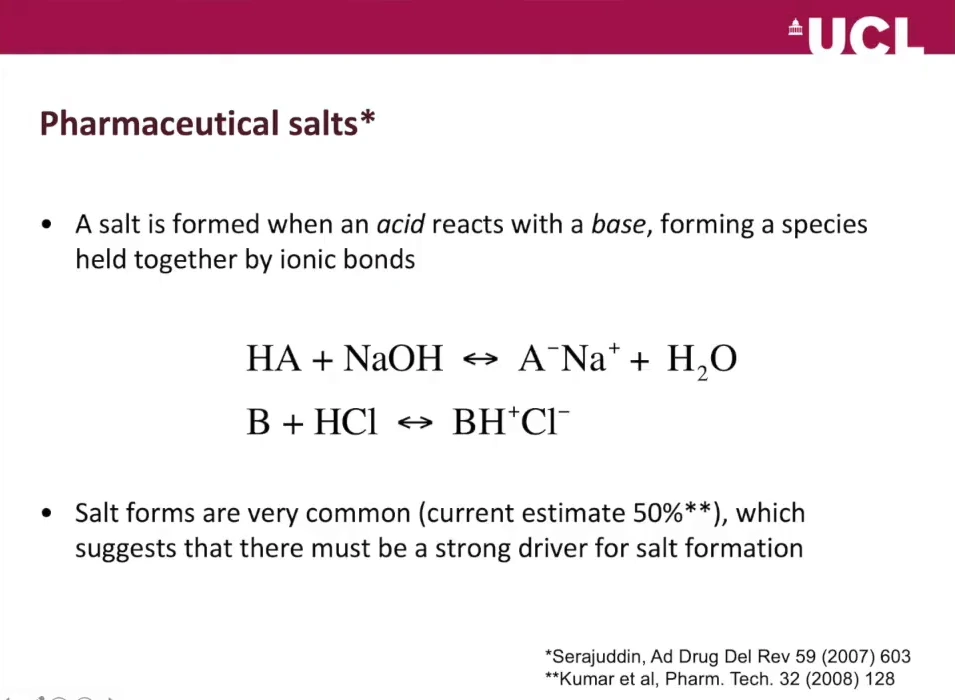

$$
\mathrm{HA} + \mathrm{NaOH} \rightleftharpoons \mathrm{A^-Na^+} + \mathrm{H_2O}
$$

$$
\mathrm{B} + \mathrm{HCl} \rightleftharpoons \mathrm{BH^+Cl^-}
$$

注意两条式子的箭头都是**可逆号**，这一点在第三节会变得非常重要：成盐不是「加进去就 100% 完成」的反应，而是一个平衡。

幻灯片还给了两个数字：盐型非常普遍，当时的估计是**约 50% 的上市药物是盐**（引用 Kumar 等 2008 年的统计），这本身就说明背后有很强的驱动力。

### 1.3 看药盒就能判断：药名 + 成盐剂名

[【跳转到 06:24】](https://www.youtube.com/watch?v=IENbFpXYeyQ&t=384)

判断一个产品是不是盐，最容易的一步是看名字：**药物名后面跟着成盐剂的名字**。

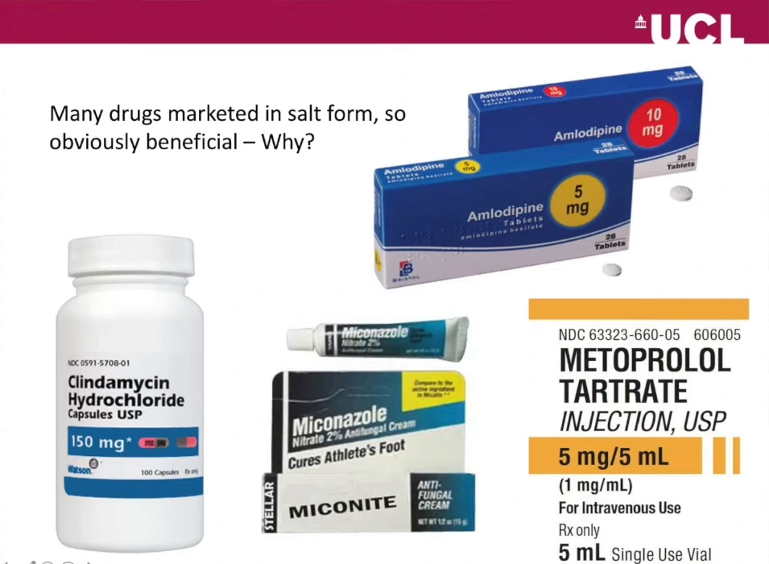

稍微难一点的是判断它是**酸性盐还是碱性盐**——也就是活性成分本身是酸还是碱。讲者给了一条捷径：盐酸盐最常见，而盐酸是酸，所以**能做成盐酸盐的药，本身必然是碱**（例如克林霉素）。其他盐要靠记住常见成盐剂的酸碱性来判断。

为什么要费这个劲？因为**化合物是酸还是碱，绝对决定了它在体内怎么表现**，也决定了后面溶解度曲线长什么样。

## 二、为什么做盐：一张「得」与「失」的对照表

[【跳转到 08:34】](https://www.youtube.com/watch?v=IENbFpXYeyQ&t=514)

讲者把成盐可能改变的性质列成两栏。这张表是本节最值得记住的框架：

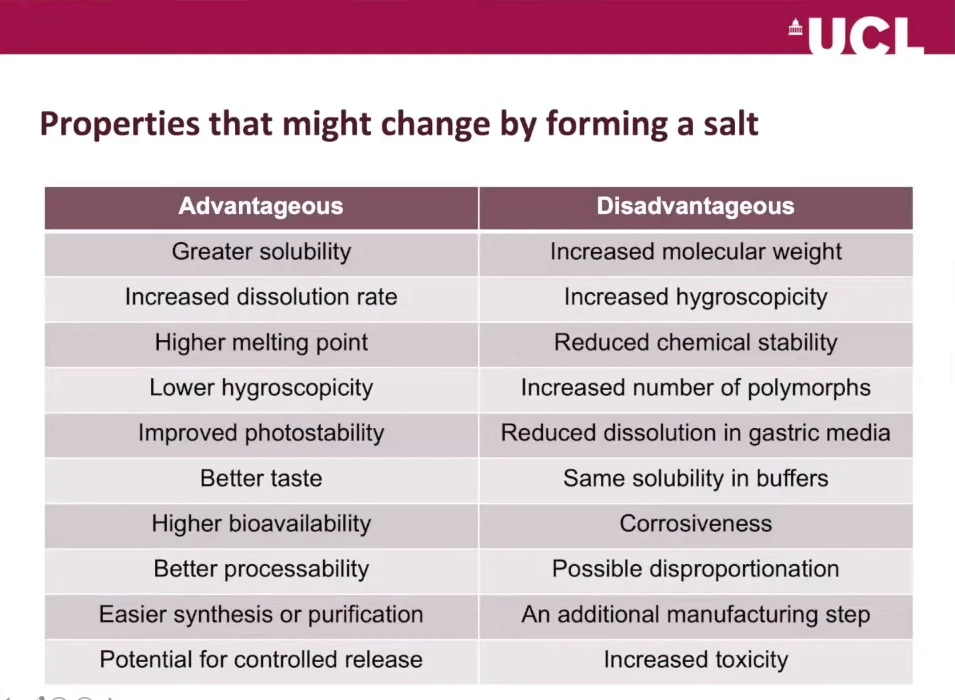

| 有利变化 | 不利变化 |
| --- | --- |
| 溶解度提高 | 分子量增加 |
| 溶出速率提高 | 吸湿性增加 |
| 熔点升高 | 化学稳定性下降 |
| 吸湿性降低 | 多晶型数目增加 |
| 光稳定性提高 | 在胃液中溶出下降 |
| 味道改善 | 在缓冲液中溶解度相同 |
| 生物利用度提高 | 腐蚀性 |
| 可加工性更好 | 可能发生歧化 |
| 更易合成或纯化 | 多一道制造工序 |
| 有可能实现控释 | 毒性增加 |

注意表里有几处「同一条性质出现在两边」：**吸湿性**既可能升高也可能降低，取决于原料本身；**多晶型增加**通常算缺点，但如果你正想挑一个更合适的晶型，它反而是机会。讲者的态度是：盐型没有绝对的好坏，只有「对这个产品是否合适」。

下面挑几条讲者展开讲过的说。

### 2.1 溶解度与溶出速率：离子天生亲水

盐进水后会**解离**，放出带电的离子；水是极性溶剂，离子在水里比中性分子好溶得多。所以成盐常常能救一个水溶性很差的药。溶出速率提高对**速释产品**尤其重要——这就是 Nurofen Express 里「Express」的来源：它是盐型，溶得更快，所以起效更快。

### 2.2 生物利用度：溶解度好 ≠ 能进血液

[【跳转到 11:14】](https://www.youtube.com/watch?v=IENbFpXYeyQ&t=674)

这是讲者反复强调的一个陷阱。盐进水后解离成离子，而**细胞膜是亲脂的，离子化的化合物过不去**。所以很容易设计出一个在实验室水里溶得极好的盐，给到病人身上却进不了血液。

> 补充（非视频内容）：这正是上一节 logD 的用武之地——决定跨膜的是**中性形态的分数**，而不是总溶解度。溶解度解决「药能不能溶出来」，logD 解决「溶出来的药能不能穿过去」，两者是不同的问题。

### 2.3 味道、纯化与控释

- **味道**：盐通常能改善味道，尤其是苦味药物——大多数药都很苦。
- **纯化**：要得到盐型通常要从溶液里结晶，而进入晶体的往往是纯度很高的物质，所以「成盐 + 结晶」本身就是一种纯化手段。
- **控释**：肠道是一根从低 pH 到接近中性的长管，盐在不同 pH 介质里怎么溶解，决定了能不能做出控释。

### 2.4 代价：分子量、吸湿、腐蚀与多晶型

- **分子量增加**：本身不是问题，问题在**高剂量片**。布洛芬片可以做到 600 mg，做成盐后要拿到等效剂量，质量还要往上加，留给辅料的空间更少，配方更难。
- **化学稳定性下降**：多半是因为吸水；如果药物会水解，多余的水进入晶格会让它降解更快。
- **腐蚀性**：盐酸盐解离后相当于一摊强酸，而工厂设备大量使用不锈钢。讲者用 1970–80 年代的车做类比：冬天路上撒盐化冰，盐水溅到底盘，盐是生锈的催化剂，那些车基本锈没了。连氯化钠都这么腐蚀，工厂里用盐当然要小心。
- **多晶型增加**：多一种晶型就多一种要表征、要控制的东西。

## 三、剂量换算：200 mg 与 256 mg 是同一剂量

[【跳转到 04:44】](https://www.youtube.com/watch?v=IENbFpXYeyQ&t=284)

讲者拿出两款英国市售的 Nurofen 产品让学生判断：哪一款的活性成分剂量更高？

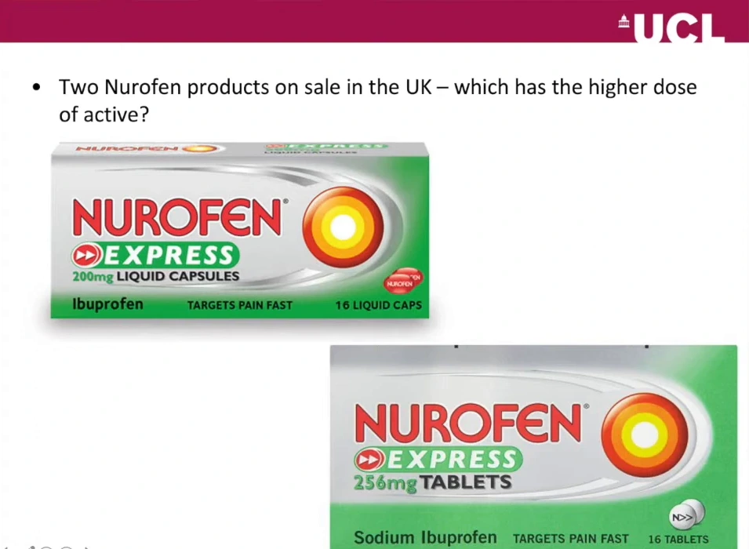

答案是**一样多**。可盒子上写的是 200 mg 和 256 mg，为什么不同？

因为片剂里装的是**布洛芬的钠盐**，那个钠加进了活性成分的分子量里。200 到 256 毫克的差值，本质上反映的是「一个产品含盐、另一个含游离酸」。

> 补充（非视频内容）：这就是盐型换算的基本算式。若游离酸分子量为 $M_{\text{free}}$、盐的分子量为 $M_{\text{salt}}$，则等效剂量为
>
> $$
> m_{\text{salt}} = m_{\text{free}} \times \frac{M_{\text{salt}}}{M_{\text{free}}}
> $$
>
> 反过来，从盐的质量折算游离碱/酸的量，就是乘上换算因子 $M_{\text{free}} / M_{\text{salt}}$。药品说明书上的「相当于某某 10 mg」就是在做这件事。

同一个换算在双氯芬酸凝胶的包装上写得很清楚：**双氯芬酸二乙胺 11.6 mg/g，相当于双氯芬酸钠 10 mg/g（1% w/w）**。

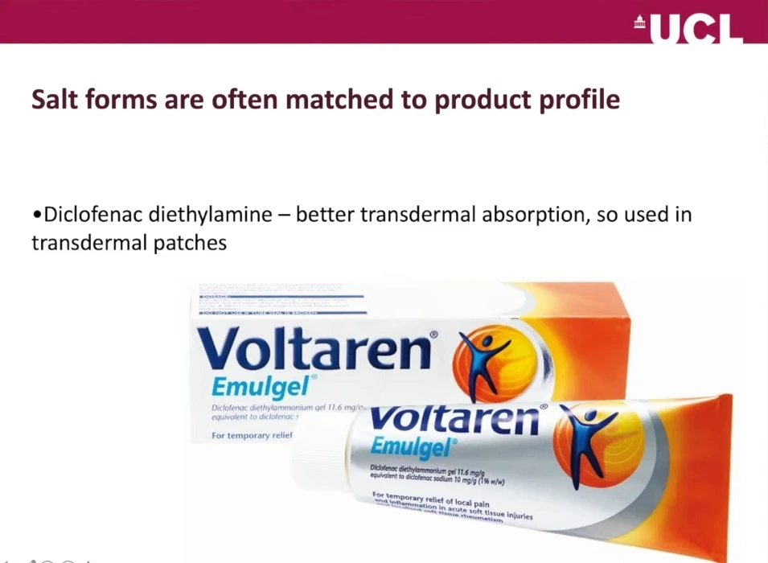

## 四、一个药、三种盐型：盐型要匹配产品定位

[【跳转到 17:53】](https://www.youtube.com/watch?v=IENbFpXYeyQ&t=1073)

双氯芬酸是讲者最爱用的例子：同一个活性成分，三种盐型，对应不同的给药途径与释放行为，原因是**不同盐型的物理化学性质不同**，正好适合不同的产品定位。

**双氯芬酸钾**——速释、快速分散的胃内制剂：

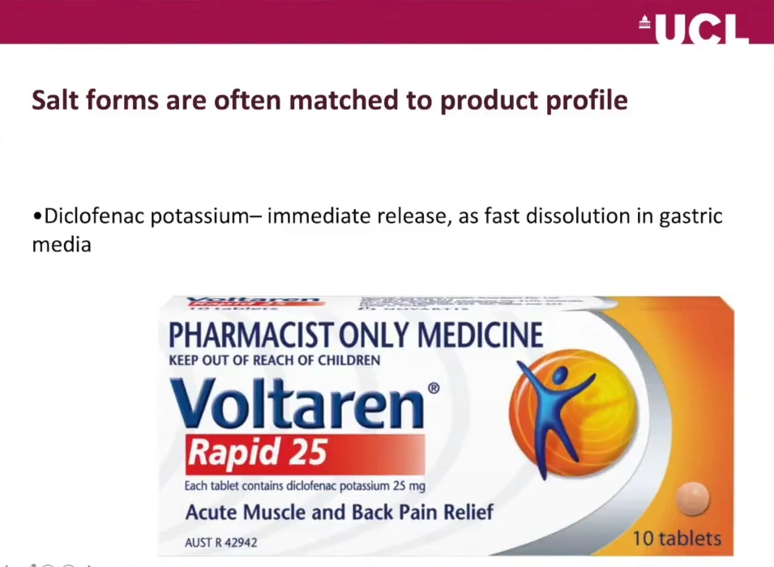

名字里的「Rapid」不是营销词：钾盐在胃介质中分散、溶解得很快，所以做成速释片。

**双氯芬酸钠**——用于**延迟释放**的肠溶片。片子上有一层薄膜包衣，阻止它在胃里溶解，让它到胃肠道更后面、pH 更高的位置才释放，而钠盐在那个 pH 下表现更好。（讲者也提到：钠换钾不是大改动，一种药同时有钠盐和钾盐很常见。）

**双氯芬酸二乙胺**——用于**经皮**给药。肌肉酸痛时涂的凝胶，二乙胺盐比钾盐、钠盐更容易穿过皮肤，所以做成凝胶/贴剂。

> 补充（非视频内容）：这三种盐型的差异，本质上还是上一节 logD 的故事——不同反离子、不同 pH 下，中性形态的分数与亲脂性不同，于是「溶得快」「到肠里再溶」「穿得过皮肤」三种需求分别找到了合适的形态。

## 五、成盐能不能成：pKa 差是硬条件

### 5.1 反应是平衡，所以永远拿不到 100%

[【跳转到 22:52】](https://www.youtube.com/watch?v=IENbFpXYeyQ&t=1372)

很容易以为：把碱性药加进盐酸，反应瞬间完成，得到 100% 的盐。但任何化学反应都是**平衡**，你会得到 95%、99%，不会是 100%。

这在工业上是要花钱的：如果你已经投入大量资金合成出活性成分，最后一步成盐只有 90% 转化率，你就扔掉了 10% 的药。所以选成盐剂时，要尽量把平衡推向盐那一侧。

### 5.2 酸碱强度按 pKa 分档

[【跳转到 26:04】](https://www.youtube.com/watch?v=IENbFpXYeyQ&t=1564)

药典对酸碱强度有定义（欧洲药典与美国药典基本一致）：

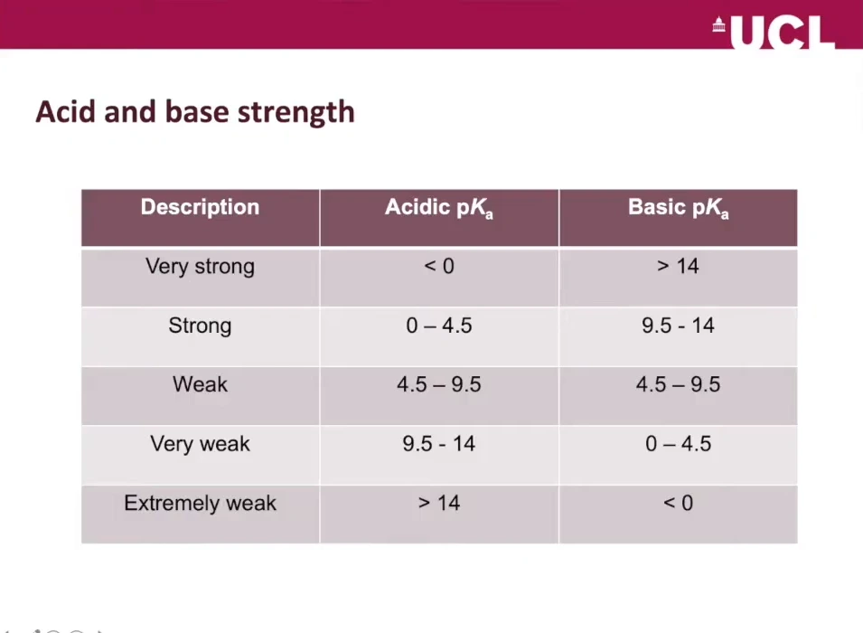

| 描述 | 酸性 pKa | 碱性 pKa |
| --- | --- | --- |
| 极强 | < 0 | > 14 |
| 强 | 0 – 4.5 | 9.5 – 14 |
| 弱 | 4.5 – 9.5 | 4.5 – 9.5 |
| 极弱 | 9.5 – 14 | 0 – 4.5 |
| 极弱至极 | > 14 | < 0 |

讲者的推论很直接：**药物本身几乎总是弱酸/弱碱或更弱**，所以只要选一个「强」或「极强」的成盐剂，pKa 差通常就足够大，成盐反应能走得不错。反过来，用弱或极弱的酸碱去成盐，平衡会偏向起始物，几乎不反应。

> 补充（非视频内容）：讲者顺带吐槽了制药界的一个习惯——每个药只给一个 pKa，于是光看数值无法判断它是酸还是碱。判断酸碱性要看结构（有没有羧基、胺基），pKa 只告诉你「有多强」。

### 5.3 经验法则：ΔpKa ≥ 3 对应约 97%

[【跳转到 27:56】](https://www.youtube.com/watch?v=IENbFpXYeyQ&t=1676)

幻灯片把规则写得很清楚：

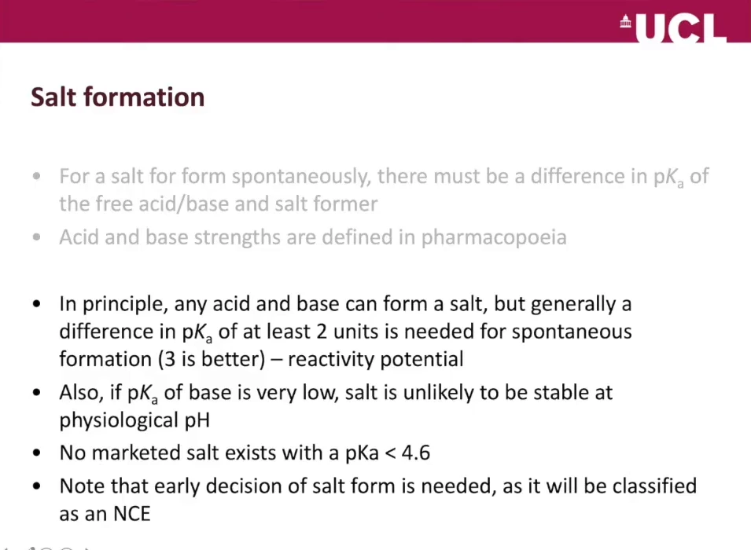

- 原则上任何酸和碱都能成盐，但**自发成盐一般需要 ΔpKa 至少 2，3 更好**——这叫**反应潜力（reactivity potential）**；
- 如果碱的 pKa 很低，盐在**生理 pH 下不稳定**；
- 没有 pKa 低于 4.6 的上市盐型；
- 盐型会被归为 **NCE（新化学实体）**，所以必须尽早决定。

[【跳转到 30:43】](https://www.youtube.com/watch?v=IENbFpXYeyQ&t=1843)

为什么需要这个 pKa 差？讲者给的理由是：它保证**两种物种在溶液里都离子化**。盐靠的是离子相互作用（想想 NaCl 的 Na⁺ 与 Cl⁻），不离子化就不会成盐。由此还有一条方向性规则：

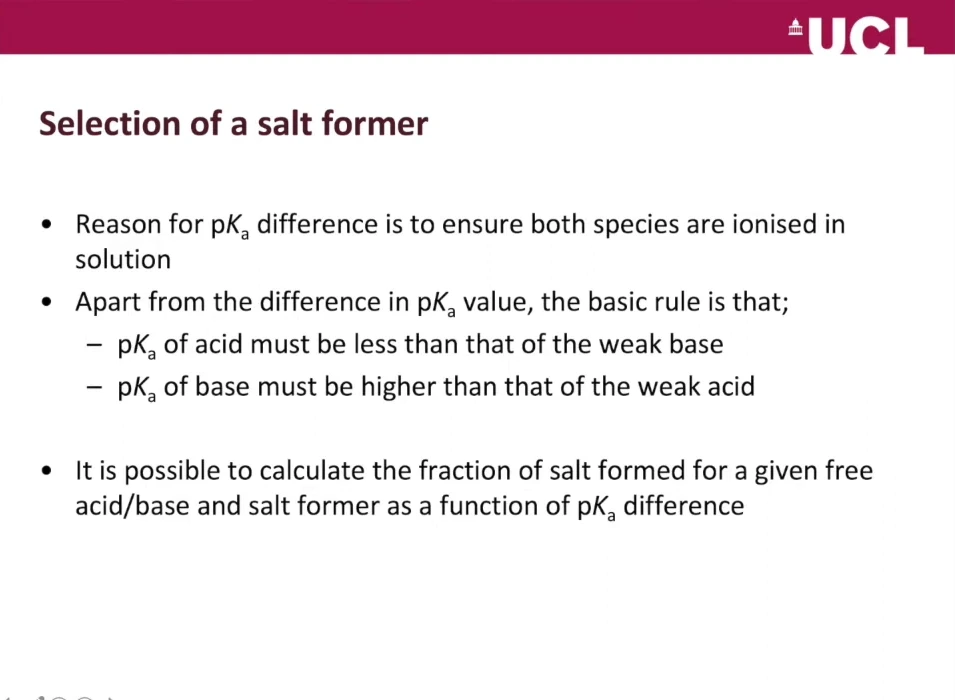

- 用来成盐的**酸的 pKa 必须低于弱碱的 pKa**；
- 用来成盐的**碱的 pKa 必须高于弱酸的 pKa**。

### 5.4 一张图读出收率：ΔpKa 2 → 91%，3 → 97%，4 → 99%

[【跳转到 32:50】](https://www.youtube.com/watch?v=IENbFpXYeyQ&t=1970)

讲者用 Henderson–Hasselbalch 方程算出了「生成盐的百分比」随 pKa 差变化的曲线。以 pKa 7.5 的碱性药物为例：

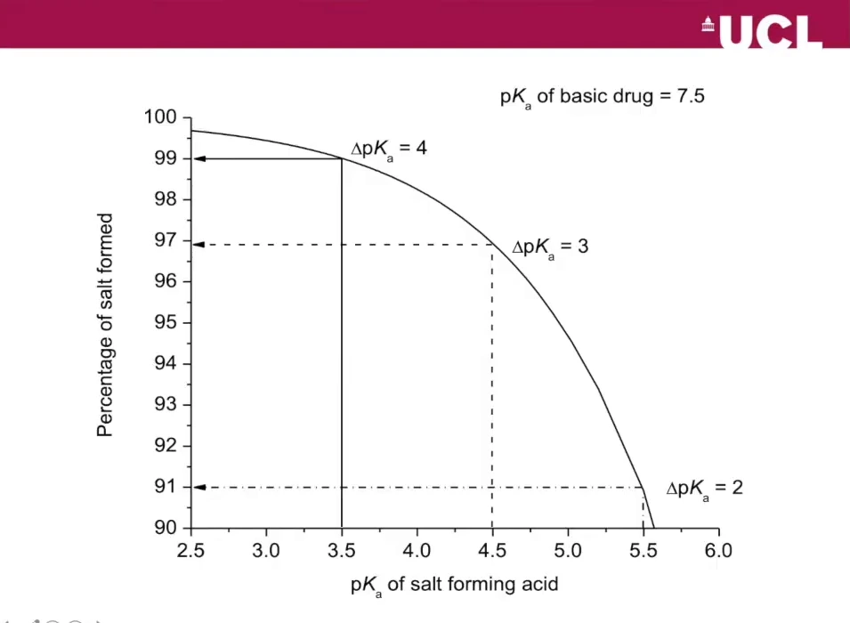

| ΔpKa | 理论最高成盐比例 | 损失 |
| --- | --- | --- |
| 2 | 91% | 约 9% |
| 3 | 97% | 约 3% |
| 4 | 99% | 约 1% |

曲线**永远不会到 100%**，因为它是平衡。所以 99% 差不多是上限。实际中如果用盐酸或氢氧化钠（pKa 差 5、6 以上），转化率远超 99%。

### 5.5 一个反向约束：pKa 太低的碱做不成可用的盐

[【跳转到 28:06】](https://www.youtube.com/watch?v=IENbFpXYeyQ&t=1686)

还有一条容易被忽略的限制：如果碱性药物的 pKa 很低，这个盐在**生理 pH 下不稳定**。原因是体内的 pH 最高约 6.8，往胃肠道下游会降到 1.5 左右，永远不会更高；这样的环境会把盐**推回游离碱**。所以即使你能做出盐，给到病人、在体内溶解后它也会变回游离碱。

讲者的结论是：**没有市售的盐型药物其 pKa 低于 4.6**（讲者口述为 4.8，幻灯片写 4.6），就是这个原因。要用盐型，药物的 pKa 得在 6、7、8 这一带。

## 六、反离子的选择：谁最常用，价态怎么算

### 6.1 盐酸盐与钠盐占据了大半市场

[【跳转到 36:13】](https://www.youtube.com/watch?v=IENbFpXYeyQ&t=2173)

讲者先让学生猜最常用的阴离子和阳离子，然后给出答案：

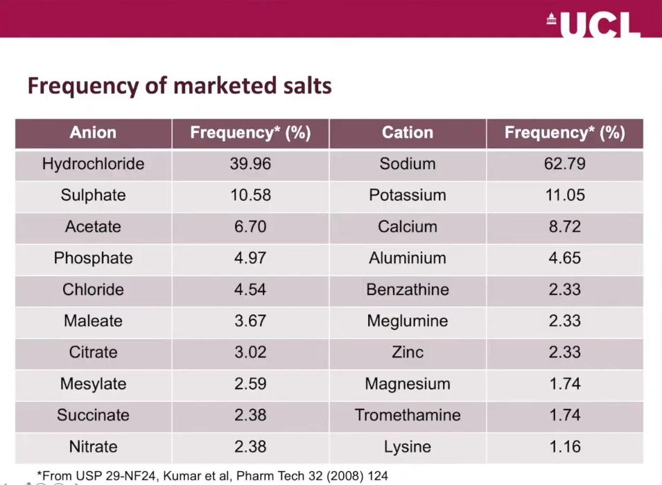

| 阴离子 | 频率 | 阳离子 | 频率 |
| --- | --- | --- | --- |
| 盐酸盐（氯化物） | 39.96% | 钠 | 62.79% |
| 硫酸盐 | 10.58% | 钾 | 11.05% |
| 乙酸盐 | 6.70% | 钙 | 8.72% |
| 磷酸盐 | 4.97% | 铝 | 4.65% |
| 氯化物 | 4.54% | 苯扎托品类 | 2.33% |
| 马来酸盐 | 3.67% | 葡甲胺 | 2.33% |
| 枸橼酸盐 | 3.02% | 锌 | 2.33% |
| 甲磺酸盐 | 2.59% | 镁 | 1.74% |
| 琥珀酸盐 | 2.38% | 氨丁三醇 | 1.74% |
| 硝酸盐 | 2.38% | 赖氨酸 | 1.16% |

阳离子市场基本被**钠、钾、钙**瓜分——讲者提醒，这三种恰好都是体内常见的元素，这不是巧合；其他阳离子（如铝）要有很好的理由才用，因为你不希望铝在体内蓄积。

### 6.2 价态决定化学计量：一价 1:1，二价 2:1

[【跳转到 38:03】](https://www.youtube.com/watch?v=IENbFpXYeyQ&t=2283)

最后一个概念是**价态（valency）**：反离子失去了或得到了几个电子。

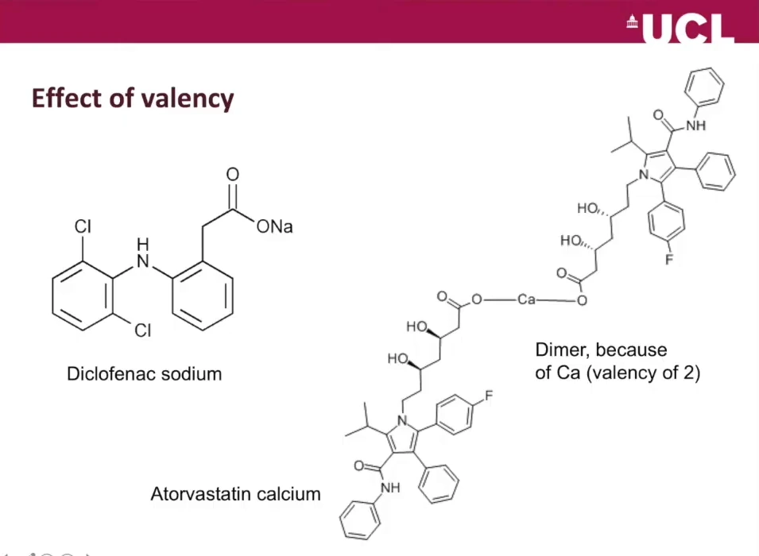

- **双氯芬酸钠**：钠是一价，所以一个钠只带一个药物分子；
- **阿托伐他汀钙**：钙是二价（Ca²⁺），要电中性就必须**两个药物分子**结合到一个钙上，所以阿托伐他汀钙其实是个二聚体，分子量大得多。

讲者说这对片剂里的药物剂量影响不大，但「一个反离子对两个药物分子」这件事在体内可能有后果，心里要有数。

## 七、监管与开发顺序：盐型是新的化学实体

[【跳转到 16:57】](https://www.youtube.com/watch?v=IENbFpXYeyQ&t=1017)

讲者反复强调一条工程上的铁律：**不能把「换个盐型」当成改配方**。

毒性以及各种物理化学性质在做成盐后都会变，而且不同盐型之间也各不相同。所以你必须告知监管机构你打算开发哪一个，而**他们把每一种盐型都视为不同的化学实体**。如果你已经做完大量开发、甚至进了临床试验（用游离酸或游离碱），发现效果不理想再想换盐型——太晚了，得从头再来，会浪费大量资金。

所以盐型的决定必须**尽早做**，这也是幻灯片上把它和「ΔpKa ≥ 2」「没有 pKa < 4.6 的上市盐型」并列的原因。

## 八、这条线索对「样品与建模输入一致」意味着什么

> 补充（非视频内容，属本节归纳）：把上面的机制整理成三条检查项，用于核对数据库记录、样品标签与建模输入是否指向同一个东西。

**第一，数据库里的一条记录，可能只是「某个盐」。** 同一个化合物在 ChEMBL、PubChem 里出现多条记录，常见原因就是游离酸、钠盐、盐酸盐各算一条。它们的分子量、分子式、甚至部分描述符都不同，但化学身份（去掉反离子后的母体）是同一个。

**第二，剂量与浓度换算必须先统一到母体。** 200 mg 与 256 mg 的例子说明：拿盐的质量直接当游离酸的量，会算错 20% 以上。做剂量-反应拟合、配溶液、比较 IC50 时，先把质量换算成母体的摩尔量，再比较。

**第三，建模输入要显式声明「是哪种形态」。** 对接、描述符计算、logD 预测都需要一个确定的结构：是游离碱还是盐酸盐？带不带那个 Cl⁻？如果输入里带着反离子，口袋里的静电与体积都会被污染；如果输入的是中性游离碱，而实验条件是 pH 7.4 的缓冲液，那算出来的性质与测出来的也不是同一件事。

## 小结

- **盐 = 离子靠静电结合成的电中性物质**，晶格里没有分子，只有离子；成盐反应是酸 + 碱 ⇌ 盐 + 水，是**平衡**，拿不到 100%。
- **做盐的首要理由是溶解度与溶出速率**，连带改善味道、纯化、控释与生物利用度；但离子过不了亲脂的细胞膜，溶解度好不等于吸收好。
- **代价清单**：分子量增加（高剂量片空间被挤占）、吸湿、稳定性下降、多晶型增多、腐蚀性、多一道工序、毒性可能上升。
- **剂量必须换算**：200 mg 布洛芬 vs 256 mg 布洛芬钠是同一剂量；换算因子是盐与游离型的分子量之比。
- **盐型要匹配产品**：双氯芬酸钾做速释、钠盐做肠溶、二乙胺盐做经皮。
- **成盐的硬条件是 ΔpKa**：经验上 ≥ 3（97% 转化），≥ 4 到 99%；碱 pKa 太低则盐在生理 pH 下会变回游离碱，所以没有 pKa < 4.6 的上市盐型。
- **反离子市场高度集中**：盐酸盐约 40%，钠盐约 63%；价态决定化学计量（一价 1:1，二价 2:1）。
- **盐型是新的化学实体（NCE）**，必须尽早决定，中途更换等于重做开发。

## 关键术语速查

| 术语 | 一句话解释 |
| --- | --- |
| 盐型（salt form） | 药物离子与反离子靠静电结合成的电中性固体，如盐酸盐、钠盐 |
| 反离子（counterion） | 与药物离子配对、使整体电中性的离子，如 Cl⁻、Na⁺ |
| 成盐剂（salt former） | 用来与药物反应生成盐的酸或碱，如盐酸、氢氧化钠 |
| 反应潜力（reactivity potential） | 由药物与成盐剂的 ΔpKa 决定的成盐倾向，ΔpKa 越大转化率越高 |
| ΔpKa | 成盐剂与药物 pKa 之差；经验上 ≥ 3 可得到约 97% 的盐 |
| 价态（valency） | 反离子所带电荷数；二价反离子会让两个药物分子形成一个二聚体 |
| 吸湿性（hygroscopicity） | 材料从周围环境吸收水分的倾向；强到一定程度会潮解 |
| 潮解（deliquescence） | 固体吸收水分直到把自己溶成溶液的现象 |
| 歧化（disproportionation） | 盐在介质中部分解离、析出游离型的过程 |
| NCE（新化学实体） | 监管上被视为全新分子的物质；换盐型即构成新的 NCE |
| 肠溶（enteric coating） | 用包衣阻止药物在胃中释放、使其在肠道更高 pH 处释放 |
| 前处方（pre-formulation） | 在确定剂型之前，对原料药物理化学性质与稳定性的系统研究 |