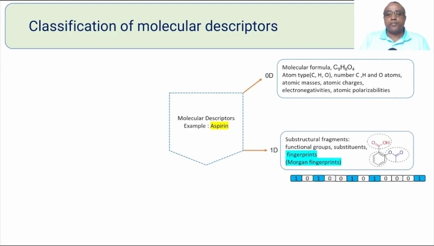
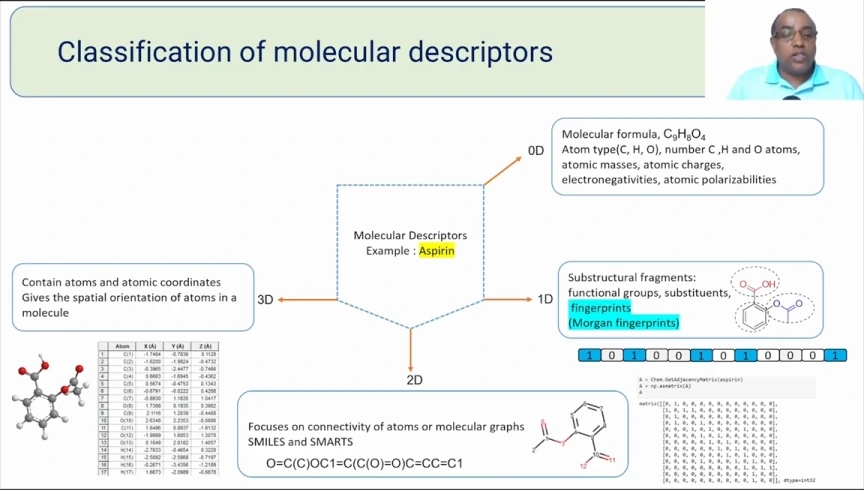
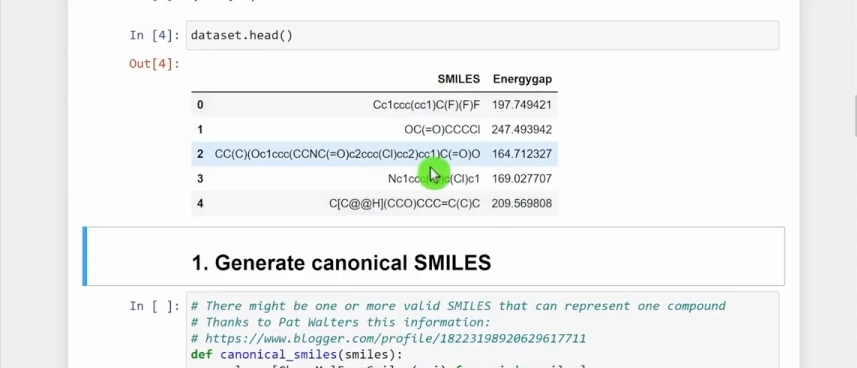
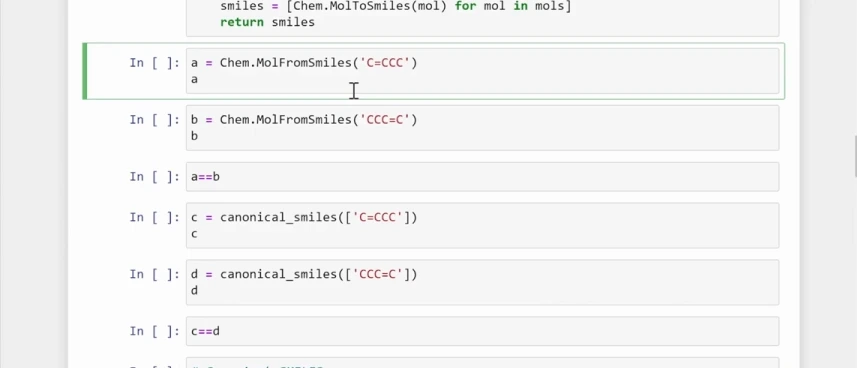
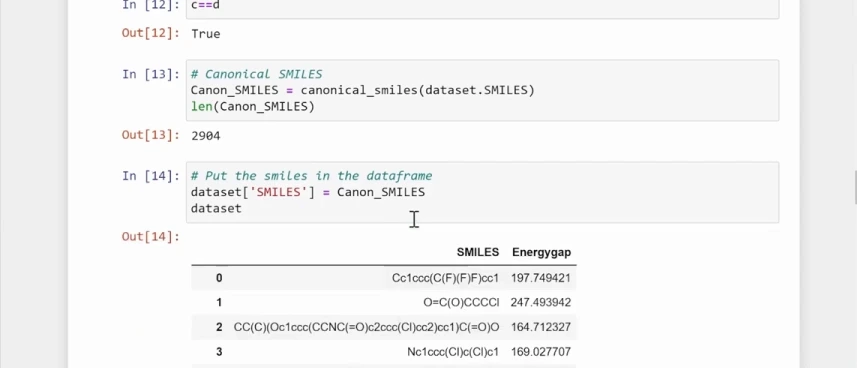
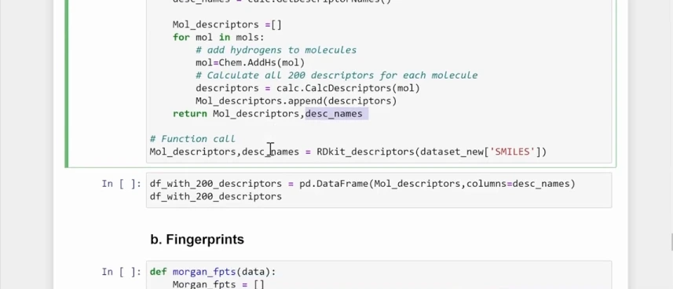
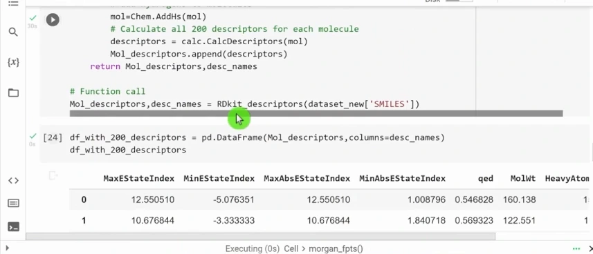
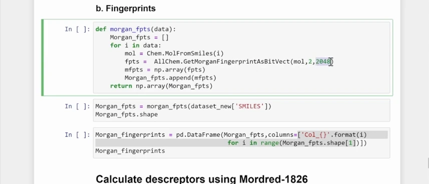
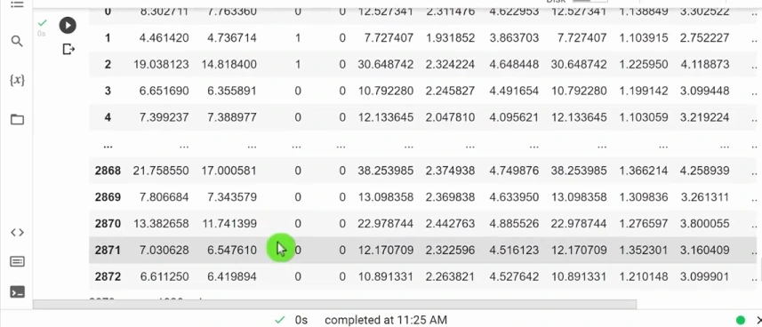
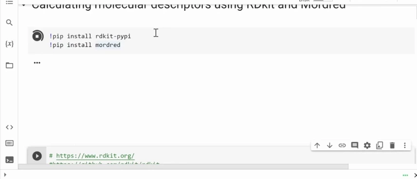

# 从分子到数字：用 RDKit 与 Mordred 计算分子描述符

> 视频来源：[What are molecular descriptors, and how to calculate them using RDkit and Mordred?](https://www.youtube.com/watch?v=9i9SY6Nd1Zw)（YouTube · Machine Learning in Chemistry from Scratch，讲者 Gashaw M. Goshu）｜时长约 24 分 37 秒
> 本篇讲「怎么把分子变成一张数字表格」：描述符按维度怎么分、为什么算之前要先做规范 SMILES 去重、RDKit 的 200 个描述符与 Mordred 的 1826 个描述符分别怎么调用。指纹的位长、位冲突与相似度检索，见同小节的另一篇《分子指纹：位冲突、Tanimoto 相似度与聚类》。

## 本讲要解决的核心问题（SCQA）

**背景**：机器学习模型吃的是数字，而分子是「原子 + 连接关系」的图。要让模型处理分子，第一步必须把结构翻译成数值。

**冲突**：翻译的方式不止一种。有的方式给你几十个有物理意义的数（分子量、原子数），有的方式给你几千个 0/1 位；同一支视频里，讲者用 RDKit 算出约 200 个描述符，用 Mordred 算出 1826 个，而指纹又是另一套 2048 列的表示。选错表示，模型学到的可能只是噪声。

**疑问**：分子描述符到底有哪些类型？它们分别需要什么输入？在真正开始算之前，数据要先做哪些清洗？

**回答（中心思想）**：分子描述符是**按「需要多少结构信息」分层**的一套数值表示——从只用分子式（0D）到需要原子坐标（3D）甚至分子间相互作用（4D），维度越高、信息越多、代价也越大；而无论用 RDKit 还是 Mordred，**算之前都必须先把 SMILES 规范化去重**，否则同一个分子会被当成多条样本重复计入。

---

## 一、描述符就是「用数字代表分子」，目的是喂给模型

讲者给的定义很朴素：**分子描述符（molecular descriptor）就是用数字来表示分子**——我们只是把分子表示成一堆数字。理由也很朴素：计算机擅长处理数字，要让计算机做计算，就得先有数值表示。[【跳转到 00:22】](https://www.youtube.com/watch?v=9i9SY6Nd1Zw&t=22)

这些数字拿去干什么？两类任务：

- **QSAR**（quantitative structure–activity relationship，定量构效关系）：用结构描述符预测**活性**；
- **QSPR**（quantitative structure–property relationship，定量结构-性质关系）：用结构描述符预测**理化性质**。

具体到预测目标，讲者列了溶解度、活性、毒性、收率等等——把描述符当作输入特征，交给机器学习或深度学习模型。[【跳转到 00:50】](https://www.youtube.com/watch?v=9i9SY6Nd1Zw&t=50)

这里有个容易被忽略的定位问题：描述符不是「分子的全部」，而是**你选择让模型看到的那一部分**。选分子量，模型就只知道大小；选指纹，模型就只知道有哪些片段。后面所有关于「描述符好不好用」的讨论，都建立在这个取舍上。

## 二、按维度分五类：需要的信息越多，维度越高

讲者把描述符按**维度**分成五类，分类的依据不是数学维数，而是**算它需要多少结构信息**。[【跳转到 01:38】](https://www.youtube.com/watch?v=9i9SY6Nd1Zw&t=98)



### 2.1 0D：只用到分子式和原子统计

零维描述符处理的是「不涉及连接关系」的量：**分子量**是典型的 0D 描述符；数一数分子里有多少个原子，也算 0D；再比如原子质量、原子电荷等等。

幻灯片上把阿司匹林（分子式 $\mathrm{C_9H_8O_4}$）作为例子，列出的 0D 内容包括：原子类型（C、H、O）、C/H/O 各自的原子数、原子质量、原子电荷、电负性、原子极化率。

这类描述符的好处是**一眼能懂、算得极快**；代价是**完全丢掉了结构**——阿司匹林和任何一个同分子式的异构体，0D 描述符完全一样。

### 2.2 1D：看结构片段，指纹就属于这一层

一维描述符关注**结构片段**：官能团、取代基。讲者仍用阿司匹林举例——它含有一个酸官能团、一个酯官能团、一个芳香环。

关键在于这些片段**可以被编码成 0/1**：某个片段存在就置 1，不存在就置 0，这就是一种二值编码。讲者明确点出，最著名的这类编码是 **Morgan 指纹**（圆形指纹），本节后面会演示怎么算。[【跳转到 02:05】](https://www.youtube.com/watch?v=9i9SY6Nd1Zw&t=125)



这张图把四类描述符并排放在一起，是理解「描述符 vs 指纹」最直观的一帧：**指纹不是描述符之外的另一种东西，它是 1D 这一层里的一种具体编码方式**。区别在于，0D/2D 描述符通常给你一个**连续的数值**（分子量 180.16），而指纹给你一个**很长的 0/1 向量**。

### 2.3 2D：用分子图，邻接矩阵是代表

二维描述符用**分子图**算。讲者举的例子是**邻接矩阵**（adjacency matrix）：它记录「哪个原子和哪个原子成键」，把连接关系编码成矩阵。幻灯片上同时给出阿司匹林的 SMILES 与 SMARTS（`O=C(C)OC1=C(C(=O)O)C=CC=C1`），说明 2D 这一层吃的就是这种「连接关系」信息。

换句话说，2D 描述符**知道谁连着谁，但不知道原子在空间里在哪**。

### 2.4 3D：需要原子坐标，通常要先做几何优化

三维描述符必须有**原子坐标**才能算。讲者指出，量子力学描述符大多属于 3D，因为算它们需要分子的三维结构，通常要先做**能量最小化**和**几何优化**。

幻灯片左下角给了一张带坐标表的 3D 结构（每个原子一行 x/y/z），这就是 3D 描述符的输入形态。代价也很明显：一个分子要先决定用哪个构象，构象选得不对，描述符就跟着偏——这正是同小节《三维构象、构象集合与化学身份的区别》讨论的问题。

### 2.5 4D：把「分子间相互作用」也算进去

最后一类是四维描述符，它**对分子之间的相互作用建模**。讲者的例子是蛋白质-配体相互作用：如果描述符是根据分子间的相互作用算出来的，就归为 4D。[【跳转到 04:10】](https://www.youtube.com/watch?v=9i9SY6Nd1Zw&t=250)

到这里可以看出这条分类轴的本质：**维度越高，描述符越贴近「真实物理情境」，但需要的输入越多、可复现性越依赖前置计算**。0D 拿 SMILES 就能算，3D 得先有构象，4D 还得先有复合物结构。

## 三、算之前先清洗：一个分子只能有一条 SMILES

讲完分类，讲者切到 Jupyter Notebook 开始实操。他用的数据集来自一篇论文，两列：**SMILES 字符串**和对应的 **HOMO-LUMO 能隙**（由密度泛函计算得到），共 **2904 行**。[【跳转到 05:57】](https://www.youtube.com/watch?v=9i9SY6Nd1Zw&t=357)



### 3.1 为什么必须先做规范 SMILES

讲者的第一步不是算描述符，而是**生成规范 SMILES（canonical SMILES）**。原因：一个化合物可能对应不止一条合法 SMILES。

他用一个具体例子演示：`C=CCC` 和 `CCC=C` 描述的是同一个分子（双键位置只是写法不同）。对化学家来说这两个结构是同一个，但计算机比较两条字符串会给出 `False`：



这正是同小节《分子图与 SMILES》里讲的「等价写法」问题在数据清洗上的后果。解决办法是把 SMILES 先读成分子图、再统一写回字符串：

```python
mols = [Chem.MolFromSmiles(smi) for smi in smiles]
smiles = [Chem.MolToSmiles(mol) for mol in mols]
```

经过这一步，`C=CCC` 与 `CCC=C` 都被写成同一条规范 SMILES，两者比较得到 `True`。[【跳转到 09:01】](https://www.youtube.com/watch?v=9i9SY6Nd1Zw&t=541)

### 3.2 去重之后，2904 行变成 2873 行

把规范 SMILES 替换回数据框后，行数暂时没变（还是 2904），但现在**能识别出重复**了。讲者按 SMILES 排序把重复项列出来——有些重复行连能量值都一样。用 `drop_duplicates` 只保留一条之后，行数降到 **2873**。



这一步的意义不只是「少了几行」：如果同一个分子在训练集和测试集里各出现一次，模型评估就会被高估。**去重是后面所有描述符计算的前提**，讲者也明确说，接下来就用这份干净数据算描述符。

## 四、用 RDKit 算约 200 个描述符

RDKit 自带一套描述符。讲者的做法是：先用 `getDescriptorNames()` 拿到**全部描述符的名字**（约 200 个），再对每个分子逐一计算。[【跳转到 13:29】](https://www.youtube.com/watch?v=9i9SY6Nd1Zw&t=809)



代码里有两个值得记住的细节：

1. **先加氢**：`mol = Chem.AddHs(mol)`。很多描述符（尤其涉及氢键、极性表面的）依赖显式氢，SMILES 里的氢默认是隐含的。
2. **用列表推导式批量转换**：`[Chem.MolFromSmiles(i) for i in smiles]`，把整列 SMILES 一次转成分子图，再逐分子算描述符、追加到列表。

最终得到一张 **2873 行 × 200 列**的表，列名就是描述符名：



这张表就是可以直接喂给模型的「分子特征矩阵」。注意列名里既有 `MolWt`（分子量这种一眼能解释的），也有 `MaxEStateIndex`（电性拓扑状态指数这类需要查文档的）——**可解释性在描述符之间差别很大**，这一点在选特征时很重要。

## 五、指纹是另一套表示：半径和位长都是参数

在 RDKit 里也能算分子指纹，讲者选了最常用的 **Morgan 指纹**。他的函数接收 SMILES，逐个转成分子图，然后调用 `GetMorganFingerprintAsBitVect`。[【跳转到 15:57】](https://www.youtube.com/watch?v=9i9SY6Nd1Zw&t=957)



调用里有两个参数必须自己定：

- **半径（radius）**：这里取 2，决定每个原子周围看几圈；
- **位长（bit length）**：这里取 2048，意味着指纹向量有 2048 列。

讲者特意演示了把位长改成 **1024** 再跑一次，理由是**数据可能非常稀疏、很多位都是 0**，缩短向量可以减少这种稀疏。这里埋下了一个后面必须处理的问题：位长变短，不同子结构就可能被挤到同一位上——这就是同小节另一篇要讲的**位冲突**。

把指纹矩阵放进 DataFrame 后，它和描述符表长得一样，都是「一行一个分子」，区别只在列的含义：**描述符的每一列是一个有名字的物理量，指纹的每一列只是一个位的位置**。

## 六、Mordred：1826 个描述符，两三行代码

除了 RDKit，讲者还演示了 **Mordred**——一个专门的描述符计算库，包含 **1826 个描述符**（把 3D 描述符也算进去的话）。[【跳转到 19:08】](https://www.youtube.com/watch?v=9i9SY6Nd1Zw&t=1148)



函数体很短：先用 Calculator 建一个计算器（参数 descriptors 指定要算哪一组，ignore_3D=False 表示连 3D 描述符一起算），把 SMILES 批量转成分子，再调用 calc.pandas(mols) 直接得到数据框。跑完得到 **2873 行 × 1826 列**。

代价是**慢**：讲者在 Colab 上跑 Mordred 花了八九分钟，并说在自己电脑上没这么久。这一点值得记住——描述符数量从 200 涨到 1826，计算成本也跟着涨了一个量级，而多出来的列未必都对预测有用。

## 七、在 Colab 上复现这套流程

最后一段是环境配置，步骤很具体：[【跳转到 21:00】](https://www.youtube.com/watch?v=9i9SY6Nd1Zw&t=1260)

1. 点描述里的链接打开 notebook，先**复制到自己的云端硬盘**（不改原文件）；
2. 打开「运行时 → 更改运行时类型」，讲者建议选 **GPU**；
3. 安装两个包：`pip install rdkit-pypi` 与 `pip install mordred`；
4. 导入 RDKit 与 Mordred，然后可以一格一格跑，也可以直接 **Run all**。



讲者提醒，如果要在自己电脑上跑，需要在 Anaconda 环境里装 Mordred、numpy、pandas 和 RDKit 四个包。

## 小结

- **描述符 = 用数字代表分子**，存在的理由是计算机只能算数字；它的用途是 QSAR/QSPR，以及给机器学习模型提供输入特征。
- **按维度分五类，分类依据是「算它需要多少结构信息」**：0D 只要分子式与原子统计，1D 看官能团片段（指纹属于这一层），2D 用分子图与邻接矩阵，3D 需要原子坐标（常要先做几何优化），4D 还要分子间相互作用。
- **描述符与指纹是两种不同形态的表示**：描述符的每一列是有名字的物理量，维度低、可解释；指纹是一长串 0/1，维度高、列名只是位的位置。两者在 RDKit 里都只是一行函数调用。
- **算之前必须先做规范 SMILES 并去重**：同一个分子有多条合法 SMILES，不统一就会被当成多条样本；本例 2904 行去重后剩 2873 行。
- **规模差异要心里有数**：RDKit 约 200 个描述符，Mordred 1826 个，后者在 Colab 上要跑八九分钟；指纹的位长（2048 或 1024）和半径（2）都是要自己定的参数，位长缩短会带来位冲突的隐患。

## 关键术语速查

| 术语 | 一句话解释 |
| --- | --- |
| 分子描述符 | 用数值刻画分子某一侧面性质的量，如分子量、原子数、极化率 |
| QSAR / QSPR | 定量构效关系 / 定量结构-性质关系，用结构描述符预测活性或理化性质 |
| 0D 描述符 | 不需要连接关系的描述符，如分子量、原子计数、原子电荷 |
| 1D 描述符 | 基于结构片段的描述符，如官能团计数；指纹属于这一层 |
| 2D 描述符 | 基于分子图的描述符，如邻接矩阵导出的量 |
| 3D 描述符 | 需要原子坐标的描述符，通常先做能量最小化与几何优化 |
| 4D 描述符 | 基于分子间相互作用（如蛋白-配体）的描述符 |
| 规范 SMILES | 把同一分子的多种写法统一成同一条字符串，用于去重与比较 |
| Morgan 指纹 | 以每个原子为中心、按半径扩展子结构并哈希到位向量的圆形指纹 |
| 位长 | 指纹向量的位数，决定能容纳多少不同子结构；越短越容易冲突 |
| Mordred | 一个可算 1826 个描述符（含 3D）的 Python 库 |