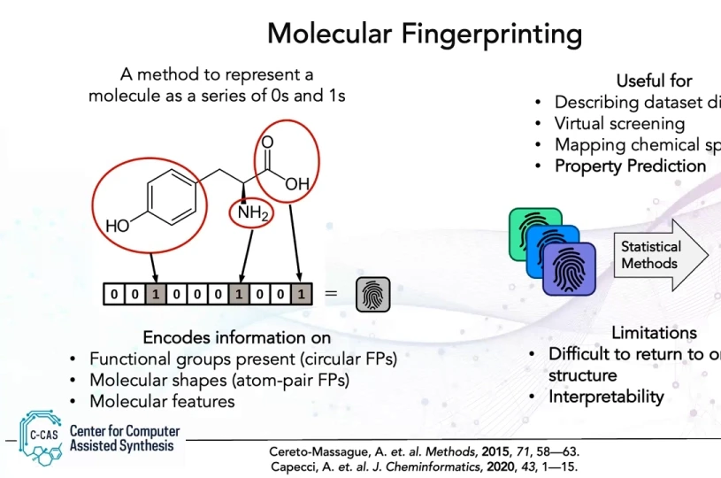
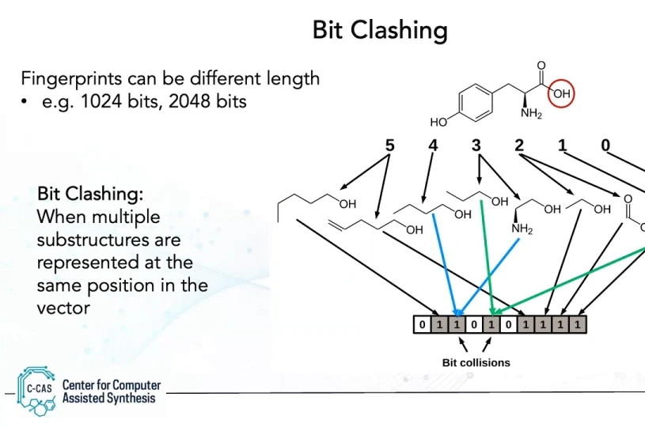
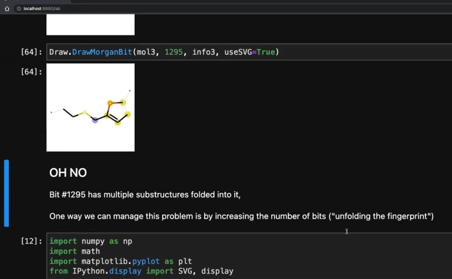
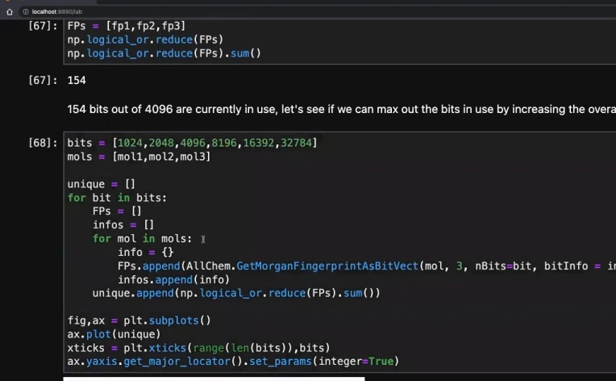
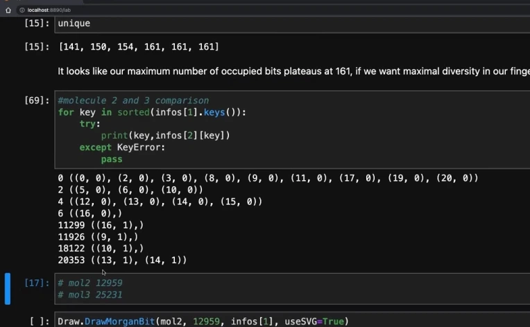
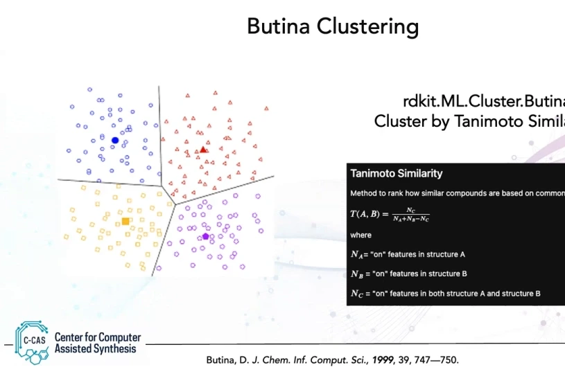
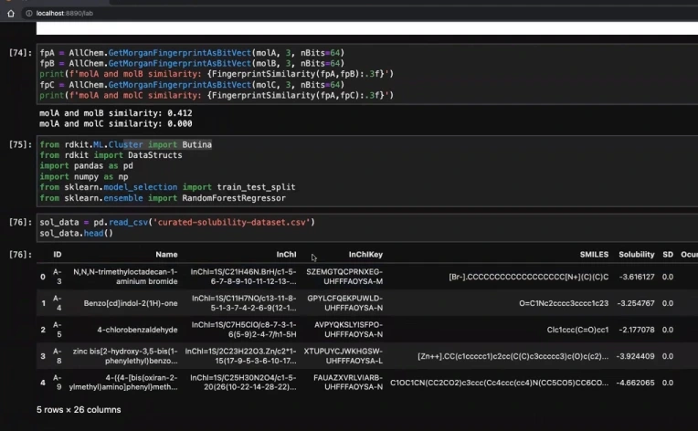
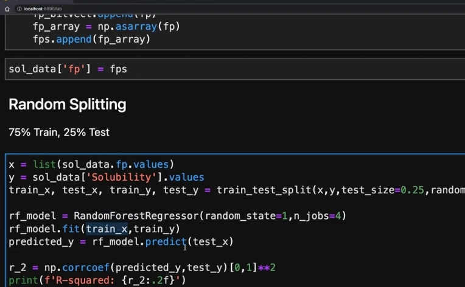
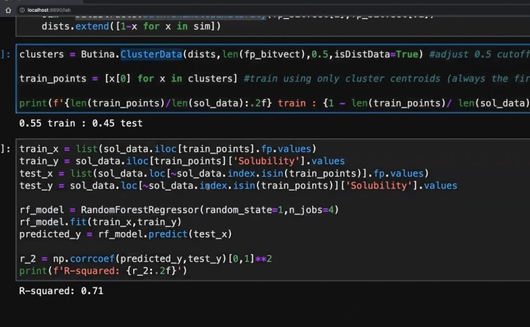

# 分子指纹：位冲突、Tanimoto 相似度与聚类

> 视频来源：[Molecular Fingerprints: Clashing & Clustering](https://www.youtube.com/watch?v=4V7V2GlxOto)（YouTube · Center for Computer-Assisted Synthesis，讲者 Julian，Rob Paton 课题组）｜时长约 19 分 38 秒
> 本篇讲指纹这一侧的表示：0/1 位向量怎么编码子结构、位长不够时会发生什么、Tanimoto 相似度怎么算、以及怎么用相似度做聚类和训练集划分。描述符那一侧（0D–4D 分类、RDKit/Mordred 实操）见同小节的另一篇《从分子到数字：用 RDKit 与 Mordred 计算分子描述符》。

## 本讲要解决的核心问题（SCQA）

**背景**：把分子变成数字最常用的两种方式，一种是描述符（几十到上千个有名字的数值），另一种是指纹（一长串 0/1）。指纹在虚拟筛选、化学空间可视化、性质预测里都用得很广。

**冲突**：指纹看起来很「客观」，但它的两个参数——**位长**和**半径**——是人选的。位长不够时，不同的子结构会被折叠到同一位上（位冲突），分子之间凭空多出「共同片段」；而指纹相似度高，也只说明片段重合，不说明活性一样。

**疑问**：指纹到底编码了什么？位冲突怎么发现、怎么解决？有了指纹之后，怎么算相似度、怎么用它做检索和聚类？

**回答（中心思想）**：指纹是**把子结构哈希进固定长度位向量**的表示，它的分辨率由位长决定；**Tanimoto 相似度只衡量「共同置位的位占全部置位的位的比例」**，因此它天然只能回答「结构像不像」，不能回答「活性是否相同」——用相似度做聚类和训练集划分时，必须把这一点当成前提而不是结论。

---

## 一、指纹是什么：把分子压成一串 0 和 1

讲者 Julian 是 Rob Paton 课题组的四年级博士生，这场教程来自 C-CAS。他给指纹的定义是：**指纹给分子一个唯一的编码**——通常是把分子表示成一串 0 和 1，也就是一种 one-hot 编码的嵌入。[【跳转到 00:30】](https://www.youtube.com/watch?v=4V7V2GlxOto&t=30)



这张总览图把整条链路画清楚了，从左到右读：

- **左边**：分子里的每个官能团（羟基、氨基、羧基、苯环）被圈出来；
- **中间**：这些片段被映射到一个 0/1 向量上，片段存在的那一位写 1，其余写 0，向量就等于这枚分子的「指纹」；
- **右边**：一堆指纹交给统计方法，输出性质或活性。

他讲的是 **Morgan 指纹**，也叫**圆形指纹**（circular fingerprint）：算法会去找特定的官能团、或者某些相连的原子组合，**存在就置 1，不存在就置 0**。[【跳转到 01:06】](https://www.youtube.com/watch?v=4V7V2GlxOto&t=66)

除了官能团，指纹还能编码别的信息。讲者提到 **atom pair 指纹**编码的是「分子形状」——具体说，是**每个原子到其它原子的距离**。也有人做完 one-hot 嵌入之后，把 DFT 算出来的或实验测到的特征接到位向量后面，给分子补充额外信息。

这里有个容易混淆的点值得点明：**指纹的每一位不是「一个数」，而是「某个子结构在不在」**。所以指纹向量的列没有物理单位，列名只是位的位置；这与描述符表里 `MolWt`、`qed` 那种有名字有单位的列完全不同。

## 二、指纹能干什么，代价是什么

讲者列了四类用途，都是化学信息学里的常规操作：[【跳转到 01:41】](https://www.youtube.com/watch?v=4V7V2GlxOto&t=101)

1. **描述数据集多样性**：手上有一个大数据集，想知道结构之间有多相似，或者想引入新结构、看它和现有数据集契合得怎么样；
2. **虚拟筛选**：按指纹里有哪些结构实体，把特定结构筛掉或选出来；
3. **描绘化学空间**：对指纹向量做降维，看分子分布得多开、怎么聚成簇；
4. **性质预测**：直接把按位的指纹当作特征，取一批指纹做统计，再挑一个神经网络或随机森林来预测。

代价他也说得很直接，两条局限：

- **难以还原结构**：有了位向量之后，很难、有时不可能把它还原回原来的分子——因为你已经把分子拆成了碎片；
- **可解释性成问题**：不过这一点也可能反过来变成优点——如果模型里某个位很重要，也许能顺着它看出是哪个官能团在影响你要预测的东西，比如收率或选择性。

## 三、位冲突：位长不够时，不同子结构挤在同一位

这是全片最核心的技术点。讲者先讲前提：对大多数指纹，**位长是你自己选的**，比如要 1024 位还是 2048 位的向量。[【跳转到 04:26】](https://www.youtube.com/watch?v=4V7V2GlxOto&t=266)

**位冲突（bit clashing）**的定义是：当**多个子结构被表示在位向量的同一个位置**上时，就发生了冲突。



这张图把冲突画得很清楚：上方一排结构各不相同的片段（都是醇，但碳链长度、双键位置、是否带氨基都不一样），箭头全部指向下面同一个位。结果是——**它们在这一位上无法区分**。

为什么这是问题？讲者的理由：理想情况下，向量里的每一位应该是它自己独有的子结构，这样才能把它们区分开，因为**它们对你要预测的结果贡献可能不一样**。一旦挤在同一位，模型看到的就是同一个信号。

## 四、展开指纹：加长位向量，直到被占用的位不再增加

发现冲突的过程很直观。讲者拿了两个「比较长的、像药物一样的分子」，生成 **4096 位**的 Morgan 指纹，然后逐位检查。[【跳转到 06:51】](https://www.youtube.com/watch?v=4V7V2GlxOto&t=411)

先验证「同一位 = 同一子结构」这件事是对的：第 **2136** 位在两个分子里对应的都是同一个子结构，只是朝向略有不同——这是正常情况。

再引入第三个分子，问题出现了：第 **1295** 位在分子二里对应一个子结构，在分子三里对应的却是**另一个**子结构。



讲者的判断是：这两个片段结构上有点像，也能猜到算法为什么这么编码，但它们**并不是同一个结构**——这就是位冲突。[【跳转到 10:33】](https://www.youtube.com/watch?v=4V7V2GlxOto&t=633)根本原因是**位数不够，装不下所有的结构多样性**。

解决办法叫**展开指纹（unfolding）**：把位向量加长。具体做法是用 numpy 的**逻辑或**把所有指纹按位合并，数一数一共用到了多少位：[【跳转到 12:17】](https://www.youtube.com/watch?v=4V7V2GlxOto&t=737)

```python
FPs = [fp1, fp2, fp3]
np.logical_or.reduce(FPs).sum()   # 154
```

4096 位里只用到 **154** 位。于是他把位长从 1024 一路试到 32784，看「被占用的位数」怎么变化：



结果是一条**先上升、后进入平台期**的曲线：



讲者的读法是：到 **161 位被占用**时基本达到最大值，意味着不该再有位冲突了，每个被编码的子结构都该有自己独有的位置——这对应 **8192 位**的向量。

验证一下：原来冲突的第 1295 位，现在对分子二落在 **12959** 位，对分子三落在 **25231** 位，两者分开了。讲者的结论是「我们展开了指纹，每一位现在都唯一表示一个子结构」。

这里的方法论值得单独记住：**「被占用的位数」是一个可以测量的诊断量**。如果加长位向量之后占用位数还在涨，说明还在冲突；涨到平台，说明分辨率够了。这比凭感觉设 2048 要可靠。

## 五、Tanimoto：用「共同置位的位」算相似度

有了指纹，就能算分子之间的相似度。讲者用的是 **Tanimoto 相似度**，幻灯片上给出的定义是：[【跳转到 06:11】](https://www.youtube.com/watch?v=4V7V2GlxOto&t=371)

$$
T(A,B) = \frac{N_c}{N_A + N_B - N_c}
$$

其中 $N_A$ 是结构 A 中「置位（on）」的特征数，$N_B$ 是结构 B 中置位的特征数，$N_c$ 是 A 和 B **共同置位**的特征数。[【跳转到 14:01】](https://www.youtube.com/watch?v=4V7V2GlxOto&t=841)



这个公式其实就是集合的 Jaccard 系数：分子写成「置位的位的集合」之后，分子是交集大小，分母是并集大小（$N_A + N_B - N_c$ 正好把交集数了两次的部分减掉一次）。

讲者用三个分子做演示：分子 a 和 b 有一些共同子结构，分子 c 和这两个都没有共同子结构。



结果是 **a 与 b 相似度 0.412**，**a 与 c 相似度 0.000**。他还补了一个归一化的检验：把同一个分子输入两次，位完全相同，相似度应当是 **1**。

这三个数（0、0.412、1）正好标出 Tanimoto 的取值范围和含义：**0 表示没有任何共同置位，1 表示完全一致**。注意 0.412 这个数本身没有绝对意义——它高不高，取决于你用什么指纹、什么位长、以及你的任务。

## 六、用相似度做检索与聚类：Butina 与训练集划分

### 6.1 Butina 聚类

讲者在 GSK 实习时接触到一个用法：给几十万个分子生成指纹，然后用 **Butina 聚类**（已实现在 RDKit 的 `rdkit.ML.Cluster.Butina` 里）按 Tanimoto 相似度把分子聚成簇。[【跳转到 05:45】](https://www.youtube.com/watch?v=4V7V2GlxOto&t=345)

思路很朴素：**如果两个分子有很多相同的位，它们就相似**；有共同官能团的分子，Tanimoto 相似度往往就高。于是可以用相似度把分子连成簇，再从簇里采样。

他在 notebook 里对约 **10000** 个分子（y 值是溶解度）算了指纹，然后按两种方式划分训练/测试集。[【跳转到 15:36】](https://www.youtube.com/watch?v=4V7V2GlxOto&t=936)

### 6.2 两种划分方式的对比

**第一种：随机划分**，75% 训练、25% 测试，用随机森林回归，**只用指纹当特征**：



得到的 $R^2$ 是 **0.68**。讲者的评价是：只用这些 0 和 1 当特征，这个结果不算差。

**第二种：先聚类再划分**。先算每个分子和数据集里其它分子的相似度，用 Butina 以 **0.5 的 cutoff** 聚成簇，然后**只取每个簇的中心点（centroid）当训练集**：



这样得到 **55% 训练、45% 测试**，再跑同一个随机森林，$R^2$ 是 **0.71**。

讲者的解读是：和随机划分差不多、略好一点，**但我们用的训练数据更少**，所以这很有价值——它是一种基于指纹的聚类方法，可以用来筛选、组织你的训练集。

### 6.3 这个对比真正说明了什么

表面上看是「聚类划分不比随机划分差」，但更值得注意的是它暴露的风险：**随机划分会让高度相似的分子同时出现在训练集和测试集里**。模型在测试集上遇到的其实是它训练时见过的结构的近邻，$R^2$ 自然偏高。按簇划分把整个簇分到一边，才更接近「预测一个真正没见过的化学型」的场景。

这也解释了为什么讲者要强调「只用簇心训练」：簇心代表一个簇，用它训练相当于每个化学型只留一个代表，剩下的同簇分子全部进测试集。

## 七、相似不等于活性相同：指纹能回答什么，不能回答什么

这一节把前面所有内容收束成一句判断：**Tanimoto 相似度衡量的是「指纹位向量重合的程度」，不是「活性接近的程度」**。理由可以完全从视频里推出来：

1. **指纹只记录片段在不在**。位冲突那一段已经证明，同一位可能对应不同子结构；反过来，两个分子可以在很多位上重合，却在某个关键位置上不同——而那个位置可能恰恰决定活性。
2. **相似度高只说明「像」，不说明「一样」**。讲者的 a/b 相似度 0.412、a/c 为 0，说明这个数只反映共同片段的比例。
3. **相似度会被用来划分数据，从而影响你对模型性能的判断**。随机划分得到 0.68、按簇划分得到 0.71，两个数都不能直接读成「模型能预测新分子的活性」——前者偏乐观，后者才是更严格的估计。

**补充（非讲者原话）**：化学信息学里把「结构极相似、活性差很多」的现象称为**活性悬崖（activity cliff）**。它是指纹方法的结构性盲区：一对只差一个取代基的分子，Tanimoto 可能高达 0.9，但一个 IC50 是纳摩尔、另一个是微摩尔。所以用相似性搜索做虚拟筛选时，正确的读法是「**这些分子值得优先测**」，而不是「这些分子活性一定好」。同理，**骨架跃迁（scaffold hop）**——活性相似但骨架完全不同的化合物——会被指纹判为「不相似」而漏掉，这也是相似性检索召回不全的常见原因。

一句话：**相似性假设（similar property principle）是一个工作假设，不是一条定律**。它可以用来排序、聚类、挑候选，但最终必须由实验读数来裁决。

## 小结

- **指纹 = 把子结构哈希进固定长度位向量**：某片段存在就置 1，不存在置 0；Morgan（圆形）指纹编码官能团，atom pair 指纹编码原子间距离，还可以把 DFT 或实验特征接到位向量后面。
- **指纹的用途**是描述数据集多样性、虚拟筛选、描绘化学空间、当性质预测的特征；代价是**难以还原结构**、可解释性有限。
- **位冲突的根源是位长不够**：多个子结构被折叠到同一位，分子之间凭空多出「共同片段」；诊断办法是数「逻辑或之后被占用的位数」，加长位长直到这个数进入平台（本例 4096 → 8192，占用位 154 → 161）。
- **Tanimoto 相似度 = 共同置位数 / 并集置位数**，取值 0 到 1；本例 a 与 b 为 0.412，a 与 c 为 0，自身与自身为 1。
- **相似度可以拿来做检索、聚类和训练集划分**：Butina 按 Tanimoto 聚簇，用簇心训练（55/45 划分）得到 $R^2$ 0.71，与随机划分（75/25）的 0.68 相当，但用的数据更少，且更接近「预测新化学型」的真实场景。
- **相似不等于活性相同**：指纹只看片段重合，活性悬崖与骨架跃迁都是它的盲区；相似性检索的结果应当被当作「优先测试的候选」，而不是「活性结论」。

## 关键术语速查

| 术语 | 一句话解释 |
| --- | --- |
| 分子指纹 | 把分子编码成固定长度 0/1 向量的表示，每一位对应一类子结构 |
| Morgan / 圆形指纹 | 以原子为中心按半径扩展子结构并哈希到位向量的指纹 |
| atom pair 指纹 | 用原子对及其拓扑距离编码分子形状的指纹 |
| 位长（bit length） | 指纹向量的位数，决定能区分多少种不同子结构 |
| 位冲突（bit clashing） | 多个不同子结构被折叠到位向量同一位的现象 |
| 展开（unfolding） | 加长位向量，让冲突的子结构落到不同位上 |
| 置位（on bit） | 指纹中取值为 1 的位，代表某个子结构存在 |
| Tanimoto 相似度 | $N_c/(N_A+N_B-N_c)$，共同置位数除以并集置位数，取值 0 到 1 |
| Butina 聚类 | 按 Tanimoto 相似度阈值把分子聚成簇的算法，RDKit 有实现 |
| 簇心（centroid） | 一个簇的代表分子，常用作该簇的训练样本 |
| 活性悬崖 | 结构极相似但活性差异很大的分子对，是指纹相似性的盲区（补充概念） |
| 骨架跃迁 | 骨架不同但活性相近的化合物，指纹容易判为不相似（补充概念） |