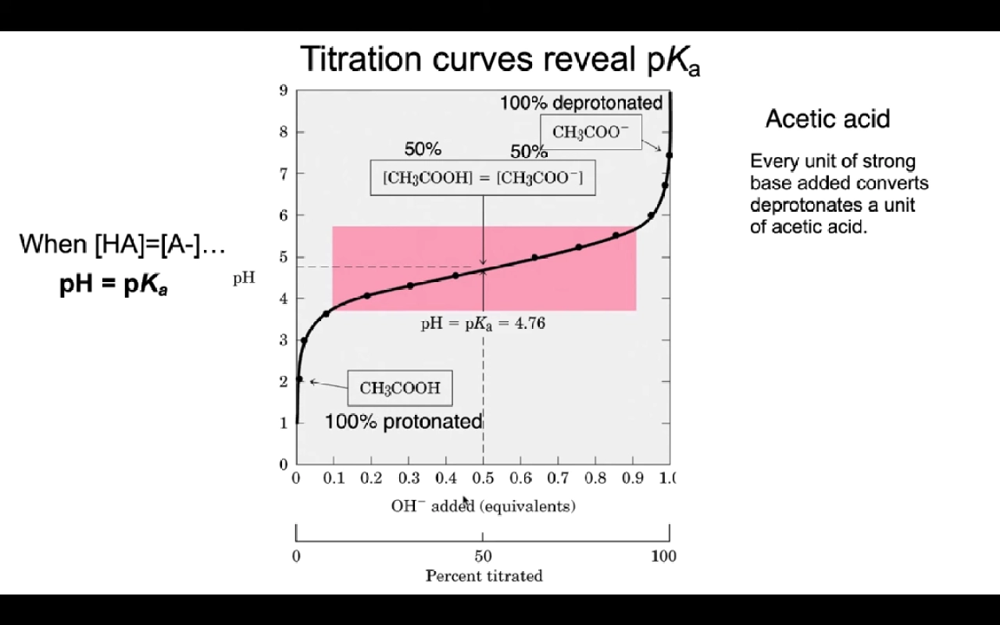
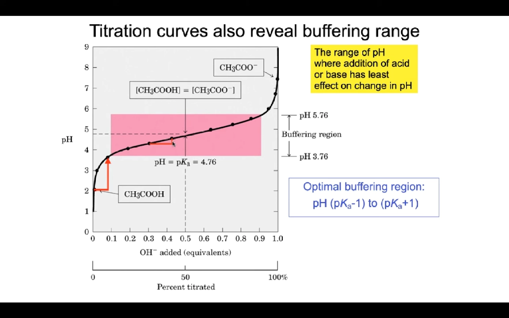
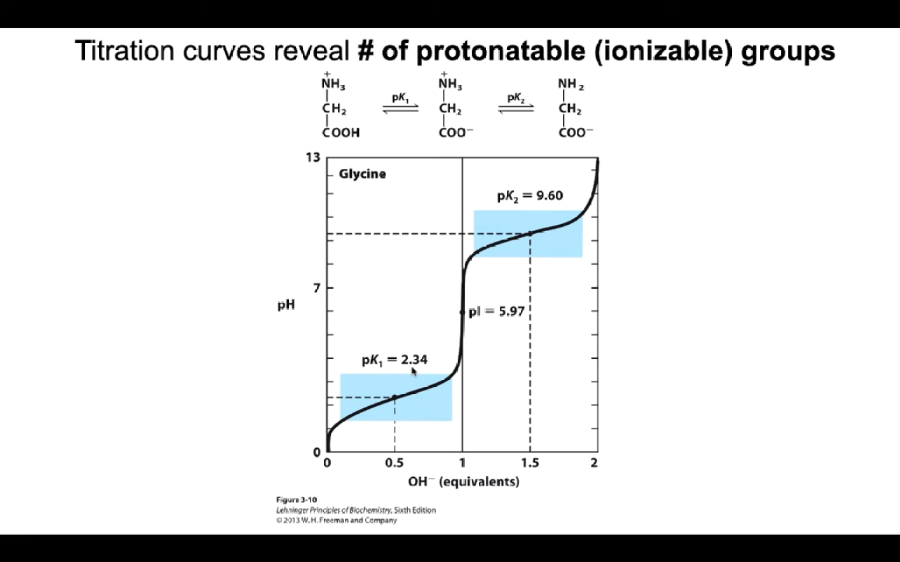
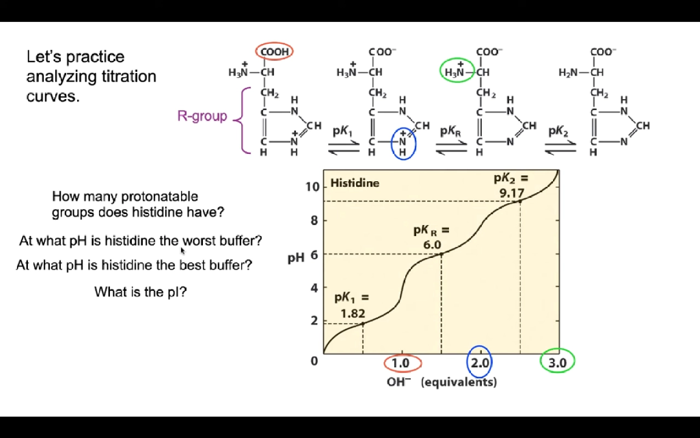
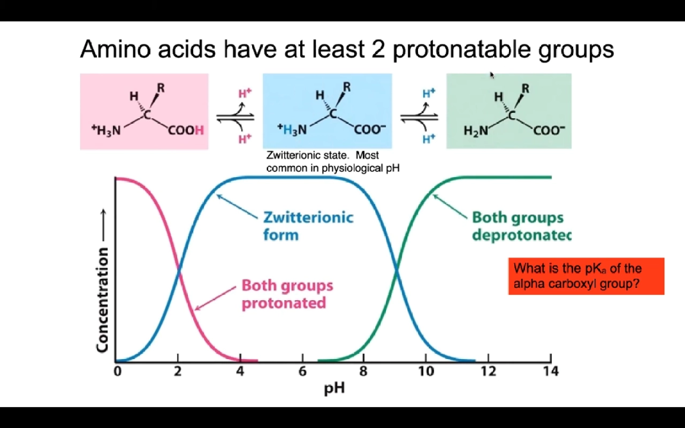
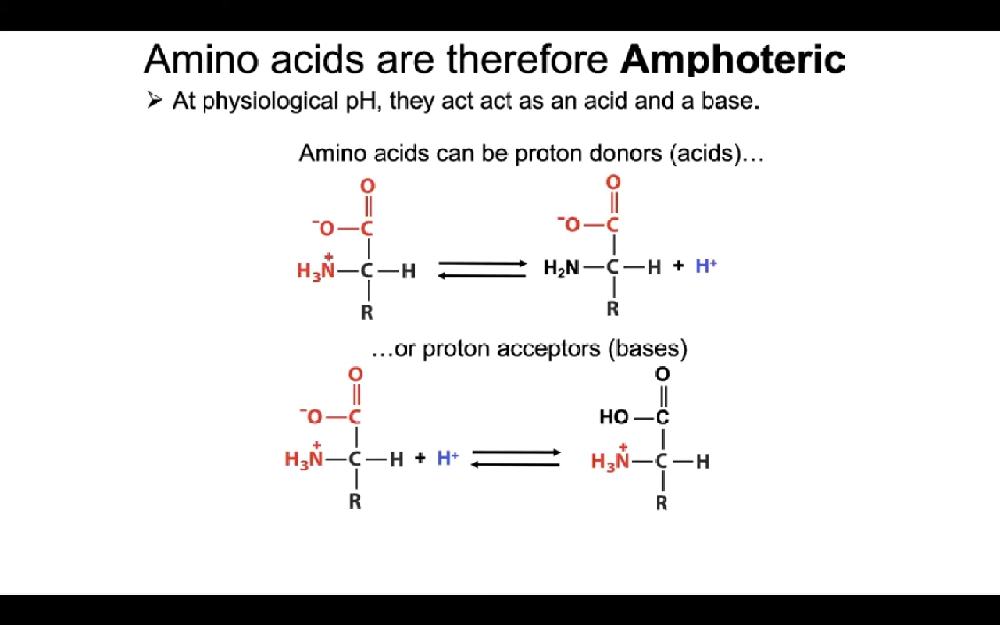
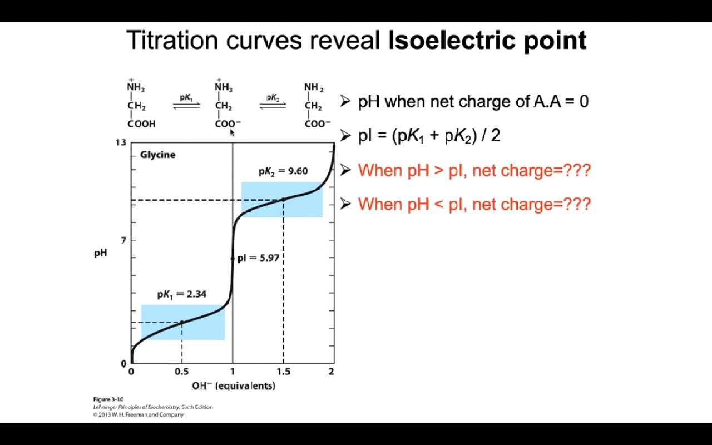
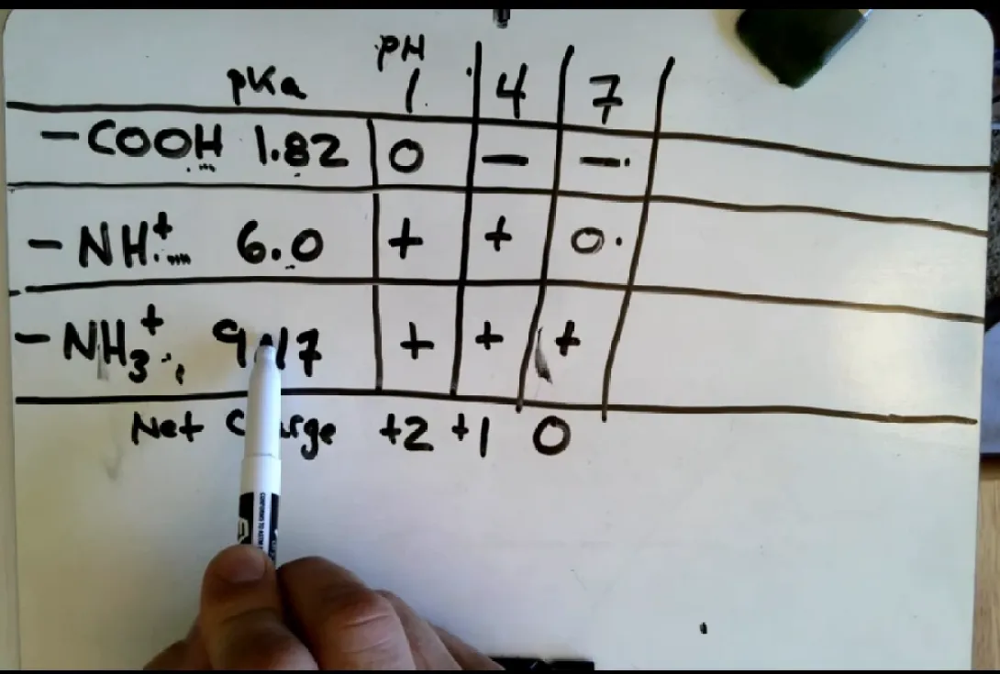
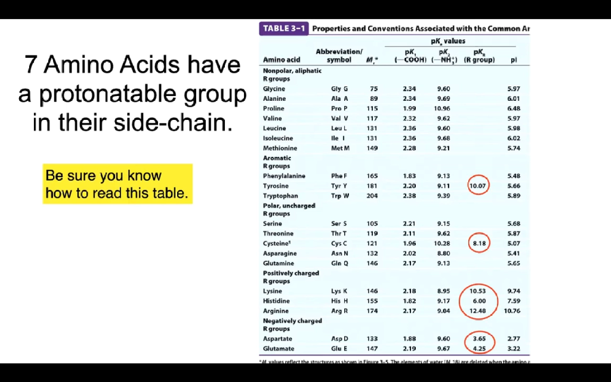
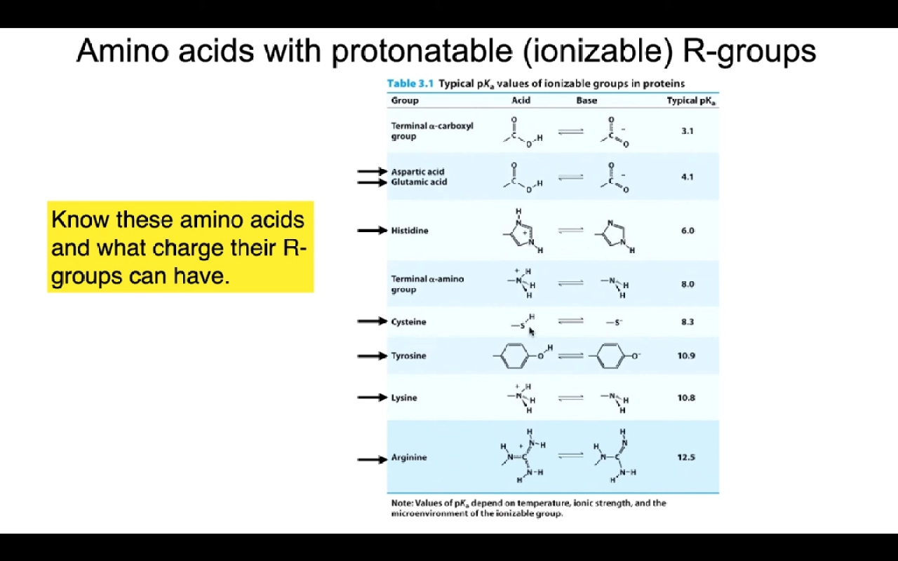

# 一条滴定曲线能读出三件事：pKa、缓冲区间与等电点

> 视频来源：[Titration curves, pKa, pI, and Buffering regions](https://www.youtube.com/watch?v=6L1VulMjedI)（YouTube · Bialecki Biology）｜时长约 31 分钟
> 导读：上一节用 Henderson–Hasselbalch 把 pH、$pK_a$ 和酸碱比例连起来，前提是「你已经知道 $pK_a$」。这一节反过来：**在不知道 $pK_a$ 的情况下，怎么用一条滴定曲线把它读出来**，并顺势读出另外三件事——分子有几个可电离基团、在哪个 pH 最好缓冲、净电荷何时为零（等电点）。讲者以乙酸和甘氨酸、组氨酸为例，一步步演示读图。本文按「造曲线 → 读 $pK_a$ → 数基团 → 定等电点 → 查表」重排，末尾补一段药物分子的用法（已标明为补充）。

## 本讲要解决的核心问题（SCQA）

**背景**：$pK_a$ 是可查、可比的数，也是判断「某个基团在给定 pH 下带不带电」的唯一输入。上一节还给出了定量关系：$pH = pK_a + \log\frac{[\mathrm{A^-}]}{[\mathrm{HA}]}$。

**冲突**：但面对一个新分子——一条新合成的肽、一个刚拿到的候选化合物、一个查不到数据的蛋白侧链——你手上并没有 $pK_a$。而且即便查得到，不同来源的数值也可能相差零点几个单位，因为它们对应的离子强度、温度、微环境不同。只靠查表，遇到新分子就卡住了。

**疑问**：有没有一种实验，能**一次**把「有几个可电离基团、每个的 $pK_a$ 是多少、在哪个 pH 缓冲最好、净电荷何时为零」全部读出来？

**回答（中心思想）**：有，就是**滴定曲线**。把分子放在低 pH 下全部质子化，再一步步加碱、每一步测 pH，得到的曲线自带四个读数：**半当量处的 pH 就是 $pK_a$**；**平坦段就是缓冲区间的中心与宽度（$pK_a \pm 1$）**；**曲线上的台阶数等于可电离基团的个数**；**净电荷为零的那个 pH 就是等电点 $pI$**，对只有两个基团的分子，它正好是两个 $pK_a$ 的算术平均。

## 一、滴定曲线是怎么造出来的

### 1.1 从「100% 质子化」出发，一步步加碱

[【跳转到 02:55】](https://www.youtube.com/watch?v=6L1VulMjedI&t=175)

以乙酸为例。乙酸是弱酸，酸性基团是羧基。**正因为它是弱酸，直接丢进生理 pH 的溶液里它不会完全去质子化**，所以滴定必须从「全部质子化」的状态出发：

1. 把乙酸溶在 pH 很低的溶液里，保证 100% 处于质子化状态（$\mathrm{CH_3COOH}$）；
2. 每次加入 0.1 个当量的强碱，测一次 pH；
3. 以「加入的强碱当量」为横轴、「pH」为纵轴作图。

曲线的两端是确定的：**起点 100% 质子化，终点（1 个当量）100% 去质子化**。中间的过程就是「每加一份碱，就有一份乙酸交出质子」。

### 1.2 曲线为什么是「陡—平—陡」

曲线形状分三段，每一段对应一种状态：

- **起点附近很陡**：溶液里几乎没有共轭碱，加一点碱 pH 就跳——没有缓冲；
- **中间很平**：弱酸与共轭碱同时大量存在，加碱主要改变两者比例，pH 几乎不动——这就是缓冲；
- **终点附近又变陡**：弱酸被耗尽，再加碱就是往水里加强碱。

这个形状不是乙酸特有的，**所有弱酸的滴定曲线都长这样**，差别只在平坦段落在哪个 pH 上。

## 二、第一件事：半当量处的 pH 就是 $pK_a$

### 2.1 判据：$[\mathrm{HA}] = [\mathrm{A^-}]$ 时 $pH = pK_a$

[【跳转到 02:55】](https://www.youtube.com/watch?v=6L1VulMjedI&t=175)

半当量处，恰好一半分子质子化、一半去质子化，即 $[\mathrm{HA}] = [\mathrm{A^-}]$。代进 Henderson–Hasselbalch：

$$
pH = pK_a + \log_{10}\frac{[\mathrm{A^-}]}{[\mathrm{HA}]} = pK_a + \log_{10} 1 = pK_a
$$

所以读法只有一步：**在半当量处向上作垂线交到曲线，读出的 pH 就是 $pK_a$**。乙酸的这个值是 **4.76**。

讲者强调这一步的普适性：不管分子多复杂，只要能在曲线上找到「一半去质子化」的位置，就能读出对应的 $pK_a$。

### 2.2 平坦段就是缓冲区间：$pK_a \pm 1$

[【跳转到 05:15】](https://www.youtube.com/watch?v=6L1VulMjedI&t=315)

曲线最平的那一段，就是缓冲效果最好的区间。乙酸的例子：

- 在 pH 接近 2 时加 0.1 当量碱，pH 会从 2 跳到接近 4，**动了两个多单位**；
- 在 pH 4 附近加同样多的碱，**pH 只升高不到 0.15 个单位**。

这个平坦段**以 $pK_a$ 为中心**，上下各延伸一个单位：乙酸的缓冲范围是 **pH 3.76–5.76**。超出这个范围，曲线重新变陡，缓冲能力等于被破坏。

讲者在这里留了一个思考题：**为什么缓冲容量在 $pH = pK_a$ 时最大？**（上一节从「10 倍比例偏移 1 个单位」的角度回答过；严格的回答需要缓冲容量的微分定义，属于补充内容。）

## 三、第二件事：数一数分子有几个可电离基团

### 3.1 一个基团一个当量，两个基团两个当量

[【跳转到 11:50】](https://www.youtube.com/watch?v=6L1VulMjedI&t=710)

乙酸只有一个可交出质子的基团，所以 1 个当量的强碱就能把它滴完，曲线上只有一个平坦段、一个 $pK_a$。

氨基酸不一样：**每个氨基酸至少有两个可质子化基团**——α-羧基和 α-氨基。所以要滴完甘氨酸，需要 **2 个当量**的强碱，曲线上出现**两个平坦段、两个 $pK_a$**：

读法与单基团完全一样，只是要做两次：

- 第 1 个当量的半当量处（0.5 当量）读出 $pK_{a1} = 2.34$，这是 **α-羧基**；
- 第 2 个当量的半当量处（1.5 当量）读出 $pK_{a2} = 9.60$，这是 **α-氨基**。

**哪个基团先被滴定，取决于 $pK_a$ 的大小**：$pK_a$ 小的先交质子。所以曲线上的顺序天然就是「酸性强的在前」。

由此还得到一个直接推论：**甘氨酸有两个缓冲区间**，一个以 pH 2.34 为中心（约 1.3–3.3），一个以 pH 9.60 为中心（约 8.6–10.6）。

### 3.2 三个基团：组氨酸要三个当量

[【跳转到 22:02】](https://www.youtube.com/watch?v=6L1VulMjedI&t=1322)

组氨酸除了 α-羧基和 α-氨基，侧链上还有一个咪唑基，所以它有**三个**可质子化基团，需要 1 到 3 个当量才能滴完。三个 $pK_a$ 分别是：

| 基团 | $pK_a$ | 去质子化后 |
| --- | --- | --- |
| α-羧基 | 1.82 | 带负电（$\mathrm{COO^-}$） |
| 咪唑基（R 基团） | 6.0 | 不带电 |
| α-氨基 | 9.17 | 不带电（$\mathrm{NH_2}$） |

组氨酸这张图还演示了「怎么找最差的缓冲位置」：**曲线最陡的地方就是缓冲最差的地方**。图上 pH 4 附近曲线几乎垂直（第一个当量刚过、第二个平台还没开始），那里加一点酸或碱 pH 就剧烈变化；反过来，**三个平坦段（约 pH 2、6、9）是三个最好的缓冲位置**。

## 四、pH 一变，氨基酸就换一种形态

### 4.1 生理 pH 下的标准形态：两性离子

[【跳转到 07:53】](https://www.youtube.com/watch?v=6L1VulMjedI&t=473)

把甘氨酸的三种形态的浓度对 pH 作图，得到三条此消彼长的曲线：

- **低 pH**：两个基团都质子化，分子带 +1；
- **中间 pH**：羧基已去质子化（带负电）、氨基仍质子化（带正电），**净电荷为零**——这就是**两性离子（zwitterion）**，也是生理 pH 下最常见的形态；
- **高 pH**：两个基团都去质子化，分子带 −1。

注意这条曲线的形状和上一节讲的「分布曲线」是同一个东西：**每一个基团在自己的 $pK_a$ 附近完成一次 0→100% 的转变**，转变区宽度约 $\pm 1$ 个单位。两个基团的转变区不重叠，就形成了中间那个宽平台。

### 4.2 「两性」（amphoteric）的确切含义

[【跳转到 08:55】](https://www.youtube.com/watch?v=6L1VulMjedI&t=535)

氨基酸在生理 pH 下既能当酸又能当碱，这个性质叫**两性（amphoteric）**。讲者特意点出这里有个反直觉之处：

- 生理 pH 下**羧基已经去质子化**，所以它只能**接受**质子——它在这里扮演**碱**；
- 生理 pH 下**氨基仍然质子化**，所以它可以**交出**质子——它在这里扮演**酸**。

也就是说，**「哪个基团当酸、哪个当碱」不是由基团的名字决定的，而是由 pH 相对 $pK_a$ 的位置决定的**。这正是本节学习目标那句话的完整含义：用酸碱平衡解释分子在不同 pH 下的状态。

## 五、第三件事：等电点 $pI$

### 5.1 定义：净电荷为零的那个 pH

[【跳转到 14:10】](https://www.youtube.com/watch?v=6L1VulMjedI&t=850)

**等电点（isoelectric point, $pI$）就是分子净电荷恰好为零时的 pH。**

为什么需要它？因为它给了一条判断电荷的规则：

- **$pH > pI$**：溶液里质子少，分子总体**带负电**；
- **$pH < pI$**：质子多，分子总体**带正电**。

这条规则在实验里很实用：把蛋白溶在 pH 高于其 $pI$ 的缓冲液里，分子带负电、相互排斥、不易聚集；反过来接近 $pI$ 时净电荷趋零，分子容易沉淀（这也是等电沉淀法的基础）。

### 5.2 两个基团：取两侧 $pK_a$ 的算术平均

甘氨酸的两个 $pK_a$ 是 2.34 与 9.60，$pI$ 就是：

$$
pI = \frac{pK_{a1} + pK_{a2}}{2} = \frac{2.34 + 9.60}{2} = 5.97
$$

**为什么是平均？** 讲者的解释是「两头都要顾」：我们希望 pH 高于 2.34（让羧基去质子化），但又不能太高、否则 α-氨基也开始去质子化。离 2.34 越远越好，同时离 9.60 越远越好——两个要求同时满足的位置，就是两者的中点。

### 5.3 三个基团：取「夹住零电荷态」的那两个 $pK_a$

组氨酸有三个基团，不能简单取平均。讲者给的做法是**列表 + 逐段试**：

1. **把所有可质子化基团按 $pK_a$ 从小到大排**：1.82（羧基）、6.0（咪唑）、9.17（α-氨基）；
2. **从低于最小 $pK_a$ 的 pH 开始**，逐段写出每个基团带什么电，算出净电荷；
3. **找到净电荷为零的那一段**，取**夹住这一段的那两个 $pK_a$** 求平均。

按这个流程走一遍：

| pH 区间 | 羧基 | 咪唑 | α-氨基 | 净电荷 |
| --- | --- | --- | --- | --- |
| pH < 1.82 | 0 | +1 | +1 | +2 |
| 1.82 < pH < 6.0 | −1 | +1 | +1 | +1 |
| 6.0 < pH < 9.17 | −1 | 0 | +1 | **0** |
| pH > 9.17 | −1 | 0 | 0 | −1 |

净电荷为零出现在 **6.0 与 9.17 之间**，所以：

$$
pI = \frac{6.0 + 9.17}{2} = 7.58
$$

**这个结果值得停下来想一想**：组氨酸的 $pI$ 是 7.58，比生理 pH 7.4 略高一点点。按 5.1 的规则，在 pH 7.4 时它略低于 $pI$，因此**带一点点正电**。这解释了组氨酸为什么常出现在酶的活性位点、也常出现在蛋白—配体界面上：它正好跨在「带电/不带电」的边界上，pH 的微小变化就能切换它的状态。

## 六、把 $pK_a$ 表用起来：七个带可电离侧链的氨基酸

### 6.1 表格怎么读

[【跳转到 16:12】](https://www.youtube.com/watch?v=6L1VulMjedI&t=972)

20 种常见氨基酸的性质表（讲者用的是 Lehninger 教材的表）有固定的四列值得记：

- **三字母 / 单字母缩写**：注意单字母不总是首字母（天冬氨酸是 D，不是 A）；
- **$pK_1$**：α-羧基的 $pK_a$，普遍在 2 左右；
- **$pK_2$**：α-氨基的 $pK_a$，普遍在 9–10；
- **$pK_R$**：侧链 R 基团的 $pK_a$，**只有七种氨基酸有这一列**——酪氨酸、半胱氨酸、赖氨酸、组氨酸、精氨酸、天冬氨酸、谷氨酸。大多数氨基酸的侧链没有可电离基团，所以这一列是空的。

表里还直接给出每种氨基酸的 $pI$。所以「查表」和「读曲线」是同一件事的两种做法：**曲线给你数据，表格是别人已经读好的结果**。

### 6.2 谁带正电、谁带负电

[【跳转到 18:32】](https://www.youtube.com/watch?v=6L1VulMjedI&t=1112)

七个可电离侧链，只需要记住两件事：**电离后带什么电**、**靠质子化还是去质子化带这个电**。

| 侧链 | 典型 $pK_a$ | 带电状态 | 生理 pH 7.4 下 |
| --- | --- | --- | --- |
| 天冬氨酸 / 谷氨酸（羧基） | 约 4.1 | 去质子化后带负电 | 几乎全带负电 |
| 组氨酸（咪唑） | 约 6.0 | 质子化后带正电 | 部分带正电 |
| 半胱氨酸（巯基） | 约 8.3 | 去质子化后带负电 | 少量带负电 |
| 酪氨酸（酚羟基） | 约 10.9 | 去质子化后带负电 | 基本不带电 |
| 赖氨酸（氨基） | 约 10.8 | 质子化后带正电 | 几乎全带正电 |
| 精氨酸（胍基） | 约 12.5 | 质子化后带正电 | 几乎全带正电 |

（表中「生理 pH 下」一列是按 $pK_a$ 与 7.4 的距离推的：相差 2 个单位以上就接近全有或全无，相差 0–1 个单位就是混合状态。视频只讲了「带正电还是负电」，这一列属于补充推算。）

**注意方向**：酸性侧链（羧基、巯基、酚羟基）是**去质子化后带负电**，所以 pH 越高越负；碱性侧链（咪唑、氨基、胍基）是**质子化后带正电**，所以 pH 越低越正。这也是为什么蛋白的净电荷会随 pH 连续变化，并在某个 pH 上穿过零点（即蛋白的 $pI$）。

## 七、这套读法在药物发现里的位置（补充）

> 以下为补充内容（非视频原话），把本节的方法接到系列的其他小节上。

**第一，药物分子的可电离基团就那么几类。** 常见的是羧酸（$pK_a$ 约 3–5）、脂肪胺（共轭酸 $pK_a$ 约 8–10）、咪唑/吡啶类（约 5–7）、酚（约 9–10）、磺酰胺（约 8–10）。把这几类的典型 $pK_a$ 和生理 pH 7.4 一比，就能立刻判断「这个分子在体内带正电、带负电还是中性」——这正是本节 5.1 那条规则的应用。至于「为什么某个基团更酸」，是 1.1.4 的电子效应判据，不在这里重复。

**第二，$pI$ 不只属于氨基酸。** 任何带多个可电离基团的分子（肽、小分子、蛋白）都有 $pI$。对肽来说，$pI$ 决定了它在给定 pH 下的净电荷，进而影响溶解度、聚集倾向和膜结合；这是 5.1.4 讲两亲性与电荷时的直接输入。

**第三，滴定曲线只是测 $pK_a$ 的一种方法。** 视频演示的是最经典的一种；实验上还有毛细管电泳、核磁化学位移滴定、紫外光谱滴定等，计算上则用基于官能团的经验规则或量子化学/连续介质模型预测。**要注意的是：$pK_a$ 是条件量**，离子强度、温度、有机溶剂比例、蛋白口袋的局部介电环境都会让它漂移，所以引用数值必须带上条件——这也是为什么同一基团在不同表里会差零点几个单位。

**第四，电荷状态是「输入」，不是「结论」。** 知道 pH 7.4 下的电荷状态之后，下游的 logD、溶解度、膜渗透、蛋白结合才有意义；反过来，这些读数如果不标明 pH，就没法解释。logD 与 pH 的关系在 1.1.6 已经展开，这里只做引用。

## 小结

- **滴定曲线从「全部质子化」开始**：低 pH 溶样，逐份加强碱、逐点测 pH，横轴是当量、纵轴是 pH。
- **半当量处 $pH = pK_a$**：因为那里 $[\mathrm{HA}] = [\mathrm{A^-}]$，对数项为零。乙酸读出来是 4.76。
- **平坦段是缓冲区间，宽度 $pK_a \pm 1$**；曲线最陡的地方是缓冲最差的地方。
- **台阶数 = 可电离基团数 = 需要的强碱当量数**：乙酸 1 个、甘氨酸 2 个、组氨酸 3 个；$pK_a$ 小的基团先被滴定。
- **生理 pH 下氨基酸以两性离子存在**：羧基去质子化（可当碱）、氨基质子化（可当酸），所以氨基酸是两性物质。
- **$pI$ 是净电荷为零的 pH**：两个基团取两个 $pK_a$ 的平均（甘氨酸 5.97）；三个基团要先列表找零电荷段，再取夹住它的两个 $pK_a$ 的平均（组氨酸 7.58）。
- **$pH > pI$ 带负电，$pH < pI$ 带正电**；组氨酸 $pI$ 7.58 略高于生理 pH，所以在体内带一点点正电。
- **表格是别人读好的曲线**：$pK_1$ 约 2（α-羧基）、$pK_2$ 约 9–10（α-氨基）、$pK_R$ 只有七种氨基酸有。

## 关键术语速查

| 术语 | 一句话解释 |
| --- | --- |
| 滴定曲线（titration curve） | 以加入的强碱当量为横轴、pH 为纵轴的曲线，形状为陡—平—陡 |
| 当量（equivalent） | 恰好把一摩尔可电离基团完全去质子化所需的强碱量；几个基团就要几个当量 |
| 半当量点 | 加入量为一半的位置，此时 $[\mathrm{HA}] = [\mathrm{A^-}]$，$pH = pK_a$ |
| 缓冲区间 | 曲线平坦段，约 $pK_a \pm 1$，是缓冲容量最大的 pH 范围 |
| 两性离子（zwitterion） | 同一分子上同时带正、负电荷、净电荷为零的形态，是生理 pH 下氨基酸的常见形态 |
| 两性（amphoteric） | 同一分子既能当酸又能当碱；具体哪个基团当酸由 pH 相对 $pK_a$ 决定 |
| 等电点（$pI$） | 分子净电荷为零时的 pH；$pH > pI$ 带负电，$pH < pI$ 带正电 |
| $pK_1$ / $pK_2$ / $pK_R$ | 氨基酸表中 α-羧基、α-氨基、侧链 R 基团的 $pK_a$ 三列 |
| 等电沉淀 | 把溶液 pH 调到蛋白质 $pI$ 附近，净电荷趋零、分子聚集析出的现象 |