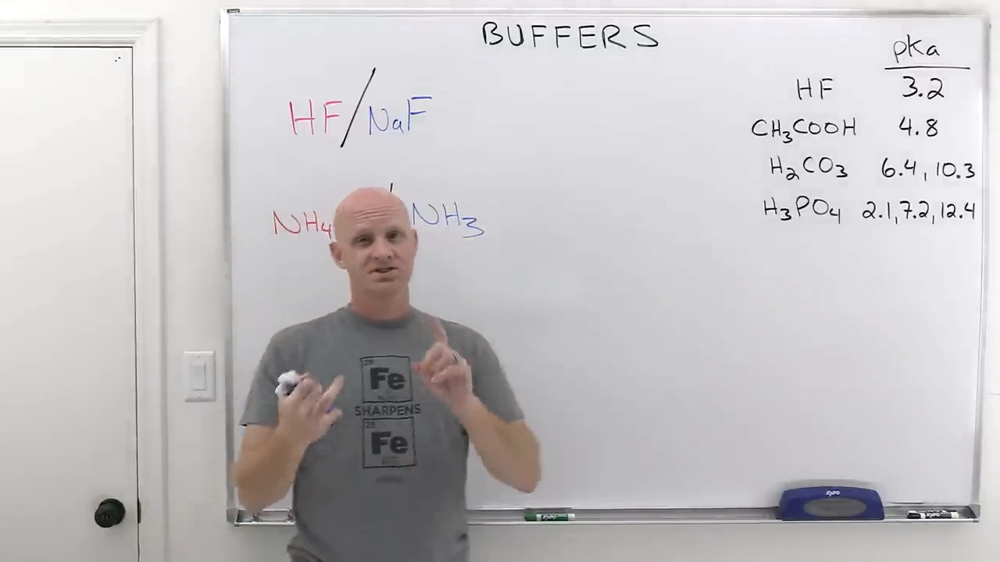
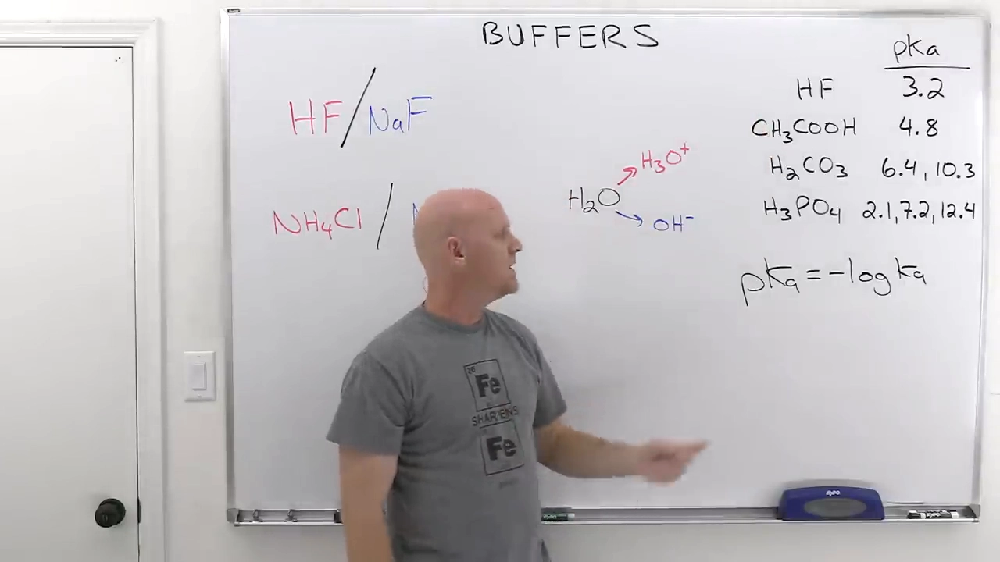
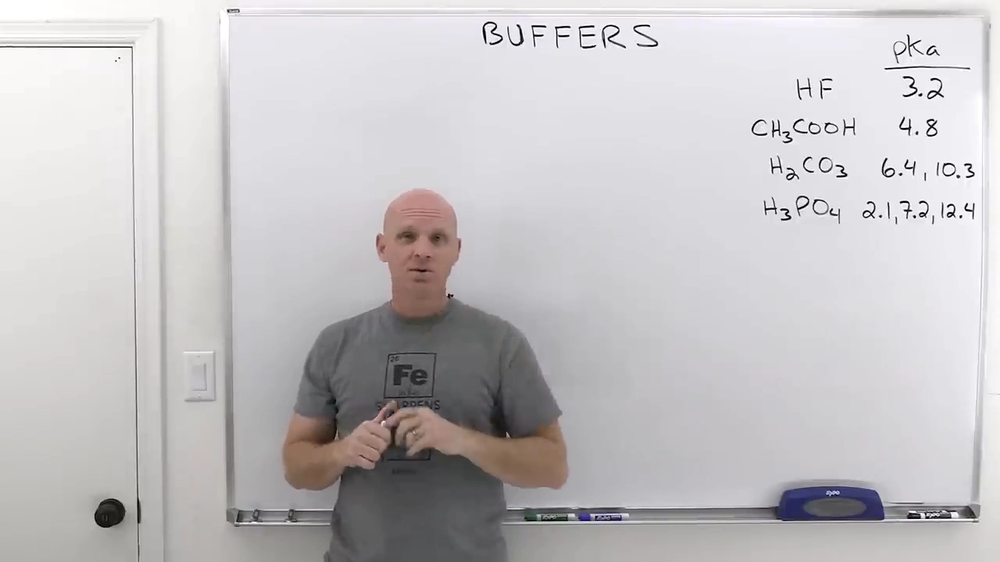
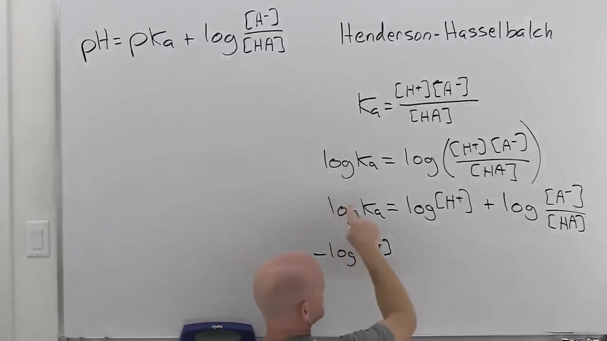
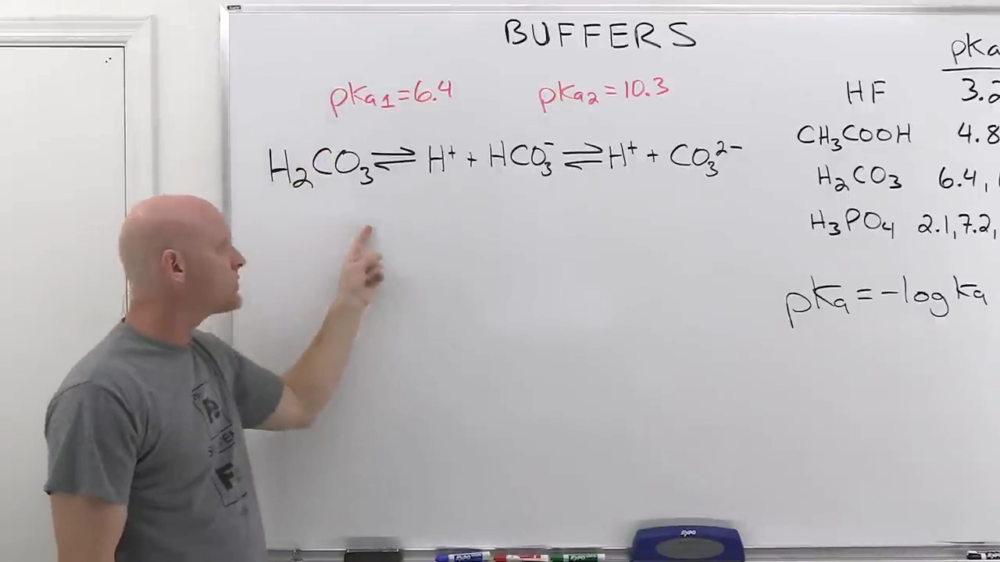
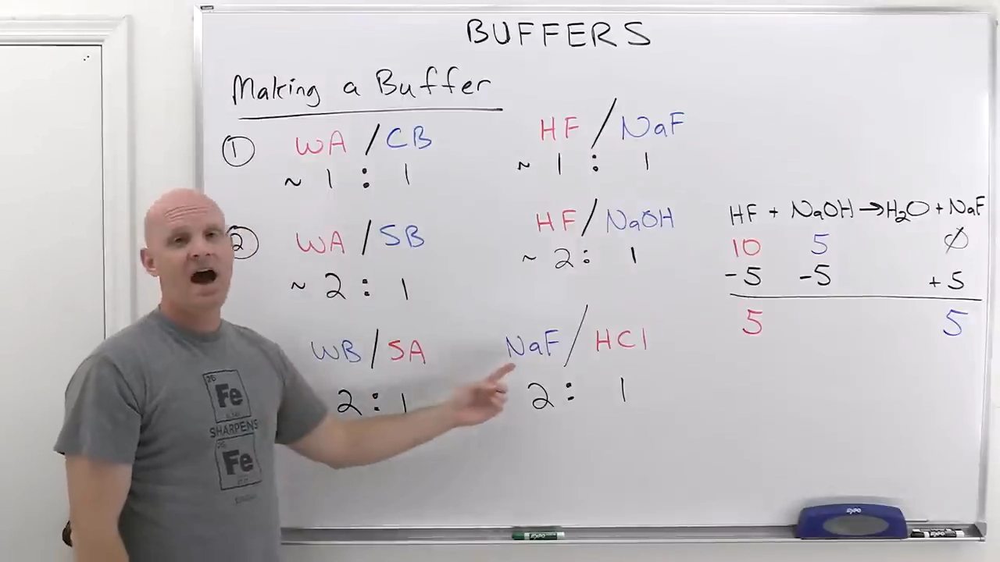
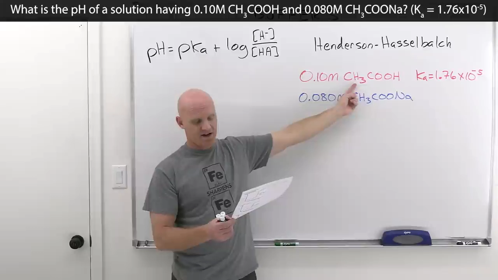
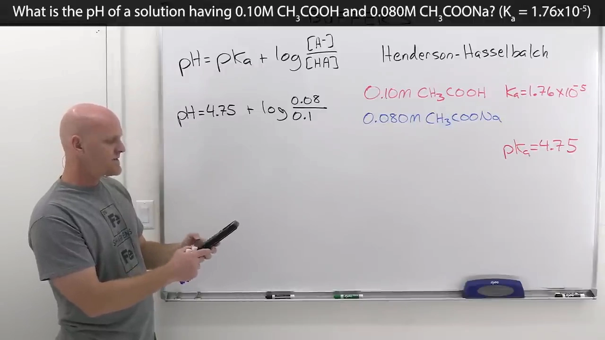
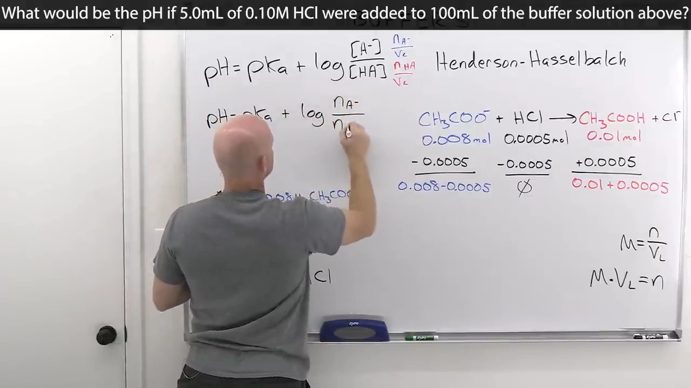
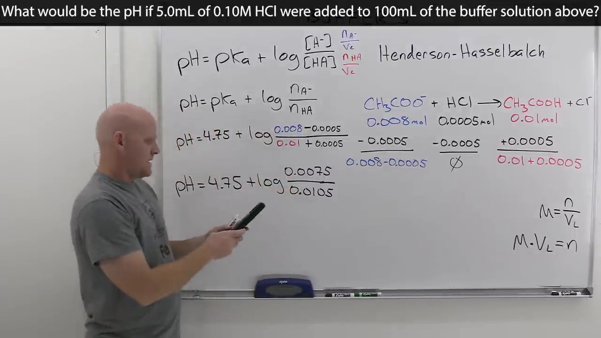

# 缓冲液为什么只在 pKa±1 内有效：Henderson–Hasselbalch 的推导与用法

> 视频来源：[Buffers | Henderson-Hasselbalch Eqn | 17.1 General Chemistry](https://www.youtube.com/watch?v=AQdes2OlLgU)（YouTube · Chad's Prep，讲者 Chad）｜时长约 45 分钟
> 导读：这一节把「酸碱平衡」从定性判断（1.1.4 讲哪个质子更酸）推进到定量框架：$pK_a$ 怎么定义、Henderson–Hasselbalch 方程怎么从 $K_a$ 推出来、为什么缓冲范围恰好是 $pK_a \pm 1$、多质子酸为什么有多个缓冲区间，以及加了一滴强酸之后 pH 到底动多少。讲者是白板推导风格，例题完整，本文按「是什么 → 怎么算 → 怎么用」重排，末尾补一段药物发现视角的用法（已标明为补充）。

## 本讲要解决的核心问题（SCQA）

**背景**：分子上的可电离基团各有自己的 $pK_a$，这是一个可查、可比的数。而实验几乎都在某个固定 pH 下进行：细胞培养、酶反应、血浆、色谱流动相，都要求 pH 稳定在很窄的范围里。

**冲突**：pH 本身极不稳定。往纯水里加一点强酸或强碱，pH 会跳好几个单位；而人和细胞能容忍的范围窄得惊人——视频给的数字是血液 pH 约 7.4，**低于 7.1 或高于 7.8 且持续一段时间，人基本就死了**。所以「让 pH 别动」不是锦上添花，而是生理和实验的前提。

**疑问**：靠什么把 pH 钉住？这种「抗变化」的能力从哪里来、能覆盖多宽的 pH 区间、又该怎么算？

**回答（中心思想）**：靠一对**弱酸与其共轭碱**（或弱碱与其共轭酸）组成的缓冲体系。它抗变化的能力来自**比值**：Henderson–Hasselbalch 方程把 pH 写成 $pK_a$ 加上一个对数比值项，比值 1:1 时 $pH = pK_a$，比值偏到 10:1 时 pH 只偏移 1 个单位。所以**缓冲范围就是 $pK_a \pm 1$**，缓冲容量在 $pH = pK_a$ 时最大。一个分子有几个可电离基团、就有几个 $pK_a$、也就有几个缓冲区间。

## 一、缓冲液是什么：一对弱酸/共轭碱在替水「挨打」

### 1.1 定义与组成：必须是「弱」的那一对

[【跳转到 01:18】](https://www.youtube.com/watch?v=AQdes2OlLgU&t=78)

缓冲液（buffer）就是**能抵抗 pH 变化的溶液**。它的组成有硬性要求：**弱酸 + 它的共轭碱**，或者**弱碱 + 它的共轭酸**。不能是强酸 + 共轭碱，也不能是强碱 + 共轭酸——因为强酸强碱的共轭对手几乎没有碱性/酸性，凑不出「一对」。

视频给的两个标准例子是：

- 弱酸对：$\mathrm{HF}$ 与 $\mathrm{F^-}$；
- 弱碱对：$\mathrm{NH_3}$ 与 $\mathrm{NH_4^+}$。

实际配制时，离子那一半是以**盐**的形式加进去的，所以写出来是 $\mathrm{NaF}$、$\mathrm{NH_4Cl}$ 而不是孤零零的 $\mathrm{F^-}$、$\mathrm{NH_4^+}$。选盐有两条讲究（讲者顺带讲了，属于操作细节）：

1. **反离子要「可忽略」**：$\mathrm{Na^+}$、$\mathrm{K^+}$ 这类碱金属离子不参与酸碱反应，$\mathrm{Cl^-}$ 是强酸的共轭碱、碱性可忽略；
2. **盐要溶得开**：碱金属（第 1 族）的氟盐溶解度好，碱土金属（第 2 族）的氟盐溶解度差，所以配氟缓冲液用 $\mathrm{NaF}$ 而不是 $\mathrm{MgF_2}$。

### 1.2 它保护的对象其实是水

[【跳转到 07:47】](https://www.youtube.com/watch?v=AQdes2OlLgU&t=467)

讲者给了一个很好用的心智模型：**缓冲液是在保护水**。中性水里，加酸会把 $\mathrm{H_2O}$ 变成 $\mathrm{H_3O^+}$，加碱会把 $\mathrm{H_2O}$ 变成 $\mathrm{OH^-}$，这两种转化直接改变 pH。

有了缓冲对之后，反应被「截胡」了：

- 加碱时，$\mathrm{HF}$ 是比水更强的酸，于是由 $\mathrm{HF}$ 交出质子，而不是水；
- 加酸时，$\mathrm{F^-}$ 是比水更强的碱，于是由 $\mathrm{F^-}$ 接受质子，而不是水。

结果就是：**变的是 $\mathrm{HF}$ 与 $\mathrm{NaF}$ 的比例，而不是水的电离程度**，pH 因此只发生很小的变化。这句话是整节课的机制核心——后面所有公式都只是在算这个比例。

## 二、把 $pK_a$ 请出来：pH 的「设定点」

### 2.1 $pK_a$ 就是 $K_a$ 的负对数

[【跳转到 07:31】](https://www.youtube.com/watch?v=AQdes2OlLgU&t=451)

缓冲体系里，人们几乎不谈 $K_a$，只谈 $pK_a$。定义很直接：前缀 p 表示负对数，

$$
pK_a = -\log_{10} K_a
$$

以 $\mathrm{HF}$ 为例，$K_a = 6.8 \times 10^{-4}$，取负对数得 3.17，视频的表里写成 3.2。

这张表值得记住，因为它同时示范了两件事：**单元子酸的 $pK_a$ 是一个数，多质子酸的 $pK_a$ 是一串数**（碳酸两个、磷酸三个，第四节展开）。

### 2.2 1:1 时 $pH = pK_a$；10:1 时偏移 1 个单位

[【跳转到 08:53】](https://www.youtube.com/watch?v=AQdes2OlLgU&t=533)

这是全课最该背下来的四个数：

| 弱酸与共轭碱的比例 | pH 相对 $pK_a$ | 缓冲能力 |
| --- | --- | --- |
| 1:1 | $pH = pK_a$ | 最大 |
| 10:1（酸多） | $pH = pK_a - 1$ | 仍可缓冲 |
| 1:10（碱多） | $pH = pK_a + 1$ | 仍可缓冲 |
| 100:1 | $pH = pK_a - 2$ | 已不算缓冲 |

为什么是「每 10 倍差 1 个单位」？因为 pH 本身就是对数刻度，而比例进入公式时也是取对数——两者刚好抵消成「一个数量级 = 一个 pH 单位」。于是：

- $\mathrm{HF}$ 的 $pK_a = 3.2$，缓冲范围是 **2.2 到 4.2**；
- 乙酸（醋酸）的 $pK_a = 4.8$，缓冲范围是 **3.8 到 5.8**。

超出这个范围，缓冲液就「不再缓冲」了：再加酸或碱，pH 会像纯水一样大幅变化。这就是**缓冲范围 = $pK_a \pm 1$** 的来历，也是本节标题那句话的全部内容。

> 补充（非视频内容）：$pK_a \pm 1$ 这条经验规则的严格版本是缓冲容量（buffer capacity）$\beta$ 在 $pH = pK_a$ 处取极大值，在 $pK_a \pm 1$ 处降到极大值的约 1/3。视频只给了「10 倍比例」这个操作性判据，没有引入 $\beta$ 的微分定义。

## 三、Henderson–Hasselbalch：从 $K_a$ 表达式一步步推出来

### 3.1 推导只有三步

[【跳转到 24:13】](https://www.youtube.com/watch?v=AQdes2OlLgU&t=1453)

方程不是天上掉下来的，它就是 $K_a$ 表达式两边取对数再整理。起点是：

$$
K_a = \frac{[\mathrm{H^+}][\mathrm{A^-}]}{[\mathrm{HA}]}
$$

两边取对数，用「乘变加、除变减」拆开：

$$
\log K_a = \log[\mathrm{H^+}] + \log\frac{[\mathrm{A^-}]}{[\mathrm{HA}]}
$$

再把 $\log K_a$ 和 $\log[\mathrm{H^+}]$ 分别搬到等号两边，并代入 $pH = -\log[\mathrm{H^+}]$、$pK_a = -\log K_a$：

$$
pH = pK_a + \log_{10}\frac{[\mathrm{A^-}]}{[\mathrm{HA}]}
$$

这就是 **Henderson–Hasselbalch 方程**。它把「pH」拆成了两部分：分子的固有属性（$pK_a$）与环境里酸碱比例（对数项）。

### 3.2 四个版本，只挑一个用

讲者特意提醒：这个方程有**四个等价写法**，差别只在符号和谁在上谁在下。比如把 $\log\frac{[\mathrm{A^-}]}{[\mathrm{HA}]}$ 写成 $-\log\frac{[\mathrm{HA}]}{[\mathrm{A^-}]}$，或者改用 $pOH = pK_b + \log\frac{[\mathrm{HA}]}{[\mathrm{A^-}]}$。四个式子在数学上完全等价，任何缓冲计算用哪个都对。

但他的建议是**只记一个**：$pH = pK_a + \log\frac{[\mathrm{A^-}]}{[\mathrm{HA}]}$。理由是符号一多就容易记反，而记反符号的代价是 pH 算错整整两倍的对数距离。

### 3.3 使用前提：酸和碱都得在

方程只在**弱酸与共轭碱同时存在**时可用。原因很实在：如果某一项浓度为 0，比值要么是 0 要么是无穷，对数没有定义。所以这个式子描述的是「缓冲体系」，不是「单纯的弱酸溶液」——后者要用 ICE 表（初-变-平）解二次方程。

讲者还补了一句实用判断：**缓冲体系里永远不用列 ICE 表**。因为酸和碱都是「外加的」，电离产生的 $\pm x$ 相对它们的浓度可以忽略，直接套方程即可。

## 四、多质子酸：一个分子，多个缓冲区间

### 4.1 碳酸：两个 $pK_a$，两个缓冲区间

[【跳转到 11:50】](https://www.youtube.com/watch?v=AQdes2OlLgU&t=710)

碳酸是二元酸，两个质子分两步交出：

$$
\mathrm{H_2CO_3} \rightleftharpoons \mathrm{H^+} + \mathrm{HCO_3^-} \rightleftharpoons \mathrm{H^+} + \mathrm{CO_3^{2-}}
$$

- $pK_{a1} = 6.4$：$\mathrm{H_2CO_3}$ 与 $\mathrm{HCO_3^-}$ 配对，缓冲区间约 5.4–7.4；
- $pK_{a2} = 10.3$：$\mathrm{HCO_3^-}$ 与 $\mathrm{CO_3^{2-}}$ 配对，缓冲区间约 9.3–11.3。

**注意第二个 $pK_a$ 更大**，也就是第二步更难交出质子。这是多质子酸的普遍规律：每多交一个质子，剩下的负电荷越来越难离开，酸性越来越弱；而 $pK_a$ 越大正表示酸性越弱。

### 4.2 磷酸：三个 $pK_a$，其中 7.2 正好在生理 pH 附近

磷酸是三元酸，$pK_a$ 分别是 **2.1、7.2、12.4**，因此有三个缓冲区间。讲者特别点出 **7.2 这个值非常实用**：细胞培养、生理体系里最常用的磷酸盐缓冲液（PBS 一类）就工作在这个区间，因为生理 pH 7.4 距离它只有 0.2 个单位，正处在缓冲容量最大的位置附近。

### 4.3 血液里的碳酸缓冲

[【跳转到 13:46】](https://www.youtube.com/watch?v=AQdes2OlLgU&t=826)

血液的主要缓冲成分是碳酸体系，而它和呼吸耦合在一起：

$$
\mathrm{CO_2} + \mathrm{H_2O} \rightleftharpoons \mathrm{H_2CO_3} \rightleftharpoons \mathrm{H^+} + \mathrm{HCO_3^-}
$$

呼出的 $\mathrm{CO_2}$ 通过血液运输，与水平衡生成碳酸，碳酸再按 $pK_{a1} = 6.4$ 释放质子。也就是说，**肺可以通过「排掉 $\mathrm{CO_2}$」来拉动这个平衡、调节血液 pH**。这解释了为什么血液 pH 的稳定不只是化学问题，也是生理问题。

## 五、怎么配缓冲液：三条路，目标都是「最终 1:1」

### 5.1 三条路

[【跳转到 15:01】](https://www.youtube.com/watch?v=AQdes2OlLgU&t=901)

关键不是「你往里加了什么」，而是「最后剩下什么比例」。只要终点是接近 1:1 的弱酸/共轭碱，就是缓冲液。由此有三条路：

1. **弱酸 + 共轭碱**，约 **1:1**（最直观）；
2. **弱酸 + 强碱**，约 **2:1**：强碱只中和掉一半弱酸，剩下一半弱酸 + 新生成的一半共轭碱，终点仍是 1:1；
3. **弱碱 + 强酸**，约 **2:1**：同理，强酸只中和一半弱碱。

### 5.2 用化学计量表验证第 2 条路

[【跳转到 19:23】](https://www.youtube.com/watch?v=AQdes2OlLgU&t=1163)

以 $\mathrm{HF} + \mathrm{NaOH}$ 为例，按 10:5 混合（即 2:1）：

$$
\mathrm{HF} + \mathrm{NaOH} \rightarrow \mathrm{H_2O} + \mathrm{NaF}
$$

强碱完全反应，所以 $\mathrm{NaOH}$ 是限量试剂：5 份被耗尽，同时消耗 5 份 $\mathrm{HF}$、生成 5 份 $\mathrm{NaF}$。终点是 **5 份 $\mathrm{HF}$ + 5 份 $\mathrm{NaF}$**，即 1:1。这就是「2:1 起步、1:1 收尾」的算术来源。

### 5.3 两个经典错误答案

讲者列了两个考试里常见的干扰项，都值得记住：

- **强酸 + 共轭碱**：强酸的共轭碱碱性可忽略，这只是一瓶很酸的溶液，不是缓冲液；
- **弱酸 + 强碱按 1:1**：1:1 时强碱会把弱酸**全部**中和，最后只剩共轭碱，没有酸了，也就没有缓冲对。

## 六、两个计算：直接算 pH，和加了强酸之后

### 6.1 例题一：已知浓度，求缓冲液 pH

[【跳转到 26:44】](https://www.youtube.com/watch?v=AQdes2OlLgU&t=1604)

题目：$0.10\ \mathrm{M}$ 乙酸 + $0.080\ \mathrm{M}$ 乙酸钠，$K_a = 1.76 \times 10^{-5}$，求 pH。

第一步把 $K_a$ 换成 $pK_a$：$-\log(1.76\times10^{-5}) = 4.75$。第二步直接套方程：

$$
pH = 4.75 + \log_{10}\frac{0.080}{0.10} = 4.75 - 0.097 \approx 4.65
$$

结果 4.65 略低于 4.75，讲者让大家用「常识」校验：**酸比碱多一点，pH 就该比 $pK_a$ 低一点**，方向对了，数值就在缓冲范围内（3.75–5.75）。

### 6.2 例题二：往里加 5 mL 强酸，pH 动多少

[【跳转到 30:58】](https://www.youtube.com/watch?v=AQdes2OlLgU&t=1858)

题目：向 100 mL 上述缓冲液里加入 5.0 mL $0.10\ \mathrm{M}$ $\mathrm{HCl}$，求新 pH。

这一题多了一步**中和反应**，因为强酸会与共轭碱反应，而且反应进行到底：

$$
\mathrm{CH_3COO^-} + \mathrm{HCl} \rightarrow \mathrm{CH_3COOH} + \mathrm{Cl^-}
$$

关键技巧是**把浓度比换成摩尔比**。因为两项在同一个溶液里，体积相同、可以约掉：

$$
pH = pK_a + \log_{10}\frac{n_{\mathrm{A^-}}}{n_{\mathrm{HA}}}
$$

于是全程用摩尔数算：

1. 原有 $n_{\mathrm{A^-}} = 0.1\ \mathrm{L} \times 0.08\ \mathrm{M} = 0.008\ \mathrm{mol}$；
2. 原有 $n_{\mathrm{HA}} = 0.1\ \mathrm{L} \times 0.10\ \mathrm{M} = 0.010\ \mathrm{mol}$；
3. 加入的 $\mathrm{HCl}$：$0.005\ \mathrm{L} \times 0.10\ \mathrm{M} = 0.0005\ \mathrm{mol}$；
4. 中和后：$n_{\mathrm{A^-}} = 0.008 - 0.0005 = 0.0075$，$n_{\mathrm{HA}} = 0.010 + 0.0005 = 0.0105$。

代入：

$$
pH = 4.75 + \log_{10}\frac{0.0075}{0.0105} \approx 4.60
$$

**pH 只从 4.65 掉到 4.60，动了 0.05 个单位。** 讲者给的对照很直观：同样这么多 $\mathrm{HCl}$ 加进 100 mL 纯水，pH 会掉好几个单位。这就是「缓冲」的量化含义。

### 6.3 一个易错点：减了分子别忘了加分母

讲者反复强调学生最常犯的错：算出「共轭碱被中和、要减掉」之后，**忘了它变成了等量的弱酸、分母要加上**。中和反应是守恒的：$\mathrm{A^-}$ 少多少，$\mathrm{HA}$ 就多多少。加碱时方向相反：$\mathrm{HA}$ 减少、$\mathrm{A^-}$ 增加。

## 七、把这套框架搬到药物分子上（补充）

> 以下为补充内容（非视频原话），用于把本节与系列里相邻的小节接起来。

**第一，先问「生理 pH 下它带不带电」。** 有了 $pK_a$，判断一个可电离基团在 pH 7.4 下的状态只需要看两个数的大小关系：羧酸 $pK_a$ 约 4–5，比 7.4 低两个单位以上，几乎全部以 $\mathrm{COO^-}$ 存在；脂肪胺共轭酸 $pK_a$ 约 9–10，比 7.4 高，主要以 $\mathrm{NH^+}$ 存在；咪唑（组氨酸侧链）$pK_a$ 约 6.0，正好跨在生理 pH 附近，所以它在体内是「一部分带电、一部分不带电」的混合物——这也是组氨酸常出现在酶活性位点的原因之一。至于「为什么某个 O–H 更酸」，属于 1.1.4 的电子效应判据，本节不重复。

**第二，缓冲区间决定了「在哪个 pH 下做实验」。** 体外实验里选缓冲液，本质是选一个 $pK_a$ 接近目标 pH 的弱酸：磷酸的 7.2 对应生理 pH，乙酸的 4.8 对应弱酸性条件，碳酸的 6.4 对应血液。如果缓冲液的 $pK_a$ 离目标 pH 超过一个单位，它就只剩「稀释」作用，抗不住酸碱扰动。

**第三，带电状态会连锁影响下游读数。** 带电形态亲水、难穿膜，也难分配进辛醇，所以同一化合物在不同 pH 下的 logD 会差好几个数量级——这条链路的定义与曲线在 1.1.6 已经讲过，这里只做引用：**$pK_a$ 是输入，电荷状态是中间量，logD、溶解度、膜渗透、蛋白结合是输出**。

**第四，$pK_a$ 从哪来。** 视频里读 $pK_a$ 靠的是滴定曲线（下一节专门讲读法）。实验上还有毛细管电泳、核磁或紫外光谱滴定等方法；计算上则用基于官能团的经验规则或量子化学/连续介质模型预测。需要注意两点：一是**表观 $pK_a$ 会随离子强度、温度、有机溶剂比例和局部介电环境漂移**（蛋白口袋里的 $pK_a$ 常与水中值差一个单位以上），二是不同数据库对同一基团给出的值可能相差 0.1–0.5。引用任何 $pK_a$ 都应带上条件，这与引用 logD 的道理相同。

## 小结

- **缓冲液 = 弱酸 + 共轭碱（或弱碱 + 共轭酸）**，强酸的共轭碱凑不出缓冲对。
- **机制是「替水挨打」**：加酸时由共轭碱接质子，加碱时由弱酸给质子，变化的是两者比例，不是水的电离。
- **$pK_a = -\log K_a$**；比值 1:1 时 $pH = pK_a$，比值偏到 10:1 时 pH 偏 1 个单位，所以**缓冲范围是 $pK_a \pm 1$**。
- **Henderson–Hasselbalch 由 $K_a$ 表达式取对数得到**：$pH = pK_a + \log\frac{[\mathrm{A^-}]}{[\mathrm{HA}]}$；四个等价版本只记一个，且只在酸与碱同时存在时可用。
- **多质子酸有多个 $pK_a$**：碳酸 6.4 与 10.3，磷酸 2.1、7.2、12.4，每个 $pK_a$ 对应一个独立缓冲区间；磷酸的 7.2 与血液的碳酸体系分别服务细胞培养与生理 pH。
- **配缓冲液有三条路**，终点都是 1:1：弱酸+共轭碱约 1:1，弱酸+强碱约 2:1，弱碱+强酸约 2:1。
- **加强酸/碱的计算用摩尔比**：中和到底、按限量试剂算，$n_{\mathrm{A^-}}$ 减多少、$n_{\mathrm{HA}}$ 就加多少，代回方程。例题里 pH 只从 4.65 掉到 4.60。

## 关键术语速查

| 术语 | 一句话解释 |
| --- | --- |
| 缓冲液（buffer） | 能抵抗外加酸碱、把 pH 稳定在 $pK_a$ 附近的溶液，成分为弱酸与其共轭碱（或弱碱与其共轭酸） |
| 缓冲容量（buffering capacity） | 抗 pH 变化的能力，在 $pH = pK_a$ 时最大，$pK_a \pm 1$ 之外迅速衰减 |
| 缓冲范围（buffer range） | 约 $pK_a \pm 1$ 的 pH 区间，对应弱酸与共轭碱比例在 1:10 到 10:1 之间 |
| $pK_a$ | $K_a$ 的负对数；越小酸性越强，是缓冲体系 pH 的「设定点」 |
| Henderson–Hasselbalch 方程 | $pH = pK_a + \log\frac{[\mathrm{A^-}]}{[\mathrm{HA}]}$，把 pH 拆成固有属性与比例项 |
| 共轭碱（conjugate base） | 弱酸失去质子后的物种，是缓冲体系里接受外加质子的那一方 |
| 多质子酸（polyprotic acid） | 能分步交出多个质子的酸，每个质子有自己的 $pK_a$ 与缓冲区间 |
| 表观 $pK_a$（apparent $pK_a$） | 在非纯水环境（有机溶剂、高离子强度、蛋白口袋）中测到的 $pK_a$，与水中值有偏移 |
| 限量试剂（limiting reagent） | 中和反应里先被耗尽的那一方；强酸/强碱与缓冲对反应时通常由它决定变化量 |