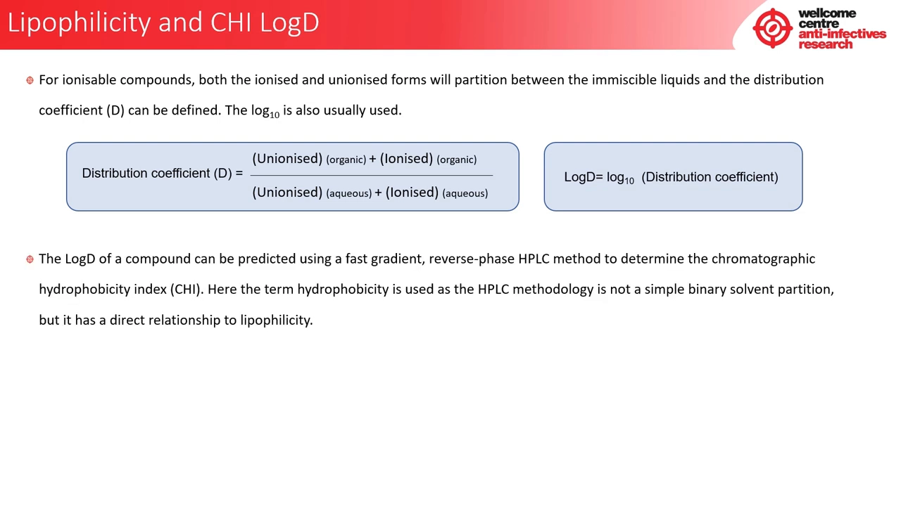
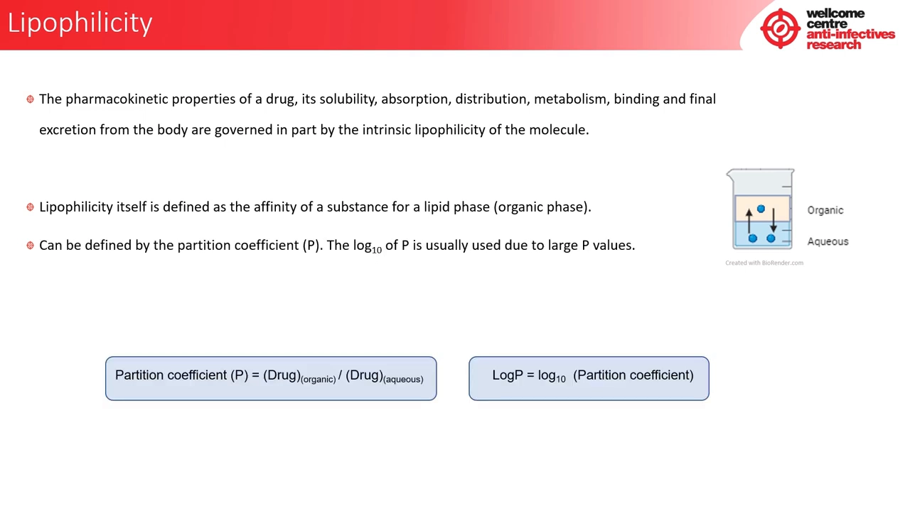
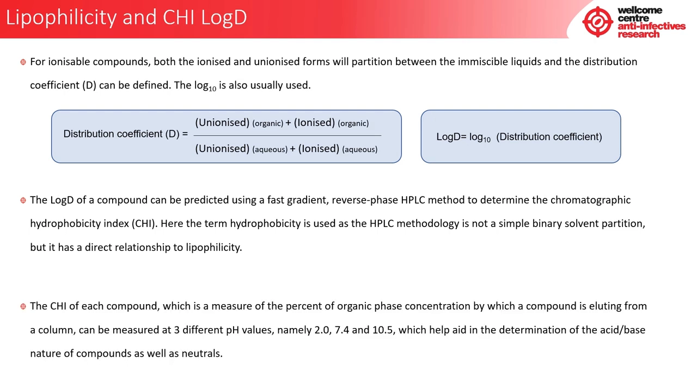
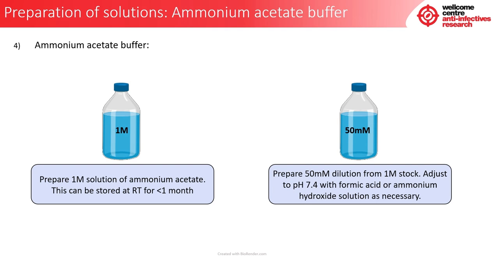
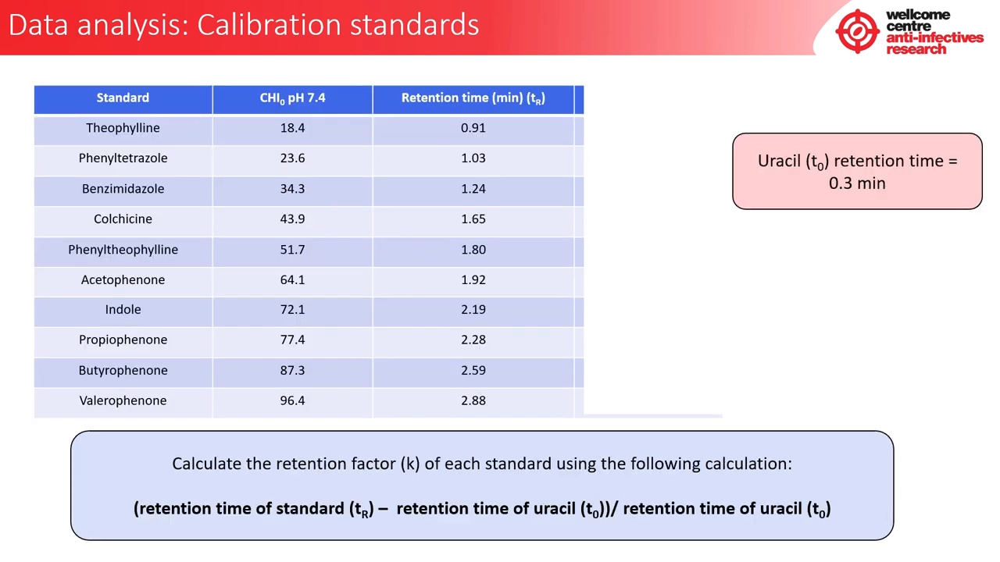
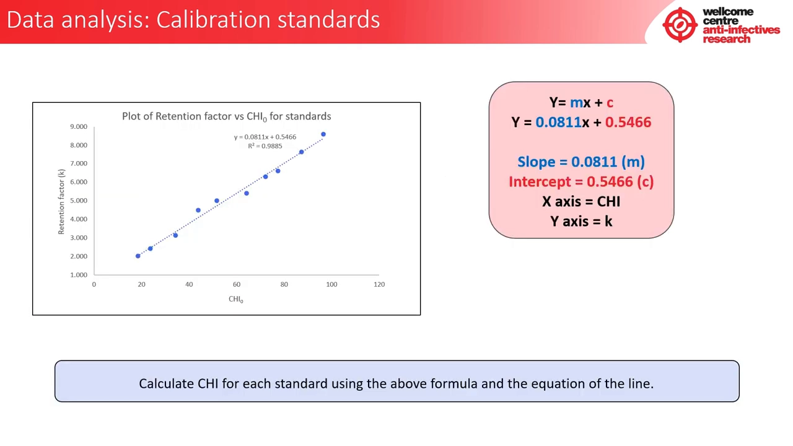
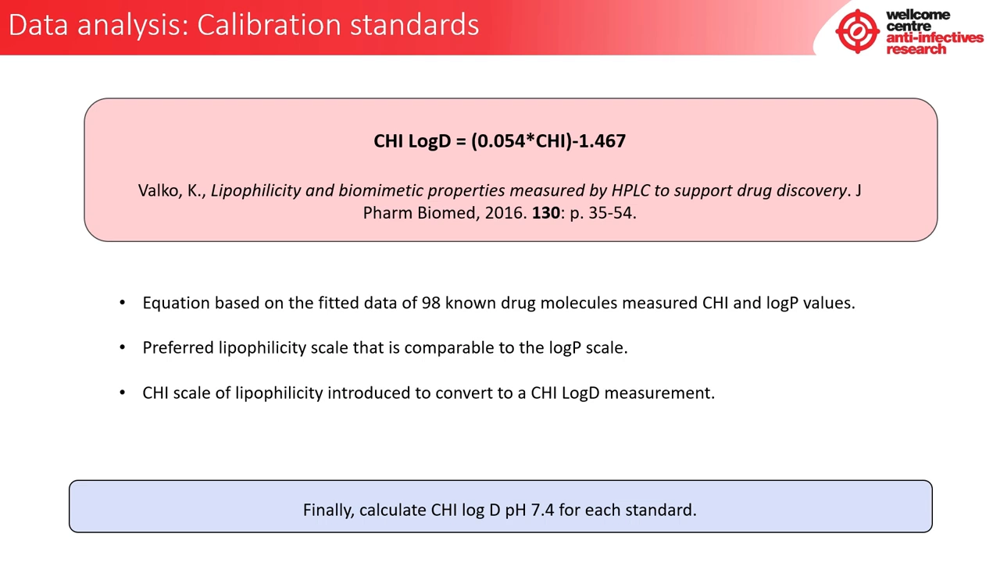
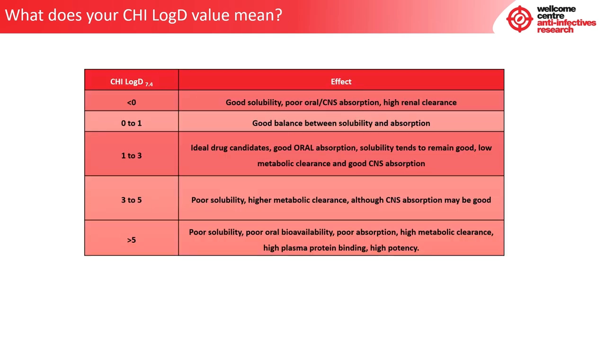

# 不摇瓶也能测 logD：CHI 反相 HPLC 法的操作与读数

> 视频来源：[CHI LogD Assay | Drug Discovery Unit Dundee](https://www.youtube.com/watch?v=ASJTwKQYwOs)（YouTube · Wellcome Centre for Anti-Infectives Research / Drug Discovery Unit, University of Dundee）｜时长约 15.5 分钟
> 导读：这是一支**方法学操作视频**，不是概念课。它把「测 logD」拆成溶液配制、进样、三段算术和一张判读表，全程不用分液漏斗。本文保留完整操作细节与全部公式，并在开头用一小节交代它与 1.1.6 的分工：那里讲 logP/logD 为什么不同，这里讲 logD 到底怎么测出来。

## 本讲要解决的核心问题（SCQA）

**背景**：logD 是「某个 pH 下所有形态的总分配比」，最直观的测法是把药在辛醇和水之间摇匀、分层、测两相浓度。这个做法有个硬门槛：**你得知道两相各自的浓度**，而辛醇相里往往还有乳化、微滴和离子对，取样本身就带误差。

**冲突**：如果一天要过几十上百个化合物，摇瓶法既慢又难自动化；更麻烦的是，辛醇/水分配只在一个 pH 下给你一个数，而判断一个分子是酸、是碱还是中性，本来需要扫好几个 pH。方法学上的冲突是：**要通量，还是要「真正的两相分配」**。

**疑问**：有没有一种测法，既不摇瓶、又能一次给出多个 pH 下的 logD，而且结果还能和文献里的 logP 标度对上？

**回答（中心思想）**：有，就是 **CHI 法（chromatographic hydrophobicity index，色谱疏水性指数）**。它用一根反相柱代替辛醇相、用梯度洗脱代替摇瓶，把「化合物在柱子上洗脱时有机相占多少百分比」记为 CHI，再用一条校准线把保留因子换算成 CHI，最后用一条**已发表的线性关系**把 CHI 换算成 logD。整条链路只有三段算术，且每一段都可以被对照品验证。

## 一、为什么可以不做两相分配实验

### 1.1 先把 D 的定义摆出来：分子与离子的总量之比

[【跳转到 00:12】](https://www.youtube.com/watch?v=ASJTwKQYwOs&t=12)

视频开头的定位很清楚：一个药物的药代动力学性质——溶解度、吸收、分布、代谢、结合以及最终从体内排出——**一部分由分子本身的亲脂性决定**。亲脂性定义为一种物质对脂相或有机相的亲和力，用分配系数 $P$ 表示，通常取以 10 为底的对数，因为 $P$ 的数值往往很大：

$$
P = \frac{[\text{药物}]_{\text{有机相}}}{[\text{药物}]_{\text{水相}}}, \qquad \log P = \log_{10} P
$$

[【跳转到 01:02】](https://www.youtube.com/watch?v=ASJTwKQYwOs&t=62)

对**可电离化合物**，情况变了：**电离形态与未电离形态都会在两相之间分配**，于是要改用分布系数 $D$：

$$
D = \frac{[\text{未电离}]_{\text{有机}} + [\text{电离}]_{\text{有机}}}{[\text{未电离}]_{\text{水}} + [\text{电离}]_{\text{水}}}, \qquad \log D = \log_{10} D
$$

**这个式子是整支视频的地基**，请注意它和 logP 的差别不在数学，而在「分子里加了什么项」：分子、分母都多了一个电离形态的浓度。因此 $D$ 必然随 pH 变化，而 $P$ 不变。

> 本系列在 1.1.6 已经讲过 $\log D$ 与 $\log P$、$pK_a$、pH 的换算关系（$\log D = \log P + \log f_{\text{中性}}$ 及酸/碱两条展开式），2.1.1 讲过 $pK_a$ 与形态比例。本文不重复推导，只关心一件事：**这个量在实验台上怎么得到。**

### 1.2 CHI：不问「分配多少」，只问「洗脱时有机相占多少」

[【跳转到 01:27】](https://www.youtube.com/watch?v=ASJTwKQYwOs&t=87)

视频给出的替代方案是：**用快速梯度的反相 HPLC 方法测定色谱疏水性指数（CHI）**。讲者特意解释了为什么这里用「疏水性」而不是「亲脂性」这个词：

> 该 HPLC 方法**并不是简单的二元溶剂分配**，但它与亲脂性有直接关系。

CHI 的定义是：**化合物从柱子上洗脱出来时，流动相中有机相所占的百分比**。一个分子越疏水，就需要越多的有机溶剂才能把它从固定相上「推」下来，所以它的 CHI 越大。这与 1.1.6 里那条「logD 越高、保留越久」的规律是同一件事，只是这里把「保留时间」换成了一个与仪器无关的标度。

> 补充（非视频内容）：CHI 之所以能跨实验室比较，是因为它把保留行为归一化成了「百分之几的有机相」这种无量纲量，而不是「几分钟」。同一根柱子换流速、换梯度时长，保留时间会变，CHI 不会。

### 1.3 三个 pH，一次读出酸、碱还是中性

[【跳转到 01:12】](https://www.youtube.com/watch?v=ASJTwKQYwOs&t=72)

CHI 可以在**三个不同 pH 值下测定：pH 2.0、7.4 和 10.5**，这有助于判断化合物是**酸性、碱性还是中性**。

> 注意：讲者口述时说的是「pH 2、7.4 和 10」，幻灯片上写的是 **2.0、7.4 和 10.5**，以幻灯片为准。
>
> 补充（非视频内容）：这三个 pH 不是随便挑的。pH 2 近似胃液，7.4 是血浆与细胞外液，10.5 用来把碱性中心（例如脂肪胺，$pK_a$ 常在 9–10）也推到中性一侧。三点连起来看趋势，就能反推 $pK_a$ 的大致位置与酸碱性——这正是 1.1.6 里那条「$pK_a$ 附近读数最敏感」的规律在方法设计上的用法。

## 二、把方法跑起来：四份溶液与一次进样

### 2.1 材料清单

[【跳转到 01:59】](https://www.youtube.com/watch?v=ASJTwKQYwOs&t=119)

视频逐项列出了所需材料：乙酸铵、去离子水或 Milli-Q 水、乙腈、10 mM 测试化合物 DMSO 储备液、1 mM 校准混标、V 底 96 孔微孔板、Eppendorf 管、HPLC 样品瓶、15 mL 离心管、可分配 10 μL、200 μL、1 mL 的移液器及配套吸头，以及 HPLC 或 UPLC 系统。

### 2.2 四份溶液：每一份都对应后面一个计算环节

[【跳转到 03:04】](https://www.youtube.com/watch?v=ASJTwKQYwOs&t=184)

| 溶液 | 配法 | 保存条件 | 在计算里的角色 |
| --- | --- | --- | --- |
| 50/50 乙腈/水 | 直接混合 | 室温 3 个月 | 稀释剂与空白基质 |
| 校准混标 | 各标准品配 1 mM 储备液，各取 100 μL 合并，加 9 mL 50/50 乙腈/水 → 10 μg/mL | −20 °C，6 个月 | 提供已知 CHI，用来建校准线 |
| 尿嘧啶（uracil） | 1 mM DMSO 储备液，稀释到 10 μg/mL | −20 °C，6 个月 | $t_0$ 标记物（死时间） |
| 乙酸铵缓冲液 | 1 M 储备液（室温 1 个月）→ 稀释到 50 mM，用甲酸或氢氧化铵调 pH | 1 个月 | 决定测定在哪个 pH 下进行 |

[【跳转到 04:59】](https://www.youtube.com/watch?v=ASJTwKQYwOs&t=299)

缓冲液这一步值得单独看：**先配 1 M 乙酸铵储备液，再稀释成 50 mM，然后用甲酸或氢氧化铵把 pH 调到 7.4**。视频明确说「这个缓冲液可以按实验需要配成不同 pH，本例在 pH 7.4 下进行」。

> 这是本方法最容易被低估的一步。**pH 不是背景条件，而是实验变量**：你测的是 logD7.4 还是 logD6.5，完全由这一步决定。这也是为什么报 logD 时必须带下标。

[【跳转到 05:49】](https://www.youtube.com/watch?v=ASJTwKQYwOs&t=349)

化合物配制：每个化合物配成 10 mM 的 DMSO 储备液，再稀释到 0.25 mM——取 5 μL 的 10 mM 储备液加 195 μL 的 50/50 乙腈/水。

### 2.3 为什么需要「尿嘧啶」这种看似无关的东西

[【跳转到 04:09】](https://www.youtube.com/watch?v=ASJTwKQYwOs&t=249)

尿嘧啶的保留时间非常短、在第一相色谱中接近零，因此被用作 **$t_0$ 标记物（死时间标记）**。它的作用是给所有保留时间提供一个零点：柱子本身有一个不被固定相保留的体积，任何化合物的「真实保留」都必须先减掉这一段。

> 补充（非视频内容）：这就是后面保留因子公式里为什么要减 $t_0$ 再除以 $t_0$——它把「分钟」变成了一个与柱子和流速无关的比值 $k$。

### 2.4 进样顺序与对照

[【跳转到 06:01】](https://www.youtube.com/watch?v=ASJTwKQYwOs&t=361)

方法设好后，把校准标准品、尿嘧啶 $t_0$ 标记物和样品依次进样。**空白对照（50/50 乙腈/水、50/50 乙腈/缓冲液）与校准混标应在每批运行的开始与结束各分析一次**；如果测试样品超过 30 个，中间还要额外插入空白与校准混标等对照。

> 补充（非视频内容）：首尾各一次校准，是为了捕捉「运行过程中柱子状态漂移」——这正是把色谱法用于定量的标准做法，也是 CHI 法能被接受为 logD 替代方法的前提。

## 三、把峰位换算成 logD：三段算术

### 3.1 第一步：保留因子 $k$

[【跳转到 07:30】](https://www.youtube.com/watch?v=ASJTwKQYwOs&t=450)

对每个标准品，先算保留因子：

$$
k = \frac{t_R - t_0}{t_0}
$$

其中 $t_R$ 是标准品的保留时间，$t_0$ 是尿嘧啶的保留时间。视频给的实测值是 $t_0 = 0.3$ 分钟。

以茶碱（theophylline）为例：$t_R = 0.91$ 分钟，

$$
k = \frac{0.91 - 0.3}{0.3} = 2.03
$$

### 3.2 第二步：校准线，从 $k$ 到 CHI

[【跳转到 08:25】](https://www.youtube.com/watch?v=ASJTwKQYwOs&t=505)

把每个标准品的 $k$ 对它的**已知 CHI 值**作图，做线性回归。视频给出的结果是：

$$
k = 0.0811 \times \mathrm{CHI} + 0.5466, \qquad R^2 = 0.9885
$$

讲者给的质量标准是：**$R^2$ 通常应大于 0.9**；此外，必要时最多可以剔除三个点，由分析人员自行判断。

> 字幕订正：讲者口述时把斜率读成了「0.811」，但幻灯片上的方程是 $y = 0.0811x + 0.5466$，而且用茶碱的 $k = 2.03$ 反算：$0.0811 \times 18.4 + 0.5466 \approx 2.04$，与实测吻合。**以 0.0811 为准**。

把直线方程整理成 $x = (y - c)/m$，就得到 CHI 的计算式：

$$
\mathrm{CHI} = \frac{k - 0.5466}{0.0811}
$$

对茶碱：

$$
\mathrm{CHI} = \frac{2.03 - 0.5466}{0.0811} \approx 18.3
$$

与表中给出的 18.4 基本一致。

### 3.3 第三步：从 CHI 到 logD

[【跳转到 10:40】](https://www.youtube.com/watch?v=ASJTwKQYwOs&t=640)

最后一步是一条**已发表的线性关系**：

$$
\log D_{7.4} = 0.054 \times \mathrm{CHI} - 1.467
$$

视频给出了这条式子的来历，这是它可信的关键：

- 出自 **Valko 等人 2016 年发表在 J. Pharm. Biomed. Anal.（130: 35–54）** 的论文，主题是「用 HPLC 测定的亲脂性与生物模拟性质支持药物发现」；
- 方程基于 **98 个已知药物分子**的 CHI 与 logP 实测数据拟合；
- 之所以要做这个换算，是因为**药物化学家更希望有一个与 logP 标度可比的亲脂性标度**——人们已经建立了大量结构-亲脂性关系用于 logP 的计算机预测，CHI 必须能被翻译成同一把尺子上的读数，才有比较价值。

> 补充（非视频内容）：这三段算术的结构值得记住——**仪器读数 → 无量纲保留因子 → 与文献标度对齐的经验值**。每一段都是线性变换，误差会累积，所以校准线的 $R^2$、对照品的覆盖范围、以及首尾两次校准，都不是形式主义。

### 3.4 一个未知样品的完整算例

[【跳转到 12:39】](https://www.youtube.com/watch?v=ASJTwKQYwOs&t=759)

把同样的三步套到未知样品上。已知 $t_0 = 0.3$ 分钟，未知化合物 1 的 $t_R = 1.5$ 分钟：

$$
k = \frac{1.5 - 0.3}{0.3} = 4
$$

$$
\mathrm{CHI} = \frac{4 - 0.5466}{0.0811} \approx 42.6
$$

$$
\log D_{7.4} = 0.054 \times 42.6 - 1.467 \approx 0.83
$$

视频给出的结果是 **0.833**。三个数一路算下来，只用了一支移液器、一根柱子和一条 Excel 回归线。

> 顺带核对一下茶碱：$0.054 \times 18.3 - 1.467 \approx -0.48$，即 logD 约为 **−0.5**。讲者口述时读作「0.5」，按公式应为负值——这也符合茶碱是个弱极性、几乎不亲脂的分子。

## 四、读数怎么判：logD7.4 的五档

[【跳转到 14:51】](https://www.youtube.com/watch?v=ASJTwKQYwOs&t=891)

算出 logD7.4 之后，视频给了一张「logD7.4 与药代动力学效应」的对照表：

| CHI logD7.4 | 效应 |
| --- | --- |
| < 0 | 溶解性好，但口服与 CNS 吸收差，肾清除高 |
| 0 – 1 | 溶解度与吸收之间的良好平衡 |
| **1 – 3** | **理想候选药物**：口服吸收好，溶解度往往仍然良好，代谢清除低，CNS 吸收也好 |
| 3 – 5 | 溶解度差，代谢清除较高，但 CNS 吸收可能仍好 |
| > 5 | 溶解度差、口服生物利用度差、吸收差、代谢清除高、血浆蛋白结合高、效价高 |

讲者自己给了一个限定：**这并不是一刀切的标准，这张表只是一个指导原则**。

> 补充（非视频内容）：这张表最有信息量的地方是两端的对称性——**太低不行，太高也不行**，而且「太高」的代价列得比「太低」更长（溶解度、生物利用度、清除率、蛋白结合四项同时变差）。这与 logP 那一侧的结论完全一致，只是这里用的是 pH 7.4 下的实测值，更贴近生理。

## 五、这个方法的边界

把视频里的做法和它的前提放在一起看，CHI 法的适用范围与代价就很清楚了：

1. **它测的是「柱上的分配」，不是「辛醇/水两相分配」。** 讲者自己强调 HPLC 方法「不是简单的二元溶剂分配」，所以 CHI 必须通过一条经验方程翻译成 logD，而不能直接当 logD 用。
2. **它需要一根状态稳定的柱子和一套首尾校准。** 校准线 $R^2 > 0.9$、对照品覆盖待测区间，是这个方法成立的前提。
3. **它把 pH 变成可切换的变量。** 换缓冲液 pH 就能得到 logD2.0、logD7.4、logD10.5，这比摇瓶法一次一个 pH 高效得多。
4. **它对化合物的检测依赖色谱行为。** 样品必须有可被这套系统检测到的响应，且不能与柱子发生不可逆吸附。

> 补充（非视频内容）：摇瓶法并没有被淘汰。恰恰相反，它仍是**基准方法（reference method）**：CHI 这类「高通量替代法」必须先用一批摇瓶法数据校准过，才有资格被信任。两者是「基准」与「筛查」的分工，不是新旧替代。

## 小结

- **logD 的定义是「分子 + 离子形态在有机相的总量 ÷ 它们在水相的总量」**，与 logP 的差别只在多算了电离形态这一项。
- **CHI 法用反相柱代替辛醇相**：CHI 是化合物洗脱时流动相中有机相的百分比，越疏水越大；它「不是简单的二元溶剂分配」，但与亲脂性有直接关系。
- **三个 pH（2.0 / 7.4 / 10.5）** 一次给出酸碱中性判断，这是色谱法相对摇瓶法最实用的优势。
- **换算只有三步**：$k = (t_R - t_0)/t_0$ → $\mathrm{CHI} = (k - 0.5466)/0.0811$ → $\log D_{7.4} = 0.054\,\mathrm{CHI} - 1.467$。
- **经验方程有出处**：Valko 2016，基于 98 个已知药物的 CHI 与 logP 拟合，目的是让 CHI 与 logP 标度可比。
- **判读有窗口**：logD7.4 在 1–3 之间最理想；低于 0 吸收差、肾清除高；高于 5 溶解度、生物利用度、清除率与蛋白结合一起变差。
- **它是替代法，不是基准法**：摇瓶法仍是校准基准，CHI 法负责通量。

## 关键术语速查

| 术语 | 一句话解释 |
| --- | --- |
| 分布系数 $D$ | 某 pH 下未电离与电离形态在有机相的总量除以在水相的总量 |
| CHI（色谱疏水性指数） | 化合物从反相柱洗脱时流动相中有机相所占的百分比，越大越疏水 |
| 保留因子 $k$ | $(t_R - t_0)/t_0$，把保留时间归一化成与柱子、流速无关的比值 |
| $t_0$ 标记物 | 完全不被固定相保留的探针（本例为尿嘧啶），用来标定死时间 |
| 校准混标 | 一组已知 CHI 值的化合物，用来建立 $k$ 与 CHI 的线性关系 |
| 反相色谱 | 固定相非极性、流动相极性的色谱模式，保留行为由疏水作用主导 |
| logD7.4 | 在 pH 7.4 下测得的分布系数，最常被引用的生理相关值 |
| 血浆蛋白结合 | 药物与血浆蛋白结合的比例，logD 过高时通常升高，影响游离浓度 |