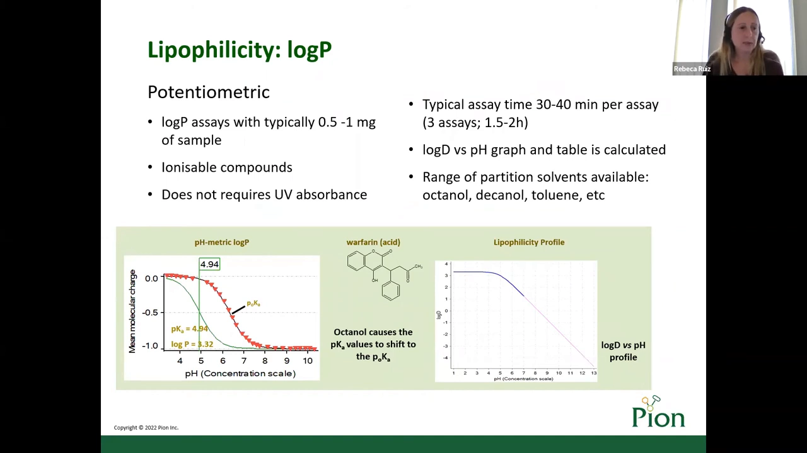
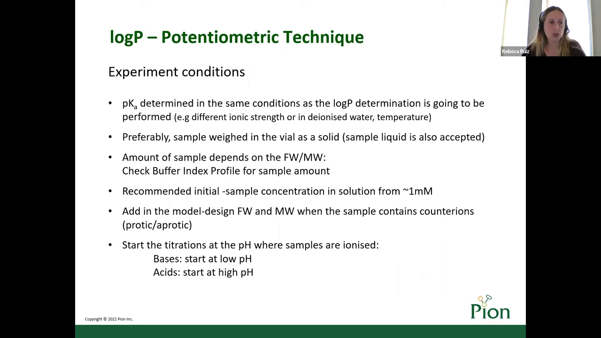
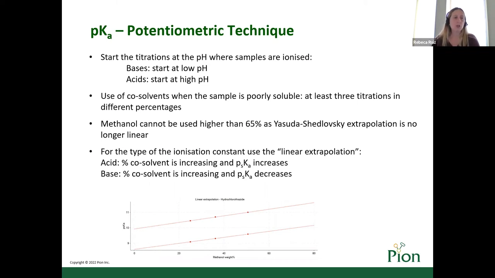
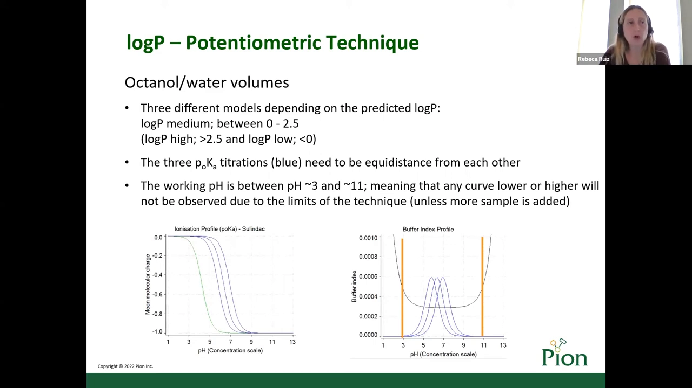
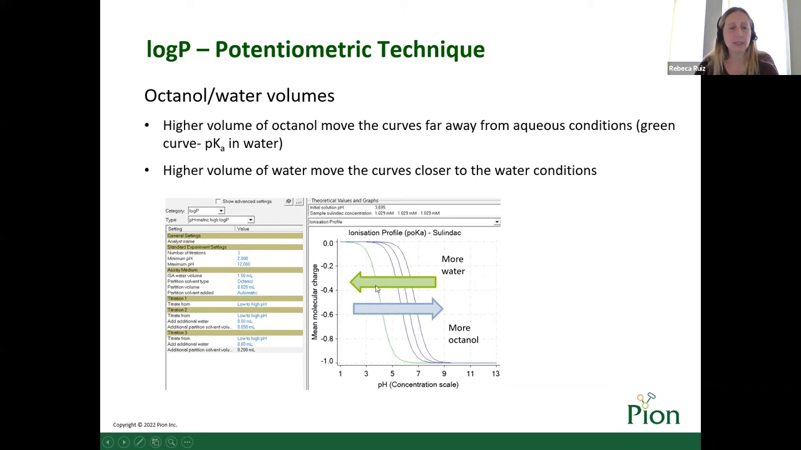
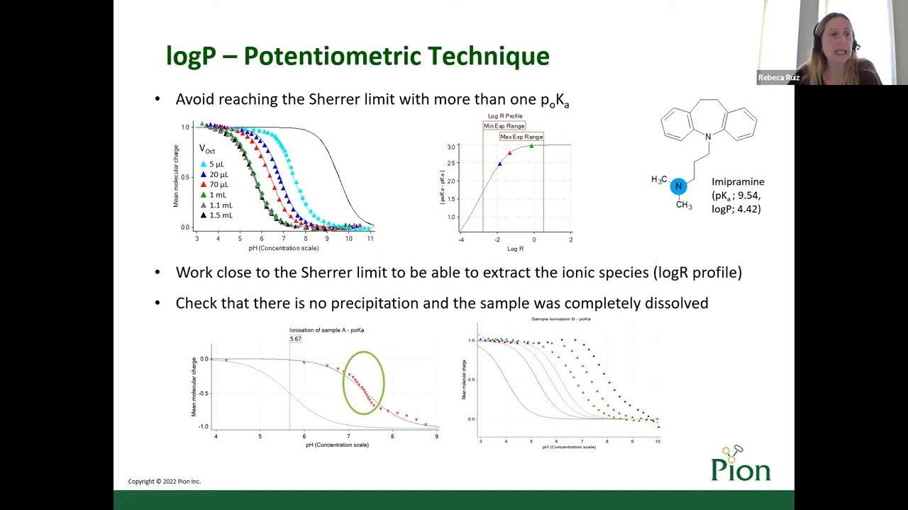
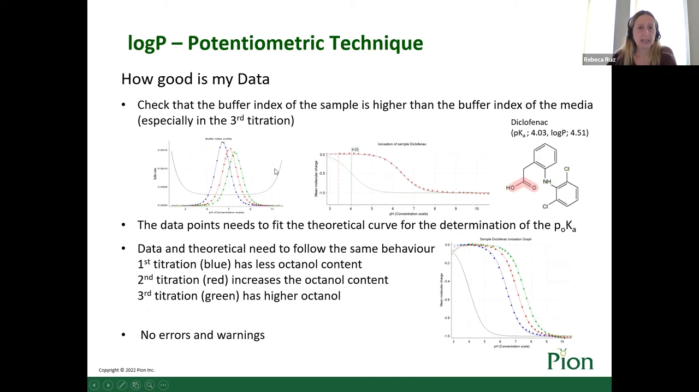

# 同一个 logP 为什么两个实验室差半个单位：电位滴定法的测量条件与判读

> 视频来源：[Best Practices for PhysChem Determination Using Pion Sirius T3 | Webinar recording July 12, 2022](https://www.youtube.com/watch?v=EQayhX9yx54)（YouTube · Pion Inc.）｜时长约 53 分钟，本文取其中「亲脂性 logP / logD」约 25:00–34:00 一段与结尾问答（约 50:45 起）
> 导读：这是一场面向仪器使用者的内部培训，前半段讲仪器维护与校准，**本文只取其中关于 logP/logD 测定的部分**，并略去与本系列 2.1.1（$pK_a$ 电位滴定）重叠的酸碱平衡推导。它回答的是一个非常实际的问题：同一份样品，为什么不同实验室报出的 logP 会差半个单位？

## 本讲要解决的核心问题（SCQA）

**背景**：logP 在教科书里是一个常数——中性形态在辛醇/水之间的浓度比。既然是常数，两个实验室测同一个化合物，结果应该一致。

**冲突**：现实里不是。同一个化合物，文献里能查到 4.0、4.4、4.5 好几个值；有的来自摇瓶法，有的来自色谱法，有的来自电位滴定法。更麻烦的是，**测量条件本身会改变读数**：离子强度不同、温度不同、有没有加共溶剂、辛醇加了多少，都会让曲线平移。

**疑问**：这些条件到底通过什么机制改变读数？一台仪器测 logP 时，操作者需要盯住哪几个旋钮？数据出来了，怎么判断这一批能不能用？

**回答（中心思想）**：电位滴定法测 logP 的做法是——**在辛醇存在下再测一次 $pK_a$**，用辛醇引起的 $pK_a$ 位移反推分配系数。所以它的读数继承了两件事：一是**这次 $pK_a$ 测得多准**，二是**辛醇/水比例选得对不对**。前者要求 $pK_a$ 与 logP 在**同一离子强度、同一温度**下测定；后者受一条硬边界约束——**Sherrer 极限**（水相被辛醇饱和之后，再加辛醇也不会改变读数）。理解了这两点，「差半个单位」就不再是玄学，而是可以逐项排查的条件差。

## 一、把「两相分配」变成一条滴定曲线

### 1.1 电位滴定法测 logP 的三个前提

[【跳转到 25:23】](https://www.youtube.com/watch?v=EQayhX9yx54&t=1523)

视频给出的方法规格很具体：

| 项目 | 规格 |
| --- | --- |
| 样品量 | 通常 **0.5 – 1 mg**（取决于分子量） |
| 适用对象 | **可电离化合物** |
| 检测要求 | **不需要紫外吸收** |
| 单次测定时间 | 30 – 40 分钟；**三次测定共 1.5 – 2 小时** |
| 输出 | **logD 对 pH 的曲线与数据表** |
| 可选分配溶剂 | 辛醇、癸醇、甲苯等（实际几乎都用辛醇） |

这张幻灯片右下角那张图值得单独看：左边是 pH-metric logP 的拟合曲线，中间写着「**Octanol causes the $pK_a$ values to shift to the $p_aK_a$**」，右边是 logD 对 pH 的曲线（lipophilicity profile）。三张图其实是同一件事的三个投影。

> 注意：这条路线**只适用于可电离化合物**。中性分子没有 $pK_a$ 可移，也就无从用位移反推分配。

### 1.2 电极只能读水相，所以必须先分层

[【跳转到 25:48】](https://www.youtube.com/watch?v=EQayhX9yx54&t=1548)

为什么一次测定要 30–40 分钟、比色谱法慢？讲者给的理由非常物理：

> 在采集数据之前，**辛醇层与水层必须先分开**，因为**电极只能在水相里读数**。

这句话点出了这个方法与摇瓶法的亲缘关系：它依然是两相体系，只是把「取出两相分别测浓度」换成了「**只测水相，用 $pK_a$ 的位移推油相里的量**」。分层不完全，读数就不可信。

### 1.3 pH-metric logP：辛醇把 $pK_a$ 推成 $p_aK_a$

[【跳转到 26:03】](https://www.youtube.com/watch?v=EQayhX9yx54&t=1563)

视频用华法林（warfarin，一种酸）演示了机制：水相中测得的 $pK_a$ 是 4.94，而在辛醇存在下测得的表观值是 $p_aK_a$，两者之间的**位移量**就编码了分子在两相之间的分配倾向；拟合得到的 logP 是 3.32。

> 补充（非视频内容）：为什么位移能反推分配？因为辛醇把一部分中性分子「抽走」了，水相里中性形态的活度下降，滴定曲线看起来就像酸性变弱了。位移越大，说明中性形态越爱油相，logP 越大。这条推导本身不在视频里，这里只作为机制说明。

## 二、实验条件：五个会让读数跑掉的旋钮

[【跳转到 26:38】](https://www.youtube.com/watch?v=EQayhX9yx54&t=1598)

视频把「实验条件」列成一页清单，这是整段最实用的部分。

### 2.1 第一旋钮：$pK_a$ 必须与 logP 同条件测

清单第一条，也是讲者反复强调的一条：

> **$pK_a$ 必须在与 logP 测定相同的条件下测定**——例如相同的离子强度（或同样在去离子水中）、相同的温度。

她在后面又重复了一次，并给了具体例子：**如果 logP 是在 0.1 M 氯化钠、37 °C 下测的，那么用于计算 logP 的那个 $pK_a$ 也必须来自 0.1 M 氯化钠、37 °C**。

这一条解释了本文标题里的现象：**如果 A 实验室用去离子水、25 °C 测 $pK_a$，B 实验室用 0.1 M NaCl、37 °C 测 logP，两个数放在一起算，结果必然对不上**。离子强度会改变活度系数，温度会改变 $pK_a$ 本身，两个误差会一起进入 logP。

### 2.2 第二、三旋钮：称样方式与样品量

- **尽量以固体形式在样品瓶里称样**（液体样品也可接受）；
- **样品量取决于分子量**，具体加多少要**看缓冲指数曲线（Buffer Index Profile）**，确保整场滴定有足够的缓冲能力；
- **推荐初始浓度约 1 mM**。

> 补充（非视频内容）：缓冲指数是「样品自身抵抗 pH 变化的能力」。样品太稀，滴定曲线太平，拟合就没有约束；样品太浓，又可能析出。这也是为什么「加多少样品」不是照抄分子量算出来的，而是看曲线。

### 2.3 第四旋钮：反离子要算进分子量

如果样品是盐（含反离子），**在模型设计里要把成盐部分的对离子分子量一并计入**，并区分质子性（protic）与非质子性（aprotic）反离子。

> 这一条与 1.1.6 讲的「盐形式」直接相关：你称的是盐，算的是游离体，两者分子量不同，浓度就会差一截。

### 2.4 第五旋钮：从「电离态」开始滴定

清单最后一条：**滴定的起点应选在样品处于电离态的 pH**——

- **碱：从低 pH 开始**；
- **酸：从高 pH 开始**。

理由是溶解度：电离态水溶性最好，从那里起步能保证样品先溶开，再一路滴过去。

### 2.5 共溶剂：溶解度不够时的补救，但有上限

[【跳转到 23:38】](https://www.youtube.com/watch?v=EQayhX9yx54&t=1418)

如果样品在水里溶不开、会析出，就要用**共溶剂**。讲者给的操作规则是：**至少做三次不同百分比的滴定**，然后外推到 0% 共溶剂。

- **甲醇不能超过 65%**，因为超过之后 **Yasuda–Shedlovsky 外推不再线性**；
- 用**线性外推**还能顺便判断这个电离中心是酸还是碱：**共溶剂百分比升高、$p_sK_a$ 升高 → 酸**；**$p_sK_a$ 降低 → 碱**。

> 讲者自己也提醒：这条判据不是 100% 有效，因为溶剂与溶质之间总有各种相互作用。
>
> 补充（非视频内容）：共溶剂是 logP 测定里最容易被忽略的偏差来源之一。加了甲醇，体系的介电常数下降，分子的表观 $pK_a$ 会整体平移；外推能修正一部分，但修正的前提是「线性」——这就是 65% 上限的由来。

## 三、辛醇/水的体积比：三个模型与一条饱和线

### 3.1 三个模型，按预测的 logP 选

[【跳转到 28:18】](https://www.youtube.com/watch?v=EQayhX9yx54&t=1698)

加多少辛醇、加多少水，不是随意的。视频给出**三种模型，按预测的 logP 选择**：

| 模型 | 适用 logP |
| --- | --- |
| logP low | < 0 |
| **logP medium** | **0 – 2.5** |
| logP high | > 2.5 |

同时有两条硬约束：

- **三条 $p_aK_a$ 滴定之间必须等距**（辛醇量按固定步长递增）；
- **有效工作 pH 大约在 3 到 11 之间**，超出这个范围曲线就观测不到（除非加大样品量）。

### 3.2 辛醇越多，曲线越远离水相

[【跳转到 29:33】](https://www.youtube.com/watch?v=EQayhX9yx54&t=1773)

这一页把「辛醇量」与「曲线位置」的关系讲得很清楚：

- **辛醇体积越大，曲线越远离水相条件**（绿线是纯水中的 $pK_a$）；
- **水的体积越大，曲线越靠近水相条件**。

换句话说，**辛醇量是一个「放大倍数」旋钮**：位移太小，噪声盖过信号；位移太大，又会撞上下一节的饱和线。

### 3.3 Sherrer 极限：为什么不能无限加辛醇

[【跳转到 31:13】](https://www.youtube.com/watch?v=EQayhX9yx54&t=1873)

视频用伊米帕明（imipramine，$pK_a$ 9.54、logP 4.42）演示了这条边界：

- 逐级加辛醇（5 μL → 20 μL → 70 μL → 1 mL → 1.1 mL → 1.5 mL），曲线一路右移；
- 但到某个体积之后，**曲线不再移动、彼此重叠**——这就是 **Sherrer 极限**（水相已被辛醇饱和）；
- 讲者的两条操作建议：**有多个 $p_aK_a$ 时不要撞上 Sherrer 极限**；**但又要尽量靠近 Sherrer 极限**，因为只有靠近它，才能把离子形态的分配（logR profile）也提取出来。

> 补充（非视频内容）：Sherrer 极限的物理含义是「水相已经溶不下更多辛醇」。此时再加油相，水相的组成不再变化，分子的表观 $pK_a$ 自然也不再移动。所以它既是**上限**（再加没用），也是**最佳工作点**（信号最大）。

## 四、数据好不好：四条判据

[【跳转到 30:23】](https://www.youtube.com/watch?v=EQayhX9yx54&t=1823)

视频用二氯芬酸（diclofenac，$pK_a$ 4.03、logP 4.51）示范了「如何判断这批数据能不能用」：

1. **样品的缓冲指数必须高于介质的缓冲指数**，尤其是**第三次滴定**（那时样品最稀）；
2. **实验点必须贴合理论曲线**，才能定出 $p_aK_a$；
3. **实验数据与理论曲线要遵循同样的顺序**：第一次滴定（蓝）辛醇最少、第二次（红）更多、第三次（绿）最多——如果顺序反了，说明样品没溶好或已析出；
4. **不能出现报错与警告**。

第 3 条是最容易被忽略、也最有诊断价值的一条：**它检查的不是单条曲线拟合得好不好，而是三条曲线之间的关系是否符合物理预期**。

## 五、最常见的失败：沉淀

[【跳转到 50:45】](https://www.youtube.com/watch?v=EQayhX9yx54&t=3045)

结尾问答里有人问：**logP 测定中出现沉淀怎么办？** 讲者的回答很坦率——这是这个方法的一个固有短板：

> 因为 logP 测定**不用紫外检测器**，所以很难直接看到样品是否析出。

她给出两个间接信号：

- **数据点彼此靠得过近**（曲线出现不正常的密集段）；
- **三条滴定的趋势与理论不符**（顺序错乱）。

一旦确认有沉淀，排查方向是**定位它发生在哪一次滴定**：

- 如果发生在**第一次滴定**（辛醇最少的那次），说明**辛醇不够**，样品在水里溶不开；
- 如果发生在**最后一次滴定**（辛醇最多的那次），说明**水或辛醇的比例不合适**，需要改体积。

解决办法只能是**改水/辛醇的体积比，反复试**。讲者自己也承认：「我知道这有点像试错，但确实没有别的办法。」

> 补充（非视频内容）：这一段与 2.1.3（溶解度）正好接上——沉淀的本质是「该 pH 下的游离浓度超过了溶解度」。所以 logP 测定失败，很多时候不是分配测不准，而是**溶解度不够支撑这场滴定**。

## 小结

- **电位滴定法测 logP 的原理是「在辛醇存在下再测一次 $pK_a$」**，用位移反推分配；所以它只适用于可电离化合物，且不需要紫外吸收。
- **电极只能读水相**，所以辛醇与水必须先分层，这也是单次测定要 30–40 分钟的原因。
- **$pK_a$ 与 logP 必须同离子强度、同温度测定**——这是「两个实验室差半个单位」最常见的来源。
- **五个条件旋钮**：同条件 $pK_a$、固体称样、约 1 mM 初始浓度（看缓冲指数定）、计入反离子分子量、从电离态 pH 起滴。
- **辛醇/水体积按预测 logP 选模型**（low < 0、medium 0–2.5、high > 2.5），三条滴定等距，工作 pH 约 3–11。
- **辛醇加得越多曲线越远离水相，但撞上 Sherrer 极限后不再移动**；最佳做法是尽量靠近而不越过它。
- **数据判据四条**：缓冲指数高于介质、实验点贴合理论、三条滴定的辛醇顺序正确、无报错。
- **沉淀是固有短板**（没有紫外检测器），只能靠数据点密集度与曲线顺序间接发现，再靠调整水/辛醇体积试错解决。

## 关键术语速查

| 术语 | 一句话解释 |
| --- | --- |
| 电位滴定法（potentiometric） | 用 pH 电极跟踪滴定曲线来定 $pK_a$ 与 logP 的方法，不需要紫外吸收 |
| pH-metric logP | 通过辛醇引起的 $pK_a$ 位移反推得到的 logP |
| $p_aK_a$ | 在辛醇存在下测得的表观 $pK_a$，与纯水中的 $pK_a$ 有位移 |
| 缓冲指数（Buffer Index） | 样品抵抗 pH 变化的能力，用来判断样品量够不够 |
| Sherrer 极限 | 水相被辛醇饱和的临界点；越过它再加辛醇，曲线不再移动 |
| logR profile | 由多条 $p_aK_a$ 曲线提取的、包含离子形态分配信息的曲线 |
| 共溶剂外推 | 用甲醇等共溶剂提高溶解度，再外推到 0% 得到水中 $pK_a$ 的做法 |
| Yasuda–Shedlovsky 外推 | 共溶剂体系外推 $pK_a$ 的线性关系；甲醇超过 65% 后不再线性 |