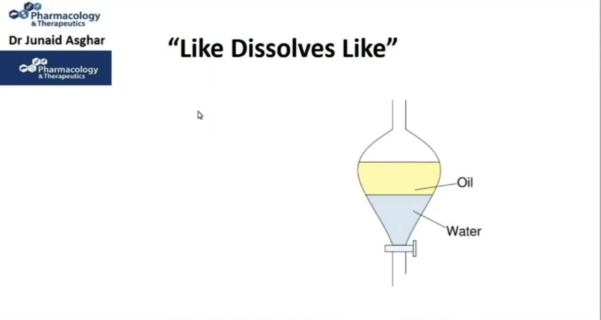
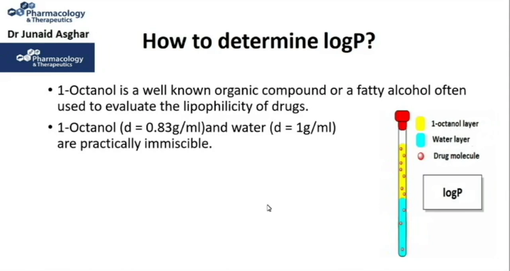
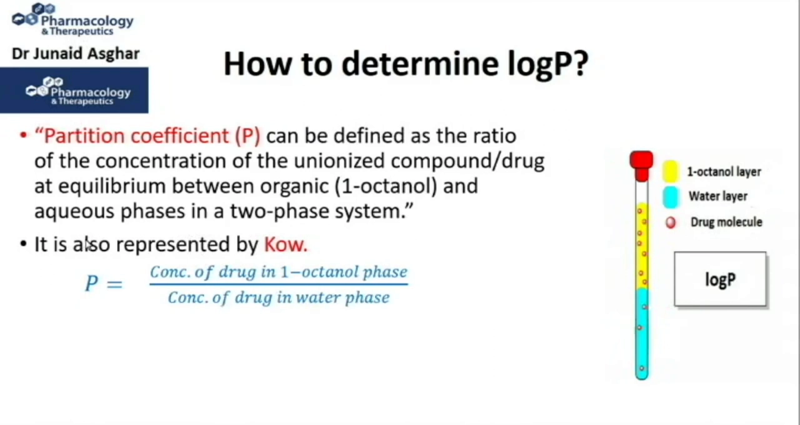
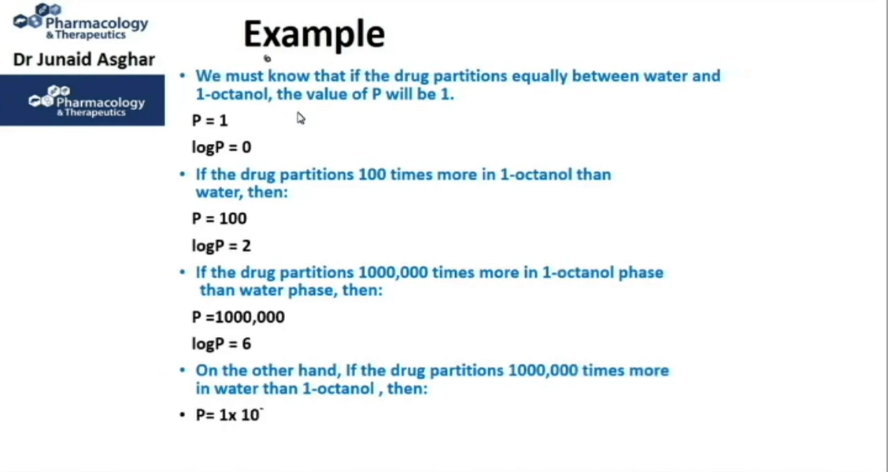
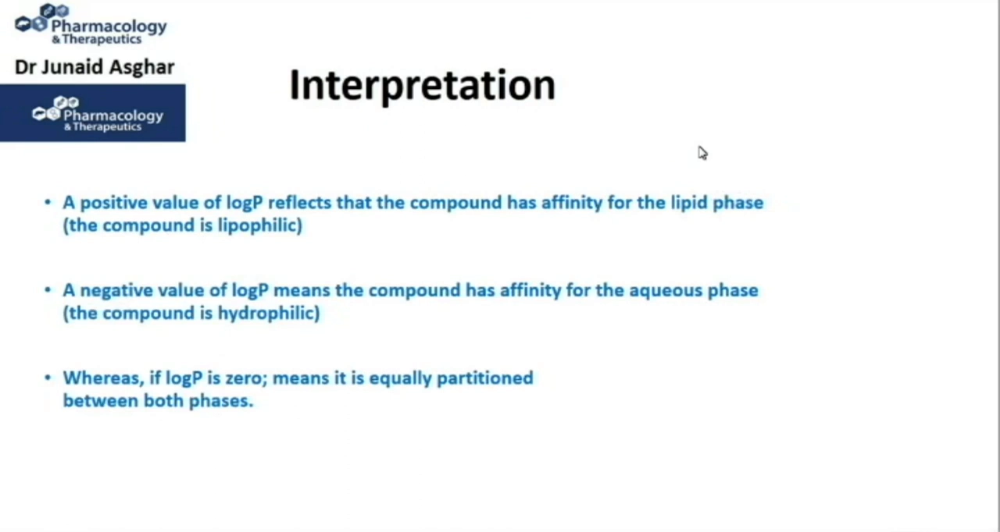
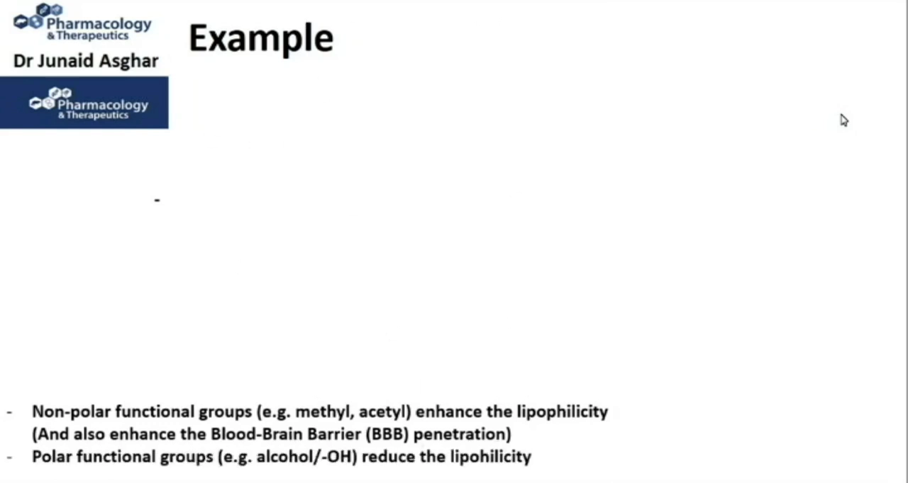
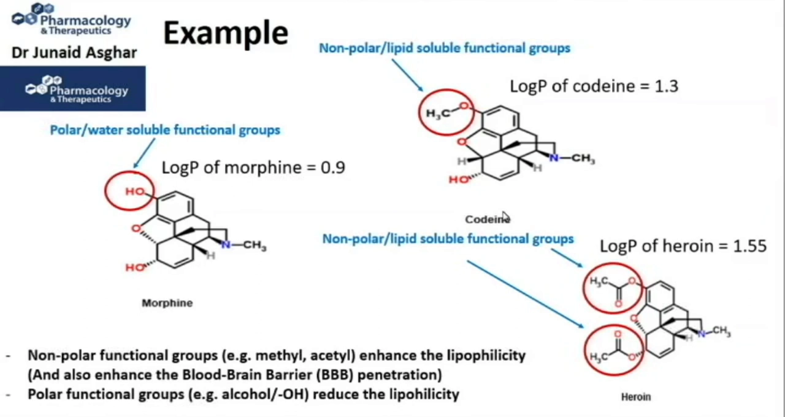
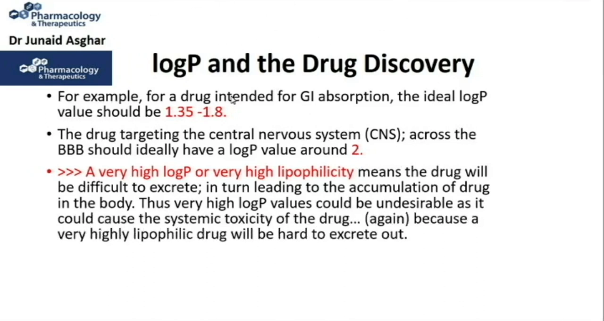

# 辛醇-水为什么成了亲脂性的标准答案：logP 的定义、读法与阈值

> 视频来源：[logP (Partition Coefficient) and Lipid Solubility of Drugs || Junaid Asghar PhD](https://www.youtube.com/watch?v=aX77canCUII)（YouTube · Junaid Asghar PhD）｜时长约 12.5 分钟
> 导读：这支视频从「相似相溶」讲起，把 logP 的定义、辛醇/水的物理依据、对数标度的意义、基团如何移动读数、以及两个经验窗口串成一条线。本文按「为什么是这个体系 → 怎么定义 → 怎么读 → 怎么用」重排，并在末尾接上本系列已讲过的 pH 与 $pK_a$（见 2.1.1 与 1.1.6），本文不重推酸碱平衡。

## 本讲要解决的核心问题（SCQA）

**背景**：药物要跨过细胞膜才能到达作用位点，而细胞膜是脂质的。化学里有一句「相似相溶」：极性液体溶于极性液体，非极性液体彼此混溶。所以「一个药有多爱脂肪」是一件必须被量化的事。

**冲突**：可是实验室报出来的只有一个数——「这个药的 logP 是 4」。这个数来自一个看起来很随意的操作：把药在**正辛醇和水**之间摇匀，等它分层，再测两边的浓度。为什么偏偏是辛醇，而不是植物油、氯仿或环己烷？为什么要把比值取对数？同一个分子只换掉一个基团，读数就从 0.9 跳到 1.55，这 0.65 个单位为什么值得关心？

**疑问**：logP 究竟量的是什么？辛醇/水凭什么成为标准体系？这个数该怎么读，什么范围算合适，什么时候会骗人？

**回答（中心思想）**：logP 是**中性（未电离）形态**在辛醇相与水相中的浓度比取以 10 为底的对数；辛醇之所以成为标准，是因为它一个分子里同时带极性的羟基头和非极性的烃链尾、与水几乎不互溶、密度 0.83 便于分层取相——它用一个简单体系同时模拟了膜的「亲水界面 + 疏水核心」。因此 logP 是一把**分子层面的亲脂性标尺**：它只描述分子本身，不描述某个具体 pH 下的样品；正因为如此，它才有资格被写进经验规则，也正因为如此，它单独使用时必须补上 pH 与 $pK_a$。

## 一、亲脂性是药物性质的「主开关」之一

### 1.1 「爱脂肪」的另一面是「怕水」

[【跳转到 00:25】](https://www.youtube.com/watch?v=aX77canCUII&t=25)

讲者用一句很口语的话定义亲脂性：**亲脂性就是一个化合物的「爱脂肪」，换句话说就是「怕水」**。这句话不是修辞，它直接对应后面那个比值——分子越倾向待在油相，比值越大。

为什么这件事重要？因为**亲脂性是决定药物体内药代动力学、决定它能否穿过各种生物膜与生物屏障的主要因素**，而膜与屏障的通过与否，又会影响一个化合物的吸收、分布、代谢、排泄与毒性，也就是 ADMET 这一整组性质。

[【跳转到 00:50】](https://www.youtube.com/watch?v=aX77canCUII&t=50)

由此得到一对最基本的分类：

| 类别 | 主要溶解环境 | 直观含义 |
| --- | --- | --- |
| 亲水（hydrophilic） | 水 | 水溶性强，但不容易自己穿过脂质膜 |
| 亲脂（lipophilic） | 脂质 | 容易穿过膜，但可能溶不进胃肠液、也难被排出 |

> 补充（非视频内容）：正因为两侧都有代价，药物化学里讨论亲脂性时几乎从不问「越高越好吗」，而是问「落在哪个窗口里」。这一点在第五节会看到具体数字。

### 1.2 相似相溶：先看一个不用仪器的实验

[【跳转到 01:21】](https://www.youtube.com/watch?v=aX77canCUII&t=81)

视频先给了一个最朴素的演示：分液漏斗里装水和植物油，振荡，静置。

分层之后，**密度较大的液体（这里是水）沉在分液漏斗底部，油浮在上面**，因为油的密度更小、比重更低。这个画面里已经包含了后面所有定量测定的三个要素：两相、不互溶、能分开取。

## 二、标准体系为什么是辛醇/水

### 2.1 三个物理事实让它成为「可操作的膜替身」

[【跳转到 02:28】](https://www.youtube.com/watch?v=aX77canCUII&t=148)

要测定药物分子的亲脂性，**最广泛使用的有机相是正辛醇（1-octanol）**——一种众所周知的有机化合物、一种脂肪醇，常被用来评价药物的亲脂性。视频给出三条关键事实：

1. **辛醇的密度是 0.83 g/mL，水是 1 g/mL**，所以辛醇浮在水上面；
2. **两者几乎不互溶**（practically immiscible），这才构成真正的两相，而不是一个混合溶剂；
3. 正因为不互溶且密度有差，**分层后可以分别取样**，两边的浓度才测得出来。

> 补充（非视频内容）：辛醇被选中的化学理由，是它「一半像油、一半像水」——一个羟基提供氢键给体/受体能力，一条八碳直链提供疏水体积。细胞膜的脂双层也是这样：界面处是极性头基与结合水，内部是疏水尾链。用纯的烷烃（如己烷、环己烷）当油相会高估疏水作用、丢掉界面氢键；用氯仿则极性又偏强。辛醇恰好落在这两者之间，所以几十年来成为事实标准。视频本身只讲了「最广泛使用」，这段化学解释是补充。

[【跳转到 03:18】](https://www.youtube.com/watch?v=aX77canCUII&t=198)

讲者给出的定位是：**水/辛醇分配可以作为药物跨细胞膜分配的一个良好近似**；辛醇/水分配系数是药物发现中用来估计化合物的**溶解度、膜通透性和生物利用度**的一个指标。一句话：它不是为了精确复刻膜，而是为了给「亲脂」这件事一个可比较、可复现的刻度。

### 2.2 定义里藏着一个限定词：只算未电离形态

[【跳转到 04:13】](https://www.youtube.com/watch?v=aX77canCUII&t=253)

分配系数的定义是：**在两相体系（正辛醇相与水相）中达到平衡时，未电离（unionized）化合物在有机相中的浓度与水相中的浓度之比**。它也用 $K_{ow}$ 表示，o 代表油（oil）、w 代表水（water）：

$$
P = \frac{[\text{药物}]_{\text{辛醇相}}}{[\text{药物}]_{\text{水相}}}
$$

**「未电离」这三个字是整条定义里最容易被忽略的部分。** 它意味着 $P$ 是一个只属于中性分子的常数：不管你的缓冲液是 pH 2 还是 pH 7.4，只要分子本身没变，$P$ 就不变。

> 这条限定带来的后果，本系列在 1.1.6 已经展开过：真实样品里往往有相当比例的分子是带电的，而带电形态几乎不进油相，于是「某 pH 下所有形态的总分配比」会明显低于 $P$，那个量叫分布系数 $D$，记作 logD。本文不重复推导，只在这里指出**分工**：$P$ 描述分子，$D$ 描述「分子 + 这个 pH 的样品」。

[【跳转到 05:03】](https://www.youtube.com/watch?v=aX77canCUII&t=303)

一个实操细节：**$P$ 值通常在室温 20 到 25 摄氏度下测定**，而讲者明确说「温度对分配系数的影响并不大」。这句话要连着条件一起记——它成立的前提是「室温附近、以中性形态为主的水/辛醇体系」。温度会同时改变两相的互溶度与分子的水合状态，所以跨实验室比对数值时，温度仍然要写进条件里（这一点在本文第三篇、电位滴定法那篇里会看到更严格的要求）。

## 三、取对数：把六个数量级压进一个数

### 3.1 问题不在测量，而在数值范围

[【跳转到 05:24】](https://www.youtube.com/watch?v=aX77canCUII&t=324)

讲者把动机说得很直白：**问题在于我们得到的分配系数值往往极大或极小**，一个很有用的数学工具就是取对数，把这些巨大的数值压缩到便于比较的尺度。

$$
\log P = \log_{10} P
$$

这一步在工程上极其重要：$P$ 可以小到 $10^{-6}$、大到 $10^{6}$，直接列在表格里既难读也难以画图；取对数之后，全部落进 $-6$ 到 $+6$ 这个区间，而且**每 1 个单位就是一个 10 倍的差别**，正好对应「差一个数量级」这种直觉。

### 3.2 四个读数，建立手感

[【跳转到 05:29】](https://www.youtube.com/watch?v=aX77canCUII&t=329)

视频用四个例子建立对数手感：

| 情形 | $P$ | $\log P$ |
| --- | --- | --- |
| 两相等量分配 | 1 | 0 |
| 辛醇中多 100 倍 | 100 | 2 |
| 辛醇中多 100 万倍 | $10^6$ | 6 |
| 水中多 100 万倍 | $10^{-6}$ | −6 |

### 3.3 读法的三条规则

[【跳转到 07:02】](https://www.youtube.com/watch?v=aX77canCUII&t=422)

把上面的例子归纳成三句话，就是 logP 的读法：

- **正值的 logP** 说明化合物对脂相有亲和力，也就是**亲脂**；
- **负值的 logP** 说明化合物对水相有亲和力，也就是**亲水**；
- **logP 等于 0** 表示它在两相之间**等量分配**。

> 补充（非视频内容）：这三个规则只在「同一套辛醇/水体系、同一温度」下可比。换油相（例如氯仿/水、环己烷/水）会得到另一套数值，绝对大小不可直接混用——这也是为什么文献里报 logP 必须注明体系。

## 四、基团如何移动 logP：一个真实的三级台阶

### 4.1 两类基团，两个方向

[【跳转到 08:07】](https://www.youtube.com/watch?v=aX77canCUII&t=487)

讲者把「怎么改结构来调亲脂性」压缩成两条：

- **非极性基团**（例如甲基、乙酰基）加到分子上会**增强亲脂性**；
- **极性基团**（例如醇羟基 −OH）会**降低亲脂性**，也就是提高亲水性。

同时他补了一句关键的方向性结论：**提高亲脂性往往会增加血脑屏障的穿透**，从而使只有高脂溶性的物质能进入脑组织。

### 4.2 吗啡 0.9 → 可待因 1.3 → 海洛因 1.55

[【跳转到 09:02】](https://www.youtube.com/watch?v=aX77canCUII&t=542)

视频用三个结构几乎相同、只差几个基团的分子做了对照：

| 分子 | 改了什么 | logP | 血脑屏障穿透 |
| --- | --- | --- | --- |
| 吗啡（morphine） | 基准，带一个极性羟基 | 0.9 | 最低 |
| 可待因（codeine） | 加一个甲基（非极性） | 1.3 | 更高 |
| 海洛因（heroin） | 再加两个乙酰基（非极性） | 1.55 | 三者最高 |

讲者的结论是：**海洛因脂溶性如此之高、透过血脑屏障的能力如此之强，因此被认为是已知最容易成瘾的物质之一**。

> 补充（非视频内容，属本节归纳）：这个例子值得多看一眼的地方在于**幅度**。从吗啡到海洛因，logP 只涨了 0.65，也就是辛醇里的分配多了约 4.5 倍（$10^{0.65} \approx 4.5$），但临床与行为上的差别是数量级的。这提醒我们：logP 是连续标尺，不是开关；而在接近阈值的地方，0.5 个单位就足以改变一个分子的用途。

## 五、阈值与代价：logP 不是越高越好

### 5.1 两个经验窗口

[【跳转到 10:11】](https://www.youtube.com/watch?v=aX77canCUII&t=611)

亲脂性在药物发现与化合物设计中扮演重要角色，通常就用 logP 来量化——在诸多筛选标准中，新药会用 logP 值来衡量亲脂性。视频给出两个具体窗口：

| 目标 | 理想 logP 区间 |
| --- | --- |
| 胃肠道（GI）吸收 | **1.35 – 1.8** |
| 中枢神经系统（CNS）、需穿血脑屏障 | **约 2** |

### 5.2 太高的代价：排不掉

[【跳转到 10:36】](https://www.youtube.com/watch?v=aX77canCUII&t=636)

讲者紧接着给了反面：**logP 过高、也就是亲脂性过强，意味着药物难以被排泄，进而在体内蓄积，因此过高的 logP 并不可取，可能引起全身毒性**——理由很朴素：高亲脂性的药物很难被排出体外。

> 补充（非视频内容）：这条「太高也不行」的约束，与 Lipinski 类规则里对 logP 的上界要求是同一个逻辑——亲脂性帮助穿膜，但超过一定值后，溶解度、代谢清除与蛋白结合会一起变差。具体阈值在不同规则集里略有差异，本文只保留视频给出的两个窗口。

### 5.3 一个必须补上的变量：pH 与 $pK_a$

[【跳转到 11:01】](https://www.youtube.com/watch?v=aX77canCUII&t=661)

视频最后自己给出了限定：**除了 logP，了解药物的 $pK_a$ 和介质的 pH 同样重要**。因为药物在体内的情况没那么简单，还有许多其他因素对分子的亲脂性起关键作用，例如药物的 $pK_a$ 和介质的 pH。

这句话正是本小节的落点：**logP 是分子属性，logD 是「分子 + 环境」属性**。前者回答「这个分子天生多爱脂肪」，后者回答「在胃里 pH 1.5、在血里 pH 7.4、在肿瘤微环境 pH 6.5 时，这个样品实际上多爱脂肪」。两者的换算关系（$\log D = \log P + \log f_{\text{中性}}$）与 $pK_a$ 的角色，本系列已在 1.1.6 与 2.1.1 讲过，这里只做引用，不再推导。

## 小结

- **logP 量的是「中性形态」在两相中的浓度比**，取以 10 为底的对数；定义里的「未电离」限定决定了它与 pH 无关。
- **辛醇/水成为标准体系**，靠的是三条物理事实：与水几乎不互溶、密度 0.83 便于分层取相、一个分子里同时有极性头与疏水尾，能粗略模拟膜的界面与内核。
- **取对数是为了压缩量程**：$P$ 可以横跨 12 个数量级，logP 落在 −6 到 +6，每 1 个单位等于 10 倍。
- **读法三句话**：正值亲脂、负值亲水、零为等量分配。
- **基团决定方向**：非极性基团（甲基、乙酰基）推高 logP，极性基团（羟基）拉低 logP；吗啡 0.9 → 可待因 1.3 → 海洛因 1.55 是同一骨架上的三级台阶。
- **经验窗口**：GI 吸收 1.35–1.8，CNS 约 2；过高则难排泄、易蓄积、可能带来全身毒性。
- **logP 单独用会骗人**：它不随 pH 变，而真实样品永远在某个 pH 下，所以必须补上 $pK_a$ 与 pH，改用 logD 描述样品。

## 关键术语速查

| 术语 | 一句话解释 |
| --- | --- |
| 亲脂性（lipophilicity） | 物质对脂相/有机相的亲和力，口语说法是「爱脂肪、怕水」 |
| 分配系数 $P$ | 平衡时未电离形态在辛醇相与水相中的浓度之比，也写作 $K_{ow}$ |
| logP | $P$ 的以 10 为底对数，把跨数量级的比值压到便于比较的尺度 |
| 正辛醇（1-octanol） | 密度 0.83 g/mL 的脂肪醇，与水几乎不互溶，是 logP 的标准有机相 |
| 未电离形态 | 不带净电荷的中性分子形态；只有它被计入 $P$ |
| 分布系数 logD | 某 pH 下所有形态的总分配比取对数，随 pH 变化；与 logP 的分工见 1.1.6 |
| 血脑屏障（BBB） | 脑毛细血管的选择性屏障，亲脂性不足的分子难以通过 |
| ADMET | 吸收、分布、代谢、排泄与毒性，一组由亲脂性等理化性质驱动的性质 |