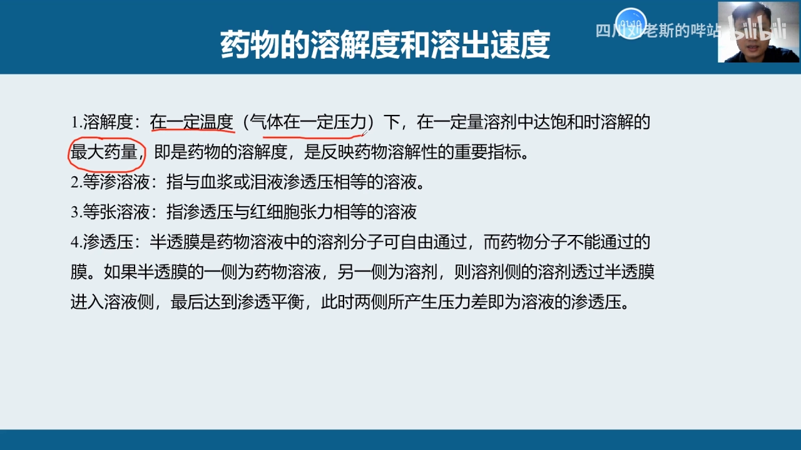
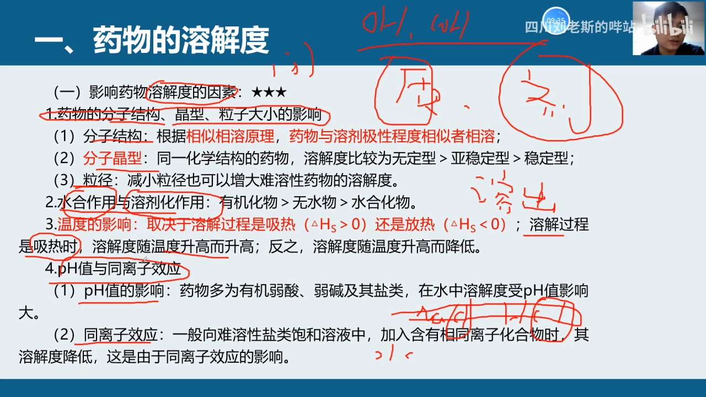
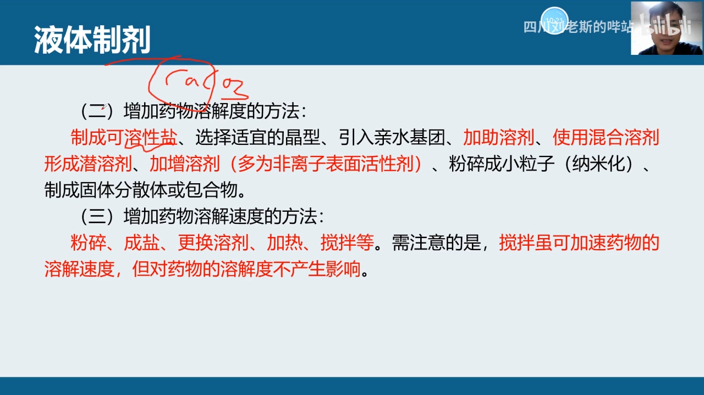
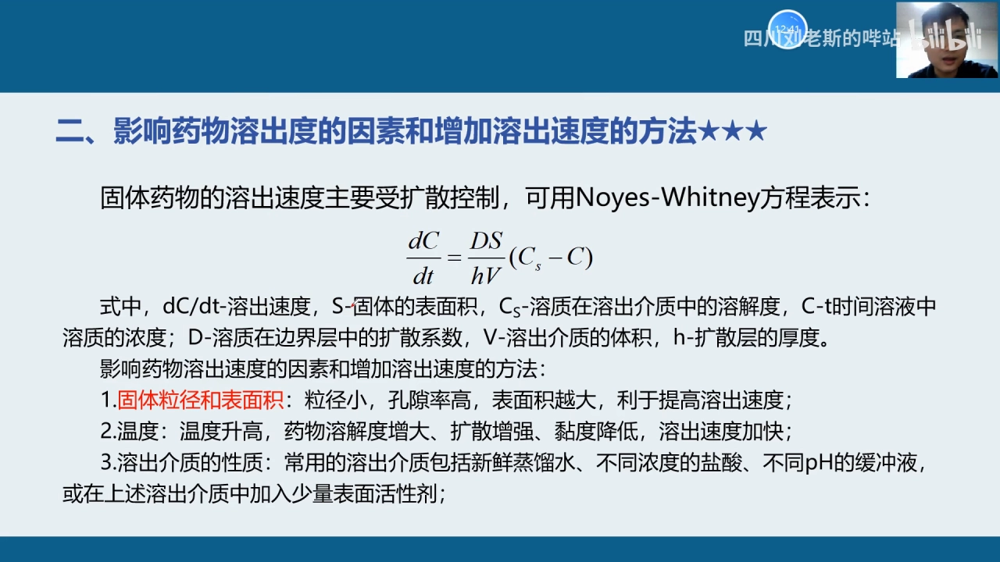
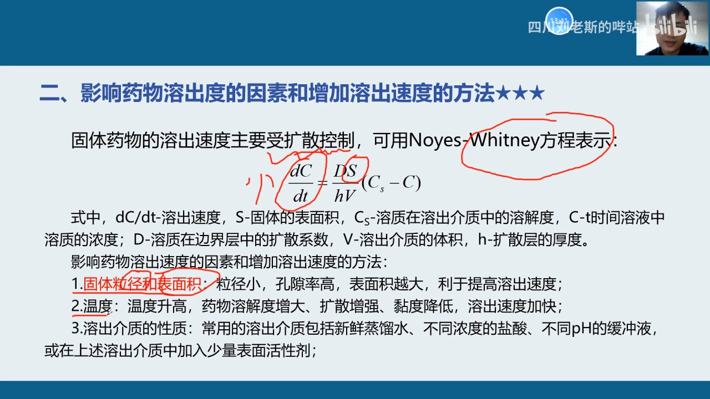
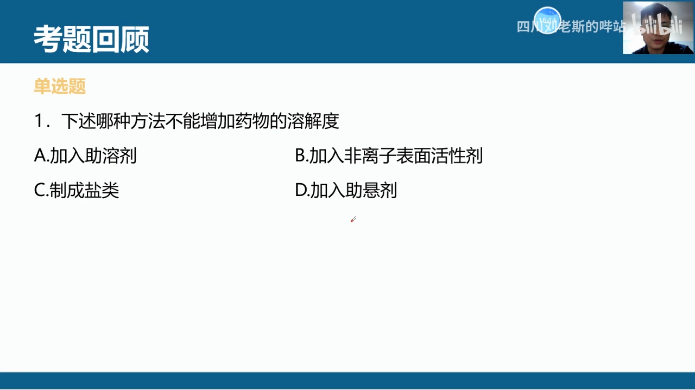
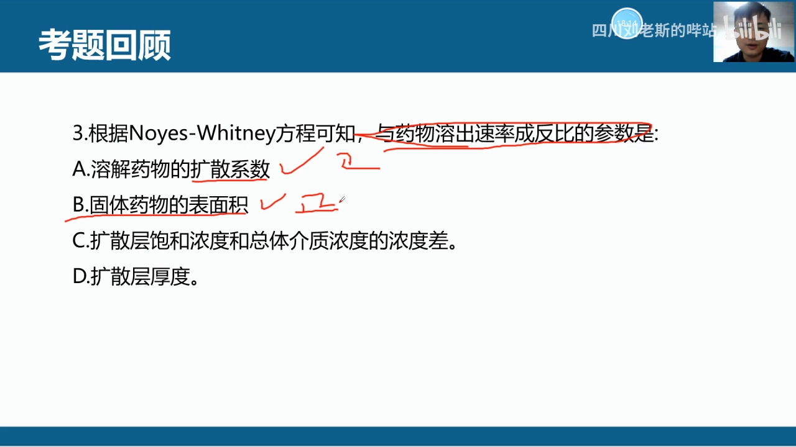

# 升高温度一定让药更溶吗：溶解度与溶出速度是两套规则

> 视频来源：[01761药剂学二｜第二章-药物的溶解度和溶出速度](https://www.bilibili.com/video/BV1fs4y1G7sV/)（Bilibili · 四川刘老斯的哔站）｜时长约 19 分钟
> 导读：这是一节药剂学期末复习课，把「溶解度」和「溶出速度」两个常被混用的概念拆开讲：前者是平衡上限，只受四类因素影响；后者是快慢，由 Noyes-Whitney 方程里的表面积、扩散系数、扩散层厚度和浓度差决定。加热和搅拌只改速度、不改上限——这是全课最容易做错的一道判断题。

## 本讲要解决的核心问题（SCQA）

**背景**：药典和教材都用「在一定温度下、100 毫升溶剂中最多能溶解多少药」来定义溶解度，这是一个平衡值，可以查表、可以比较。

**冲突**：实验室里想让难溶药快点溶，最常用的手段是加热和搅拌。于是很容易顺手推出「加热能提高溶解度」。但这句推断是错的：讲者明确说，**升高温度不一定会增加药物的溶解度**，它取决于溶解过程是吸热还是放热；而**升高温度一定会加快溶出速度**。

**疑问**：既然两个词都带"溶"，到底哪些操作改的是上限、哪些改的是快慢？各自的依据是什么？

**回答（中心思想）**：**溶解度是平衡上限，溶出速度是达到上限的快慢**，两者的控制变量完全不同。溶解度只受四类因素影响——溶质自身（分子结构、晶型、粒径）、溶剂（水合与溶剂化）、温度（通过溶解焓 $\Delta H_{\mathrm{sol}}$ 的正负）、以及溶液中的 pH 与同离子效应。溶出速度则由 Noyes-Whitney 方程控制，改的是表面积、扩散系数、扩散层厚度、介质体积和浓度差。搅拌、升温这类操作动的是速度项，不是上限项。

## 一、先把两个词分开：一个是"最多溶多少"，一个是"多快溶到"

### 1.1 溶解度的定义里必须带条件

[【跳转到 00:31】](https://www.bilibili.com/video/BV1fs4y1G7sV/?t=31)

讲者反复强调，答名词解释时要把条件说全：溶解度是**在一定温度（气体还要在一定压力）下，在一定量溶剂中达到饱和时溶解的最大药量**，一般写成"100 毫升溶剂中能溶解的最大量"。

[【跳转到 01:31】](https://www.bilibili.com/video/BV1fs4y1G7sV/?t=91)

这一页还顺带给了另外三个名词（属于液体制剂的范围，这里只记结论）：

- **等渗溶液**：与血浆或泪液渗透压相等的溶液；
- **等张溶液**：与红细胞张力（渗透压）相等的溶液；
- **渗透压**：半透膜两侧达到渗透平衡时所产生的压力差。

讲者给的对应关系是：**等张溶液一定是等渗溶液，等渗溶液不一定是等张溶液**——0.9% 氯化钠既等张又等渗，而 5% 葡萄糖是等渗溶液，却不是等张溶液。

### 1.2 区别就一句话：一个说量，一个说快慢

[【跳转到 15:43】](https://www.bilibili.com/video/BV1fs4y1G7sV/?t=943)

课程最后用一页把区别钉死：

- **溶解度**：一定温度（气体在一定压力）下、一定溶剂中能溶解药物的**最大量**；
- **溶解速度（溶出速度）**：**单位时间**内溶解药物的量；
- **适当搅拌可加速溶解速度，不影响溶解度**。

最后这一句是整节课的"分水岭"。判断一个操作改的是哪个量，就看它是否改变了"平衡时溶液里能容纳多少药"。

## 二、影响溶解度的四类因素

[【跳转到 09:36】](https://www.bilibili.com/video/BV1fs4y1G7sV/?t=576)

讲者把这一题的标准答案压成四条：**与溶质有关、与溶剂有关、与温度有关、与溶液中的 pH 值和同离子效应有关**。

### 2.1 溶质自身：结构、晶型、粒径

- **分子结构**：依据**相似相溶原理**，药物与溶剂极性程度相似者相溶。分子里带羟基、羧基这类亲水基团，极性和亲水性就强，更容易溶于水；完全不带亲水基团的分子，水溶性一般就低。
- **分子晶型**：同一化学结构，**溶解度比较为无定形 > 亚稳定型 > 稳定型**。这条是本节与「晶型」那篇的接口：晶型不同，晶格能不同，打破晶格所需的能量不同，表观溶解度就不同。
- **粒径**：减小粒径也可以增大难溶药物的溶解度。讲者在这里的说法是"粒径越小，溶解度会相应提高"——严格说，粒径主要改的是溶出速度（见第四节），只有在粒子小到纳米尺度、曲率带来的额外化学势不可忽略时才对溶解度有实质贡献。这一点讲者没有展开，读者按"主要影响速度"理解更稳妥。

### 2.2 溶剂：水合作用与溶剂化作用

如果溶质与溶剂能很好地融合，就会形成**水合作用**（溶剂为水时）或更一般的**溶剂化作用**，溶解度随之增大。教材给的顺序是：**有机物 > 无水物 > 水合物**——已经带着结晶水的药物，等于已经"用掉"了一部分水合能力，再溶进水里的驱动力就小。

### 2.3 温度：取决于溶解过程吸热还是放热

[【跳转到 06:56】](https://www.bilibili.com/video/BV1fs4y1G7sV/?t=416)

这是全课最容易被考倒的一点。讲者的推理很朴素：

- 如果溶解过程**吸热**（$\Delta H_{\mathrm{sol}} > 0$），它需要热，升温就把平衡推向"更多溶解"，**溶解度随温度升高而升高**；
- 如果溶解过程**放热**（$\Delta H_{\mathrm{sol}} < 0$），它不需要额外的热，再升温反而把平衡推回去，**溶解度随温度升高而降低**。

所以"升高温度溶解度一定升高"这句话是**错的**。但紧接着的一句一定对：**升高温度，溶出速度一定会加快**。

这个"不一定 / 一定"的对照，正好说明两个概念受不同规律支配：温度对溶解度的影响是**热力学**的（看 $\Delta H$ 符号），对溶出速度的影响是**动力学**的（分子运动更快、黏度更低、扩散更强）。

[【跳转到 07:56】](https://www.bilibili.com/video/BV1fs4y1G7sV/?t=476)

### 2.4 溶液：pH 值与同离子效应

- **pH 值**：药物多为有机弱酸、弱碱及其盐类，在水中的溶解度受 pH 值影响很大。酸碱性如何决定带电状态，见 2.1.1 那两篇（$pK_a$ 与 Henderson–Hasselbalch）；这里只记结论：**改变 pH 等于改变"哪种物种在溶"，表观溶解度随之改变**。
- **同离子效应**：一般向难溶性盐类的饱和溶液中，加入含有**相同离子**的化合物时，其溶解度降低。讲者举的例子是盐酸盐药物放进氯化钠溶液——两者都提供氯离子，共同离子把平衡推向析出。

## 三、增溶的六种办法：注意这里没有"升温"

[【跳转到 10:02】](https://www.bilibili.com/video/BV1fs4y1G7sV/?t=602)

"增加溶解度的方法"是另一道常考问答题。讲者列出的办法可以归成三组：

1. **改分子或改固体状态**：制成可溶性盐（碳酸钙难溶、氯化钙易溶，就是这个思路）、选择适宜的晶型、引入亲水基团；
2. **改溶剂**：加助溶剂、使用混合溶剂形成潜溶剂、加增溶剂（多为非离子表面活性剂）；
3. **改分散状态**：粉碎成小粒子（纳米化）、制成固体分散体或包合物。

讲者特意点了一句：**这一组里没有温度**。因为升温不一定能增加溶解度，把它写进"增溶方法"就是错的。

而"增加溶解速度的方法"是另一组：**粉碎、成盐、更换溶剂、加热、搅拌**。两者的交集（成盐、粉碎）说明有些手段同时改上限和速度，但**加热和搅拌只改速度**。

## 四、溶出速度：Noyes-Whitney 方程把"快慢"拆成五项

[【跳转到 12:42】](https://www.bilibili.com/video/BV1fs4y1G7sV/?t=762)

固体药物的溶出速度主要受**扩散**控制，可用 Noyes-Whitney 方程表示：

$$
\frac{dC}{dt} = \frac{DS}{hV}\left(C_s - C\right)
$$

各符号的含义（教材原文）：

| 符号 | 含义 | 怎么影响速度 |
| --- | --- | --- |
| $dC/dt$ | 溶出速度 | 被求的量 |
| $S$ | 固体的表面积 | 越大越快（正比） |
| $C_s$ | 溶质在溶出介质中的溶解度 | 出现在浓度差里，越大越快 |
| $C$ | $t$ 时刻溶液中溶质的浓度 | 越接近 $C_s$ 越慢 |
| $D$ | 溶质在边界层中的扩散系数 | 越大越快（正比） |
| $V$ | 溶出介质的体积 | 在分母，体积越大越快 |
| $h$ | 扩散层的厚度 | 在分母，越厚越慢（反比） |

讲者逐项讲了影响因素，正好可以按方程对号入座：

- **固体粒径和表面积**：粒径小、孔隙率高、表面积大，利于提高溶出速度；
- **温度**：温度升高，药物溶解度增大、扩散增强、黏度降低，溶出速度加快；
- **溶出介质的性质**：常用新鲜蒸馏水、不同浓度的盐酸、不同 pH 的缓冲液，或在这些介质中加入少量表面活性剂（[跳转到 13:42](https://www.bilibili.com/video/BV1fs4y1G7sV/?t=822)）；
- **溶出介质的体积**：体积小，溶出到后面越来越慢（因为 $C$ 逼近 $C_s$）（[跳转到 14:09](https://www.bilibili.com/video/BV1fs4y1G7sV/?t=849)）；
- **扩散系数**：扩散系数越大，溶出越快；
- **扩散层厚度**：扩散层越厚，溶出越慢——搅拌的作用就是减小 $h$。

这里能看出为什么"搅拌只加速不改上限"：搅拌改的是 $h$，而 $h$ 只出现在速度方程里，不出现在"饱和浓度"的定义里。

## 五、两道题检验：错在哪里

[【跳转到 16:07】](https://www.bilibili.com/video/BV1fs4y1G7sV/?t=967)

**第一题**：下述哪种方法不能增加药物的溶解度？A. 加入助溶剂 B. 加入非离子表面活性剂 C. 制成盐类 D. 加入助悬剂。

答案是 **D**。助溶剂、表面活性剂（增溶剂）、成盐都能提高溶解度；**助悬剂的作用是增加混悬剂介质的黏度**，让颗粒别沉降，跟溶解度无关。

**第二题**：根据 Noyes-Whitney 方程，与药物溶出速率成反比的参数是？A. 溶解药物的扩散系数 B. 固体药物的表面积 C. 扩散层饱和浓度和总体介质浓度的浓度差 D. 扩散层厚度。

答案是 **D**。$D$、$S$、$(C_s - C)$ 都在分子上，是正比；只有扩散层厚度 $h$ 在分母上，是反比。

[【跳转到 17:35】](https://www.bilibili.com/video/BV1fs4y1G7sV/?t=1055)

## 六、补充：这两个数在生物药剂学里怎么用（非视频内容）

> 以下为补充背景，讲者未在视频中展开。

把"上限"和"速度"分开，正好对应口服吸收的两道关卡：

- **上限不够**：溶出介质里的 $C_s$ 太低，浓度差 $(C_s - C)$ 小，肠道里始终溶不出足够的药。这类分子属于**溶解度限制**，通常落在 BCS II 类（低溶解、高渗透）；
- **速度不够**：$C_s$ 够，但表面积小、扩散层厚，短时间内溶不出来，同样吸收不足。

工程上常用**剂量数**（dose number，$D_0$ = 最高剂量 /（$C_s$ × 250 mL））来粗略判断"这个剂量能不能溶在 250 毫升水里"：$D_0 \le 1$ 说明剂量能被一杯水溶掉，$D_0 \gg 1$ 说明溶解会成为限速步骤。这个判据与 BCS 的溶解度分类同源，细节属于 2.2 生物可及性那一节。

## 小结

- **溶解度是上限，溶出速度是快慢**；搅拌只加速、不改上限，这是判断一切"能不能增溶"问题的分水岭。
- **溶解度受四类因素控制**：溶质（结构、晶型、粒径）、溶剂（水合与溶剂化）、温度（看 $\Delta H_{\mathrm{sol}}$ 正负）、溶液（pH 与同离子效应）。
- **晶型顺序**：无定形 > 亚稳定型 > 稳定型；水合顺序：有机物 > 无水物 > 水合物。
- **升温不一定增溶，但一定加快溶出**——前者是热力学问题，后者是动力学问题。
- **增溶六法**：成盐、选晶型、引亲水基、助溶剂/潜溶剂/增溶剂、微粉化、固体分散体或包合物；升温不在其中。
- **Noyes-Whitney 方程** $\frac{dC}{dt} = \frac{DS}{hV}(C_s - C)$：$D$、$S$、$(C_s-C)$、$V$ 正比，$h$ 反比。
- **助悬剂不是增溶剂**：它改的是介质黏度，不是溶解度。

## 关键术语速查

| 术语 | 一句话解释 |
| --- | --- |
| 溶解度 | 一定温度（气体另加一定压力）下、一定量溶剂中能溶解药物的最大量 |
| 溶出速度 | 单位时间内溶解药物的量，与溶解度不是同一个量 |
| 相似相溶原理 | 药物与溶剂极性程度越接近，越容易互溶 |
| 水合作用 / 溶剂化作用 | 溶质与溶剂结合形成水合（溶剂化）层，使溶解度增大 |
| 溶解焓 $\Delta H_{\mathrm{sol}}$ | 溶解过程吸热为正、放热为负，决定升温时溶解度升还是降 |
| 同离子效应 | 加入含相同离子的化合物使难溶盐溶解度下降 |
| 助溶剂 / 潜溶剂 / 增溶剂 | 分别通过复合、混合溶剂、胶束增溶提高溶解度的辅料 |
| 助悬剂 | 增加混悬剂介质黏度、延缓沉降的辅料，不提高溶解度 |
| Noyes-Whitney 方程 | 描述扩散控制溶出速度的方程，含表面积、扩散系数、扩散层厚度与浓度差 |