# 同一分子不同晶型：无定形溶得更多，却守不住

> 视频来源：[药剂学第9版_第四章_药物多晶型](https://www.bilibili.com/video/BV1sNa7zREZe/)（Bilibili · 冰熊熊一个）｜时长约 9.5 分钟
> 导读：这是一节对着教材勾画的复习课，讲的是「同一个分子、不同的堆积方式」如何改掉一个药的熔点、溶解度、溶出速率与稳定性，以及这些差异怎么表征、怎么在生产中被无意改掉。本文按「是什么 → 怎么造 → 怎么证明 → 改了什么 → 对制剂意味着什么」重排，末尾补一段亚稳态与过饱和的关系（已标明为补充）。

## 本讲要解决的核心问题（SCQA）

**背景**：在化学身份那一层，一个药就是一张结构式——SMILES、InChI、分子量都唯一确定。同一张结构式，就应该有同一套性质。

**冲突**：现实里不是。同一个分子可以长成不同的晶体，甚至长成没有晶格的固体。它们的熔点不同（巴比妥晶型 I 是 190 ℃，晶型 II 是 183.5 ℃）、溶解度不同、稳定性不同、可压性也不同。更麻烦的是，生产中的研磨、制粒、压片、干燥、冷冻都可能把一种晶型变成另一种，而溶解度、生物利用度跟着一起变。

**疑问**：这些"同分不同相"的固体到底怎么分类？它们怎么被造出来、又怎么被认出来？对制剂和生物利用度的影响有多大？

**回答（中心思想）**：**晶型是同一分子的不同堆积方式**，它改变的是**晶格能**，因此同时改变熔点、溶解度、溶出速率与稳定性这条链上的每一个量：晶格越不稳定，熔点越低、表观溶解度越大、越容易转变成稳定晶型。**无定形**（没有长程有序）是这条链的极端——表观溶解度最高，但也最不稳定。多晶型对**生物利用度**的影响大小，取决于"溶解是不是吸收的限速步骤"：对 BCS II 类（低溶解、高渗透）药物影响最大，必须严格控制；对 BCS I、III 类风险较低。

## 一、晶体、无定形、多晶型：三个定义

[【跳转到 00:15】](https://www.bilibili.com/video/BV1sNa7zREZe/?t=15)

教材按内部原子、离子、分子的排列状态，把固体药物分成两类：

- **晶体（crystal）**：内部原子、离子、分子在三维空间有**规律的周期性排列**；
- **无定形（amorphism）**：内部原子、离子、分子呈**无规则排列**。

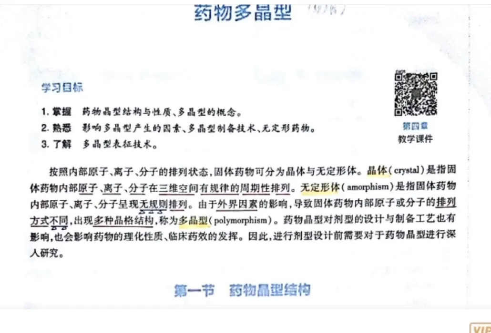

在此基础上，**多晶型（polymorphism）** 的定义是：由于外界因素的影响，导致固体药物内部原子或分子的排列方式不同，出现**多种晶格结构**。

这里要区分两个容易混的词（教材在下一页专门讲了）：

- **晶型**：结晶物质**晶格内**分子的排列方式。同一种物质因结晶条件不同，分子间作用力和分子构象改变，导致排列与堆积方式不同，这种同种物质形成不同晶型的现象叫**同质多晶现象**；
- **晶癖**：结晶的**外观形态**。食盐（NaCl）的晶体本来是立方体，但水溶液里加入尿素杂质，可以让食盐长出正八面体的外形——外形变了，晶格没变。

一句话记：**晶癖是"长什么样"，晶型是"里面怎么排"**。

[【跳转到 00:56】](https://www.bilibili.com/video/BV1sNa7zREZe/?t=56)

教材还补了一句基础事实：几乎所有的晶体都是由**七种基础晶胞**做成的，晶胞参数包括 a、b、c 三条边与 α、β、γ 三个夹角。

## 二、多晶型的三种类型

[【跳转到 01:49】](https://www.bilibili.com/video/BV1sNa7zREZe/?t=109)

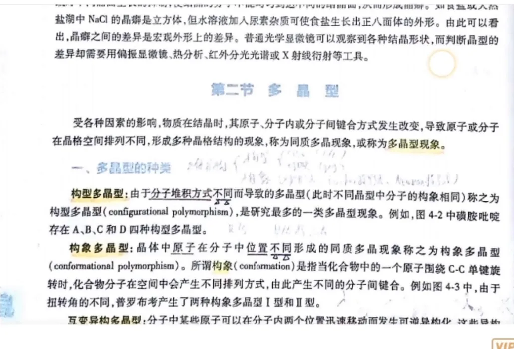

| 类型 | 差异在哪里 | 例子与要点 |
| --- | --- | --- |
| **构型多晶型** | 由于**分子堆积方式**不同导致，此时不同晶型中分子的构象相同 | 研究最多的一类；磺胺吡啶有 A、B、C、D 四种构型多晶型 |
| **构象多晶型** | 晶体中**原子在分子中的位置**不同（构象不同） | 单键旋转产生不同排列与分子间键合；普罗布考有 I、II 两种构象多晶型 |
| **互变异构多晶型** | 分子中某些原子在分子内两个位置间迅速移动，产生**可逆**异构化 | 酮式–烯醇式互变异构 |

讲者在讲这一页时顺带补了有机化学的区分：构型层面有顺反（Z/E）与对映异构（R/S、D/L），构象层面有楔形式、Fischer 投影式、纽曼式等表示法。这些是理解"构型多晶型 vs 构象多晶型"的前置知识。

## 三、怎么造出不同的晶型

[【跳转到 03:22】](https://www.bilibili.com/video/BV1sNa7zREZe/?t=202)

教材列了三条主线：

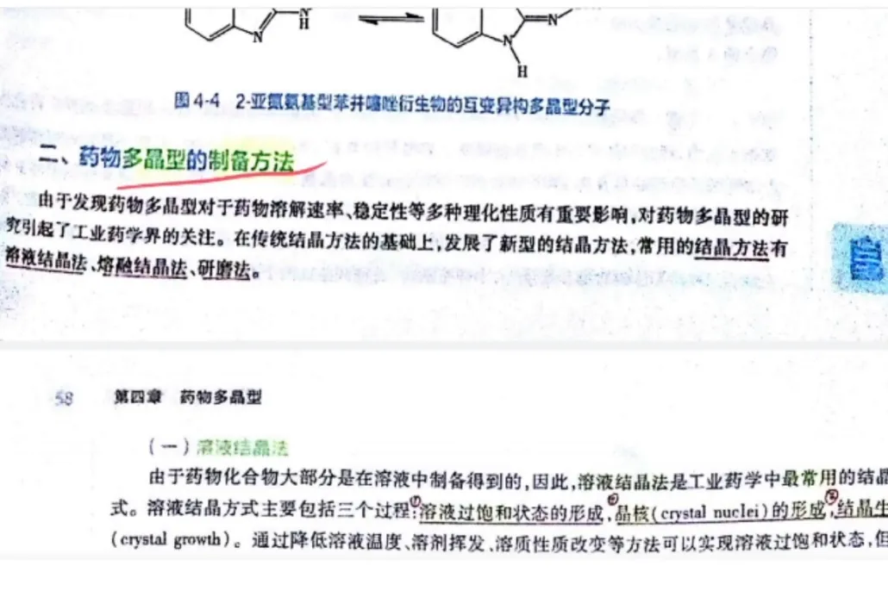

**1. 溶液结晶法**（工业药学中最常用，因为多数药物本来就在溶液里制备）。它包含三个过程：

1. 溶液**过饱和**状态的形成；
2. **晶核**（crystal nuclei）的形成；
3. **结晶生长**（crystal growth）。

实现过饱和的手段包括降温、溶剂挥发、改变溶质性质等。按操作方式又分：**冷却结晶**（实验室与大生产首选）、蒸发结晶、反溶剂结晶、反应结晶等。

**2. 熔融结晶法**：多数药物在接近熔点的温度下会分解，所以应用比较少。

**3. 晶格物理破坏法**：就是常用的**研磨法**。此外还有**热处理**（如低熔点晶型在一定温度下转为高熔点晶型）和**加入添加物结晶**（少量添加物可促进或抑制结晶生长，甚至通过与特定晶面结合改变晶癖）。

## 四、共晶：另一条改性质的路

[【跳转到 04:19】](https://www.bilibili.com/video/BV1sNa7zREZe/?t=259)

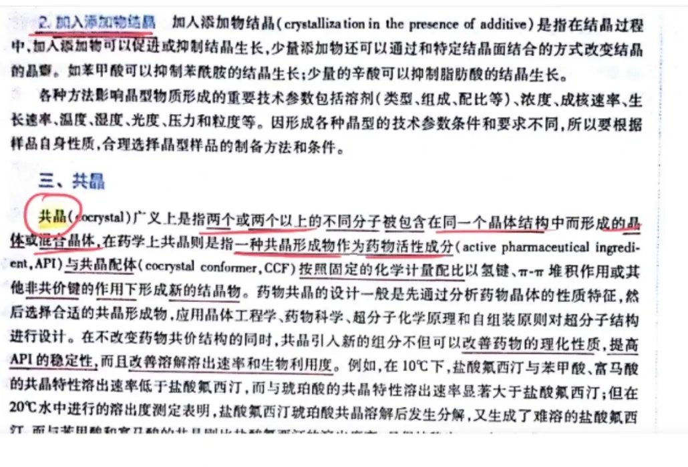

**共晶（cocrystal）** 广义上指两个或两个以上的不同分子被包含在同一个晶体结构中而形成的晶体或混合晶体。药学上的定义更具体：一种共晶形成物作为**药物活性成分（API）**，与**共晶配体（CCF）** 按固定的化学计量配比，以氢键、$\pi$-$\pi$ 堆积或其他**非共价键**作用形成的新的结晶物。

它和"多晶型"的区别在于：多晶型只动堆积方式，**共晶引入了新组分**。教材给的收益是——在不改变药物共价结构的前提下，共晶可以改善理化性质、提高 API 稳定性、改善溶解与溶出速率和生物利用度。

制备上有个实用细节：**研磨通常可以获得亚稳定的共晶**；研磨时加入少许有机溶剂有时能加快共晶形成，但要**避免所用溶剂与药物形成溶剂化物**。

## 五、怎么证明它是哪种晶型

[【跳转到 05:29】](https://www.bilibili.com/video/BV1sNa7zREZe/?t=329)

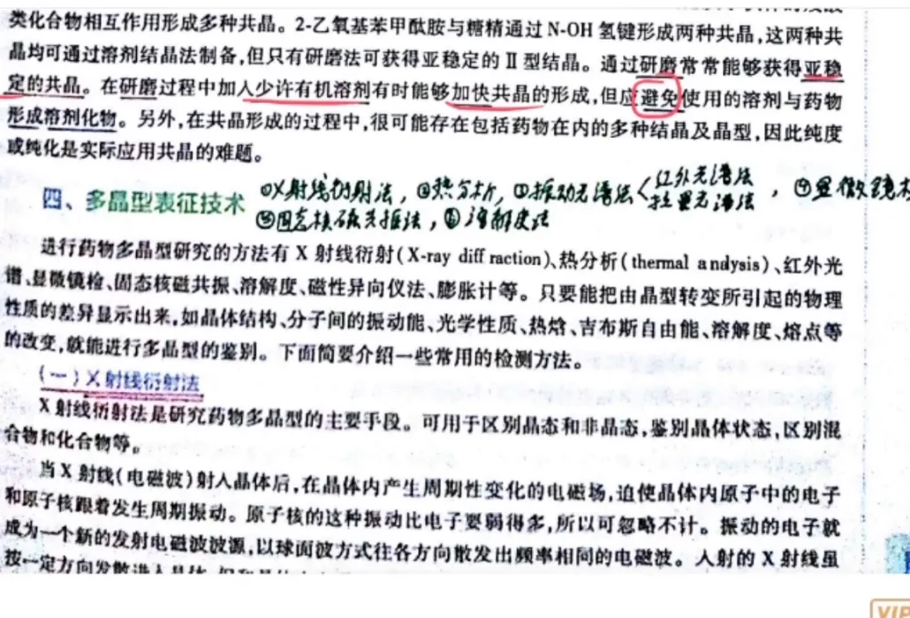

教材列了六类方法，思路都是"把由晶型转变引起的物理性质差异显示出来"：

1. **X 射线衍射法**：研究多晶型的**主要手段**，可用于区别晶态与非晶态、鉴别晶体状态、区分混和物与化合物；
2. **热分析法**：差示扫描量热法、热重分析法、热机械分析法；
3. **振动光谱法**：红外光谱法与拉曼光谱法；
4. **显微镜法**：普通显微镜、偏光显微镜、热台显微镜；
5. **固态核磁共振法**（SSNMR）：非破坏性，广泛用于辨别原料药与制剂中药物存在的形式，以及区分共晶和水合物；
6. **溶解度法**：见下一节。

X 射线衍射的物理基础是 Bragg 方程：

$$
2d\sin\theta = n\lambda
$$

其中 $d$ 是晶面间距，$\theta$ 是衍射角（Bragg 角），$\lambda$ 是 X 射线波长，$n$ 是整数。测量时以 $2\theta$ 为横坐标、衍射强度 $I$ 为纵坐标作图，从峰位算出 $d$，从峰强比得到信息。

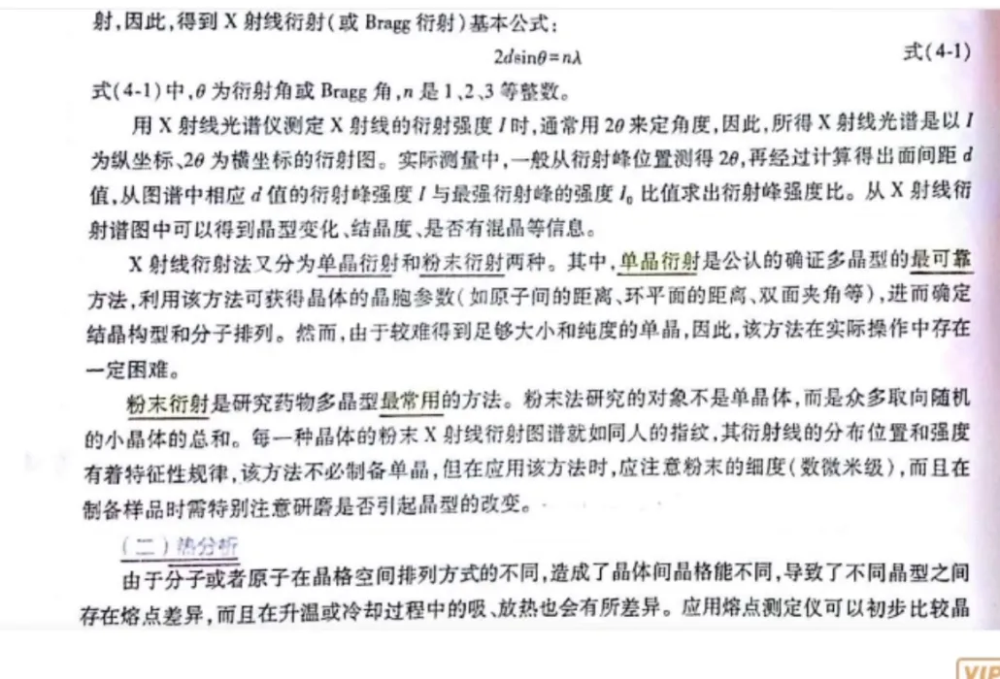

两种衍射的分工很清楚：

[【跳转到 05:53】](https://www.bilibili.com/video/BV1sNa7zREZe/?t=353)

- **单晶衍射**是公认**确证多晶型最可靠**的方法，能给出晶胞参数（原子间距离、环平面距离、双面夹角等），进而确定结晶构型与分子排列；难点是难以得到足够大小和纯度的单晶；
- **粉末衍射**是研究药物多晶型**最常用**的方法。每种晶体的粉末衍射图谱"如同人的指纹"，峰位与强度有特征规律，且不必制备单晶。但要**注意粉末细度**（数微米级），并且制样时**研磨是否引起晶型改变**——这句话很关键：表征手段本身可能改变被表征的对象。

## 六、晶型改变了什么：熔点、溶解度、稳定性

[【跳转到 06:46】](https://www.bilibili.com/video/BV1sNa7zREZe/?t=406)

教材把影响归成三条：**熔点、溶解度与溶出速率、稳定性**。

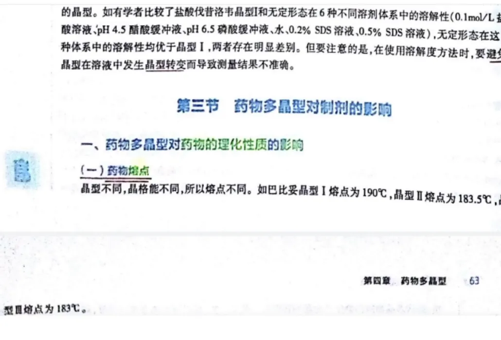

### 6.1 熔点：晶格能的直接读数

晶型不同，**晶格能**不同，所以熔点不同。教材的例子是巴比妥：晶型 I 熔点 190 ℃，晶型 II 熔点 183.5 ℃。熔点高的那个晶型晶格更稳、破坏晶格需要的能量更多——这直接决定了它在溶剂里"愿意"溶出多少。

### 6.2 溶解度：晶型越不稳定，溶解度越大

[【跳转到 06:29】](https://www.bilibili.com/video/BV1sNa7zREZe/?t=389)

**溶解度法**是六类表征技术里的最后一条，也是本节与"溶解度"主题的直接接口。教材的原话是：药物的晶型不同，其溶解度存在较大差异；**一般说来，晶型越不稳定，溶解度就越大**；反之则越小。实践中常测定各晶型在不同温度下的溶解度，绘制**溶解度–温度曲线**，进而区分不同晶型。

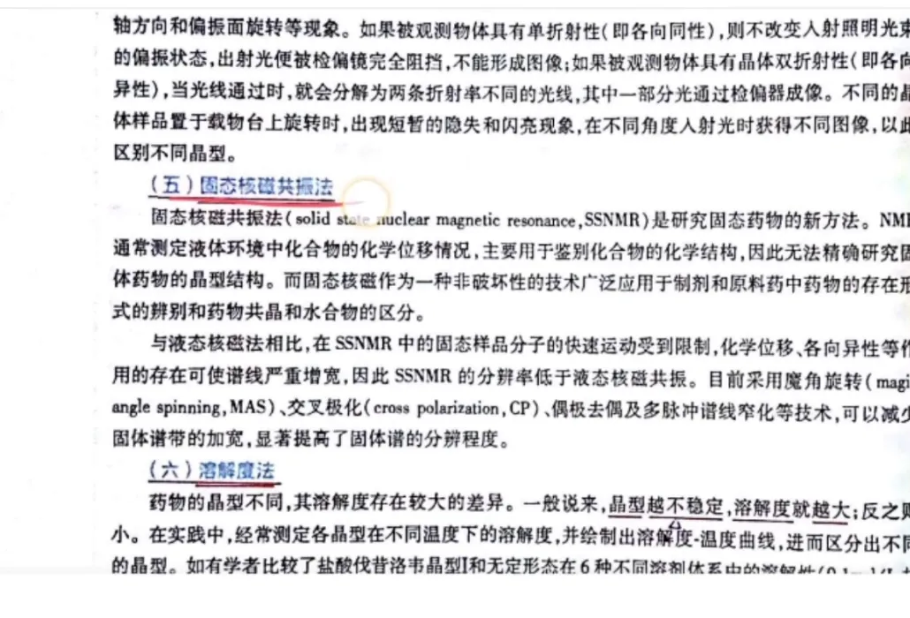

教材给的实例很有说服力：盐酸伐昔洛韦的**晶型 I** 与**无定形态**，在 6 种不同溶剂体系（0.1 mol/L 盐酸溶液、pH 4.5 醋酸缓冲液、pH 6.5 磷酸缓冲液、水、0.2% SDS 溶液、0.5% SDS 溶液）中的溶解性，**无定形态均优于晶型 I**，两者存在明显差别。

但紧接着是一句必须记住的警告：**使用溶解度方法时，要避免晶型在溶液中发生晶型转变，导致测量结果不准确**。也就是说，你测到的"无定形溶解度"可能只是它还没来得及转晶时的瞬时值——这正好是下一篇要讲的"表观溶解度靠不住"的化学版本。

### 6.3 稳定性：三种晶型与"选稳定型"

晶型稳定性分为**稳定型、亚稳定型、不稳定型**，一般选择**稳定型**晶型作为研究对象。稳定性还包括物理稳定性与化学稳定性两个层面。

## 七、对生物利用度与生产的影响

### 7.1 生物利用度：只有"溶解是限速步骤"时才敏感

[【跳转到 07:29】](https://www.bilibili.com/video/BV1sNa7zREZe/?t=449)

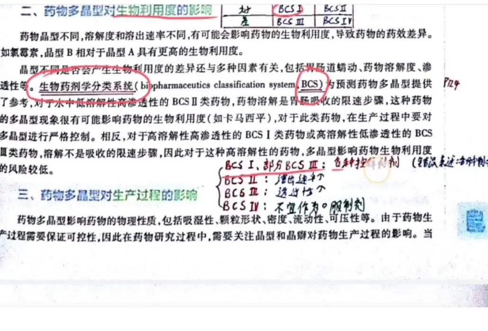

教材的判断链条是：晶型不同 → 溶解度和溶出速率不同 → 可能影响生物利用度 → 导致药效差异。例子里提到氯霉素晶型 B 相对晶型 A 有更高的生物利用度。

但这条链是否成立，还取决于其他因素（胃肠道蠕动、药物溶解度、渗透性等）。**生物药剂学分类系统（BCS）** 提供了判断框架：

- **BCS II 类**（水中低溶解、高渗透）：**药物溶解是胃肠吸收的限速步骤**，多晶型现象很可能影响生物利用度（教材举卡马西平），生产过程中要对多晶型**严格控制**；
- **BCS I 类**（高溶解、高渗透）与 **BCS III 类**（高溶解、低渗透）：溶解不是吸收的限速步骤，多晶型影响生物利用度的**风险较低**。

讲者在页边补了一张四类速记表：BCS I 与部分 BCS III 可制备各种控释制剂；BCS II 需提高溶出速率；BCS III 需提高渗透性；BCS IV 不宜作为口服制剂。

### 7.2 生产过程：工艺会把晶型改掉

[【跳转到 08:29】](https://www.bilibili.com/video/BV1sNa7zREZe/?t=509)

反过来的影响同样重要：**生产工艺可能引起药物晶型转变**。教材点了五个环节——研磨、制粒、干燥、压片、冷冻。

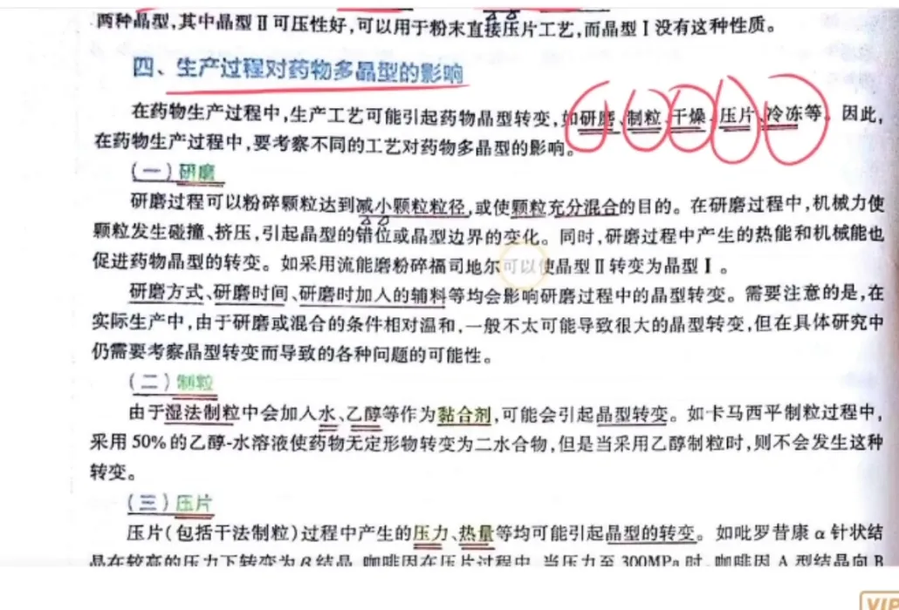

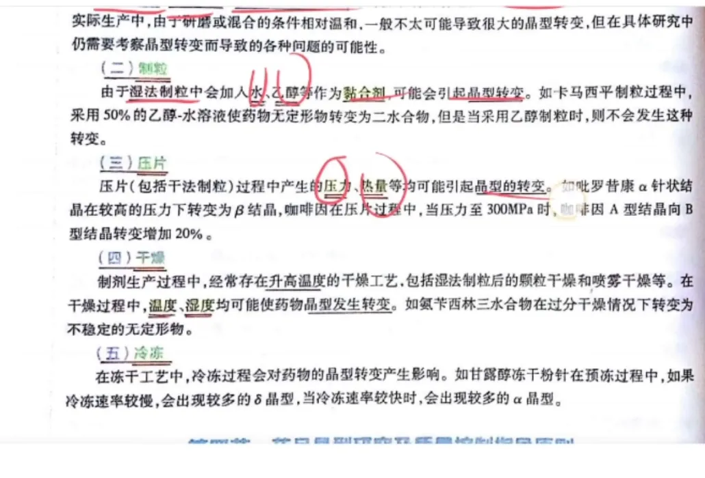

各环节的机制与实例：

- **研磨**：机械力使颗粒碰撞、挤压，引起晶型错位或晶型边界变化；研磨产生的热能和机械能也会促进转变。研磨方式、时间、加入的辅料都会影响转变程度。教材的例子是流能磨粉碎福司地尔可使晶型 II 转变为晶型 I。实际生产中研磨条件相对温和，一般不太可能导致很大的晶型转变，但仍需考察；
- **制粒**：湿法制粒会加入水、乙醇等黏合剂，可能引起晶型转变。卡马西平制粒时，用 50% 乙醇–水溶液会使**无定形转变为二水合物**，而采用乙醇制粒则不会；
- **压片**：压力与热量都可能引起转变。吡罗昔康 α 针状结晶在较高压力下转变为 β 结晶；咖啡因压片时压力至 300 MPa，晶型 A 向晶型 B 转变的比例增加 20%（[跳转到 08:59](https://www.bilibili.com/video/BV1sNa7zREZe/?t=539)）；
- **干燥**：温度、湿度都可能使晶型转变。氨苄西林三水合物在过分干燥情况下转变为不稳定的无定形；
- **冷冻**：冻干工艺中，冷冻过程会影响晶型。甘露醇冻干粉针在预冻过程中，冷冻速率较慢会出现较多 δ 晶型，较快则出现较多 α 晶型。

这一节的实际含义是：**晶型不是"原料属性"，而是"原料 + 工艺"的共同产物**。所以制剂研究里既要关注原料晶型，也要关注每一步工艺之后晶型有没有变。

## 八、补充：亚稳态、过饱和与"守不住"的高溶解度（非视频内容）

> 以下为补充背景，讲者未在视频中展开。

把"晶型越不稳定、溶解度越大"和"要避免测定过程中转晶"这两句话连起来，就得到药物开发里一个常见困境：

- **无定形或亚稳晶型**在溶出初期给出远高于稳定晶型的浓度，甚至进入**过饱和**状态；
- 但过饱和是**亚稳态**：一旦有晶核出现，药物会向更稳定的晶型（或水合物）结晶析出，浓度回落到稳定晶型的溶解度水平。

制剂上因此有两类策略：一类是**延长过饱和的维持时间**（高分子沉淀抑制剂、固体分散体、聚合物基质），让"高浓度"多撑一会儿；另一类是**接受低浓度**，转而通过减小粒径、增溶等手段提高溶出速度。前者的风险正是本节反复强调的那件事——**转晶**：一旦转成稳定晶型，之前的高表观溶解度就没了。

这也解释了为什么"报溶解度"必须同时报**晶型**：同一分子的无定形与晶型 I，在同一个介质里可以差出数倍，而这个差别完全不是分子性质，而是固体状态的性质。

## 小结

- **三个定义**：晶体=有规律周期性排列；无定形=无规则排列；多晶型=同一物质出现多种晶格结构。**晶癖是外形，晶型是内部排列**。
- **三种类型**：构型多晶型（堆积方式不同）、构象多晶型（原子在分子中位置不同）、互变异构多晶型（可逆，如酮式–烯醇式）。
- **三种造法**：溶液结晶（过饱和 → 晶核 → 生长；冷却结晶最常用）、熔融结晶（少用，易分解）、研磨等晶格物理破坏法；另有热处理与添加物结晶。
- **共晶**引入新组分，通过非共价键改善稳定性、溶解溶出与生物利用度；研磨常得亚稳共晶，但要避免形成溶剂化物。
- **六类表征**：X 射线衍射（单晶最可靠、粉末最常用）、热分析、振动光谱、显微镜、固态核磁、溶解度法；$2d\sin\theta = n\lambda$。
- **改了什么**：熔点（晶格能）、溶解度与溶出速率（晶型越不稳定溶解度越大）、稳定性（稳定型/亚稳定型/不稳定型）。
- **生物利用度**：只有 BCS II 类这类"溶解是限速步骤"的药物才高度敏感，需严格控制晶型。
- **工艺会改晶型**：研磨、制粒、压片、干燥、冷冻都可能引起转变，晶型是"原料 + 工艺"的产物。

## 关键术语速查

| 术语 | 一句话解释 |
| --- | --- |
| 晶体 / 无定形 | 内部粒子有规律周期性排列 / 无规则排列的固体 |
| 多晶型（同质多晶） | 同一物质因排列方式不同而形成多种晶格结构的现象 |
| 晶癖 | 结晶的外观形态，与内部晶型不是一回事 |
| 构型多晶型 | 分子构象相同、堆积方式不同造成的多晶型 |
| 构象多晶型 | 分子内原子位置（构象）不同造成的多晶型 |
| 互变异构多晶型 | 分子内原子在两个位置间移动、可逆异构化造成的多晶型 |
| 共晶 | API 与配体按固定计量比以非共价键形成的新的结晶物 |
| 晶格能 | 破坏晶格所需的能量，决定熔点与溶解度的高低 |
| Bragg 方程 | $2d\sin\theta = n\lambda$，X 射线衍射的峰位与晶面间距的关系 |
| BCS | 生物药剂学分类系统，按溶解度与渗透性把药物分成四类 |
| 亚稳定型 | 热力学上不如稳定型稳定、但可长时间存在的晶型 |