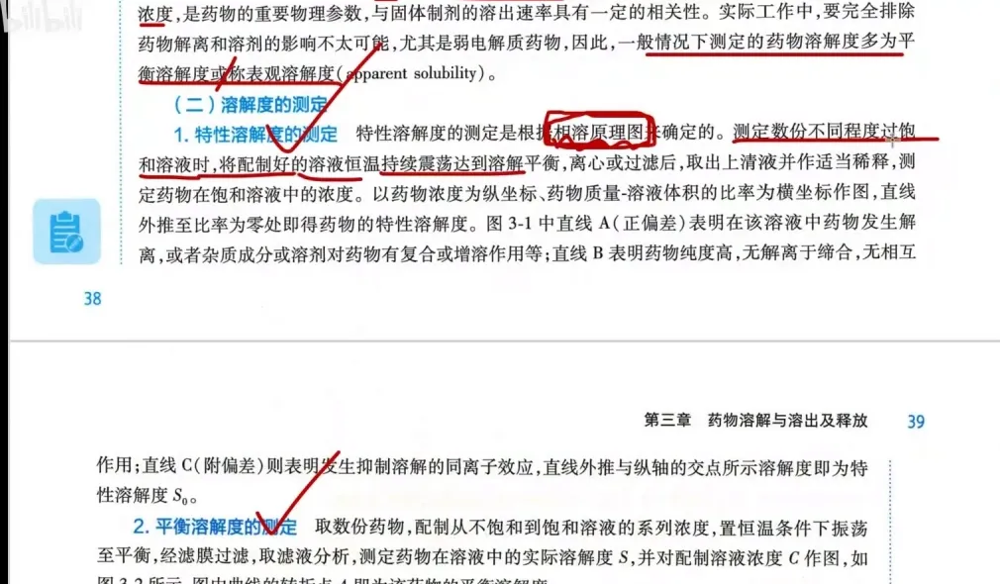
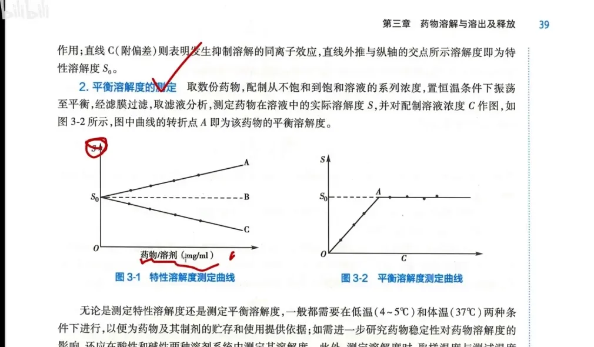
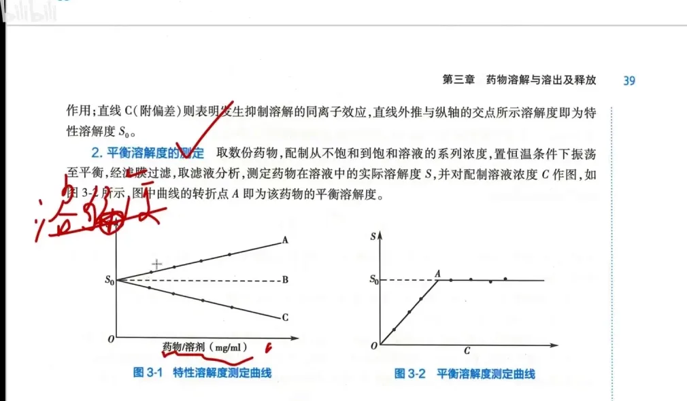
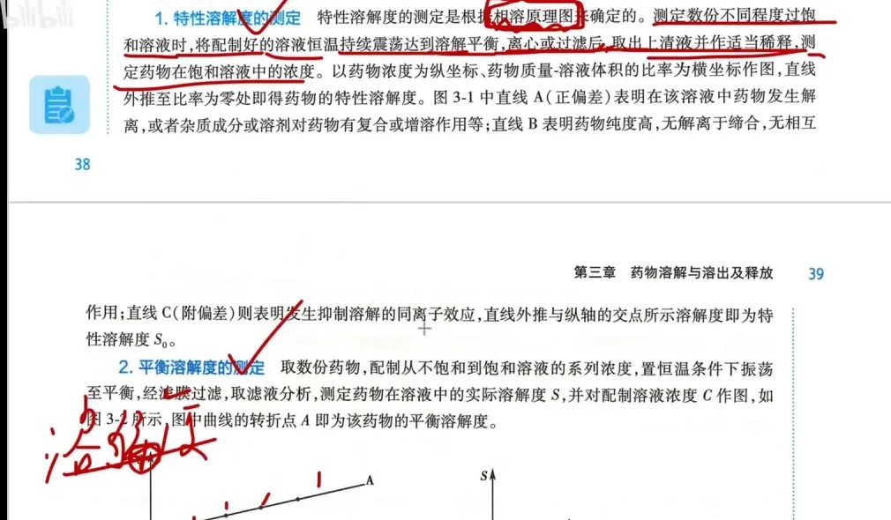
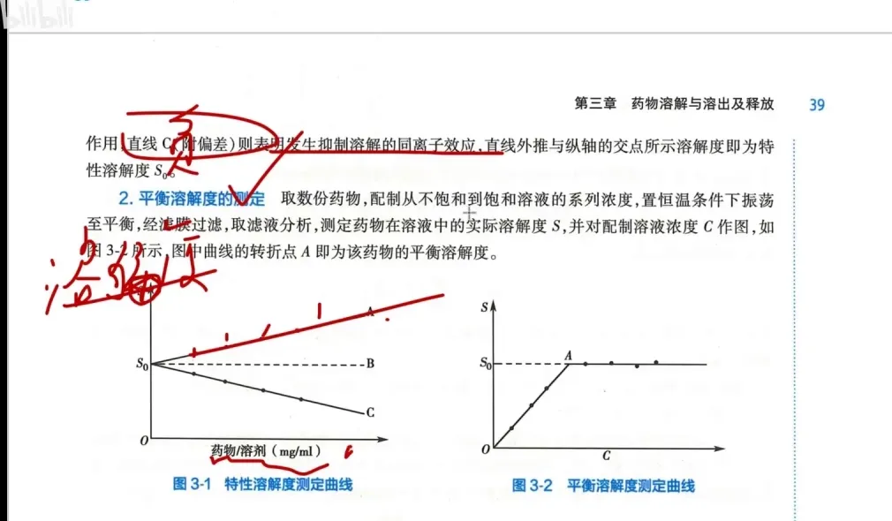
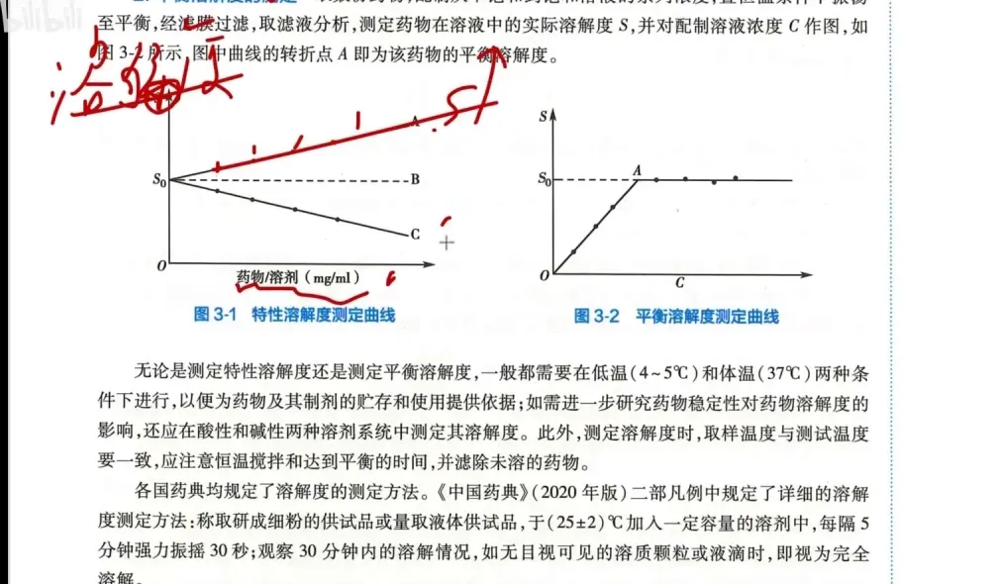
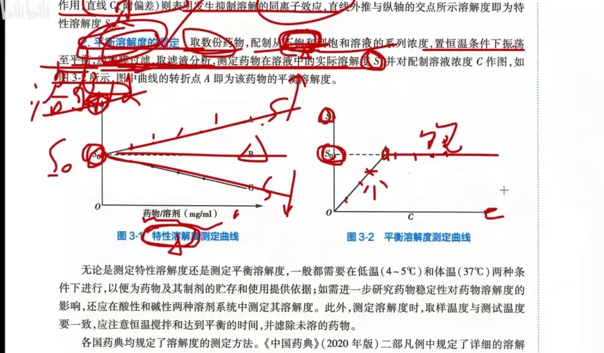
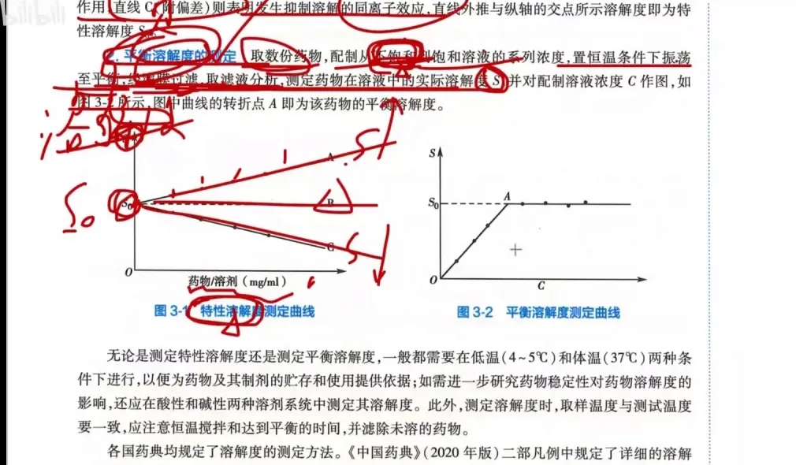

# 特性溶解度是外推出来的：你测到的多半是表观溶解度

> 视频来源：[【特性溶解度、表观溶解度】原理详细讲解](https://www.bilibili.com/video/BV1Qn846BEgo/)（Bilibili · 药略略略）｜时长约 7 分钟
> 导读：这支视频是对着《药剂学》教材「药物溶解与溶出及释放」一章讲两个溶解度概念的区别：特性溶解度 $S_0$ 靠相溶解度图外推得到，平衡溶解度（表观溶解度）才是实测值。本文按「两个数 → 一张图 → 怎么测 → 条件怎么定」重排，末尾补一段热力学写法与药物发现里的用法（已标明为补充）。

## 本讲要解决的核心问题（SCQA）

**背景**：溶解度看起来就是一个数——在一定温度下，100 毫升溶剂里最多能溶多少药。查表、报数、比较不同分子，用的都是它。

**冲突**：真去测就会发现这个数不稳。同一份药，溶剂里多一点杂质，测出来偏高；药物是弱电解质，测出来也偏高；溶剂里本来就有同名离子，测出来偏低。更奇怪的是，往过饱和溶液里继续加药，测到的"溶解度"居然还会往上走。

**疑问**：那"溶解度"到底指哪个数？这些偏差是测量误差，还是它本来就该这样？

**回答（中心思想）**：药剂学里的溶解度分两层。**特性溶解度 $S_0$** 是一个理想值——药物不含杂质、在溶剂中不解离不缔合、也不与溶剂发生相互作用时的饱和浓度；它**不是直接测出来的，而是用相溶解度图外推到"药物/溶剂 = 0"处得到的**。**平衡溶解度 $S$**（也叫**表观溶解度**，apparent solubility）才是实际体系里测到的那个浓度，它把解离、增溶、同离子效应全都算进去了。日常说的"溶解度"几乎都是后者；偏差不是误差，而是体系在告诉你溶质和溶剂之间发生了什么。

## 一、两个溶解度：一个是定义出来的，一个是测出来的

### 1.1 特性溶解度：理想条件下的那个饱和浓度

[【跳转到 00:24】](https://www.bilibili.com/video/BV1Qn846BEgo/?t=24)

教材给特性溶解度的定义是：**药物不含任何杂质，在溶剂中不发生解离或缔合，也不发生相互作用时所形成的饱和溶液的浓度**。它是药物的重要物理参数，与固体制剂的溶出速率有一定相关性。

这段文字里最该画线的是后半句：实际工作中要完全排除药物解离和溶剂的影响**不太可能**，尤其是弱电解质药物。所以一般情况下测定的药物溶解度**多为平衡溶解度，或称表观溶解度**。

这句话解释了为什么"溶解度"这个数总是带着条件：它测的不是分子本身的疏水程度，而是"这个分子 + 这个介质 + 这个 pH"共同给出的结果。

### 1.2 为什么理想值拿不到：解离、缔合、相互作用都在改数

[【跳转到 01:11】](https://www.bilibili.com/video/BV1Qn846BEgo/?t=71)

讲者把偏离理想的原因归成两类，正好对应相溶解度图上的两条斜线：

- **往上偏**：药物解离成离子型，极性变大，水溶性增强；或者杂质、溶剂本身对药物起了复合、增溶作用；
- **往下偏**：溶剂里存在同名离子，产生抑制溶解的同离子效应。

所以"测不准"不是操作问题，而是**定义本身要求一个现实中不存在的纯净体系**。想拿到 $S_0$，只能靠外推把这个体系"还原"出来。

## 二、相溶解度图：把"加了多少药"和"溶了多少药"画在一起

### 2.1 坐标怎么设、点怎么取

[【跳转到 00:44】](https://www.bilibili.com/video/BV1Qn846BEgo/?t=44)

作图的两根轴是：

- **纵坐标**：药物在饱和溶液中的浓度，也就是溶解度的读数；
- **横坐标**：药物质量与溶液体积的比值（教材写作"药物/溶剂，mg/ml"），说白了就是**你往体系里加了多少药**。

[【跳转到 00:04】](https://www.bilibili.com/video/BV1Qn846BEgo/?t=4)

取样流程是：配制**数份不同程度过饱和**的溶液（都是过饱和液），恒温持续振荡达到溶解平衡，然后离心或过滤，取上清液并适当稀释，测定药物在饱和溶液中的浓度。

这里有个容易被忽略的设计：**用的是过饱和溶液，不是不饱和溶液**。因为只有从"药过量"的一侧回到平衡，测到的才是饱和浓度；从不足的一侧加，你测到的只是"加进去多少"。

### 2.2 三条线：正偏差、理想线、负偏差

[【跳转到 01:43】](https://www.bilibili.com/video/BV1Qn846BEgo/?t=103)

把上面那些点连起来，会得到图 3-1 里的三条直线，它们都从纵轴上的同一个点 $S_0$ 出发：

[【跳转到 02:11】](https://www.bilibili.com/video/BV1Qn846BEgo/?t=131)

- **直线 A（正偏差）**：随着加入的药物增多，测到的溶解度反而上升。教材给的两种解释是——药物在该溶液中发生**解离**（解离型极性更大，溶解度增强），或者**杂质成分、溶剂对药物有复合或增溶作用**。讲者的例子很直观：某药的饱和溶解度本来是 10，换一种溶剂或存在能增溶的杂质，它的饱和溶解度就可能大于 10。
- **直线 B（理想线，虚线）**：药物纯度高、无解离与缔合、无相互作用。这条线在现实中画不出来，它只是外推的目标。
- **直线 C（负偏差）**：加得越多，测到的溶解度越小，说明发生了**抑制溶解的同离子效应**（[跳转到 02:57](https://www.bilibili.com/video/BV1Qn846BEgo/?t=177)）。

[【跳转到 03:25】](https://www.bilibili.com/video/BV1Qn846BEgo/?t=205)

同离子效应这条线值得单独记一个例子：**盐酸麻黄碱这类带盐酸根的药物，在氯化钠溶液（生理盐水）中的溶解度会比在纯水中更低**。因为两种物质都提供氯离子，共同离子把平衡往"析出"的方向推。

### 2.3 外推：$S_0$ 是推出来的，不是测出来的

[【跳转到 04:04】](https://www.bilibili.com/video/BV1Qn846BEgo/?t=244)

既然 A 和 C 分别代表"偏多"和"偏少"的两侧，就可以用它们互相校正：把两条线**外推到与纵轴的交点**，交点就是 $S_0$。讲者专门强调了一句：**特性溶解度其实不是测出来的，是推出来的**。

这也解释了为什么 $S_0$ 只对"纯的、中性的、不与溶剂反应的"那个物种有意义——外推到横坐标为零，等于把所有"加进去的药改变了溶剂环境"的效应都消掉了。

## 三、平衡溶解度：从不饱和到饱和，找那个转折点

### 3.1 做法：一系列浓度、恒温振荡、过滤、测实际浓度

[【跳转到 05:19】](https://www.bilibili.com/video/BV1Qn846BEgo/?t=319)

平衡溶解度的测法反过来：**取数份药物，配制从不饱和到饱和的系列浓度**，置恒温条件下振荡至平衡，经滤膜过滤，取滤液分析，测定药物在溶液中的**实际溶解度 $S$**，并对配制浓度 $C$ 作图。

日常经验就是这个过程：刚开始加进去都溶了（不饱和），继续加还溶（仍不饱和），加到某一刻不再溶、开始析出——那一点就是饱和。

[【跳转到 06:43】](https://www.bilibili.com/video/BV1Qn846BEgo/?t=403)

图 3-2 里曲线的**转折点 A** 就是平衡溶解度。讲者的说法是：为了强调它是怎么测出来的，重点在于"由不饱和变饱和的那个转折点"，也就是**刚开始析出的瞬间**。

### 3.2 为什么它"好测"

[【跳转到 05:04】](https://www.bilibili.com/video/BV1Qn846BEgo/?t=304)

因为它的操作方向和日常经验一致，不需要刻意制造过饱和、也不需要外推：加药、振荡、过滤、测浓度，画出来找拐点即可。代价是它把体系里所有的相互作用都算进了这个数里，所以**报数时必须带上条件**。

## 四、测量条件决定你报出的数

[【跳转到 05:33】](https://www.bilibili.com/video/BV1Qn846BEgo/?t=333)

教材在两种溶解度之后紧接着写了条件，这一段是本节最实用的部分：

- **温度要选两个**：一般在**低温（4~5 ℃）和体温（37 ℃）**两种条件下测定，分别对应贮存和使用；
- **介质要选两类**：如需研究药物稳定性对溶解度的影响，还应在**酸性和碱性两种溶剂系统**中测定；
- **温度要一致**：取样温度与测试温度要一致；
- **过程要控制**：注意恒温搅拌和**达到平衡的时间**，并**滤除未溶的药物**——滤不掉，你测到的就是"混进去的固体"，不是溶解的那部分。

药典还给了更"操作性"的判据：《中国药典》（2020 年版）二部凡例规定，称取研成细粉的供试品或量取液体供试品，于 **(25±2) ℃** 加入一定容量的溶剂中，**每隔 5 分钟强力振摇 30 秒**，观察 **30 分钟内**的溶解情况，如无目视可见的溶质颗粒或液滴，即视为**完全溶解**。

所以同一个分子报出两个不同的溶解度并不矛盾：温度、pH、离子强度、平衡时间、有没有把未溶固体滤掉，任何一项变了，数就变了。

## 五、补充：为什么溶解度可以写成一个自由能（非视频内容）

> 以下为补充背景，讲者未在视频中展开，用于把本节与热力学接上。

溶解是一个平衡过程：固态（或液态）溶质进入溶液，与"从溶液中析出"速率相等。平衡常数就是饱和浓度本身（以摩尔分数或活度计），于是

$$
\Delta G_{\mathrm{sol}} = -RT \ln S
$$

其中 $R$ 是气体常数，$T$ 是绝对温度，$S$ 是以摩尔分数表示的饱和溶解度。这条式子说明三件事：

1. **溶解度是自由能差，不是"亲水性打分"**。$\Delta G_{\mathrm{sol}}$ 越负，$S$ 越大；
2. **它把"晶格破坏"和"溶剂化"两笔账合在一起**：破坏晶格要吸能（正贡献，晶体越稳、熔点越高，这笔账越大），溶剂化放能（负贡献，氢键、极性、可电离基团都在这里加分）；
3. **温度通过 $\Delta H_{\mathrm{sol}}$ 进入**：升温让溶解度升高还是降低，取决于溶解过程整体是吸热还是放热——这正是下一节溶解度和溶出速度那支视频反复强调的一点。

工程上常把 $S$ 换成 $\log S$（摩尔溶解度取对数）来和 $\log P$ 一起做经验模型，因为两者近似线性负相关：亲脂性越强，水中溶解度越低。这条经验关系的细节属于分配系数那一节（2.1.2）的范围。

## 小结

- **溶解度有两个层次**：特性溶解度 $S_0$ 是理想值（无杂质、不解离、无相互作用），平衡/表观溶解度 $S$ 是实测值。
- **$S_0$ 靠外推**：以浓度为纵坐标、药物/溶剂为横坐标，用正偏差（解离、增溶）与负偏差（同离子效应）两条线互相校正，外推到纵轴交点。
- **$S$ 靠拐点**：配制从不饱和到饱和的系列浓度，恒温振荡至平衡、过滤、测浓度，曲线上由升转平的转折点即平衡溶解度。
- **偏差是信息，不是误差**：上偏说明有解离或增溶，下偏说明有同离子效应（如盐酸麻黄碱在生理盐水中溶解度更低）。
- **报溶解度必须带条件**：温度（4~5 ℃ 与 37 ℃）、介质 pH、离子强度、平衡时间、是否滤除未溶药物；药典的"完全溶解"判据是 25±2 ℃、每 5 分钟振摇 30 秒、30 分钟内无可见颗粒。
- **热力学视角（补充）**：$\Delta G_{\mathrm{sol}} = -RT \ln S$，把晶格破坏（吸能）与溶剂化（放能）两笔账合起来看。

## 关键术语速查

| 术语 | 一句话解释 |
| --- | --- |
| 特性溶解度 $S_0$ | 药物不含杂质、不解离不缔合、无相互作用时的饱和浓度，由相溶解度图外推得到 |
| 平衡溶解度 $S$ | 实际体系恒温振荡至平衡后测得的饱和浓度 |
| 表观溶解度 | 平衡溶解度的另一个名字，含解离、增溶、同离子效应等全部实际因素 |
| 相溶解度图 | 纵坐标为药物浓度、横坐标为药物/溶剂比例的作图，用来外推 $S_0$ |
| 正偏差 | 测得的溶解度随加药量上升，源于解离或杂质/溶剂的增溶作用 |
| 负偏差 | 测得的溶解度随加药量下降，源于同离子效应 |
| 同离子效应 | 溶剂中已存在同名离子时，难溶盐的溶解度下降 |
| 平衡时间 | 振荡到溶解平衡所需的时间，不足则测值偏低 |