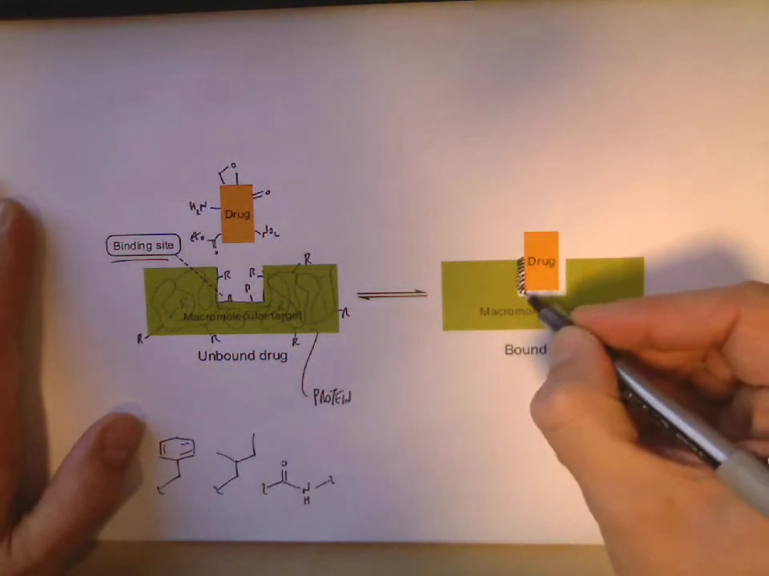
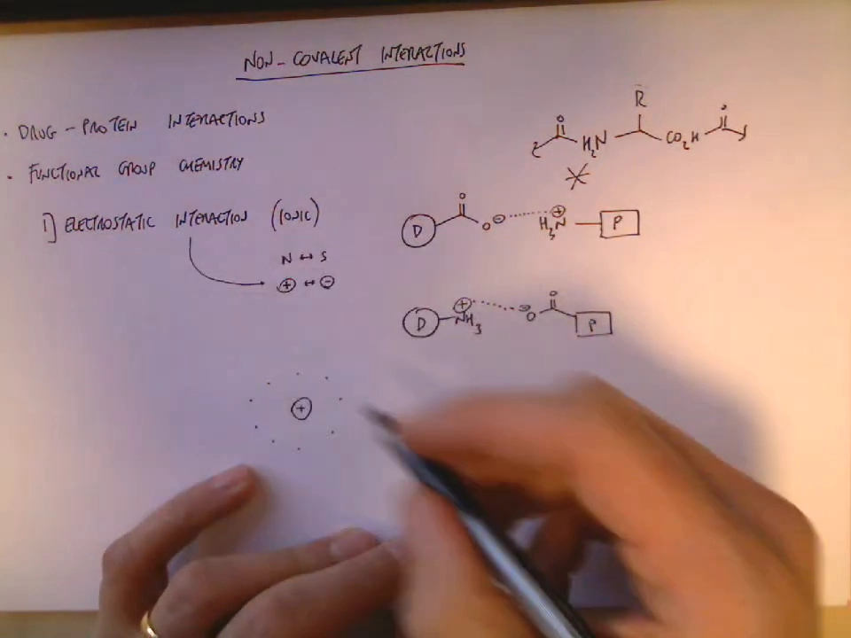
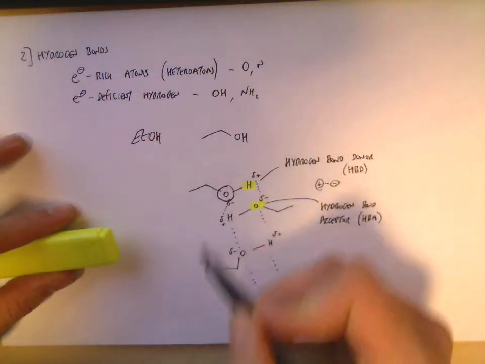
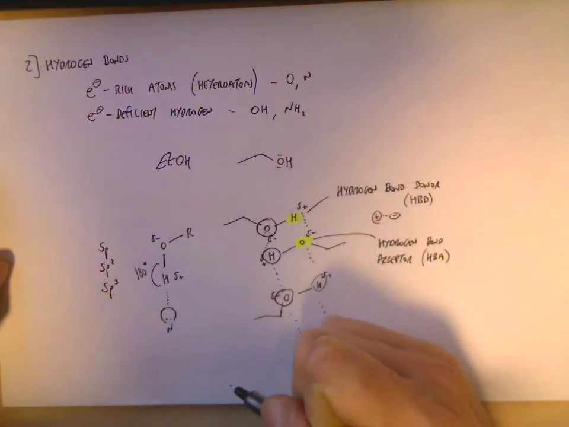
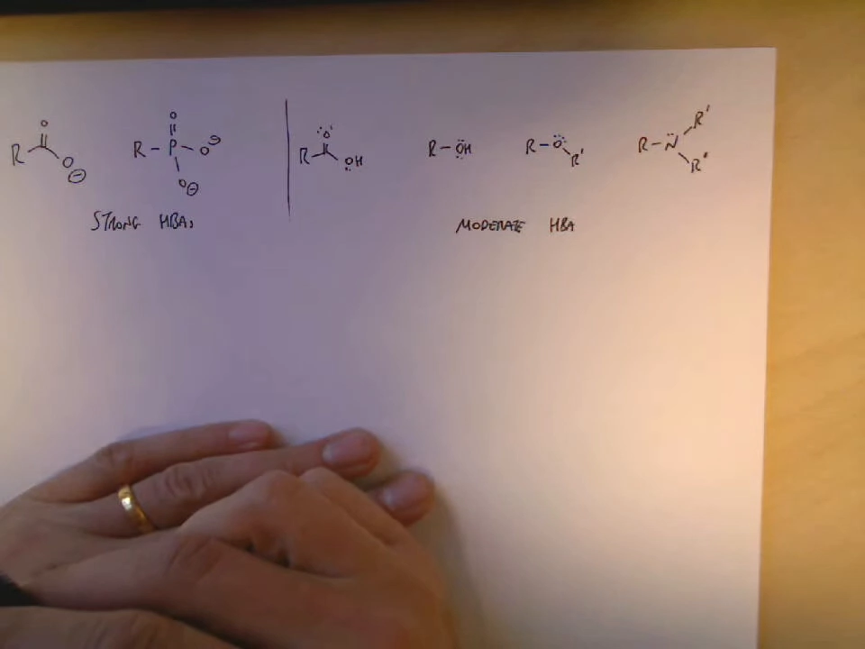
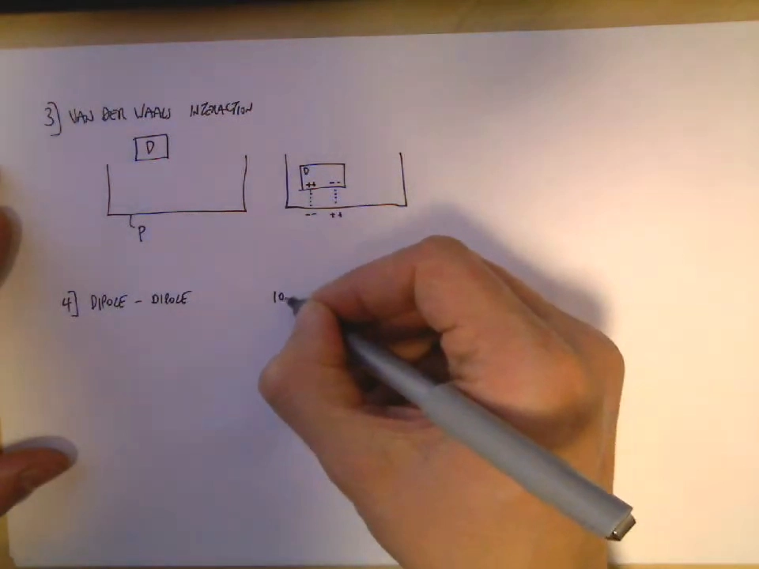
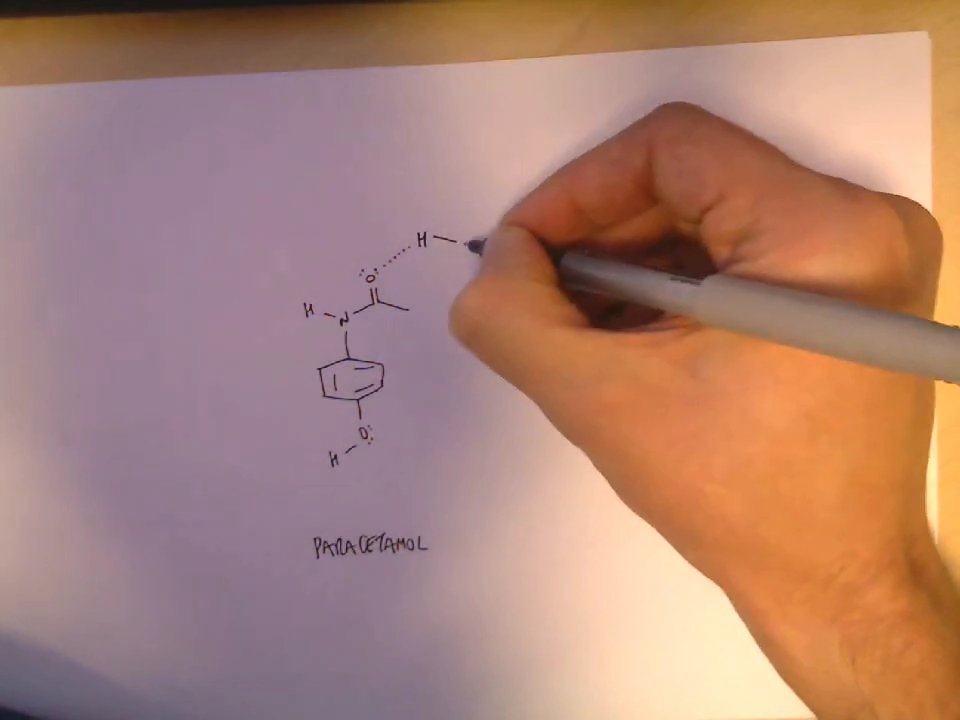
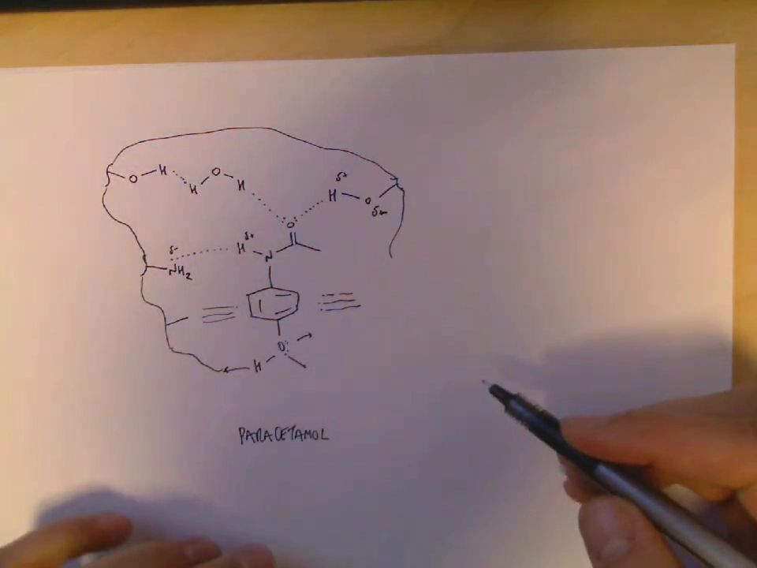

# 药物与蛋白靠什么黏在一起：非共价相互作用的类型、互补性与方向性

> 视频来源：[Non-Covalent Interactions - Med Chem 2](https://www.youtube.com/watch?v=zaXTMoOKRdo)（YouTube · 药物化学课程第二讲）｜时长约 22 分钟
> 导读：这是一支手绘板式的药物化学课，讲者边画边讲，把药物—蛋白之间的五类非共价相互作用逐个拆开：离子作用、氢键、范德华、偶极—偶极、离子—偶极。重点不在背名词，而在两件事——**官能团的互补性**决定了能不能结合，**氢键的方向性**决定了结合得好不好。热力学账本（焓、熵、去溶剂化）见同小节的另一篇《高亲和力不是靠疏水堆出来的》。

## 本讲要解决的核心问题（SCQA）

**背景**：上一讲把蛋白质讲清楚了：一条线性氨基酸链折叠成二级结构，链上挂着各种侧链基团。药物要起效，就得和这个蛋白质发生点什么。

**冲突**：可是「发生点什么」这句话太含糊。药物分子上也有酮、醚、酯、胺、羧酸，蛋白质结合位点上有芳环、疏水侧链、骨架的羰基和 N—H。两边都摆满了官能团，为什么有的配对能结合、有的不能？为什么有的药物结合后能脱落、有的却永久占住位点？

**疑问**：药物与蛋白质之间到底有哪几种「黏法」？每种黏法的强度、方向性、对官能团的要求分别是什么？一个分子上的官能团，怎样决定它能形成哪些相互作用？

**回答（中心思想）**：药物与蛋白之间靠**五类非共价相互作用**结合，按强度排序是离子作用 > 氢键 > 偶极相关作用 > 范德华。它们的共同本质都是「异种电荷相吸」，差别在于电荷是完整的、部分的还是瞬时的，以及**是否具有方向性**：离子作用是非方向性的（库仑定律，只依赖距离），氢键则是方向性的（孤对电子占据特定杂化轨道，最优取向 180 度）。因此药物设计的核心动作是**官能团互补**——药物上的每个官能团都要在结合位点上找到一个几何与电子性质都匹配的对手；配不上，它不但不贡献亲和力，还会因为去溶剂化而倒扣。

## 一、先看清两边各有什么牌

### 1.1 蛋白质这一侧：结合位点上伸出来的官能团

[【跳转到 00:36】](https://www.youtube.com/watch?v=zaXTMoOKRdo&t=36)

讲者把蛋白质画成一块绿色的「大分子靶标」：一条线性氨基酸链折叠成二级结构，链上有很多酰胺键，还有一堆从骨架伸出来的基团，于是蛋白质表面出现了各种各样的位置，也就是结合位点。一个蛋白质通常只有一个或两个结合位点。

因为二级结构里折叠了这么多氨基酸，结合位点上就会有特定的官能团伸向空间：可能是氨基酸侧链上的芳环，可能是疏水的侧链，也可能是骨架本身的羰基或 N—H。**上一讲讲过的任何氨基酸基团，都可能出现在结合位点上。**

### 1.2 药物这一侧：同样是一堆官能团

[【跳转到 01:53】](https://www.youtube.com/watch?v=zaXTMoOKRdo&t=113)

药物身上也有官能团——胺、酮、醚、酯都可能挂在上面。所以在药物开发这一侧，我们的工作是优化药物，让它与体内的蛋白质相互作用。

这里有一个容易被忽略的框架：药物进入体内后，只要它能到达作用部位，体系里就存在一个平衡——药物是游离在溶液或细胞里，还是结合在靶标上。今天要看的正是这一块。

至于你想让药物**永久地、共价地**占据结合位点并抑制蛋白，还是想让它在平衡中脱落、被排出体外，取决于你怎么设计这个药。共价抑制不在本讲范围。

### 1.3 关键概念：互补性

[【跳转到 04:40】](https://www.youtube.com/watch?v=zaXTMoOKRdo&t=280)

讲者把药物与结合位点之间的相互作用用线条标出来，然后给出全讲的判据：

> 药物上有一个位置带着某个官能团，结合位点上也有一个与之互补的区域。如果两边完全互补，就会产生有利的相互作用，药物就能结合；**如果互补性相反，两边就会互相排斥，药物就结合不好。**

这句话把「药物设计」翻译成了一个可操作的检查表：不是问「这个基团好不好」，而是问「这个基团和对面那个基团配不配」。

### 1.4 强度要恰到好处

[【跳转到 06:19】](https://www.youtube.com/watch?v=zaXTMoOKRdo&t=379)

相互作用必须**足够强**，药物才能起效；又要**足够弱**，药物才能在该做的事情做完之后离开。讲者补了一句实务上的提醒：与靶标相互作用更多的药物会停留得更久，这可能正是你想要的，也可能带来麻烦——半衰期、生物利用度和排泄都会成为问题。

> 补充（非视频内容）：这里的「停留更久」就是药物化学里说的驻留时间（residence time）。它与半衰期不是一回事，但在体内暴露的账上互相牵连。

## 二、第一类：离子作用——最强，但没有方向

### 2.1 异种电荷相吸

[【跳转到 07:34】](https://www.youtube.com/watch?v=zaXTMoOKRdo&t=454)

讲者把静电/离子相互作用放在第一位，因为它是药物与蛋白质之间**最强**的相互作用。它的基础很朴素：异种电荷互相吸引，就像磁铁的 N 极被 S 极吸引。

典型场景是：药物上有一个羧酸，在生理条件下可以去质子化带负电；它与上一讲见过的某个氨基酸侧链（可以被质子化、带正电，例如赖氨酸）相互作用。讲者特意强调：这里说的是**侧链上的** R 基团，不是主链上的那个氨基。

完全相反的情形同样成立：药物上带一个氨基，在生理条件下带正电，而蛋白质上某个酸性侧链带负电。

### 2.2 非方向性：因为它是库仑定律

[【跳转到 10:30】](https://www.youtube.com/watch?v=zaXTMoOKRdo&t=630)

离子作用非常强，强到是「你遇到过的最强的相互作用」。它还有一个性质：**非方向性**。只要这里有一个电荷，无论相反电荷在它周围哪个方位，感受到的效果都一样——以这个电荷为球心的三维球面上任何位置，相互作用都相同。

原因就是库仑定律：

$$
F \propto \frac{q_1 q_2}{r^2}
$$

相互作用强度正比于两个电荷的乘积，反比于距离的平方。所以距离一变大，作用强度就按平方迅速衰减。

### 2.3 为什么在结合位点里它特别强

[【跳转到 11:50】](https://www.youtube.com/watch?v=zaXTMoOKRdo&t=710)

讲者给了一个很实用的观察：蛋白质的结合位点往往是**疏水的**，因为它折叠在远离水的地方。这意味着正负电荷受到水的屏蔽较少，所以静电作用在口袋里特别强。

由此得到一条经验：如果你的药物与蛋白质之间正好有一对正负电荷，那它很可能就是药物遇到的**第一个、也是最重要的**相互作用——它负责把分子初步摆到正确的位置上，之后氢键和范德华才能接着起作用。

## 三、第二类：氢键——供体、受体与 180 度

### 3.1 定义：富电子原子 + 缺电子的氢

[【跳转到 12:43】](https://www.youtube.com/watch?v=zaXTMoOKRdo&t=763)

氢键通常发生在**富电子的原子**之间——也就是杂原子，在药物发现里通常是氧或氮；另一端则是**缺电子的氢**。缺电子的氢通常连在氧或氮上。

讲者用乙醇做例子：氧是富电子的，上面连着一个氢，这个氢是缺电子的。因为氧的电负性远大于氢，氧带部分负电荷（$\delta^-$），氢带部分正电荷（$\delta^+$）。

前面刚讲过，正电荷与负电荷之间会有静电相互作用；这里是一对**部分**电荷，所以它们同样会与其他乙醇分子发生相互作用。再画一个乙醇分子，一个部分负、一个部分正，于是两个分子之间就产生了相互作用，而且可以一直延伸下去，形成一个网络。

讲者顺手解释了物态：这正是冰（固态水）以及水蒸气背后的原因，都取决于水分子之间的氢键；而乙醇在室温下是液体，也是因为这一片氢键网络。

### 3.2 供体与受体：同一个基团可以两者兼是

[【跳转到 15:22】](https://www.youtube.com/watch?v=zaXTMoOKRdo&t=922)

- **氢键供体（HBD）**：提供那个缺电子的氢。在乙醇里，是那个连着氧的氢。
- **氢键受体（HBA）**：提供孤对电子的富电子原子。在乙醇里，是那个氧。

醇既可以当氢键受体，也可以当氢键供体，因为氧上有孤对电子，而且氧相对富电子。讲者说这一点在后面讲利平斯基规则时会很重要——因为五规则里 HBD 和 HBA 是分开计数的。

### 3.3 方向性：孤对电子住在哪个轨道里，氢键就指向哪里

[【跳转到 16:48】](https://www.youtube.com/watch?v=zaXTMoOKRdo&t=1008)

这是氢键与离子作用最重要的区别。讲者说：氢键也可以看作一种弱的静电相互作用，但与前面非方向性的静电作用不同，**氢键是有方向性的**。

原因在于：带孤对电子的原子，其孤对电子处在特定的轨道里——可能是 sp、sp² 或 sp³ 杂化轨道，所以它指向一个非常确定的方向。而氢键最强的、最优的取向，是这三个原子成 **180 度**。

讲者画了一个氮带孤对电子、与一个氢相互作用的例子：这里有部分正、部分负，三个原子之间成 180 度，这就是非常强的最优氢键取向。

接着他给了一个很诚实的限定：在蛋白质里、在活性位点的限制下，这种理想几何未必能实现；但如果可以自由旋转，配体会把自己摆到接近 180 度的方向。**换句话说，方向性是热力学偏好，不是硬性要求——配不上 180 度，氢键仍然存在，只是变弱。**

### 3.4 强度排序与「好受体 / 好供体」清单

[【跳转到 18:13】](https://www.youtube.com/watch?v=zaXTMoOKRdo&t=1093)

讲者明确排序：氢键的强度通常**弱于**静电（离子）相互作用。

好的受体是电负性强、带孤对电子的原子，通常是氧或氮；好的供体则拥有非常缺电子的质子。具体到官能团：

| 类别 | 例子 | 说明 |
| --- | --- | --- |
| 强氢键受体 | 羧酸根、磷酸基等阴离子 | 带完整负电荷，是最好的受体 |
| 中等氢键受体 | 未解离的羧酸、醇、醚、胺 | 靠富电子杂原子上的孤对电子 |
| 最强氢键供体 | 季铵盐 | 紧挨着正电荷的氮，质子极度缺电子 |
| 其他氢键供体 | 羧酸的氢、醇的氢 | 质子缺电子，可以给出 |

这张表有一个直接的设计含义：**同一个官能团，电离与否会改变它在氢键账上的角色**。羧酸（$\mathrm{COOH}$）是中等受体兼供体，羧酸根（$\mathrm{COO^-}$）是强受体但不再是供体。这与本系列 2.1.1 讲的 $pK_a$ 与电荷状态直接相连。

## 四、第三、四、五类：范德华、偶极—偶极、离子—偶极

### 4.1 范德华：单笔极小，靠数量取胜

[【跳转到 21:13】](https://www.youtube.com/watch?v=zaXTMoOKRdo&t=1273)

范德华相互作用非常弱，但如果数量很多，累积起来也可以变得比较强。它通常是**瞬时偶极**。

讲者的解释很具体：想象药物上有一条烷基链，某一瞬间电子偏到一端、离开另一端；当它靠近蛋白质时，这一端的负电荷会排斥蛋白质里的负电荷，把电子推开，于是蛋白质这一侧出现正电荷，形成一对反向的电荷排布，也就建立了相互作用。

它很弱，随距离衰减很快，而且是瞬时的、转瞬即逝的偶极；但如果有大量这样的相互作用，它就能变得比较强。本质上是一个分子里的偶极诱导了另一个分子里的偶极。

### 4.2 偶极—偶极：永久偶极要反向平行

[【跳转到 24:05】](https://www.youtube.com/watch?v=zaXTMoOKRdo&t=1445)

第四类与范德华相关，但涉及的是更**永久**的偶极。取一个带羰基的药物，比如酮：氧的电负性比碳大，电子被拉向氧，于是碳带部分正、氧带部分负，形成一个偶极，箭头从正指向负。

偶极喜欢彼此**反向平行**地排列。如果蛋白质结合位点上有一个偶极方向朝这边，药物靠近时会把自己摆成反向平行——两个偶极的箭头互相平行但指向相反，因为箭头一端是部分正、另一端是部分负，仍然是异种电荷相吸。两个偶极平行时，这种相互作用的「重叠」会更强。

### 4.3 离子—偶极：一方换成完整电荷

[【跳转到 25:49】](https://www.youtube.com/watch?v=zaXTMoOKRdo&t=1549)

离子—偶极是完全一样的道理，只是其中一方换成了离子。比如蛋白质上有一个羧基作为 R 基团伸出来，它带一个部分正和一个完整负电荷，于是与药物上的偶极形成离子—偶极相互作用；活性位点的另一处可能有一个带电荷的胺，同样能看到这种相互作用。

讲者在这里做了一个统一：说到底，这些相互作用都是**异种电荷互相吸引**——可能是瞬时电荷，可能是部分电荷，也可能是完整电荷，或者与偶极、离子相关的电荷。五类相互作用的差别，只在电荷的种类和几何约束上。

## 五、把五类相互作用拼成一个活性位点

### 5.1 扑热息痛：一个分子上有几种「把手」

[【跳转到 27:13】](https://www.youtube.com/watch?v=zaXTMoOKRdo&t=1633)

讲者拿扑热息痛（对乙酰氨基酚）做综合练习。看它的结构就会发现：

- 氧上的孤对电子可以当氢键受体；
- 连在氮或氧上的氢可以当氢键供体；
- 烷基与芳环部分可以发生范德华相互作用。

### 5.2 逐个「接上」：从官能团到活性位点

[【跳转到 28:08】](https://www.youtube.com/watch?v=zaXTMoOKRdo&t=1688)

于是可以逐个接：这里是部分负、那里是部分正，可以接一个氢键；这里还可以再接一个氢键，比如通过一个水分子桥接；这个位置也有氢键受体。于是在骨架上，某个带孤对电子的氨基酸就能与这里的部分正电荷形成氢键。此外还有芳环，可以发生范德华相互作用。

讲者的收束句是：当你把蛋白质所有这些部分拼起来、让它们都能发生相互作用，你就构建出了一个活性位点。这条骨架就是蛋白质，这些基团都是氨基酸的 R 基团。我们看到了主要的几类相互作用：离子作用、氢键、范德华、偶极—偶极和离子—偶极——它们发生在药物的官能团与氨基酸侧链官能团之间。

### 5.3 留下的问题：那「一桶水」怎么办

[【跳转到 30:02】](https://www.youtube.com/watch?v=zaXTMoOKRdo&t=1802)

讲者在结尾没有给答案，而是留了一个问题：当一个分子处在水环境中，它会被水包围；同样，药物活性位点最初也可能被水包围。那么，当药物与蛋白质真正结合、把那「一桶水」挤出去时，发生了什么？去看一看药物进入结合位点所需付出的各种能量代价。

这个问题正是同小节另一篇博客的主题：去溶剂化惩罚、疏水效应与构象熵。**本讲只讲了「哪些手能握住」，没讲「握住要付多少钱」。**

## 六、把这张清单变成设计动作

[【跳转到 04:18】](https://www.youtube.com/watch?v=zaXTMoOKRdo&t=258)

讲者反复强调一件事：要理解药物与蛋白质之间的非共价相互作用，你需要理解**官能团化学**；理解了官能团，你就理解了有机化学的绝大部分。他还纠正了一个术语习惯：这些基团有时被称为「结合基团」，但本质上官能团，只是它们的角色是结合。

把全讲内容整理成一张可执行的检查表：

| 检查项 | 要问的问题 | 依据 |
| --- | --- | --- |
| 电荷互补 | 药物上的电荷与口袋里的电荷是否异号？ | 离子作用最强，且常是第一个接触点 |
| 氢键互补 | 供体对面是不是受体？角度能否接近 180 度？ | 氢键有方向性，孤对电子在特定轨道 |
| 电离状态 | 这个基团在生理 pH 下是哪种形式？ | 羧酸与羧酸根的受体强度不同 |
| 形状契合 | 芳环、烷基能否贴住疏水区域？ | 范德华单笔小，靠数量累积 |
| 偶极取向 | 永久偶极能否反向平行排列？ | 偶极—偶极与离子—偶极 |
| 强度平衡 | 是否强到起效、又弱到能离开？ | 太强会影响半衰期与排泄 |

> 补充（非视频内容）：本讲没有涉及的两类相互作用值得知道——**π–π 堆积**（两个芳环面对面或边对面排列，本质是偶极/四极矩相互作用）与**阳离子–π**（季铵或金属离子正对芳环的电子云）。它们可以看成上面「偶极相关作用」的变体，在激酶抑制剂与乙酰胆碱结合位点里很常见。此外，本讲也没有讨论**可旋转键与构象熵**：一个柔性配体在结合时要放弃大量构象，这笔熵账会直接冲抵上面这些相互作用的收益，详见同小节另一篇博客。

## 小结

- 药物与蛋白之间靠五类非共价相互作用结合，强度大致是：离子作用 > 氢键 > 偶极相关作用 > 范德华；它们的共同本质都是异种电荷相吸。
- 离子作用最强且**非方向性**，只按库仑定律随距离平方衰减；结合位点往往疏水，电荷受水屏蔽少，所以离子作用在口袋里特别强，常是第一个接触点。
- 氢键发生在富电子杂原子（O、N）与缺电子的氢（连在 O 或 N 上）之间；给出氢的是供体 HBD，提供孤对电子的是受体 HBA，醇可以两者兼是。
- 氢键**有方向性**：孤对电子占据 sp、sp² 或 sp³ 轨道，最优取向 180 度；蛋白质口袋未必允许理想几何，配不上就变弱。
- 好受体是阴离子（羧酸根、磷酸基），中等受体是未解离的酸、醇、醚、胺；最强供体是季铵盐，其次是羧酸与醇。电离状态会改变一个基团在氢键账上的角色。
- 范德华是瞬时偶极诱导的相互作用，单笔极小但可累积；偶极—偶极与离子—偶极是永久偶极参与的同族作用。
- 设计的核心动作是**官能团互补**：药物上每个官能团都要在口袋里找到几何与电子性质匹配的对手；配不上就只剩下去溶剂化的代价。
- 本讲只讲了「怎么握住」，没讲「握住要付多少钱」——去溶剂化、疏水与构象熵的账本见同小节另一篇。

## 关键术语速查

| 术语 | 一句话解释 |
| --- | --- |
| 非共价相互作用 | 不共享电子、靠电荷与偶极相互吸引的结合力，可逆且强度弱于共价键 |
| 互补性 | 药物官能团与口袋官能团在电子性质与几何上互相匹配；不互补则排斥 |
| 离子作用 | 完整正负电荷之间的吸引，最强、非方向性，按库仑定律随距离平方衰减 |
| 氢键供体 HBD | 提供缺电子氢的基团，氢通常连在 O 或 N 上 |
| 氢键受体 HBA | 提供孤对电子的富电子原子，通常是 O 或 N |
| 方向性 | 氢键的强度依赖三个原子的夹角，最优 180 度；离子作用没有这个约束 |
| 范德华相互作用 | 瞬时偶极诱导邻近原子产生偶极而产生的弱吸引，靠数量累积 |
| 偶极—偶极 | 两个永久偶极反向平行排列产生的吸引 |
| 离子—偶极 | 完整电荷与永久偶极之间的吸引 |
| 结合基团 | 参与结合的那部分官能团，本质仍是官能团，只是角色是结合 |