# 高亲和力不是靠疏水堆出来的：ITC 热力学账本里的去溶剂化、疏水与构象熵

> 视频来源：[Thermodynamic Rules to Achieve High Binding Affinity & Selectivity](https://www.youtube.com/watch?v=CBGW5-8KX-s)（YouTube · TA Instruments 网络研讨会，主讲 Ernesto Freire，约翰·霍普金斯大学）｜时长约 40 分钟
> 导读：这是一场以等温滴定量热法（ITC）为主线的报告。讲者把「亲和力」拆成焓与熵两栏，逐项算出极性基团、非极性基团、可旋转键各自的价钱，最后给出一张能同时看亲和力、焓、熵的优化图。本文按「为什么要算账 → 账本怎么读 → 每一栏的价钱 → 怎么用它做设计」重排。logP 的定义与测量见本系列 2.1.2，本文只借用它的读数。

## 本讲要解决的核心问题（SCQA）

**背景**：药物化学有一条被反复验证的经验：往分子上挂疏水基团，亲和力几乎总会涨一点。所以优化一个筛选出来的微摩尔级苗头化合物时，最省事的做法就是不断加碳。

**冲突**：这条路走到头会撞墙。讲者给出两组数字：已上市药物里有 41% 兼具高溶解度和高渗透性，而在新分子实体里这个比例只有 5%；反过来，90% 的新分子实体属于低溶解度或低渗透性化合物。Christopher Lipinski 当年追踪辉瑞候选药物的疏水性随时间的变化，发现它涨了将近一个数量级。也就是说，行业用疏水性换来了亲和力，却把溶解度、渗透性、清除率一起赔了进去。

**疑问**：既然疏水基团「几乎总是有效」，为什么不能一直加下去？除了疏水，还有哪些力在贡献亲和力，各自值多少钱？有没有办法只提高亲和力而不增加疏水性——甚至顺带提高选择性？

**回答（中心思想）**：结合亲和力是一本**热力学账本**，$\Delta G = \Delta H - T\Delta S$。疏水基团之所以「总是有效」，是因为它的价钱极低（甲基的去溶剂化自由能只有 $-0.76\ \text{kcal/mol}$），加一个赚一点，但每笔都很小；极性基团则相反，它的去溶剂化惩罚高达 $5\sim7\ \text{kcal/mol}$，只有真正形成氢键才赚得回来，否则净亏。因此**高亲和力的正确来源是焓（氢键、范德华、紧密契合），而不是疏水性**；而焓的每一笔收益几乎都要用构象熵去付账，这就是焓熵补偿。ITC 一次实验就能把 $\Delta G$、$\Delta H$、$-T\Delta S$ 三栏同时测出来，让这本账可以被逐行核对。

## 一、苗头化合物的五个数量级，靠「加碳」补不上

### 1.1 从微摩尔到纳摩尔，等价于再降 7 kcal/mol

[【跳转到 03:14】](https://www.youtube.com/watch?v=CBGW5-8KX-s&t=194)

候选药物通常来自大规模化合物库筛选，筛出来的分子亲和力大多落在微摩尔到中微摩尔区间。要让它成为可靠的候选药物，亲和力必须做到纳摩尔乃至亚纳摩尔——也就是提高五个数量级。

在室温下，亲和力每提高 10 倍，自由能约降低 $1.36\ \text{kcal/mol}$：

$$
\Delta G = RT\ln K_d \quad\Longrightarrow\quad \Delta\Delta G \approx -1.36\times 5 \approx -7\ \text{kcal/mol}
$$

[【跳转到 03:44】](https://www.youtube.com/watch?v=CBGW5-8KX-s&t=224)

所以「提高五个数量级」这句话，翻译成热力学就是「再找出 7 kcal/mol 的有利自由能」。这是一笔必须逐项凑出来的钱，而凑钱的手段是受限的。

### 1.2 约束条件先划好了天花板

[【跳转到 03:58】](https://www.youtube.com/watch?v=CBGW5-8KX-s&t=238)

优化不能随便改分子，因为要维持类药性。讲者复述了利平斯基五规则：分子量小于 500，cLogP 不超过 5，氢键供体不超过 5 个，氢键受体不超过 10 个，基团不能明显有毒。

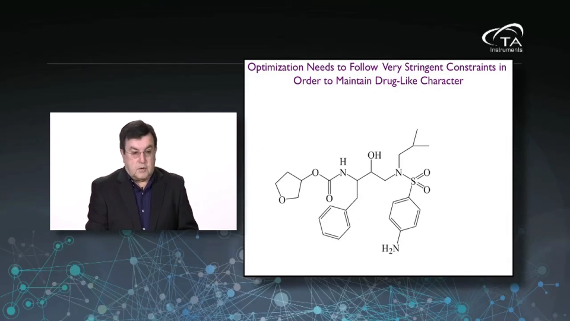

这张幻灯片只写了一句话——「优化必须服从非常严格的约束，才能维持类药性」——分子结构本身就是那个约束的具象：一个分子里同时塞着四氢呋喃环、酰胺、羟基、磺酰胺、苯胺，每一块都在花账本上的钱。

### 1.3 主流做法确实把分子越做越油

[【跳转到 04:46】](https://www.youtube.com/watch?v=CBGW5-8KX-s&t=286)

讲者对这个现状的措辞很直接：优化这些化合物的常用手段，反而造出了越来越多高疏水性的分子，这在过去是、现在仍然是一个问题，业界也已经承认。

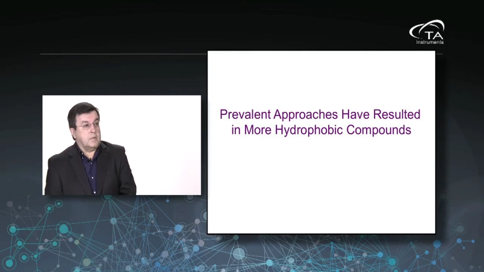

### 1.4 于是有了 LipE：把「不是靠疏水挣来的那部分亲和力」单独计量

[【跳转到 06:24】](https://www.youtube.com/watch?v=CBGW5-8KX-s&t=384)

为了把「真本事」和「靠油挣的」分开，业界提出了亲脂性效率 LipE（也叫 LLE，亲脂配体效率）：

$$
\text{LipE} = \text{p}K_i\ (\text{或}\ \text{pIC}_{50}) - \log D
$$

它衡量的是亲和力里有多少不是由疏水性贡献的。讲者强调，高亲脂性或高分子量会拖累体内表现——清除率、溶解度、吸收率、膜渗透性都受影响，所以目标应该是提高 LipE，而不只是提高效力。

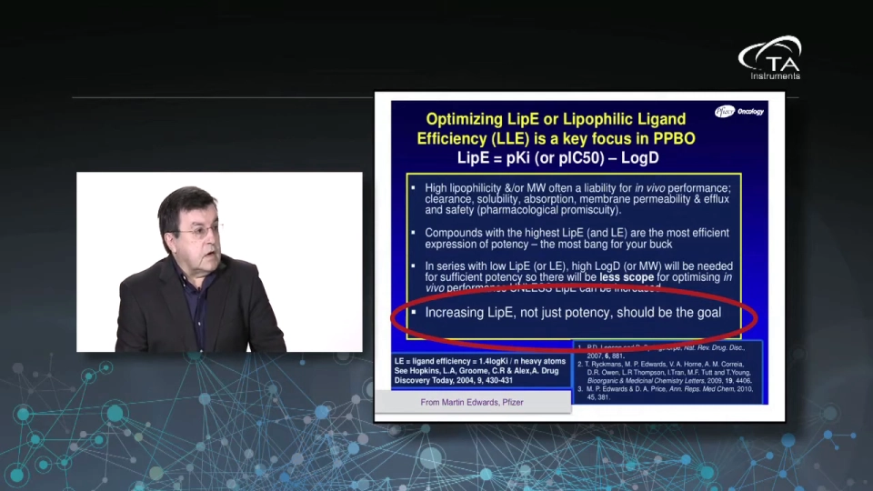

> 补充（非视频内容）：LipE 的分子端用 $\text{pIC}_{50}$、分母端用 $\log D$，所以它同时吃进了「活性」和「在测定 pH 下的实际亲脂性」两个信息。这与本系列 2.1.2 讲的 logP/logD 之分直接相关——用 logP 还是 logD，会改变 LipE 的读数。

## 二、账本只有两栏：$\Delta G = \Delta H - T\Delta S$

### 2.1 亲和力是焓和熵的差

[【跳转到 08:03】](https://www.youtube.com/watch?v=CBGW5-8KX-s&t=483)

结合亲和力由吉布斯自由能给出，而自由能是焓与熵的组合。讲者把这张图称为化合物的「热力学特征」（thermodynamic signature）：

$$
\Delta G = -RT\ln\frac{1}{K_a} = \Delta H - T\Delta S
$$

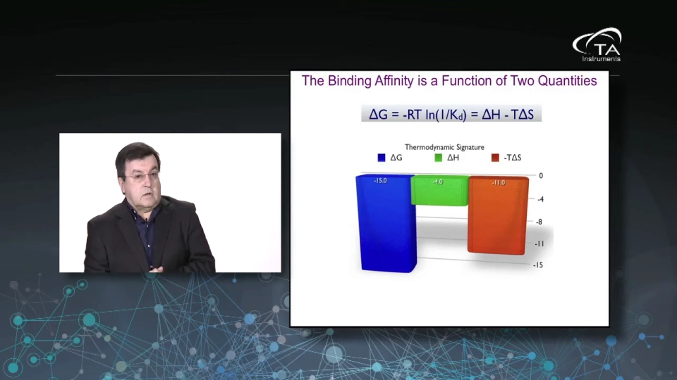

这张柱状图是整场报告的基本语言：蓝色柱是总账（$\Delta G$），绿色柱是焓，红色柱是熵项。看图的人可以立刻判断这个化合物的结合是焓驱动还是熵驱动。讲者说，这是一个非常直观而且重要的观察方式，因为只看这一张图，你就知道哪种力在主导。

### 2.2 ITC 一次实验给出三栏数字

[【跳转到 08:54】](https://www.youtube.com/watch?v=CBGW5-8KX-s&t=534)

在典型的 ITC 实验里，大分子放在量热池中，配体或药物放在注射器里，逐次滴定。ITC 的独特之处在于它直接测量结合过程中吸收或放出的热量：

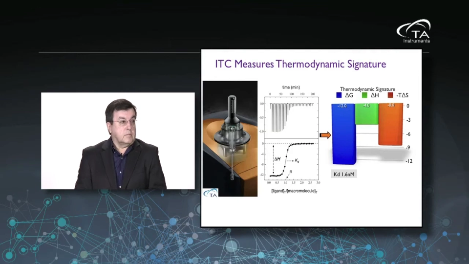

因为可观测量就是热量，所以焓是直接测出来的，再由热力学关系算出 $-T\Delta S$。讲者强调：一次实验同时得到 $\Delta G$、$\Delta H$、$-T\Delta S$，这一点目前只有 ITC 能做到。这就是「账本可以被逐行核对」的技术前提——别的亲和力测定只给你蓝柱，不给你绿柱和红柱。

### 2.3 从 first-in-class 到 best-in-class，账本在往焓那边挪

[【跳转到 10:24】](https://www.youtube.com/watch?v=CBGW5-8KX-s&t=624)

讲者拿 FDA 批准的 HIV 蛋白酶抑制剂做了一次纵向对比，跨度 12 年：

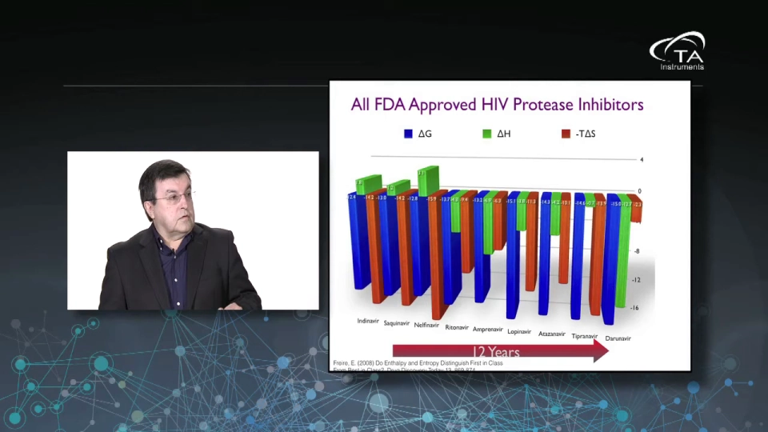

最早的抑制剂是熵驱动的，焓不但对结合没有贡献，甚至是正值——也就是在阻碍结合；而最新获批的抑制剂有很强的焓驱动，熵的贡献虽然仍为正，但小得多。区别在哪？最新化合物的亲和力更高（从纳摩尔进入皮摩尔），耐药性和选择性也更好。他汀类（HMG-CoA 还原酶抑制剂）的演化模式完全一样：从最早的他汀到瑞舒伐他汀、再到立普妥，焓值随亲和力提高而显著变负。

讲者特意补了一句：科学家当年研发这些新化合物时并没有刻意追求焓或熵，但恰好最好的化合物都带焓特征。这句话的分量在于——**焓不是一种可以事后贴上去的标签，它是「真的把每个极性基团都摆对了位置」的结果**。

## 三、账本的四栏明细：去溶剂化、氢键、范德华、构象

[【跳转到 12:50】](https://www.youtube.com/watch?v=CBGW5-8KX-s&t=770)

从工程的角度看，对结合亲和力有重要影响、又可以被调控的因素有四项：

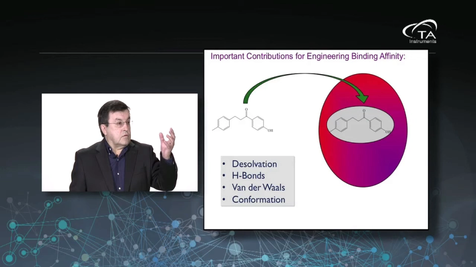

1. **去溶剂化**：药物和结合口袋周围都有水，结合时这些水被释放回溶液本体；
2. **氢键**：极性基团与口袋形成氢键；
3. **范德华**：药物与口袋契合得好，范德华接触增强；
4. **构象**：药物从溶液中的多构象被锁定到单一构象，构象熵下降；口袋一侧也有类似的构象限制。

后面三节就是把前三项各自标价，第四项（构象）单独讲。

## 四、去溶剂化：极性基团的价钱比非极性贵一个数量级

### 4.1 一张 1981 年的基团溶剂化自由能表

[【跳转到 14:05】](https://www.youtube.com/watch?v=CBGW5-8KX-s&t=845)

讲者引用了 Cabani 等人编制的基团溶剂化自由能表，这是整场报告里最硬的一张数据图：

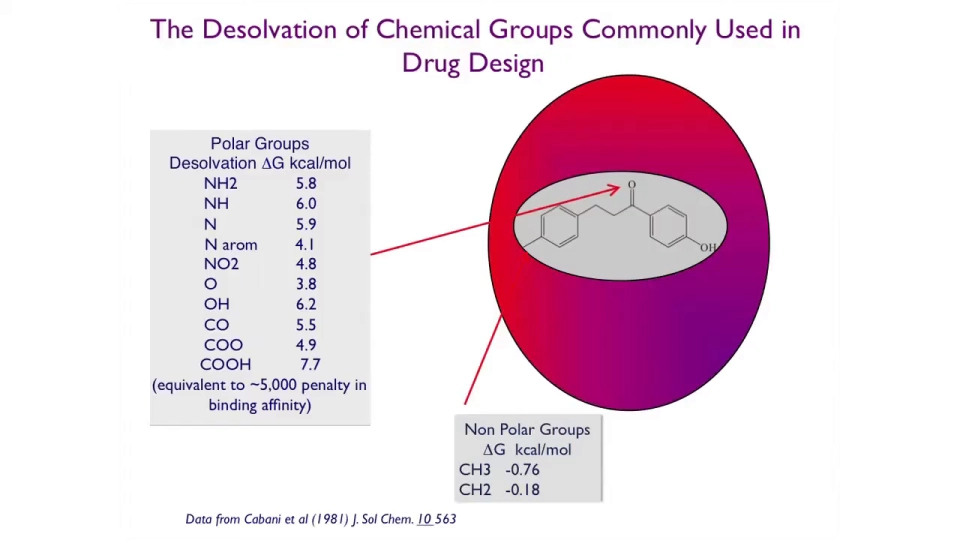

| 基团类型 | 去溶剂化 $\Delta G$（kcal/mol） |
| --- | --- |
| $\mathrm{NH_2}$ | 5.8 |
| $\mathrm{NH}$ | 6.0 |
| $\mathrm{N}$ | 5.9 |
| 芳香 $\mathrm{N}$ | 4.1 |
| $\mathrm{NO_2}$ | 4.8 |
| $\mathrm{O}$ | 3.8 |
| $\mathrm{OH}$ | 6.2 |
| $\mathrm{CO}$ | 5.5 |
| $\mathrm{COO^-}$ | 4.9 |
| $\mathrm{COOH}$ | 7.7 |
| $\mathrm{CH_3}$ | $-0.76$ |
| $\mathrm{CH_2}$ | $-0.18$ |

读法是这样的：如果一个极性基团被埋进结合腔却不发生任何相互作用（相当于处在真空里），它就要付出 4~8 kcal/mol 的代价；按 1.36 kcal/mol 对应 10 倍换算，5 kcal/mol 大约相当于亲和力下降 5000 倍。反过来，非极性基团从水里转移到口袋里是**有利**的，所以即使它不与口袋发生任何相互作用，把它放进去也是赚的。

请注意两栏的数量级差别：极性基团是 $+4\sim+8$，非极性基团是 $-0.2\sim-0.8$。这解释了 1.3 节那个行业现象——**加碳几乎总是「有效」，因为它的价钱是负的；加极性基团则要先付一笔首付**。

### 4.2 这笔钱主要记在焓那一栏

[【跳转到 16:09】](https://www.youtube.com/watch?v=CBGW5-8KX-s&t=969)

讲者进一步把去溶剂化拆成焓和熵：

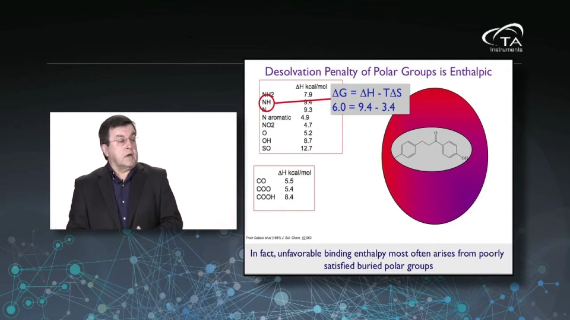

以氨基为例，净的去溶剂化惩罚是 6.0 kcal/mol，但焓的惩罚是 9.4 kcal/mol，熵项则是有利的 3.4 kcal/mol——因为溶解过程总要释放水。幻灯片底部那句话是本节结论：**不利的结合焓，往往就来自没有被满足的、被埋起来的极性基团**。而像甲基这样的非极性基团，溶解焓变非常小，熵变也明显有利。

这就是「氢键不是免费的」这句话的定量版本：形成一个氢键大约能赚 1~5 kcal/mol（不同氢键差别很大），而把一个极性基团从水里拔出来要先付 4~8 kcal/mol。**只有真正配对成功，这笔账才划算。**

## 五、两对化合物：疏水基团的小幅累积 vs 氢键的焓熵补偿

### 5.1 加一个甲基：焓和熵各赚一点点

[【跳转到 17:01】](https://www.youtube.com/watch?v=CBGW5-8KX-s&t=1021)

讲者用「只改一个官能团」的成对化合物做对照实验，这样差异就可以归因于那个基团。第一对是加一个甲基：

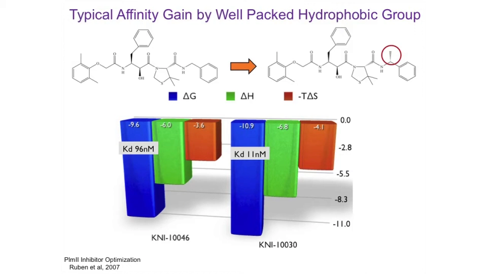

亲和力提高约 8 倍，结合焓和熵的贡献都有小幅改善。这是非极性基团的典型行为：**焓和熵都小幅改善，一点一点累积**。讲者由此解释为什么科学家更容易靠疏水性而不是极性基团来优化——前者是「无风险的小额收益」，后者要赌配对是否成功。

### 5.2 换一个羟基：焓赚 4.4，熵赔 3.9

[【跳转到 18:06】](https://www.youtube.com/watch?v=CBGW5-8KX-s&t=1086)

第二对只把甲基换成羟基：

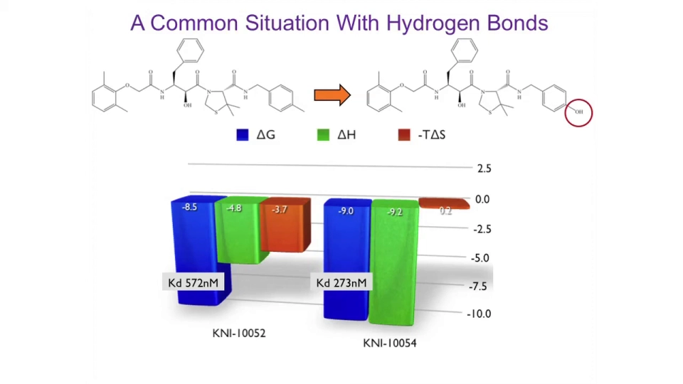

| 化合物 | $K_d$ | $\Delta G$ | $\Delta H$ | $-T\Delta S$ |
| --- | --- | --- | --- | --- |
| KNI-10052（甲基） | 572 nM | $-8.5$ | $-4.8$ | $-3.7$ |
| KNI-10054（羟基） | 273 nM | $-9.0$ | $-9.2$ | $+0.2$ |

亲和力只提高了约两倍，但焓改善了 4.4 kcal/mol；然而熵项从 $-3.7$ 变成 $+0.2$，几乎完全抵消了焓的改善。这就是**焓熵补偿**（enthalpy–entropy compensation）。讲者强调：极性基团引起的焓熵补偿幅度远大于非极性基团。

> 注：这一对化合物的幻灯片标题是「A Common Situation With Hydrogen Bonds」——讲者用它说明「氢键带来的焓增益被熵抵消」是一种**常见**情形，而不是特例。

## 六、构象熵：焓的每一笔收益，都要用自由度去付账

### 6.1 补偿从哪来：成键就锁死了一个旋转

[【跳转到 18:52】](https://www.youtube.com/watch?v=CBGW5-8KX-s&t=1132)

导致焓熵补偿的因素很多，比如形成氢键时的去溶剂化或溶解度下降，但在药物设计中最重要的是**结构自由度的变化**。

化合物与天冬氨酸侧链形成氢键时，成键带来焓，但熵会相应减少——因为形成氢键会失去旋转自由度。所以这种情况下我们看到焓增加、构象自由度减少。

用公式写出来，就是结合时构象熵的损失直接进入自由能：

$$
\Delta G_{\text{conf}} \approx -T\Delta S_{\text{conf}} > 0
$$

一个柔性配体在溶液里能采取大量构象，结合时被锁定到少数几个构象，$\Delta S_{\text{conf}}$ 为负，于是 $-T\Delta S_{\text{conf}}$ 为正——它是**减分项**。可旋转键越多，这一项越大。这正是「刚性化能提高亲和力」的热力学理由：把自由度在成键之前就预先花掉（预组织，preorganization），结合时就不用再付。

### 6.2 所以要把氢键打在「结构有序」的地方

[【跳转到 20:03】](https://www.youtube.com/watch?v=CBGW5-8KX-s&t=1203)

既然成键会锁死旋转，那么氢键打在哪里就很有讲究。讲者给了两种评估靶标一侧结构有序程度的方法，第一种是晶体结构里的温度因子（B factor）：比如一个激酶的结合口袋，口袋底部蓝色区域结构良好，而表面区域通常是无序的。

如果氢键靶向无序残基，氢键会让那片区域变有序，于是焓的增加会被有序化过程的熵损失抵消掉一大半；如果氢键与蛋白质中本来就有结构的区域成键，补偿就小得多。这就是他提出的策略之一：**把氢键靶向蛋白质中结构有序的部分**。

### 6.3 一个反直觉的结论：结合焓与氢键的「数量」无关

[【跳转到 24:00】](https://www.youtube.com/watch?v=CBGW5-8KX-s&t=1440)

讲者明确指出：结合焓与氢键的数量无关。即使氢键供体数目完全相同，也可能出现有利的结合焓，也可能出现不利的结合焓。关键在于这些供体或受体的**位置**。诀窍就在于重新布置化合物上的极性官能团。

这条结论对「数氢键打分」的做法是一个警告：氢键数是一个计数指标，而焓是一个能量指标，两者之间没有单调关系。

## 七、选择性：同一本账，算两个靶标

### 7.1 选择性就是两个 $K_D$ 的比值

[【跳转到 26:15】](https://www.youtube.com/watch?v=CBGW5-8KX-s&t=1575)

选择性可以用靶标与脱靶分子的解离常数之比来定量描述：比值越大，选择性越高。讲者展示了凝血酶抑制剂的例子：

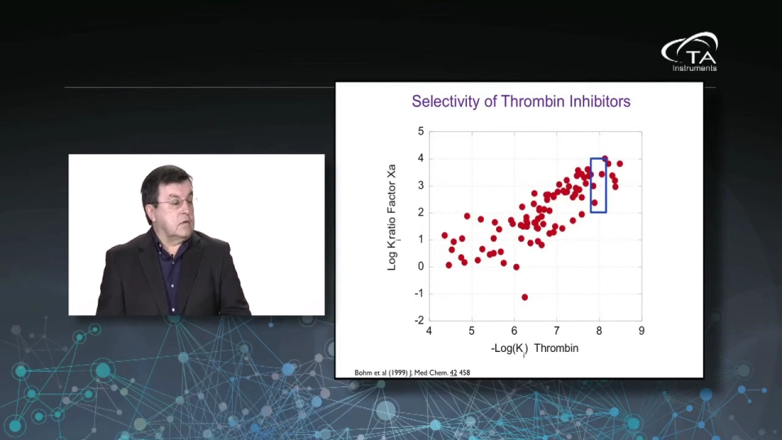

可以看到亲和力越高，选择性也越高，但同一亲和力水平上还有大约两个数量级的散布。也就是说，**亲和力能解释一部分选择性，但解释不完**——剩下的部分要靠热力学特征去解释。

### 7.2 两条路：把靶标那边抬高，或把脱靶那边压低

[【跳转到 27:46】](https://www.youtube.com/watch?v=CBGW5-8KX-s&t=1666)

要在保持相同亲和力的前提下提高选择性，有两条路：一是化学修饰，提高化合物对靶标的亲和力，且提高得比对非靶标更多；二是化学修饰，直接降低化合物对非靶标分子的亲和力。

**第一条路的例子**：靶标是 HIV 蛋白酶，需要在人体内两种天冬氨酸蛋白酶——胃蛋白酶和组织蛋白酶 D——之间做出区分。化合物上 R1、R2 是氢或甲基，位于结合口袋的空腔中：

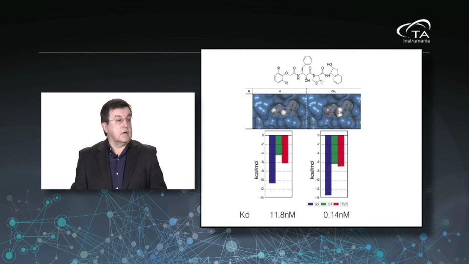

氢原子与空腔契合得很差，而甲基能非常紧密地填满它。主靶标亲和力从 11.8 nM 提到 0.14 nM，接近两个数量级；而胃蛋白酶只从 854 nM 到 345 nM，组织蛋白酶 D 从 139 nM 到 22 nM。斜率不同，选择性因此改善。

**第二条路的例子**：比较硫醚（不能形成氢键）与磺酰基（能与蛋白酶形成很强的氢键）：

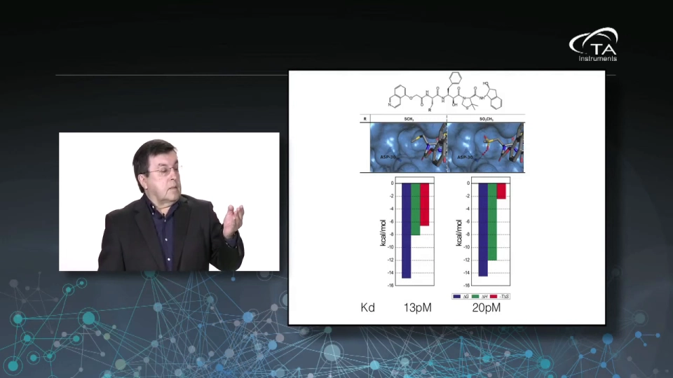

这两个化合物的热力学特征与「该基团形成强氢键」时应有的样子一致：焓改善了 4~5 kcal/mol，但熵的变化方向相反，几乎完全抵消了氢键带来的焓增益，亲和力没有提高，反而略有下降（13 pM → 20 pM）。讲者的评价是：这是一个很好的例子——**这里有一个非常强的氢键，却对亲和力没有贡献**。

而到了脱靶分子上，同样的极性基团让亲和力大幅下降（197 → 2000，90 → 1300）。原因很简单：对脱靶分子来说，这个氢键没有对靶标那么强，于是该基团的去溶剂化惩罚占了上风。**同一个基团，在靶标上是收益，在脱靶上是负债**——这就是选择性的热力学来源。

## 八、把账本画成一张图：热力学优化图

### 8.1 坐标轴是焓和熵，不是亲和力

[【跳转到 34:19】](https://www.youtube.com/watch?v=CBGW5-8KX-s&t=2059)

讲者把上述规则落成一个可操作的工具：热力学优化图。一张图，y 轴是 $\Delta H$，x 轴是 $-T\Delta S$，把待优化化合物的坐标放上去，再画一条斜率为 1 的直线。

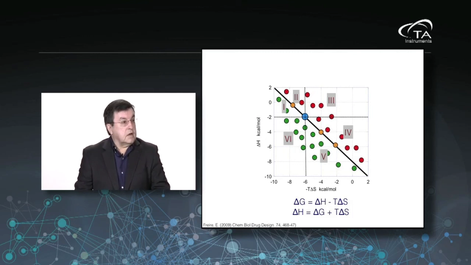

规律是：落在同一条线上的化合物，结合亲和力与母体相同，只是焓熵组合不同；线以上的亲和力低于母体，线以下的亲和力高于母体。再以母体坐标为原点画水平线和垂直线，整张图被分成六个区域：

| 区域 | 焓 | 熵 | 亲和力 | 含义 |
| --- | --- | --- | --- | --- |
| 1 | 更不利 | 更有利 | 更高 | 熵增益超过了焓损失 |
| 2 | 更不利 | 更有利 | 更低 | 熵增益不够 |
| 3 | 更不利 | 更不利 | 更低 | 全面变差 |
| 4、5 | 更有利 | 更不利 | 视情况 | 焓熵补偿区 |
| 6 | 更有利 | 更有利 | 更高 | 双赢 |

讲者强调，因为我们确切知道每个化合物是什么、修饰在哪个位置，所以借助这张图可以精确知道每一种取代对亲和力、焓、熵的影响。本质上，**它让你在三维空间里做构效关系（亲和力、焓、熵），而不是经典构效关系那样只看一维的亲和力**。

### 8.2 五条规则

[【跳转到 24:32】](https://www.youtube.com/watch?v=CBGW5-8KX-s&t=1472)

讲者把前面的分析收成五条亲和力优化规则：

1. 筛选中焓值较高的化合物应优先用于优化，因为焓优化比熵优化更难；
2. 极性基团应与靶标中结构有序的基团形成强氢键，否则它会因溶剂化而吃亏；
3. 不能形成氢键的极性基团应当剔除，因为它们是不利焓的来源；
4. 非极性基团应紧密嵌入结合口袋，以优化范德华相互作用；
5. 尽量减少构象自由度的损失。

[【跳转到 39:11】](https://www.youtube.com/watch?v=CBGW5-8KX-s&t=2351)

结论三句话：

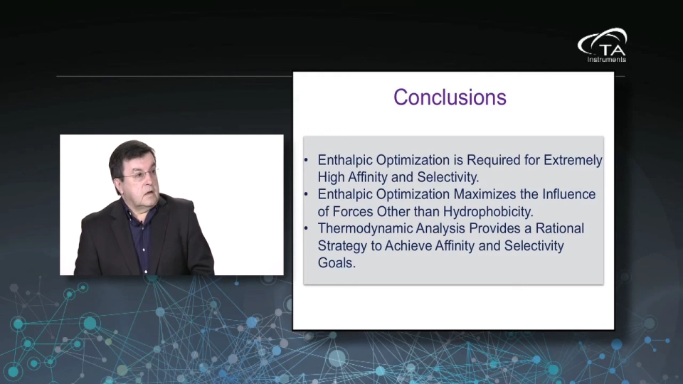

- 要拿到极高的亲和力和选择性，**焓优化是必要的**；
- 焓优化能放大疏水性以外的其他作用力，从而提高 LipE；
- 热力学分析为实现亲和力与选择性目标提供了一条合理的路径。

## 小结

- 苗头化合物到候选药物要补五个数量级，等价于再找出约 7 kcal/mol 的自由能；靠加碳来补，代价是把溶解度、渗透性、清除率一起赔掉。
- 亲和力是一本两栏账：$\Delta G = \Delta H - T\Delta S$。ITC 一次滴定同时给出三栏数字，这是它能做「逐行核对」的原因。
- 账本明细四项：去溶剂化、氢键、范德华、构象。其中去溶剂化是唯一一项**在结合之前就已经欠下的债**。
- 极性基团的去溶剂化惩罚是 $+4\sim+8$ kcal/mol 且主要是焓性的；非极性基团是 $-0.2\sim-0.8$ kcal/mol。数量级差十倍，这解释了「加碳总是有效」。
- 加一个甲基：焓、熵各小幅改善，Kd 从 96 nM 到 11 nM；换一个羟基：焓改善 4.4 kcal/mol，熵几乎全部抵消，Kd 只从 572 nM 到 273 nM。
- 焓熵补偿的主因是结构自由度的损失：形成氢键会锁死旋转，$\Delta G_{\text{conf}} \approx -T\Delta S_{\text{conf}} > 0$。因此要把氢键打在靶标中结构有序的残基上，并尽量预组织配体。
- 结合焓与氢键数量无关，只与位置有关——「数氢键」不是能量指标。
- 同一个极性基团在靶标上是收益、在脱靶上可能是负债，这是选择性的热力学来源；热力学优化图把 SAR 从一维（亲和力）扩到三维（亲和力、焓、熵）。

## 关键术语速查

| 术语 | 一句话解释 |
| --- | --- |
| 热力学特征（thermodynamic signature） | 把 $\Delta G$、$\Delta H$、$-T\Delta S$ 画成三根柱子的图，一眼看出结合是焓驱动还是熵驱动 |
| ITC（等温滴定量热法） | 直接测量结合放热/吸热的滴定实验，一次给出 $\Delta G$、$\Delta H$、$-T\Delta S$ |
| 去溶剂化惩罚 | 把极性基团从水中拔出来埋进口袋所付出的自由能代价，通常 4~8 kcal/mol 且主要是焓 |
| 焓熵补偿 | 焓的改善被熵的恶化部分或全部抵消，使净亲和力变化远小于焓变化 |
| LipE（亲脂性效率） | $\text{pIC}_{50} - \log D$，衡量亲和力中有多少不是由疏水性贡献的 |
| 构象熵 | 配体因可旋转键而在溶液中拥有的构象自由度；结合时被锁定，贡献正的 $\Delta G$ |
| 预组织（preorganization） | 在成键之前就把配体刚性化到结合构象，避免结合时再付构象熵 |
| 热力学优化图 | 以 $\Delta H$ 为纵轴、$-T\Delta S$ 为横轴、斜率为 1 的等亲和力线为基准的构效关系图 |
| 选择性 | 靶标与脱靶分子的 $K_D$ 之比；同一极性基团在两侧的热力学收益不同即产生选择性 |