# 转运体与外排：同一个分子为什么在不同组织里可及性不同

> 视频来源：[Drug Transporters in ADME and Drug Action with Dr. Joseph Ware](https://www.youtube.com/watch?v=WaLVjoAA2lE)（YouTube · NIH Clinical Center「Principles of Clinical Pharmacology」课程，讲者 Joseph Ware，Genentech 临床药理部）｜时长约 42 分钟
> 导读：这是一堂从产业视角讲转运体的课：不讲家族分类表，而是用六个真实案例把「转运体什么时候才是限速步骤」讲透——肠道外排、双向渗透性实验、基因敲除、血脑屏障、肾脏分泌、肝脏摄取。本文按「为什么转运体重要 → 肠道 → 怎么测 → 血脑屏障 → 肾与肝 → 生物标志物」重排；被动扩散的分子判据见本小节另一篇，ADMET 的整体风险地图见 2.2.1。

## 本讲要解决的核心问题（SCQA）

**背景**：教科书写吸收时，默认分子靠被动扩散过膜——亲脂、不带电、分子量小，就能过去。这套规则解释了很多药物的口服吸收。

**冲突**：但有一批分子**明明符合亲脂规律，口服后血药浓度却低得离谱**；还有一批分子在体外细胞实验里表现很好，进了人体却完全对不上。更奇怪的是，同一个分子在肠道、血脑屏障、肾小管、肝细胞这四个地方的表现可以完全不同：在肠道进不去，在肝脏却进得又快又多。

**疑问**：是什么在「违反」被动扩散的规律？如果转运体是答案，那什么时候它才是决定性的那一环？在实验室里怎么把这个环节测出来，又怎么判断测出来的数字能不能外推到人？

**回答（中心思想）**：转运体分两类——**SLC 家族负责摄取**（把底物往细胞里搬），**ABC 家族负责外排**（把底物往细胞外、管腔或胆汁里泵）。它们对可及性的影响有一个前提：**只有当转运体是限速步骤时，它的作用才会显现**（Sugiyama 的提法）。因此判断一个分子「有没有转运体风险」，不能只看它是不是底物，而要看四件事：**该组织是否表达这个转运体、底物是否敏感、有没有饱和、以及上下游还有没有别的通路**。讲者的六个案例，正好把这四件事各演示了一遍。

## 一、转运体为什么值得单独讲：它决定了「浓度-时间曲线」的形状

[【跳转到 00:49】](https://www.youtube.com/watch?v=WaLVjoAA2lE&t=49)

讲者开篇列了转运体影响 ADME 的五个方面：**口服吸收、组织分布、消除、药物相互作用（DDI）、以及多药耐药**。近十年还多了一条——**药物基因组学**：同一个转运体的不同变异，会让不同人对同一个药暴露量差出好几倍。

监管层面，FDA、EMA、PMDA 都已发布转运体 DDI 评估指南。指南的做法是：**先用体外系统判断有没有相互作用，再决定要不要做临床 DDI 研究**。所以体外实验的质量，直接决定了后面临床方案的设计。

[【跳转到 02:36】](https://www.youtube.com/watch?v=WaLVjoAA2lE&t=156)

讲者特别强调 Sugiyama 十几年前提出的那个判断标准：**要理解一个转运体相互作用重不重要，必须先理解这个转运体是不是限速步骤**。这句话是整堂课的纲领——后面每个案例，本质上都在回答「这里它是不是限速的」。

## 二、肠道：外排泵在门口把药推回肠腔

[【跳转到 07:37】](https://www.youtube.com/watch?v=WaLVjoAA2lE&t=457)

口服药物要经过崩解、溶出，然后穿过若干层膜才能到达靶点。在肠上皮细胞上，**P-糖蛋白（P-gp，基因名 ABCB1）与 BCRP（基因名 ABCG2）都位于腔面（apical）**，方向是把药物从细胞内泵回肠腔。净效果是：药物刚被吸收进来，又被送回去。

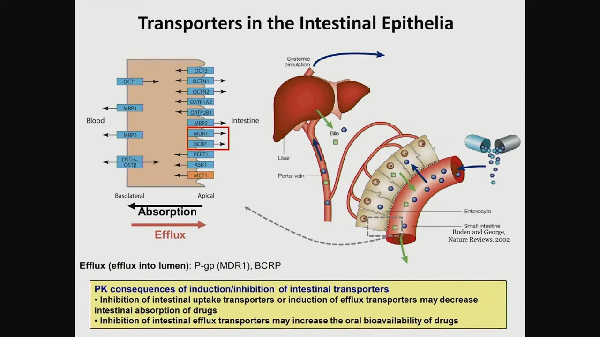

[【跳转到 08:02】](https://www.youtube.com/watch?v=WaLVjoAA2lE&t=482)

讲者给了一句很实用的总结：**抑制肠道摄取型转运体，或诱导外排型转运体，都会降低吸收；抑制肠道外排型转运体，则会提高口服生物利用度**。四个方向，两升两降。

### 2.1 诱导：把泵的数量调上去

[【跳转到 09:44】](https://www.youtube.com/watch?v=WaLVjoAA2lE&t=584)

利福平既是 CYP450 的诱导剂，也诱导 P-糖蛋白。1999 年的一项研究在给人用利福平前后各取十二指肠活检，用免疫组化看 P-糖蛋白的表达：用药后腔面的染色明显加深。泵变多了，底物的全身暴露就下降。

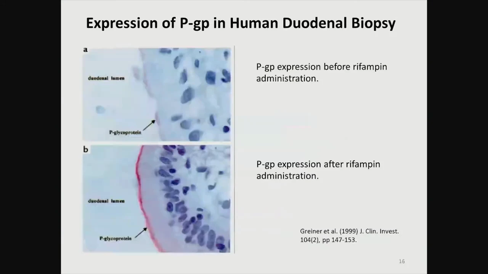

[【跳转到 10:05】](https://www.youtube.com/watch?v=WaLVjoAA2lE&t=605)

### 2.2 抑制：把泵堵住，暴露量翻倍

[【跳转到 10:38】](https://www.youtube.com/watch?v=WaLVjoAA2lE&t=638)

反过来，抑制 P-糖蛋白会让敏感底物的暴露上升。讲者举的例子是**地高辛**：合用含洛匹那韦/利托那韦的抗病毒方案后，地高辛的血药浓度曲线整体抬高，AUC 约翻倍。

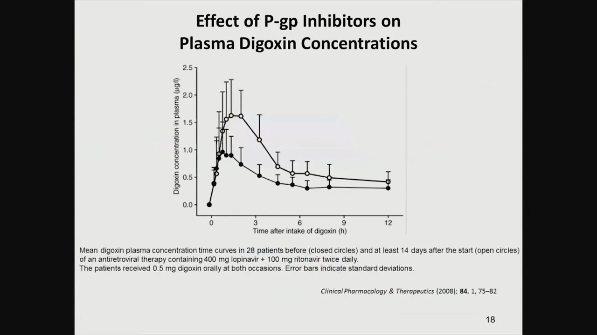

[【跳转到 11:21】](https://www.youtube.com/watch?v=WaLVjoAA2lE&t=681)

地高辛这个例子之所以重要，是因为它的**治疗窗只有 0.5–1.5 ng/mL**，超过 2 ng/mL 就可能出现房室传导阻滞等毒性。所以对窄治疗窗药物来说，**暴露量变化 25% 就有临床意义**，不到两倍的 AUC 变化也必须当回事。

### 2.3 一个必须承认的局限：体外预测会有假阴性

[【跳转到 12:28】](https://www.youtube.com/watch?v=WaLVjoAA2lE&t=748)

讲者在这里说了一句很诚实的话：把体外数据外推到体内，**相当一部分预测是对的，但假阴性率仍然很高**——尤其是地高辛这类窄治疗窗底物。原因之一是「探针底物本身不完美」：地高辛并不是最理想的 P-gp 底物，用它测出来的抑制效应会偏小。

> **补充（非讲者原话）**：这正是「底物 vs 抑制剂」必须分开讨论的原因。一个分子可以是某转运体的**底物**（会被搬运），也可以是**抑制剂**（会堵住别人的搬运），还可以两者兼有。判断 DDI 风险时，** perpetrator 一侧看抑制能力，victim 一侧看底物敏感性**，两边都要评估。

## 三、怎么把「外排」测出来：双向渗透性与外排比

[【跳转到 13:18】](https://www.youtube.com/watch?v=WaLVjoAA2lE&t=798)

讲者用自己的一个项目演示了完整链路。**利福昔明**是一个肠道靶向抗生素，绝对生物利用度只有 0.4%；但它与环孢素合用时，$C_{max}$ 与 AUC 增加了 83–100 倍。这个量级显然不止一种机制。

第一步是体外：把利福昔明放在转染了 P-gp（MDR1）的 MDCK 细胞上，做**双向转运实验**——同时测腔面到基底面（A→B）和基底面到腔面（B→A）的表观渗透系数 $P_{app}$。

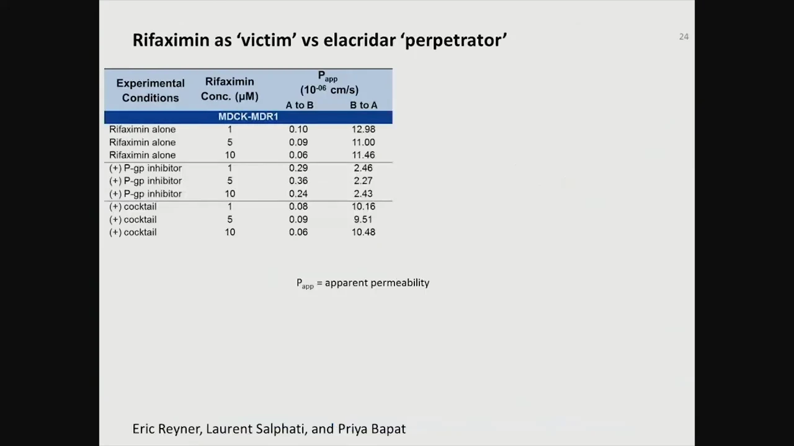

[【跳转到 13:50】](https://www.youtube.com/watch?v=WaLVjoAA2lE&t=830)

这张表值得逐行读，因为它把「怎么判读方向性」演示得非常干净：

| 条件 | $P_{app}$ A→B（$10^{-6}$ cm/s） | $P_{app}$ B→A（$10^{-6}$ cm/s） | 外排比 B→A / A→B |
| --- | --- | --- | --- |
| 利福昔明 1 µM | 0.10 | 12.98 | ≈130 |
| 利福昔明 5 µM | 0.09 | 11.00 | ≈122 |
| 利福昔明 10 µM | 0.06 | 11.46 | ≈190 |
| + P-gp 抑制剂 1 µM | 0.29 | 2.46 | ≈8.5 |
| + P-gp 抑制剂 5 µM | 0.36 | 2.27 | ≈6.3 |
| + P-gp 抑制剂 10 µM | 0.24 | 2.43 | ≈10 |
| + 抑制剂鸡尾酒 | 0.06–0.09 | 9.5–10.5 | ≈110–170 |

三个读数要点：

1. **两个方向差两个数量级**，说明这是一个强外排底物；
2. **加入 P-gp 抑制剂后 B→A 掉到原来的五分之一左右**，说明外排确实由 P-gp 介导；
3. **抑制剂鸡尾酒反而没有进一步降低**，说明在这个体系里 P-gp 已经是主要通路，其他外排泵贡献有限。

还有一点值得注意：**A→B 的绝对值很低（0.1 量级）**。这说明利福昔明本身的被动通透性就很差——外排只是雪上加霜，不是唯一原因。这提醒我们：**外排比高不等于「被动通透性好但被泵出去了」**，也可能是一个本来就难过膜的分子。

## 四、基因敲除：把「相关」变成「因果」

[【跳转到 14:30】](https://www.youtube.com/watch?v=WaLVjoAA2lE&t=870)

体外实验只能证明「这个细胞里有外排」，不能证明「在动物体内它决定了暴露量」。讲者的做法是**基因敲除小鼠**：把 P-gp 敲掉、把 BCRP 敲掉、再双敲，比较口服后的 AUC。

利福昔明的结果是：敲掉 P-gp 后暴露显著上升；但**再敲掉 BCRP 并没有让 AUC 进一步上升**，且单敲与双敲的 AUC/野生型比值都超过 20 倍。这说明在这个模型里，P-gp 是主导，BCRP 的贡献被掩盖了。

[【跳转到 15:12】](https://www.youtube.com/watch?v=WaLVjoAA2lE&t=912)

BCRP 的故事更完整。BCRP（ABCG2）最早是作为干细胞标志物被发现的，同时也与米托蒽醌耐药有关。它的底物包括拓扑异构酶抑制剂等化疗药，以及一些非肿瘤药物；抑制剂里则有不少分子靶向药——这意味着**靶向药与化疗联用时，存在 BCRP 层面的相互作用**。

[【跳转到 16:52】](https://www.youtube.com/watch?v=WaLVjoAA2lE&t=1012)

荷兰癌症研究所的工作显示：**拓扑替康**在小鼠里口服吸收很差；加一个 P-gp/BCRP 双重抑制剂后，AUC 提高约 8 倍；在敲除模型中进一步定位到 BCRP。同样的抑制剂（GF-120918）用在患者身上，把拓扑替康的暴露也提高了约 8 倍。**从细胞到小鼠到人，三层的倍数对得上**——这是这类研究最有说服力的形态。

### 4.1 柳氮磺吡啶：把「个体差异」归因到一个转运体

[【跳转到 18:07】](https://www.youtube.com/watch?v=WaLVjoAA2lE&t=1087)

柳氮磺吡啶是个老药，1950 年代就有文献报告它的 **PK 暴露个体差异极大**。它本身不被 CYP450 代谢，限速步骤是结肠细菌把偶氮键还原，裂解成 5-氨基水杨酸（留在肠腔起抗炎作用）和磺胺吡啶。

讲者的假设是：**肠上皮 BCRP 表达的个体差异，造成了吸收的差异**。验证分三步：

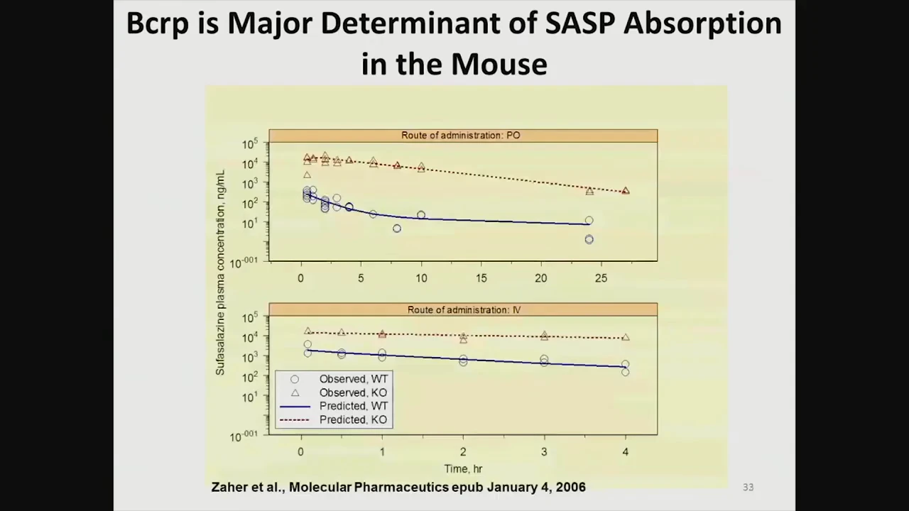

[【跳转到 19:20】](https://www.youtube.com/watch?v=WaLVjoAA2lE&t=1160)

1. **敲除小鼠口服**：BCRP 敲除组的 AUC 比野生型高出**一百倍以上**；
2. **敲除小鼠静脉**：差异很小，说明差别发生在**吸收环节**，不是消除环节；
3. **人群**：在北美健康志愿者中，首次报告了 ABCG2 表达差异与柳氮磺吡啶 PK 的关联；日本志愿者中也观察到类似的低、中、高分组。

这个案例的方法论价值在于：**先用静脉给药把「消除」按住，再看口服的差别，就能把差异定位到吸收**。这也是本小节另一篇讲 Caco-2 时反复强调的「方向性」在体内的对应版本。

[【跳转到 20:58】](https://www.youtube.com/watch?v=WaLVjoAA2lE&t=1258)

讲者还补了一个**外源性抑制剂**的例子：姜黄素是 BCRP 的选择性抑制剂（对 P-gp 的外排没有影响），与柳氮磺吡啶合用可提高后者在小鼠体内的生物利用度；日本课题组进一步发现这种抑制**有剂量依赖**——低剂量柳氮磺吡啶时 AUC 约翻倍，2 g 治疗剂量时约提高 5 倍。同一对底物/抑制剂，在不同底物浓度下给出不同的倍数，这正是**饱和**在起作用。

## 五、血脑屏障：三条通路，加一排泵

[【跳转到 25:39】](https://www.youtube.com/watch?v=WaLVjoAA2lE&t=1539)

P-gp 在血脑屏障与胎盘屏障中的作用，最早是在小鼠里被发现的。敲掉 mdr1a/1b 的小鼠外表完全正常、可育，但**用伊维菌素处理后，敲除小鼠出现严重毒性甚至死亡**，而保留血脑屏障 P-gp 的小鼠相对耐受。原因是伊维菌素本来进不了脑，P-gp 是那道闸门。

这个发现还有临床对应：**柯利犬等牧羊犬品种存在 mdr1 四碱基缺失**，血脑屏障 P-gp 功能缺失，用伊维菌素这类底物时必须大幅减量。

[【跳转到 28:05】](https://www.youtube.com/watch?v=WaLVjoAA2lE&t=1685)

讲者用胶质母细胞瘤说明「外排如何限制脑内可及性」。药物跨血脑屏障只有三条路：

1. **跨细胞被动通透**（要求亲脂）；
2. **SLC 家族的摄取型转运体**；
3. **经紧密连接之间的细胞旁路**——但这条路只对极小的分子开放，讲者给的界限是**分子量小于 120–180**。

而在这三条路之外，还有一排**外排泵（MRP、P-gp、ABCG2）**把进来的分子送回去。

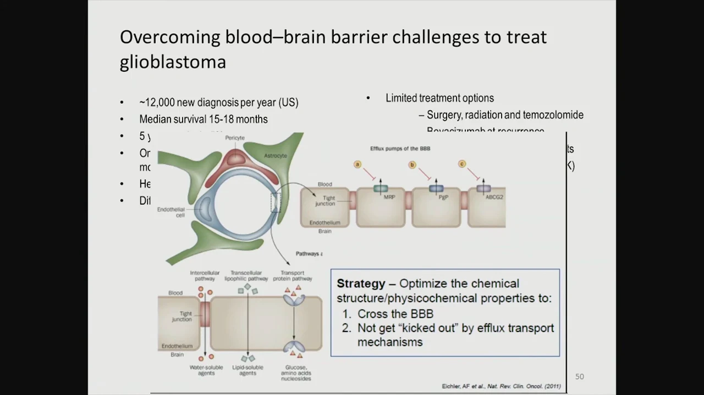

[【跳转到 28:55】](https://www.youtube.com/watch?v=WaLVjoAA2lE&t=1735)

讲者团队的解法是**改化学结构以降低 P-gp 相互作用**：GDC-0084 与 GDC-0941 药理强度相当，但前者脑/血浆比值提高了约一百倍，跨过血脑屏障的游离分数大于 7%。

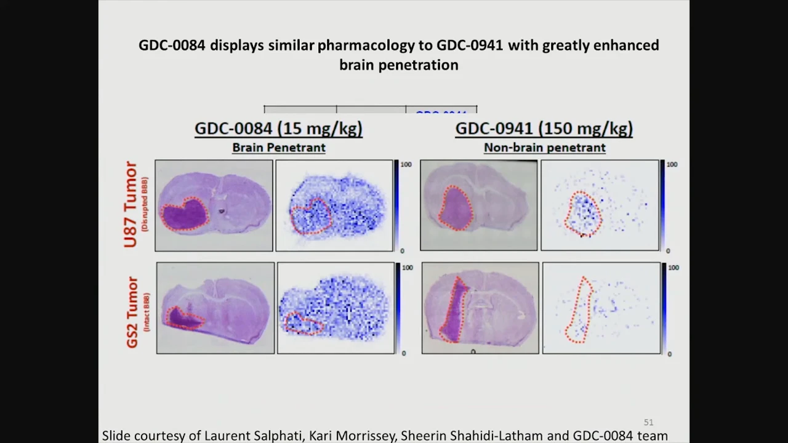

[【跳转到 30:35】](https://www.youtube.com/watch?v=WaLVjoAA2lE&t=1835)

更有说服力的是临床验证：一位需要手术的胶质母细胞瘤患者，术后测到**脑肿瘤/血浆比值大于 1.43、脑组织/血浆比值 1.54**。非临床模型预测的脑穿透，在病人身上被证实了。

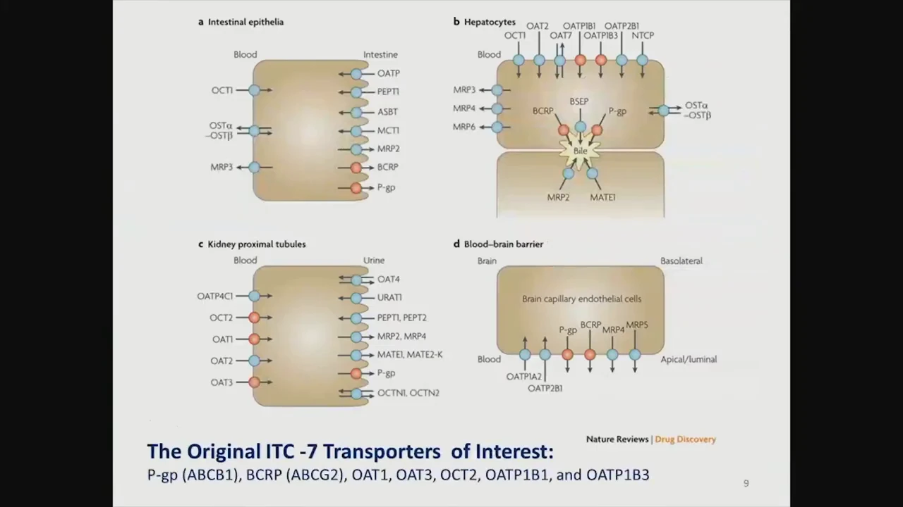

## 六、肾脏与肝脏：SLC 负责「搬进来」，ABC 负责「泵出去」

[【跳转到 31:20】](https://www.youtube.com/watch?v=WaLVjoAA2lE&t=1880)

SLC 是一个超过 **300 个基因**的超家族（远多于 ABC 家族），主要负责在**消除器官**（肾、肝）里把底物摄取进细胞。

[【跳转到 31:56】](https://www.youtube.com/watch?v=WaLVjoAA2lE&t=1916)

肾脏这一侧，讲者给了一个可以直接用来判读数据的等式：

$$
CL_r = GFR + \text{分泌} - \text{重吸收}
$$

由此有三种情形：

- $CL_r = GFR$：分泌与重吸收相互抵消，看起来像「只过滤」；
- $CL_r < GFR$：净重吸收；
- $CL_r > GFR$：净分泌。

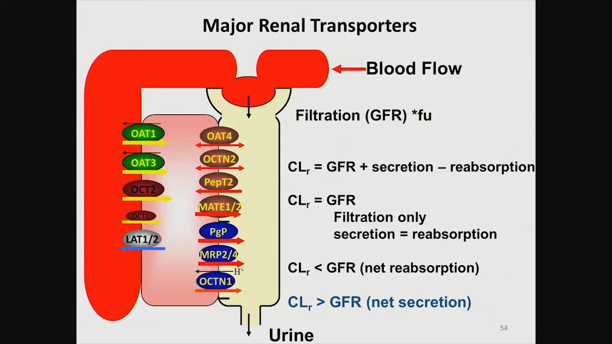

[【跳转到 32:52】](https://www.youtube.com/watch?v=WaLVjoAA2lE&t=1972)

肾转运体介导的 DDI 是历史上最早被发现的一类：二战时青霉素紧缺，研究者花了近八年才确认**丙磺舒能抑制青霉素的肾小管主动分泌**，从而延长其半衰期。这类相互作用的现代版本是：

- **多非利特**（抗心律失常，窄治疗窗）：与西咪替丁（抑制有机阳离子转运）或酮康唑合用会升高暴露，需避免；
- **二甲双胍**：完全以原形经尿排出，肾清除率是 GFR 的数倍，说明存在净分泌；
- 某些药物在 OAT 抑制剂存在时，肾毒性反而可以避免。

[【跳转到 35:18】](https://www.youtube.com/watch?v=WaLVjoAA2lE&t=2118)

肝脏这一侧的逻辑是「**摄取 → 代谢 → 外排**」串联：基底面的 OATP1B1/OATP1B3 把药从血里搬进肝细胞，腔内面的泵再排进胆汁。他汀类正是靠这套转运体被**靶向到肝脏**——这对药效是好事（靶点在肝），但也意味着一旦摄取被抑制，血药浓度会上升、肌肉毒性风险增加。

[【跳转到 36:13】](https://www.youtube.com/watch?v=WaLVjoAA2lE&t=2173)

瑞舒伐他汀是标准案例：亚洲人群的暴露约高两倍，且与代谢无关；SLCO1B1 的变异（如 Q141K）与 BCRP 底物特性共同影响暴露。NEJM 的那张图则显示，**OATP1B1 功能缺陷的患者在使用高剂量辛伐他汀后，肌病发生率更高**。

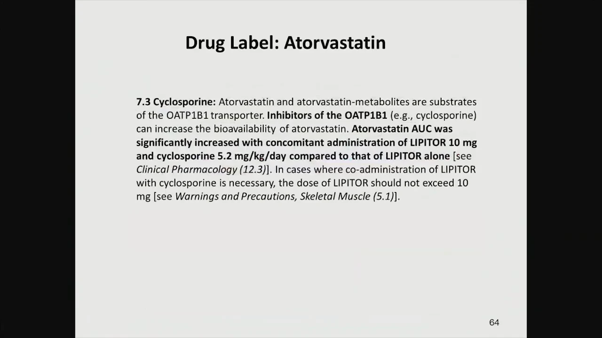

[【跳转到 37:34】](https://www.youtube.com/watch?v=WaLVjoAA2lE&t=2254)

说明书把这条机制写得很直白：**环孢素抑制 OATP1B1 → 他汀进入肝细胞减少 → 血中浓度升高 → 骨骼肌损伤风险上升**。这是「转运体机制」直接变成「用药限制」的例子。

## 七、内源性生物标志物：不用吃探针药也能测抑制

[【跳转到 38:24】](https://www.youtube.com/watch?v=WaLVjoAA2lE&t=2304)

临床 DDI 研究要给人吃探针底物，成本高、也有伦理负担。讲者介绍了另一条路：**用体内本来就存在的内源性底物当「探针」**。

- **粪卟啉 I/III（coproporphyrin I/III）**：罗特综合征患者体内水平升高，提示它由 OATP1B1/1B3 转运；利福平抑制 OATP1B 后，瑞舒伐他汀的 $C_{max}$ 升高 13.2 倍、AUC 升高 4.7 倍，而粪卟啉 I 的 $C_{max}$ 同步升高 6.3 倍——**两条曲线平行**。
- 其他候选标志物：肌酐（OCT2/MATE 底物）、牛磺酸（OAT 底物）、6β-羟基皮质醇等。

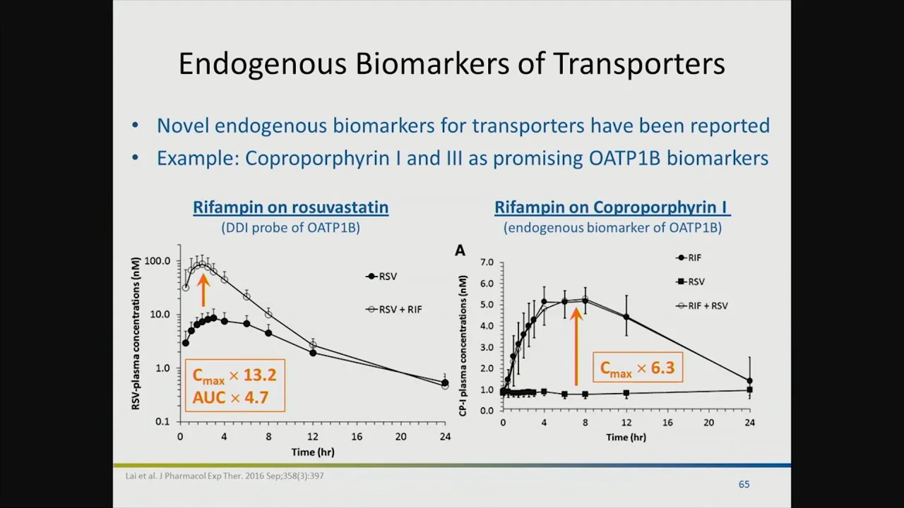

[【跳转到 39:14】](https://www.youtube.com/watch?v=WaLVjoAA2lE&t=2354)

讲者也给了**反面证据**：他们用一个弱抑制剂 GDC-0810 做同样的实验，普伐他汀的相互作用很轻微，粪卟啉 I 只升高约 1.6 倍。这说明生物标志物**不是万能的**——在弱抑制情形下灵敏度不够，仍需进一步验证。

## 八、一段「非转运体」的插曲：pH 依赖溶解度

[【跳转到 23:46】](https://www.youtube.com/watch?v=WaLVjoAA2lE&t=1426)

讲者在这里主动岔开一段，说明**有些吸收问题根本不是转运体造成的**：很多分子靶向药是弱碱，溶解度强烈依赖 pH。胃内 pH 从正常的 2–5 升高时，溶解度可能下降上万倍。

临床上这件事很常见：胶质母细胞瘤与胃肠间质瘤患者中，**40%–60% 在服用质子泵抑制剂**。他们的健康志愿者研究显示，达沙替尼合用雷贝拉唑后暴露下降超过 8 倍；而给受试者补充少量酸（讲者称之为「再酸化」策略）后，达沙替尼暴露可以回到基线的 80% 以内。

> **补充（非讲者原话）**：这段与本小节另一篇讲的 pH 分配是同一机制的两个方向。那里讲的是「pH 改变电离比例 → 改变被动扩散」；这里讲的是「pH 改变溶解度 → 改变可供吸收的分子数量」。两者都会让口服暴露下降，但排查手段不同：前者看 $pK_a$ 与肠段 pH，后者看剂型与胃内酸度。

## 小结

- 转运体分两侧：**SLC 摄取、ABC 外排**。它们对可及性的影响有前提——**必须是限速步骤**，否则上下游的其他通路会把效应稀释掉。
- 肠道腔面的 **P-gp 与 BCRP** 是口服吸收的第一道闸门：诱导它们会降低暴露（利福平），抑制它们会提高暴露（地高辛 + 洛匹那韦/利托那韦）。
- 测外排的标准做法是**双向渗透性实验**：比较 A→B 与 B→A 的 $P_{app}$，算外排比；再用**抑制剂**确认是哪个泵，用**基因敲除**确认在体内是否真的决定暴露。
- 血脑屏障只有三条通路（跨细胞、SLC 摄取、<120–180 Da 的细胞旁路），外面还站着一排外排泵。降低 P-gp 相互作用可以把脑/血浆比值提高两个数量级。
- 肾脏看 $CL_r$ 与 $GFR$ 的关系判净分泌/净重吸收；肝脏看「OATP 摄取 → 代谢 → 胆汁外排」这条串联，他汀的肌病风险就写在这条链上。
- **内源性生物标志物**（粪卟啉、肌酐等）有望替代探针药做 DDI 评估，但在弱抑制情形下灵敏度不足。

## 关键术语速查

| 术语 | 一句话解释 |
| --- | --- |
| SLC 家族 | 溶质载体超家族，约 300 个基因，主要负责把底物摄取进细胞 |
| ABC 家族 | ATP 结合盒转运体，靠水解 ATP 把底物泵出细胞，如 P-gp、BCRP、MRP |
| P-gp（ABCB1） | 肠道腔面、血脑屏障、肾小管等处的外排泵，底物谱极宽 |
| BCRP（ABCG2） | 外排泵，肠道与血脑屏障表达，底物含拓扑异构酶抑制剂与部分靶向药 |
| 外排比（efflux ratio） | $P_{app}$(B→A) / $P_{app}$(A→B)；明显大于 1 提示存在外排 |
| 限速步骤 | 整个过程中最慢的那一环；转运体只有处于限速位置才决定暴露量 |
| 底物 vs 抑制剂 | 底物是被搬运的分子，抑制剂是堵住搬运的分子；评估 DDI 时两侧都要看 |
| 净分泌 | $CL_r > GFR$，说明肾小管主动分泌的量大过重吸收 |
| 内源性生物标志物 | 体内天然存在的转运体底物（如粪卟啉 I），可用来替代探针药评估抑制程度 |