# 游离药物原理：总浓度只是陪衬，游离浓度才是驱动量

> 视频来源：[Not a Hypothesis: The free drug principle](https://www.youtube.com/watch?v=ZhUavp4gkUo)（YouTube · Drug Hunter Flash Talk，讲者 Dennis Smith，在制药业工作 32 年、长期任职辉瑞）｜时长约 67 分钟
> 导读：这是一场把「游离药物原理」讲成工程判据的讲座。前 18 分钟是嘉宾履历与产品介绍，正式内容从 17:46 开始，本文只整理这之后的 40 分钟讲演与末尾的问答。讲者反复强调一件事：$f_u$ 不能单独看，只有把它乘回一个真实的总浓度，才有意义。

## 本讲要解决的核心问题（SCQA）

**背景**：药物化学的日常是看数字——IC50 多少、清除率多少、半衰期多少。这些数字大多是在血浆里测的，而血浆里的药有一部分被蛋白抓着，抓着的部分摸不到靶点。

**冲突**：于是有了一个流传很广的写法：$C_{u} = f_u \times C_{total}$——先测总浓度，再乘游离分数，就得到"有效浓度"。这个式子算术上没错，但它把因果讲反了。讲者的原话是：它"有罪"，因为它暗示总浓度是游离浓度的来源。按这个暗示去优化分子，方向会错。

**疑问**：既然 $f_u$ 不决定游离浓度，那什么决定？总浓度到底还能用来做什么？蛋白结合高到底是坏事还是好事？

**回答（中心思想）**：真正驱动药效与清除的是**游离（未结合）药物浓度**，它由**剂量、吸收分数与内在清除率**决定，与蛋白结合无关；蛋白结合只决定"要给出多少总浓度才能得到这个游离浓度"。所以总浓度不能用来横向比较化合物，只能在同一化合物内部比较剂型、途径与物种内的 PK/PD；而游离浓度可以直接和体外的 IC50、Kd 对齐，把体外实验与体内暴露接成一条线。

## 一、先立结论：游离药物不是假说，而是平衡

[【跳转到 17:46】](https://www.youtube.com/watch?v=ZhUavp4gkUo&t=1066)

讲者开门见山反对"free drug hypothesis（游离药物假说）"这个叫法。理由很朴素：假说意味着还有别的可能解释，而这里只有一种解释——药物必须溶解在水相里，才能碰到受体和酶。

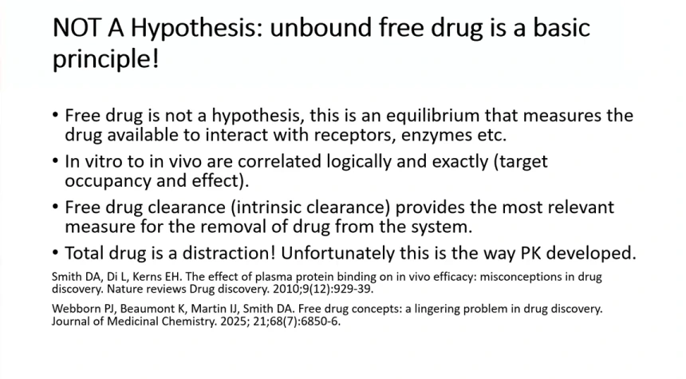

他把理由拆成四条：

1. **游离药物不是假说**，它是一个平衡，衡量的是"有多少药能去和受体、酶作用"；
2. **体外到体内可以逻辑一致地对应**，前提是你同时理解靶点占据与效应；
3. **游离药物清除率（即内在清除率）是衡量"药物从系统中被移走"的最相关指标**；
4. **总药物浓度是个干扰项**——讲者的措辞是"不幸的是，PK 就是这么发展起来的"。

第 4 条是整场讲座的靶子。它不是在说总浓度没用，而是在说：把总浓度当成分子性质的代表，会得出错误结论。

## 二、总浓度能做什么、不能做什么

[【跳转到 19:56】](https://www.youtube.com/watch?v=ZhUavp4gkUo&t=1196)

讲者没有一棍子打死总浓度，而是划了一条很清楚的界：**总浓度只在"同一个分子自己跟自己比"时有意义**。

能做的：

- 比较**剂型**：比如聚乙二醇（PEG）处方与普通晶型处方，比 $C_{\max}$ 与 AUC；
- 比较**给药途径**：有静注和口服两条曲线，就能算生物利用度和吸收分数 $F_a$——讲者特意说，生物利用度这个指标有点被高估，但**吸收分数**对低溶解度药物非常有用；
- 看**曲线形状**：低溶解度药物常常有偏晚的 $T_{\max}$，和静注曲线一对比就很明显；
- 判断**清除部位**：如果怀疑是肝清除，把总清除率与肝血流量比一比，就能定位；
- 同一物种内的 **PK/PD 相关**：比同一化合物的疗效端点和副作用端点。

不能做的：

- **不能跨化合物比较**。讲者说得直白：你不能拿一个化合物的 $C_{\max}$ 去和另一个化合物的 $C_{\max}$ 比，也不能拿一个化合物的清除率去和另一个的清除率比；
- **总全身清除率不能当作"药物是否容易被代谢"的度量**。这一点在第四节会被两个反例坐实。

最后他补了一句"即使在临床上也还有问题"，然后给了那个最漂亮的案例。

### 2.1 疟疾里的奎宁：总浓度飙升，毒性却没有

[【跳转到 21:56】](https://www.youtube.com/watch?v=ZhUavp4gkUo&t=1316)

急性疟疾、尤其是重症疟疾患者，血浆里的**奎宁总浓度**会升得很高，高到按常识应该出现严重视网膜、听神经和心血管毒性。但临床上，疟疾患者的奎宁毒性很罕见。

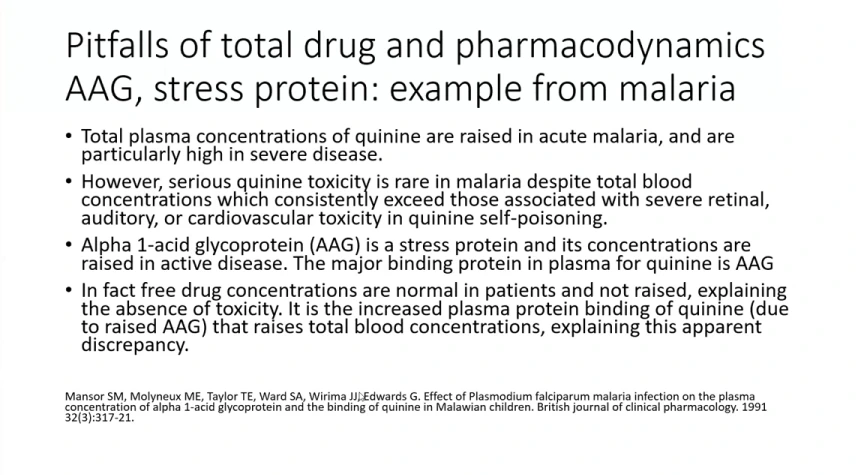

解释只有一句：奎宁的主要结合蛋白是 **α1-酸性糖蛋白（AAG）**，而 AAG 是一种**应激蛋白**，在疾病中被上调。结合多了，总浓度就被抬上去；而**患者的游离浓度是正常的**，所以没有毒性。讲者在这里顺带给了 AAG 的适用边界：它主要在**碱性药物亲脂性不太高**的时候才"唱主角"。

这个案例的价值在于：它同时否掉了两个直觉——"总浓度高所以危险"和"结合率高所以药效差"。前者在这里错，后者在第六节会被彻底反转。

## 三、正确的关系式：$C_{total}$ 依赖 $C_u$，不是反过来

[【跳转到 24:46】](https://www.youtube.com/watch?v=ZhUavp4gkUo&t=1486)

从总浓度走到游离浓度，操作上只有两步：**总浓度来自生物分析**（组织、全血或血浆），**游离分数来自体外测定**（通常是平衡透析），两者相除/相乘就得到游离浓度。

[【跳转到 25:15】](https://www.youtube.com/watch?v=ZhUavp4gkUo&t=1515)

问题出在这个式子的写法上。讲者把它叫作"**有罪的方程**"：

$$
C_{u} = f_u \times C_{total}
$$

算术没错，但它暗示的因果是：$f_u$ 是 $C_u$ 的原因，总浓度是游离浓度的来源。讲者的判断是"这完全不成立"。

正确的写法是把两边换个位置：

$$
C_{total} = \frac{C_{u}}{f_u}
$$

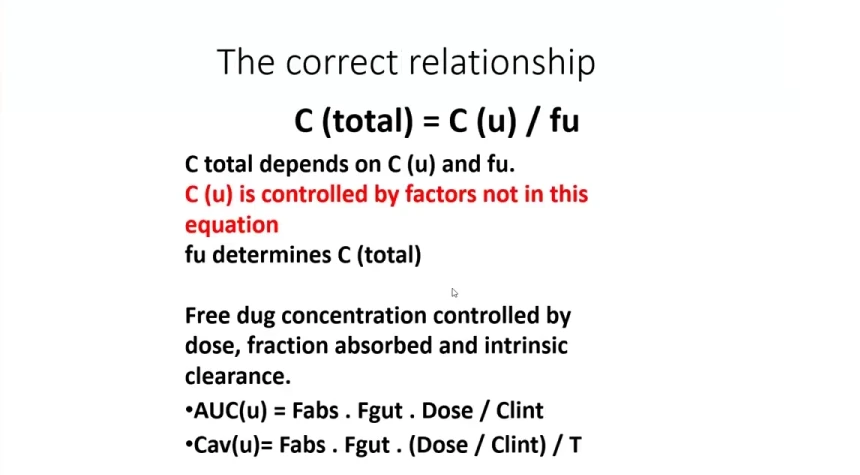

读法变成三句话：

- **总浓度依赖游离浓度与游离分数**；
- **游离浓度由这个式子之外的其它因素控制**——剂量、吸收分数 $F_{abs}$、肠道首过逃逸 $F_{gut}$、内在清除率 $Cl_{int}$、给药间隔 $T$；
- **$f_u$ 决定的是总浓度**，不是游离浓度。

写成公式就是：

$$
AUC(u) = \frac{F_{abs} \cdot F_{gut} \cdot Dose}{Cl_{int}}
$$

$$
Cav(u) = \frac{F_{abs} \cdot F_{gut} \cdot (Dose / Cl_{int})}{T}
$$

讲者特别提醒两点：$F_{gut}$ 在多数情况下接近 1，是个次要角色；而 **$Cav(u)$（平均稳态游离浓度）比 $AUC(u)$ 更好用**，因为它是一个浓度，可以直接和 IC50、Kd 这种浓度量纲的数去比，而 AUC 是一个"浓度×时间"的混合量。

## 四、可饱和结合：给"错误公式"的两个反证

如果 $C_u = f_u \times C_{total}$ 成立，那么 $f_u$ 应该是常数，总浓度应该随剂量线性上升。讲者用两个药说明这两条都不成立。

### 4.1 双异丙吡胺：剂量翻倍，总浓度不翻倍

[【跳转到 27:46】](https://www.youtube.com/watch?v=ZhUavp4gkUo&t=1666)

双异丙吡胺（disopyramide）是钠通道阻滞剂，属于"不太强"的药：有效浓度通常在 10 μM 以上。而它在血浆里的主要结合蛋白 AAG 的浓度只有约 9 μM。药物浓度要跑到结合位点浓度之上，**结合必然饱和**。

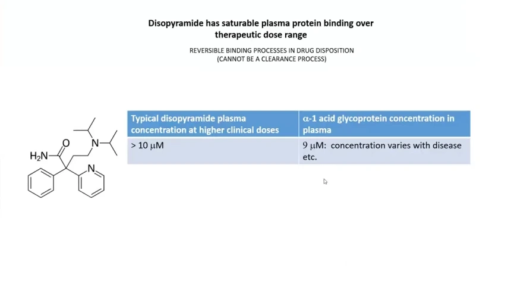

Meffin 等人的稳态数据把结果画成了一张图：

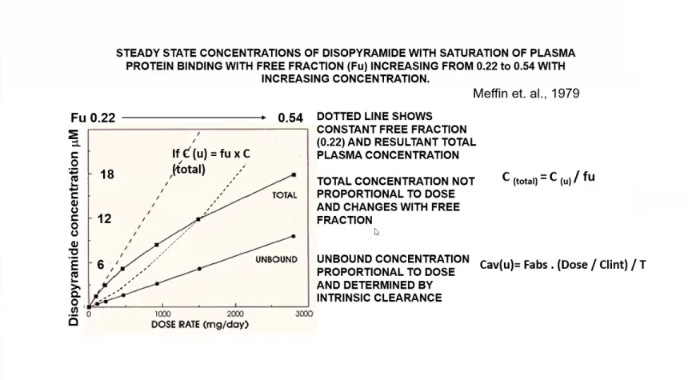

[【跳转到 28:44】](https://www.youtube.com/watch?v=ZhUavp4gkUo&t=1724)

图上有三条信息：

- **实线"UNBOUND"**：游离浓度随日剂量严格线性上升；
- **实线"TOTAL"**：总浓度**次线性**上升，因为 $f_u$ 从 0.22 涨到了 0.54；
- **虚线**：如果 $C_u = f_u \times C_{total}$ 的因果成立（$f_u$ 恒定在 0.22），总浓度应该走这条更陡的直线——实测数据完全不在那条线上。

这就是"$f_u$ 不决定 $C_u$"的直接证据：**剂量往上加，游离浓度按比例涨，而 $f_u$ 自己也在涨，总浓度反而跟不上剂量。**

### 4.2 头孢曲松：总清除率"变大"是个假象

[【跳转到 30:37】](https://www.youtube.com/watch?v=ZhUavp4gkUo&t=1837)

头孢曲松（ceftriaxone）是酸性抗生素，结合白蛋白。它的问题和白蛋白的"可用位点"有关：

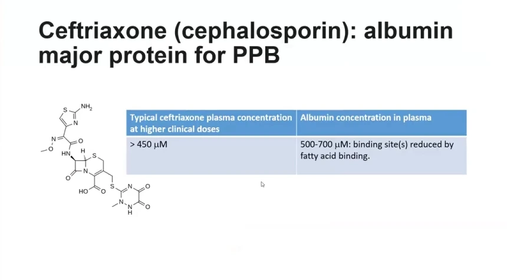

白蛋白浓度约 500–700 μM，但**实际可用的结合位点数会被脂肪酸等内源物压低**。抗生素又必须给高剂量，于是治疗浓度逼近甚至超过位点浓度——结合饱和是可以预期的。

在 150–1500 mg 静注的剂量范围内，实测结果和双异丙吡胺是同一个故事：

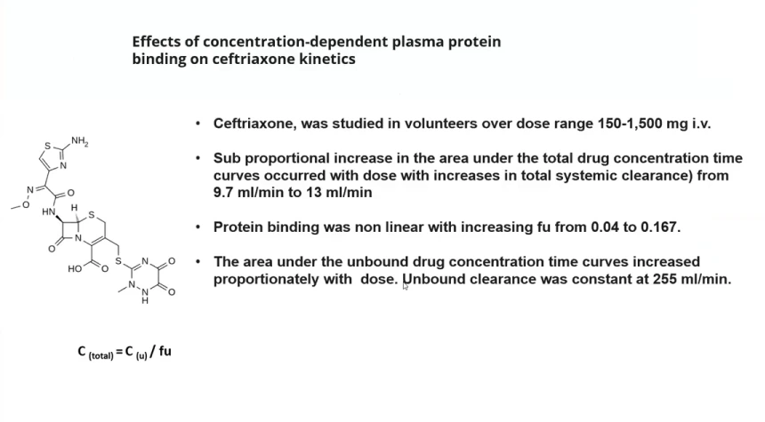

- **总药物浓度-时间曲线下面积**随剂量**次比例**上升；
- 折算出来的**总全身清除率**从 9.7 ml/min 涨到 13 ml/min——看起来像"剂量越大清得越快"；
- 但同时 $f_u$ 从 0.04 涨到 0.167，**游离药物 AUC 严格正比于剂量，游离清除率恒定在 255 ml/min**。

讲者的落点是：那个"变大的总清除率"只是结合饱和的投影，**能代表分子性质的是恒定的游离清除率**。这也是他一再重复"总清除率没有意义"的实证依据。

## 五、"一袋水"模型：组织结合才是分布的主角

[【跳转到 32:45】](https://www.youtube.com/watch?v=ZhUavp4gkUo&t=1965)

血浆讲完，讲者转向分布。他的提醒很短：**我们关心的靶点大多在组织里，不在血浆里。**

市面上有大量复杂的分布模型（well-stirred 之类），讲者说他要介绍"自己的世界观"——**身体是一袋水**：

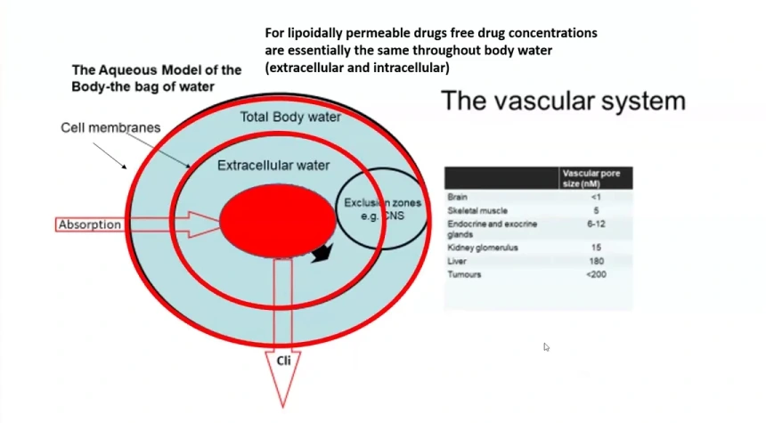

[【跳转到 32:56】](https://www.youtube.com/watch?v=ZhUavp4gkUo&t=1976)

模型的前提是**稳态**。讲者强调这一点：人们总爱问"给药 2 分钟后会怎样"，而只有在稳态，才能说这句关键的话——**对于亲脂可透膜的药物，游离药物浓度在整个身体水里基本是同一个值，细胞外和细胞内都一样。**

袋子上有几个"排除区"：中枢神经系统因为血管孔径小（<1 nM 量级）又有转运体，对低通透性的药就成了排除区；某些肿瘤也类似。右侧那张表列了各组织的血管孔径（脑 <1、骨骼肌 5、内分泌腺 6–12、肾小球 15、肝 180、肿瘤 <200）。

分布体积的式子随之写成：

$$
V_{ss} = V_{p} + \frac{f_u}{f_{ut}} \cdot V_{t}
$$

讲者的解读是：**体积项几乎是常数**（总体水约 1 L/kg，血浆水约 0.1 L/kg，取整数只是为了好算），真正在变的是**结合项**——血浆游离分数 $f_u$ 和组织游离分数 $f_{ut}$。而**组织结合主要发生在细胞膜上**（磷脂的烷基链），不是细胞内的水相。

### 5.1 体外是静态的，体内是动态的

[【跳转到 35:31】](https://www.youtube.com/watch?v=ZhUavp4gkUo&t=2131)

同样的"一袋水"，体外和体内有一个本质差别。体外是**静态系统**：

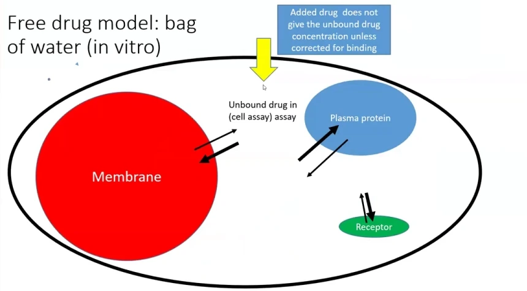

药物加进去以后，一部分被膜吸走、一部分被血浆蛋白抓走，**没有任何机制把它放回来**。所以在细胞实验里，"我加了 10 μM"绝不等于"细胞看到 10 μM"——必须校正。

[【跳转到 36:26】](https://www.youtube.com/watch?v=ZhUavp4gkUo&t=2186)

体内则是**动态系统**：结合是可逆的，药物被清除掉之后，结合的部分会释放回来，"进去的会出来"。所以结合影响的是**消失的速率**，不改变一段时间内的总量。

### 5.2 酸、中性、碱：结合在哪里，差别有多大

[【跳转到 38:16】](https://www.youtube.com/watch?v=ZhUavp4gkUo&t=2296)

讲者把三类分子的结合行为排成一张表：

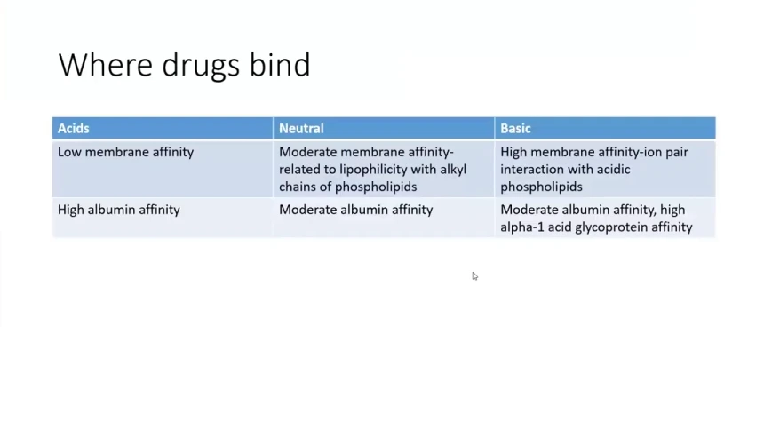

- **酸**：膜亲和力很低（几乎不结合膜），但白蛋白亲和力很高 → 血浆结合率高、$f_u$ 很低，而 $f_{ut}$ 接近 1；
- **中性**：膜亲和力中等（由亲脂性决定，作用力来自磷脂的烷基链），白蛋白亲和力中等；
- **碱**：膜亲和力很高，因为**碱性中心与酸性磷脂形成离子对** → $f_{ut}$ 极低；白蛋白亲和力中等，有时对 AAG 很高。

在讲者之前还插了一页"结合受体"的浓度尺度，这页解释了为什么受体可以忽略：**磷脂是 mM 级、血浆蛋白是 μM 级、药物受体通常是 pM–nM 级**。差了几个数量级，所以"靶点占据"在结合账本里几乎不占位置。

### 5.3 $K_p$ 与 $K_{puu}$：一个把结合"除掉"的比值

[【跳转到 40:01】](https://www.youtube.com/watch?v=ZhUavp4gkUo&t=2401)

组织分配系数 $K_p$ 是组织总浓度与水相浓度之比。按 $K_p$ 排，酸 7、中性 47、碱 74——看起来碱类"进组织进得最多"。

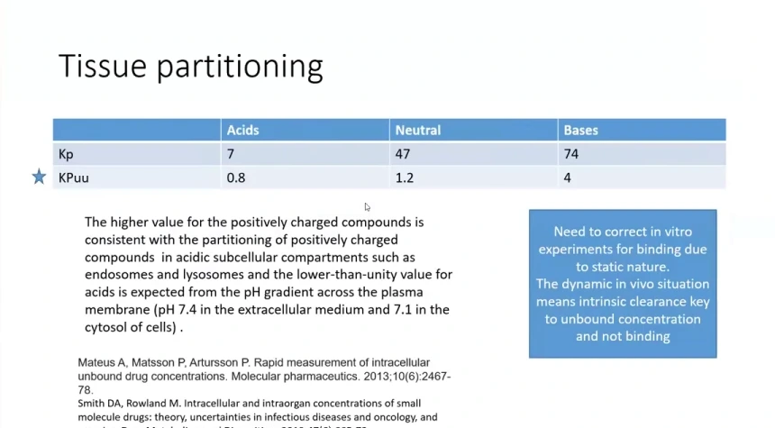

但把结合除掉、改用**游离浓度的比值 $K_{puu}$**，三个数变成 0.8、1.2、4——**几乎都等于 1**。这正是"一袋水"模型的预测：游离浓度在全身水里是均一的。

碱类略高于 1 的原因讲者也给了：溶酶体与内体 pH 很低，碱性药物在那里被富集（讲者特意说明"离子捕获"这个说法容易误导，因为过程是可逆的，本质是 pH 梯度）。**所以用 $K_p$ 看到的"组织富集"，大部分只是结合，不是浓度梯度。**

### 5.4 分布体积：从 $V_{ss}$ 到"游离体积"

[【跳转到 41:48】](https://www.youtube.com/watch?v=ZhUavp4gkUo&t=2508)

讲者用一组药把这条线走完，每个药都标了 pKa、logD、PSA 与 $V_d$：

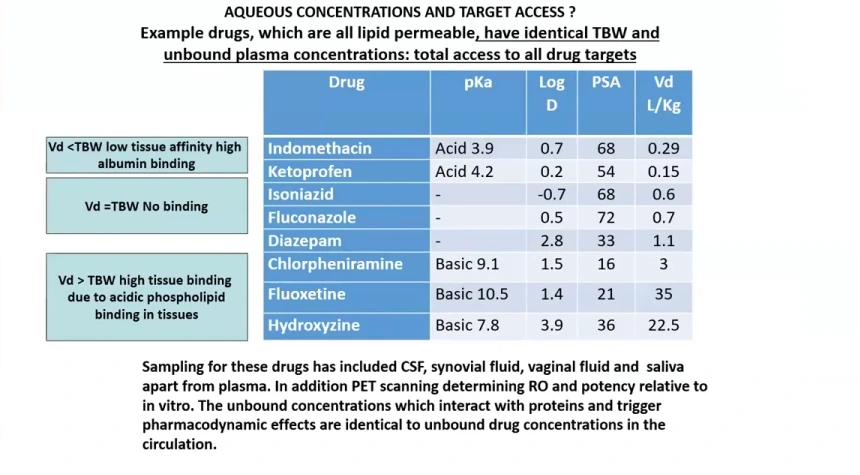

- **吲哚美辛、酮洛芬（酸）**：$V_d$ 只有 0.29 与 0.15 L/kg——蛋白结合高、组织结合低，药基本留在血浆里；
- **异烟肼、氟康唑**：约 0.6–0.7 L/kg，接近总体水，几乎不结合；
- **地西泮、氯苯那敏、氟西汀、羟嗪**：1.1 → 3 → 35 → 22.5 L/kg，随亲脂性上升、再随碱性中心出现而暴涨。

关键在于最后一句：**不管 $V_d$ 差多少倍，只要去采样细胞内的游离浓度（脑脊液、滑液、阴道液、唾液，或用 PET 测受体占据），得到的游离浓度都和循环里的游离浓度相同。**

[【跳转到 44:03】](https://www.youtube.com/watch?v=ZhUavp4gkUo&t=2643)

于是讲者引入"**游离体积**"（free volume）：

$$
V_{ss,u} = \frac{V_{ss}}{f_{u}} = \frac{1}{f_{ut}}
$$

（对中等至高组织亲和力的药物；对酸这类低组织亲和力的药物，则退化为 $V_{ss,u} = 0.1 / f_u$。）

这个式子的漂亮之处是：**$f_u$ 被约掉了**。也就是说，对中高组织亲和力的药，**蛋白结合对分布完全没有影响**，游离体积只由组织亲和力决定。

## 六、蛋白结合不是缺点：它把半衰期拉长

[【跳转到 46:57】](https://www.youtube.com/watch?v=ZhUavp4gkUo&t=2817)

接下来的模拟图是全场最反直觉的一页。固定内在清除率，让血浆蛋白结合从低到高变化：

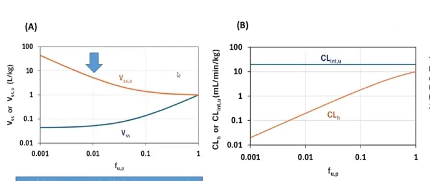

- 左图：总 $V_{ss}$ 随 $f_u$ 下降先降后走平，而**游离体积 $V_{ss,u}$ 持续上升**；
- 右图：总肝清除率 $Cl_h$ 随 $f_u$ 下降而下降，而**游离内在清除率 $Cl_{int,u}$ 是一条水平线**。

因为 $t_{1/2} = 0.693 \times V_{ss}/Cl$，而 $V_{ss,u}$ 在涨、$Cl_{int,u}$ 不变，**半衰期就被拉长**。讲者给了一个具体数字：**多数非甾体抗炎药（NSAIDs）如果不结合蛋白，半衰期会短 6 倍**。他的结论很干脆："多数 NSAIDs 之所以能上市，正是因为它们高度结合蛋白。结合是你的朋友。"

### 6.1 稳态：同样的剂量，不同的给药频次

[【跳转到 48:50】](https://www.youtube.com/watch?v=ZhUavp4gkUo&t=2930)

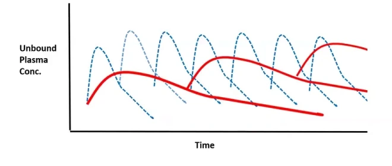

两条曲线的**内在清除率相同**，只是体积和半衰期不同。高体积长半衰期的那条（红线）要更久才到稳态，但**到达稳态后的平均游离浓度与蓝线一样**。所以只要内在清除率相同、吸收分数相同，**每日总剂量就是一样的**，差别只在**给药频次**。

### 6.2 硝苯地平与氨氯地平：一对教科书级的对照

[【跳转到 50:09】](https://www.youtube.com/watch?v=ZhUavp4gkUo&t=3009)

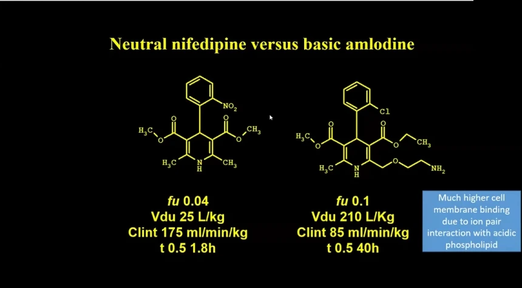

- **硝苯地平**（中性）：$f_u$ 0.04、$V_d$ 25 L/kg、$Cl_{int}$ 175 ml/min/kg、$t_{1/2}$ 1.8 h；
- **氨氯地平**（带碱性侧链）：$f_u$ 0.1、$V_d$ 210 L/kg、$Cl_{int}$ 85 ml/min/kg、$t_{1/2}$ 40 h。

氨氯地平那个碱性侧链会和酸性磷脂形成离子对，膜结合大幅上升，$f_{ut}$ 掉下去，$V_d$ 就涨了近十倍，半衰期跟着从 1.8 小时变成 40 小时。

但把两者放到稳态看，故事就收敛了：

| | IC50 (nM) | $Cl_{int}$ (ml/min/kg) | $Cav_u$ (nM) | 每日给药方案 | 每日总剂量 (mg) |
| --- | --- | --- | --- | --- | --- |
| 硝苯地平 | 4 | 175 | 6 | 3 × 5 mg | 15 |
| 氨氯地平 | 6 | 85 | 8 | 1 × 10 mg | 10 |

两者效价接近（IC50 4 与 6 nM），内在清除率接近，所以**要拿到相近的 $Cav_u$（6 与 8 nM），每日总剂量也接近（15 与 10 mg）**。分布上的巨大差异，只体现在"一天吃三次还是一次"。

[【跳转到 51:12】](https://www.youtube.com/watch?v=ZhUavp4gkUo&t=3072)

讲者的总结是：**分布与组织结合做的事，只是改变半衰期。**

## 七、把游离浓度接到体外读数上

[【跳转到 52:17】](https://www.youtube.com/watch?v=ZhUavp4gkUo&t=3137)

到这里，前面所有铺垫汇成一条使用规则：**测到 $f_u$ 之后，把总浓度换算成游离浓度，再去和体外的 IC50、Kd 对齐**。讲者用了一句很重的话：**$f_u$ 单独看是毫无价值的数据，只有配上总浓度才有意义；永远不要只凭 $f_u$ 去指导项目。**

这条规则有三个直接推论：

1. **个体值可比**：$C_{\max}$、$C_{\min}$、$Cav$ 换算成游离浓度后，可以同时和临床前的疗效、毒性端点比，也可以和体外的 IC50、Kd 比；
2. **跨物种比较必须用游离浓度**：因为**游离分数在物种之间不同、也随剂量变化**，用总浓度做种属间 PK/PD 比较是错的；
3. **多数水性隔室与血浆游离药物处于广泛平衡**，所以血浆游离浓度可以当作组织游离浓度的代理——但**有例外**：有屏障性毛细血管和外排转运体的组织（如中枢神经系统），对低亲脂性药物会形成梯度。

### 7.1 预测人体 PK 与剂量

[【跳转到 53:35】](https://www.youtube.com/watch?v=ZhUavp4gkUo&t=3215)

讲者把预测路线分成两档：

- **异速放大（allometry）**：用游离值去做，对经代谢消除的药物"没有科学基础，但结果还算合理"；
- **IVIVC**：微粒体、肝细胞、肝芯片直接给出 $Cl_{int}$，**前提是校正结合**，然后就能算日剂量。这条路线简单但有前提，需要在临床前物种中确认。

日剂量的算法就是把前面那个式子倒过来用：$Cav(u)$ 对齐 IC50 之类的目标，$T$ 取 24 小时，$F_{abs}$ 要反映通透性与溶解度（Caco-2 与热力学溶解度），$F_{gut}$ 通常不重要；**曲线形状、持续时间与给药频次则要靠 $V_d$**（体内实测或 in silico）。

### 7.2 需要多少受体占据

[【跳转到 54:43】](https://www.youtube.com/watch?v=ZhUavp4gkUo&t=3283)

把游离浓度和 IC50 放在一张图上，就得到"治疗窗"的直观版本：

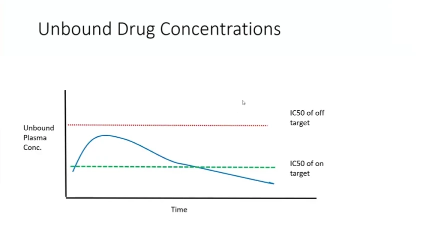

蓝线是游离血浆浓度，绿色虚线是在靶 IC50，红色虚线是脱靶 IC50。**峰太高就碰到脱靶线，谷太低就掉到在靶线以下**——剂量方案的取舍就在这两条线之间。

[【跳转到 54:55】](https://www.youtube.com/watch?v=ZhUavp4gkUo&t=3295)

讲者还强调：**必须知道每一类药需要多少受体占据**，否则算出来的目标浓度没有意义。他给了一组粗略的量级——抗感染药约 90%、酶抑制剂约 80%、GPCR 抑制剂约 75%、GPCR 激动剂约 30%，而 **hERG 只需要很低的占据就能引起有临床意义的 QT 变化**，这是必须单独算的一条。

## 八、方法：平衡透析与它的替代

讲演正文里只提了一句"游离分数通常用平衡透析测定"，细节在末尾的问答里。

[【跳转到 63:19】](https://www.youtube.com/watch?v=ZhUavp4gkUo&t=3799)

- **平衡透析**是实际上的默认答案。讲者提到文献里已经有一批方法学工作，比较不同透析方式、不同校正方式、蛋白稀释、不同时间与温度，结论大体是**这些做法彼此等价**；
- **超速离心**也有人用，但前提是你有超速离心机——讲者说现在多数实验室没有，因为这块业务已经外包出去了；
- 现实约束是：多数团队是**委托外部测**的，所以拿回来的大概率是**快速平衡透析**的结果；
- 对**极高结合率**的药物，真正的难点是"在几种方法里挑出最合适的那个"，而不是"有没有方法"。

## 九、几个常见误解

讲者在问答环节澄清了三件事，都值得单独记下来。

**极高结合率（>99.9%）的药能不能用？** [【跳转到 64:30】](https://www.youtube.com/watch?v=ZhUavp4gkUo&t=3870) 能，而且这样的上市药不少。高结合率**只是把总浓度抬高了**，游离浓度仍由内在清除率与剂量决定，体内"该起效就会起效"。真正会出问题的是**体外**：静态体系里药物被蛋白和膜吸走，看起来"怎么都不起作用"，那是实验设计的问题，不是分子的判决。

**共价药适用吗？** [【跳转到 58:40】](https://www.youtube.com/watch?v=ZhUavp4gkUo&t=3520) 分两段。第一段是**可逆结合到靶点**，这一步完全由游离药物驱动；第二段是**共价反应本身**，讲者把它归为一种内在清除——药物被转化成别的东西。两段的动力学要分开算，不能一句"共价药特殊"带过。

**组织匀浆测出来的浓度可信吗？** [【跳转到 60:26】](https://www.youtube.com/watch?v=ZhUavp4gkUo&t=3626) 要谨慎。组织（尤其肿瘤）匀浆后并不是均匀悬液，再拿去透析，得到的"游离浓度"未必是真的游离浓度。如果看到"肿瘤里富集"，先问一句：富集的是游离药物吗？为什么会富集？

## 小结

- 游离药物不是假说，是一个平衡；它衡量的是"有多少药能去碰受体和酶"。
- 总浓度只在同一分子内部（剂型、途径、同物种 PK/PD）有意义，**不能跨化合物比较**，也**不能当作分子稳定性的度量**。
- $C_{u} = f_u \times C_{total}$ 算术正确、因果错误；正确的读法是 $C_{total} = C_{u}/f_u$，游离浓度由**剂量、吸收分数、内在清除率**决定。
- 可饱和结合是最硬的反证：双异丙吡胺与头孢曲松都表现为**总浓度次线性、游离浓度严格正比于剂量、游离清除率恒定**。
- "一袋水"模型：亲脂可透膜药物的游离浓度在全身水里基本一致；$K_p$ 的差异主要是结合，换成 $K_{puu}$ 后三类药都接近 1。
- 游离体积 $V_{ss,u} = 1/f_{ut}$ 把 $f_u$ 约掉了——**蛋白结合不改变分布，只改变半衰期**。
- 因此蛋白结合可以是优点：多数 NSAIDs 若不高结合，半衰期会短 6 倍；硝苯地平与氨氯地平分布差 8 倍，日剂量却相近，差别只在给药频次。
- 使用规则只有一条：$f_u$ 必须配上总浓度，换算成游离浓度，再去和 IC50、Kd 对齐；跨物种比较必须用游离浓度。
- 体外必须校正结合（静态体系会吸走药物），体内不必担心（动态体系会释放回来）。

## 关键术语速查

| 术语 | 一句话解释 |
| --- | --- |
| 游离药物（unbound drug） | 血浆或组织中未被蛋白结合、可自由扩散的那部分药物，是唯一能结合靶点并被清除的部分 |
| 游离分数 $f_u$ | 血浆中未结合药物占总浓度的比例；它决定"要多少总浓度才能得到某个游离浓度" |
| 内在清除率 $Cl_{int}$ | 在不受血流与结合限制的条件下，消除器官清除游离药物的能力；是分子"易被代谢"程度的度量 |
| 游离清除率 | 用游离浓度算出的清除率，等于内在清除率，跨化合物、跨物种可比 |
| 可饱和结合 | 结合位点数量有限，浓度接近位点浓度时结合比例下降、$f_u$ 随浓度上升 |
| $K_p$ / $K_{puu}$ | 组织总浓度/水相浓度；以及组织游离浓度/血浆游离浓度。后者接近 1 说明无真正的浓度梯度 |
| 游离体积 $V_{ss,u}$ | $V_{ss}/f_u$，把结合除掉后的分布体积；中高组织亲和力时等于 $1/f_{ut}$ |
| 一袋水模型 | 把身体视为总体水、细胞外水、血浆水三层，稳态下亲脂可透膜药物的游离浓度处处相同 |
| $Cav(u)$ | 平均稳态游离浓度，量纲是浓度，可直接与 IC50、Kd 比较 |
| 受体占据率 | 达到期望效应所需的靶点被占比例；不同药类差别很大，hERG 只需很低占据即有临床意义 |