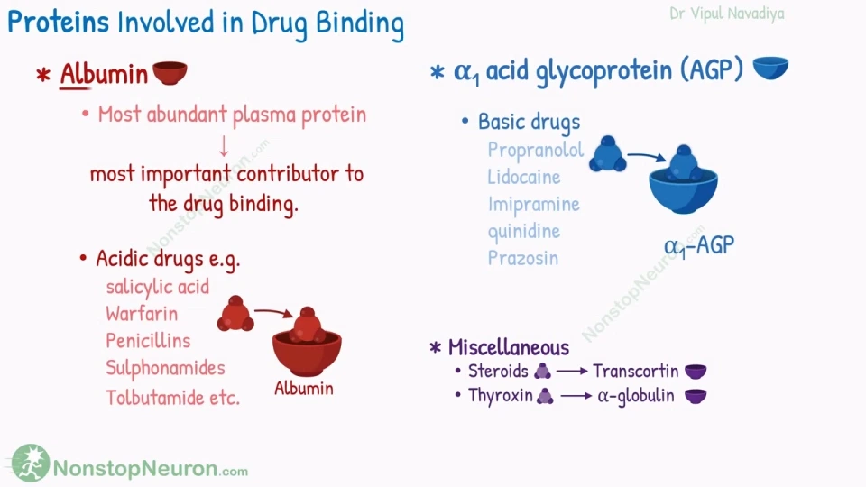
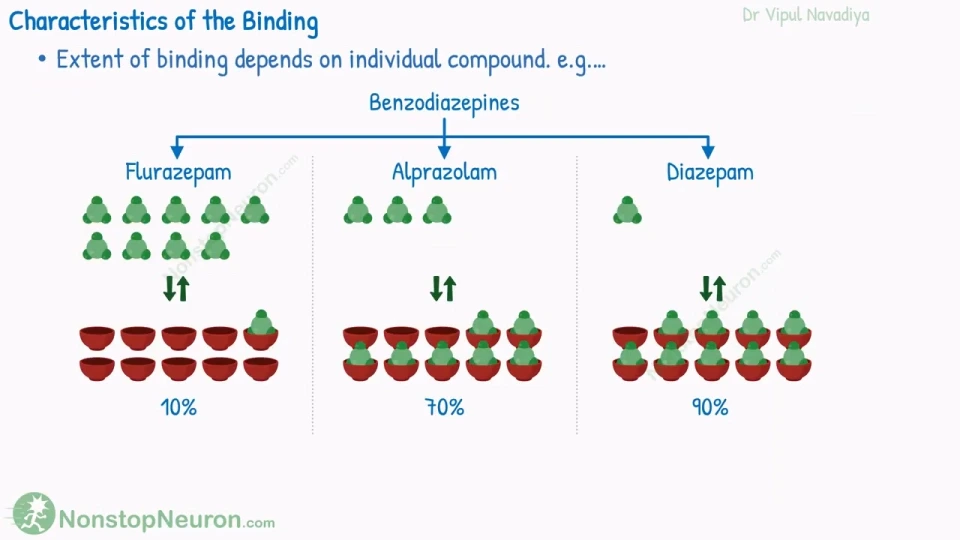
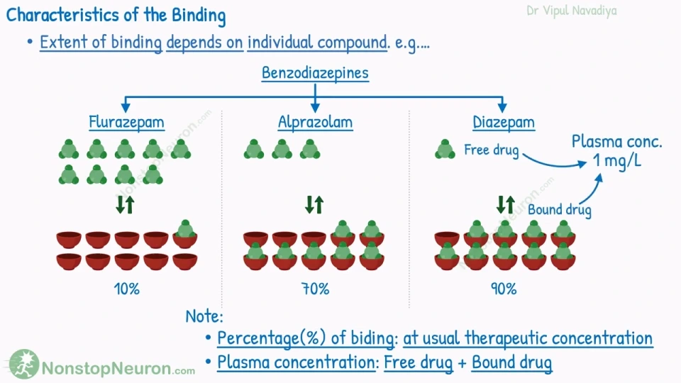
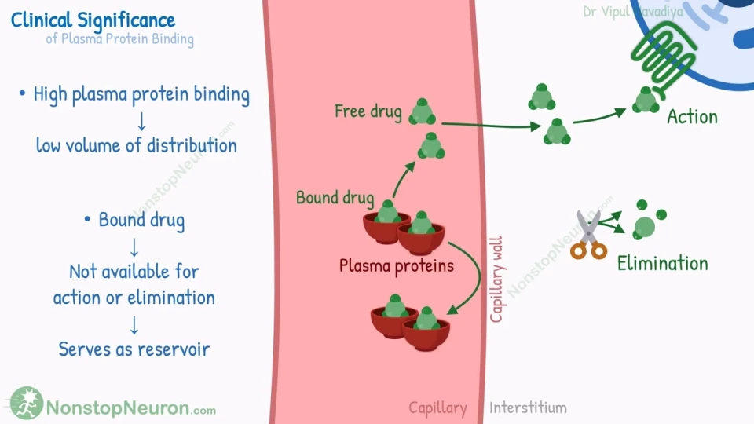
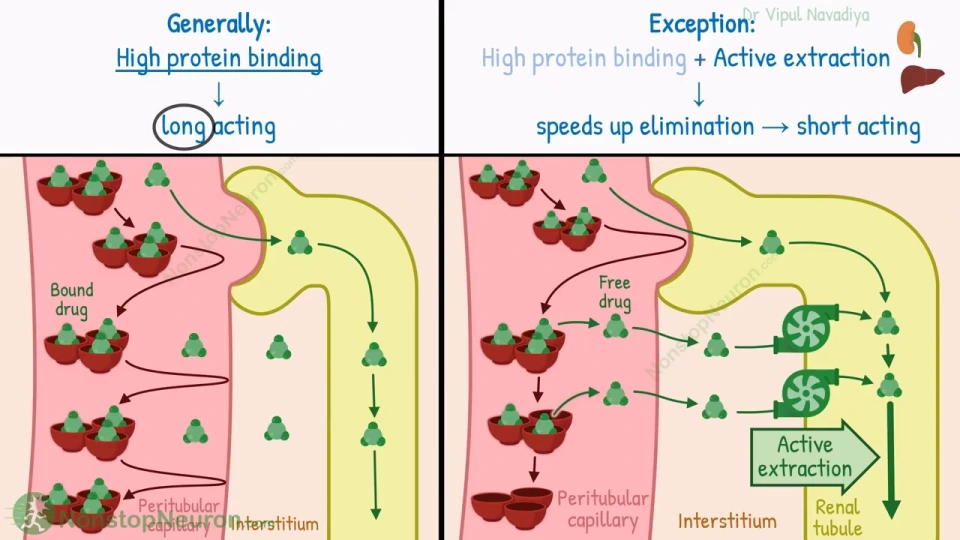
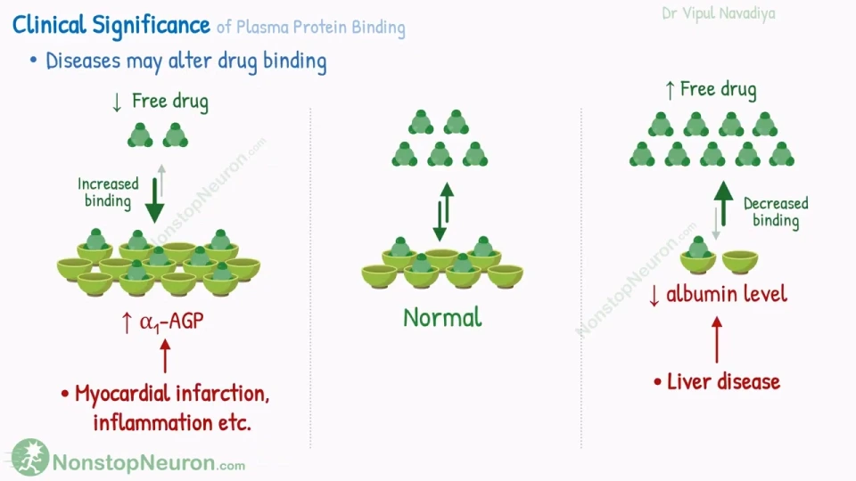
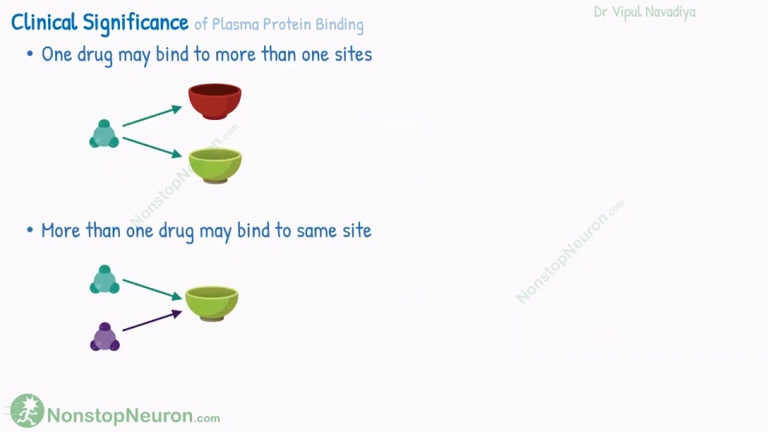
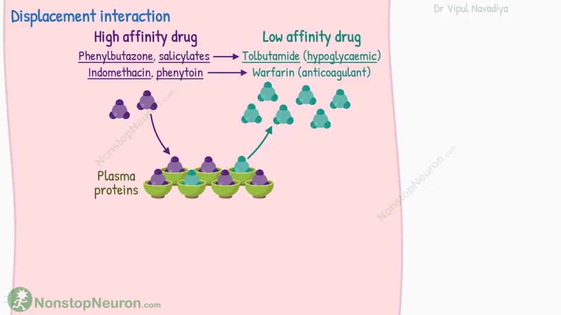
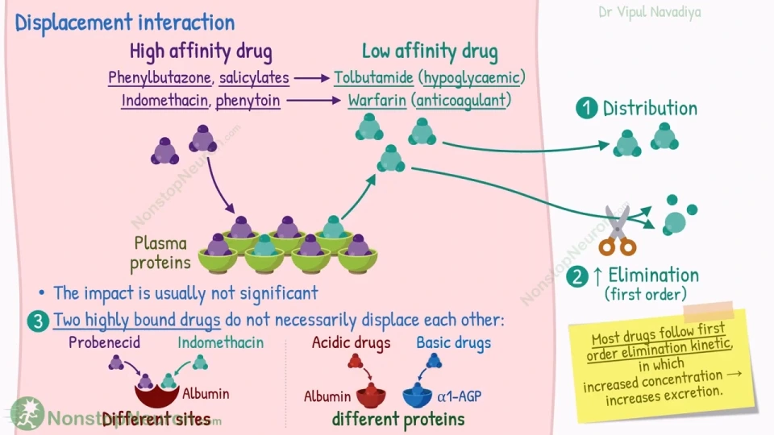

# 血浆蛋白结合：白蛋白、α1-酸性糖蛋白与游离分数

> 视频来源：[Plasma Protein Binding](https://www.youtube.com/watch?v=-XvkejRqkWg)（YouTube · NonstopNeuron，讲者 Vipul Navadiya）｜时长约 15 分钟
> 导读：这支动画短片把血浆蛋白结合讲成一条完整的临床推理链：哪些蛋白负责结合 → 结合有哪些特征 → 结合在临床上意味着什么 → 为什么"置换相互作用"听起来可怕、实际却常常不重要。本文按这条链整理，并在末尾补了一段与"游离药物原理"那篇的衔接。

## 本讲要解决的核心问题（SCQA）

**背景**：药物吸收后进入血液，随血液分布到全身。血液里除了水，还有大量蛋白质。

**冲突**：很多药物会与这些蛋白结合，而且结合比例差别极大——同一类药里，有的只结合 10%，有的结合 90%。结合了的那部分药物既碰不到靶点，也进不了代谢和排泄通路。那么"结合"到底是在削弱药效，还是另有作用？

**疑问**：血浆蛋白结合在临床上究竟意味着什么？为什么考试里、处方里、透析室里都要单独考虑它？

**回答（中心思想）**：血浆蛋白结合是血液内部的一个**可逆储库**。它把药物暂时"存"在血管里，因此**降低分布体积、延长作用时间、让透析失效**；它也让游离药物浓度随疾病状态漂移（肝病升、炎症降）。至于最常被担心的**置换相互作用**，理论上成立，但因为释放出的药物会分布到全身、且消除速率会随浓度上升，**实际影响通常很小**。

## 一、血浆蛋白是血液里的药物储库

[【跳转到 00:20】](https://www.youtube.com/watch?v=-XvkejRqkWg&t=20)

讲者的开场把位置摆得很清楚：药物吸收后分布到体内各个隔室，**其中一个隔室就是血液本身**——具体说，是血液里的血浆蛋白。所以血浆蛋白不只是"载体"，它本身就是**一个药物储库**。

这句话是整支视频的枢纽。后面所有的临床推论——分布体积小、作用时间长、透析无效——都是"储库"这个定位的直接后果。

## 二、两种主角蛋白分工明确

[【跳转到 00:39】](https://www.youtube.com/watch?v=-XvkejRqkWg&t=39)

讲者把结合蛋白分成三组：

1. **白蛋白（albumin）**：血浆中含量最高的蛋白，因此也是**结合量上最重要的贡献者**。它主要结合**酸性药物**——水杨酸、华法林、青霉素类、磺胺类、甲苯磺丁脲等；
2. **α1-酸性糖蛋白（α1-AGP，也称 AAG）**：主要结合**碱性药物**——普萘洛尔、利多卡因、丙咪嗪、奎尼丁、哌唑嗪等；
3. **少量专一运载蛋白**：类固醇结合到皮质类固醇结合球蛋白（transcortin），甲状腺素结合到 α 球蛋白等。

讲者特意强调了第 1 条的量级理由：**因为白蛋白最丰富，所以"结合白蛋白"在数量上更重要**。这也解释了为什么临床上讨论低蛋白血症时，第一个想到的是白蛋白。

## 三、结合是可逆平衡，但位点有限

[【跳转到 02:09】](https://www.youtube.com/watch?v=-XvkejRqkWg&t=129)

讲者列出结合的三个特征，每个都对应一个临床后果：

**第一，结合是可逆的动态平衡。** 药物浓度上升，结合量也上升；所以**结合占总量的比例是由药物浓度决定的**。这一条是后面"饱和"的前提。

**第二，血浆蛋白的量是有限的。** 浓度高到一定程度，所有位点被占满，结合量不再增加；**超过这个浓度，结合比例反而下降**。这就是**可饱和结合**——注意它的方向：浓度越高，游离分数越大，而不是越小。

**第三，结合程度取决于化合物本身，不能按药理或化学类别去推。** 讲者用同一类药做了对照：

[【跳转到 02:52】](https://www.youtube.com/watch?v=-XvkejRqkWg&t=172)

氟西泮（flurazepam）10%、阿普唑仑（alprazolam）70%、地西泮（diazepam）90%——**同一母核、差别巨大**。所以"这类药结合率高"这种说法在方法学上是不成立的，只能一个分子一个分子地测。

### 3.1 两个容易被读错的约定

[【跳转到 04:09】](https://www.youtube.com/watch?v=-XvkejRqkWg&t=249)

讲者补了两条读数字的规矩，都是初学者最常踩的坑：

- **"结合率 70%"指的是常用治疗浓度下的值**。浓度一变（尤其接近饱和时），这个数就不成立；
- **"血浆浓度"指的是游离加结合的总浓度**。说地西泮血浆浓度 1 mg/L，这 1 mg 里既有结合的也有游离的——这正是"总浓度"与"有效浓度"不是一回事的根源。

## 四、结合改变分布与消除

[【跳转到 04:27】](https://www.youtube.com/watch?v=-XvkejRqkWg&t=267)

讲者用一张图把"结合"的临床后果串起来：

**后果一：分布体积偏小。** 血浆蛋白分子太大，**过不了毛细血管壁**；结合在它上面的药物也就跟着留在血管内。所以**高血浆蛋白结合的药物，分布体积倾向于更小**。

**后果二：结合的部分既不能起效，也不能被消除。** 只有游离药物能结合靶分子产生效应；也只有游离药物能穿过毛细血管壁被代谢或排泄。但反过来，**当游离药物被清除掉，结合的药物会从蛋白上释放下来**，重新变得可用。所以蛋白结合同时扮演"**储存位点**"的角色。

**后果三：高结合通常让药更长效。** 因为消除机制够不到结合的部分。肾脏是最直观的例子：结合的药物过不了毛细血管壁，也就无法被滤过。

### 4.1 例外：主动摄取会把这条规则反过来

[【跳转到 06:08】](https://www.youtube.com/watch?v=-XvkejRqkWg&t=368)

讲者马上给了一个转折：**这条一般规律并不总是成立**。如果药物被肾或肝**主动摄取（active extraction）**，高血浆蛋白结合反而会**加快**消除，让药变短效。

机制是这样的：肾小管主动分泌把间质里的药物抽走 → 间质浓度下降 → 血浆游离药物扩散出去补充 → 血浆游离浓度下降 → **肾周毛细血管里的结合药物被释放出来** → 又被抽走。如此循环，结合的药物源源不断地被"卸货"。

讲者的总结很精炼：**高蛋白结合把更多的药送到肾脏，而主动摄取把这些药从蛋白上拽下来排掉**，于是消除加快、作用变短。他给的具体例子是**青霉素，血浆半衰期只有约 30 分钟**。同样的道理适用于肝主动摄取。

反过来，如果排泄只靠被动扩散（图左侧），游离浓度降得不够快，结合的药物就不会被快速释放——**蛋白带再多药过来，也排不掉**。

### 4.2 高结合的药物，透析救不了

[【跳转到 07:59】](https://www.youtube.com/watch?v=-XvkejRqkWg&t=479)

同一个"分子太大"的理由，导出了急诊场景的结论：**高血浆蛋白结合的药物很难用透析清除**。蛋白过不了透析膜，结合的药物就跟着留在血里。所以这类药物中毒时，透析无效，得换别的手段。

## 五、疾病会改变结合，因此改变游离浓度

[【跳转到 08:27】](https://www.youtube.com/watch?v=-XvkejRqkWg&t=507)

讲者用一张三联图说明"同样的剂量，不同的游离浓度"：

- **肝病**：白蛋白水平下降 → 结合减少 → **同样剂量下游离药物浓度升高**；
- **心肌梗死、炎症**等急性期反应：α1-酸性糖蛋白（急性期反应蛋白）升高 → 结合增加 → **同样剂量下游离药物浓度降低**；
- 中间是正常状态。

这一页的实用价值在于：**剂量不变，暴露可以变**。看到病人状态变化时，"血药浓度正常"这句话必须先问清楚——是总浓度正常，还是游离浓度正常。

## 六、置换相互作用：理论上重要，实践上通常不显著

[【跳转到 09:20】](https://www.youtube.com/watch?v=-XvkejRqkWg&t=560)

讲者先立结构：**一个药物可以结合多个位点，多个药物也可以结合同一个位点。**

当两个药对同一位点都有亲和力，就出现了**置换相互作用（displacement interaction）**：**亲和力高的药把亲和力低的药从蛋白上挤下来，被挤下来的那个游离浓度升高。**

经典例子有两个：

- **苯丁唑酮（phenylbutazone）与水杨酸盐**置换**甲苯磺丁脲（tolbutamide）**，使其降糖作用增强；
- **吲哚美辛与苯妥英**置换**华法林**，使其抗凝作用增强。

### 6.1 为什么临床上很少真的出事

[【跳转到 10:10】](https://www.youtube.com/watch?v=-XvkejRqkWg&t=610)

讲者说得很直接：**理论上这听起来很重要，但实际影响通常没那么显著**。他给了三条理由，第三条最容易被忽略：

1. **释放出来的药物会分布到它自己的分布体积里**——被挤下来的那部分不会全部堆在血浆里；
2. **多数药物遵循一级（first-order）消除动力学**：浓度升高，消除速率也升高。药物被更快地清掉，**新的稳态游离浓度只是略微高一点**；
3. **两个高结合率的药不一定互相置换**。如果它们结合在**不同位点**或**不同蛋白**上，就不会竞争。讲者举了两组反例：
   - 丙磺舒与吲哚美辛**都结合白蛋白，但位点不同**，所以不互相置换；
   - **酸性药主要结合白蛋白、碱性药主要结合 α1-AGP**，两类之间一般也不互相置换。

所以讲者的结论是：**单纯由置换引起的、有临床意义的药物相互作用是罕见的。**

## 七、补充：把"高结合→低分布体积"放进更精确的框架

这一节是本文的补充说明，不是视频内容。

视频里"高血浆蛋白结合 → 分布体积偏小"这条规则，在标准药理学教材里成立，但它**只在组织结合很低时才是主导**。如果按"游离体积"的框架看（见本小节另一篇《游离药物原理：总浓度只是陪衬，游离浓度才是驱动量》），分布体积可以写成

$$
V_{ss} = V_{p} + \frac{f_u}{f_{ut}} \cdot V_{t}
$$

其中 $f_u$ 是血浆游离分数，$f_{ut}$ 是组织游离分数。对**酸性药**，组织结合很低（$f_{ut} \approx 1$），$V_{ss}$ 确实随 $f_u$ 变小而变小，视频的规则完全适用；但对**碱性药**，膜结合很强（$f_{ut}$ 很小），$V_{ss}$ 会被组织结合拉得很大，此时"高结合 → 低分布体积"就不再成立。

两篇的结论并不冲突，而是**适用范围不同**：本篇讲的是"结合把药留在血管里"这一条通道，另一篇讲的是"组织结合"这条更强的通道。判断时先问一句：这个分子的组织结合强不强？

## 小结

- 血浆蛋白是血液里的**药物储库**；白蛋白最丰富、主要结合酸性药，α1-酸性糖蛋白主要结合碱性药，另有少量运载激素的专一蛋白。
- 结合是**可逆平衡**；位点有限，浓度过高会**饱和**，饱和之后结合比例下降、游离分数上升。
- 结合程度**不能按药物类别推断**：同为苯二氮䓬类，10%、70%、90% 都出现过。
- 读数字要守两条约定：结合率指**常用治疗浓度**下的值；血浆浓度指**游离加结合**的总和。
- 只有游离药物能起效、能被消除；结合的部分是储库，游离药物被清掉后会释放补充。
- 高结合通常**降低分布体积、延长作用时间、使透析失效**；但若存在**主动摄取**（肾或肝），高结合反而加快消除，青霉素半衰期仅约 30 分钟就是例子。
- **疾病会改变结合**：肝病降白蛋白使游离药物升高，心肌梗死与炎症升 α1-AGP 使游离药物降低。
- **置换相互作用**机制成立（苯丁唑酮/水杨酸盐 → 甲苯磺丁脲；吲哚美辛/苯妥英 → 华法林），但因为分布与一阶消除的缓冲，加上位点与蛋白可能不同，**临床影响通常不显著**。

## 关键术语速查

| 术语 | 一句话解释 |
| --- | --- |
| 血浆蛋白结合 | 药物与血浆蛋白之间可逆的非共价结合，形成血液内的药物储库 |
| 白蛋白 | 血浆中含量最高的蛋白，结合酸性药物，是结合量的主要贡献者 |
| α1-酸性糖蛋白（α1-AGP） | 结合碱性药物的血浆蛋白，属急性期反应蛋白，炎症时升高 |
| 游离药物 | 未被蛋白结合、可穿膜、可结合靶点、可被消除的那部分药物 |
| 结合饱和 | 位点被占满后结合量不再增加，结合比例随浓度上升而下降 |
| 分布体积 $V_d$ | 把体内药量折算成血浆浓度所需的假想体积；高结合倾向使其偏小 |
| 主动摄取 | 肾小管或肝细胞主动把药物从血液侧抽走，可让高结合药物消除更快 |
| 置换相互作用 | 高亲和力药物把低亲和力药物从结合位点挤下来，使后者游离浓度升高 |
| 一级消除动力学 | 消除速率与浓度成正比，因此浓度升高时消除也加快，可缓冲置换带来的浓度上升 |