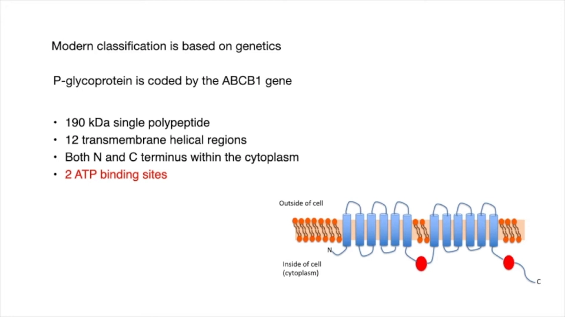
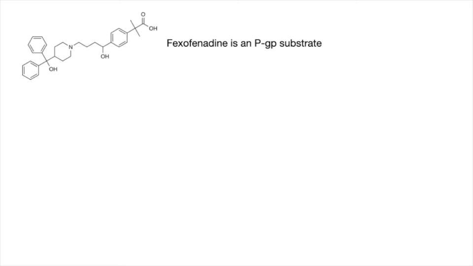
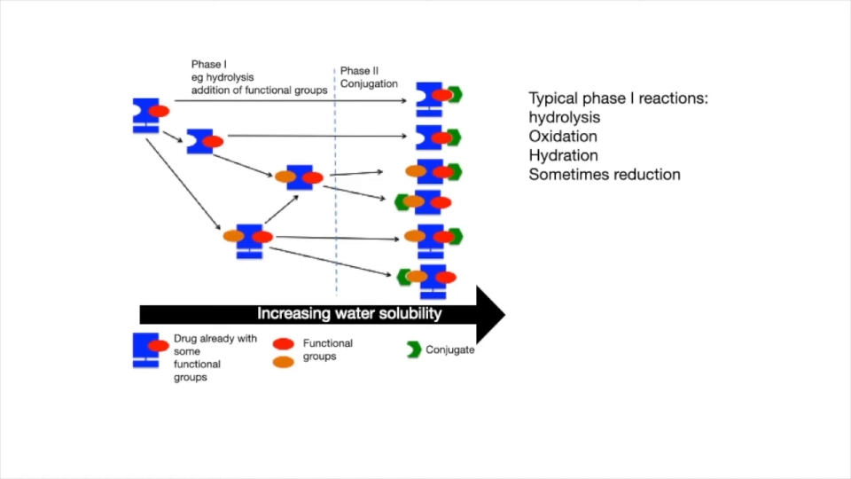
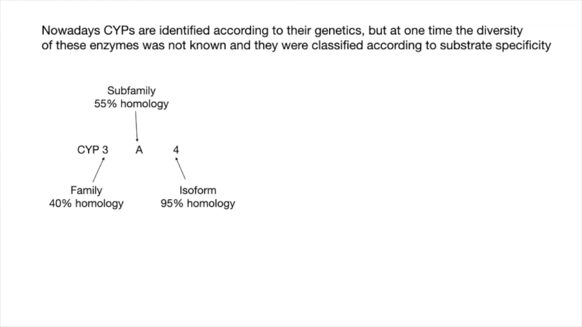
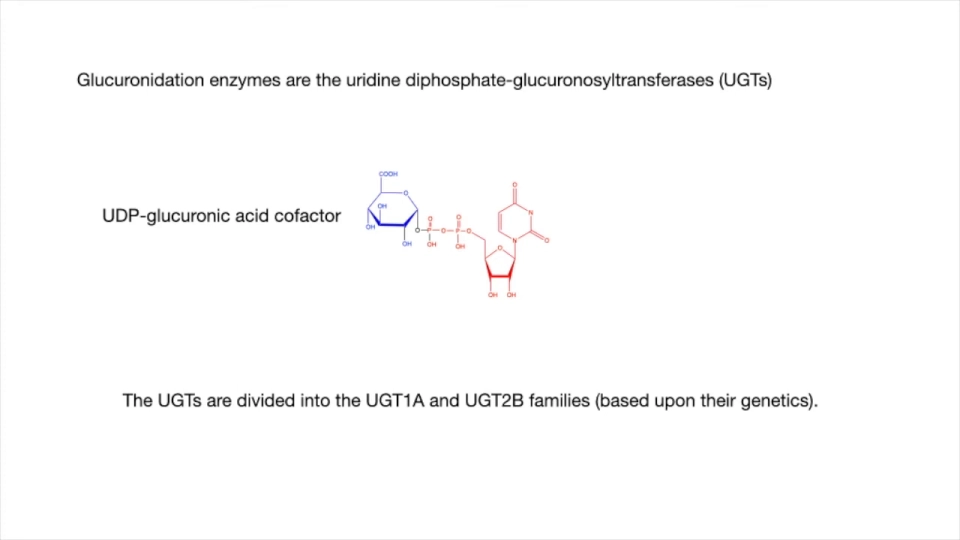
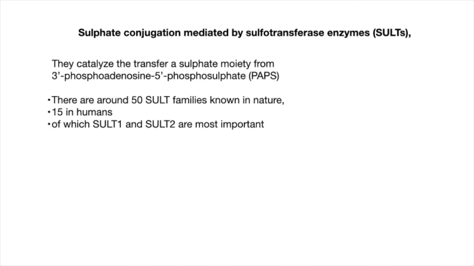
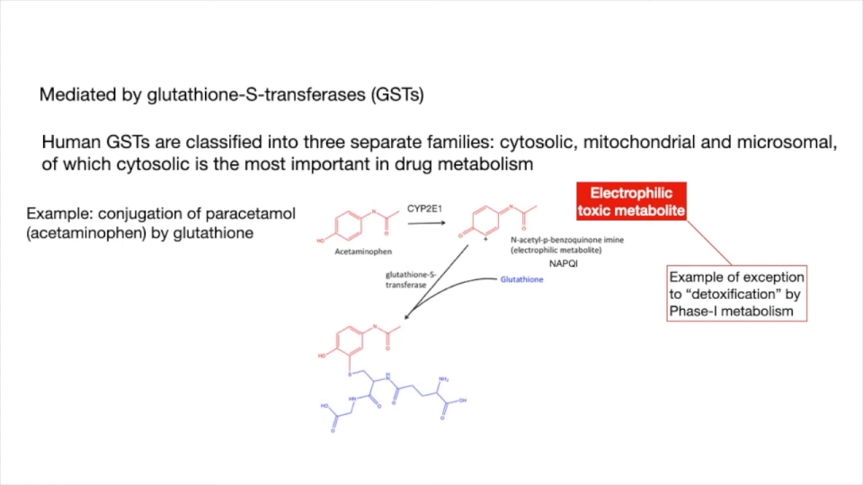
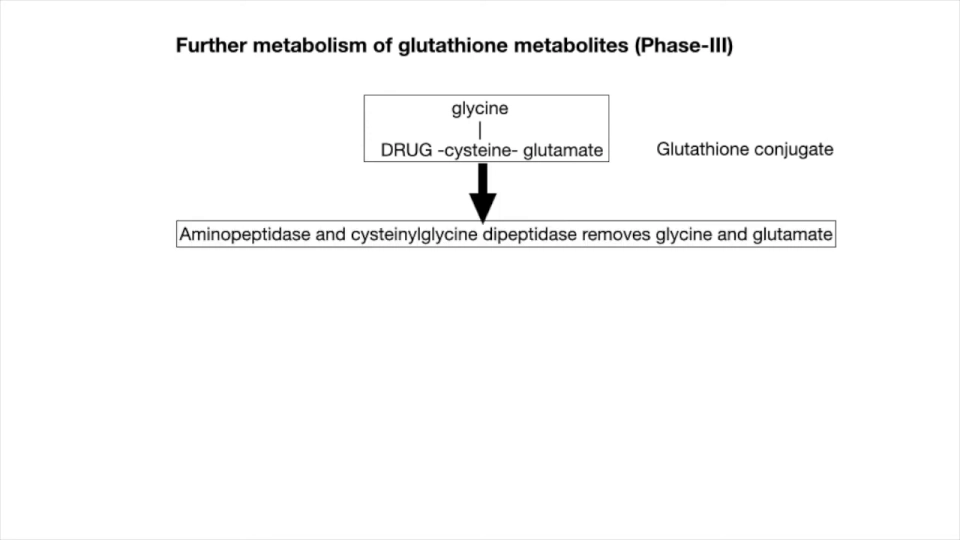
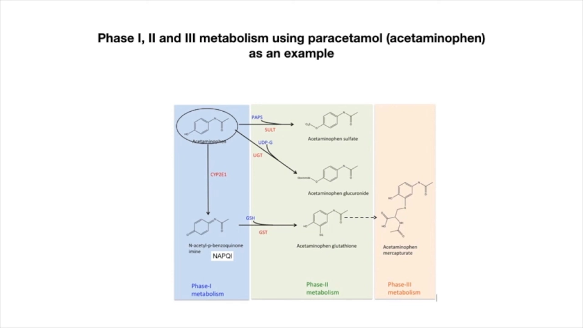
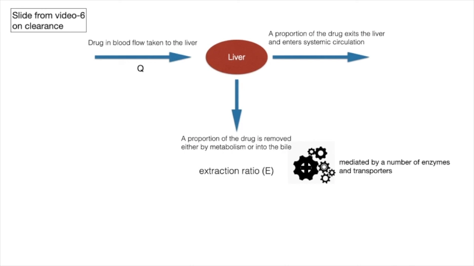

# 从酶到清除率：I/II/III 相反应、反应性代谢物与肝提取率

> 视频来源：[Drug metabolising enzymes and transporters](https://www.youtube.com/watch?v=galZv4lEA4c)（YouTube · Graham Lappin，药物代谢与放射性标记示踪领域的研究者）｜时长约 36 分钟
> 导读：这是一支「把药代动力学的引擎盖打开」的讲座。前面的 PK 视频讲的是浓度曲线怎么变，这一支讲**为什么会变**：酶和转运体。讲者按「转运体 → 代谢酶的三相分工 → 具体反应与酶家族 → 反应性代谢物的例外 → 提取率与清除率」推进，全程只给代表性例子，明确说「不要指望我念完酶家族清单」。本文保留这个取舍。

## 本讲要解决的核心问题（SCQA）

**背景**：药代动力学可以用几个参数描述一个药物在体内的旅程——清除率、生物利用度、分布体积、消除速率常数、半衰期。有了这些参数，就能画出那条经典的口服浓度曲线。

**冲突**：但这些参数只是**描述**，不是**解释**。它们告诉你药物多快被清掉，却不告诉你是什么在清、清的时候分子被改成了什么、以及为什么改完之后有时反而更毒。

**疑问**：驱动这一切的「引擎」到底是什么？为什么同一套酶既能解毒又能致毒？这些微观反应又如何汇总成一个宏观的清除率数字？

**回答（中心思想）**：引擎是**药物代谢酶与膜转运体**，两者不是各自独立的两套系统，而是**咬合的齿轮**。代谢酶分三相工作：I 相用 CYP450 等加/暴露小官能团，II 相用转移酶接上水溶性大分子，III 相继续加工结合物；每一步的默认方向都是「更低反应性、更高水溶性」，但**存在明确例外**（还原可能更亲脂，CYP2E1 能把对乙酰氨基酚变成亲电的 NAPQI）。宏观上，肝清除率等于**肝血流量乘以提取率**（$CL = Q \times E$），而提取率正是这一群酶与转运体协同工作的结果——所以任何让酶或转运体上调/下调的因素，最终都会改写剂量与毒性。

## 一、先把转运体摆上桌：药物进出细胞不只靠扩散

[【跳转到 02:50】](https://www.youtube.com/watch?v=galZv4lEA4c&t=170)

讲者的顺序有点反直觉：先讲转运体，再讲代谢酶。理由是这两者必须一起看。

被动扩散不需要能量，靠的是分子的理化性质（这部分属于分配系数的内容）。但膜上还有一类**跨膜蛋白**：结合底物后发生构象变化，把底物从膜的一侧释放到另一侧；如果方向是逆浓度梯度，就需要 ATP 供能。它们的底物既有内源的（讲者的说法是「生命的生物化学」），也有外源的（xenobiotics，药物就属于这一类）。

[【跳转到 06:35】](https://www.youtube.com/watch?v=galZv4lEA4c&t=395)

代表成员是 **P-糖蛋白**（P-glycoprotein，P-gp）。讲者顺带讲了它的「身份信息」：

- 1971 年由 Victor Ling 发现，因此历史名称很多；
- 现代分类按基因：由 **ABCB1** 基因编码；
- 分子量约 **190 kDa**，单条多肽，**12 个跨膜螺旋**，N 端与 C 端都在胞质侧，胞质侧有**两个 ATP 结合位点**。

[【跳转到 08:40】](https://www.youtube.com/watch?v=galZv4lEA4c&t=520)

它的工作方式是**外排**（efflux）：药物先被动扩散进胞质，P-gp 再把它泵回膜外。讲者提到教科书里那个流传很广的比喻——P-gp 像一台「**吸尘器**」，专门把亲脂分子吸走。它分布在肠上皮、肝、肾，以及**血脑屏障**：潜在有毒的外源物扩散进脑之前，会被它泵出去。

这个机制有一个可以直接观察的后果。**非索非那定**（fexofenadine）几乎不被代谢，以原形从尿排出，口服绝对生物利用度只有约 **0.35**。原因不是它吸收不了，而是它**吸收得很好、随后又被 P-gp 泵回肠腔**。

[【跳转到 12:00】](https://www.youtube.com/watch?v=galZv4lEA4c&t=720)

转运体分两个超家族：

| 超家族 | 是否直接用 ATP | 方向 |
| --- | --- | --- |
| ABC（ATP-binding cassette） | 是，有 ATP 结合位点 | 主要是外排，逆浓度梯度 |
| SLC（solute carrier） | 不直接用 ATP（可偶联其他供能机制） | 可为摄取，也可为外排 |

讲者强调，这两张表（ABC 与 SLC 的成员清单）只是「快照」，不值得背；需要记住的是**分类逻辑**与「转运体决定药物能不能到达酶所在的位置」。

## 二、三相分工：默认方向是「更低反应性、更高水溶性」

[【跳转到 13:38】](https://www.youtube.com/watch?v=galZv4lEA4c&t=818)

讲者先纠正一个用词：**「药物代谢酶」是个误称**。这些酶不是为药物进化出来的，而是为**外源物**（xenobiotics）进化出来的——药物只是其中一类，饮食与吸烟都会带来大量外源物。

代谢（metabolism）一词来自希腊语 *metabole*，意思是「改变」。讲者给出的通用定义是：所有生物（从细菌到人）都进化出了化学修饰外源物的酶，把它们变成**反应性更低、更水溶**的化合物，从而容易被排出。但他马上补了一句贯穿全场的警告：**这个规则有很多例外**，后面会碰到。

[【跳转到 15:26】](https://www.youtube.com/watch?v=galZv4lEA4c&t=926)

三相的分工：

| 相 | 做的事 | 典型反应 |
| --- | --- | --- |
| I 相 | 加上或去掉**小分子量官能团** | 水解、氧化、水合，有时还原 |
| II 相 | 与**较大分子量的水溶性基团**结合 | 葡萄糖醛酸化、硫酸化、谷胱甘肽结合 |
| III 相 | 对**结合物**再做进一步代谢 | 谷胱甘肽结合物 → 半胱氨酸结合物 → 硫醚氨酸 |

讲者说明：有些教材把 II 相与 III 相合并，他这里按「老三相」拆开讲。同时点出了第一个例外——**还原反应可能让分子更亲脂**，直接违反「越代谢越水溶」的规则。

[【跳转到 17:05】](https://www.youtube.com/watch?v=galZv4lEA4c&t=1025)

讲者用一张示意图把整条路径走了一遍：药物先被水解去掉一部分，再经 I 相加一个羟基（图中橙色），然后进入 II 相，在两个官能团上各接一个葡萄糖醛酸（图中绿色）。他强调这张图只是**一种可能的路径**，不是所有药物都要走完；而且从左到右「水溶性上升」只是**经验法则**。

## 三、CYP450：一个血红素蛋白，只加一个氧

[【跳转到 20:15】](https://www.youtube.com/watch?v=galZv4lEA4c&t=1215)

I 相里最重要的家族是**细胞色素 P450**（CYP）。讲者给的结构要点很干脆：

- 含**血红素**辅基；血红素中的铁与蛋白里一个**半胱氨酸残基的硫**配位；
- 催化时**给底物加一个氧原子**；
- 名称里的「450」来自还原态与一氧化碳结合后的**吸收波长 450 nm**——当年就是靠这个吸收峰发现它们的；
- 现代命名按基因，永远是「CYP-数字-字母-数字」的形式；
- CYP 是**膜结合**酶。

[【跳转到 21:30】](https://www.youtube.com/watch?v=galZv4lEA4c&t=1290)

命名里的三级同源性门槛值得记一下：**家族约 40%、亚家族约 55%、同工酶约 95%**。

讲者只点了三个「非常重要」的成员：**CYP1A2、CYP2C9、CYP3A4**，并明确表示其余成员请自行查书。他还补了一个反例，说明 I 相不只属于 CYP：**舒马曲普坦**（sumatriptan）的清除靠代谢，但用的是**单胺氧化酶**（MAO），不是 P450。

## 四、II 相三主角：葡萄糖醛酸、硫酸、谷胱甘肽

[【跳转到 22:45】](https://www.youtube.com/watch?v=galZv4lEA4c&t=1365)

II 相是**官能团的结合**，接上去的是相对较大、水溶的分子。讲者聚焦三个：

### 4.1 葡萄糖醛酸化：底物最广的一类

葡萄糖醛酸（glucuronide）通过 **UGT**（UDP-葡萄糖醛酸转移酶）接上去，辅因子是 **UDP-葡萄糖醛酸**（UDPGA）。讲者按连接原子把产物分了类：

- **O-葡萄糖醛酸**：接在氧上，例如对乙酰氨基酚；
- **N-葡萄糖醛酸**：接在氮上；
- **S-葡萄糖醛酸**：接在硫上；
- **C-葡萄糖醛酸**：直接接在碳上，很罕见。

UGT 主要分 **UGT1A** 与 **UGT2B** 两个家族（按基因分类）。

### 4.2 硫酸化：辅因子是 PAPS

硫酸化由 **SULT**（磺基转移酶）催化，把硫酸基从 **PAPS**（3'-磷酸腺苷-5'-磷酰硫酸）转移到底物上。讲者给了几个数字：自然界已知约 **50 个 SULT 家族**，人类有约 **15 个**，其中最重要的是 **SULT1 与 SULT2**。例子是**沙丁胺醇**（salbutamol）经 SULT1A3 硫酸化。

### 4.3 谷胱甘肽结合：专门对付亲电体

谷胱甘肽（glutathione，GSH）是一个**亲核的三肽**：甘氨酸-半胱氨酸-谷氨酸。讲者提醒它的结构特殊之处——普通肽键是 α 肽键，而谷胱甘肽里是 **γ 肽键**。结合发生在**半胱氨酸的硫**上，由 **GST**（谷胱甘肽-S-转移酶）催化。

讲者还补了两个「例外中的例外」：

- **乙酰化与甲基化**倾向让外源物**更亲脂**，是「越代谢越水溶」规则的又一个反例；
- **甘氨酸结合**在人类中不常见，但它是最早被发现的生物转化途径之一：1842 年人们在尿里发现了马尿酸（苯甲酸的甘氨酸结合物）。

## 五、反应性代谢物：CYP 也能把药变成毒

[【跳转到 28:35】](https://www.youtube.com/watch?v=galZv4lEA4c&t=1715)

这是全场最重要的一段，讲者用它说明「解毒」这个定义的反面。主角是**对乙酰氨基酚**（paracetamol / acetaminophen）：

1. 大部分对乙酰氨基酚走安全的 II 相：硫酸化或葡萄糖醛酸化，直接排出；
2. 少部分经 **CYP2E1** 氧化，生成 **NAPQI**（N-乙酰-对苯醌亚胺）；
3. NAPQI 是**亲电的毒性代谢物**——讲者把它标成「Phase I 代谢解毒规则的例外」；
4. 正常情况下 NAPQI 会被 **GST** 迅速用谷胱甘肽结合掉，变成可排出的结合物。

[【跳转到 29:00】](https://www.youtube.com/watch?v=galZv4lEA4c&t=1740)

问题出在**过量**时：谷胱甘肽被耗尽，剩余的 NAPQI 就会与肝内各种大分子共价结合，造成**肝毒性**。（**补充，非讲者原话**：临床上对乙酰氨基酚中毒的解毒思路就是补充谷胱甘肽前体，把这条结合通路重新撑起来。）

## 六、III 相：结合物还要再加工

[【跳转到 29:25】](https://www.youtube.com/watch?v=galZv4lEA4c&t=1765)

以谷胱甘肽结合物为例，III 相做的是「拆件」：

1. 谷胱甘肽结合物上的**甘氨酸与谷氨酸被酶切除**（氨肽酶与半胱氨酰甘氨酸二肽酶），剩下药物-半胱氨酸结合物；
2. 半胱氨酸结合物再经 **N-乙酰化**，得到**硫醚氨酸**（mercapturic acid）；
3. 硫醚氨酸随尿排出。

[【跳转到 30:40】](https://www.youtube.com/watch?v=galZv4lEA4c&t=1840)

把对乙酰氨基酚的三条路画在一张图上，整节课的逻辑就闭合了：

- **主路**（安全）：SULT 硫酸化、UGT 葡萄糖醛酸化；
- **旁路**（危险）：CYP2E1 氧化成 NAPQI → GST 结合谷胱甘肽 → III 相变成硫醚氨酸。

同一条「代谢」通道，既能解毒也能致毒，取决于**走哪条路、走多快、谷胱甘肽够不够**。

## 七、酶与转运体是咬合的齿轮：从反应到清除率

[【跳转到 25:40】](https://www.youtube.com/watch?v=galZv4lEA4c&t=1540)

讲者在讲 UGT 时插了一段结构性的观察，值得单独拎出来：**酶和转运体在空间上是串联的**。以葡萄糖醛酸化为例，底物先经 I 相代谢，产物由转运体送进内质网；UGT 位于内质网的**腔侧**，在那里完成结合；产物再由另一个转运体送回原来的那一侧。所以「代谢」不是溶在胞质里的一锅反应，而是被膜和转运体组织起来的流水线。

[【跳转到 31:17】](https://www.youtube.com/watch?v=galZv4lEA4c&t=1877)

最后，讲者把镜头拉回 PK 的宏观参数。血液以流量 $Q$ 把药物带进肝脏，每次经过肝脏有一部分药物被代谢或排入胆汁而消失，这个比例叫**提取率**（extraction ratio，$E$）。于是：

$$
CL = Q \times E
$$

[【跳转到 32:32】](https://www.youtube.com/watch?v=galZv4lEA4c&t=1952)

讲者用「齿轮」形容这一步：提取率通常不是单个酶的功劳，而是**一组酶加一组转运体协同**的结果。因此：

- 任何让这些酶或转运体**上调或下调**的因素（诱导、抑制、基因变异、疾病），都会改变 $E$；
- $E$ 改变 → $CL$ 改变 → 剂量、稳态浓度、毒性全部跟着变。

这正是前面所有 PK 参数背后的「引擎」。

## 八、补充：分子改造如何绕开这套引擎（非讲者原话）

视频没有讲药物化学层面的改造策略，但这一节的知识点可以直接接到设计上，这里补一段（**补充内容，非讲者原话**），便于把「酶」与「分子」连起来：

- **封堵代谢软点**：先用体外肝微粒体/肝细胞找出分子上最容易被氧化的位置（通常是富电子的芳环、苄位、烯丙位），再用氟、甲基或环化把该位点堵住或钝化；
- **降低亲脂性**：$\log D$ 下降通常降低 CYP 周转与 P-gp 外排，但要注意别把被动扩散也一起牺牲掉（与 2.2.2 的通透性权衡）；
- **氘代**：把易被氧化的 C–H 换成 C–D，利用同位素效应减慢该位点的氧化速率；只对「氧化是限速步」的分子有效；
- **生物等排替换**：用代谢稳定的杂环或基团替换易被氧化的芳环/酯键，同时尽量保住靶点亲和力。

这些手段的共同逻辑与讲者的结论一致：**改的是酶和转运体认得的那个「位点」，而不是整体性质**。

## 小结

- 药代参数只是**描述**；解释它们的是**代谢酶与转运体**，两者在空间上串联、功能上咬合。
- 转运体分 **ABC（耗 ATP，主要外排）** 与 **SLC**；P-gp 是外排代表，能把吸收良好的分子泵回肠腔（非索非那定 $F \approx 0.35$）。
- 代谢分三相：**I 相加/暴露小官能团，II 相结合水溶性大分子，III 相加工结合物**；默认方向是更低反应性、更高水溶性，但**例外明确存在**。
- CYP 是含血红素的膜结合酶，催化时**只加一个氧**；命名按家族/亚家族/同工酶（40%/55%/95% 同源性）；I 相不只有 CYP（舒马曲普坦用 MAO）。
- II 相三主角：**UGT（UDPGA）**、**SULT（PAPS）**、**GST（谷胱甘肽）**；乙酰化与甲基化反而更亲脂。
- **反应性代谢物**是「解毒」的反面：对乙酰氨基酚经 CYP2E1 生成亲电的 NAPQI，谷胱甘肽耗尽即肝毒性。
- 宏观上 $CL = Q \times E$：酶与转运体的任何上调/下调，最终都通过提取率改写清除率、剂量与毒性。

## 关键术语速查

| 术语 | 一句话解释 |
| --- | --- |
| 外源物（xenobiotic） | 非机体自身产生或浓度异常高的化学物质，药物是其中一类 |
| 提取率（E） | 血液一次流经肝脏时被清除掉的药物比例 |
| P-糖蛋白（P-gp） | ABCB1 编码的外排转运体，把亲脂底物泵出细胞 |
| ABC / SLC | 两个转运体超家族，前者直接用 ATP，后者不直接使用 |
| CYP450 | 含血红素的膜结合氧化酶系，催化时给底物加一个氧 |
| UGT | 葡萄糖醛酸转移酶，辅因子 UDPGA，产物按连接原子分 O/N/S/C 型 |
| SULT | 磺基转移酶，辅因子 PAPS，人类约 15 个成员 |
| GST | 谷胱甘肽-S-转移酶，催化亲电体与谷胱甘肽结合 |
| NAPQI | 对乙酰氨基酚经 CYP2E1 生成的亲电毒性代谢物 |
| 硫醚氨酸（mercapturic acid） | 谷胱甘肽结合物经 III 相加工后的终产物，随尿排出 |