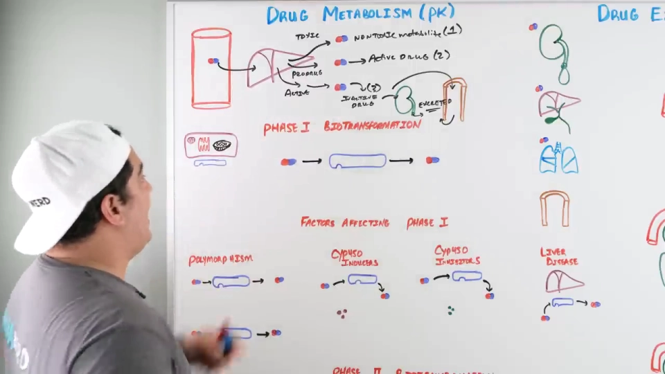
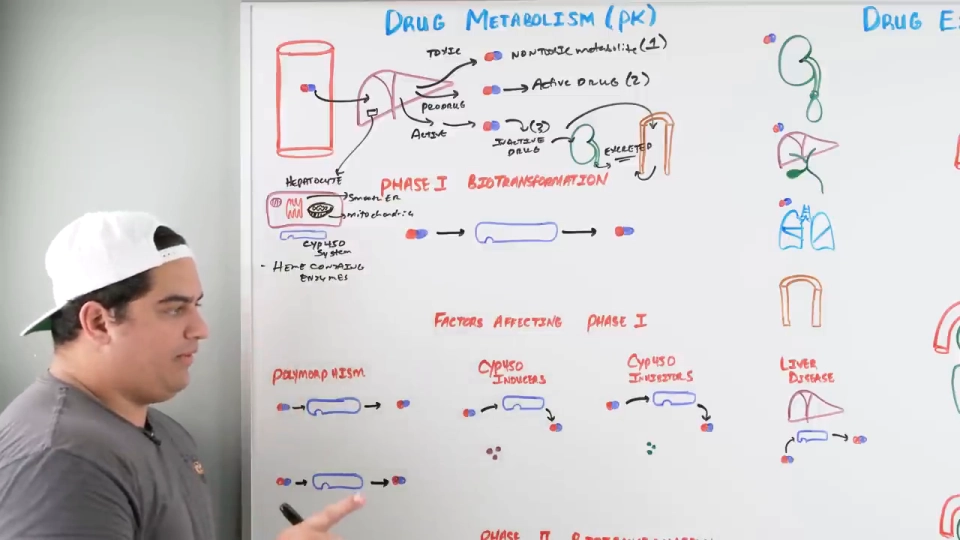
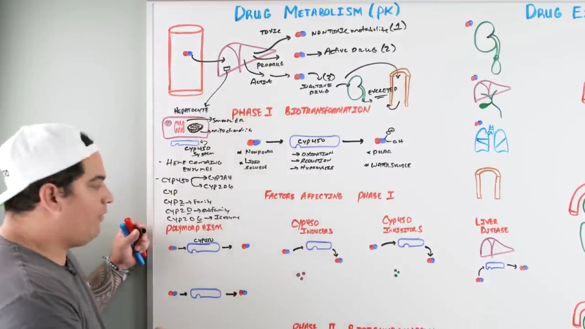
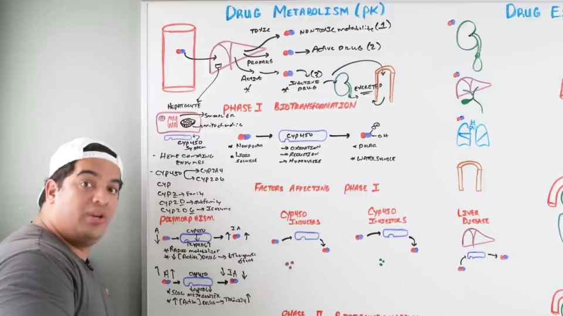
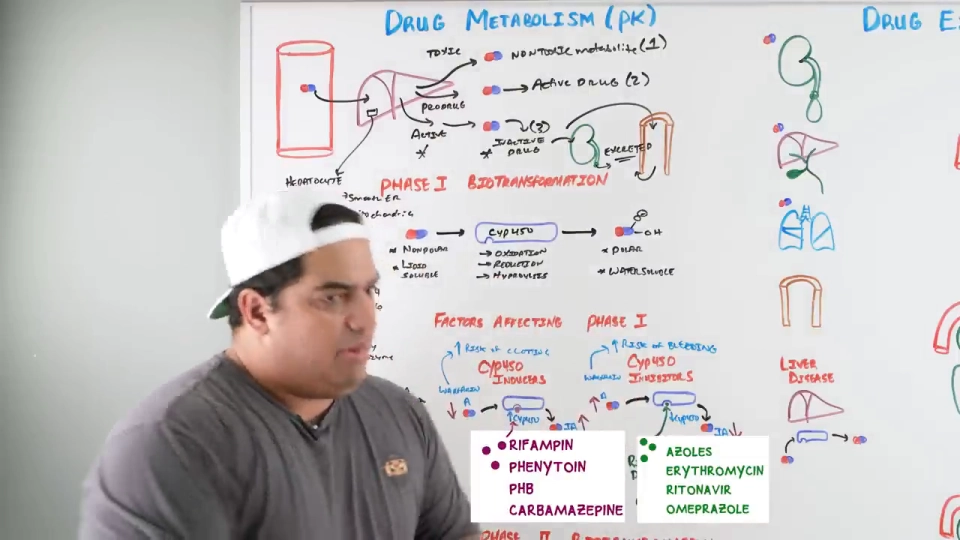
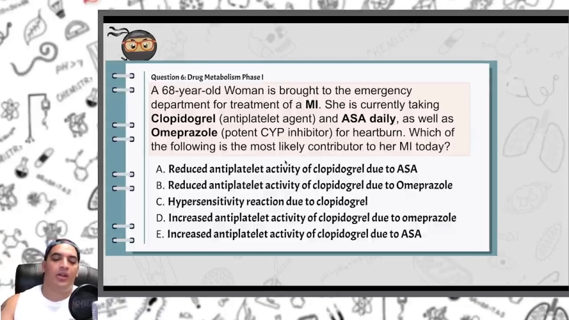
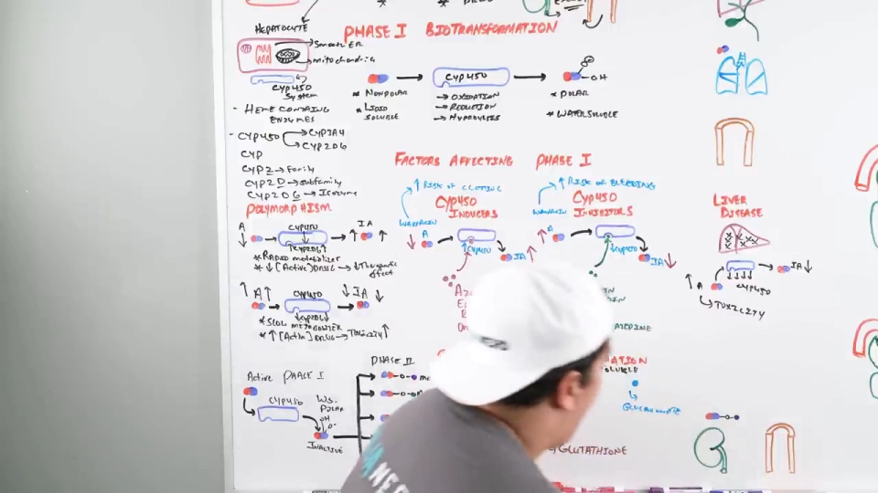
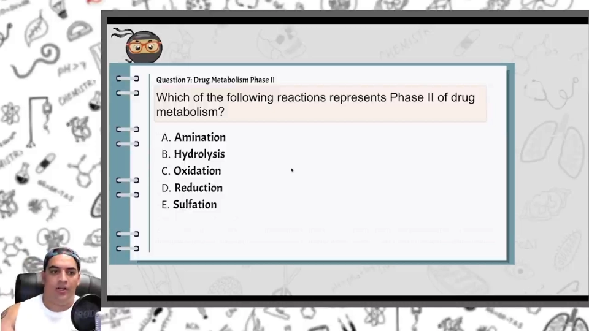

# 代谢的两相分工与 CYP 开关：抑制、诱导与表型差异如何改变暴露

> 视频来源：[Pharmacokinetics | Drug Metabolism](https://www.youtube.com/watch?v=qvucMHUVZA4)（YouTube · Ninja Nerd，讲者 Zach Murphy）｜时长约 28 分钟
> 导读：这是一堂在白板上边画边讲的药代入门课，主线只有一条——**肝脏把药物改造成更容易排出去的样子**。本文按「代谢的三种结局 → I 相与 CYP450 → 影响 I 相的四个因素（多态性、诱导、抑制、肝病与年龄）→ 前药的反向例外 → II 相结合反应」重排。CYP 家族只讲 3A4 与 2D6 两个代表；更细的酶学与清除率推导见同小节另一篇《从酶到清除率》。

## 本讲要解决的核心问题（SCQA）

**背景**：药物在体内起完作用，总得有个去处。多数药物是脂溶性的，脂溶性意味着它能穿过细胞膜进入细胞，也意味着它很难被肾脏直接排进尿里——肾小管会把脂溶性分子重新吸收回血。

**冲突**：于是身体必须先把分子改一改：加上极性基团、接上水溶性的大分子，让它「不像自己」。可这一步改造并不总是单向的：它可能让药物失活，也可能把无活性的前药变成有活性的药，还可能把原本无害的分子变成有毒的代谢物。更麻烦的是，这套改造系统会被别的药物、基因型、肝病和年龄同时调节。

**疑问**：代谢到底分几步做？谁在做？当另一个药、另一种基因型或一场肝病插进来时，药物在体内的浓度会往哪个方向变？

**回答（中心思想）**：代谢是**两相分工的增极性工程**——I 相用 CYP450 等酶加上或暴露小的极性官能团，II 相用转移酶把葡萄糖醛酸、硫酸、谷胱甘肽这类大分子共价接上去；两相不必按顺序发生，目的都是让分子更容易被排进尿或胆汁。而**代谢速度是一个可调的旋钮**：酶被抑制就转慢（底物蓄积、毒性上升），被诱导就转快（底物不足、疗效下降），CYP2D6 的基因多态性则让不同人天生就在快慢两端。判断任何一次药物相互作用，只要先问一句「这个酶现在转得更快还是更慢，被影响的是活性药还是前药」，方向就不会错。

## 一、代谢先回答「为什么要把药物改掉」：三种结局

[【跳转到 00:11】](https://www.youtube.com/watch?v=qvucMHUVZA4&t=11)

讲者从口服给药的路径讲起：药物经胃肠道吸收，先进入门静脉系统，经过**首过代谢**（first-pass metabolism）再进入体循环，分布到各组织；等它起完作用，就该被排掉。排泄的出口有几个——尿、粪便（经胆道系统）、呼出的气体。

但很多药物不能直接排。讲者把肝脏对药物的改造归纳成三类结局：

1. **把有毒的变成无毒**（toxic → non-toxic metabolite），便于排出；
2. **把前药变成活性药**（prodrug → active drug），这是唯一「越代谢越有效」的情形。他举的例子是伐昔洛韦（valacyclovir）：它本身是前药，在体内被拆成有活性的阿昔洛韦（acyclovir）；
3. **把活性药变成失活代谢物**（active → inactive），这是最常见的一类。

[【跳转到 02:56】](https://www.youtube.com/watch?v=qvucMHUVZA4&t=176)

第 3 条对应两个「相」：**I 相生物转化**（phase I biotransformation）与 **II 相生物转化**（phase II biotransformation）。初学者最容易在这里形成一个错误印象——以为药物必须先过 I 相、再过 II 相。讲者特意纠正：**没有固定顺序**。有的药只走 I 相，有的跳过 I 相直接走 II 相，还有的先 II 相再 I 相。

## 二、I 相：CYP450 是「加极性」的第一步

[【跳转到 04:06】](https://www.youtube.com/watch?v=qvucMHUVZA4&t=246)

I 相反应发生在肝细胞（hepatocyte）里。讲者把肝细胞放大，指出两个位置：**滑面内质网**（smooth ER）与**线粒体**。这两处聚集着一类含血红素（heme）的酶——**细胞色素 P450 系统**（cytochrome P450，简称 CYP450）。

CYP450 这个名字本身可以拆开读。讲者用 CYP2D6 举例：

- **CYP**：细胞色素 P450 这个蛋白家族；
- **2**：家族（family）；
- **D**：亚家族（subfamily）；
- **6**：同工酶（isoform）。

[【跳转到 05:41】](https://www.youtube.com/watch?v=qvucMHUVZA4&t=341)

在几十个成员里，讲者只要求记住两个代表：

| 同工酶 | 讲者给出的占比 | 备注 |
| --- | --- | --- |
| CYP3A4 | 约 50% | 参与代谢的药物最多 |
| CYP2D6 | 约 20–25% | 多态性最突出（见第三节） |

[【跳转到 06:54】](https://www.youtube.com/watch?v=qvucMHUVZA4&t=414)

CYP450 在口袋里结合底物后，做三类反应：**氧化**（oxidation）、**还原**（reduction）、**水解**（hydrolysis）。以氧化为例，最常见的是给分子接上一个羟基（-OH）。这一步的意义不在「破坏」，而在**改性质**：

- 药物原本是**非极性、脂溶性**的；
- 加上 -OH 或带负电的氧之后，分子变得**更极性、更水溶**；
- 极性分子不容易被肾小管重吸收，于是更容易随尿排出。

讲者在这里给了一句很实用的判断标准：**越脂溶越难排，越极性越好排**。这句话是后面所有「抑制/诱导会怎样」推理的地基。

## 三、同一个酶，不同的人：CYP2D6 的多态性

[【跳转到 08:39】](https://www.youtube.com/watch?v=qvucMHUVZA4&t=519)

影响 I 相的第一个因素是**基因多态性**（polymorphism）：同一个酶，在不同人身上「啃」药物的速度可以差很多。讲者指出，多态性最集中的就是 **CYP2D6**。

**快代谢者（rapid metabolizer）**：酶把活性药迅速转成失活代谢物。

- 活性药浓度下降 → 血药浓度可能达不到治疗窗；
- 结果：**疗效不足**，需要加量。

**慢代谢者（slow metabolizer）**：活性药迟迟不被转化。

- 活性药在血中蓄积 → 浓度偏高；
- 结果：**毒性风险上升**。

讲者给了一个临床例子：婴儿若是可待因（codeine）的慢代谢者，可待因在体内蓄积，可能出现**呼吸抑制、过度嗜睡与镇静**。

需要留意的是，讲者在视频后段（18:03）专门提醒过：一旦被代谢的对象是**前药**，快/慢代谢者的结论会整个翻过来。可待因正属于这类需要单独判断的药物，读到这里先记住「方向取决于被转化的是活性药还是前药」，第六节会把这个例外讲清楚。

## 四、抑制与诱导：把「代谢速度」当成旋钮

[【跳转到 11:58】](https://www.youtube.com/watch?v=qvucMHUVZA4&t=718)

影响 I 相的第二个因素是**多药同服**（polypharmacy）。很多药共用同一套 CYP450，于是 A 药可以改变 B 药的代谢速度。讲者用华法林（warfarin）做主线，因为后果最直观：华法林被代谢掉，抗凝作用就消失。

**诱导剂（inducer）**：让 CYP450 的活性升高。

- 华法林被更快地转成失活形式；
- 活性药浓度下降 → 抗凝不足 → **血栓风险上升**。

**抑制剂（inhibitor）**：结合到酶的口袋上，降低酶的活性。

- 华法林代谢受阻，活性形式滞留；
- 浓度超过治疗水平 → **出血风险上升**。

[【跳转到 15:25】](https://www.youtube.com/watch?v=qvucMHUVZA4&t=925)

讲者给出两份清单（他反复强调「名单长到离谱，这里只是例子」）：

| 类别 | 例子 |
| --- | --- |
| CYP450 抑制剂 | 唑类（如酮康唑）、红霉素、利托那韦、奥美拉唑 |
| CYP450 诱导剂 | 利福平、苯妥英、苯巴比妥、卡马西平 |

他还提醒了一个容易被忽略的细节：**同一个药可能只抑制或只诱导某一个特定的 CYP 同工酶**，因此它只影响「由那个酶代谢的底物」，不是对所有药都有效应。换句话说，判断相互作用要先确认「是不是同一个酶」。

## 五、肝病与年龄：酶的数量和效率本身会变

[【跳转到 16:33】](https://www.youtube.com/watch?v=qvucMHUVZA4&t=993)

影响 I 相的第三、第四个因素是器官状态与年龄。

- **代谢主要在肝**：肾、肺、肠道细胞也有少量代谢，但量很小；
- **肝病**：肝硬化、急性肝衰竭时，CYP450 的数量与效率都下降 → 活性药转不出去 → **毒性风险上升**；
- **年龄**：婴幼儿的酶系统尚未发育完全，老年人的酶量下降，两端都容易出现「代谢不足 → 浓度偏高 → 副作用」。

对初学者来说，这一段的用处是建立一个习惯：看到「肝功能不全」「新生儿」「高龄」这些词，就要想到**默认剂量可能偏高**。

## 六、一个反方向的例外：前药被抑制，疗效反而下降

[【跳转到 18:03】](https://www.youtube.com/watch?v=qvucMHUVZA4&t=1083)

讲者在这里插了一个「小提醒」（one little caveat）：前面所有结论都建立在「被代谢的是活性药」这个前提上。如果 CYP450 正在做的是**把前药变成活性药**，那么诱导与抑制的效果完全相反：

- 抑制剂 → 活化减少 → **疗效下降**；
- 诱导剂 → 活化增多 → **作用过强**。

[【跳转到 24:17】](https://www.youtube.com/watch?v=qvucMHUVZA4&t=1457)

视频末尾用一道练习题把这个逻辑走了一遍，案例很典型：一位 68 岁女性因心梗入院，长期服用**氯吡格雷**（clopidogrel，抗血小板前药）与阿司匹林，同时因烧心服用**奥美拉唑**（omeprazole，强效 CYP 抑制剂）。问：最可能造成这次心梗的原因是什么？

讲者的推理链是：

1. 氯吡格雷是**前药**，必须经 CYP450 转化成活性形式才能抑制血小板；
2. 奥美拉唑抑制 CYP450 → 活化步骤被卡住；
3. 活性代谢物减少 → 抗血小板作用减弱 → 血栓在斑块上形成 → 心梗。

所以答案是「**因奥美拉唑导致氯吡格雷的抗血小板活性降低**」。这道题的价值不在答案，而在它演示了一个判断顺序：**先分清被影响的是活性药还是前药，再决定抑制/诱导的方向**。

## 七、II 相：把「稍微有点极性」变成「足够极性」

[【跳转到 18:58】](https://www.youtube.com/watch?v=qvucMHUVZA4&t=1138)

II 相与 CYP450 无关，走的是另一套酶：**转移酶**（transferase）。讲者的定位很清楚——I 相只是让分子「稍微极性一点、稍微水溶一点」，往往还不够；II 相要在此基础上**再挂一个大分子**，把水溶性拉到位。

[【跳转到 21:13】](https://www.youtube.com/watch?v=qvucMHUVZA4&t=1273)

五类结合反应与对应的基团：

| 反应 | 接上的基团 | 酶（讲者的说法） |
| --- | --- | --- |
| 甲基化（methylation） | 甲基 | 甲基转移酶 |
| 乙酰化（acetylation） | 乙酰基 | 乙酰转移酶 |
| 硫酸化（sulfation） | 硫酸基 | 硫酸转移酶 |
| 谷胱甘肽结合（glutathionylation） | 谷胱甘肽 | 谷胱甘肽转移酶 |
| 葡萄糖醛酸化（glucuronidation） | 葡萄糖醛酸 | 葡萄糖醛酸转移酶 |

[【跳转到 23:32】](https://www.youtube.com/watch?v=qvucMHUVZA4&t=1412)

这一类反应有一个统称：**结合反应**（conjugation reactions）。讲者给了一句便于记忆的对照：

- **I 相**＝CYP450 做水解、氧化、还原；
- **II 相**＝转移酶做结合反应。

他再次强调顺序不固定：可以只走 II 相，可以只走 I 相，也可以两相都走。判断一个反应属于哪一相，只看**它在做什么**，不看它排在第几步。

[【跳转到 25:57】](https://www.youtube.com/watch?v=qvucMHUVZA4&t=1557)

视频最后一道练习题就是考这个区分：下列哪个反应属于 II 相？选项是「胺化、水解、氧化、还原、硫酸化」。

答案是**硫酸化**。水解、氧化、还原都是 I 相；胺化根本不在讲者列出的两相反应清单里。

## 小结

- 代谢的三种结局：**解毒、活化前药、失活药物**；最常见的是第三种，但前药是必须单独处理的例外。
- **I 相**用 CYP450（含血红素）做氧化、还原、水解，把脂溶性分子变极性；代表成员是 **CYP3A4（约 50%）与 CYP2D6（约 20–25%）**。
- **II 相**用转移酶做结合反应（甲基化、乙酰化、硫酸化、谷胱甘肽结合、葡萄糖醛酸化），把水溶性一次拉到位；两相**没有固定先后**。
- 影响 I 相速度的四个旋钮：**基因多态性**（CYP2D6 快/慢代谢者）、**抑制**（底物蓄积、毒性上升）、**诱导**（底物不足、疗效下降）、**肝病与年龄**（酶量与效率下降）。
- 判断任何一次相互作用，先问两句：**这个酶变快还是变慢？被影响的是活性药还是前药？** 前药的方向与活性药相反。
- 氯吡格雷 + 奥美拉唑是「前药被抑制 → 疗效下降」的标准案例；华法林 + 诱导剂/抑制剂是「活性药被加速/减速」的标准案例。

## 关键术语速查

| 术语 | 一句话解释 |
| --- | --- |
| 首过代谢 | 口服药经门静脉入肝，在进入体循环前先被代谢掉一部分 |
| I 相生物转化 | CYP450 等酶通过氧化、还原、水解加上或暴露极性官能团 |
| II 相生物转化 | 转移酶把葡萄糖醛酸、硫酸、谷胱甘肽等大分子共价接到药物上 |
| 结合反应（conjugation） | II 相反应的总称，产物水溶性显著提高 |
| CYP450 | 含血红素的膜结合酶系，命名按「家族-亚家族-同工酶」三级 |
| 多态性（polymorphism） | 同一酶的基因在不同个体间存在差异，导致代谢速度不同 |
| 快代谢者 / 慢代谢者 | 对活性药分别表现为疗效不足 / 毒性蓄积；对前药则相反 |
| 诱导剂（inducer） | 提高 CYP450 活性，加快底物代谢 |
| 抑制剂（inhibitor） | 结合酶并降低其活性，减慢底物代谢 |
| 前药（prodrug） | 本身无活性，需经代谢转化才产生药效 |