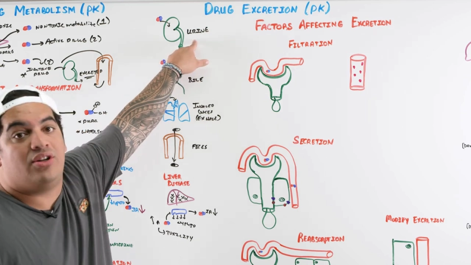
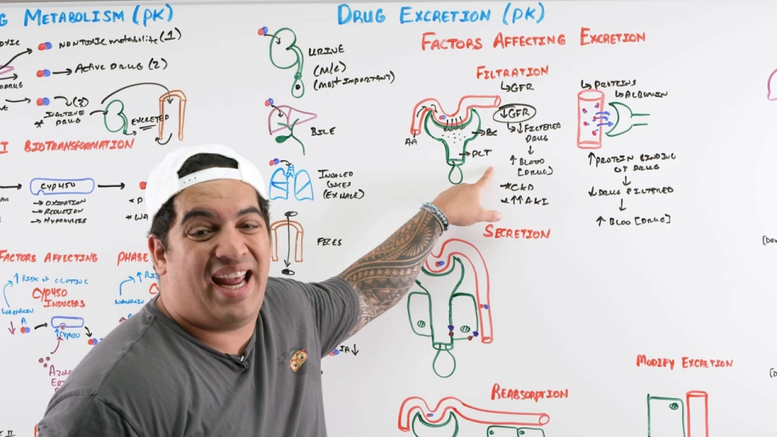
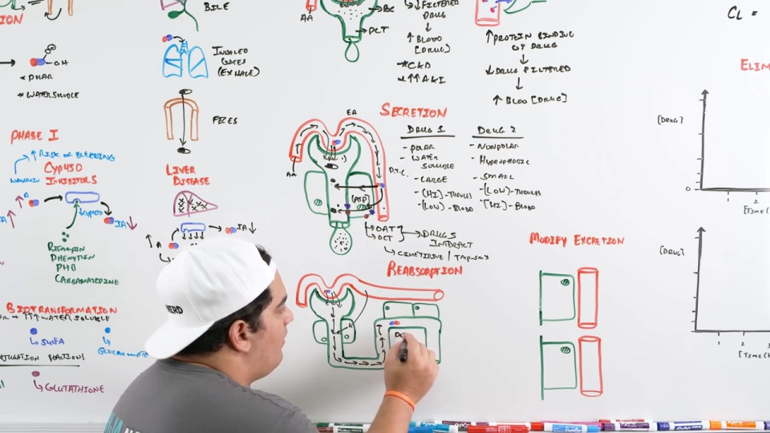
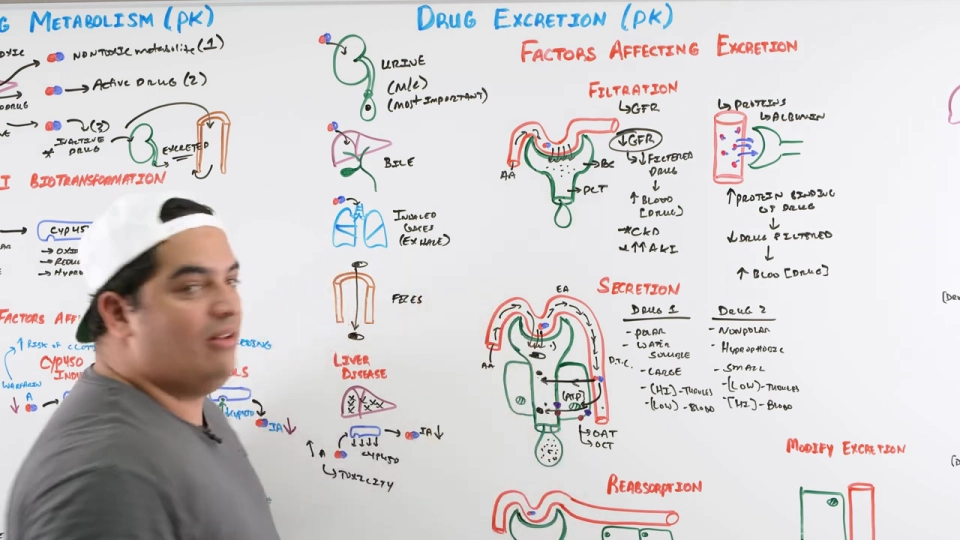
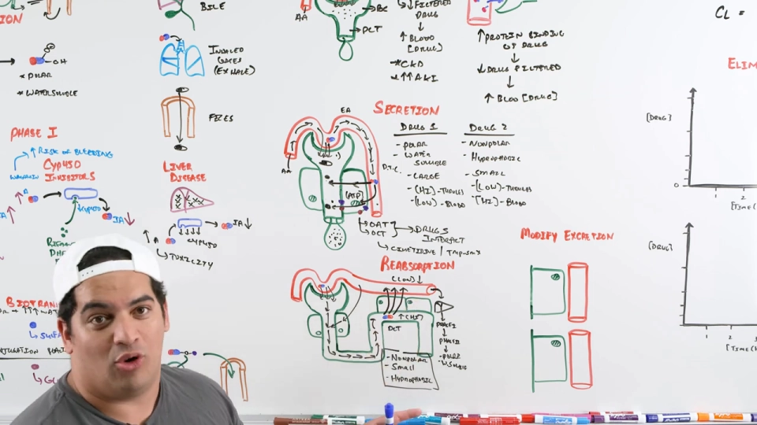
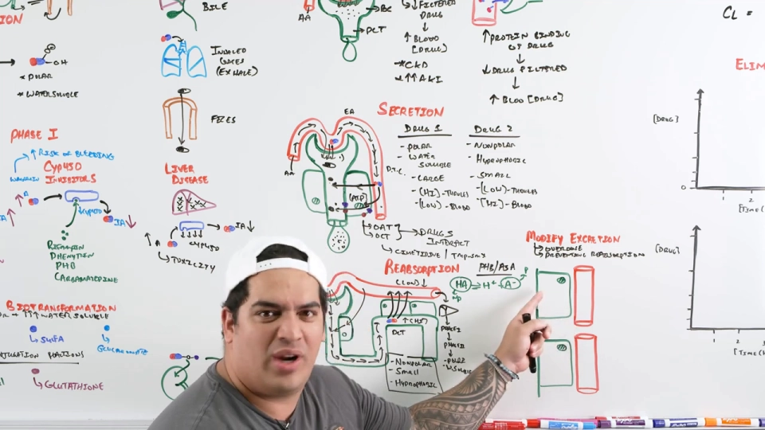
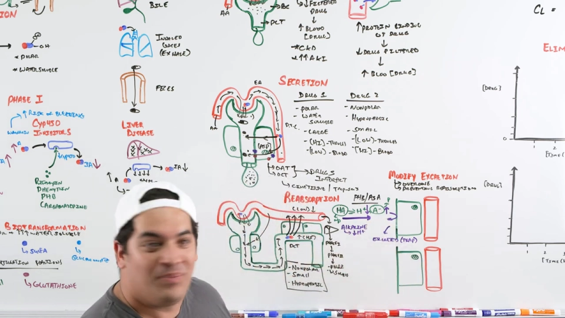
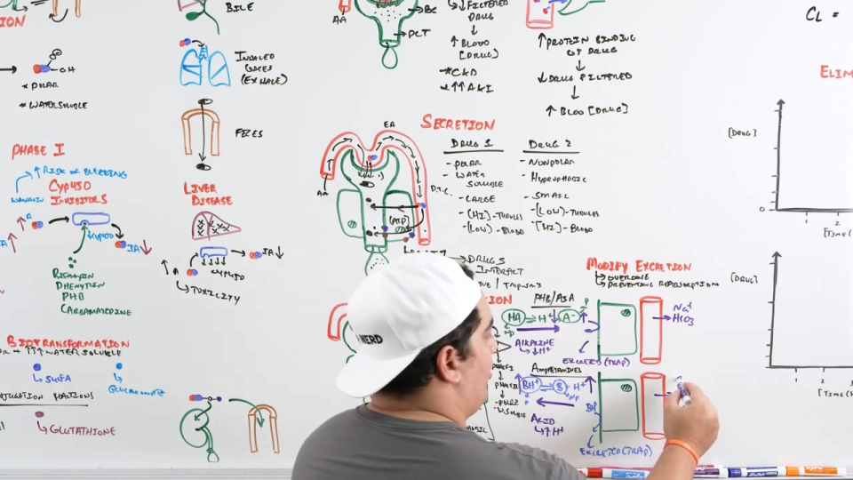

# 排泄的三道关：肾滤过、分泌、重吸收与离子捕获

> 视频来源：[Pharmacokinetics | Drug Excretion](https://www.youtube.com/watch?v=k04PQiAFJbY)（YouTube · Ninja Nerd，讲者 Zach Murphy）｜时长约 22 分钟
> 导读：这是「药物代谢」的下一集，讲药物最终怎么离开身体。讲者把肾排泄拆成滤过、分泌、重吸收三道关，再用「离子捕获」把这三关接到临床解毒上。本文按「出口清单 → 三关 → 离子捕获 → 与清除率/半衰期的接口」重排；代谢本身见同小节另两篇。

## 本讲要解决的核心问题（SCQA）

**背景**：药物在体内被代谢成更极性、更水溶的分子之后，需要被排出体外。最直觉的答案是「从尿里走」。

**冲突**：但尿不是简单的筛子。肾小球只滤掉一部分药物，剩下的要靠小管主动分泌；滤出去、分泌出去的药，又可能在小管后段被**重新吸收回血**。三个环节里任何一个被改变——肾功能下降、血浆蛋白结合升高、合并用药抢占转运体——都会让药物在体内蓄积。而且这三个环节的方向并不一致：同一分子在滤过环节容易走，在重吸收环节也容易回来。

**疑问**：肾到底在哪几步把药物「留下」或「放走」？临床上能不能干预这几步，把过量的药赶出去？

**回答（中心思想）**：肾排泄是**三道关的净结果**——滤过（取决于肾小球滤过率与血浆蛋白结合）、分泌（取决于转运体，可被竞争性药物抑制）、重吸收（取决于分子的亲脂性与电荷）。脂溶性小分子滤过之后几乎必然被重吸收，所以**代谢的意义就是把它变得不像能被重吸收的样子**。而在过量中毒时，可以通过改变尿液 pH 把分子「锁」在带电形式里，让它无法被重吸收——这就是**离子捕获**。

## 一、出口不止一个：尿、胆汁、呼气、粪便

[【跳转到 00:06】](https://www.youtube.com/watch?v=k04PQiAFJbY&t=6)

讲者先列了一张「出口清单」：

| 出口 | 机制 | 说明 |
| --- | --- | --- |
| 肾 → 尿 | 滤过、分泌、重吸收 | **最主要、最重要**的一条 |
| 肝 → 胆汁 → 粪便 | 结合后经胆道排入肠腔 | 讲者用「肝肠循环」（enterohepatic circulation）描述这条路 |
| 肺 → 呼气 | 挥发性药物 | 吸入麻醉药是典型 |
| 胃肠道 → 粪便 | 未被吸收的药物 | 药物在肠内起效但未被吸收入血 |

[【跳转到 01:48】](https://www.youtube.com/watch?v=k04PQiAFJbY&t=108)

讲者把重点压在肾上，理由很直接：**肾功能决定能不能把药排出去**。慢性肾病、急性肾损伤、肾功能几乎丧失的病人，药物排不出去就会蓄积。这也是临床上「按肾功能调整剂量」的底层原因。

## 二、第一关：滤过——GFR 与蛋白结合共同决定

[【跳转到 02:34】](https://www.youtube.com/watch?v=k04PQiAFJbY&t=154)

药物随**入球小动脉**进入肾小球，靠**肾小球静水压**被压过毛细血管壁，进入**鲍曼囊**，再流入近端小管。这一步叫**滤过**（filtration），它主要取决于**肾小球滤过率**（GFR）——每分钟被滤过的血浆体积。

[【跳转到 03:08】](https://www.youtube.com/watch?v=k04PQiAFJbY&t=188)

GFR 下降的后果可以一步步推：

1. 每分钟滤过的血浆体积减少；
2. 随血浆一起被滤出的药物减少；
3. 药物滞留在血中，**血药浓度升高**；
4. 毒性风险上升。

所以慢性肾病与严重急性肾损伤的病人需要**调整剂量**。

[【跳转到 04:26】](https://www.youtube.com/watch?v=k04PQiAFJbY&t=266)

第二个决定因素是**蛋白结合**。药物要与白蛋白等血浆蛋白结合，结合了的部分分子太大，过不了滤过屏障。于是：

- **蛋白结合率高** → 能滤过的游离药物少 → 滤过减少 → 血药浓度偏高；
- **蛋白结合率低** → 滤过增多 → 排出增多。

讲者举了两个「蛋白少反而排得多」的情形：**肝硬化**病人白蛋白合成减少；**慢性肾病**病人从尿里丢白蛋白。两者都会让游离药物比例上升，药物被大量排出，**疗效可能不足**。

这一段与 2.2.3 的「游离药物」直接接得上：真正被滤过的是游离部分，但总浓度决定检验单上的数字——两者在低蛋白状态下会明显脱节。

## 三、第二关：分泌——靠转运体，能被别的药抢走

[【跳转到 06:56】](https://www.youtube.com/watch?v=k04PQiAFJbY&t=416)

没有被滤过的药物留在出球小动脉，进入**管周毛细血管**。在这里，药物还有第二次机会：从小管周毛细血管穿过小管细胞，被送进**小管腔**。这一步叫**分泌**（secretion）。

讲者用两个分子做对比，把「主动」与「被动」讲清楚了：

- **药物 1：极性、水溶、分子大**。它要从小管周血（低浓度）进入小管腔（高浓度），既逆浓度梯度，又过不了脂质膜，只能靠转运体、消耗 ATP。这类转运体是**有机阴离子转运体**（OAT）与**有机阳离子转运体**（OCT）。
- **药物 2：非极性、亲脂、分子小**。它从血（高浓度）进入小管腔（低浓度）是顺浓度梯度，可以直接穿过膜，不需要 ATP。

[【跳转到 11:29】](https://www.youtube.com/watch?v=k04PQiAFJbY&t=689)

分泌环节的关键脆弱点在于：**转运体会被别的药物竞争**。讲者点了几个名字——**西咪替丁**（cimetidine）、**甲氧苄啶-磺胺甲噁唑**（trimethoprim-sulfamethoxazole）。它们占据同一批转运体，需要被分泌的药物就进不了小管腔，只能在血里蓄积。

这解释了一类容易被忽略的药物相互作用：**不是代谢酶被抑制，而是肾小管转运体被抢占**。判断时看的是「这个药是不是主要以原形从尿排出」，而不是「它被哪个 CYP 代谢」。

## 四、第三关：重吸收——脂溶性分子会被「捡回来」

[【跳转到 12:29】](https://www.youtube.com/watch?v=k04PQiAFJbY&t=749)

滤过与分泌把药物送进小管腔，但故事没完。小管液沿近端小管、髓袢、远端小管流动，一路上药物浓度升高，而管周血里的浓度相对较低——这是一个**适合重吸收的浓度梯度**。

[【跳转到 14:19】](https://www.youtube.com/watch?v=k04PQiAFJbY&t=859)

哪些分子会被重吸收？讲者的答案很干脆：**小、非极性、疏水**的分子。它们不需要转运体，直接顺浓度梯度扩散回血。结果是：**排不出去**。

[【跳转到 14:44】](https://www.youtube.com/watch?v=k04PQiAFJbY&t=884)

讲者在这里把「代谢」与「排泄」接成了一条线。既然脂溶性分子会被重吸收，那身体能做的就是把它们**改得不再脂溶**：

1. 重吸收回血的药物被送回**肝脏**；
2. 肝脏做 I 相（加 -OH 等基团）；
3. 再做 II 相（接葡萄糖醛酸等结合物）；
4. 分子变得更极性、更亲水、带电荷；
5. 再次到达肾小管时，**很难被重吸收**，于是被排出。

这就是为什么「代谢」和「排泄」不能分开讲：**代谢是在为排泄做准备**。也解释了为什么肝功能障碍会间接影响肾排泄——不是肾坏了，而是「预处理」没做好。

## 五、离子捕获：用 pH 把药物锁在尿里

[【跳转到 15:34】](https://www.youtube.com/watch?v=k04PQiAFJbY&t=934)

重吸收不只取决于亲脂性，还取决于**电荷**。讲者用弱酸/弱碱的解离平衡把这条讲透，这也是整支视频最像「临床操作」的一段。

### 5.1 弱酸过量：碱化尿液

以**苯巴比妥**（phenobarbital）或**阿司匹林**（aspirin）过量为例，它们是弱酸：

$$
HA \rightleftharpoons H^{+} + A^{-}
$$

- 非极性的 $HA$ 形式容易穿过膜被重吸收；
- 极性的 $A^{-}$ 形式带电荷，难以重吸收，会被排掉。

所以要「把反应往右推」，让更多分子停在 $A^{-}$：**降低质子浓度**，也就是**碱化尿液**。临床上给**碳酸氢钠**（sodium bicarbonate）。

### 5.2 弱碱过量：酸化尿液

以**安非他命**（amphetamine）过量为例，它是弱碱：

$$
BH^{+} \rightleftharpoons B + H^{+}
$$

- 非极性的 $B$ 形式容易被重吸收；
- 极性的 $BH^{+}$ 形式难以重吸收。

这次要「把反应往左推」，让更多分子停在 $BH^{+}$：**提高质子浓度**，也就是**酸化尿液**。临床上给**氯化铵**（ammonium chloride）。

[【跳转到 21:02】](https://www.youtube.com/watch?v=k04PQiAFJbY&t=1262)

讲者把这段总结成一句：**通过改变尿液的酸碱性，把离子「困」在小管腔里，让它无法被重吸收**。这是「重吸收」这一关唯一可以被人为大幅调节的地方，也是过量中毒处理里最实用的一条机制。

## 六、把三关合成一个清除率（补充）

视频在结尾说「下一集讲清除率、半衰期与酶动力学」，没有给出公式。为了把这一节与 2.2.6 接上，这里补两行（**补充内容，非讲者原话**）：

肾清除率可以写成三关的净效果：

$$
CL_{renal} = \left( f_u \times GFR + Q_{sec} \right) \times \left( 1 - F_{reabs} \right)
$$

其中 $f_u$ 是游离分数（只有游离药能滤过），$Q_{sec}$ 是分泌清除，$F_{reabs}$ 是被重吸收的比例。总清除率是各器官之和：

$$
CL_{total} = CL_{hepatic} + CL_{renal} + \cdots
$$

而清除率与半衰期的关系是：

$$
t_{1/2} \approx \frac{0.693 \times V_d}{CL}
$$

这三行式子把整节的因果串起来了：**滤过看 $f_u$ 与 GFR，分泌看转运体，重吸收看亲脂性与电荷；三者决定 $CL_{renal}$，$CL$ 再与分布体积一起决定半衰期**。所以「肾功能下降 → $CL$ 下降 → $t_{1/2}$ 变长 → 蓄积」不是一句经验，而是可以顺着式子推出来的。

## 小结

- 排泄有四条出口：**尿（最重要）、胆汁/粪便、呼气、未被吸收的粪便**。
- 肾排泄是**三道关的净结果**：滤过（GFR × 游离分数）、分泌（OAT/OCT 等转运体）、重吸收（亲脂性与电荷）。
- **滤过**受 GFR 与蛋白结合双重限制；低蛋白状态（肝硬化、肾病综合征）反而让更多药物被排出。
- **分泌**依赖转运体，会被西咪替丁、甲氧苄啶-磺胺甲噁唑等竞争性药物抑制，导致药物在血中蓄积。
- **重吸收**会把小、非极性、疏水的分子捡回血里；代谢的作用就是把它变得不像能被重吸收的样子——这是「代谢为排泄服务」的具体含义。
- **离子捕获**是可操作的干预点：弱酸过量碱化尿液（碳酸氢钠），弱碱过量酸化尿液（氯化铵）。
- 三关合起来决定 $CL_{renal}$，再与 $V_d$ 一起决定 $t_{1/2}$；肾功能下降的后果可以顺着这条链推出来。

## 关键术语速查

| 术语 | 一句话解释 |
| --- | --- |
| 肾小球滤过率（GFR） | 每分钟被滤过到鲍曼囊的血浆体积 |
| 滤过（filtration） | 靠静水压把游离药物压过肾小球，进入小管腔 |
| 分泌（secretion） | 管周血中的药物经转运体主动进入小管腔 |
| 重吸收（reabsorption） | 小管腔中的药物被动扩散回血，抵消排泄 |
| OAT / OCT | 有机阴离子/阳离子转运体，负责肾小管主动分泌 |
| 离子捕获（ion trapping） | 通过改变尿 pH 把药物锁在带电形式，阻止重吸收 |
| 肝肠循环 | 药物经胆汁排入肠道后被重吸收回血，延长体内停留 |
| 游离分数 $f_u$ | 血浆中未被蛋白结合的药物比例，决定可滤过的部分 |
| 清除率 $CL$ | 单位时间内被完全清除药物的血浆体积 |