# 前药把可及性缺陷改写成一段可剪断的化学键

> 视频来源：[Introduction to Medicinal Chemistry: Prodrugs Design - Part 5](https://www.youtube.com/watch?v=tXVlSqpnDLI)（YouTube · Tade MedChem Insights，讲者 Dr. Tardasa）｜时长约 62 分钟
> 导读：这是一堂按「定义 → 分类 → 载体标准 → 六类应用 → 生物前药」顺序铺开的药物化学课，例子密度很高（地匹福林、匹氨西林、替诺福韦酯、依那普利、泼尼松龙半琥珀酸酯、福沙那韦、阿糖胞苷、氯霉素棕榈酸酯、柳氮磺吡啶、阿司匹林、替加氟、环磷酰胺、舒林酸）。本文保留讲者的分类骨架和全部例子，把散落在口语里的设计逻辑收拢成「缺陷 → 挂什么 → 在哪断」三问；字幕为自动生成，药名与术语已按幻灯片订正。代谢酶与清除的全貌见本系列 2.2.4，盐型的监管身份见 1.1.6，本文只在必要处引用。

## 本讲要解决的核心问题（SCQA）

**背景**：药物发现里最常见的困境不是「分子对靶点没活性」，而是「分子在体外有活性，到了体内却到不了靶点」——溶解度太低灌不进胃里，脂溶性太差穿不过膜，半衰期太短一天要吃四次，或者全身分布导致副作用压不住。

**冲突**：这些缺陷几乎都发生在分子到达靶点之前。如果直接改活性骨架去迁就溶解度或稳定性，很可能把好不容易建立的构效关系一起改掉。

**疑问**：有没有一种办法，能只改变分子「在路上的性质」，而不改变它「到达之后的样子」？

**回答（中心思想）**：有，这就是前药。前药的本质是**把可及性缺陷翻译成一段可剪断的化学键**：在母体药物上临时接一个基团（或把母体改造成一个自身会被代谢改造的异构体），让分子在旅途中呈现另一套理化性质；等它到达该到的地方，再由酶或化学反应把这段键剪断，释放原来的药物。设计的全部难点集中在两个问题上——**挂什么**（载体前药还是生物前药）和**在哪断、断多快**（酶、pH、菌群、位阻）。

## 一、前药的定义：一个刻意做成无活性的「生物可逆衍生物」

[【跳转到 00:00】](https://www.youtube.com/watch?v=tXVlSqpnDLI&t=0)

讲者把前药概念的起点定在 1958 年：Adrian Albert 用「prodrug」指代那些**需要经过生物转化才表现出治疗活性**的化合物。由此得到定义：前药是药物分子的**生物可逆衍生物**（bioreversible derivative），它本身生物活性很低甚至没有，进入体内后经过酶促或化学转化，释放出能发挥药理作用的活性药物。

这个定义里有两个词决定了后面所有设计：

- **可逆**（bioreversible）：接上去的基团必须能掉下来，而且掉下来之后母体结构要完好；
- **衍生物**：前药不是新药，它的价值来自母体药物，本身只是一个运输形态。

[【跳转到 01:40】](https://www.youtube.com/watch?v=tXVlSqpnDLI&t=100)

讲者特别提到一个行业态度的转变：前药最初被视为药物开发的「最后手段」——实在没办法了才去接一个基团；但随着组合化学、高通量筛选和分子生物学的发展，它变成了早期药物发现中的**中心策略**，因为它能在不重做构效关系的前提下优化理化性质、跨越生物屏障（例如血脑屏障），并实现位点特异性递送。按讲者给出的数量级，全球获批药物中大约有 **10%–14%** 可以算作前药。

### 1.1 前药要修的是哪几类缺陷

讲者列出的目标清单，其实就是一张「可及性缺陷表」：

| 缺陷 | 前药能做什么 | 本文对应案例 |
| --- | --- | --- |
| 水溶性差，无法做成注射剂 | 接可电离的磷酸酯、琥珀酸半酯 | 泼尼松龙半琥珀酸酯、福沙那韦 |
| 脂溶性差，被动扩散穿不过膜 | 用亲脂性载体掩蔽极性的羧基、羟基 | 地匹福林、匹氨西林、替诺福韦酯 |
| 代谢太快、首过效应强 | 用载体保护易被酶切的位点 | 依诺他滨（阿糖胞苷前药） |
| 味道苦、有腐蚀性、注射疼痛 | 掩味、降低局部刺激 | 氯霉素棕榈酸酯、甘油三乙酸酯 |
| 分布无选择性、全身毒性大 | 只在靶组织被特定酶或条件激活 | 柳氮磺吡啶、替加氟、环磷酰胺 |
| 需要缓慢平稳释放 | 用位阻减慢断裂速度 | 见配套篇《载体前药的四个旋钮》 |

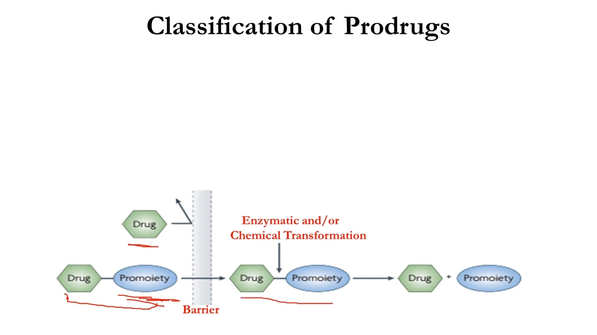

## 二、两大类前药：带载体的和不带载体的

[【跳转到 04:31】](https://www.youtube.com/watch?v=tXVlSqpnDLI&t=271)

讲者用一张图把分类讲清楚：药物接上一个「promoiety」（载体基团，讲者口语里说成 promote/promo），得到的是**载体前药**；而如果分子本身没有额外挂东西，只是被改造成一个会在体内被代谢成母体的结构异构体，那就是**生物前药**。两者的差别不在于「有没有经过代谢」，而在于**释放机制是剪断一条键，还是改造整个分子**。

### 2.1 载体前药：共价接一个临时基团

[【跳转到 07:51】](https://www.youtube.com/watch?v=tXVlSqpnDLI&t=471)

载体前药的定义是：通过**共价键**把活性药物与一个**临时的、无毒的载体基团**连接起来，形成的活性更低（常为无活性）的化合物。载体通常被设计成对特定生物靶点有亲和力，从而帮助前药绕过细胞膜这类屏障，或者向肿瘤这样的病灶归巢；它同时**临时掩蔽或改变母体的理化性质**，改善溶解度、稳定性或药代行为。

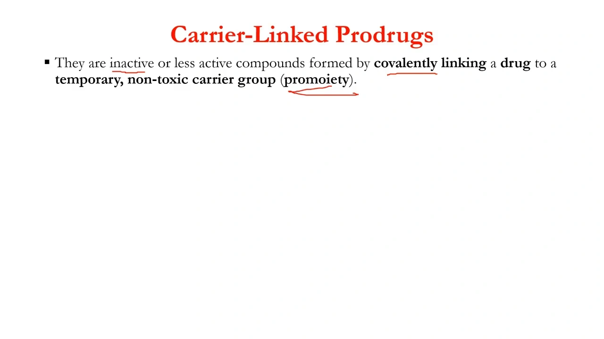

关键在「临时」二字：前药到达目标部位后，药物与载体之间的连接键被酶或化学反应切断，释放出活性药物，载体则应当无毒并可被清除。讲者反复强调，载体不是越大越好，也不是越稳定越好——**它必须在正确的时间点断掉**。

### 2.2 载体前药的两种再分类

[【跳转到 16:32】](https://www.youtube.com/watch?v=tXVlSqpnDLI&t=992)

讲者给了两条互相独立的分类轴，这是整堂课最实用的框架：

**按连接方式分：**

- **双部件前药**（bipartate）：载体直接连在药物上，连接键通常是酯、酰胺、氨基甲酸酯、碳酸酯或磷酸酯。结构最简单，断裂也最直接。
- **三部件前药**（tripartate）：载体与药物之间多插一个连接段（linker/spacer）。当直接连接会造成**位阻或稳定性问题**时，才需要多这一节——它相当于给酶提供一个更好下手的把手。

**按活化位置分：**

- **I 型（胞内活化）**：前药进入细胞后才被激活，典型是抗病毒的核苷类似物。
- **II 型（胞外活化）**：在胃肠液或体循环中被激活，主要目的是改善吸收。双部件前药多由酶控制这一步；三部件前药的连接段则可以由酶系统或纯化学反应移除。

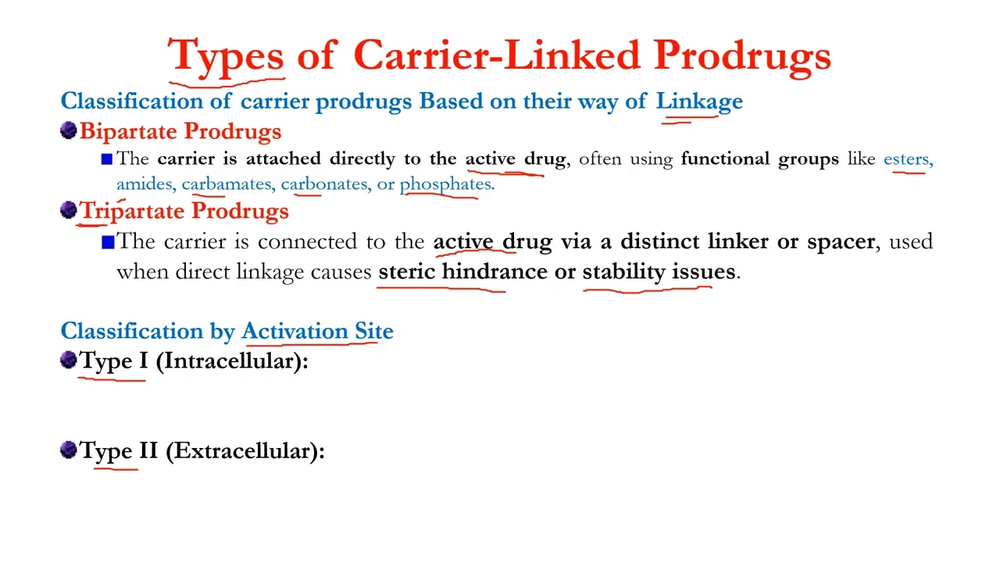

### 2.3 一个双部件前药的完整例子：托美丁-甘氨酸

[【跳转到 19:02】](https://www.youtube.com/watch?v=tXVlSqpnDLI&t=1142)

托美丁（tolmetin）是羧酸类非甾体抗炎药，把它的羧基与甘氨酸的氨基缩合成酰胺，就得到托美丁-甘氨酸前药。讲者给出的设计目的是**降低托美丁对胃肠道的副作用**；前药进入体内后，酰胺键经酶控制的代谢过程被水解，释放托美丁。注意这个前药上仍保留着甘氨酸的游离羧基——它并不是靠「把羧基全部封住」来起作用的，讲者也没有展开它减轻刺激的具体机制，只用它作双部件前药的例子。这张幻灯片同时给出了双部件与三部件的对照结构，讲者用它说明：同一个药物，接法不同，前药的稳定性和释放行为就不同。

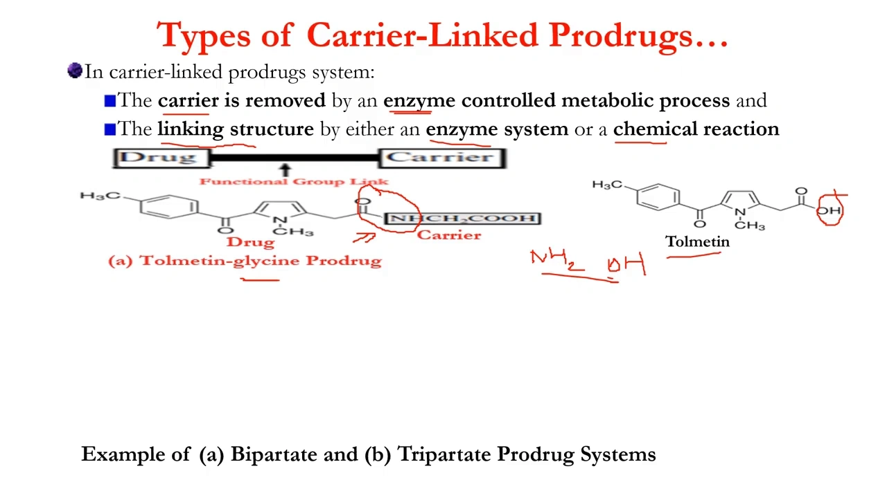

## 三、载体怎么接：药物的官能团决定连接键

[【跳转到 13:12】](https://www.youtube.com/watch?v=tXVlSqpnDLI&t=792)

前药不是随便找一个基团粘上去。可用的连接键由**药物上已有的官能团**决定，而连接键又决定了由哪种酶来剪断它。讲者给出的对应关系是：

- **酯键**：用于含羧基或羟基的药物，例如依那普利、奥司他韦；
- **酰胺键**：常用于提高稳定性，例如伐昔洛韦；
- **磷酸酯**：用于提高水溶性，服务肠外给药，例如磷丙泊酚；
- **氨基甲酸酯 / 碳酸酯**：常用于连接氨基或羟基。

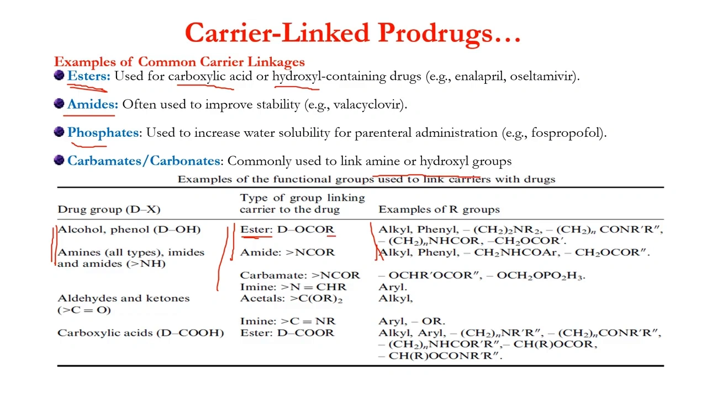

同一张幻灯片下半部分的表格把这件事说得更细，它是一张可以直接拿来查的对照表：

| 药物上的官能团 | 可用的连接键 | 载体一侧常见的 R 基 |
| --- | --- | --- |
| 醇、酚（D–OH） | 酯 D–OCO–R | 烷基、苯基、氨基烷基、酰胺烷基、酰氧基烷基 |
| 胺（伯/仲/叔）、亚胺、酰胺 | 酰胺、氨基甲酸酯、亚胺、缩醛 | 烷基、苯基、酰氧基、磷酸酯 |
| 醛、酮 | 亚胺、缩醛 | 芳基、烷基 |
| 羧酸（D–COOH） | 酯 D–COOR、亚胺 | 烷基、芳基、氨基烷基、酰胺烷基 |

读这张表的正确方式不是背，而是**反过来用**：先看母体药物上有没有可用的「把手」（羧基、羟基、氨基、羰基），再决定能接哪类键，最后才轮到考虑接什么基团来调性质。没有把手，就只能走生物前药那条路。

## 四、什么样的载体算合格

[【跳转到 12:22】](https://www.youtube.com/watch?v=tXVlSqpnDLI&t=742)

讲者给了一份「设计良好的载体前药应满足的条件」清单，这份清单同时也是评审一个前药方案的检查表：

1. **临时连接**：活性分子与转运载体之间是暂时连接，载体通常是亲脂性的（讲者举例提到聚乙二醇、脂肪酸链、大分子），用来提高膜通透性和药物稳定性；
2. **共价但体内可断**：药物与载体之间是共价键，但必须在体内断开；
3. **前药活性更低**：前药应比母体药物活性更低或失活，这样才能「安全地被运输」；
4. **前药与释放出的载体都无毒**：两者在体内释放后都必须无毒；
5. **断裂要快且要有选择性**：在靶点处快速、选择性地断键，释放出能达到有效治疗水平的活性药物，同时尽量减少旁路代谢，避免载体本身带来毒性。

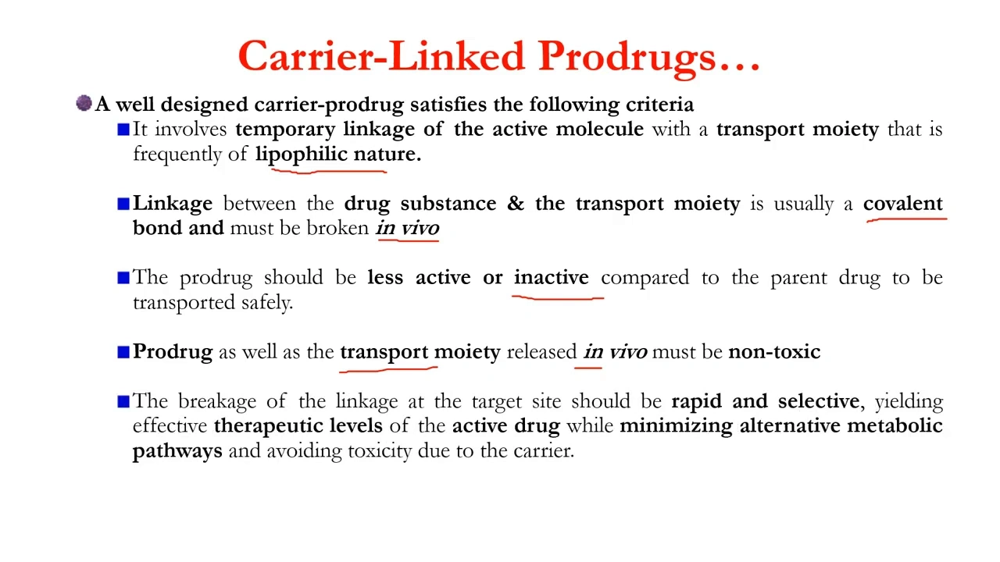

第 3 条容易被误解成「前药越没活性越好」。它的真实含义是**在到达靶点之前不要提前起效**：如果前药在胃里就有活性，它会在没有靶点的位置产生效应，等于把副作用提前释放了。这与第 5 条是一体两面——前药的价值取决于「何时何地断键」，而不取决于「挂了多少东西」。

## 五、六类应用：每一类都对应一种具体的缺陷

讲者把载体前药的应用拆成六类，每一类都配了结构式。这部分是整堂课信息密度最高的地方。

### 5.1 提高脂溶性，改善渗透性与生物利用度

[【跳转到 21:32】](https://www.youtube.com/watch?v=tXVlSqpnDLI&t=1292)

策略是**用亲脂性载体掩蔽极性基团**（羧基、羟基），让分子整体更亲脂，从而更容易被动扩散过膜。讲者给了四个例子：

- **地匹福林**（dipivefrin，肾上腺素的双特戊酸酯）：肾上腺素的两个酚羟基各接一个特戊酸（pivalic acid）成酯。肾上腺素本身极性太强，角膜吸收差；成酯后亲脂性上升，角膜透过增加，进入眼内后被酯酶水解回肾上腺素，用于治疗**开角型青光眼**。
- **匹氨西林**（pivampicillin）：氨苄西林的特戊酰氧甲酯，靠亲脂性提高口服生物利用度，吸收后水解释放氨苄西林。
- **替诺福韦二吡呋酯**（tenofovir disoproxil）：替诺福韦带磷酸基团、极性很强、口服吸收差；把磷酸做成二酯后亲脂性大幅提高，用于慢性乙肝和 HIV-1 的治疗。讲者还提到它做成**富马酸盐**（TDF）是为了得到稳定、药学上可接受的盐型，同时改善溶解度、化学稳定性和肠道吸收。
- **依那普利**（enalapril）：本身是羧酸，做成单乙酯后吸收改善，进入体内经酯酶水解为活性形式**依那普利拉**（enalaprilat），后者是血管紧张素转化酶抑制剂，用于高血压、糖尿病肾病和心力衰竭。

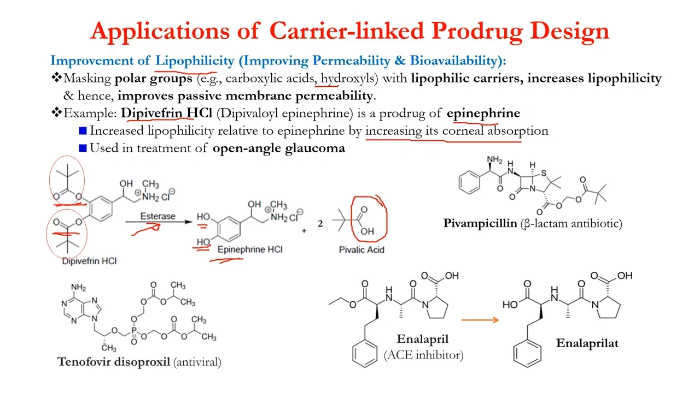

注意这四个例子的共同结构：**母体药物上都有一个极性「把手」（羧基、羟基、磷酸基），前药把这个把手暂时封住，进入体内后再由酯酶打开**。这正是 2.1.2 里 logP 与 logD 的实操版本——前药改变的是「到达靶点之前那一瞬间的表观亲脂性」，而不是母体的固有亲脂性。

### 5.2 提高水溶性，让肠外给药成为可能

[【跳转到 28:02】](https://www.youtube.com/watch?v=tXVlSqpnDLI&t=1682)

水溶性对生物利用度和吸收至关重要，讲者给出的三条思路是：降低分子疏水性、引入极性官能团（含氮、含氧）、降低晶格能。具体手段分三类——化学改造（成盐、成前药）、物理方法（微粉化、纳米化、高压均质、固体分散体）、制剂技术（环糊精包合、助溶剂、pH 调节）。

真正属于前药的两个例子是：

- **泼尼松龙-21-半琥珀酸钠**：泼尼松龙几乎不溶于水，在 C-21 位接上琥珀酸半酯并成钠盐后，得到一个可电离的侧链，水溶性足以做成**注射剂**；进入体内后酯键水解，释放泼尼松龙。
- **福沙那韦**（fosamprenavir）：在安普那韦（amprenavir）上接一个磷酸酯，靠磷酸基团的电离提高水溶性，进入体内后磷酸酯被切除，释放安普那韦。讲者把它归为「磺胺类 HIV 蛋白酶抑制剂」的前药。

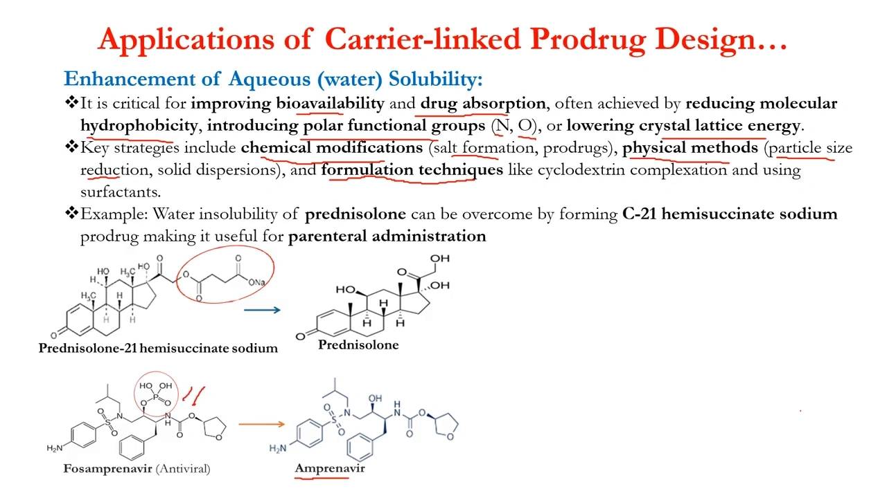

这里有一个值得记住的权衡：**提高水溶性和提高脂溶性是同一枚硬币的两面**。同一个母体，接亲脂载体是为了过膜（口服、经皮、角膜），接可电离基团是为了进瓶子（注射剂）。选哪一面，取决于缺陷出在「吸收」还是「剂型」。

### 5.3 提高代谢稳定性，延长半衰期

[【跳转到 33:22】](https://www.youtube.com/watch?v=tXVlSqpnDLI&t=2002)

讲者的框架是：药物被 CYP450 等酶快速降解，导致半衰期短、生物利用度低、给药频繁；解决办法包括结构改造（引入氘、成环、替换代谢软点，用肝微粒体等体外实验验证）和前药策略。

前药的例子是**阿糖胞苷**（cytarabine，Ara-C）：它是抗白血病药，但在体内会被**胞苷脱氨酶**快速脱氨，变成无活性的阿糖尿苷（Ara-U），因此血浆半衰期很短。解决办法是把氨基做成**N4-山嵛酰**衍生物，即**依诺他滨**（enocitabine）：脂肪酸链暂时封住脱氨酶识别的位点，从而延长半衰期，并提高活性部位的药物浓度。

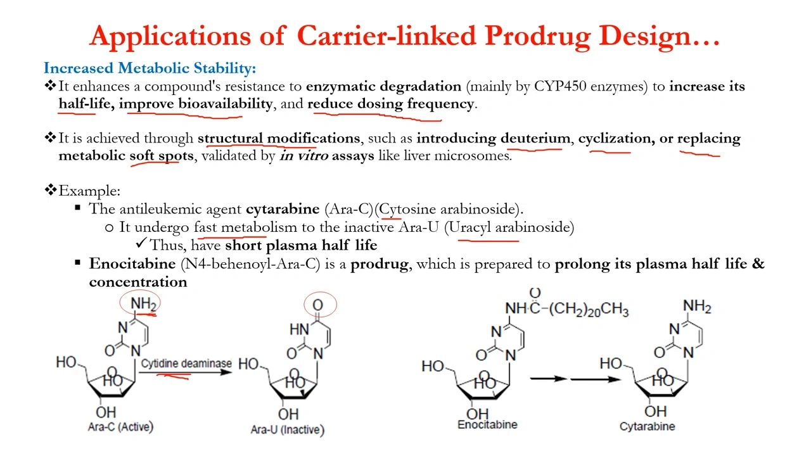

这个例子把「前药」和「代谢软点」两个概念接了起来：前药不是去改代谢酶，而是**把酶要攻击的那个位置先占住**。至于代谢软点如何被鉴定、CYP 抑制与诱导如何影响清除，属于 2.2.4 的内容，这里不展开。

### 5.4 改善患者依从性：掩味与降低局部刺激

[【跳转到 38:12】](https://www.youtube.com/watch?v=tXVlSqpnDLI&t=2292)

依从性问题听起来琐碎，但在儿科和皮肤科是硬约束。讲者给了两个例子：

- **氯霉素棕榈酸酯**：氯霉素极苦，儿童口服混悬剂难以接受；把羟基做成棕榈酸酯后，苦味被掩蔽，体内水解释放氯霉素。
- **甘油三乙酸酯**：乙酸有腐蚀性，无法直接用于局部抗真菌；把甘油与三分子乙酸酯化得到甘油三乙酸酯，**不腐蚀、且比母体更容易透皮**，进入体内后释放乙酸起效。

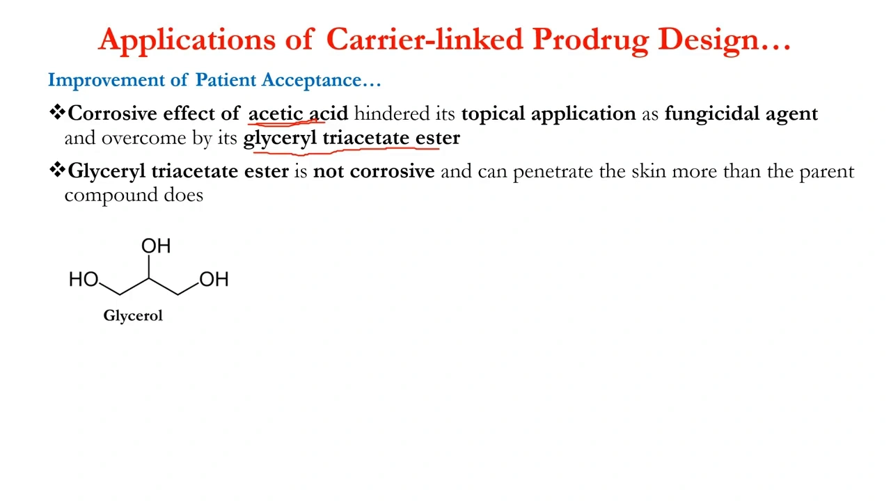

这两个例子说明前药的目标函数不只有「浓度-时间曲线」：**患者能不能把药吃下去、涂上去**，同样是一个可及性问题。

### 5.5 位点特异性递送：把「在哪断」变成设计变量

[【跳转到 41:32】](https://www.youtube.com/watch?v=tXVlSqpnDLI&t=2492)

这是整堂课最需要区分概念的一段。讲者把靶向递送拆成两种**不同**的策略，并用一张对比表说明：

| 维度 | 位点导向递送（site-directed delivery） | 位点特异性释放（site-specific release） |
| --- | --- | --- |
| 关注点 | 位置与运输：怎么到达 | 释放时机：何时、在哪触发 |
| 方法 | 主动（配体、抗体）或被动（EPR 效应） | 由 pH、温度或酶触发 |
| 路径 | 载体导向（纳米粒、脂质体） | 制剂导向（肠溶包衣） |
| 首要目标 | 保护与蓄积 | 精准释放 |

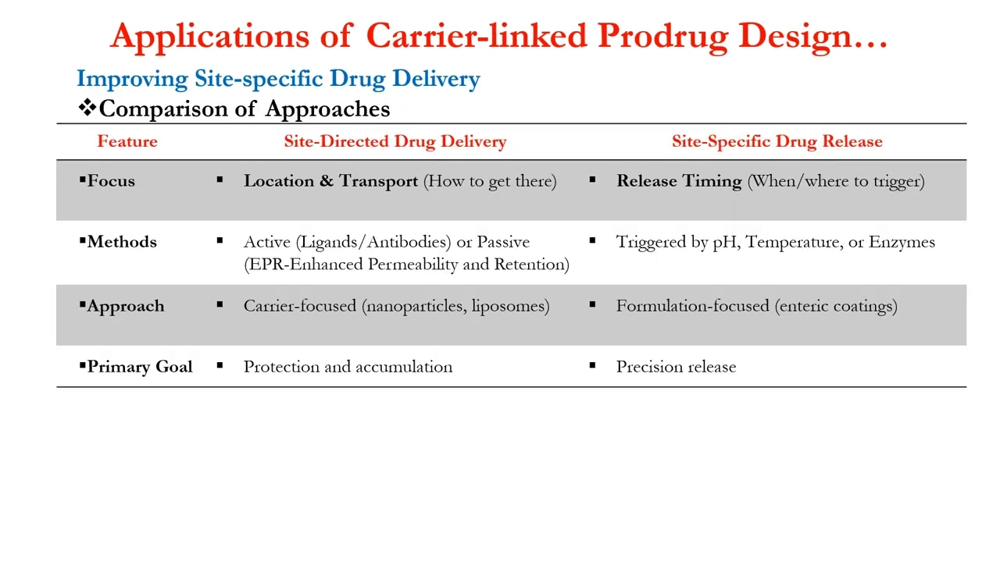

讲者强调两者的目标其实一致——都是提高治疗指数，用更少的副作用换更好的效果；区别在于**一个管运输、一个管开关**。

**位点特异性释放的代表是柳氮磺吡啶**：它把 5-氨基水杨酸（抗炎，用于溃疡性结肠炎）与磺胺吡啶通过**偶氮键**（–N=N–）连在一起。偶氮键在胃和小肠不被破坏，到达结肠后被结肠菌群产生的**偶氮还原酶**切断，就地释放出 5-氨基水杨酸和磺胺吡啶。这是一个「只有结肠里的细菌才有的酶」被当成触发器的设计——触发条件不在人体细胞里，而在共生菌群里。

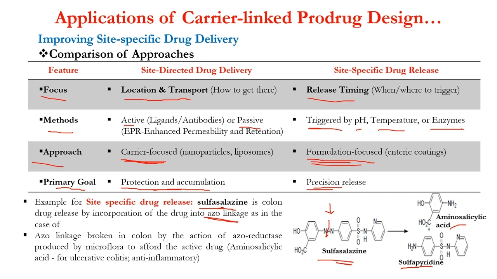

讲者另举了几个**位点导向**的例子（严格说属于递送系统而非共价前药，但与上一节共用同一套「载体」思路）：脂质体多柔比星靠 EPR 效应在肿瘤蓄积以降低副作用；白蛋白结合型紫杉醇用白蛋白纳米粒把紫杉醇送到肿瘤；叶酸介导靶向利用癌细胞过表达的叶酸受体；以及用外部磁场引导氧化铁纳米粒的磁靶向。位点特异性释放侧的例子则包括在结肠或回肠末端释放的美沙拉嗪制剂、以陶瓷核心加聚合物包覆实现靶向缓释的胰岛素载体，以及用于关节炎局部治疗的甲氨蝶呤脂质体。

### 5.6 降低副作用：阿司匹林其实是一个前药

[【跳转到 53:19】](https://www.youtube.com/watch?v=tXVlSqpnDLI&t=3199)

讲者用柳氮磺吡啶之外最经典的一个例子收尾：水杨酸是最早的镇痛药之一，但会刺激胃黏膜、甚至引起出血。把水杨酸的**酚羟基乙酰化**得到阿司匹林（乙酰水杨酸），口服后吸收过程中被酯酶水解回水杨酸。

为什么这样能减轻胃刺激？讲者的解释是：阿司匹林主要在吸收之后才被酯酶水解，因此**与胃壁直接接触的水杨酸量减少了**。讲者也诚实地补了一句：阿司匹林只是「减轻」刺激，并没有完全消除，它自己也有副作用。

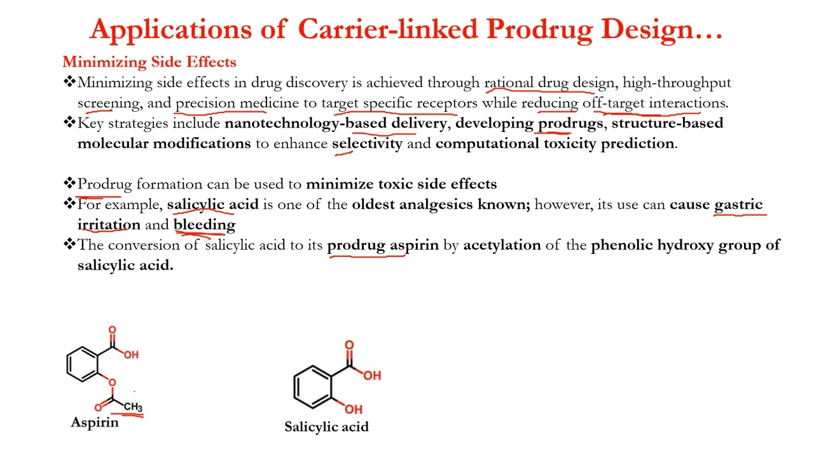

## 六、生物前药：没有载体，靠代谢把分子「改造」成母体

[【跳转到 54:59】](https://www.youtube.com/watch?v=tXVlSqpnDLI&t=3299)

讲者用「没有载体」一句话把生物前药与载体前药分开：生物前药**不含载体部分**，它是把药物本身化学改造成一个无活性的生化前体，进入生物系统后再转化为活性药物。这种改造对调节**亲脂性、稳定性和器官趋向性**（organotropism，即药物向特定器官或组织分布、浓集并发挥主要作用的倾向）特别有用。活化方式通常是氧化、还原或水解。

### 6.1 替加氟：靠 CYP2A6 在肿瘤里「就地制造」5-氟尿嘧啶

[【跳转到 57:29】](https://www.youtube.com/watch?v=tXVlSqpnDLI&t=3449)

替加氟（tegafur）是 5-氟尿嘧啶（5-FU）的 N-四氢呋喃衍生物，可以口服。它主要在 **CYP2A6** 作用下转化为 5-FU。讲者的说法是：这一步让 5-FU 在肿瘤部位**选择性活化**，从而降低化疗的全身毒性。

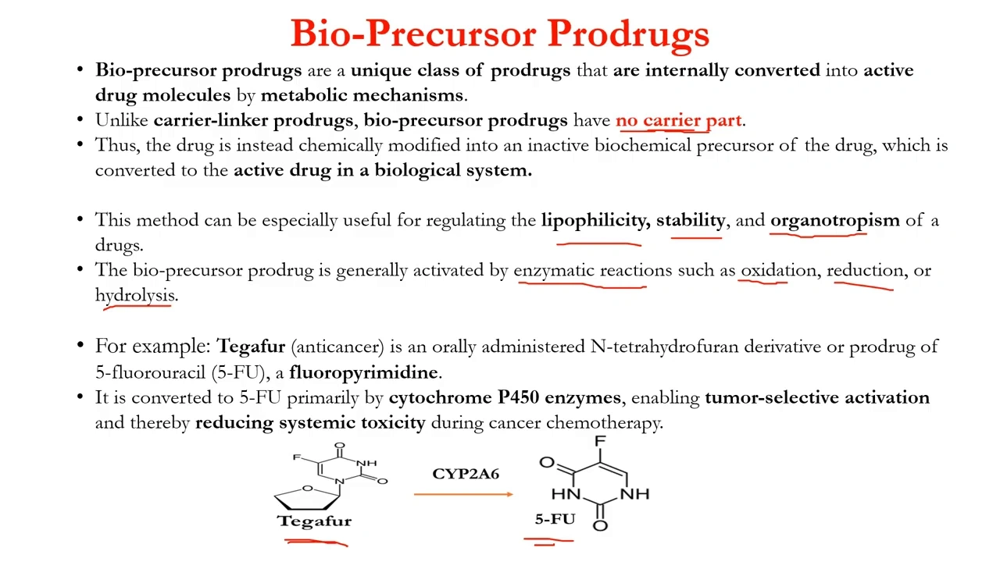

这里的设计逻辑与载体前药不同：没有一条「外来的键」被剪断，而是母体分子的一部分被酶**改写**掉。因此生物前药的可调空间更依赖代谢酶的分布——酶在哪儿多，药就在哪儿被激活。

### 6.2 环磷酰胺：一次氧化、一次自发水解、两条失活旁路

[【跳转到 59:09】](https://www.youtube.com/watch?v=tXVlSqpnDLI&t=3549)

环磷酰胺是细胞毒药物，活化过程是**氧化脱烷基后接自发水解**：

1. 经肝微粒体氧化，环磷酰胺转变为 **4-羟基环磷酰胺**；
2. 4-羟基环磷酰胺与开环的**醛磷酰胺**（aldophosphamide）处于互变平衡；
3. 醛磷酰胺自发水解，释放出活性的**磷酰胺氮芥**（phosphoramide mustard）和**丙烯醛**（acrolein）。

同时存在两条失活旁路：4-羟基环磷酰胺可被进一步氧化为 4-酮环磷酰胺，醛磷酰胺可被醛脱氢酶氧化为羧基磷酰胺。这两条旁路的存在意味着：**同一个前药在不同细胞里可能走向活化或失活**，而醛脱氢酶活性高的细胞对环磷酰胺相对不敏感——这是前药活化依赖「细胞内的酶组成」的直接后果。

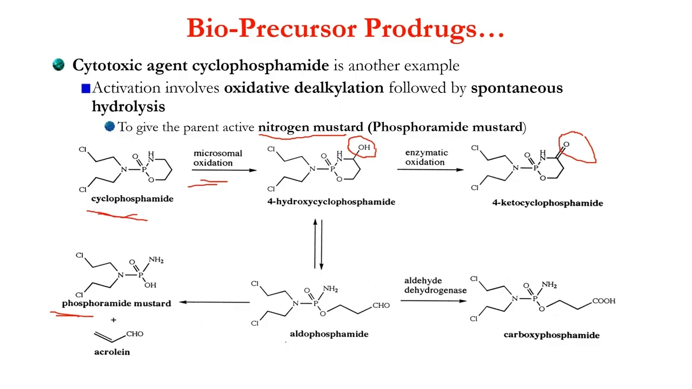

### 6.3 舒林酸：靠肠道菌群的还原反应激活

讲者把舒林酸（sulindac）作为生物前药「组织特异性活化」的另一个例子：它本身是前药，经**肠道菌群的还原反应**转化为活性的硫化物代谢物。讲者给出的结论是：与传统非甾体抗炎药相比，这种设计带来的胃刺激更小。

### 6.4 生物前药的三个好处

[【跳转到 60:49】](https://www.youtube.com/watch?v=tXVlSqpnDLI&t=3649)

讲者把生物前药的优势归纳为三条：

- **提高生物利用度**：避开首过代谢或吸收不良，提高活性物质的血浆水平；
- **降低毒性**：允许组织特异性活化，从而减少副作用（例子是舒林酸和替加氟）；
- **提高稳定性**：保护活性药物在储存期间或释放入体后不被过早降解，维持药理活性。

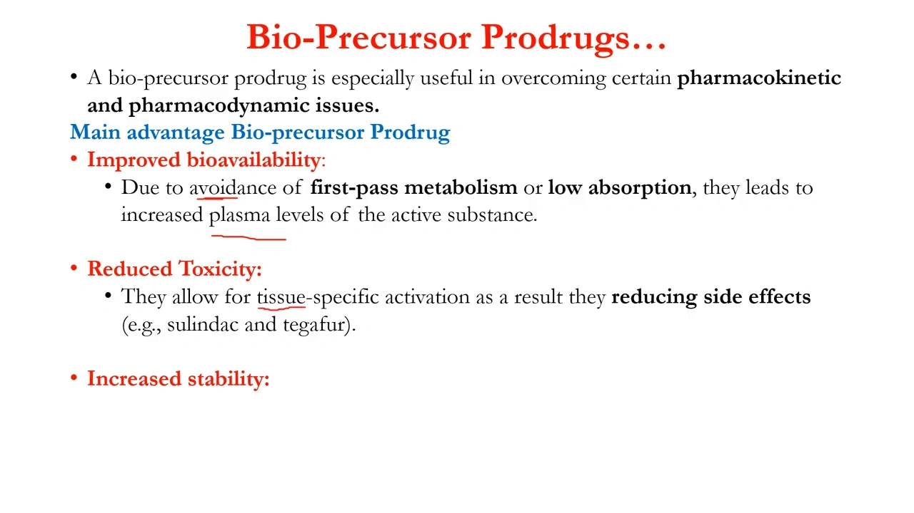

## 七、把前药当成一个化学键来评估：四个必答问题

讲者没有专门讲失败案例，但把散落在各节的标准合起来，可以得到一份评估清单。下面四条中，前三条直接来自讲者的载体标准与生物前药讨论，第四条（剂量与效价折算）是本文根据其化学计量关系补充的，讲者本人未展开：

1. **断得开吗？** 连接键必须在体内可断（第 4 节第 2 条）。如果载体太稳定，前药会以完整形式排出，等于给患者吃了一个没有活性的分子。
2. **断在对的地方吗？** 断裂应当发生在靶点附近（第 4 节第 5 条）。如果断裂发生在血浆里，前药就退化成一个吸收更好的母药，靶向性收益归零；如果断裂发生在肠道菌群，那么抗生素联用就可能让药效消失——柳氮磺吡啶的偶氮键正是依赖菌群。
3. **断下来的东西有毒吗？** 前药与释放出的载体都必须无毒（第 4 节第 4 条）。这一条在生物前药里尤其微妙：环磷酰胺的活化产物里除了活性氮芥，还有丙烯醛（补充：丙烯醛是环磷酰胺引起出血性膀胱炎的经典原因，讲者未展开）。
4. **剂量怎么折算？**（补充）前药的分子量大于母体，相同质量下所含母体的摩尔数更少；如果前药转化不完全，实际暴露还要再打折。因此前药的剂量、AUC 与效价必须以**母体**为基准来报告，否则不同前药之间无法比较。这一条在本系列 2.2.6 讲药代参数时会再次遇到。

## 小结

- 前药是母体药物的**生物可逆衍生物**：本身活性低，靠体内酶促或化学转化释放母药；全球获批药物中约 10%–14% 属于此类。
- 它修的是**到达靶点之前**的缺陷：溶解度、渗透性、代谢稳定性、味道与局部刺激、分布选择性、释放速度。
- **载体前药**靠剪断一条共价键释放药物，载体必须临时、无毒、可清除；按连接方式分双部件与三部件，按活化位置分胞内 I 型与胞外 II 型。
- **生物前药**没有载体，靠氧化、还原或水解把自身改造成母体，可调的是亲脂性、稳定性与器官趋向性。
- 连接键由**母体已有的官能团**决定：羧基/羟基走酯，氨基走酰胺或氨基甲酸酯，需要水溶性走磷酸酯。
- 靶向有两套不同的问题：**位点导向**解决「怎么到达」（载体、EPR、配体），**位点特异性释放**解决「何时触发」（pH、酶、菌群）。柳氮磺吡啶是后者的教科书例子。
- 前药的价值不在「挂了什么」，而在「**何时、何地、以多快的速度断掉**」。

## 关键术语速查

| 术语 | 一句话解释 |
| --- | --- |
| 前药（prodrug） | 本身活性低、需经体内转化才释放活性药物的生物可逆衍生物 |
| 载体基团（promoiety） | 临时共价连接在药物上的基团，负责改变理化性质并在体内被切除 |
| 载体前药（carrier-linked prodrug） | 药物与载体共价连接的前药，靠剪断连接键释放母药 |
| 生物前药（bioprecursor） | 不含载体，靠氧化、还原或水解把自身改造成母体药物的前体 |
| 双部件 / 三部件前药 | 载体直接连药物 / 载体经连接段再连药物，后者用于解决位阻与稳定性问题 |
| I 型 / II 型活化 | 在细胞内被活化 / 在胃肠液或体循环中被活化 |
| 位点导向递送 | 解决「怎么把药送到」（载体、EPR 效应、配体、磁场） |
| 位点特异性释放 | 解决「何时何地触发释放」（pH、温度、酶、菌群） |
| 器官趋向性（organotropism） | 药物向特定器官或组织分布、浓集并发挥主要作用的倾向 |
| 代谢软点（metabolic soft spot） | 易被 CYP450 等酶攻击的化学键或基团，是代谢失活与改造的靶点 |
| EPR 效应 | 肿瘤血管通透性高、淋巴回流差，使大分子或纳米载体被动蓄积 |