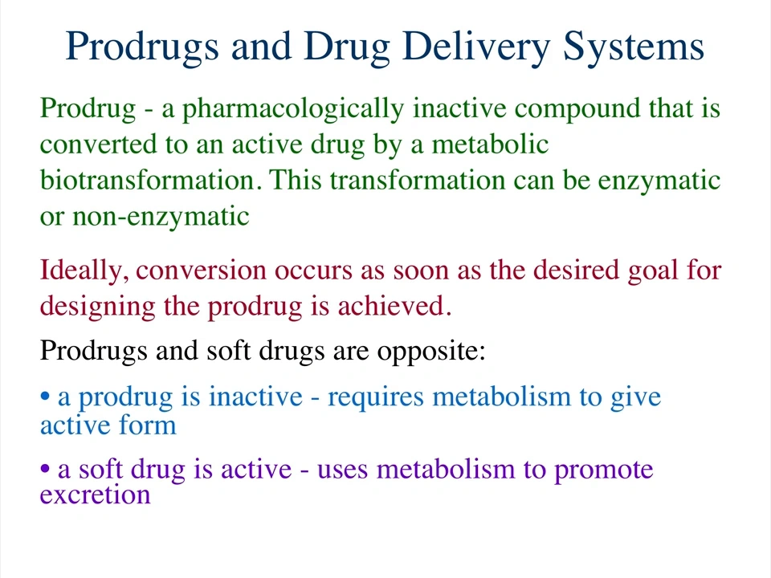
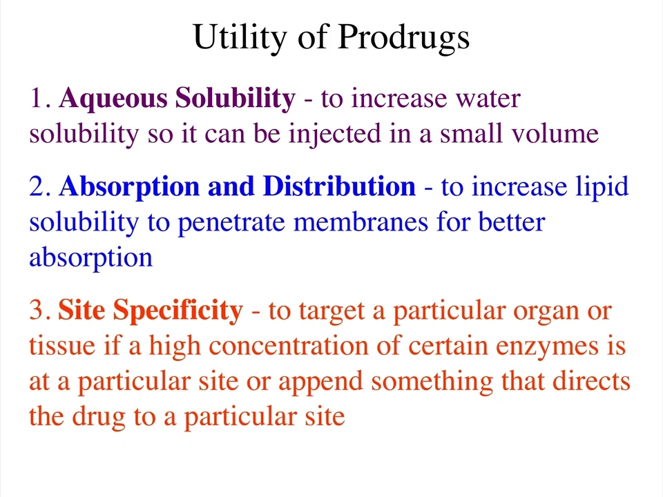
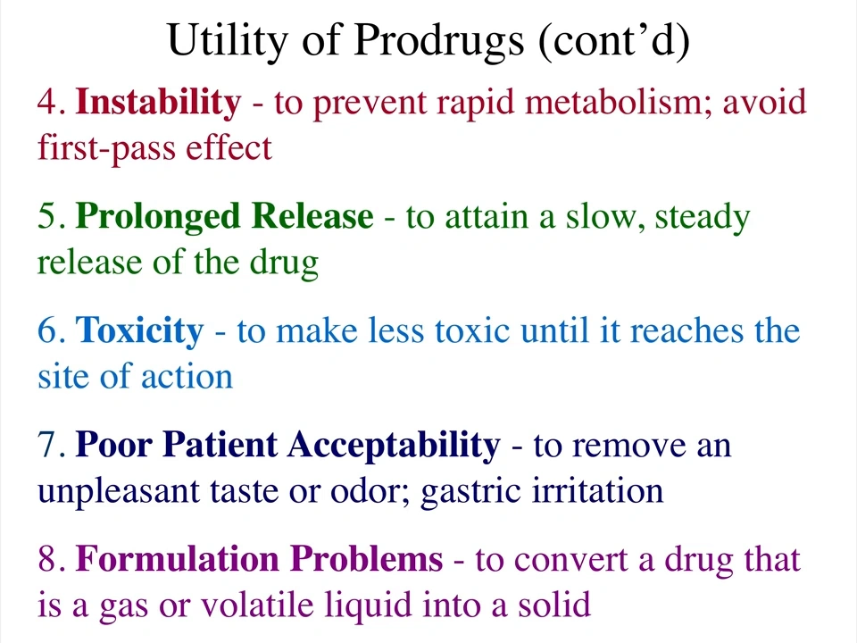
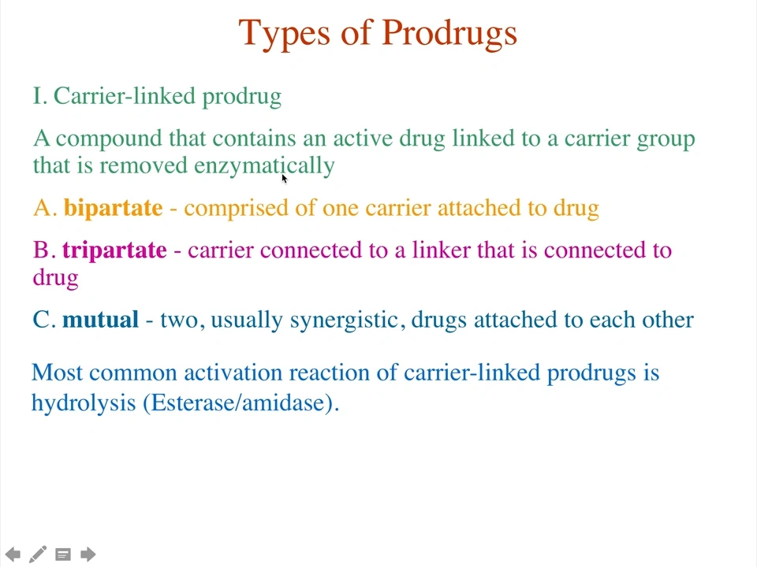
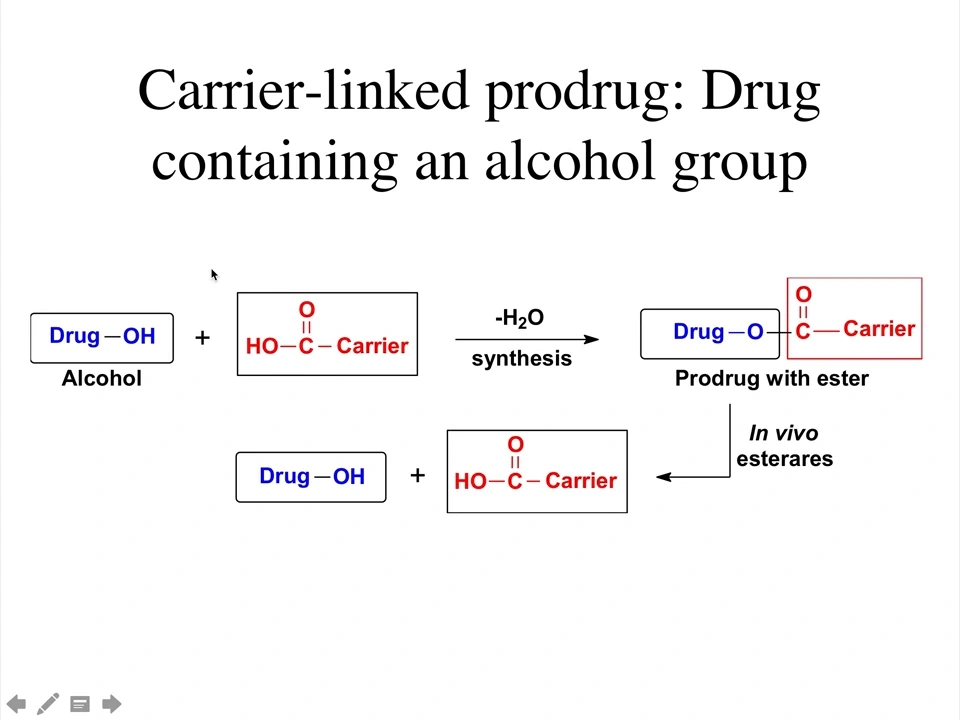
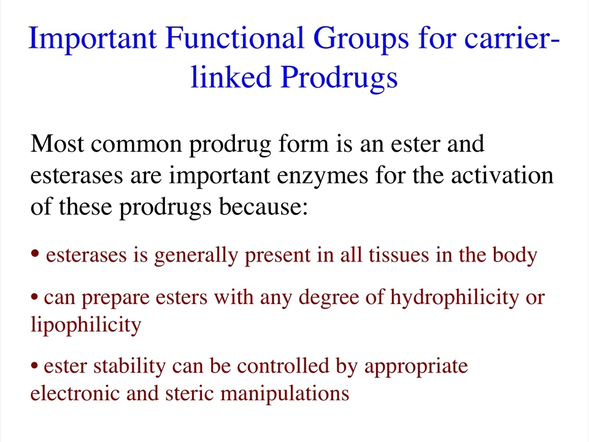
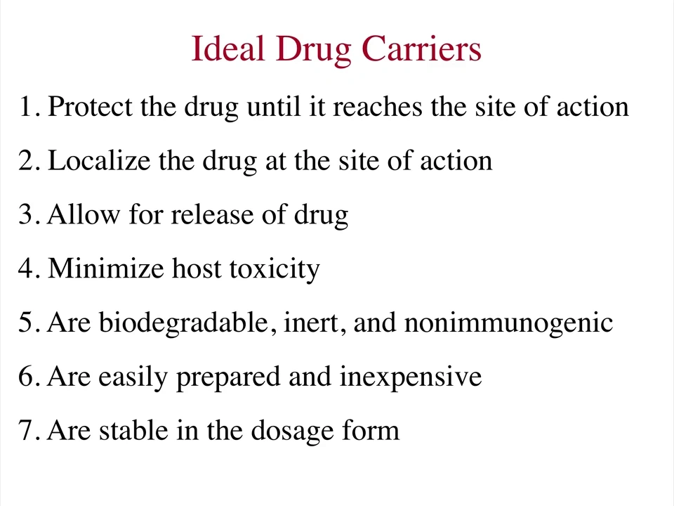
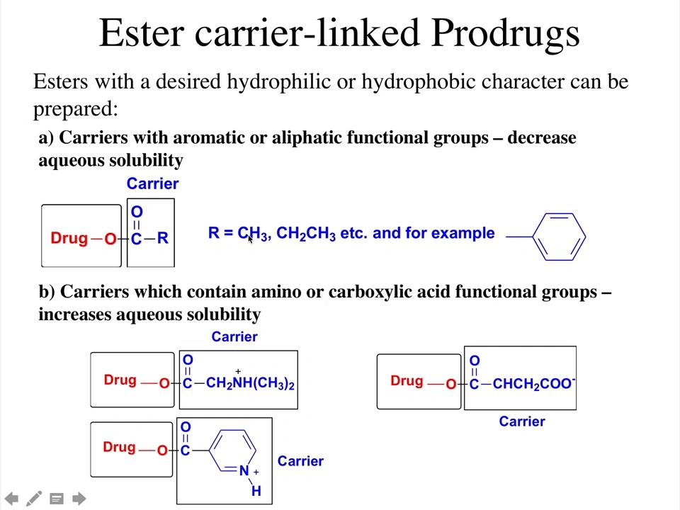
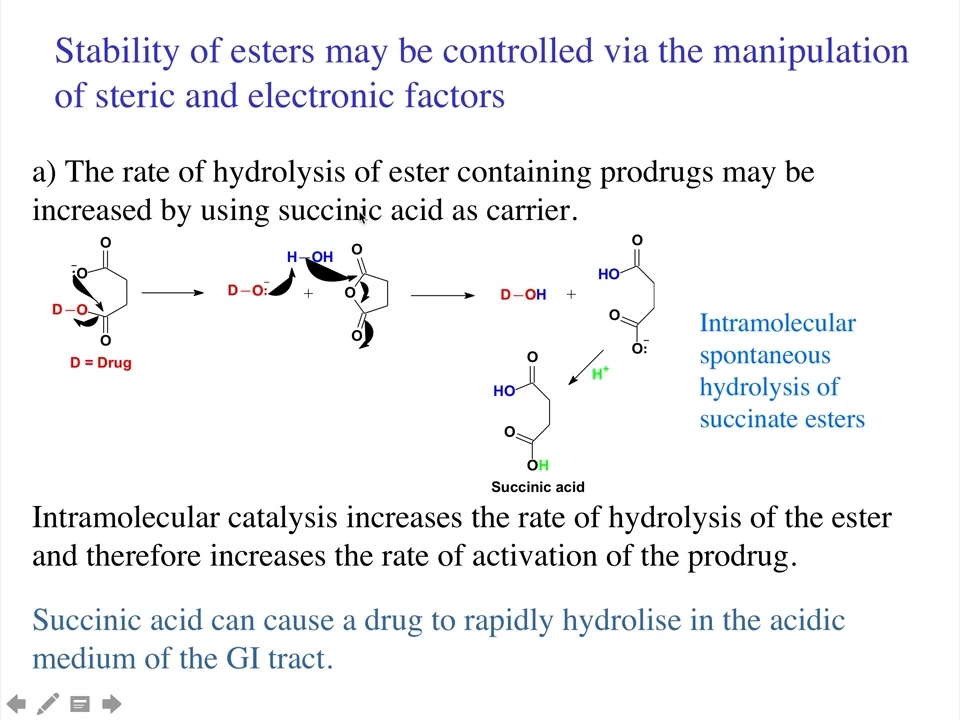
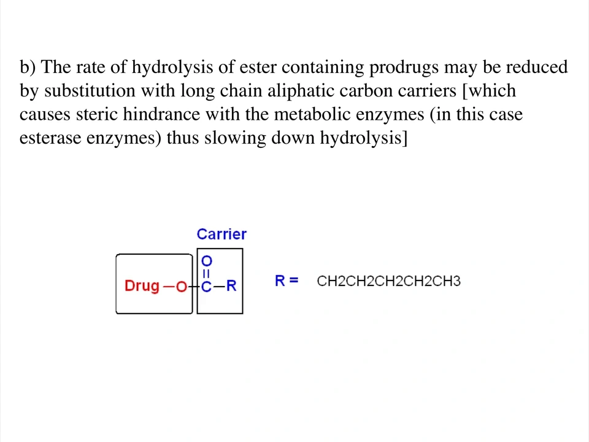

# 载体前药的四个旋钮：链长定脂溶性、可电离基团定水溶性、催化与位阻定释放快慢

> 视频来源：[Prodrug Lecture 1 - Drug Design and Discovery](https://www.youtube.com/watch?v=Nov-3-D6IKQ)（YouTube · Prof JJ，Drug Design and Medicinal Chemistry 课程）｜时长约 32 分钟
> 导读：这是药物设计课里「前药与递送系统」的第一讲，讲法偏工程：先给定义和八种用途，再讲载体前药与生物前药的分界，然后用整整一半时间讲**酯键前药怎么调**——链长、可电离基团、琥珀酸的分子内催化、长链位阻，四个旋钮各管一件事。本文按「是什么 → 为什么 → 怎么调」重排；前药的分类地图与大量上市药物案例见配套篇《前药把可及性缺陷改写成一段可剪断的化学键》，本文不重复。

## 本讲要解决的核心问题（SCQA）

**背景**：前药是一个已经被验证的策略——把一个有活性的药物暂时变成没有活性的前体，等它到达该到的地方再变回来。行业里大约 10% 的上市药物是前药，而且这个比例还在上升。

**冲突**：一旦决定「接一个载体」，马上会遇到一连串具体问题：接什么基团？接多长？接了之后水溶性会不会掉到没法做注射剂？前药会不会在货架上就水解掉？同样是酯键，为什么有的前药进肠道就断、有的能撑两周？

**疑问**：载体的哪些性质是可以被设计的？每一个性质换来什么、牺牲什么？

**回答（中心思想）**：酯类载体前药的释放行为由**载体的四个性质**决定——**链长与芳香性**决定脂溶性，**可电离基团**决定水溶性，**分子内催化**加快水解，**长链位阻**减慢水解。这四个旋钮互相牵制，所以前药设计从来不是「接个酯就完了」，而是在溶解度、渗透性、释放速度和货架期之间找一组能同时成立的参数。

## 一、前药与软药是相反的两件事

[【跳转到 00:00】](https://www.youtube.com/watch?v=Nov-3-D6IKQ&t=0)

讲者给出的定义很干脆：**前药是一个药理学上无活性的化合物，它通过代谢性生物转化转变为活性药物**。这个转化可以是**酶促**的（酯酶、酰胺酶），也可以是**非酶促**的——例如在胃肠道这样的酸性环境里直接水解。

定义之后紧接着是一条常被忽略的设计原则：

> 理想情况下，前药的转化应当**在设计的目的一达成时立刻发生**。

讲者用血脑屏障举例：如果你设计前药就是为了让它穿过血脑屏障、在中枢神经系统里起作用，那么你**不希望**它在到达之前就被代谢掉——它必须保持完整，直到穿过血脑屏障、进入中枢之后才被切断，释放出活性成分。这句话把前药设计从「化学问题」变成了「时空问题」：断键的位置和时机，和断键本身一样重要。

### 1.1 前药与软药：一个靠代谢变活，一个靠代谢变没

[【跳转到 03:20】](https://www.youtube.com/watch?v=Nov-3-D6IKQ&t=200)

讲者专门澄清了一对容易混淆的概念：

- **前药**：本身无活性，**需要代谢才能得到活性形式**；
- **软药**（soft drug）：本身**就是活性形式**，它利用代谢来促进排泄，而不是用来产生活性。

讲者的说法是「前药与软药正好相反」，并补充：目前市场上的大多数药物是软药，约 10% 是前药，但这个比例随着开发者用前药改善制剂与药代性质而上升。

这个区分在评估化合物时很实用：看到一个「代谢产物有活性」的分子，要先问它的**原型**有没有活性。原型有活性、代谢物也有活性，那是活性代谢物；原型无活性、代谢物才有活性，那才是前药。

## 二、八种用途：前药能修的八类缺陷

[【跳转到 05:50】](https://www.youtube.com/watch?v=Nov-3-D6IKQ&t=350)

讲者把前药的用途列成八条，并明确说这是一道可以考的长答题——每一条都要能配一个例子。这八条实际上就是一张「缺陷 → 对策」的对照表：

| 用途 | 要解决的缺陷 | 讲者的原话要点 |
| --- | --- | --- |
| 1. 水溶性 | 无法做成小体积静脉注射 | 提高水溶性，才能溶在水里注射 |
| 2. 吸收与分布 | 穿不过膜 | 提高脂溶性以穿透膜，改善吸收 |
| 3. 位点特异性 | 分布无选择性 | 若某处有高浓度的特定酶，或接上能导向该处的基团 |
| 4. 不稳定性 | 快速代谢、首过效应 | 防止快速代谢，避开首过效应 |
| 5. 缓释 | 释放太快 | 获得缓慢、平稳的释放 |
| 6. 毒性 | 到达靶点前就有毒性 | 让它在到达作用部位之前毒性更低 |
| 7. 依从性差 | 味苦、有臭味、胃刺激 | 去除不良味道或气味、减轻胃刺激 |
| 8. 剂型问题 | 是气体或挥发性液体 | 把气体或挥发性液体转成固体 |

第 4 条和第 5 条值得放在一起看：它们都关于「时间」，但方向相反。第 4 条要前药**别太快被代谢掉**（保护母体），第 5 条要前药**慢慢地释放**（控制母体出现的速度）。同一个酯键，靠不同的取代基可以分别实现这两种目标——这正是第六节的主题。

## 三、载体前药与生物前药：区别在有没有「载体」这一半

[【跳转到 10:00】](https://www.youtube.com/watch?v=Nov-3-D6IKQ&t=600)

讲者用一句话划出分界，并且强调这句话里最重要的词是「连接」：

- **载体前药**：含有**与载体基团相连**的活性药物，载体由酶促方式移除；
- **生物前药**：不是「活性药物 + 载体」，而是一个**经分子修饰代谢成新化合物**的化合物。

两者的差别不只是形式。载体前药的活化主要是**水解**——把一条连接键剪断，母体原样释放；生物前药的活化是**氧化或还原**——分子的官能团被改造，甚至加上或去掉碳原子，母体是被「改造」出来的。讲者特别强调：生物前药**不是简单地从分子上剪掉一个基团**。

讲者还给了一个便于记忆的说法：氧化是「往上加」，还原是「往下减」。

### 3.1 载体前药的三种接法

[【跳转到 11:40】](https://www.youtube.com/watch?v=Nov-3-D6IKQ&t=700)

载体前药按连接方式再分三类：

- **双部件**（bipartate）：一个载体直接连在药物上；
- **三部件**（tripartate）：载体连连接段，连接段再连药物，即「载体—连接段—药物」；
- **互惠前药**（mutual）：两个通常具有协同作用的药物彼此相连，**没有载体**，两边都是活性药物。

互惠前药是这三类里最特殊的一个：它不解决溶解度或渗透性，而是解决**两个药必须同时到达同一部位**的问题——把两个药连成一个分子，就保证了它们在同一时间、同一位置以接近的速率释放。

## 四、酯键是主战场：两个方向都能接

[【跳转到 20:00】](https://www.youtube.com/watch?v=Nov-3-D6IKQ&t=1200)

讲者指出，载体前药最常用的官能团是**醇和羧酸**，而这两者缩合得到的正是**酯**——因此酯是前药里最常见的形态。酯键有两个方向可以接：

- 药物带**醇/羟基**，就用带羧基的载体去酯化：`药物–OH + HOOC–载体 → 药物–O–CO–载体`；
- 药物带**羧基**，就用带羟基的载体去酯化：`药物–COOH + HO–载体 → 药物–CO–O–载体`。

两个方向的产物在体内都靠**酯酶**水解，把 O–C(=O) 这条键剪断，释放母药与载体。讲者用这张图把整个前药的生命周期串了一遍：合成（酯化）→ 制成制剂 → 给药 → 体内酯酶水解 → 母药在作用部位起效。

### 4.1 为什么偏偏是酯酶

[【跳转到 22:28】](https://www.youtube.com/watch?v=Nov-3-D6IKQ&t=1348)

讲者给了三条理由，说明酯酶为什么适合当「通用剪刀」：

1. **分布广**：酯酶几乎存在于全身所有组织。这意味着你可以先把酯设计好，等它到达某个器官或组织，那里的酯酶就会把它转成活性药物——不需要依赖某个只在肝脏表达的酶。
2. **亲疏水可调**：酯可以做成任意程度的亲水或亲脂。载体换一个，整个前药的分配性质就跟着变。
3. **稳定性可调**：酯的稳定性可以通过电子效应与位阻效应来调控。

第 2、3 条就是本文后面两节的全部内容。讲者在这里先埋了伏笔，然后才展开讲「怎么调」。

## 五、什么样的载体算合格：七条标准

[【跳转到 15:50】](https://www.youtube.com/watch?v=Nov-3-D6IKQ&t=950)

在讲具体调法之前，讲者先给了理想载体的七条标准。这份清单的价值在于：它同时约束了化学、生物学和工业生产三个层面。它与配套篇里那堂课的「五条标准」讲的是同一件事，只是把工业与制剂层面的要求（易制备、成本低、剂型稳定）单独列了出来。

1. 在药物到达作用部位之前**保护**它；
2. 把药物**定位**在作用部位（例如带它穿过血脑屏障进入中枢）；
3. **允许**药物被释放——不能稳定到连到了靶点都不水解；
4. **尽量减少宿主毒性**；
5. 可生物降解、惰性、无免疫原性；
6. 易于制备、成本低；
7. **在剂型中稳定**。

第 3 条与第 7 条看起来矛盾，其实是同一个问题的两端：**载体必须在体外足够稳定、在体内足够不稳定**。讲者对第 7 条的解释很具体——载体要能保证 12 到 24 个月的货架期；如果它在剂型里就发生化学反应、降解，活性药物可能在给患者之前就已经被释放出来了，那这个前药策略从一开始就失效了。

第 6 条也常被低估。讲者提醒：把一个新药推向市场要花 10 亿到 20 亿美元，如果载体本身制备困难、价格昂贵，这笔成本会直接叠加到最终药物上。

## 六、四个旋钮：把释放行为调到手

### 6.1 旋钮一：链长与芳香性决定脂溶性

[【跳转到 24:08】](https://www.youtube.com/watch?v=Nov-3-D6IKQ&t=1448)

讲者从同系物（homology）的规律讲起：分子里碳越多，亲脂性越强。所以载体上的 R 基就是一根「脂溶性刻度尺」：

- R = 甲基（–CH₃）时，前药只多了一个碳，水溶性下降有限；
- R 换成乙基、丙基、丁基……一路加到 10 个碳，亲脂性显著上升；
- R 换成芳香基（如苯环），因为碳数多，同样会大幅提高脂溶性。

含芳香或脂肪族官能团的载体因此被用来**降低水溶性、提高脂溶性**。讲者给出的应用场景很直接：如果药物的问题是水溶性太好、穿不过膜，就用这一类载体把它往亲脂方向拉。

### 6.2 旋钮二：可电离基团决定水溶性

同一个 R 位置，换成带可电离基团的载体，效果就反过来。讲者给了三类：

- **氨基**：在生理 pH 下会被质子化，带正电，提高水溶性。讲者举的结构是 `–CO–CH₂NH⁺(CH₃)₂` 与吡啶鎓（吡啶环上的 N 被质子化）；
- **羧酸**：在生理 pH 下去质子化，带负电，提高水溶性，例如 `–CO–CH₂CH₂COO⁻`；
- **硫酸酯与磷酸酯**：同样靠电离提高水溶性。

[【跳转到 28:18】](https://www.youtube.com/watch?v=Nov-3-D6IKQ&t=1698)

讲者的逻辑很干净：**分子在生理 pH 下被质子化或电离，水溶性就会提高**。他甚至把这条规律和前面课程里的美托洛尔例子接了起来——同一个分子，质子化与否决定了它在不同 pH 下的水溶性。这对制剂的意义是：如果一个前药的水溶性足够高，它就能被做成水溶液、以较小体积静脉注射；进入体内后再由酯酶水解释放母药。

于是第 6.1 与 6.2 两节合起来给出了一个清晰的二分法：

| 想要什么 | 选什么载体 | 代价 |
| --- | --- | --- |
| 更高的脂溶性、更好的膜通透 | 长链脂肪族或芳香族载体 | 水溶性下降，可能做不成注射剂 |
| 更高的水溶性、可做成注射剂 | 带氨基、羧酸、磷酸或硫酸酯的载体 | 脂溶性下降，被动扩散变差 |

这就是 2.1.2 里 logP 与 logD 的实操版：前药并不改变母体的固有亲脂性，它改变的是**给药那一刻分子呈现的亲脂性**。

### 6.3 旋钮三：分子内催化让水解变快

[【跳转到 29:08】](https://www.youtube.com/watch?v=Nov-3-D6IKQ&t=1748)

如果嫌酯水解得太慢，可以用**琥珀酸**（succinic acid）做载体。讲者给出的机制是**分子内催化**：琥珀酸酯水解时，同一个分子上另一个游离羧基就近参与，把水解速率提上去；随后琥珀酸自身也迅速水解。

讲者给的应用场景是「需要快速释放」的场合：如果你只是想把一个油状或挥发性的东西暂时变成固体以便做成剂型，进入体内又希望它**在胃肠道里就迅速水解**，那么琥珀酸载体正合适——它能让药物在胃肠道的酸性介质中快速水解。

### 6.4 旋钮四：长链位阻让水解变慢

[【跳转到 30:48】](https://www.youtube.com/watch?v=Nov-3-D6IKQ&t=1848)

反方向的操作是：在酯键周围堆上**长链脂肪族碳**，制造位阻，让酯酶不容易靠近并攻击羰基，水解因此变慢。

讲者明确说这是**缓释**的做法：如果希望药物在几天甚至几周里慢慢释放，就用这个办法把酯保护起来、避开酯酶。

### 6.5 四个旋钮的相互关系

把四个旋钮放在一起，会发现它们不是正交的，而是**两两耦合**：

- 链长和位阻是同一根链的两个后果：链越长，脂溶性越高，但位阻也越大、水解越慢。想「更亲脂但释放更快」不能靠加长同一根直链实现。
- 可电离基团和脂溶性直接对冲：接一个氨基能提高水溶性，但同时把亲脂性拉下来。
- 琥珀酸提供的是**独立于链长的加速通道**，因为它的加速来自分子内催化，而不是来自链长。

所以实际设计时，通常是先确定「要解决哪一个缺陷」（第二节的八条用途），再选一个主旋钮，最后用其余旋钮做补偿。这也解释了为什么前药优化往往要合成一系列同系物：**可调参数是连续的，但可接受窗口很窄**。

## 七、两个容易被忽略的硬约束

### 7.1 货架期：前药必须在体外「不反应」

讲者在理想载体标准里提到 12–24 个月的剂型稳定性。这一条对酯类前药尤其关键：酯在含水制剂里会发生水解，如果水解速率在储存温度下就不可忽略，那么**药品的有效含量会随货架期下降**，同时降解产物还会带来安全性问题。所以「体内断得快」和「体外放得久」必须同时成立，这也是为什么第 6.3 节的琥珀酸载体只适合「做成固体、进入体内再快速水解」的场景。

### 7.2 剂量与效价：前药不是「等量替换」（补充）

这一条讲者没有展开，但它直接来自前药的化学计量关系，属于本文补充：前药的分子量大于母体，相同质量所含的母体摩尔数更少；如果转化不完全，实际暴露还要再打折。因此前药的剂量、血药浓度与暴露参数必须以**母体**为基准报告，否则不同前药之间、前药与母药之间都无法比较。这条约束在 2.2.6 讲生物利用度与浓度-时间曲线时会再次出现。

## 小结

- 前药是**药理学无活性、经代谢转化才产生作用**的化合物；软药相反，本身有活性、靠代谢排泄。约 10% 的上市药物是前药。
- 转化的**时机**和转化的**位置**同样重要：设计来穿血脑屏障的前药，必须保持完整直到穿过屏障。
- 载体前药靠**水解**剪断连接键（酯酶、酰胺酶），生物前药靠**氧化或还原**改造分子；后者不是简单地剪掉一个基团。
- 载体前药分双部件、三部件、互惠三类；互惠前药没有载体，两边都是活性药物。
- **酯**是最常见的前药形态，醇与羧酸两个方向都能接；酯酶遍布全身、亲疏水可调、稳定性可调，因此适合当通用剪刀。
- 理想载体的七条标准里，最容易被忽略的是「**在剂型中稳定 12–24 个月**」——前药必须在体外足够稳定、在体内足够不稳定。
- 四个旋钮：**链长/芳香性**调脂溶性，**可电离基团**调水溶性，**琥珀酸的分子内催化**加速水解，**长链位阻**减慢水解。它们两两耦合，可接受窗口很窄。

## 关键术语速查

| 术语 | 一句话解释 |
| --- | --- |
| 前药 | 药理学无活性、经酶促或非酶促转化才释放活性药物的化合物 |
| 软药（soft drug） | 本身就是活性形式，利用代谢促进排泄而非产生活性 |
| 载体前药 | 活性药物与载体基团共价相连，靠水解剪断连接键释放母药 |
| 生物前药 | 无载体，经氧化或还原等分子修饰转变为活性药物 |
| 双部件 / 三部件前药 | 载体直接连药物 / 载体经连接段再连药物 |
| 互惠前药（mutual prodrug） | 两个活性药物彼此相连，无载体，靠水解同时释放 |
| 酯酶 / 酰胺酶 | 水解酯键与酰胺键的酶，是载体前药最常见的活化酶 |
| 同系物（homology） | 结构只差若干个 CH₂ 的一系列化合物，碳链越长亲脂性越强 |
| 分子内催化 | 同一分子内的邻近基团参与反应从而加速水解，如琥珀酸酯 |
| 位阻（steric hindrance） | 空间上挡住酶与反应中心接触，从而减慢水解 |
| 货架期 | 制剂在规定条件下保持合格的时间，前药需 12–24 个月剂型稳定 |