# 一条浓度时间曲线能读出什么：非房室分析、梯形法与一室二室模型

> 视频来源：[Multicompartmental Pharmacokinetic Modeling](https://www.youtube.com/watch?v=H8d7MoNM6t0)（YouTube · NIH 临床中心临床药理学系列讲座，讲者 Scott Penzak，奥本大学 Harrison 药学院）｜时长约 52 分钟
> 导读：这是一支讲「怎么把一条曲线变成参数」的方法课。前半段用非房室分析（NCA）把曲线压成 Cmax、Tmax、AUC、λz、CL、t½ 六个数字，后半段用一室与二室模型解释这条曲线为什么长成这个样子。本文只讲曲线判读与模型选择，代谢酶、蛋白结合与 ADMET 全景不在此重复。

## 本讲要解决的核心问题（SCQA）

**背景**：给一个人给药，然后按时间点抽血，测出血浆药物浓度，把点连起来就得到一条浓度—时间曲线。在 [2.2.1](../2.2.1_ADMET：吸收、分布、代谢、排泄与毒性/药物在体内的五道关卡：ADME%20流程、生物利用度与失败率.md) 里，我们已经用两条曲线下的面积之比算过生物利用度 $F$。

**冲突**：同一条曲线，换一种算法，得到的表观分布体积可以差好几倍；同一个「半衰期」，指的是分布相还是消除相，含义完全不同；更麻烦的是，非房室分析给出的所有数字都只描述**这一次观测到的**曲线，它没法回答「换成肾功能不全的病人会怎样」。

**疑问**：一条曲线到底能读出哪些参数？每个参数背后压着什么假设？什么情况下必须从「读曲线」升级到「建模型」？

**回答（中心思想）**：一条曲线先能被压成一组**不需要模型假设**的描述性参数（$C_{\max}$、$T_{\max}$、AUC、$\lambda_z$、$CL$、$t_{1/2}$），这批数字足够做生物等效性与暴露比较；但要回答「药在体内怎么分布、能不能外推」，就必须换成房室模型——而房室模型做的事，是把一条曲线**切成分布相与消除相**，再用两个斜率、两个截距换算出各房室的体积与转运速率。

## 一、非房室分析：先把曲线压成一组数

非房室分析（noncompartmental analysis，NCA）是药代动力学里最常用、也最简单的做法。讲者一开始就点明它的立场：**它不基于任何生理假设，也不假设任何特定的模型结构**，只是把观测到的数据画出来、代进公式、算出结果 [【跳转到 03:32】](https://www.youtube.com/watch?v=H8d7MoNM6t0&t=212)。

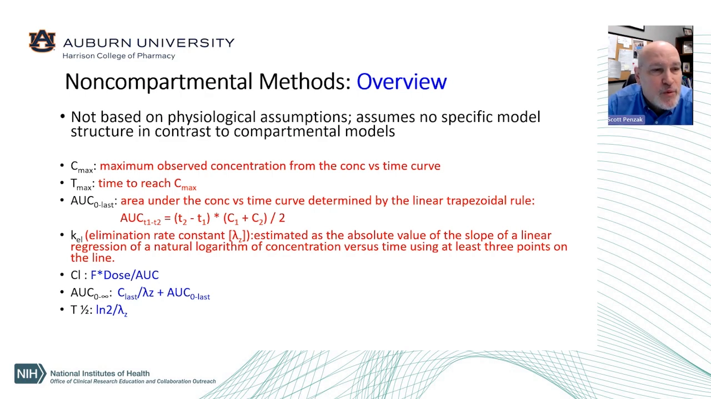

### 1.1 四个直接读出来的量

这张幻灯片上的参数可以分成两类。第一类是**直接从曲线上读**的：

- $C_{\max}$：观测到的最高浓度。注意是浓度本身的最高点，不是对数浓度的最高点；
- $T_{\max}$：达到 $C_{\max}$ 的时间；
- $\mathrm{AUC}_{0\text{-last}}$：从 0 到最后一个采样点的曲线下面积，用**线性梯形法**算；
- $k_{el}$（也叫 $\lambda_z$）：消除速率常数，由「浓度的自然对数对时间」做线性回归，取斜率的绝对值，**至少要用直线上的三个点**。

梯形法的公式很朴素，把曲线切成一个个梯形，逐个算面积再加起来：

$$
\mathrm{AUC}_{t_1 \to t_2} = \frac{(t_2 - t_1)(C_1 + C_2)}{2}
$$

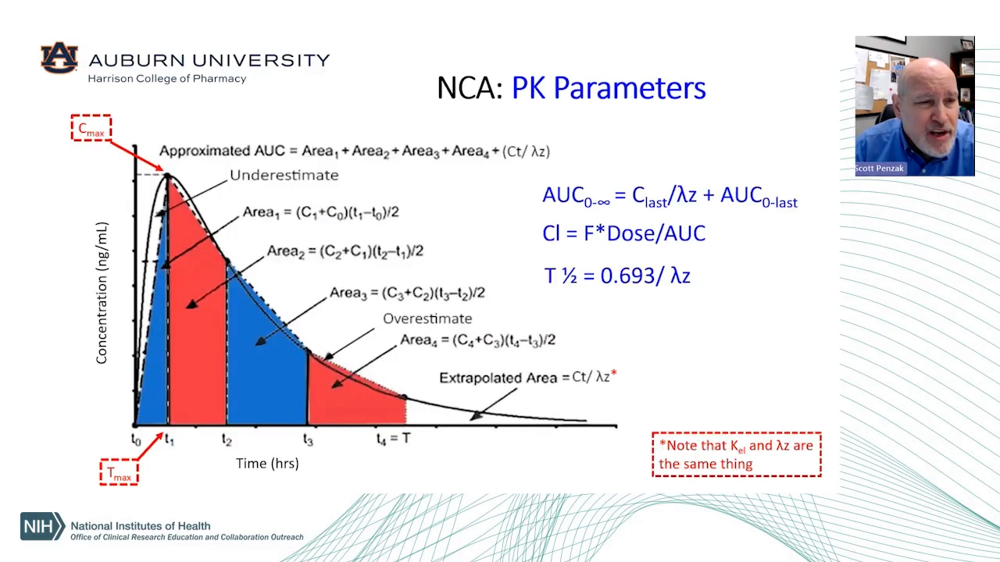

这张图值得逐块看，因为它把梯形法的**两处系统误差**画在了同一张图上：

- **峰附近会低估**：真实曲线在峰顶是弯的，梯形法用直线连点，直线走在曲线下方，所以峰顶那一块被切掉了一角，图上标着 Underestimate；
- **尾段会高估**：采样点越稀疏，梯形越"胖"；图上标着 Overestimate 的那几块红色区域就是这么来的。

讲者的原话是：非房室分析画的是直线，而真实曲线是弯的，所以「你漏掉了一部分曲线」，这里就有一点不准确 [【跳转到 04:54】](https://www.youtube.com/watch?v=H8d7MoNM6t0&t=294)。

### 1.2 尾段外推：把 AUC 补到无穷

最后一个采样点之后还有面积，这部分靠外推。做法是拿最后一个浓度除以消除速率常数：

$$
\mathrm{AUC}_{0 \to \infty} = \mathrm{AUC}_{0\text{-last}} + \frac{C_{\text{last}}}{\lambda_z}
$$

这一步成立的前提，是假设尾段已经进入**纯消除**、浓度按单指数下降。如果采样时间不够长、还没看到真正的终末相，这个外推就会失真——这也是后面要讲的「长半衰期药物难以用 NCA 描述」的根源。

### 1.3 三个算出来的量

第二类参数不是读出来的，而是**算出来**的。讲者把它们称为"真正的药代参数"之外的派生量：

$$
CL = \frac{F \cdot \text{Dose}}{\mathrm{AUC}}
$$

$$
t_{1/2} = \frac{\ln 2}{\lambda_z} \approx \frac{0.693}{\lambda_z}
$$

这里有一个必须停一下的细节：**清除率的公式里带着 $F$**。也就是说，NCA 并不能自己把清除率算出来，它必须先从别处拿到生物利用度。静脉给药时 $F=1$，问题消失；口服给药时，$F$ 和 $CL$ 在这一条式子里是纠缠在一起的，只靠一条口服曲线无法同时定出两者。

> **补充（非讲者原话）**：正因为如此，口服给药算出来的那个量严格说叫「表观清除率」$CL/F$，单位是体积除以时间，但含义是「按进入体循环的比例折算后的清除能力」。同理，口服曲线算出的分布体积叫「表观分布体积」$V/F$。这也是为什么同一个药静脉与口服两条曲线给出的 $V_d$ 不能直接对比。

### 1.4 NCA 的边界：能比等效性，不能做外推

讲者用一整页幻灯片列了 NCA 的优缺点 [【跳转到 07:14】](https://www.youtube.com/watch?v=H8d7MoNM6t0&t=434)。

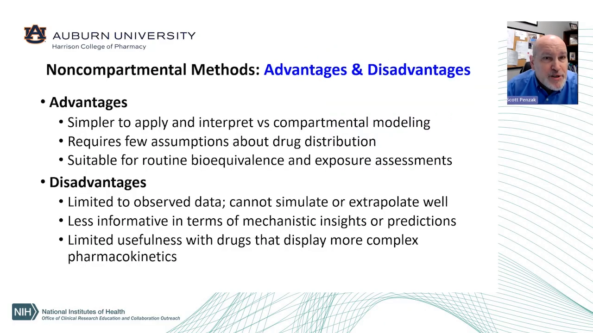

优点三条：比房室模型更容易应用和解释；对药物分布几乎不做假设；**适合常规的生物等效性评价与暴露评估**。

缺点三条：**只能描述已观测到的数据**，不能模拟、不能外推；机制信息少，做不了预测；对药代行为复杂的药物（分布体积很大、终末半衰期很长）适用性有限。

最后一条值得展开。为什么"$V_d$ 大、$t_{1/2}$ 长"会让 NCA 失灵？因为这类药的曲线尾段极长，采样窗口内根本看不到完整的消除相，$\lambda_z$ 估不准，外推的尾面积就会占 AUC 的很大一块，于是所有派生参数一起漂移。讲者后来在讲缓释制剂时举的例子，就是胺碘酮这类半衰期极长的药。

## 二、一室模型：把身体当成一只桶

从这一节开始，思路换了：不再问"曲线上有什么"，而是问"什么样的体内过程会产生这样一条曲线"。

房室模型的基本立场是：**把身体表示成若干个互相连通的房室**，参数包括分布体积 $V_d$ 与房室间转运速率（$k_{12}$、$k_{21}$），常见的形式有一室、二室、三室；求解方式是**把数据拟合到微分方程**上，用方程描述药物在各房室之间的移动 [【跳转到 08:29】](https://www.youtube.com/watch?v=H8d7MoNM6t0&t=509)。

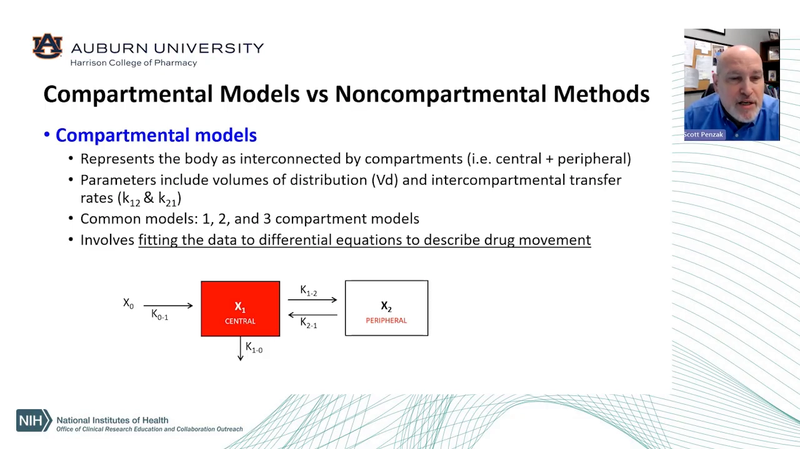

读这张图有两个约定要记住：**下标 0 表示体外**（$X_0$ 是还没给进去的剂量，$K_{1\to 0}$ 是排出体外，讲者说"把 $K_{1\to 0}$ 想成肾脏"）；**下标顺序表示方向**（$K_{1\to 2}$ 是从中央室去周边室，$K_{2\to 1}$ 是回来）。口服给药时还多一条 $K_{0\to 1}$，即吸收速率常数。

### 2.1 一室模型的假设：快速平衡

一室模型是最简形式，它的假设只有一句话：**药物进入体内后迅速均匀分布**，全身可以当作一个均相的房室。讲者的比喻是"把身体想成一只大桶，桶上有一个出口把药取走" [【跳转到 12:14】](https://www.youtube.com/watch?v=H8d7MoNM6t0&t=734)。

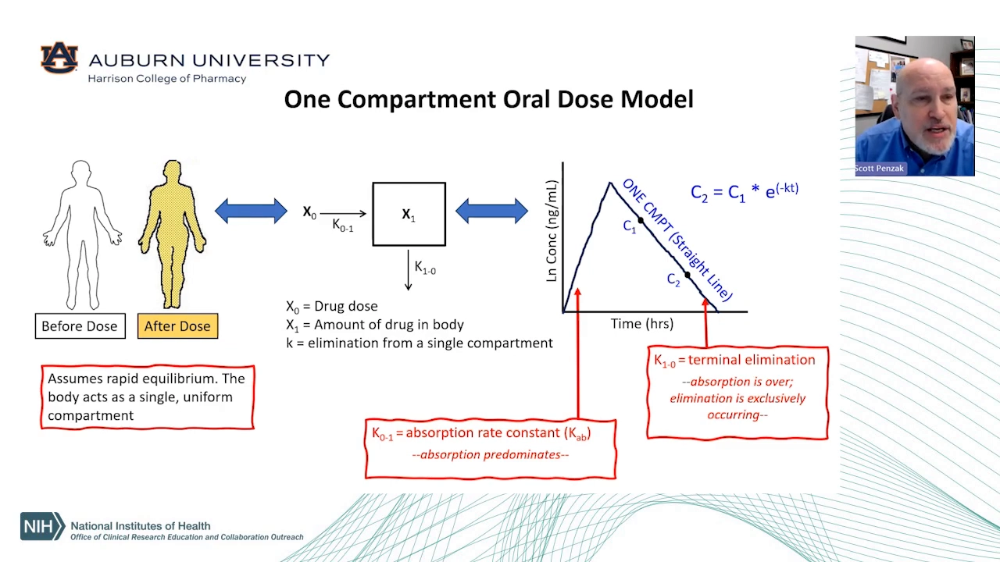

这张图把一室模型的全部内容放在了一页上。左边是"给药前/给药后"两个人体剪影，中间是 $X_0 \to X_1 \to$ 体外 的方框图，右边是对数浓度—时间图。

关键在右边那条直线。一室模型下浓度按单指数衰减：

$$
C_2 = C_1 \cdot e^{-k(t_2 - t_1)}
$$

因为只有一个指数项，所以半对数图上只有**一条斜率**，这种曲线叫单指数曲线。讲者给了一个具体例子：如果半衰期是 1 小时，那么每小时浓度正好减半，$t_{1/2} = 0.693/k$ 反推出 $k$，再代回上式就能预测未来任何时刻的浓度 [【跳转到 13:04】](https://www.youtube.com/watch?v=H8d7MoNM6t0&t=784)。

图上的两个红框还标出了曲线的两个阶段：$K_{0\to 1}$ 主导的**吸收相**（曲线上升）和 $K_{1\to 0}$ 主导的**消除相**（吸收结束，只剩一条直线往下走）。口服曲线之所以先升后降，就是因为这两个过程在时间上错开了。

### 2.2 一室模型的软肋

一室模型的问题不在数学，而在那个"迅速均匀分布"的假设。讲者在后面反复回到这一点：**很多药物并不会均匀、瞬时地分布到全身**，一室模型把身体当成一个均相空间，是一种过度简化 [【跳转到 43:23】](https://www.youtube.com/watch?v=H8d7MoNM6t0&t=2603)。一旦药物先进入血流丰富的器官、再慢慢渗进脂肪和肌肉，曲线就会出现第二个斜率——这就是二室模型要处理的事。

## 三、二室模型：曲线上的折点从哪来

二室模型把身体分成两个房室：**中央室**是血流丰富、药物先到达的器官（血、肝、肾等），**周边室**是血流较少、药物后到达的组织（脂肪、肌肉等）[【跳转到 21:24】](https://www.youtube.com/watch?v=H8d7MoNM6t0&t=1284)。

### 3.1 微常数与宏常数

讲者在这里做了一个术语区分，很实用：药物**在房室之间移动**的速率常数（$k_{12}$、$k_{21}$）叫**微常数**（microconstants）；药物**排出体外**的那个速率常数叫**宏常数**（macroconstant），因为它是整个系统对外的总出口。

### 3.2 曲线上的四个时刻

二室模型最直观的一页，是把一条曲线上的四个点与体内发生的事一一对应起来。讲者说这是他毕业、做完住院药师培训之后才看到的一张幻灯片，"如果早一点有人给我看这张图就好了" [【跳转到 17:14】](https://www.youtube.com/watch?v=H8d7MoNM6t0&t=1034)。

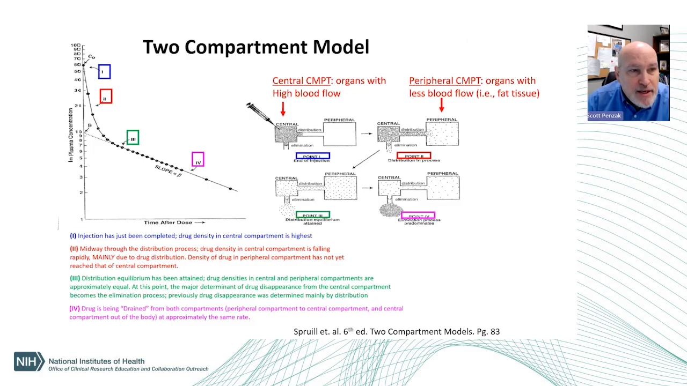

四个时刻分别是：

- **I（刚注射完）**：药物几乎全部在中央室，刚开始向周边室分布，此时已经有少量在排出，但**驱动浓度下降的主力是分布**；
- **II（分布中途）**：中央室浓度快速下降，主要是被分布"抽走"的；周边室浓度还没追上中央室，两边**尚未平衡**；
- **III（分布平衡）**：两个房室的药物密度大致相等。这是一个转折点——从此**决定中央室药物消失的主要因素不再是分布，而是消除**；
- **IV（终末相）**：药物从两个房室被"抽干"，周边室回中央室、中央室排出体外，两个方向的速率大致相同，曲线进入最后那条斜率。

这张图解释了一个初学者常见的困惑：为什么二室模型的曲线前半段降得那么快、后半段又慢下来。**前半段的快不是因为药被清除了，而是因为它躲进了组织里**。

### 3.3 α 与 β：两个斜率、两个截距

把这条曲线画成半对数图，就能看到两条斜率 [【跳转到 23:04】](https://www.youtube.com/watch?v=H8d7MoNM6t0&t=1384)。

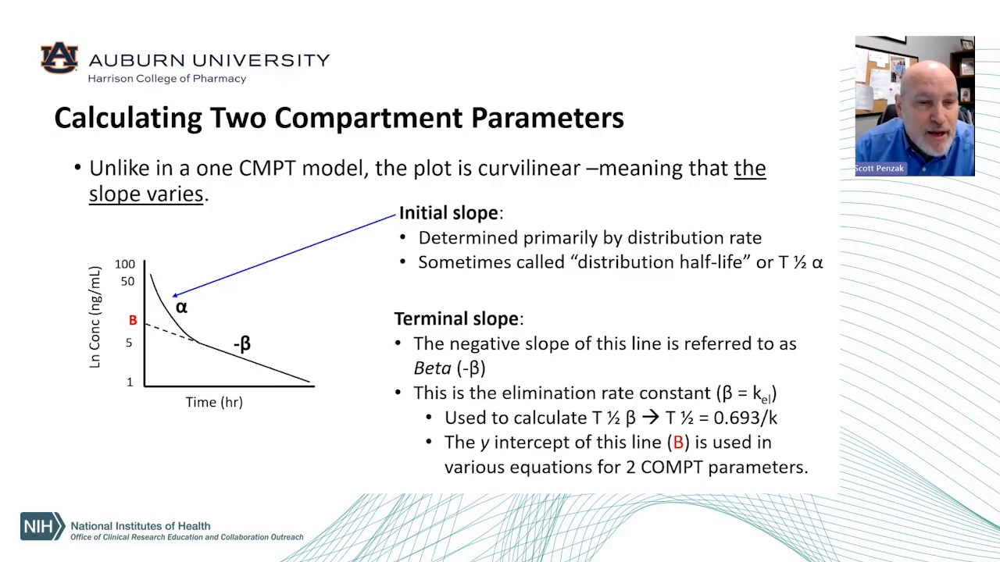

- **初始斜率**由分布速率决定，有时被非正式地叫作"分布半衰期"或 $T_{1/2}\alpha$；
- **终末斜率**的负值记作 $\beta$，它**就是消除速率常数**（$\beta = k_{el}$），用来算终末半衰期 $T_{1/2}\beta = 0.693/k$；
- 终末直线**外推回 Y 轴的截距**记作 $B$，这个 $B$ 会进入二室模型的各种公式。

讲者特别提醒：一室模型只有一条斜率，二室模型有两条，这是判断"该用几个房室"最直观的线索。

### 3.4 残数法：把分布相"减"出来

有了 $\beta$ 和 $B$，怎么拿到 $\alpha$ 和 $A$？办法是**残数法**（method of residuals），也叫**曲线剥离**（curve peeling）[【跳转到 24:19】](https://www.youtube.com/watch?v=H8d7MoNM6t0&t=1459)。

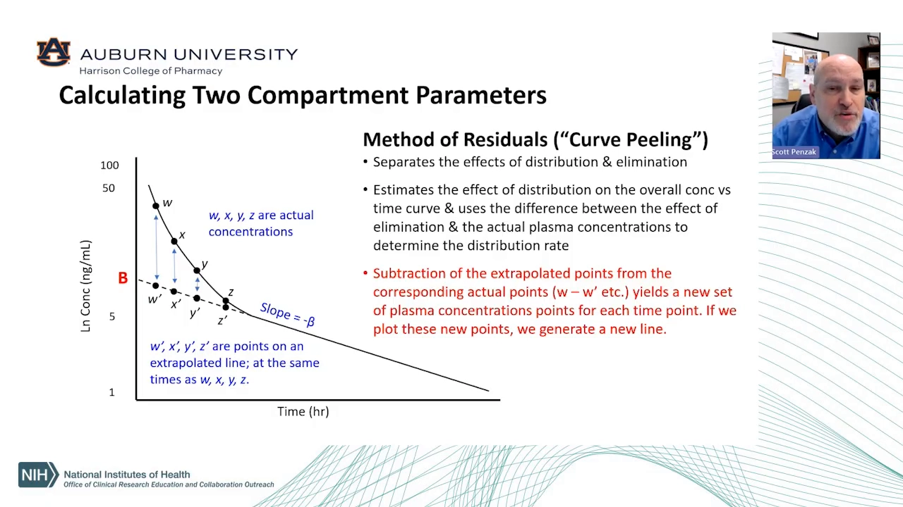

步骤是这样的：在早期时间点 $w, x, y, z$ 上，实测浓度是实心点；把终末直线外推到同样的时间点，得到 $w', x', y', z'$；**用实测值减去外推值**，得到一组新的浓度点；把这组新点画出来，又得到一条直线。

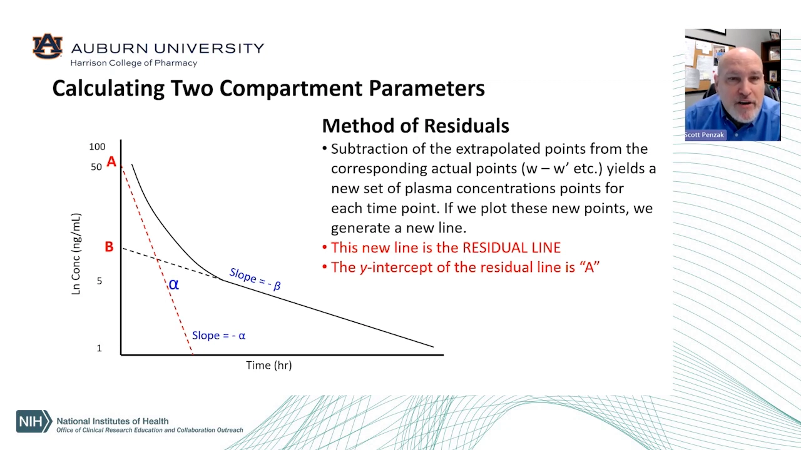

这条新线叫**残数线**，它的斜率是 $-\alpha$，截距是 $A$。讲者的比喻是"像剥掉曲线的一层皮"，把消除那一层剥掉，剩下的就是分布。计算机程序（WinNonlin 之类）做的就是这件事，只不过它是自动迭代的。

### 3.5 分布体积不止一个

拿到 $A$、$B$、$\alpha$、$\beta$ 之后，可以算体积了。讲者用最朴素的思路引入：浓度等于剂量除以体积，所以体积等于剂量除以浓度 [【跳转到 28:29】](https://www.youtube.com/watch?v=H8d7MoNM6t0&t=1709)。

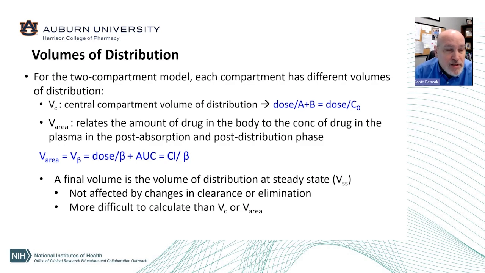

$$
V_c = \frac{\text{Dose}}{A + B} = \frac{\text{Dose}}{C_0}
$$

$$
V_{\text{area}} = V_\beta = \frac{\text{Dose}}{\beta \cdot \mathrm{AUC}} = \frac{CL}{\beta}
$$

$$
V_{ss} = \text{稳态时的分布体积}
$$

三者的区别在于**问的是哪个时刻的体积**：$V_c$ 是刚注射完那一瞬间的中央室体积，$V_{\text{area}}$ 是把终末相外推得到的"表观"体积，$V_{ss}$ 是分布平衡后的总体积。讲者的评价很直接：$V_c$ 最好算，$V_{\text{area}}$ 的公式开始变复杂，$V_{ss}$ 最难算，但它**不受清除率或消除变化的影响**，因此是三者中物理意义最干净的一个。

## 四、模型好不好：残差、R² 与信息准则

建完模型必须回答一个问题：这个模型描述数据描述得好不好？讲者给了从"看图"到"算指标"的三层做法 [【跳转到 33:29】](https://www.youtube.com/watch?v=H8d7MoNM6t0&t=2009)。

**第一层是看图**。实测浓度是红圈，模型预测是蓝线，理想情况是蓝线穿过每一个红圈。**第二层是看残差**：残差就是实测值减预测值，把残差对时间或对预测值作图，理想情况应该没有系统趋势。

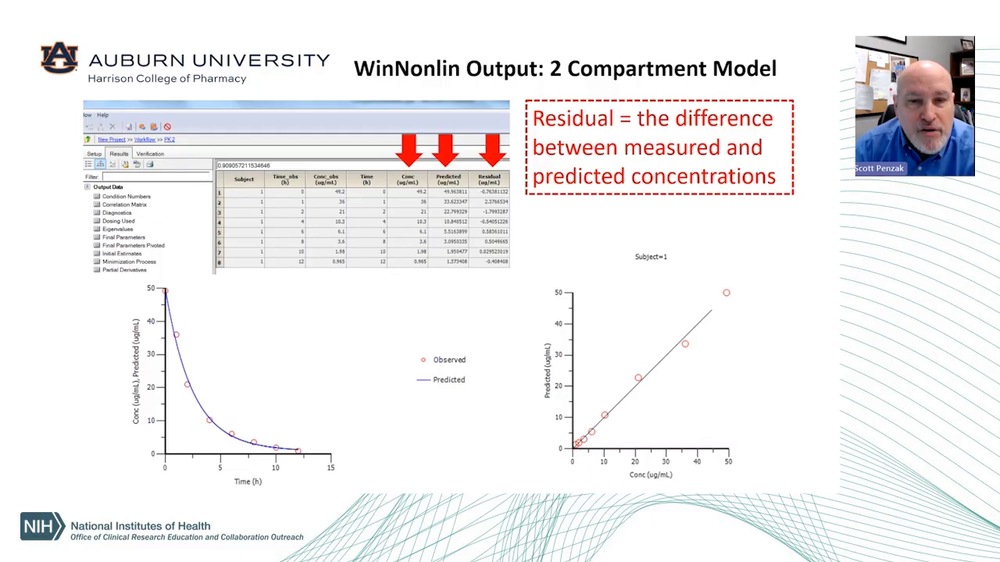

**第三层是算指标**。讲者列了三个最常被报告的：

| 指标 | 含义 | 判读方向 |
| --- | --- | --- |
| 相关系数 Corr | 实测值与预测值的相关性 | 越接近 1 越好 |
| AIC | 拟合优度与模型复杂度之间的折中 | 越低越好，但**只能在同一数据集内比较** |
| SBC / BIC | 与 AIC 类似，但对参数个数惩罚更重 | 越低越好，样本量大时更适用 |

讲者给了一组真实的对照数字：拟合好的那个受试者 Corr 为 0.9976、AIC 为 26.829、SBC 为 27.147；拟合差的 Corr 为 0.9613、AIC 为 47.952、SBC 为 50.377 [【跳转到 39:19】](https://www.youtube.com/watch?v=H8d7MoNM6t0&t=2359)。

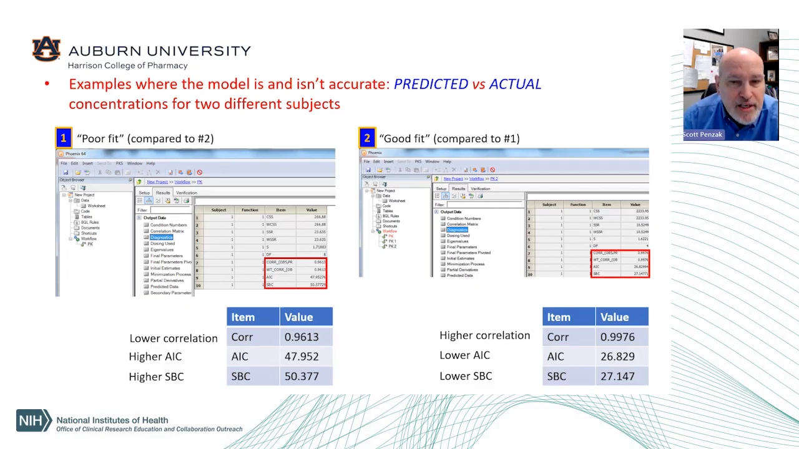

关于 AIC 有一条容易被误用的规则，讲者专门强调：**AIC 的绝对数值没有意义**。一项研究的 AIC 可能是几百，另一项可能是二十几，两者不能直接比；AIC 只在**同一份数据、比较不同模型**时有效。原因是 AIC 的公式里带着数据的似然，换个数据集，基准就变了。

还有一个更隐蔽的坑：**过拟合**。讲者用的词是 overfitting，模型参数越多，越容易"贴着"这一份数据走，把噪声也当成信号学进去，于是对这份数据完美，对别的病人就崩了。这也正是 AIC 与 BIC 要对参数个数加惩罚的原因。

## 五、什么时候值得上房室模型

讲者没有回避这个问题：房室模型更复杂、要软件、要训练，那为什么还要做？他的回答分两层——**为了更真实地反映分布，也为了能预测** [【跳转到 42:58】](https://www.youtube.com/watch?v=H8d7MoNM6t0&t=2578)。

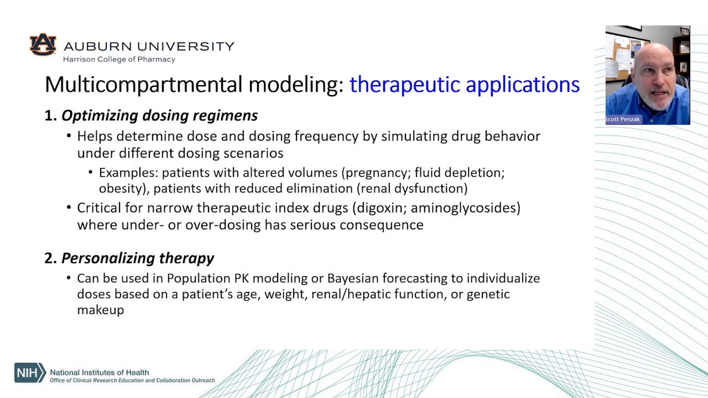

**应用一：优化给药方案**。当病人的分布体积被改变（妊娠、脱水、肥胖）或消除能力下降（肾功能不全）时，模型可以模拟不同给药情景下的曲线，从而定出剂量与频次。对**治疗窗窄**的药物尤其关键——讲者举的例子是地高辛与氨基糖苷类，给多给少后果都很严重。

**应用二：个体化治疗**。群体药代动力学建模与贝叶斯反馈可以把年龄、体重、肝肾功能、遗传背景纳入，为具体病人推算剂量。

**应用三：制剂开发**。做缓释或靶向递送时，需要预测"改变剂型会怎样改变吸收、分布与消除"。讲者指出，这类复杂制剂用非房室分析根本描述不了，往往需要两个以上的房室。

### 5.1 监管怎么看：NCA 是默认，房室模型是加分项

讲者最后讲了一页很实用的内容：FDA 对建模的要求 [【跳转到 47:58】](https://www.youtube.com/watch?v=H8d7MoNM6t0&t=2878)。

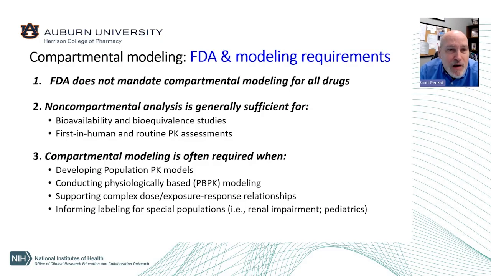

结论很清楚：

- **FDA 并不要求所有药物都做房室建模**；
- **非房室分析通常就够了**：生物利用度与生物等效性研究、首次人体试验、常规药代评价、以及"已知抑制剂或诱导剂会不会改变 AUC"这类药物相互作用研究；
- **房室建模常常是必需的**：建立群体药代模型、做 PBPK、支持复杂的剂量—暴露—效应关系、为特殊人群（肾功能不全、儿科）撰写说明书。

顺带一个有意思的细节：讲者说 90 年代末他做第一个药代研究时没有 WinNonlin，所有 NCA 参数都是**在 Excel 里手算的**；后来用上软件重算，数值完全一致 [【跳转到 42:33】](https://www.youtube.com/watch?v=H8d7MoNM6t0&t=2553)。这说明 NCA 的门槛真的只是算术，而房室模型的门槛才是数值方法。

## 六、补充：暴露与效应是两件事

这一节不是讲者的原话，是为了把这条曲线接回药效而补的。

上面所有参数描述的都是**体内有多少药**——这叫**药代暴露**（pharmacokinetic exposure）。而"有多少效应"是另一个问题，属于**药效学**（pharmacodynamics，PD）。两者的区别可以压成一句话：PK 是浓度对时间，PD 是浓度对效应。

这个区分在实践中有三个直接后果：

1. **$C_{\max}$ 管峰效应与峰毒性，AUC 管累积效应**。浓度一过性冲高造成的副作用（如某些药物的输注反应）看 $C_{\max}$；而时间依赖性的疗效（如许多抗生素的杀菌效果）看 AUC 或"超过 MIC 的时间占比"。
2. **效应常常滞后于浓度**。血药浓度到峰时，效应可能还没到峰；浓度已经降下来了，效应还在。这种滞后通常用"效应室"（effect compartment）来解释：药物要先从血浆分布到作用部位，效应才跟上。表现到图上，就是浓度—效应关系画成一个**逆时针的滞后环**（hysteresis）。
3. **治疗药物监测（TDM）测的是暴露，不是效应**。测血药浓度只能告诉你"体内有多少"，要判断"够不够、毒不毒"，还需要一个把浓度翻译成效应的阈值——这就是 2.2.7 要讲的治疗窗。

换句话说，本文讲的所有参数都是**暴露侧的坐标系**；把它翻译成"该不该调剂量"，还差一层 PD 的映射。

## 小结

- **NCA 的六个数字**：$C_{\max}$、$T_{\max}$、AUC（梯形法）、$\lambda_z$（对数线性回归至少三点）、$CL = F \cdot \text{Dose}/\mathrm{AUC}$、$t_{1/2} = 0.693/\lambda_z$。前四个是读出来的，后两个是算出来的。
- **梯形法有两处系统误差**：峰附近低估（直线切掉弯顶）、尾段高估（点稀疏时梯形变胖）；尾段面积靠 $C_{\text{last}}/\lambda_z$ 外推，前提是尾段已进入纯消除。
- **NCA 的强项是"能比"，弱项是"不能推"**：生物等效性与暴露比较足够，分布体积大、半衰期长的药则力不从心。
- **一室模型 = 一只桶**：假设快速均匀分布，半对数图上只有一条斜率，$C_2 = C_1 e^{-k(t_2-t_1)}$。
- **二室模型 = 曲线上的一个折点**：前半段降得快是因为药躲进了组织，不是因为被清除；分布平衡之后，消除才成为主因。
- **α 与 β 是两个斜率，A 与 B 是两个截距**；残数法（曲线剥离）用实测值减外推值，把分布相单独剥出来。
- **分布体积有三个**：$V_c$ 最好算，$V_{\text{area}}$ 次之，$V_{ss}$ 最难算但物理意义最干净。
- **模型选择看三样**：图、残差、信息准则（AIC/BIC）；AIC 只能在同一数据集内比较，且要警惕过拟合。
- **监管的默认答案是 NCA**；房室模型留给群体药代、PBPK、复杂剂量—暴露—效应关系与特殊人群说明书。
- **暴露不等于效应**：本文所有参数都在 PK 一侧，翻译成"该不该调剂量"还需要 PD 的映射。

## 关键术语速查

| 术语 | 一句话解释 |
| --- | --- |
| 非房室分析 NCA | 不假设房室结构的算法，只把观测曲线压成一组描述性参数 |
| $C_{\max}$ | 观测到的最高血浆浓度，不是对数浓度的最高点 |
| $T_{\max}$ | 达到 $C_{\max}$ 所需时间，口服时主要受吸收速率影响 |
| 线性梯形法 | 用相邻两点连线下的梯形面积近似曲线下面积 |
| $\lambda_z$ / $k_{el}$ | 消除速率常数，由对数浓度对时间回归的斜率取绝对值得到 |
| $\mathrm{AUC}_{0\to\infty}$ | 观测期面积加尾段外推面积 $C_{\text{last}}/\lambda_z$ |
| 表观清除率 $CL/F$ | 口服曲线算出的清除率，含生物利用度，不能与静脉值直接比 |
| 中央室 / 周边室 | 血流丰富、先接触药物的器官 / 血流较少、后接触的组织 |
| 微常数 / 宏常数 | 房室之间的转运速率常数 / 排出体外的速率常数 |
| 分布相与消除相 | 曲线前半段由分布主导、后半段由消除主导的两个阶段 |
| $\alpha$ 与 $\beta$ | 分布相的斜率与消除相的斜率，$\beta$ 即 $k_{el}$ |
| 残数法（曲线剥离） | 用实测值减终末相外推值，把分布相单独剥出来的算法 |
| $V_c$ / $V_{\text{area}}$ / $V_{ss}$ | 中央室体积 / 外推表观体积 / 稳态体积，三者含义不同 |
| AIC / BIC | 兼顾拟合优度与模型复杂度的信息准则，越低越好，且只能同数据集内比较 |
| 过拟合 | 模型把噪声也学进去，对建模数据完美但对新数据失效 |