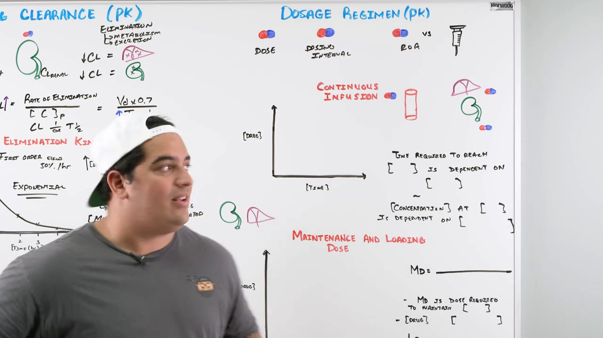
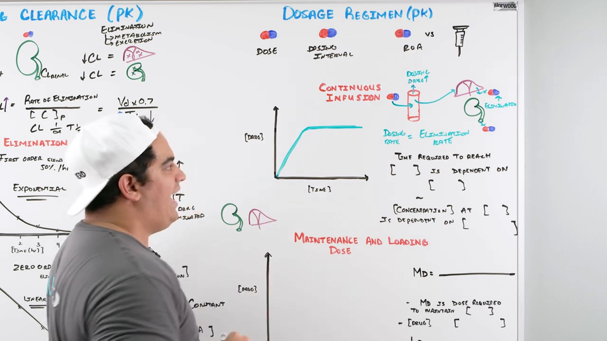
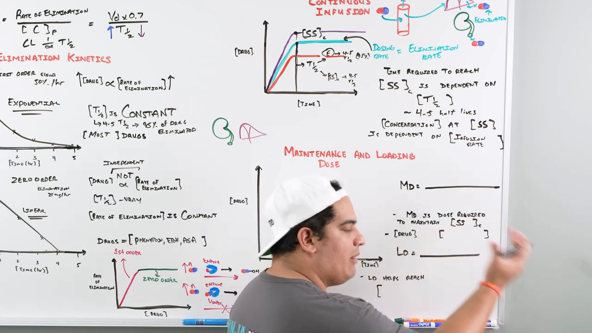
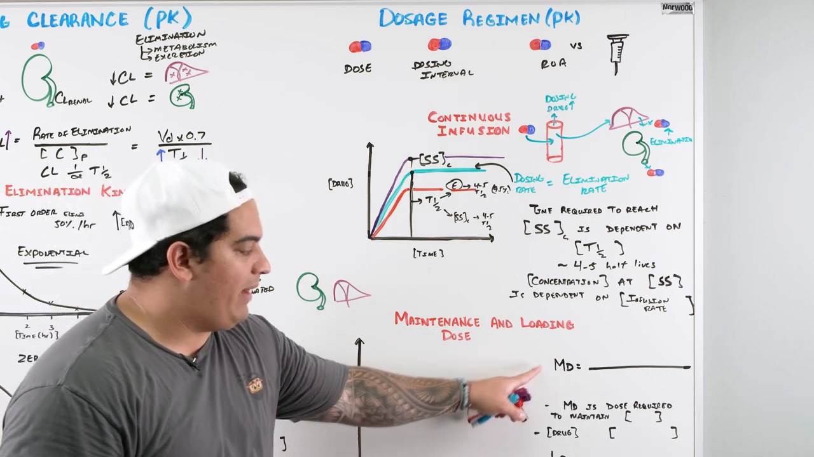
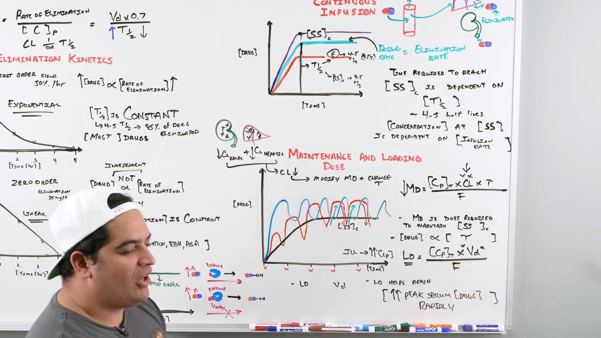
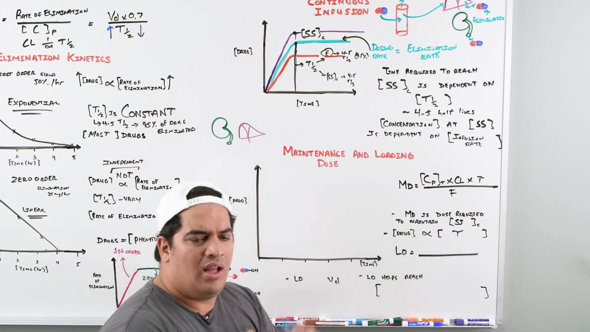
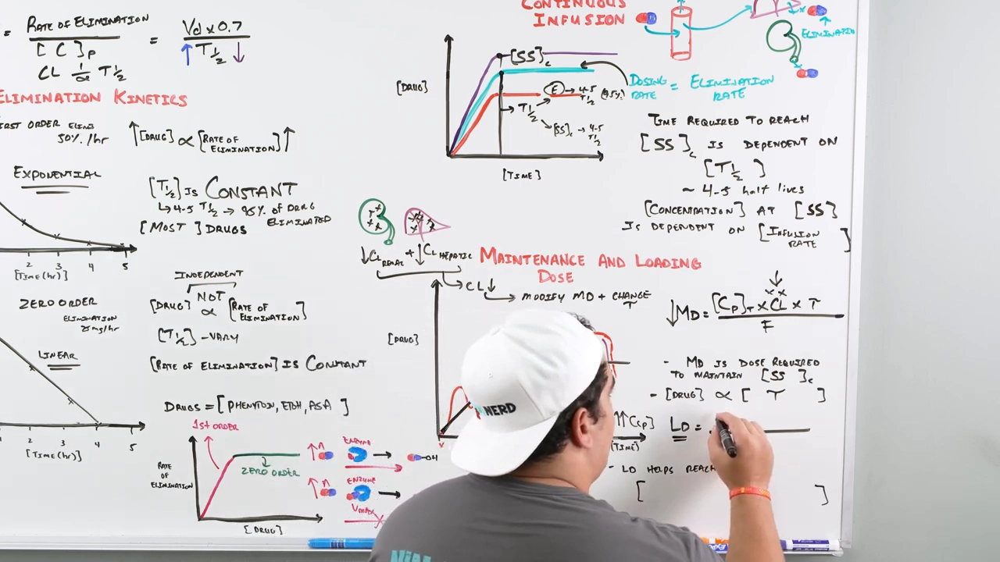
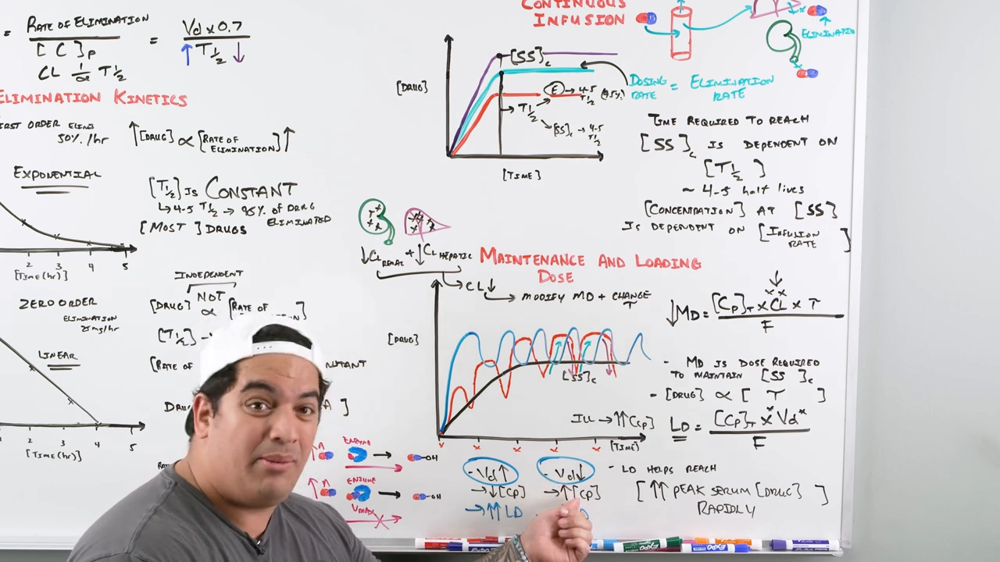
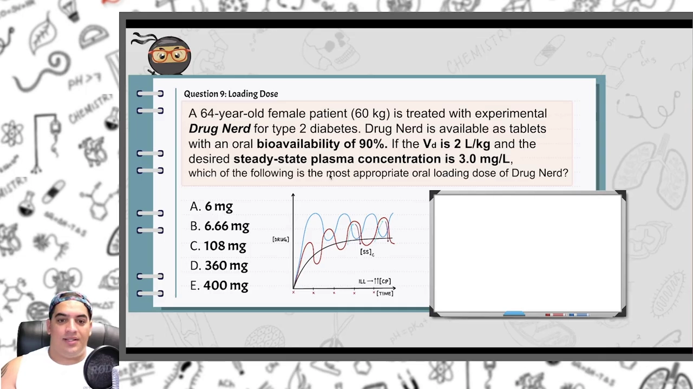

# 半衰期决定多久到稳态，清除率决定稳态多高：负荷剂量与维持剂量的算法

> 视频来源：[Pharmacokinetics | Dosage Regimen](https://www.youtube.com/watch?v=mBDMS1kHhcg)（YouTube · Ninja Nerd，讲者 Zach Murphy）｜时长约 24 分钟
> 导读：这支视频只讲一件事——把药代参数换成一张处方。前半段用恒速输注把「稳态」讲透，后半段给出维持剂量与负荷剂量两条公式，并用一道 60 kg 患者的题走完计算。曲线判读与房室模型见同小节的另一篇。

## 本讲要解决的核心问题（SCQA）

**背景**：药代动力学算到最后，要落到一张处方上：给多少、多久给一次、走哪条路。这三件事就是给药方案（dosage regimen）的全部内容 [【跳转到 00:06】](https://www.youtube.com/watch?v=mBDMS1kHhcg&t=6)。

**冲突**：如果按固定剂量、固定间隔反复给药，血药浓度不会一步到位，而是要爬四五个半衰期才稳定下来。对大多数门诊病人这没问题；但对正在癫痫持续状态里的病人，等四五个半衰期等于放弃治疗。更麻烦的是，同一个剂量给肾功能不全的人，浓度会一路爬上去。

**疑问**：稳态浓度到底由什么决定？想更快到稳态，该加什么？病人清除能力下降，该动剂量还是动间隔？

**回答（中心思想）**：**到达稳态的"时间"只由半衰期决定（4–5 个 $t_{1/2}$），稳态的"高度"只由给药速率与清除率决定**。这两件事互不相干，于是剂量被拆成两个用途不同的量：**维持剂量用清除率算，负荷剂量用分布体积算**，生物利用度 $F$ 是两者共同的分母。

## 一、给药方案只有三个旋钮

讲者开篇把给药方案拆成三个可调的量：**剂量**（给多少）、**给药间隔**（一天一次还是三次）、**给药途径**（口服还是静脉）[【跳转到 00:23】](https://www.youtube.com/watch?v=mBDMS1kHhcg&t=23)。

三个旋钮里，**恒速输注是最简单的一种**：途径固定为静脉，剂量变成一个速率（每分钟多少毫克），间隔变成"恒定不变"。正因为简单，它最适合用来把"稳态"这个概念讲清楚。

## 二、恒速输注：把「给药速率 = 消除速率」画成一条平台

开始输注后，血药浓度一路上升；与此同时，肝在代谢、肾在排泄，消除的**速率**也在上升。两条速率曲线最终会相交：进来的等于出去的，浓度不再变化，图形上出现一个平台 [【跳转到 03:27】](https://www.youtube.com/watch?v=mBDMS1kHhcg&t=207)。

讲者给了一个临床场景：给病人上降压药输注，目标是收缩压低于 140 mmHg。血压不够就加快滴速，够了就维持。这个"边看边调"的过程，本质上就是在找那个让给药速率等于消除速率的平台。

这里有一个容易被忽略的因果：**消除速率随浓度升高而升高**，这是**一级动力学**（first-order kinetics）的直接结果。正因为消除速率会"追上来"，系统才会自己停在某个平台上，而不是无限上升。

## 三、到达稳态的时间只由半衰期决定

平台的高度可以变，但**到达平台所需的时间不变**——这是本讲最重要的一句话。

### 3.1 四到五个半衰期，走完 95%

讲者的表述很干脆：消除一个药物需要 4–5 个半衰期才能去掉 95%，**达到稳态同样需要 4–5 个半衰期** [【跳转到 04:32】](https://www.youtube.com/watch?v=mBDMS1kHhcg&t=272)。

为什么是同一个数字？因为上升与下降是同一个指数过程的两个方向。每一段固定时间里，浓度都走完"剩余距离"的固定比例（一级动力学下每过一个半衰期走一半），所以走完 95% 需要的段数当然一样。

这条规律有一个很强的实用推论：**半衰期长的药，起效就是慢**。一个 $t_{1/2}$ 为 30 小时的药，要 5–6 天才到稳态；这不是剂量不够，而是物理上做不到更快——除非用负荷剂量（见第五节）。

### 3.2 调速率不改变到达时间

讲者用一组对照把这件事讲透了 [【跳转到 05:37】](https://www.youtube.com/watch?v=mBDMS1kHhcg&t=337)：假设原来以 10 mg/min 输注并已达到稳态，现在想把血压目标从 140 降到 120，于是把速率提到 15 mg/min。结果是——**新的稳态浓度更高，但到达新稳态仍然需要 4–5 个半衰期**。反过来把速率降到 7.5 mg/min，稳态浓度变低，到达时间还是不变。

所以两个量要分开记：

- **稳态浓度**由**给药速率**（或清除率）决定；
- **到达稳态的时间**由**半衰期**决定。

## 四、稳态浓度的高度由清除率决定

间断给药（每天一次、每 8 小时一次）的曲线不像输注那样平滑，而是一串锯齿：给药后冲一个峰，随后下降，还没降到底就给了下一剂，于是谷底一剂比一剂高，直到锯齿的峰与谷都不再抬升 [【跳转到 09:32】](https://www.youtube.com/watch?v=mBDMS1kHhcg&t=572)。

### 4.1 维持剂量的公式怎么读

维持剂量（maintenance dose，MD）的定义是：**把稳态浓度维持住所需的剂量**。公式是 [【跳转到 08:24】](https://www.youtube.com/watch?v=mBDMS1kHhcg&t=504)：

$$
\text{MD} = \frac{C_{ss} \cdot CL \cdot \tau}{F}
$$

四项各有分工，可以逐个读：

- $C_{ss}$ 是**想达到的稳态浓度**，也就是靶浓度；
- $CL$ 是**清除率**，代表单位时间能把多少体积的血浆"清干净"；
- $\tau$ 是**给药间隔**；
- $F$ 是**生物利用度**，静脉给药时等于 1，口服时小于 1。

这个公式的物理含义可以这样理解：$C_{ss} \cdot CL$ 是**单位时间需要清除的药量**（要维持这个浓度，就必须以同样的速率把药清掉，也就必须以同样的速率补进去）；再乘上间隔 $\tau$，就是**一个间隔内需要补的总量**；最后除以 $F$，是因为口服只有一部分真正进了体循环，开处方时要按这个比例放大。

### 4.2 间隔与浓度成正比

讲者专门强调了一个容易被忽略的正比关系：**浓度与给药间隔成正比**。同样的日剂量，如果间隔拉长、单次剂量加大，峰谷差就变大；如果间隔缩短、单次剂量减小，曲线就变平 [【跳转到 09:14】](https://www.youtube.com/watch?v=mBDMS1kHhcg&t=554)。

这解释了一个临床上的常见操作：想压低峰值（比如为了减少峰相关副作用），不一定要减总量，**把同样的日剂量拆成更频繁的小剂量**就能削峰。反过来，想减少服药次数提高依从性，就得接受更大的峰谷波动。

### 4.3 清除率下降：先减量，再考虑拉长间隔

维持剂量公式里，$CL$ 是唯一一个会随病情剧烈变化的项。讲者的推理链是这样的 [【跳转到 12:26】](https://www.youtube.com/watch?v=mBDMS1kHhcg&t=746)：

肾功能不全 → 肾清除率下降 → 总清除率下降 → 同样的剂量下浓度升高 → 出现副作用或毒性。

所以处理办法有两条，讲者都提到了：**减少维持剂量**，或者**把给药间隔拉长**（让 $\tau$ 变大、单次剂量变小），两者都能把浓度压回去。肝功能不全时同理，只是走的是代谢那条路。

> **补充（非讲者原话）**：这两条办法在数学上并不等价。减量保持间隔，峰谷差按比例缩小；拉长间隔保持单次剂量，峰不变、谷更低。如果疗效由峰浓度决定，拉长间隔可能让谷段失效；如果毒性由峰浓度决定，减量更安全。选哪条，取决于这个药的暴露—效应关系是"看峰"还是"看谷"。

## 五、负荷剂量：用分布体积换时间

危重病人等不起四五个半衰期。讲者举的例子是癫痫持续状态：要立刻用左乙拉西坦这类抗癫痫药把血药浓度顶上去，没有时间慢慢爬 [【跳转到 14:44】](https://www.youtube.com/watch?v=mBDMS1kHhcg&t=884)。他给的临床做法是：先给 3 g 左乙拉西坦作为负荷剂量，随后改成 1.5 g、每日两次的维持剂量。

### 5.1 公式：把清除率换成分布体积

$$
\text{LD} = \frac{C_{ss} \cdot V_d}{F}
$$

对比两条公式，差别只在中间那一项：**维持剂量乘的是清除率，负荷剂量乘的是分布体积**。这不是巧合，而是两个量回答的问题不同：

- 清除率回答"**单位时间清掉多少**"，所以它决定**速率**——维持剂量；
- 分布体积回答"**要把浓度抬到某个值需要填满多大空间**"，所以它决定**总量**——负荷剂量。

讲者的原话是：负荷剂量最重要的决定因素是**分布体积**，维持剂量最重要的决定因素是**清除率** [【跳转到 23:24】](https://www.youtube.com/watch?v=mBDMS1kHhcg&t=1404)。

### 5.2 一个反直觉的推论：$V_d$ 越大，负荷剂量越大

讲者在这里花了不少时间，因为这一步最容易搞反 [【跳转到 18:17】](https://www.youtube.com/watch?v=mBDMS1kHhcg&t=1097)。

推理是这样的：分布体积大，意味着药物大量跑到了血管外的组织里，**留在血浆里的就少**，所以血浆浓度低。既然血浆浓度低，想把它顶到目标值，就必须给一个**更大的**剂量。反过来，分布体积很小的药基本都待在血管里，血浆浓度本来就高，负荷剂量反而小。

用一句话记住：**负荷剂量是在填一个叫 $V_d$ 的容器；容器越大，填满它需要的药越多。**

### 5.3 一道完整的计算题

讲者最后用一道题把所有公式串起来 [【跳转到 20:29】](https://www.youtube.com/watch?v=mBDMS1kHhcg&t=1229)。

题目条件：64 岁女性，60 kg，口服片剂，生物利用度 90%，分布体积 2 L/kg，目标稳态浓度 3 mg/L，求口服负荷剂量。

第一步先把 $V_d$ 换成绝对值——因为公式里的 $V_d$ 单位必须是升：

$$
V_d = 2\ \mathrm{L/kg} \times 60\ \mathrm{kg} = 120\ \mathrm{L}
$$

第二步代进负荷剂量公式：

$$
\text{LD} = \frac{3\ \mathrm{mg/L} \times 120\ \mathrm{L}}{0.9} = \frac{360\ \mathrm{mg}}{0.9} = 400\ \mathrm{mg}
$$

答案是 400 mg。讲者特意提醒了一处易错点：**体重那一项必须乘进去**，否则 $V_d$ 停留在 L/kg，量纲就错了。另一处他没有展开但同样关键：**口服要除以 $F$**——如果这题是静脉给药，$F=1$，答案就是 360 mg。

## 六、这套算法什么时候会失效

前面所有推导都压在一个前提上：**一级动力学**。一级动力学的特征是"单位时间消除固定**比例**"，因此半衰期是常数、消除速率随浓度线性上升。

但并非所有药都这样。讲者的白板上并列画了两条曲线：一级动力学是指数衰减，零级动力学是**直线下降**（单位时间消除固定**量**），并标注了苯妥英、乙醇、阿司匹林这几个典型例子（白板内容，讲者口头未逐条展开）[【跳转到 08:24】](https://www.youtube.com/watch?v=mBDMS1kHhcg&t=504)。

零级动力学的后果很严重：因为消除速率有上限（酶饱和了），**剂量稍微增加，稳态浓度可能不成比例地暴涨**。这时"剂量翻倍、浓度翻倍"的直觉不再成立，上面那两条线性公式也就不能直接用了。

> **补充（非讲者原话）**：这就是"线性动力学 vs 非线性动力学"的分界。判断一个药是否线性，最直接的办法是做**剂量比例性**检验：给三个剂量，看 AUC 与 $C_{\max}$ 是否随剂量成比例上升。成比例就是线性，超比例上升就提示饱和消除（或靶点介导的药物处置，TMDD）。苯妥英是教科书级的例子——它的治疗窗窄、代谢又容易饱和，所以临床必须靠治疗药物监测而不是靠公式推算。

## 七、补充：从暴露到效应，还差一层映射

这一节同样不是讲者的原话，是为了把公式接回临床决策而补的。

上面两条公式算出来的都是**暴露**：$C_{ss}$ 是"体内应该有多少药"。但处方要回答的是"这个浓度够不够、毒不毒"，那属于**药效学**（PD）的问题。三个衔接点值得记住：

1. **靶浓度从哪来**。$C_{ss}$ 不是算出来的，是从暴露—效应研究里定出来的：能覆盖多数病人有效浓度的下限，与开始出现毒性的上限之间，就是治疗窗。2.2.7 会专门讲这个窗口怎么定。
2. **$F$ 的不确定性会直接放大误差**。负荷剂量与维持剂量都要除以 $F$，而 $F$ 本身受剂型、食物、首过代谢、合并用药影响，个体间差异常常是两三倍。所以按公式算出的剂量只是**起点**，后面要靠治疗药物监测（TDM）反馈修正。
3. **半衰期决定监测时机**。因为要 4–5 个半衰期才到稳态，**在到达稳态之前抽血测浓度是没有意义的**——测到的是爬坡途中的值。这也是为什么 TDM 的采血时间要按半衰期来排。

> **补充（非讲者原话）**：口服生物利用度还可以再拆成三段，写作 $F = f_a \cdot f_g \cdot f_h$：$f_a$ 是吸收分数（有多少从肠腔进了肠壁细胞），$f_g$ 是肠壁代谢存活分数，$f_h$ 是肝首过存活分数。这个分解的用处在于定位问题——如果 $F$ 低是因为 $f_a$ 小，那是溶解度或渗透性问题；如果 $f_a$ 不低而 $f_h$ 低，那是首过代谢问题。两种情况的改造策略完全不同。

## 小结

- **给药方案三个旋钮**：剂量、间隔、途径；恒速输注是最简单的一种，途径固定、间隔恒定。
- **稳态的定义是速率相等**：给药速率等于消除速率时，浓度不再变化，图上出现平台。
- **到达稳态的时间只由半衰期决定**：4–5 个 $t_{1/2}$ 走完 95%，改给药速率不改变这个时间。
- **稳态浓度的高度由给药速率与清除率决定**：与半衰期无关。
- **维持剂量 $= C_{ss} \cdot CL \cdot \tau / F$**：清除率决定"补多快"，间隔决定"一次补多少"，$F$ 决定"开多少"。
- **清除率下降时先减量或拉长间隔**：肾功能不全、肝功能不全都会让浓度爬升，不减量就是毒性。
- **负荷剂量 $= C_{ss} \cdot V_d / F$**：用分布体积换时间，$V_d$ 越大负荷剂量越大（因为药都跑到组织里去了）。
- **例题的答案链**：$V_d = 2 \times 60 = 120$ L，$\text{LD} = 3 \times 120 / 0.9 = 400$ mg。
- **前提是一级动力学**：零级动力学（苯妥英、乙醇、阿司匹林）下剂量与浓度不再成比例，公式失效。
- **公式给的是起点**：$F$ 的个体差异与非线性动力学都会让预测偏离，最终要靠 TDM 反馈修正。

## 关键术语速查

| 术语 | 一句话解释 |
| --- | --- |
| 给药方案 | 剂量、给药间隔、给药途径三者的组合 |
| 恒速输注 | 以固定速率持续静脉给药，浓度最终停在给药速率等于消除速率的平台 |
| 稳态 $C_{ss}$ | 给药速率与消除速率相等时的浓度，不再随时间变化 |
| 一级动力学 | 单位时间消除固定比例，半衰期恒定，消除速率随浓度线性上升 |
| 零级动力学 | 单位时间消除固定量，酶已饱和，剂量增加时浓度可能超比例上升 |
| 维持剂量 MD | 维持稳态浓度所需的每剂剂量，正比于清除率与给药间隔 |
| 负荷剂量 LD | 为迅速达到目标浓度而先给的一剂，正比于分布体积 |
| 给药间隔 $\tau$ | 相邻两次给药的时间差，与峰谷波动幅度成正比 |
| 生物利用度 $F$ | 给药剂量中以原形进入体循环的比例，静脉为 1 |
| $f_a \cdot f_g \cdot f_h$ | 口服生物利用度的三段分解：吸收分数、肠壁存活分数、肝首过存活分数 |
| 治疗药物监测 TDM | 测血药浓度以反馈调整剂量，采血时机需避开未达稳态的爬坡段 |