# 治疗窗与治疗指数：疗效与毒性之间有多宽

> 视频来源：[Therapeutic Index and Therapeutic Window: How Safe Is a Drug?](https://www.youtube.com/watch?v=_lw2_mmUMBk)（YouTube · Professor G - Pharmacology）｜时长约 10 分钟
> 导读：这支视频只回答一个问题——「疗效和毒性之间到底隔了多远」，用一条量化剂量-反应曲线把「治疗窗」和「治疗指数」两个常被混用的词分开。本文按「窗口是什么 → 怎么量出来 → 比值丢掉了什么 → 临床上怎么用」重排；暴露曲线的形状与半衰期计算留给 2.2.6，蛋白结合与游离浓度留给 2.2.3。

## 本讲要解决的核心问题（SCQA）

**背景**：药理学的第一课是「剂量决定效应」——给得够，效应就出来；给得更多，效应更强。学生熟悉的是那条 S 形的剂量-反应曲线：横轴是剂量的对数，纵轴是效应的大小。

**冲突**：同一条曲线在剂量高到一定程度后，会把另一种效应也拉起来——不需要的、有害的那种。于是「有效」和「有毒」并不是两件事，而是同一根剂量轴上两段重叠的区间。更麻烦的是，同一种药在不同人身上、同一个剂量下，血里的浓度可以差很多。

**疑问**：那我们凭什么说一个药「安全」？「安全」能不能变成一个可以算、可以比较的数？

**回答（中心思想）**：安全性不是药物的一种属性，而是**两条曲线之间的间距**。治疗窗是这段间距的临床形态（一段可用的暴露范围），治疗指数是它的一个数字摘要（$TD_{50}/ED_{50}$）。数字摘要好用，但它只保留了「两个点」，丢掉了曲线的斜率与重叠，所以窄窗药物真正的风险不在比值小，而在于「剂量的微小变化会跨过边界」。

## 一、每一种药都活在一个「刚好」的区间里

[【跳转到 00:55】](https://www.youtube.com/watch?v=_lw2_mmUMBk&t=55)

讲者用一根横条把这件事讲清楚了：左端是「太少」（no effect），中间是「刚好」（therapeutic），右端是「太多」（toxic）。

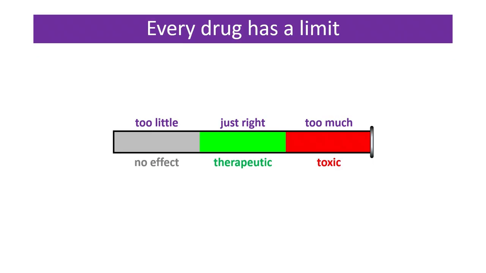

这条横条对应的是「暴露」（exposure），不是「剂量」。讲者的定义是：**从产生期望效应所需的暴露，到毒性成为重要关切的那个暴露，中间这一段就是治疗窗（therapeutic window）**。有的药窗口很宽，有的药窗口很窄。

把这条横条和剂量-反应曲线叠在一起，就得到下面这张图：蓝色曲线是期望效应，红色曲线是不期望的效应，绿色方块是两条曲线之间那段「效应已经足够、毒性还没起来」的区间。

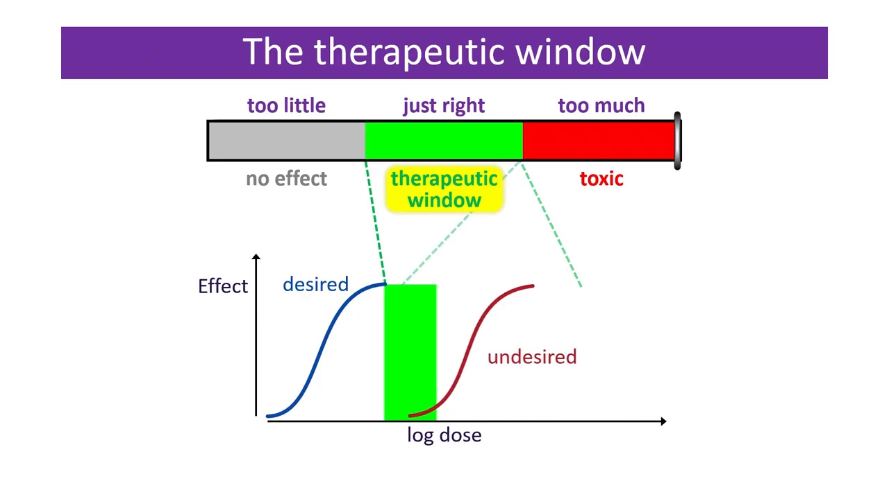

这里有个容易被跳过的前提：**效力（potency）和安全性是两件独立的事**。讲者的说法很直白——不管一个药多强，给得太少都不会有用；给够了才有治疗效应；再往上加，不期望的效应就越来越重要。「每一种药都有一个上限。」

## 二、要比较人群里的疗效与毒性，得换一种曲线

[【跳转到 02:45】](https://www.youtube.com/watch?v=_lw2_mmUMBk&t=165)

前面那条 S 形曲线画的是「效应有多大」（graded response），它回答的是「这个剂量在我身上有多强」。但要谈安全性，问的往往是另一个问题：**在这个剂量下，人群里有多少比例的人会出现这个效应？** 讲者把这种曲线叫量化剂量-反应曲线（quantal dose-response curve）：纵轴从「效应大小」换成「出现该效应的人群百分比」。

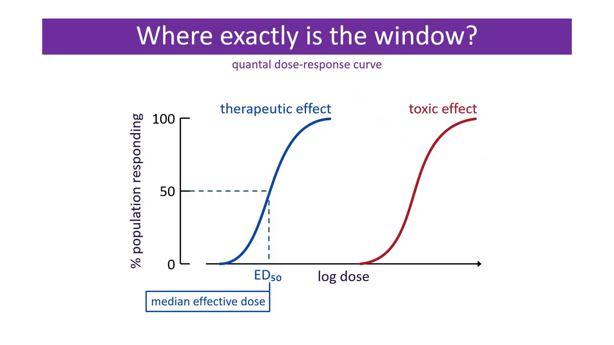

于是有了第一个锚点：**ED50（median effective dose，半数有效量）**——让 50% 的人群出现指定治疗效应的剂量。对同一种毒性效应再画一条同样的曲线，就得到第二个锚点：**TD50（median toxic dose，半数中毒量）**——让 50% 的人群出现指定毒性效应的剂量。

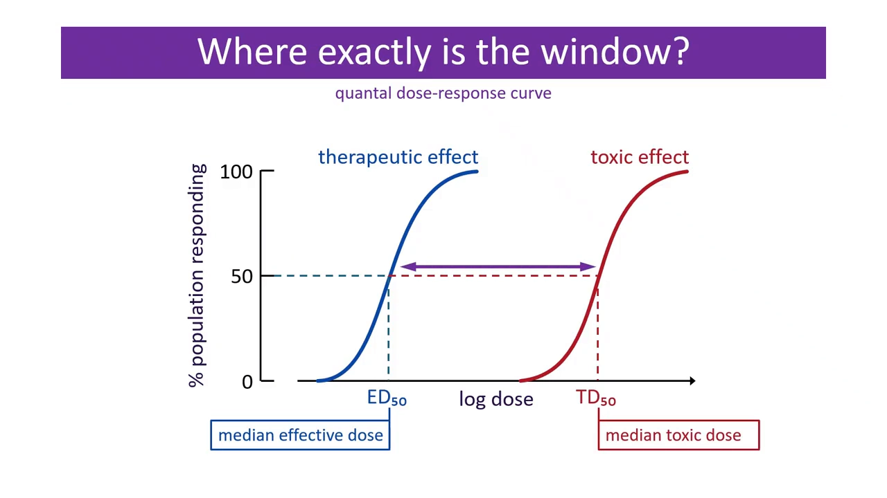

讲者的关键句是：**两条曲线分得越开，治疗获益与毒性之间的余量就越大**。这句话把「安全」从形容词变成了几何量——它量的是两条曲线的水平距离。

## 三、治疗指数是这段距离的数字摘要，但它不是效力

[【跳转到 04:00】](https://www.youtube.com/watch?v=_lw2_mmUMBk&t=240)

把上面那段距离压缩成一个数，就是治疗指数（therapeutic index, TI）：

$$
TI = \frac{TD_{50}}{ED_{50}}
$$

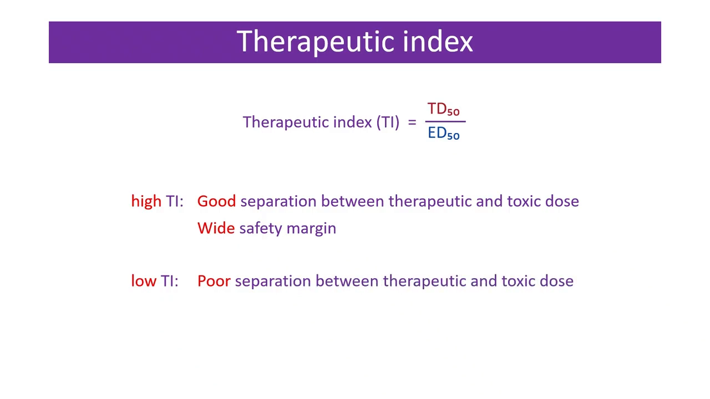

- **TI 高**：产生毒性的剂量远高于产生疗效的剂量，分离好，安全边际宽。
- **TI 低**：治疗剂量与毒性剂量靠得很近，安全边际窄。

讲者特意强调了一个常见混淆：**TI 不是效力**。效力问的是「需要多少药才能产生效应」，TI 问的是「有效剂量和有毒剂量隔多远」。一个药可以非常强效（几微克就起效）却仍然危险（TI 很低），也可以效力平平却很安全。

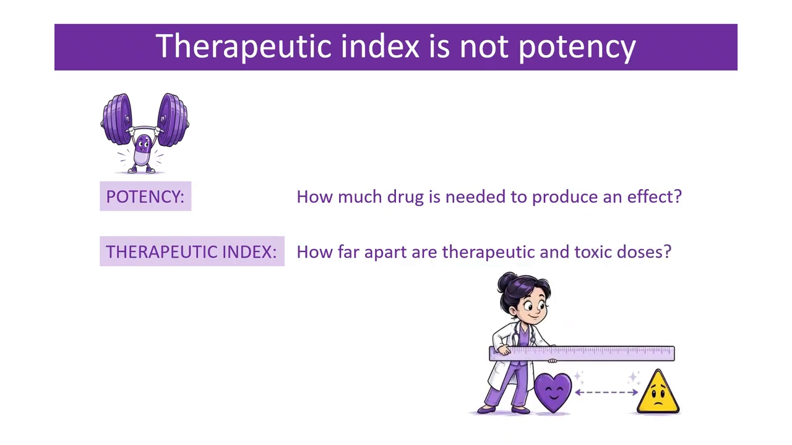

## 四、窗口宽窄的差别，落在「剂量能犯多大错」上

[【跳转到 04:50】](https://www.youtube.com/watch?v=_lw2_mmUMBk&t=290)

讲者把宽窗和窄窗并排放在一起比较，结论是实践性的：

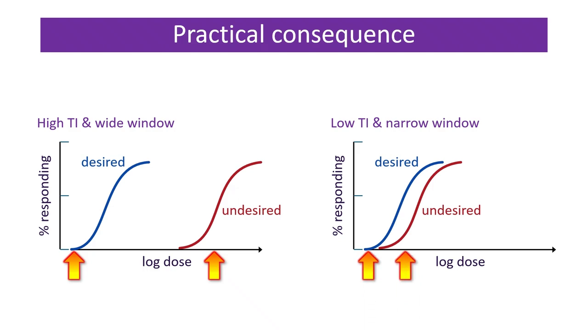

- **宽窗**：暴露不足与暴露过量之间有充足的距离，剂量调整的容错空间大。
- **窄窗**：两条边界贴得很近。**暴露的一点点变化就可能带来后果**——剂量稍微加一点，疗效或许更好，但也可能同时把毒性引进来。这意味着给药必须被更严格地控制。

这句话是整支视频的落点：窄窗药物的风险不是「毒性更强」，而是「你和边界之间没有缓冲」。

## 五、同一个剂量不等于同一个暴露，窄窗药物对此最敏感

[【跳转到 05:40】](https://www.youtube.com/watch?v=_lw2_mmUMBk&t=340)

讲者提醒了一个在处方时最容易被忽略的区分：**给药剂量（dose administered）和患者实际经历的药物浓度（drug concentration experienced）不是一回事**。同样的剂量给不同的人，暴露可以差很多，原因包括吸收、分布、代谢、排泄的差异，以及与其他药物的相互作用。

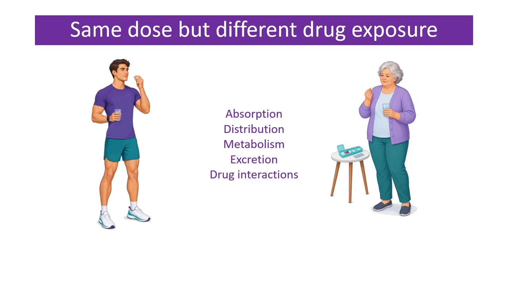

如果治疗窗很宽，这些差异通常被窗口吸收掉；如果治疗窗很窄，这些差异就变得重要起来——它们足以把一部分人推出窗口。

对这类药，一个可用的手段是**治疗药物监测（therapeutic drug monitoring, TDM）**：直接测血里的药物浓度，把浓度维持在期望的治疗范围内，同时避免过度暴露。讲者举的例子是华法林：

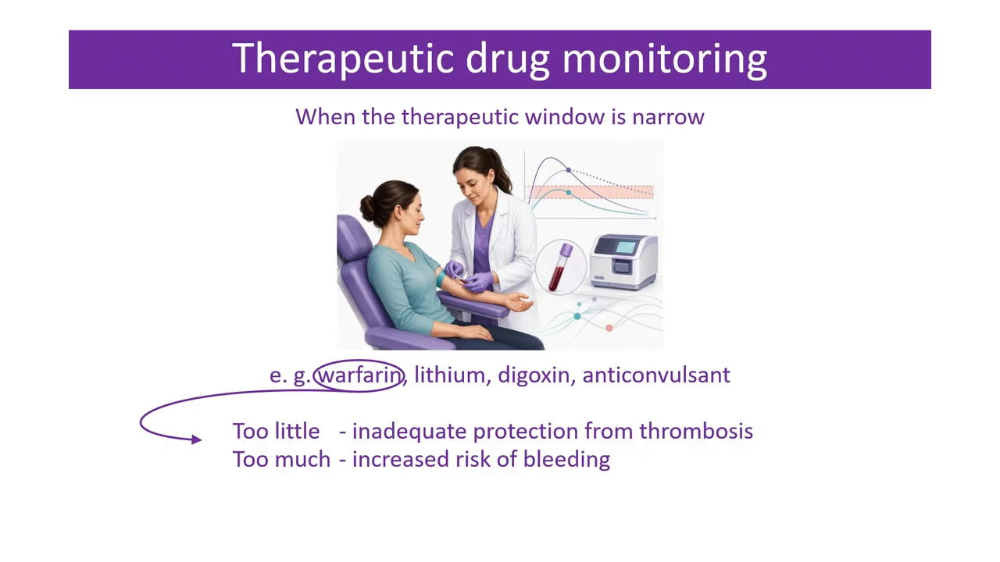

华法林的窗口相对较窄——抗凝作用太弱，患者得不到足够的血栓保护；太强，出血风险上升。而且个体间反应差异很大，所以临床上用 INR（国际标准化比值）来监测抗凝效应、指导剂量调整。注意 INR 测的不是药物浓度本身，而是药效指标——这正好说明「监测」的对象可以是浓度，也可以是效应。

## 六、一个药没有唯一的窗口：取决于你拿哪个疗效对哪个不良反应

[【跳转到 07:43】](https://www.youtube.com/watch?v=_lw2_mmUMBk&t=463)

讲者在这里加了一个常被教材省略的复杂化：**药物往往不止一个治疗效应，也不止一个不良反应**。所以「这个药的治疗窗」这句话本身是不完整的——必须说清楚是哪一对效应。

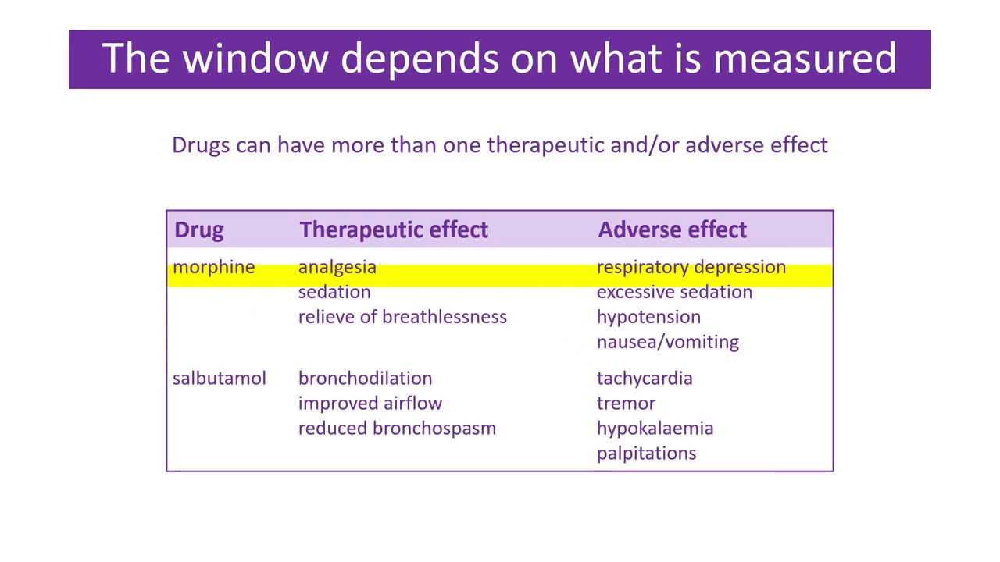

两个例子：

- **吗啡**：可以比较「镇痛」与「呼吸抑制」（图中高亮的那一对）；但它的治疗效应还包括镇静、缓解呼吸困难，不良反应还包括过度镇静、低血压、恶心呕吐。
- **沙丁胺醇**：可以比较「支气管扩张」与「心动过速」；其他不良反应还有震颤、低血钾、心悸。

这带来一个实用推论：**安全评价里说「治疗窗窄」时，必须同时说明比较的是哪一对效应**，否则这个判断无法被检验。

## 七、治疗窗与治疗指数不是同义词：一个描述区间，一个只是比值

[【跳转到 08:33】](https://www.youtube.com/watch?v=_lw2_mmUMBk&t=513)

讲者最后把两个词正式分开：

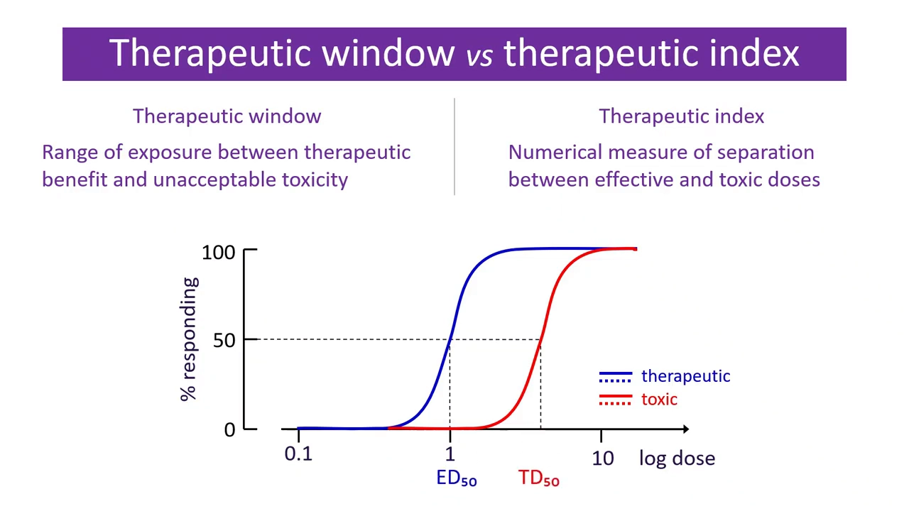

- **治疗窗**：期望治疗效应与不可接受毒性之间的暴露范围，是临床上真正可用的那段区间。
- **治疗指数**：有效剂量与有毒剂量分离程度的数值度量。

然后是他认为最重要的限制：**TI 只告诉你两个剂量之间的比值，不告诉你剂量-反应曲线的形状，也不告诉你两条曲线重叠了多少**。两个药可以有完全相同的 TI，但治疗效应与毒性效应的关系截然不同。

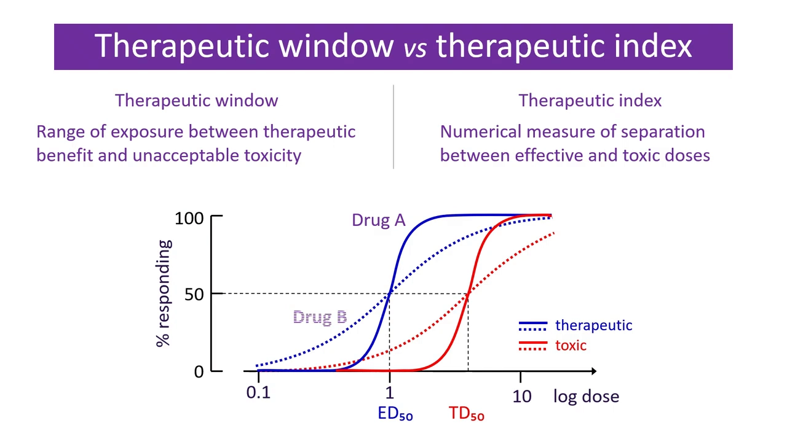

这张图值得多看几眼。Drug A 的两条曲线都很陡，50% 处虽然只隔了一段距离，但在低剂量端几乎不重叠；Drug B 的曲线平缓，尽管 $TD_{50}/ED_{50}$ 和 A 一样，它在低剂量处就已经有一部分人出现毒性反应。**同样的 TI，不同的临床风险**——这就是「比值摘要」的代价。

## 补充：那两条曲线里的「不期望效应」是从哪来的

> 以下是背景补充，不是讲者原话。

讲者只画了「期望」和「不期望」两条曲线，没有解释红色曲线背后的分子来源。在药物发现里通常分两类：

- **靶标相关毒性（on-target）**：药物结合的就是设计靶点，但这个靶点在正常组织里也表达，或这个靶点本身还控制着别的生理功能。抑制一个降压靶点，可能同时把心率带下去。
- **脱靶毒性（off-target）**：药物结合了设计之外的其他蛋白。典型例子是心脏钾通道 hERG 被阻断导致 QT 间期延长，以及某些受体亚型带来的额外药理作用。

这个区分在实践上的意义是：on-target 毒性往往要靠换靶点、改给药方式或控制暴露来解决，off-target 毒性则可以通过结构改造提高选择性来缓解。后续两篇（非临床毒理如何定 NOAEL、首次人体试验前的评价包）会分别从剂量边界和评价流程两侧展开。

## 小结

- 安全性不是药物的固有属性，而是**期望效应曲线与毒性曲线之间的间距**；剂量太低无效、太高有毒。
- 比较人群层面的疗效与毒性要用**量化剂量-反应曲线**，其锚点是 ED50 与 TD50。
- **治疗指数 $TI = TD_{50}/ED_{50}$** 是这段间距的数字摘要；高 TI 意味着分离好，低 TI 意味着分离差。
- **TI 不是效力**：效力问「需要多少药」，TI 问「有效与有毒隔多远」。
- 窄窗药物的核心风险是**缺乏缓冲**：暴露的微小变化就可能跨过边界，因此给药控制要更严。
- 同一剂量不等于同一暴露（吸收、分布、代谢、排泄、相互作用），窄窗药物对此最敏感，可用**治疗药物监测**把浓度维持在范围内。
- 一个药没有唯一窗口，必须指明「哪一对疗效与不良反应」；华法林用 INR 监测的就是药效而非浓度。
- **TI 只保留两个点**，丢掉了曲线斜率与重叠：两个药可以 TI 相同而风险不同。

## 关键术语速查

| 术语 | 一句话解释 |
| --- | --- |
| 治疗窗（therapeutic window） | 从产生期望效应所需暴露到毒性成为重要关切的暴露之间的区间 |
| 治疗指数（TI） | $TD_{50}/ED_{50}$，有效与有毒剂量分离程度的数值摘要 |
| 量化剂量-反应曲线 | 纵轴为出现某效应的人群百分比，而不是效应大小 |
| ED50 | 使 50% 人群出现指定治疗效应的剂量 |
| TD50 | 使 50% 人群出现指定毒性效应的剂量 |
| 效力（potency） | 产生效应所需的药量，与安全性是两件事 |
| 治疗药物监测（TDM） | 直接测血药浓度（或药效指标）以把暴露维持在窗口内 |
| INR | 华法林抗凝效应的监测指标，用于指导剂量调整 |