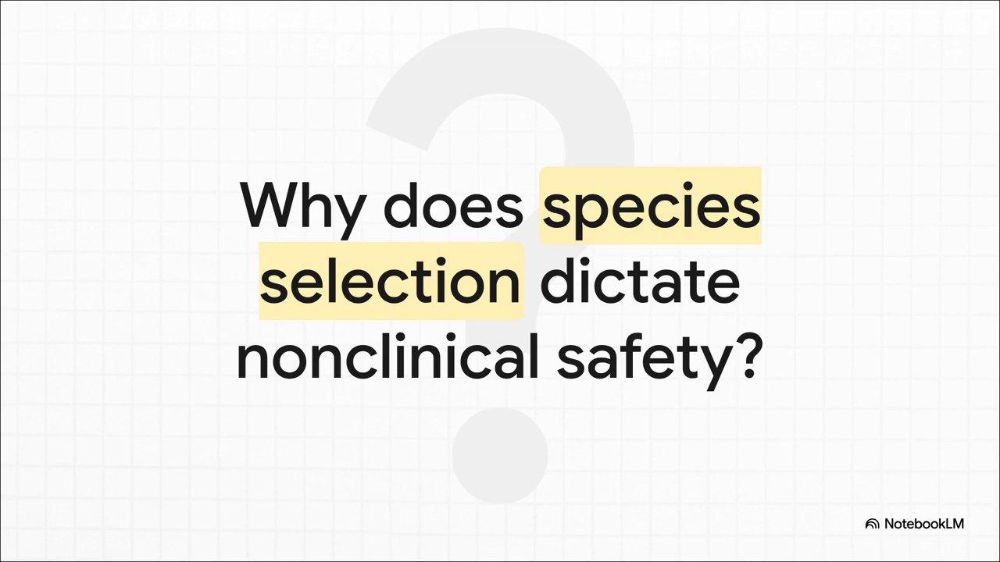
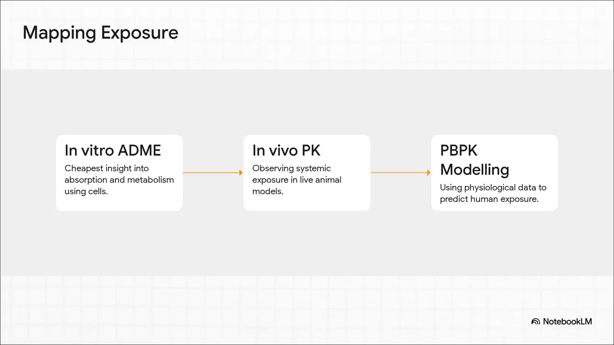
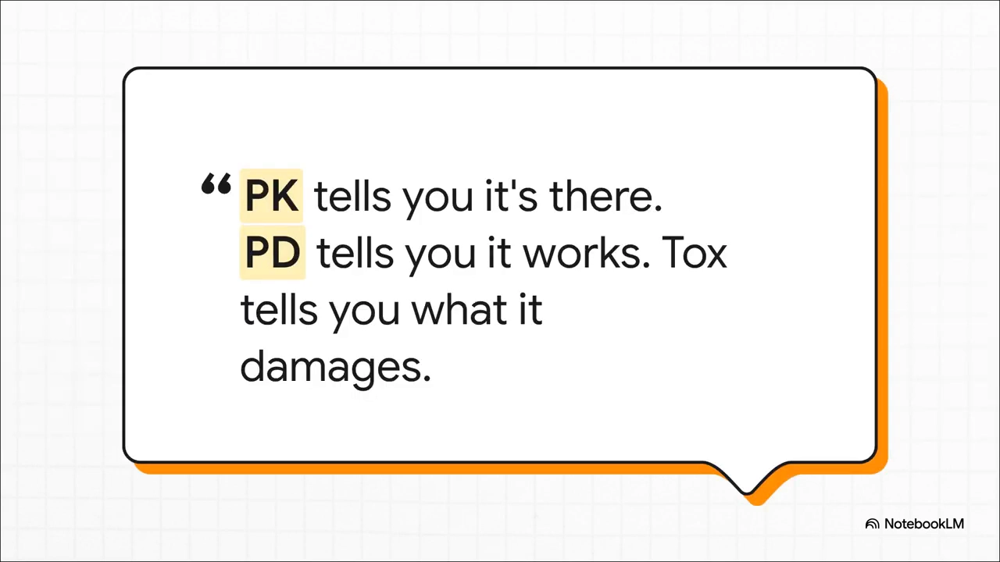
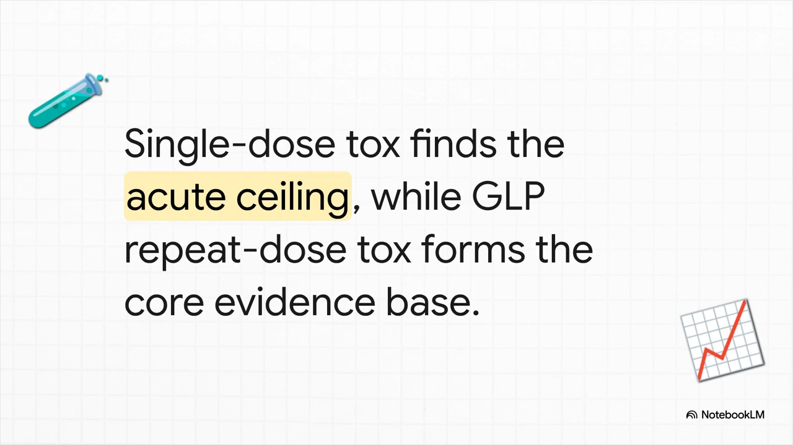
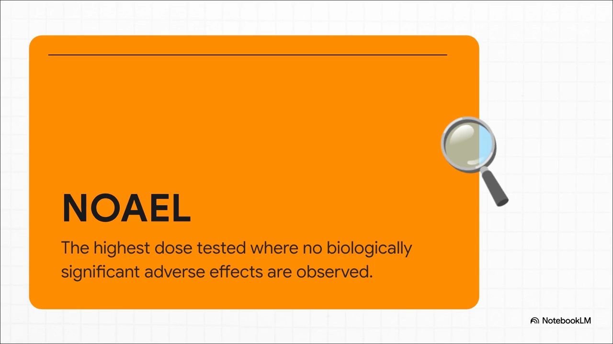
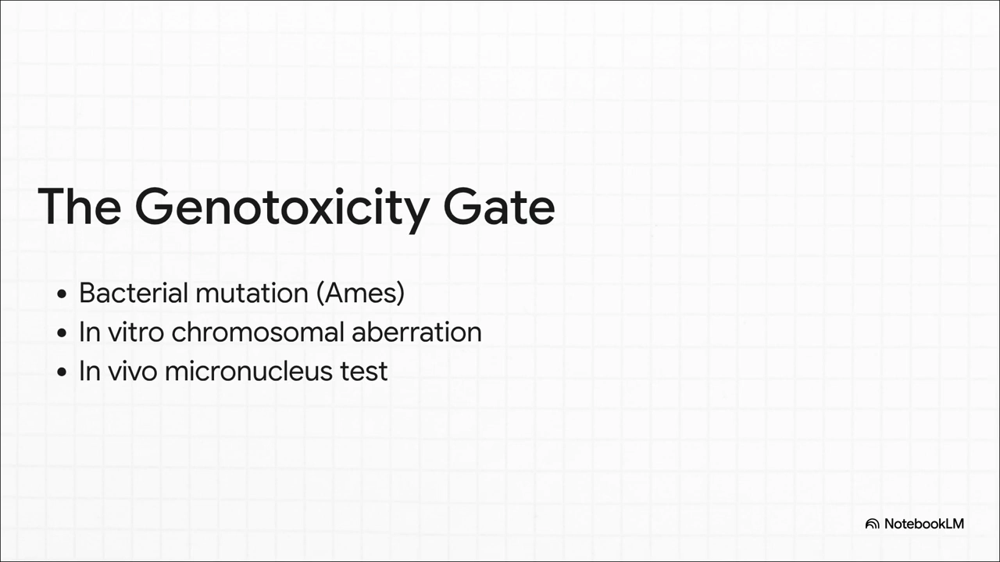
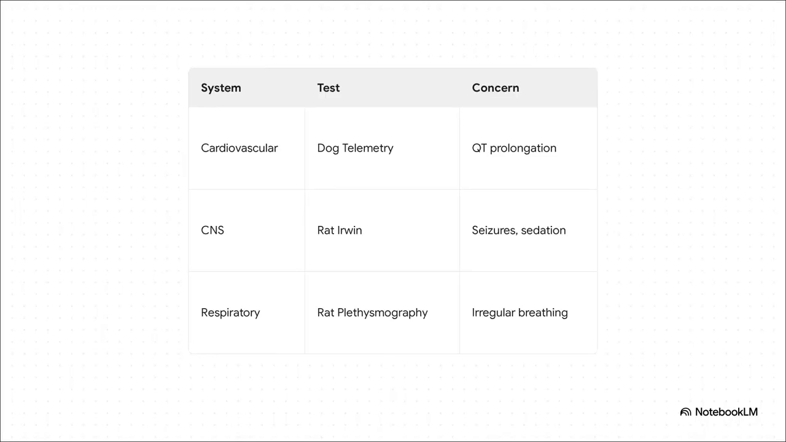
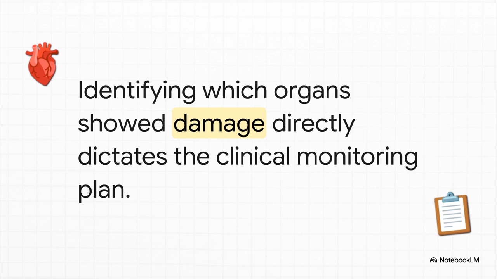
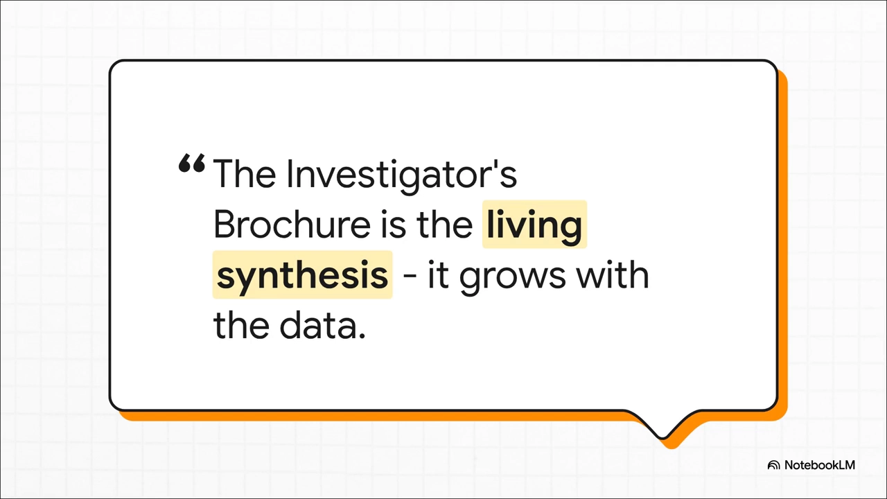
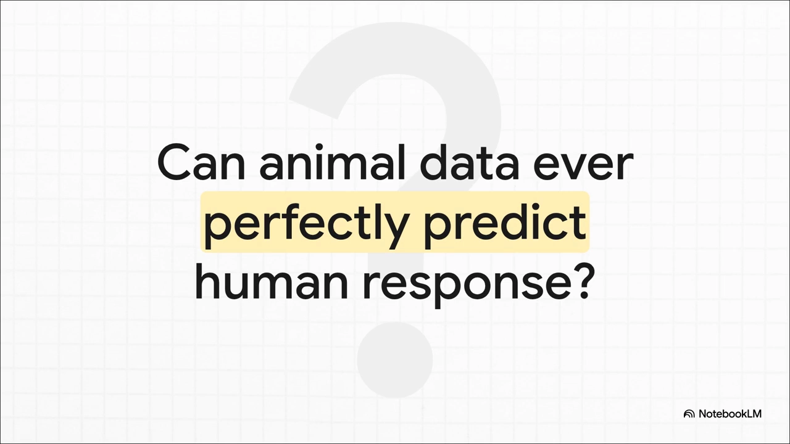

# 首次人体试验前的非临床安全性评价包：种属、遗传毒性与安全药理

> 视频来源：[Module 3 Nonclinical Package](https://www.youtube.com/watch?v=cazCBpAJiOA)（YouTube · WhitehallTraining）｜时长约 7.5 分钟
> 导读：这支视频不教某个实验怎么做，而是给出一张「首次人体试验（FIH）之前必须凑齐哪些证据」的地图：种属怎么选、暴露怎么映射到人、毒理压力测试测什么、安全药理核心组合守哪三个系统、最后怎么合成一本研究者手册。上一篇讲 NOAEL 与安全边际怎么算，本篇讲这些数字在整个评价包里的位置；具体的 ADMET 全景见 2.2.1，反应性代谢物与肝毒性见 2.2.4。

## 本讲要解决的核心问题（SCQA）

**背景**：一个候选分子此前只在细胞、组织和动物身上被测过。它即将第一次进入人体，而这一步是整个研发中不确定性最高的事件。

**冲突**：监管机构关心的东西在这一刻变了——从「理论上能不能转化」变成「人身上实际会发生什么」。而动物数据天生有一个漏洞：如果动物的靶点和人的靶点根本不是同一个东西，那么动物身上观察到的「安全」只是一种假象。

**疑问**：要在人和动物之间搭一座桥，这座桥需要哪些桥墩？每一根桥墩各自排除哪一种风险？

**回答（中心思想）**：非临床评价包是**五根桥墩组成的翻译结构**——种属相关性、暴露映射、毒理压力测试、安全药理核心组合，最后合成研究者手册。它的产出不是「这个药安全」的结论，而是**一份关于「在哪些器官、以什么暴露、可能出现什么损伤」的清单**，这份清单直接写成临床试验的监测计划。

## 一、FIH 这一步的本质：把非临床结论放到人体上检验

[【跳转到 01:30】](https://www.youtube.com/watch?v=cazCBpAJiOA&t=90)

讲者把 FIH 称为「非临床科学被拿来与人类生物学对撞的拐点」。在此之前，所有的安全性判断都建立在一个假设上：动物身上发生的事，人身上也会发生。这个假设越弱，桥就越危险。

整支视频按五段展开：跨到人类生物学（种属选择）、映射暴露（ADME）、毒理压力测试、安全药理检查、以及把这一切合成研究者手册（investigator's brochure, IB）。

## 二、种属选错，后面所有数据都是幻觉

[【跳转到 01:30】](https://www.youtube.com/watch?v=cazCBpAJiOA&t=90)

讲者把种属选择放在第一位，理由是：**再贵的毒理研究，如果种属不相关，数据就保护不了受试者**。

核心概念是**跨种属药理学（cross-species pharmacology）**：动物的靶点是否与人的靶点匹配。讲者给了一个极端但真实的例子——如果在老鼠身上测一个新型抗体，而老鼠的受体序列与人的差异大到药物根本不结合，那么「观察到的安全性」就是幻觉，因为动物**根本没有经历这个药的药理学**。

这也解释了为什么小分子和生物药的种属策略不同：

- **小分子**（讲者举例激酶抑制剂）：靶点高度保守，通常可以用标准的大鼠和狗模型；
- **高靶向性的生物药**（例如人源化单抗）：可能只在食蟹猴身上有交叉反应，这种生物学限制直接决定了整个测试基线。

而且，**种属选择必须向监管机构论证，从来不是默认的**。

## 三、把暴露映射到人：体外 → 体内 → PBPK

[【跳转到 02:14】](https://www.youtube.com/watch?v=cazCBpAJiOA&t=134)

第二根桥墩是暴露。因为毒理实验里真正驱动损伤的是动物体内的**暴露**，而临床要预测的是人体内的暴露，两者之间需要一条换算链。

讲者的三步是：

1. **体外 ADME**：用人的细胞做，最快、最便宜地了解吸收与代谢；
2. **体内 PK**：在活体动物上观察系统暴露，例如峰浓度与半衰期；
3. **PBPK 建模**：用生理学数据把前两步的结果外推，预测人体血药浓度。

这一步的产出被讲者用一句话概括得非常清楚：

**PK 告诉你药在那里，PD 告诉你它起作用，毒理告诉你它损伤什么。** 这句话把三个学科的分工钉死了：只有暴露（PK）测得准，后面「在什么暴露下出现损伤」才有意义——这也是上一篇里 TK 为什么重要的原因。

## 四、毒理压力测试：单次给药找上限，重复给药建证据

[【跳转到 03:40】](https://www.youtube.com/watch?v=cazCBpAJiOA&t=220)

两类研究的分工：

- **单次给药毒理**：本质上是**剂量范围探索**，找出急性的上限；
- **GLP 重复给药毒理**：真正支撑人体剂量论证的核心证据。通常做 **14–28 天**，与计划的临床用药时长匹配或更长，并且通常需要**啮齿类 + 非啮齿类**两个种属，才算全面。

重复给药研究要抓的那个指标，就是 **NOAEL**：

讲者在这里强调了一个关键词：**adverse（不良）**。一个轻微的、非不良的肝酶波动并不构成 NOAEL 的边界；NOAEL 是「真正的毒性损伤」之前的那一级。这与上一篇「不良改变 vs 适应性改变」的区分是同一件事。

片中还提到一个重要的例外：**肿瘤药**。如果药物本身就是细胞毒药物、用于晚期癌症，健康受试者就完全不适用；此时看的是啮齿类里的 **STD10**（10% 动物出现严重毒性的剂量），因为患者人群本身处于晚期疾病状态，风险-获益的尺度允许把剂量推得离毒性更近。

## 五、遗传毒性闸门：三项不可谈判的试验

[【跳转到 04:43】](https://www.youtube.com/watch?v=cazCBpAJiOA&t=283)

无论适应证是什么，任何标准药物在推进之前都必须通过遗传毒性这一关。讲者称这三项试验「不可谈判」，目的是确保化合物**不会损伤或突变细胞 DNA**：

- **细菌回复突变试验（Ames test）**：检测点突变；
- **体外染色体畸变试验**：检测染色体层面的结构异常；
- **体内微核试验**：在整体动物中检测染色体损伤。

讲者的判断很直接：这里出现明确的阳性结果，**可以当场终止一个项目**。原因不难理解——遗传毒性不指向某个可监测、可恢复的器官功能，它指向的是不可逆的遗传物质损伤。

## 六、安全药理核心组合：守三个「维持生命」的系统

[【跳转到 05:13】](https://www.youtube.com/watch?v=cazCBpAJiOA&t=313)

安全药理（safety pharmacology）与一般毒理的分工，讲者用一句话切开：**一般毒理看几周尺度上的器官损伤，安全药理看的是对生命支持系统的急性、即时影响**。

| 系统 | 试验 | 关切 |
| --- | --- | --- |
| 心血管 | 清醒犬遥测 | QT 间期延长 |
| 中枢神经 | 大鼠 Irwin 观察试验 | 惊厥、镇静 |
| 呼吸 | 大鼠全身体积描记 | 呼吸节律异常 |

讲者称 QT 间期延长是「监管上极其敏感的红线」，并强调：**没有这套基线，首次人体试验根本不能开展**。这里值得注意方法学上的一个细节——心血管用的是**清醒、自由活动的动物遥测**，而不是麻醉动物，因为麻醉与应激本身会干扰心电与血压读数。

## 七、把数据合成研究者手册：靶器官清单写成临床监测计划

[【跳转到 06:19】](https://www.youtube.com/watch?v=cazCBpAJiOA&t=379)

最后一根桥墩是把前面所有数据合成一份叙事，落到**靶器官毒性（target organs of toxicity, TOOT）**上。

讲者的例子非常具体：如果狗的毒理研究显示轻度肾小管空泡化，那么首次人体试验的方案就**必须**规定尿常规与肾功能监测。他的原话是——**非临床数据实际上是在写临床安全计划**。

而研究者手册本身不是一份静态文件：

它整合主要药理学、ADME、毒理与安全性预测，并在第一批人体数据出现时立即更新。这一点区分了两种文件：一种是给监管机构看的档案，一种是给临床研究者用的工作文档。

## 补充：毒性来自靶标本身，还是来自靶标之外

> 以下是背景补充，不是讲者原话。讲者在本片只按「器官系统」组织毒性，没有展开毒性的分子来源。

同样的器官损伤，背后的分子原因可以完全不同，这决定了你该改什么：

- **靶标相关毒性（on-target）**：结合的就是设计靶点，但这个靶点在正常组织里也表达，或这个靶点本身还控制别的生理功能。例如抑制某个代谢通路，同时影响心肌或中枢的同一通路。这类毒性往往**换不掉**，只能靠控制暴露、改变给药方式或换靶点来缓解。
- **脱靶毒性（off-target）**：结合了设计之外的蛋白。最经典的是心脏钾通道 **hERG** 被阻断导致 QT 间期延长——这正是上面安全药理核心组合里心血管那一项盯的东西。其他常见例子包括 5-HT2B 受体激动相关的瓣膜病变、激酶抑制剂在激酶组内的交叉抑制。

这个区分与评价包的三块内容正好对应：**安全药理核心组合**和**体外离子通道／受体筛选**主要抓脱靶；**重复给药毒理的靶器官**既可能是 on-target（靶点在器官内表达），也可能是 off-target；**遗传毒性**则两类都不属于，它是化合物本身对 DNA 的化学反应性损伤。

## 八、外推的极限：动物数据能否完美预测人

[【跳转到 07:24】](https://www.youtube.com/watch?v=cazCBpAJiOA&t=444)

讲者在收尾时没有给出乐观结论，而是把问题抛回来：

他的表述是：历史已经表明，**转化会失败，而且确实失败过**，尤其是在涉及新的免疫通路时。我们可以搭出最严谨的非临床桥梁，但第一位受试者接受给药的那一刻，我们就走下了桥，进入未知。

这句话给整条链路定了性：非临床评价包的价值不在于**消除**不确定性，而在于把不确定性**定位**——定位到具体的器官、具体的暴露、具体的监测指标上，让临床阶段有人盯着正确的地方。

## 小结

- FIH 之前要凑齐的不是一份「安全证明」，而是**五根桥墩**：种属相关性、暴露映射、毒理压力测试、安全药理核心组合、研究者手册。
- **种属选错，数据就是幻觉**：小分子靶点常高度保守（大鼠＋狗），生物药可能只在食蟹猴有交叉反应，种属选择必须向监管论证。
- 暴露的换算链是**体外 ADME → 体内 PK → PBPK**；PK 说明药在不在，PD 说明有没有作用，毒理说明损伤什么。
- **单次给药**找急性上限，**GLP 重复给药（14–28 天、两个种属）**才是核心证据；抓的指标是 NOAEL，关键词是「adverse」；细胞毒类肿瘤药改用 STD10。
- **遗传毒性三项**（Ames、体外染色体畸变、体内微核）是不可谈判的闸门，阳性可终止项目。
- **安全药理核心组合**守心血管（犬遥测、QT）、CNS（Irwin）、呼吸（体积描记）三个系统，缺了它不能开 FIH。
- **靶器官清单直接写成临床监测计划**；研究者手册是随人体数据更新的活文档。
- 转化会失败，非临床包的作用是**定位**不确定性而不是消除它。

## 关键术语速查

| 术语 | 一句话解释 |
| --- | --- |
| 非临床评价包 | 支持首次人体试验的安全性证据集合，含种属论证、暴露、毒理与安全药理 |
| 跨种属药理学 | 动物靶点与人体靶点是否匹配，决定动物数据是否有效 |
| 相关种属 | 药物能与之结合并产生药理作用的动物种属 |
| PBPK | 生理药代动力学模型，用生理学参数预测人体暴露 |
| 重复给药毒理 | 14–28 天（或更长）的 GLP 研究，通常需啮齿类＋非啮齿类 |
| STD10 | 10% 动物出现严重毒性的剂量，用于细胞毒类肿瘤药的起始剂量推算 |
| 遗传毒性组合 | Ames、体外染色体畸变、体内微核三项试验 |
| 安全药理核心组合 | 心血管、中枢神经、呼吸三个生命支持系统的急性功能检查 |
| TOOT | 靶器官毒性：动物数据中显示损伤的器官清单 |
| 研究者手册（IB） | 整合药理学、ADME、毒理与安全性预测的活文档，随人体数据更新 |
| hERG | 心脏钾通道，其阻断与 QT 延长相关，属典型脱靶风险 |