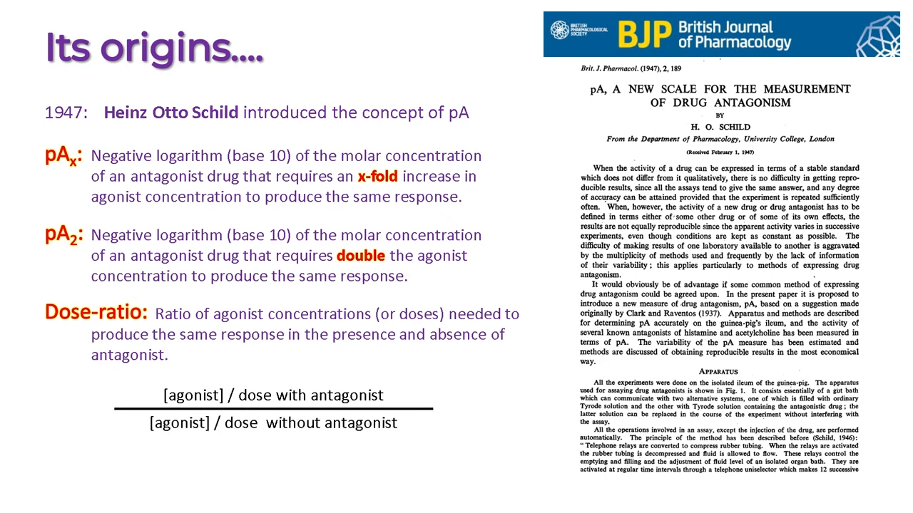
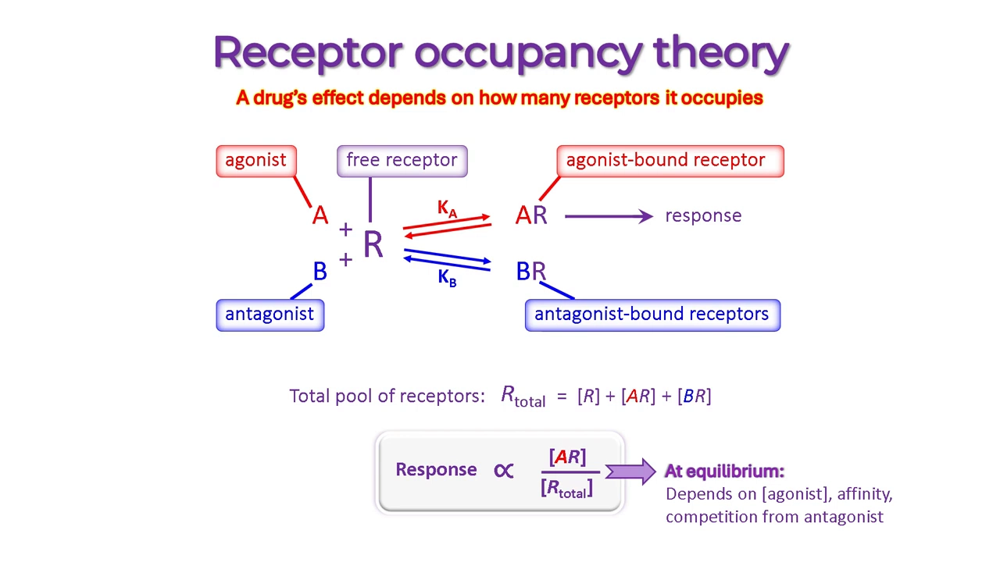
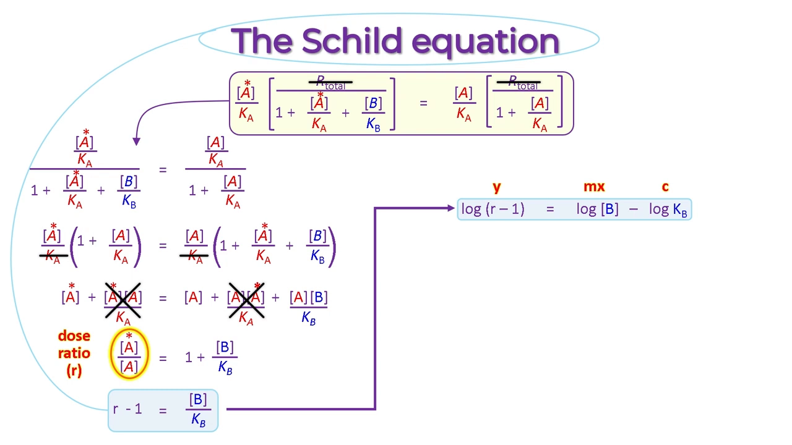
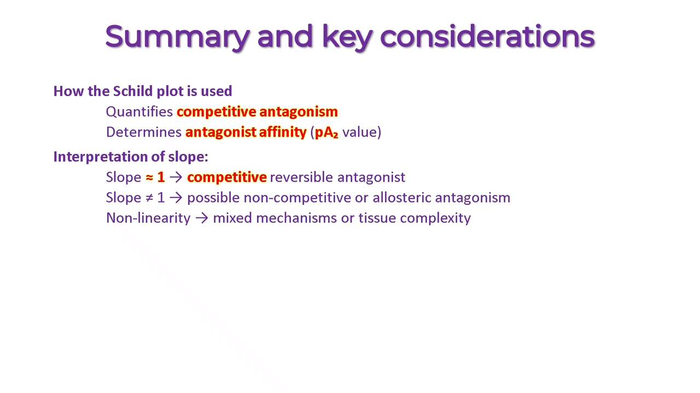
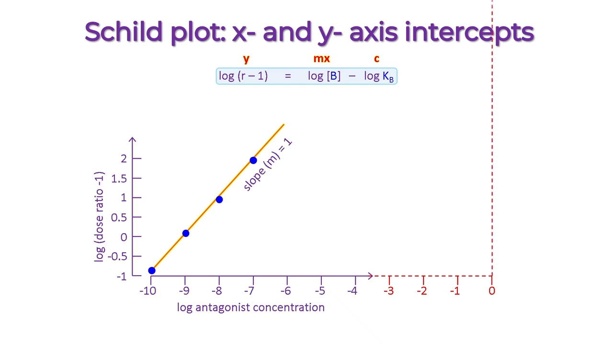
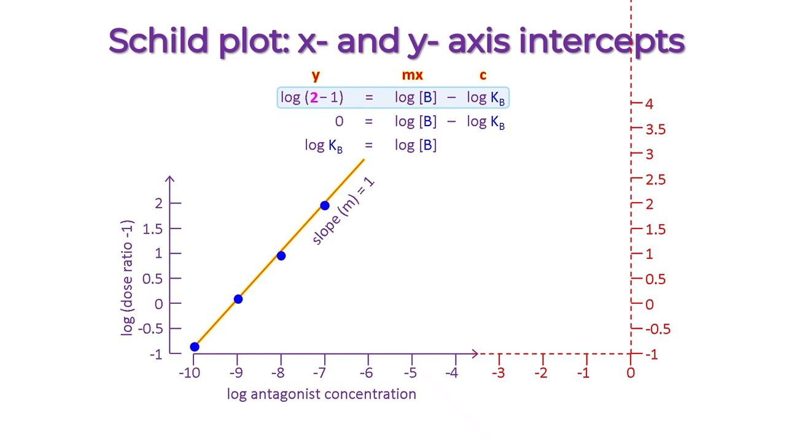
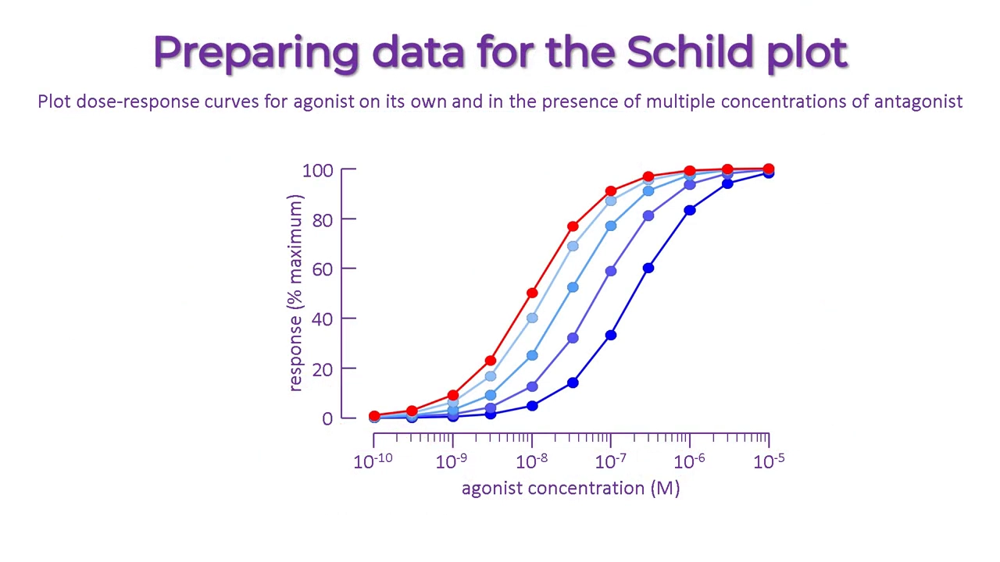
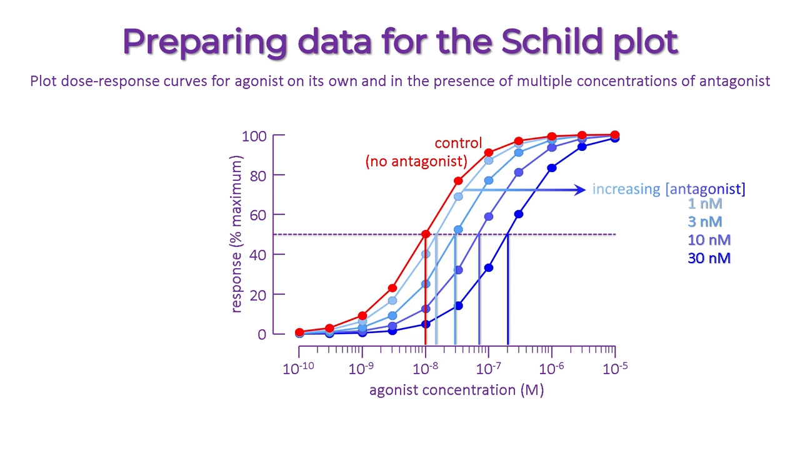
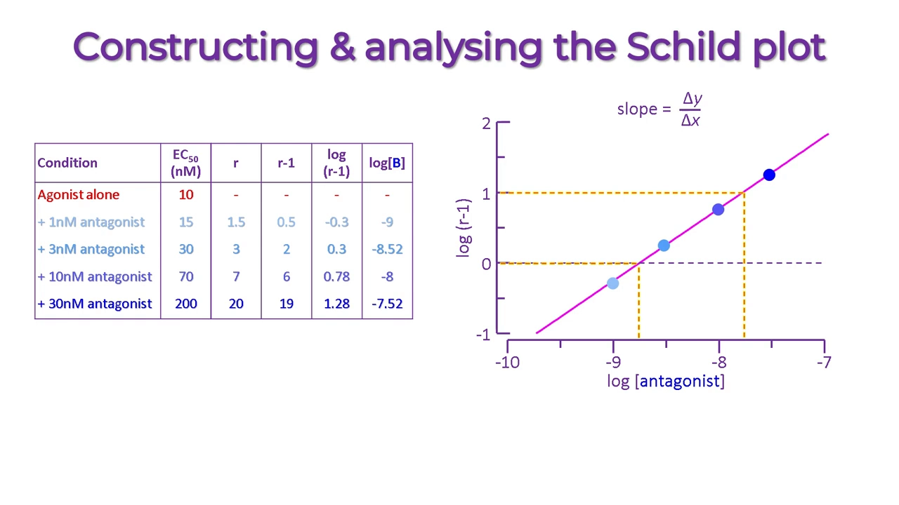

# Schild 回归与 pA2：怎么用一组右移的曲线证明「竞争性拮抗」

> 视频来源：[The Schild Equation Explained — Understanding Competitive Antagonism in Pharmacology](https://www.youtube.com/watch?v=mpiVGoO0wjQ)（YouTube · Professor G - Pharmacology）｜时长约 24 分钟
> 导读：这是一支以推导为主的幻灯片课。它从「剂量比」这个可测量的量出发，用质量作用定律把 Schild 方程一步步推出来，再演示怎么把方程变成一条直线、从直线上读出 $pA_2$，最后指出一个常见的操作错误——用外推得到的截距去报 $pA_2$。本文保留全部推导步骤，并把「斜率偏离 1 意味着什么」讲清楚。上篇《同一组曲线怎么读作用机制》讲的是定性判读，本文是它的定量续篇；$K_i$ 与 $IC_{50}$ 的关系见《IC50 是怎么测出来的》。

## 本讲要解决的核心问题（SCQA）

**背景**：上篇的结论是：竞争性拮抗的曲线「右移但 $E_{\max}$ 不变」，非竞争性拮抗「$E_{\max}$ 下降」。看形状能分个大概。

**冲突**：但「大概」不够用。两个都让曲线右移的拮抗剂，谁的亲和力更高？右移多少才算「竞争性」？更麻烦的是，右移幅度本身不是常数——拮抗剂浓度越高，右移越多。如果只报「加了拮抗剂后 $EC_{50}$ 变成 30 nM」，这个数字既不能跨浓度比较，也不能跨实验室比较。

**疑问**：有没有一个量，能把「右移多少」折算成拮抗剂自身的亲和力，并且这个折算关系可以被实验检验？

**回答（中心思想）**：**有，就是剂量比 $r$ 与 Schild 方程 $r - 1 = [B]/K_B$。把不同拮抗剂浓度下的 $r$ 取对数作图，理论上得到一条斜率为 1 的直线；斜率是否为 1 就是「是不是可逆竞争性拮抗」的定量检验，而直线上 $r = 2$ 那一点对应的拮抗剂浓度就是 $K_B$，取负对数即 $pA_2$。** 讲者还特别提醒：**不要用回归线与纵轴的交点去读 $pA_2$**，因为那个交点远在数据范围之外，完全靠外推。

## 一、先定义可测量的量：剂量比与 $pA_x$

### 1.1 $pA_x$ 是「负对数」，逻辑和 pH 一样

Schild 在 1947 年提出 $pA_x$：**使激动剂浓度需要增加 $x$ 倍才能达到同样效应时，拮抗剂浓度的负对数** [【跳转到 00:37】](https://www.youtube.com/watch?v=mpiVGoO0wjQ&t=37)。$pA_x$ 与 pH 的相似之处在于，两者都是浓度的负对数，把跨越几个数量级的数字压成便于比较的小数字 [【跳转到 01:07】](https://www.youtube.com/watch?v=mpiVGoO0wjQ&t=67)。

日常最常用的是 $pA_2$：**让激动剂浓度翻倍所需的拮抗剂浓度的负对数** [【跳转到 01:07】](https://www.youtube.com/watch?v=mpiVGoO0wjQ&t=67)。

### 1.2 剂量比：同一效应水平上的两个浓度之比

要算「翻了几倍」，就得先有一个「同样的效应」。做法是：在效应轴上画一条水平线（例如 50% 最大效应），它与「只有激动剂」的曲线和「加了拮抗剂」的曲线各交于一点，两个交点对应的激动剂浓度之比，就是**剂量比**（dose ratio，记作 $r$）[【跳转到 01:32】](https://www.youtube.com/watch?v=mpiVGoO0wjQ&t=92)：

$$
r = \frac{[\text{激动剂}]_{\text{有拮抗剂}}}{[\text{激动剂}]_{\text{无拮抗剂}}}
$$

**这一步是整个方法的地基**：剂量比只要求「效应相同」，不要求效应一定是 50%，所以它对部分激动剂、对曲线形状略有差异的体系都成立。

## 二、从质量作用定律推出 Schild 方程

### 2.1 受体占据模型：效应正比于被激动剂占据的比例

推导的出发点是受体占据理论：效应取决于有多少受体被激动剂占据，占据越多效应越大，直到全部占满达到最大 [【跳转到 02:39】](https://www.youtube.com/watch?v=mpiVGoO0wjQ&t=159)。写成可逆反应就是 $A + R \rightleftharpoons AR$，$AR$ 产生效应，解离常数为 $K_A$；加入竞争性拮抗剂 $B$ 后，$B + R \rightleftharpoons BR$，$BR$ 不产生效应，解离常数为 $K_B$ [【跳转到 03:29】](https://www.youtube.com/watch?v=mpiVGoO0wjQ&t=209)。

受体总量因此被分成三份 [【跳转到 04:19】](https://www.youtube.com/watch?v=mpiVGoO0wjQ&t=259)：

$$
R_{\text{total}} = [R] + [AR] + [BR]
$$

而效应正比于 $[AR]/R_{\text{total}}$ [【跳转到 04:44】](https://www.youtube.com/watch?v=mpiVGoO0wjQ&t=284)。

### 2.2 质量作用定律给出各部分的浓度

对 $A$ 与 $B$ 分别用质量作用定律，平衡时正向速率等于逆向速率，可以解出 [【跳转到 07:14】](https://www.youtube.com/watch?v=mpiVGoO0wjQ&t=434)：

$$
[AR] = \frac{[A][R]}{K_A}, \qquad [BR] = \frac{[B][R]}{K_B}
$$

代回总量式并提取公因子 $[R]$ [【跳转到 09:19】](https://www.youtube.com/watch?v=mpiVGoO0wjQ&t=559)：

$$
R_{\text{total}} = [R]\left(1 + \frac{[A]}{K_A} + \frac{[B]}{K_B}\right)
$$

于是游离受体浓度为：

$$
[R] = \frac{R_{\text{total}}}{1 + \dfrac{[A]}{K_A} + \dfrac{[B]}{K_B}}
$$

再代回 $[AR]$，就得到「有拮抗剂时被激动剂占据的受体量」[【跳转到 09:44】](https://www.youtube.com/watch?v=mpiVGoO0wjQ&t=584)。

### 2.3 令两种条件下的效应相等，就得到剂量比

关键一步：**在有无拮抗剂两种条件下取同一个效应，则 $[AR]$ 必须相等**，唯一的差别是所需激动剂浓度不同——把有拮抗剂时的浓度记作 $[A^*]$ [【跳转到 10:34】](https://www.youtube.com/watch?v=mpiVGoO0wjQ&t=634)。把两个表达式写成等式，约掉两边共同的 $R_{\text{total}}$ 与 $K_A$，整理后得到一个非常干净的比值 [【跳转到 12:39】](https://www.youtube.com/watch?v=mpiVGoO0wjQ&t=759)：

$$
\frac{[A^*]}{[A]} = 1 + \frac{[B]}{K_B}
$$

左边正是剂量比 $r$，于是 [【跳转到 13:04】](https://www.youtube.com/watch?v=mpiVGoO0wjQ&t=784)：

$$
r - 1 = \frac{[B]}{K_B}
$$

**这就是 Schild 方程。** 它的含义值得逐字读一遍：剂量比只由拮抗剂决定——**与激动剂的亲和力 $K_A$ 无关，与组织、与受体的表达量也无关**。这正是它能作为「拮抗剂亲和力指标」的原因。

### 2.4 取对数，变成一条直线

两边取对数，方程变成 $y = mx + c$ 的形式 [【跳转到 13:29】](https://www.youtube.com/watch?v=mpiVGoO0wjQ&t=809)：

$$
\log(r - 1) = \log[B] - \log K_B
$$

以 $\log(r-1)$ 为纵轴、$\log[B]$ 为横轴，理论上得到**斜率 $m = 1$** 的直线，截距给出拮抗剂的亲和力 [【跳转到 13:54】](https://www.youtube.com/watch?v=mpiVGoO0wjQ&t=834)。

## 三、这条直线怎么读：斜率、截距与一个陷阱

### 3.1 斜率 = 1 才是「可逆竞争性」

直线的斜率是判据本身：**斜率接近 1 → 可逆竞争性拮抗**；斜率明显偏离 1 → 可能涉及非竞争性或变构机制；数据点不成直线 → 混合机制或组织层面的复杂性 [【跳转到 13:54】](https://www.youtube.com/watch?v=mpiVGoO0wjQ&t=834)。

### 3.2 陷阱：不要用纵轴截距读 $pA_2$

按方程，纵轴截距（$\log[B] = 0$ 处）应该等于 $-\log K_B$，也就是 $pA_2$。讲者说：**理论上如此，实践中不可靠** [【跳转到 14:19】](https://www.youtube.com/watch?v=mpiVGoO0wjQ&t=859)。

理由很具体。典型实验中拮抗剂在纳摩尔到微摩尔范围，$\log[B]$ 大约落在 $-10$ 到 $-4$；剂量比从略大于 1 到约 100，对应的 $\log(r-1)$ 大约落在 $-0.7$ 到 $2$。数据点只覆盖这一小段，而纵轴截距要求横轴取到 $0$——**也就是要把直线向外推很远** [【跳转到 15:34】](https://www.youtube.com/watch?v=mpiVGoO0wjQ&t=934)。

外推带来两个问题：第一，截距完全落在实验范围之外，结果全靠外推；第二，截距对拟合斜率极其敏感——在数据范围内斜率的小误差几乎看不出来，外推到截距时会被放大成很大的误差 [【跳转到 16:24】](https://www.youtube.com/watch?v=mpiVGoO0wjQ&t=984)。

### 3.3 正确做法：从 $r = 2$ 那一点读

替代方案利用了 $pA_2$ 的定义本身。当剂量比 $r = 2$ 时，$r - 1 = 1$，$\log(r-1) = 0$，代入 Schild 方程得 $\log K_B = \log[B]$——也就是说，**$K_B$ 就是让剂量比等于 2 的那个拮抗剂浓度** [【跳转到 16:49】](https://www.youtube.com/watch?v=mpiVGoO0wjQ&t=1009)。

图形操作是：从纵轴 $0$ 处画水平线交回归线，再垂直落到横轴，读到的就是 $\log K_B$，取负号即 $pA_2$ [【跳转到 17:39】](https://www.youtube.com/watch?v=mpiVGoO0wjQ&t=1059)。

**这个操作的关键差别在于**：$r=2$ 对应的点位于数据范围之内（或紧邻），而纵轴截距远在范围之外。同一个方程，换一个读法，稳健性完全不同。

## 四、完整操作流程：从一组曲线到一张表

讲者把整个流程串成六步。

### 4.1 先做一族曲线

固定激动剂、改变拮抗剂浓度，测出一族剂量—效应曲线：横轴是激动剂浓度的对数，纵轴是「占最大效应的百分比」。红色曲线是无拮抗剂的对照，几条蓝色曲线是递增拮抗剂浓度下的结果 [【跳转到 18:04】](https://www.youtube.com/watch?v=mpiVGoO0wjQ&t=1084)。

**这一族曲线的形状本身就是第一道检查**：如果各条曲线的平台高度一致、只是水平位置不同，就符合竞争性拮抗的预期；如果平台高度下降，先别急着做 Schild 图。

### 4.2 在同一效应水平上取浓度

在 50% 处画水平线，与每条曲线相交，垂线落到横轴得到各自的 $EC_{50}$，列表记录 [【跳转到 18:54】](https://www.youtube.com/watch?v=mpiVGoO0wjQ&t=1134)。

### 4.3 算剂量比、再算 $\log(r-1)$

每个拮抗剂浓度对应一个 $r = EC_{50}^{\text{有}} / EC_{50}^{\text{无}}$，再算 $r - 1$ 与 $\log(r-1)$，同时取 $\log[B]$ [【跳转到 19:44】](https://www.youtube.com/watch?v=mpiVGoO0wjQ&t=1184)。

讲者的示例数据可以直接照着核对：对照 $EC_{50} = 10$ nM；加 1 nM 拮抗剂后 15 nM（$r = 1.5$，$r-1 = 0.5$，$\log(r-1) = -0.3$）；3 nM 后 30 nM（$r = 3$，$r-1 = 2$，$\log = 0.3$）；10 nM 后 70 nM（$r = 7$，$r-1 = 6$，$\log = 0.78$）；30 nM 后 200 nM（$r = 20$，$r-1 = 19$，$\log = 1.28$）[【跳转到 19:19】](https://www.youtube.com/watch?v=mpiVGoO0wjQ&t=1159)。

### 4.4 作图、验斜率、读 $pA_2$

把五个点画到 $\log(r-1)$ 对 $\log[B]$ 的坐标上，拟合直线，检查斜率是否接近 1（讲者用「$y$ 变化 1 个单位对应 $x$ 变化 1 个单位」来演示），再从 $r=2$ 处读出 $\log K_B$，示例中横轴截距约 $-8.75$，故 $pA_2 = 8.75$ [【跳转到 20:59】](https://www.youtube.com/watch?v=mpiVGoO0wjQ&t=1259)。

### 4.5 为什么 $pA_2$ 值得报

$pA_2$ 是拮抗剂对受体的亲和力的量度，而且**不依赖激动剂浓度、也不依赖组织的反应能力** [【跳转到 21:49】](https://www.youtube.com/watch?v=mpiVGoO0wjQ&t=1309)。这一点和 $IC_{50}$ 形成鲜明对比：$IC_{50}$ 会随底物浓度、酶浓度、温孵时间变化，所以跨条件不可比；$pA_2$ 的设计目标就是跨条件可比。

## 五、这个方法的边界

讲者在结尾列了三条假设，值得和结论一起记住 [【跳转到 22:39】](https://www.youtube.com/watch?v=mpiVGoO0wjQ&t=1359)：

1. **必须达到平衡**。Schild 方程是平衡态推导，若拮抗剂结合慢、或激动剂作用本身不可逆，曲线会漂移，剂量比不稳定。
2. **假设了简单的受体模型**。单一受体群、单一结合位点、$B$ 只竞争不改变 $A$ 的效能。一旦存在受体亚型混合、受体储备差异、或变构耦合，斜率就会偏离 1。
3. **需要多个拮抗剂浓度上的准确测量**。只有两三个浓度时，斜率几乎无法被检验，「斜率是否为 1」这个判据就失效了。

**把这三条和上篇的结论合起来看**，就得到一条完整的证据链：先用曲线形状做定性分类（右移且 $E_{\max}$ 不变），再用 Schild 回归做定量检验（斜率是否为 1），最后用 $pA_2$ 报一个可跨实验比较的亲和力数字。任何一步不满足，就只能退回到「表观竞争性」的说法。

> **补充（非讲者原话）**：Schild 分析只处理「拮抗剂与激动剂争夺同一个位点」这一种机制。若拮抗剂是变构调节剂，它可能只改变激动剂的亲和力（曲线右移、$E_{\max}$ 不变，与竞争性难以区分）或只改变效能（$E_{\max}$ 下降），此时 Schild 图往往给出偏离 1 的斜率。要区分「正构竞争」与「变构调节」，需要额外的结合实验（例如证明两种配体可以同时结合），单靠功能曲线不够——这与上篇「曲线同形时必须另做实验」是同一条纪律。

## 小结

- **剂量比 $r$** 是同一效应水平上两个激动剂浓度之比，是 Schild 分析唯一的原始输入。
- **Schild 方程 $r - 1 = [B]/K_B$** 由质量作用定律与受体占据模型推出，只含拮抗剂参数，不含激动剂亲和力与组织参数。
- **取对数后应得斜率 1 的直线**；斜率是否为 1 就是「可逆竞争性拮抗」的定量判据。
- **不要用纵轴截距读 $pA_2$**：截距要求把直线外推到 $\log[B] = 0$，远在数据范围之外，误差被放大。
- **正确读法是从 $r = 2$ 处读 $\log K_B$**，该点位于数据范围内，$pA_2 = -\log K_B$。
- **$pA_2$ 的价值在于可比性**：它不随激动剂浓度与组织反应性变化，这一点与 $IC_{50}$ 相反。
- **三条前提**：平衡、简单受体模型、足够的拮抗剂浓度点；任一不满足，斜率判据就不可靠。

## 关键术语速查

| 术语 | 一句话解释 |
| --- | --- |
| 剂量比 $r$ | 达到同一效应时，有/无拮抗剂所需激动剂浓度之比 |
| $pA_x$ | 使激动剂浓度增加 $x$ 倍所需拮抗剂浓度的负对数 |
| $pA_2$ | $x = 2$ 的特例，即让激动剂浓度翻倍所需拮抗剂浓度的负对数 |
| $K_B$ | 拮抗剂的解离常数，等于产生剂量比 2 时的拮抗剂浓度 |
| Schild 方程 | $r - 1 = [B]/K_B$，把剂量比折算成拮抗剂亲和力 |
| Schild 图 | $\log(r-1)$ 对 $\log[B]$ 作图，理想斜率为 1 |
| 可逆竞争性拮抗 | Schild 斜率接近 1，且曲线右移而 $E_{\max}$ 不变 |
| 斜率偏离 1 | 提示非竞争性、变构调节或受体体系不单一 |