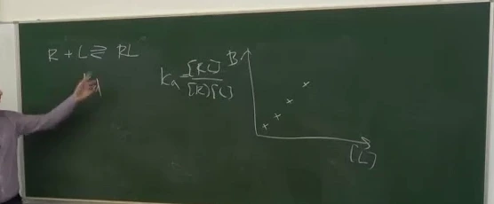
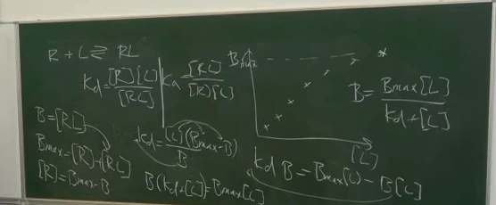
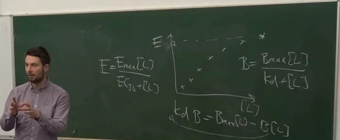
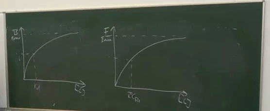
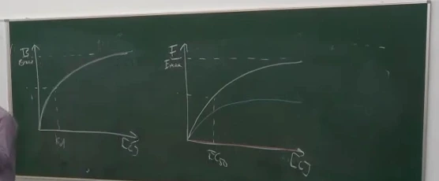
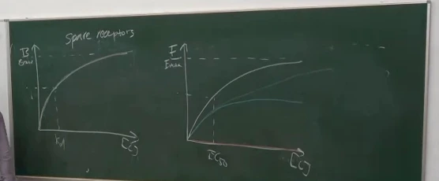
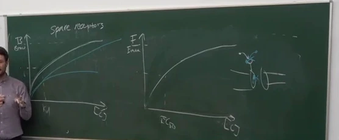
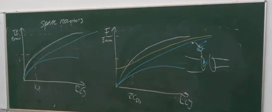
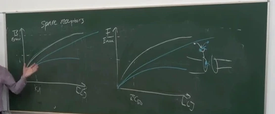

# 同一组曲线怎么读作用机制：亲和力、效能与拮抗类型

> 视频来源：[Receptors in pharmacology 2019](https://www.youtube.com/watch?v=jRpDH4B1ePw)（YouTube · Jan Trnka，药理学课堂录像）｜时长约 74 分钟
> 导读：这是一堂几乎不写幻灯片的黑板课。讲者只用两个坐标系——左边「结合量对浓度」，右边「效应对浓度」——把激动剂、拮抗剂、部分激动剂、反向激动剂，以及竞争性与非竞争性拮抗全部重画了一遍。本文按他的画图顺序整理，重点在「看到什么形状，能推出什么机制，不能推出什么」。曲线的拟合操作与浓度梯度设计见本小节《IC50 是怎么测出来的》；$K_d$ 与 $K_i$ 的实验假设见《Kd, the Dissociation Constant》；共价抑制的化学见《共价与不可逆抑制》。

## 本讲要解决的核心问题（SCQA）

**背景**：药理学入门都会背四个词——亲和力、内在活性、激动剂、拮抗剂。也都会背一句「竞争性拮抗使曲线右移，非竞争性拮抗使最大效应下降」。

**冲突**：但真正拿到一组实验曲线时，问题立刻变得具体：这条曲线是结合曲线还是效应曲线？同一个 $K_d$ 的两个配体，为什么一个让血管收缩、一个什么都不做？一条「最大效应掉下来」的曲线，到底是被不可逆地堵死了受体，还是别构改变了结合口袋，还是细胞本身受体就不够？只背结论的人在这里会卡住，因为**结论是从曲线上读出来的，而曲线本身不会告诉你它属于哪一类**。

**疑问**：那么，怎样用同一套坐标系，把「结合」和「效应」分开画，再逐类对照，从而把一条曲线的形状翻译成作用机制？

**回答（中心思想）**：**把每个配体都画成一对曲线——左图结合、右图效应——机制就藏在「两条曲线是否同步变化」里。结合曲线只由 $K_d$ 和 $B_{\max}$ 决定，与效应无关；效应曲线由 $E_{\max}$ 和 $EC_{50}$ 决定，可以完全脱离结合曲线。于是：结合同、效应为零 = 拮抗剂；结合同、效应打折 = 部分激动剂；结合同、效应为负 = 反向激动剂；效应曲线右移但 $E_{\max}$ 不变 = 可被顶回来的竞争性拮抗；$E_{\max}$ 下降 = 顶不回来的非竞争性/不可逆拮抗。** 讲者反复强调的一句话是：**结合是效应的必要条件，但不是充分条件** [【跳转到 30:01】](https://www.youtube.com/watch?v=jRpDH4B1ePw&t=1801)。

## 一、先把「结合」画成一条只由 $K_d$ 决定的曲线

### 1.1 结合实验测的是留在膜上的放射性

讲者从最经典的放射配体结合实验讲起：取含目标受体的组织（历史上常用大鼠脑），匀浆、离心、洗掉胞质，只留细胞膜；再加入不同浓度、带放射性标记的配体，孵育、洗涤、离心，最后数留在膜上的放射性——那就是结合量 [【跳转到 01:58】](https://www.youtube.com/watch?v=jRpDH4B1ePw&t=118)。横轴是配体浓度，纵轴是结合量，得到一条饱和曲线 [【跳转到 03:38】](https://www.youtube.com/watch?v=jRpDH4B1ePw&t=218)。

为什么这件事值得做？因为新药开发要确认两件事：**它只结合你想作用的那一个受体亚型**（否则副作用不可控），以及**它的亲和力足够高**——亲和力越高，达到占位所需的剂量越低 [【跳转到 04:37】](https://www.youtube.com/watch?v=jRpDH4B1ePw&t=277)。

### 1.2 把结合当成一个化学反应，$K_d$ 就自己长出来了

讲者的推导没有任何跳跃：把结合写成可逆反应 $R + L \rightleftharpoons RL$，平衡时用质量作用定律写出缔合常数 [【跳转到 07:19】](https://www.youtube.com/watch?v=jRpDH4B1ePw&t=439)：

$$
K_a = \frac{[RL]}{[R][L]}
$$

药理学按惯例取它的倒数，得到解离常数 [【跳转到 08:14】](https://www.youtube.com/watch?v=jRpDH4B1ePw&t=494)：

$$
K_d = \frac{[R][L]}{[RL]}
$$

接下来是这堂课的第一个关键动作：**把方程里的抽象符号换成实验能测的量**。结合量 $B$ 就是被占住的受体数，所以 $B = [RL]$；而受体总数在实验里是未知的，但任何时刻「游离受体 + 被占受体」都等于总数，饱和时所有受体都被占住，所以 $B_{\max} = [R] + [RL]$，于是 $[R] = B_{\max} - B$ [【跳转到 10:03】](https://www.youtube.com/watch?v=jRpDH4B1ePw&t=603)。

把这两个替换代回去、整理，就得到那条熟悉的饱和曲线 [【跳转到 16:43】](https://www.youtube.com/watch?v=jRpDH4B1ePw&t=1003)：

$$
B = \frac{B_{\max}\,[L]}{K_d + [L]}
$$

讲者特意点出：这个式子和米氏方程长得一模一样，**这不是巧合**——两者都是从同一个平衡常数推出来的，只是酶动力学里还假定了「结合之后立刻发生反应」，而这里我们暂时不关心结合之后发生什么 [【跳转到 17:12】](https://www.youtube.com/watch?v=jRpDH4B1ePw&t=1032)。

### 1.3 效应曲线形状相同，但换了两个参数

讲者的第二个关键动作，是把同一套数学搬到效应上：把 $B$ 换成效应 $E$、$B_{\max}$ 换成 $E_{\max}$、$K_d$ 换成 $EC_{50}$ [【跳转到 26:05】](https://www.youtube.com/watch?v=jRpDH4B1ePw&t=1565)：

$$
E = \frac{E_{\max}\,[L]}{EC_{50} + [L]}
$$

$EC_{50}$ 是「产生最大效应一半时的浓度」。讲者用血管收缩举例：一段血管，加一点配体直径变小一点，加到不能再缩就是 $E_{\max}$，取一半就是 $E_{\max}/2$，对应的浓度就是 $EC_{50}$ [【跳转到 27:28】](https://www.youtube.com/watch?v=jRpDH4B1ePw&t=1648)。

**这里要停一下，因为初学者最常犯的错就在这一步**：两条曲线形状相同，不等于两个参数含义相同。$K_d$ 描述的是「配体有多想结合」，$EC_{50}$ 描述的是「要多少浓度才能做出半个最大效应」。前者只跟结合有关，后者还牵扯受体后的信号放大。讲者的原话是：$EC_{50}$ 是 $K_d$ 的对应物，但**它并不是同一个东西** [【跳转到 28:35】](https://www.youtube.com/watch?v=jRpDH4B1ePw&t=1715)。

## 二、四类配体：按效应分类，不按亲和力分类

讲者说这堂课只引入四个新词，就是下面这四类 [【跳转到 19:27】](https://www.youtube.com/watch?v=jRpDH4B1ePw&t=1167)：

| 类别 | 结合 | 效应 | 讲者的说法 |
| --- | --- | --- | --- |
| 激动剂 agonist | 结合 | 激活受体 | 结合并激活 |
| 拮抗剂 antagonist | 结合 | 零 | 结合但「什么都不做」 |
| 部分激动剂 partial agonist | 结合 | 低于全激动剂 | 激活，但激活得少 |
| 反向激动剂 inverse agonist | 结合 | 负 | 产生与激动剂相反的效果 |

拮抗剂既然什么都不做，为什么有用？因为它**挡住激动剂**——要么不让激动剂结合，要么不让结合后的受体产生效应 [【跳转到 20:51】](https://www.youtube.com/watch?v=jRpDH4B1ePw&t=1251)。

### 2.1 部分激动剂：受体不是开关，是概率

讲者用离子通道型受体解释「部分」是什么意思。教科书式的图像是「配体来了通道就打开、配体走了就关上」，他说**真实情况完全不是这样**：没有配体时，通道也在随机构象涨落，不停地开开关关；配体做的不是把 0 变成 1，而是**改变通道处于开放态的概率** [【跳转到 21:55】](https://www.youtube.com/watch?v=jRpDH4B1ePw&t=1315)。

于是「部分」就有了物理含义：全激动剂把开放概率从 10% 推到 99%，部分激动剂只推到 50%，反向激动剂把它压到 1%，而拮抗剂让它停在 10% 不动 [【跳转到 25:15】](https://www.youtube.com/watch?v=jRpDH4B1ePw&t=1515)。部分激动剂的「效能」可以是 50%、75%、10%——这些数字与亲和力**没有直接关系** [【跳转到 23:16】](https://www.youtube.com/watch?v=jRpDH4B1ePw&t=1396)。

这一点值得单独记住：**完全可以存在「亲和力极高但只能激活一半」的部分激动剂，也存在「亲和力不高但一旦结合就全力激活」的全激动剂**。亲和力和效能是两个独立的轴，不是一根滑尺的两端 [【跳转到 23:34】](https://www.youtube.com/watch?v=jRpDH4B1ePw&t=1414)。

顺带一个方法学提醒：全激动剂的「100%」其实是**约定**，因为现实中我们永远不知道真正的最大效应是多少，通常拿一个已知很好的激动剂（例如谷氨酸对谷氨酸受体）当标尺 [【跳转到 24:00】](https://www.youtube.com/watch?v=jRpDH4B1ePw&t=1440)。

### 2.2 反向激动剂：只有在有本底活性时才有意义

反向激动剂能存在，前提是受体**在没有配体时也有本底活性**（上文的 10% 开放概率）。如果受体本身完全沉默，就不存在「负效应」可言。讲者用血管的例子补充：如果测的是收缩，反向激动剂的表现就是舒张，曲线会跑到横轴以下 [【跳转到 32:00】](https://www.youtube.com/watch?v=jRpDH4B1ePw&t=1920)。

## 三、把四类配体画成曲线：结合图不动，效应图分家

从第 33 分钟起，讲者开始「玩图」：对每一种情形，左边画结合曲线、右边画效应曲线，并且**故意让所有配体拥有相同的 $K_d$**，这样结合曲线应该完全重合，差别只出现在效应图上 [【跳转到 33:12】](https://www.youtube.com/watch?v=jRpDH4B1ePw&t=1992)。

### 3.1 全激动剂：两条曲线各读各的参数

全激动剂的结合曲线读出 $K_d$，效应曲线读出 $EC_{50}$，两条都是标准饱和曲线 [【跳转到 34:19】](https://www.youtube.com/watch?v=jRpDH4B1ePw&t=2059)。

### 3.2 拮抗剂：结合曲线一模一样，效应曲线贴着零

这是全篇最有说服力的一步。既然 $K_d$ 相同，拮抗剂的结合曲线与激动剂**完全重合**——因为结合曲线只由亲和力决定，与配体结合之后干什么毫无关系；但效应曲线是零，无论加多少都不产生效应 [【跳转到 35:10】](https://www.youtube.com/watch?v=jRpDH4B1ePw&t=2110)。

**结论：单看结合曲线，你无法区分激动剂和拮抗剂。** 要判断一个配体是「激动」还是「拮抗」，必须再测一条效应曲线。

### 3.3 部分激动剂：效应曲线在低处封顶

同亲和力的部分激动剂，结合曲线依旧重合，效应曲线则在 50% $E_{\max}$ 处封顶 [【跳转到 37:24】](https://www.youtube.com/watch?v=jRpDH4B1ePw&t=2244)。

讲者在这里加了一个重要的限定：**「封顶在 50%」只在一种体系里成立——必须占满 100% 受体才能产生 100% 效应**。如果体系里受体有富余，结论就变了 [【跳转到 38:33】](https://www.youtube.com/watch?v=jRpDH4B1ePw&t=2313)。

### 3.4 反向激动剂：曲线跑到横轴以下

结合曲线仍然重合，效应曲线则向负方向延伸，形状取决于它是「完全反向」还是「部分反向」——讲者说多数反向激动剂其实是部分反向的 [【跳转到 42:39】](https://www.youtube.com/watch?v=jRpDH4B1ePw&t=2559)。

## 四、受体储备：为什么「部分」激动剂也可能做到 $E_{\max}$

这是本讲最容易被忽略、也最容易读错曲线的一段。

多数细胞、组织、器官拥有的受体**远多于产生 100% 效应所需**。GPCR 的信号是逐级放大的：一个受体激活多个 G 蛋白，每个 $\alpha$ 亚基激活一个或多个腺苷酸环化酶，每个酶把大量 ATP 变成 cAMP……结果就是，很多组织只要占据 10% 的受体就能拿到 100% 的效应 [【跳转到 39:33】](https://www.youtube.com/watch?v=jRpDH4B1ePw&t=2373)。

这个现象叫**受体储备**（spare receptors）[【跳转到 41:16】](https://www.youtube.com/watch?v=jRpDH4B1ePw&t=2476)。它带来的后果是：**部分激动剂只要浓度足够高、把足够多的受体都占上，也可能把效应推到 $E_{\max}$**——只是曲线在任何一点都低于全激动剂，需要的浓度也更高 [【跳转到 40:42】](https://www.youtube.com/watch?v=jRpDH4B1ePw&t=2442)。

讲者用离子通道算了一笔账：全激动剂让通道有很高的开放概率，也许只要 10 个通道开放就足以让膜去极化；部分激动剂的开放概率只有一半，那就需要 20 个通道才能达到同样的效果 [【跳转到 42:02】](https://www.youtube.com/watch?v=jRpDH4B1ePw&t=2522)。

**由此得到一条读图纪律**：看到部分激动剂的曲线「居然到了 $E_{\max}$」，不要立刻怀疑实验做错了，也不要据此否认它是部分激动剂——受体储备足以解释。反过来，**也不能从 $E_{\max}$ 反推内在活性**，因为你不知道受体储备有多少。讲者对此说得很直接：我们不知道有没有受体储备、有多少，变量太多，这是一个陷阱 [【跳转到 45:21】](https://www.youtube.com/watch?v=jRpDH4B1ePw&t=2721)。

还有一个小细节：比较 $EC_{50}$ 时，讲者的做法是**始终以全激动剂的 $E_{\max}$ 为参照**取一半，而不是以部分激动剂自己的平台取一半。所以部分激动剂的 $EC_{50}$ 会明显更大 [【跳转到 44:13】](https://www.youtube.com/watch?v=jRpDH4B1ePw&t=2653)。这提醒我们：跨文献比较 $EC_{50}$ 之前，先确认作者用的是哪种归一化方式。

## 五、拮抗剂混进来：固定拮抗剂浓度，再滴定激动剂

到这里讲的都是「一个配体」。从第 47 分钟起，讲者换了实验设计：**先在管子里加一个固定浓度的「别的东西」，然后从零开始递增全激动剂的浓度** [【跳转到 47:14】](https://www.youtube.com/watch?v=jRpDH4B1ePw&t=2834)。这是拮抗实验的标准做法，也是所有「曲线右移/下压」说法的来源。

### 5.1 结合曲线只有三种形状，对应三种分子情形

先看结合：加了固定浓度拮抗剂之后，激动剂的结合曲线会变成什么样？答案取决于拮抗剂**是不是和激动剂抢同一个位点** [【跳转到 48:49】](https://www.youtube.com/watch?v=jRpDH4B1ePw&t=2929)。

1. **竞争性拮抗剂**：抢同一位点。结合曲线整体压低，但因为可以靠加更多激动剂把拮抗剂顶下来，最终仍然能到 $B_{\max}$ [【跳转到 49:34】](https://www.youtube.com/watch?v=jRpDH4B1ePw&t=2974)。
2. **不影响结合的非竞争性拮抗剂**：结合在别处（例如堵住通道孔），激动剂的结合曲线**完全不变** [【跳转到 51:14】](https://www.youtube.com/watch?v=jRpDH4B1ePw&t=3074)。
3. **影响结合的非竞争性拮抗剂**：结合在别处但改变了结合口袋的构象，激动剂因此结合不好，$B_{\max}$ 下降 [【跳转到 52:04】](https://www.youtube.com/watch?v=jRpDH4B1ePw&t=3124)。

讲者特意补了第三种情形，因为它对应一个非常常见的真实情况：**不可逆的竞争性拮抗剂**。它明明结合在正构位点、明明是在「竞争」，但一旦结合就不走了，加再多激动剂也顶不下来，于是**结合曲线看起来和「别构改变构象」一模一样** [【跳转到 54:28】](https://www.youtube.com/watch?v=jRpDH4B1ePw&t=3268)。

**这是一个必须记住的判读边界**：曲线本身**无法区分**「别构改变构象的非竞争性拮抗」和「不可逆的正构拮抗」，两者给出的曲线完全相同，要分开只能做别的实验 [【跳转到 55:13】](https://www.youtube.com/watch?v=jRpDH4B1ePw&t=3313)。

### 5.2 「竞争性」的定义是曲线定义的，不是化学定义的

讲者在这里纠正了一个很常见的误解。有学生问：一个不可逆结合在正构位点的拮抗剂，算不算竞争性？讲者的回答是：**「竞争性」这个词是由曲线定义的**——如果加大激动剂浓度最终能把它从结合位点上顶下来、重新拿到 $B_{\max}$，它就是竞争性的；顶不下来就不是。所以那个不可逆的分子虽然化学上确实在抢同一个位点，行为上却是非竞争性的 [【跳转到 56:32】](https://www.youtube.com/watch?v=jRpDH4B1ePw&t=3392)。

### 5.3 效应曲线：能回到 $E_{\max}$ 的才是可克服的拮抗

把同样的四种情形画到效应图上，规律立刻变得干净 [【跳转到 58:10】](https://www.youtube.com/watch?v=jRpDH4B1ePw&t=3490)：

- **竞争性拮抗剂**：曲线右移、上升更慢，但**最终仍然到达 $E_{\max}$**。这类拮抗是「可克服的」（surmountable）[【跳转到 58:22】](https://www.youtube.com/watch?v=jRpDH4B1ePw&t=3502)。
- **非竞争性拮抗剂**：所有非竞争情形在效应图上可以合并成一类——**到不了 $E_{\max}$**，因为在任何浓度下总有一部分受体被永久占住、无法被激动剂征用 [【跳转到 58:42】](https://www.youtube.com/watch?v=jRpDH4B1ePw&t=3522)。

这里又要接回受体储备：如果被永久占掉的那部分受体本来就在「富余」里，剩下的受体仍可能撑起 100% 效应，此时非竞争性拮抗剂的曲线**理论上仍可能摸到 $E_{\max}$** [【跳转到 59:50】](https://www.youtube.com/watch?v=jRpDH4B1ePw&t=3590)。讲者随即补了一句现实感很强的限定：这需要极高浓度的激动剂，生物体内几乎不会发生，属于理论可能性 [【跳转到 60:35】](https://www.youtube.com/watch?v=jRpDH4B1ePw&t=3635)。

### 5.4 一张对照表

把上面的推演压缩成表，就是这堂课最实用的产物：

| 观察到的现象 | 支持的解释 | 仍然无法排除 |
| --- | --- | --- |
| 结合曲线重合、效应为零 | 拮抗剂 | 它是可逆还是不可逆（需洗脱实验） |
| 结合曲线重合、效应打折封顶 | 部分激动剂 | 是否有受体储备把平台抬高了 |
| 结合曲线重合、效应为负 | 反向激动剂 | 体系是否存在本底活性 |
| 效应曲线右移、$E_{\max}$ 不变 | 可克服的竞争性拮抗 | 是否其实是快速可逆的正构竞争 |
| 效应曲线 $E_{\max}$ 下降 | 不可克服的拮抗 | 别构改变构象，还是不可逆占位 |
| 结合 $B_{\max}$ 下降 | 部分受体被永久占用或无法结合 | 是共价占位还是构象改变 |

## 六、预先放入另一个配体：曲线会交叉

最后一段，讲者把实验反过来做：**先加一个固定量的部分激动剂或反向激动剂，再递增全激动剂**。这时效应曲线不再是简单的「高一点/低一点」，而会出现交叉。

### 6.1 部分激动剂 + 全激动剂：低浓度抬高，高浓度压低

先看结合：部分激动剂和拮抗剂在结合图上没有区别，因为「两个配体抢同一个位点」这件事与它们结合后干什么无关。所以结合曲线就是前面拮抗剂的那几种形状之一 [【跳转到 63:07】](https://www.youtube.com/watch?v=jRpDH4B1ePw&t=3787)。讲者由此推广出一条一般规则：**结合图只关心「是不是同一个位点、能不能被顶下来」，任何配体都适用；但效应图必须逐个配体单独讨论** [【跳转到 64:09】](https://www.youtube.com/watch?v=jRpDH4B1ePw&t=3849)。

效应图则出现一个漂亮的现象。因为实验开始时管子里已经有部分激动剂，**全激动剂浓度为零时效应并不为零**——曲线不是从原点出发 [【跳转到 65:59】](https://www.youtube.com/watch?v=jRpDH4B1ePw&t=3959)。于是在全激动剂浓度很低的区间，加了部分激动剂的曲线**高于**只有全激动剂的曲线；随着全激动剂浓度升高，两者竞争同一位点，部分激动剂被替换下来，曲线又**低于**纯全激动剂的曲线；如果两者确实是竞争的，最终仍会汇到 $E_{\max}$ [【跳转到 66:49】](https://www.youtube.com/watch?v=jRpDH4B1ePw&t=4009)。

讲者点出了这个现象的用途：**部分激动剂相当于把整条曲线「压平」**——把过低的功能托起来，把过高的功能压下去，从而削减两个极端。这正是部分激动剂在治疗上被使用的方式 [【跳转到 68:43】](https://www.youtube.com/watch?v=jRpDH4B1ePw&t=4123)。

### 6.2 反向激动剂 + 全激动剂：从横轴以下出发

如果预先加的是反向激动剂，效应曲线**从横轴以下开始**（因为反向激动剂本身已经产生了负效应），随着全激动剂浓度升高，两者竞争同一位点，曲线逐步上升，最终同样到达 $E_{\max}$ [【跳转到 70:28】](https://www.youtube.com/watch?v=jRpDH4B1ePw&t=4228)。讲者的总结是：在多数场合，**反向激动剂的行为就像一个带负基线的竞争性拮抗剂** [【跳转到 72:04】](https://www.youtube.com/watch?v=jRpDH4B1ePw&t=4324)。

### 6.3 反过来做，曲线完全不同

讲者留了一个练习：如果先加固定量的全激动剂，再递增拮抗剂/部分激动剂/反向激动剂，曲线会是什么样？答案当然不一样——同样是「两个配体竞争」，但谁是变量、谁是背景，决定了横轴的含义，也决定了曲线的走向 [【跳转到 72:14】](https://www.youtube.com/watch?v=jRpDH4B1ePw&t=4334)。

**这条练习的价值在于**：它逼你把「自变量是谁」这件事说清楚。很多「曲线对不上」的争论，其实是两组实验的自变量根本不是同一个东西。

## 七、把这套读图法用在真实数据上

把整堂课压缩成一个可执行的判读流程：

1. **先问这条曲线是什么曲线。** 纵轴是结合量还是功能读数？结合曲线只回答亲和力问题，功能曲线才回答效能问题。
2. **把 $K_d$ 与 $EC_{50}$ 分开报。** 两者都是浓度、都能从曲线上读，但一个属结合、一个属功能，不能互相代替。
3. **用受体储备解释「$EC_{50}$ 看起来偏小」。** 讲者给出的机制是：只需 10% 占位就能拿到 100% 效应，因此功能上的半最大浓度可以明显低于结合上的半饱和浓度。
4. **看 $E_{\max}$ 有没有变。** $E_{\max}$ 不变而曲线右移，指向可克服的竞争；$E_{\max}$ 下降，指向不可克服的占位或效能受损。
5. **对「异常」保持两种解释。** 曲线形状不对，既可能是机制（部分激动、受体储备、双位点），也可能是检测（见下）。在没有排除检测原因之前，不要先写机制。

> **补充（非讲者原话）**：本讲全程只讨论「配体—受体—效应」这一层，没有涉及检测层面的伪影。但在真实筛选中，一条看起来像「部分激动」或「非竞争性抑制」的曲线，也可能来自化合物自身的荧光、淬灭、聚集或对检测化学的直接干扰。这类问题的排查属于检测平台层面，本系列在《生化筛选：纯化靶标、反应读数与检测干扰》（3.2.1）中展开；本文只强调一条纪律：**机制解释必须建立在「换一种检测方式仍能复现」之上**，这与讲者反复说的「曲线不能区分两种机制时，要另做实验」是同一个道理。

## 小结

- **结合曲线只由 $K_d$ 与 $B_{\max}$ 决定，与配体结合后做什么无关**；因此单看结合曲线无法区分激动剂与拮抗剂。
- **效应曲线是另一条曲线**，参数换成 $E_{\max}$ 与 $EC_{50}$；形状相同不代表含义相同。
- **四类配体按效应分**：激动、零、打折、负；部分激动剂的物理图像是「改变通道开放概率」，而不是「把开关拨到一半」。
- **亲和力与效能是两个独立的轴**：高亲和力的部分激动剂与低亲和力的全激动剂都能存在。
- **受体储备让部分激动剂也可能达到 $E_{\max}$**，所以不能从 $E_{\max}$ 反推内在活性；比较 $EC_{50}$ 前要确认归一化基准。
- **竞争性的定义来自曲线**：能被足够激动剂顶回 $B_{\max}$ 或 $E_{\max}$ 的才是可克服的拮抗；顶不回来就是不可克服的。
- **不可逆的正构拮抗与别构改变构象在曲线上完全同形**，必须靠额外实验区分。
- **部分激动剂预先存在时，效应曲线会与纯激动剂曲线交叉**，这一「压平」特性正是其治疗用途的来源。

## 关键术语速查

| 术语 | 一句话解释 |
| --- | --- |
| $K_d$ 解离常数 | 结合曲线半饱和处的浓度，只描述亲和力 |
| $B_{\max}$ | 结合曲线的平台，反映可结合受体的总量 |
| $EC_{50}$ | 效应曲线半最大处的浓度，受亲和力与受体后放大共同影响 |
| $E_{\max}$ | 效应曲线的平台，是「效能」的读数 |
| 内在活性 | 配体结合后激活受体的能力，与亲和力相互独立 |
| 部分激动剂 | 结合后只产生低于全激动剂的效应，可表现为改变开放概率 |
| 反向激动剂 | 把本底活性压到本底以下，表现为负效应 |
| 受体储备 | 产生最大效应并不需要占满全部受体的现象 |
| 可克服的拮抗 | 加大激动剂浓度仍能恢复到 $E_{\max}$ 的拮抗 |
| 不可克服的拮抗 | 加大激动剂浓度也无法恢复 $E_{\max}$ 的拮抗 |
| 变构/别构位点 | 与正构位点不同的结合位置，可改变结合或效能 |