# 四种生物物理方法测的不是同一件事：SPR、ITC、MST 与热位移的分工与伪影

> 视频来源：[Biophysical Approaches to Small Molecule Discovery and Validation](https://www.youtube.com/watch?v=baTGjyNLGYg)（YouTube · NIH 系列讲座，讲者 Michelle Arkin，加州大学旧金山分校药物化学教授、UCSF Small Molecule Discovery Center 联合主任）｜时长约 52 分钟
>
> 导读：这是一场给「要做命中验证的人」听的方法学总览。讲者按「你想证明什么 → 该用哪个方法」的顺序，把动态光散射、热变性位移、CETSA、MST、SPR、NMR、ITC、晶体学逐个过了一遍，重点全在**每种方法会怎么骗你**。本文按「为什么要测结合 → 一个阴性实验与一个阳性实验 → 四法各自的物理量与伪影 → 怎么组合」重排。SPR 的传感图四段结构与曲线拟合细节见 B05 系列（免疫与抗体生物学基础）5.2.2 下的《SPR 如何实时看见结合》与《曲线能不能拟合，先看结合段有没有曲率》；ITC 的焓熵账本见本系列 2.1.4，本文只借用它的读数，不重讲理论。字幕为自动生成，术语已按幻灯片订正（如 SYPRO Orange、CETSA、SILAC、Lineweaver-Burk）。

## 本讲要解决的核心问题（SCQA）

**背景**：找分子的两条主路都只给「结果」，不给「原因」。高通量筛选读的是**功能**——某个酶被抑制了多少、某个表型被改变了多少；虚拟筛选读的是**虚拟的结合**——对接打分算出来的位姿。

**冲突**：功能读数回答不了三个关键问题：这个化合物**真的结合**了吗？结合在**几个位点**上？它和靶标的关系是**可逆**的吗？更麻烦的是，功能测定里的伪影会同时制造假阳性和假阴性——一个化合物可能因为聚集成小泡而抑制了酶，也可能因为真的结合却读不出信号。命中验证要做的，就是从「筛出来的 1%」里再挑出「那 1% 的 1%」，而伪影一多，这一步就挑不动了。

**疑问**：既然要直接测「结合」，那 SPR、ITC、MST、热稳定性位移这些方法各自测的到底是什么？它们给出的参数为什么不一样？同一个化合物在两种方法里给出相差二十倍的 $K_D$ 时，该信哪个？

**回答（中心思想）**：这四种方法**测的不是同一个物理量**——SPR 测的是金膜表面那一小层的折射率（近似等于质量），ITC 测的是结合时放出或吸收的热量，MST 测的是温度梯度下荧光分布的变化，热稳定性位移测的是蛋白的熔解温度 $T_m$。物理量不同，能给出的参数就不同（速率常数、焓、化学计量、$T_m$ 位移），失败的方式也不同。所以正确的做法不是选「最好的那一个」，而是先想清楚**你要证明什么**，挑一个物理量对得上的主方法，再用一个**测别的物理量**的方法交叉验证。

---

## 一、生物物理方法回答的是「结合」，不是「功能」

[【跳转到 01:36】](https://www.youtube.com/watch?v=baTGjyNLGYg&t=96)

讲者把药物发现里那个「人人都默认、但很少有人真的验证过」的前提挑明了：

> 药物发现的目标，是找到一个分子，它通过结合到靶标上**某一个特定位点**来调节这个靶标的功能。而你用的大多数测定并不测这件事——它们测的是靶标被抑制，或者表型被改变。

这句话的落点是：功能被抑制，可能有很多原因（聚集、光学干扰、化学反应性、真的结合）。而生物物理方法或结构方法能直接告诉你「它结合了这一个靶标上的这一个位点」。由此才能谈下面三件事：

1. **化学计量比是 1:1**：一个结合位点对一个分子；
2. **机制**：共价还是可逆？结合在活性位点还是别构位点？
3. **对酶而言的抑制类型**：竞争性、非竞争性，还是反竞争性（uncompetitive）？

讲者特意为「反竞争」正了名：它常被当成酶学里的冷门角落，但很多代谢酶就是按这个方式工作的，而且他们发现按反竞争方式起效的化合物数量多得令人意外。反竞争的含义是**化合物结合的是酶—底物复合物**，所以底物越多，化合物结合得越紧——这与竞争性抑制恰好相反。

[【跳转到 03:16】](https://www.youtube.com/watch?v=baTGjyNLGYg&t=196)

因为测的是「结合」这个共同事件，生物物理方法能贯穿药物发现的每个阶段：

- **靶标识别与命中识别**：高通量版本一次能筛几万个分子；
- **hit-to-lead**：手里有一批化合物、正在迭代提高亲和力，这时候最要紧的是「别偏离机制」；
- **lead optimization**：通常看亲和力与选择性，但也有人一直提醒「别忘了解离速率」——药效学效应需要结合，能在靶标上待得久，即使化合物在血清里被清除得快，只要它还结合着靶标就仍在起效。

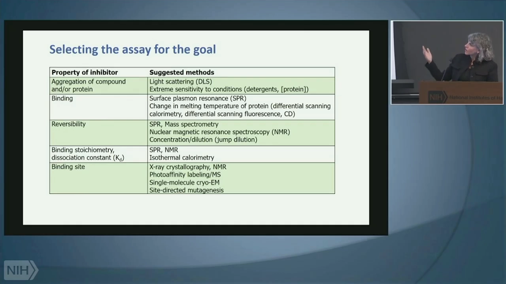

这张表是全讲的地图，讲者说它的用途是「给你带回去查」。它把「待验证的性质」和「建议的方法」一一对上：

| 要证明的性质 | 建议方法 |
| --- | --- |
| 化合物和/或蛋白的聚集 | 光散射（DLS）；对条件（去垢剂、蛋白浓度）极度敏感 |
| 结合 | SPR；熔解温度变化（DSC、DSF、CD） |
| 可逆性 | SPR、质谱、NMR、稀释法（跳跃稀释） |
| 结合化学计量与 $K_d$ | SPR、NMR、等温滴定量热（ITC） |
| 结合位点 | X 射线晶体学、NMR、光亲和标记加质谱、单分子 cryo-EM、定点突变 |

注意这张表里「结合」这一行的两个方法，物理量完全不同：SPR 测质量，热位移测温度。这正是后面所有「两个方法给出不同答案」的根源。

## 二、命中验证要证的是「正面命题」

[【跳转到 04:31】](https://www.youtube.com/watch?v=baTGjyNLGYg&t=271)

讲者给了一个很好用的说法：高通量筛选的作用是**排除你不感兴趣的 99%**；而验证的作用，是看剩下那 1% 里的 1% 里，哪些是真的有意思。

问题在于，如果测定里有很多干扰和伪影，这 1% 的 1% 就挑不出来。她列了四类最常见的伪影来源：

- **测定干扰**（assay interference），包括比色干扰；
- **化合物聚集**——她强调「这非常常见」；
- **化学反应性**——很多数据库里会对可能共价或可能反应的化合物打标记，但「你还是会被吓到」；
- **非特异结合**（下文 SPR 部分会看到它在传感图上的样子）。

对策上，讲者给了一条贯穿全讲的判据，值得单独抄下来：

> 与其去逐个证明这些「否定」（它不是共价的、它不是聚集的、它没有干扰），不如直接证明那个**肯定**：你的化合物是可逆地、按化学计量、单位点结合的。一旦证成了这一条，所有那些潜在伪影就都被排除了。

这句话解释了为什么后面的每一个方法，讲者关心的都不是「信号多漂亮」，而是「它能不能证明可逆、化学计量、单位点」。

## 三、聚集与热变性：一个阴性实验，一个阳性实验

讲者从两个「高通量筛完立刻就会做」的方法讲起：动态光散射（DLS）和差示扫描荧光（DSF）。

### 3.1 DLS 判聚集：看的是浓度依赖，不是「是不是聚集物」

[【跳转到 06:36】](https://www.youtube.com/watch?v=baTGjyNLGYg&t=396)

DLS 的原理是：化合物会聚成**脂质体样、肥皂泡样**的结构（幻灯片上给的范围是 80–100 nm），这些颗粒是可溶的、光学透明的，所以一般离心不下来，也看不见。它们散射光，散射光的自相关函数能给出一个「半径」或相关时间。

讲者在这里纠正了一个流传很广的误解：

> 在早期，大家有一种很笼统的想法：「这个化合物是聚集物」。但很多药在特定条件下也会聚集。重要的是，聚集是**依赖环境**的——依赖蛋白，依赖缓冲液条件，也依赖浓度。

所以 DLS 真正要回答的不是「它是不是聚集物」，而是**聚集发生的浓度，和活性出现的浓度，是不是同一个**。她的原话是：化合物在某个浓度聚集，其实不是什么大事；问题是它不能和你在功能测定里看到的活性出现在同一个浓度上。

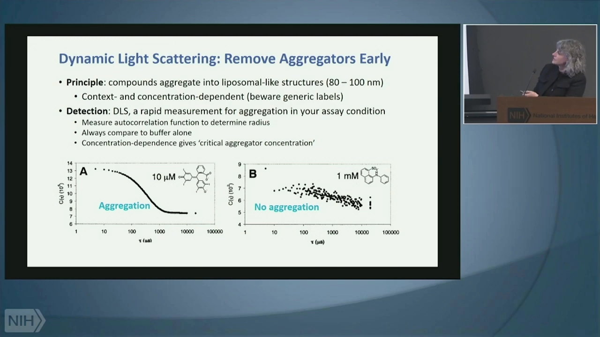

数据长这样：把相关时间对浓度作图，再把它和你的 $EC_{50}$ 或 $IC_{50}$ 画在一起，看两条线会不会交叉。聚集的特征是曲线**非常陡**——讲者拿胶束打比方：在临界聚集浓度以下什么都看不到，过了那个点陡然上升，然后维持在一个高平台上。

实操上有两个坑：一是缓冲液里本身不能有胶束或大颗粒（所以做 DLS 时通常不加载体蛋白、不加去垢剂，这反而让它成了「对你化合物最不利的场景」）；二是必须**无尘**。做到这两点，剩下的就很直接，而且现在有 384 孔格式，很快。

### 3.2 热变性位移：配体让蛋白更「耐热」

[【跳转到 09:56】](https://www.youtube.com/watch?v=baTGjyNLGYg&t=596)

DLS 是个阴性实验（证明「不是聚集」），讲者接着给了一个阳性实验。原理一句话：

> 如果化合物结合到蛋白上，它比未结合状态在热力学上更稳定；既然更稳定，你就应该能看到——表现为蛋白熔解温度的位移，蛋白需要更多能量才能被热变性。

检测方式有三种：差示扫描量热（DSC）、圆二色谱（CD）、以及疏水染料法（幻灯片上写作 Thermofluor / TSA / DSF）。染料法的机制值得说清楚：这种染料**不结合折叠好的蛋白**，只结合熔球态（molten globule）——蛋白开始熔解、疏水面暴露出来时，染料结合上去，荧光随温度升高。曲线走到一半高度对应的温度就是 $T_m$。

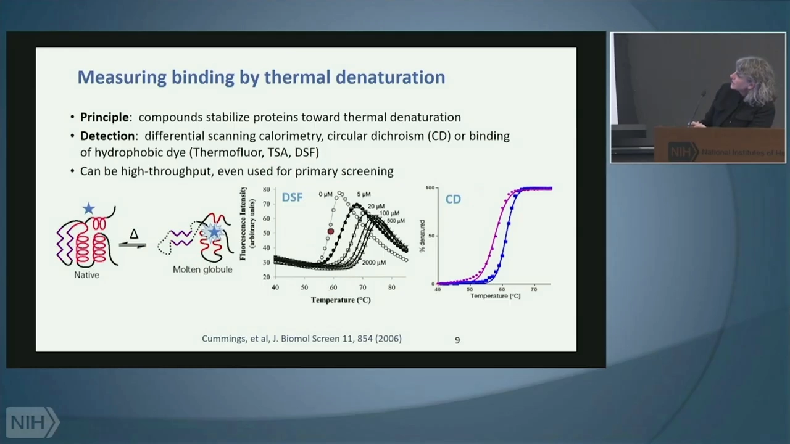

配体浓度越高，变性发生在越高的温度上。讲者说，从这个位移可以估一个**近似的** $K_d$，并证明化合物确实结合在蛋白上。她还给了一条非常实用的判据：

> 通常，聚集物**不会**提高你蛋白的热稳定性；1:1 的结合物**会**。

这句话把 DLS 和 DSF 配成了一对：一个告诉你「它是不是在聚集」，另一个告诉你「它有没有真的结合上去」。两者合起来，就能把「因为聚集而抑制」和「因为结合而抑制」分开。

反过来，偶尔会看到曲线**往左移**——加了化合物，蛋白反而更不稳定。讲者说这种情况「人们通常不太在意」，但它的含义有好几种：可能结合的是蛋白一个更不稳定的状态，可能是别构，也可能结合的是去折叠态。得结合你自己的体系判断。

> 补充（非视频内容）：$T_m$ 位移与 $K_d$ 之间不是等号。常用的近似关系是 $\Delta T_m \approx \dfrac{R T_m^2}{\Delta H_m}\ln\!\left(1 + \dfrac{[L]}{K_d}\right)$，其中 $\Delta H_m$ 是熔解焓、$[L]$ 是配体浓度。也就是说，同样的 $K_d$ 下，熔解焓大的蛋白位移更小，配体浓度低时位移也更小。所以 $T_m$ 位移只能作为「有没有结合」的定性判据，要反推 $K_d$ 必须同时知道 $\Delta H_m$ 与 $[L]$，而且这套推导本身假设了二态熔解与 1:1 结合。

### 3.3 从试管到细胞：CETSA 与热蛋白组

[【跳转到 12:51】](https://www.youtube.com/watch?v=baTGjyNLGYg&t=771)

同一套原理可以搬进细胞，这就是 CETSA（cellular thermal stabilization assay，细胞热稳定化测定）：不看纯化的蛋白，而是看**细胞内**这个蛋白有多耐热。最初的做法是加热不同温度的细胞或裂解液，再跑 Western blot 看还剩多少蛋白。

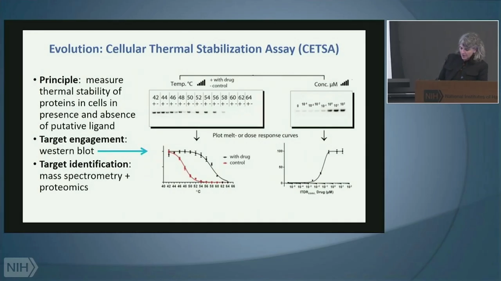

讲者给的数据是：不加化合物时，大约 46 ℃ 就开始丢这个蛋白；加了化合物后，即使把整个细胞加热到 56 ℃，蛋白仍然是稳定的。这个位移比纯化体系里大得多。把它做成浓度梯度，就能得到结合到该蛋白上的近似 $K_d$。她补了一句很诚实的评价：有很多原因会让它失效，「但它似乎相当经常地有效，是个非常有用的技术」。

再往前一步是**质谱版**：用 SILAC 做轻重标记，轻培养基的细胞不加药、重培养基的细胞加药，混在一起加热，然后看随着温度升高哪些蛋白先消失、哪些还留在溶液里。哪个蛋白的「消失温度」随药物浓度移动，就说明这个药物稳定了它——这就从「验证一个已知靶标」变成了**无偏地找靶标**。

### 3.4 边界：多结构域蛋白会有两个峰

[【跳转到 29:41】](https://www.youtube.com/watch?v=baTGjyNLGYg&t=1781)

提问环节有人问：DSF 有时会看到两个峰而不是一个，是不是多结构域？讲者的回答把判据说得很干净：

> 如果是多结构域蛋白，你确实经常看到两个峰，因为它们独立熔解。但如果是单结构域蛋白却出现两个峰，那我不太确定你手上是什么——也许有缓慢互变、热力学上真的分开的两个状态，但那很不寻常。

这条边界很重要：**峰的数量本身是信息**，不能一律当成噪声平滑掉。

## 四、MST：让蛋白在温度梯度里「跑开」，看荧光怎么分布

[【跳转到 14:56】](https://www.youtube.com/watch?v=baTGjyNLGYg&t=896)

下一个高通量方法是微量热泳（microscale thermophoresis，MST）。讲者自己都说这个技术「有点古怪」（kooky），但原理其实很好讲：

> 蛋白会在温度梯度里移动。移动得多快，取决于它的大小、形状和电荷。

具体过程是这样的：溶液是各向同性的，蛋白均匀分布；一束红外激光打进去，形成一个局部热点，蛋白被从「热」的地方推离；关掉激光，蛋白又往回走。如果蛋白带荧光——内源荧光或者接一个绿色荧光基团——你就能看见它**离开**和**回来**的过程。

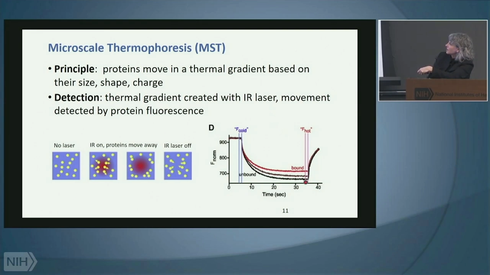

关键在于：蛋白一旦结合了小分子，它的**水合半径、形状、电荷**就变了，热泳行为随之改变。把这种改变对化合物浓度作图，就是一条剂量响应曲线，拟合出 $K_D$。讲者补了一句适用范围：这个方法对蛋白—蛋白相互作用效果也很好。通量上，几百个化合物可以比较轻松地做完。

> 补充（非视频内容）：MST 的软肋正是它的前提——蛋白必须「能被荧光看到」。用内源色氨酸荧光省掉了标记，但很多蛋白没有合适的色氨酸；外源标记则要担心标记位点是否落在结合界面附近、标记效率是否批次一致，以及标记本身会不会改变亲和力。这也是为什么 MST 的 $K_D$ 通常要和 SPR 或 ITC 对一次账。

## 五、SPR：所谓「无标记」，其实是「整个仪器就是那个标记」

[【跳转到 10:21】](https://www.youtube.com/watch?v=baTGjyNLGYg&t=621)

讲者在 SPR 上花的时间最长，因为它是小分子发现里最「多面手」的格式。她先拆了一个术语：

> SPR 被称为「无标记」（label-free）格式，这个说法**完全不成立**，因为整个仪器就是那个标记。

这句话不是文字游戏，它直接指向 SPR 的代价：蛋白必须被**固定**在一个表面上，而固定化正是这门技术所有麻烦的来源。

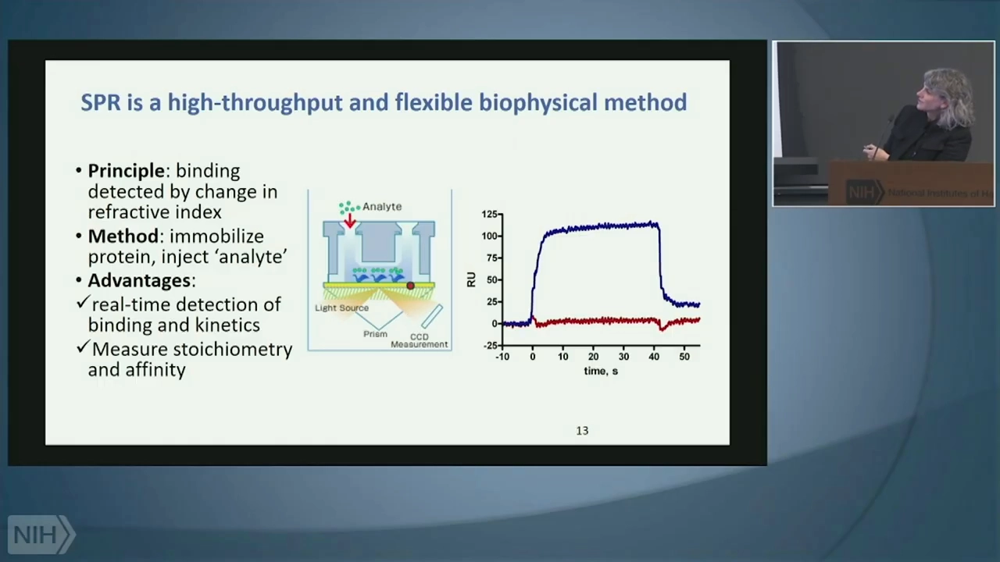

物理上，SPR 测的是**金膜表面第一小层缓冲液的折射率**。折射率一变，激光在对面那层反射的角度就变，仪器读的就是这个偏转。而它之所以能用于小分子发现，靠的是下面这个关系：

> 折射率的变化，大致正比于表面上物质的**质量**。

由此可以推出一件很有用的事：如果知道固定上去多少质量、也知道蛋白的分子量，那么 1:1 结合时能结合多少分子是可算的。于是传感图的 y 轴（RU）不只告诉你「结合了」，还能告诉你「结合了几个」——用两者的分子量之比就能读出**化学计量比**。

传感图的时间结构是：基线 → 进样（结合，on-rate，与浓度相关）→ 平衡（结合与解离同速的动态平衡）→ 进缓冲液（解离，off-rate）。讲者特意提醒：网上看到的 SPR 图往往 on-rate 慢、off-rate 也慢，但**小分子早期发现不是这样**——你手里的配体常常是 100 µM 量级的弱结合物，动力学应该**很快**，传感图接近方波。

$K_D$ 有两条独立的读法，而且应该互相印证：

$$
K_D = \frac{k_{off}}{k_{on}}
$$

一条是对多个浓度的曲线做**全局拟合**，从速率常数算 $K_D$；另一条是把每个浓度的**平衡响应**对浓度作图，得到一条结合等温线，直接拟合 $K_D$。讲者说这两个数字通常「基本一致」——如果不一致，那本身就是信息（比如平衡没到、或者表面上有非特异结合）。

### 5.1 小分子的 1:100 经验法则

[【跳转到 15:21】](https://www.youtube.com/watch?v=baTGjyNLGYg&t=921)

这是全讲最实用的一条数字。蛋白通常 30–50 kDa，小分子通常 300–500 Da，两者质量比大约 1:100。所以：

$$
R_{\max} \approx \frac{MW_{\text{小分子}}}{MW_{\text{蛋白}}} \times R_{\text{固定化}}
$$

讲者的原话是：你固定 1000 RU 的蛋白，小分子结合的最大响应大约只有 10 RU。这个数字决定了 SPR 做小分子的全部工程难度——**信号只有噪声量级的一点点**，所以参比通道、表面密度、缓冲液匹配任何一项没做好，10 RU 就会被淹没。

## 六、SPR 的「告解室」：所有罪都会显形

[【跳转到 12:46】](https://www.youtube.com/watch?v=baTGjyNLGYg&t=766)

讲者引了 Giannetti 2008 年那篇 J. Med. Chem.，给它起了个绰号叫「告解室」（the confessional），一句话概括：

> 所有的罪都会在 SPR 里显形。你能看到结合，也能看到聚集，还能看到可疑的结合。

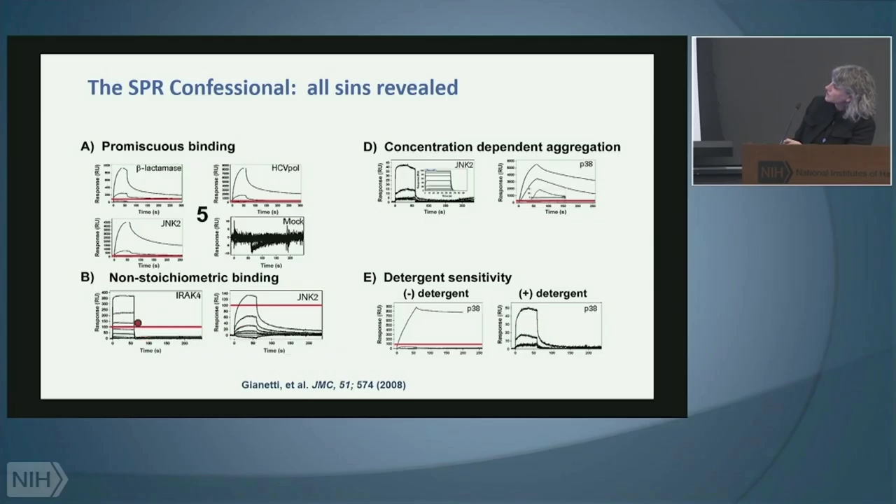

这张图值得逐格看，因为每一格都是一种「看起来像结合、其实不是」的形态：

- **A 滥交结合（promiscuous binding）**：同一个化合物对 β-内酰胺酶、HCV 聚合酶、JNK2 都给信号，而且化学计量比很高。真正的特异性结合物不会对谁都给高化学计量比的信号。
- **B 非化学计量结合**：同一个化合物对 IRAK4 是**超化学计量**（远超 1:1 那条红线）但动力学很快，对 JNK2 则是化学计量不高、动力学「很奇怪」。讲者的重点在这里：**和 DLS 里的聚集一样，SPR 里遇到的问题也是依赖蛋白的**——同一个化合物，换个蛋白就是另一副样子。
- **C 浓度依赖的聚集**：低于临界聚集浓度时看着正常，一过这个浓度就出现**极高的响应**（y 轴上的结合量非常大）和**极长的动力学**。这就是为什么「生化测定里永远要加去垢剂」——不加的话，这种曲线一点也不罕见。
- **D 去垢剂敏感性**：同一份 p38 数据，不加去垢剂时响应冲得很高、形状也不对；加了去垢剂就回到正常形态。

讲者在这里给了一个很反直觉的提醒：加去垢剂不只是为了「消除假阳性」，也是为了**别把真的结合物误判成伪影**——如果你看到的聚集并不是化合物对靶标抑制的真实机制，那你可能因此丢掉一个真的结合物。

### 6.1 流动式与浸入式：数学不一样

[【跳转到 18:21】](https://www.youtube.com/watch?v=baTGjyNLGYg&t=1101)

讲者也点了仪器格式的差别。Biacore、SensiQ 这类是**流动式**：样品被泵过表面，动力学测得更准。Forte Bio 的 Octet（以及同类的 BLI）是**光纤浸入式**：把带着蛋白的探针浸到溶液里，靠**扩散**完成结合与解离。讲者的观察很直接：数学不一样，而且「在我看来它测 off-rate 不如流动式好」。

### 6.2 固定化带来的伪影

[【跳转到 31:11】](https://www.youtube.com/watch?v=baTGjyNLGYg&t=1871)

这是 SPR 独有的问题，因为只有它要求把蛋白钉在表面上。讲者列了四层：

1. **固定化策略与表面化学**：如果能用带标签的蛋白（比如生物素标记），表面会更可重复；也可以用随机的氨基偶联或巯基偶联。
2. **活性位点的陷阱**：做激酶的人要特别小心。用随机氨基偶联（EDC 化学）固定激酶时，活性位点那个催化赖氨酸非常活泼，会被直接钉到芯片上——结果就是**任何竞争性抑制剂都结合不上去了**。解法是固定时先在活性位点里塞一个抑制剂占位。讲者把这条推广到「任何活性位点里有赖氨酸的酶」。
3. **表面密度是个双向陷阱**：有些蛋白在芯片上很不稳定，除非固定得很密（分子挨着分子）；反过来，有些蛋白会在表面上聚集，那就必须固定得很稀。两种情形都存在。
4. **表面活性浓度**：这是最容易算错的一项。数据分析时我们**默认固定上去的蛋白全都是有活性的**，所以如果表面只有一部分蛋白是活的，算出来的化学计量比就是错的。做法是用一个阳性对照或底物去测饱和响应：如果你能饱和到预期的 80%，那这块表面的活性就是 80%。这个阳性对照还应该在长时间实验里**周期性回注**——有些实验要跑 10 块 384 孔板、连着好几天，蛋白表面的稳定性会变。

### 6.3 参比通道：一张芯片上同时做五个实验

[【跳转到 20:21】](https://www.youtube.com/watch?v=baTGjyNLGYg&t=1221)

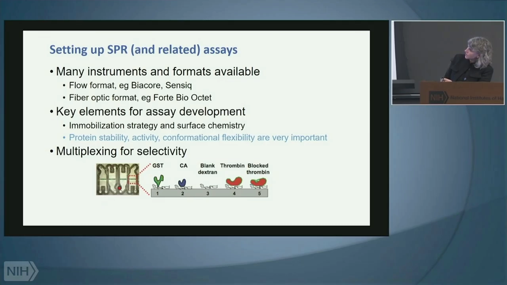

讲者展示了 SPR 在实验设计上最漂亮的一点：一张芯片的每个微流控通道上有五个点，每个点可以固定不同的东西，而**一个分析物可以同时流过这五个表面**。典型配置是：

- 一个**空白**表面（只有基质），用来测化合物的非特异结合；
- 一个**目标蛋白**；
- 一个**活性位点被封闭**的目标蛋白，或不同密度的同一个蛋白；
- 若干**无关蛋白**，或你不想命中的同源亚型。

她举了自己正在做的例子：和一个脂激酶项目合作时，他们把三个亚型同时放在芯片上——一次进样，特异性数据就全有了。这也是 SPR 被称作「数据密度很高」的原因。

## 七、功能读数相同，不代表是同一个东西

前面六节讲的是「每个方法怎么用、怎么被骗」。这一节换到使用者视角：当几个方法给出互相矛盾的答案时，该怎么读。讲者用一个真实项目做了示范。

### 7.1 两个 IC50 一样、$K_D$ 差二十倍的化合物

[【跳转到 22:51】](https://www.youtube.com/watch?v=baTGjyNLGYg&t=1371)

这个案例是全讲的转折点，也是「为什么要多种物理量一起看」的最好例证。

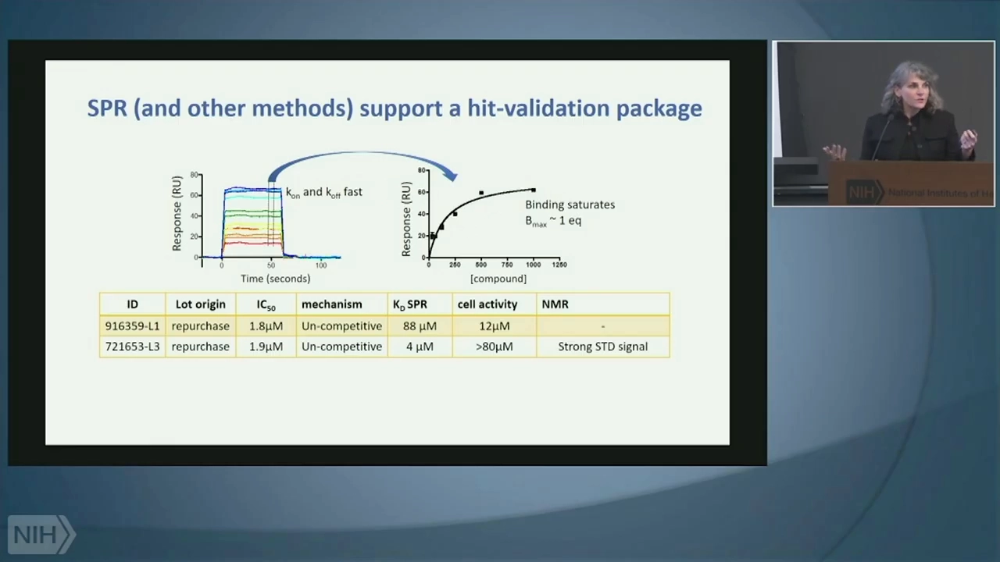

先看传感图：on-rate 很快、很快到平衡、off-rate 也很快。这种情况下**动力学参数其实测不准**（结合段和解离段都太陡），但可以改用平衡响应做剂量曲线——每条彩色曲线是一个剂量，做双复孔，最后看到饱和：浅蓝和深蓝两个剂量不同，但结合量不再增加，说明位点被占满了。把平衡响应对浓度作图（或用对数浓度轴，看起来就像一条 $IC_{50}$ 曲线），拟合出的 $B_{\max}$ 约为 1 个当量。

| 化合物 | 来源 | $IC_{50}$ | 机制 | SPR 的 $K_D$ | 细胞活性 | NMR |
| --- | --- | --- | --- | --- | --- | --- |
| 916359-L1 | 重新购买 | 1.8 µM | 反竞争 | 88 µM | 12 µM | 无信号 |
| 721653-L3 | 重新购买 | 1.9 µM | 反竞争 | 4 µM | >80 µM | 强 STD 信号 |

两个化合物重新购买后 $IC_{50}$ 几乎一样（1.8 与 1.9 µM），酶学判出的机制也一样（都是反竞争）。但：

- **SPR**：一个 $K_D$ 是 88 µM，另一个是 4 µM——相差二十倍；
- **细胞活性**：一个 12 µM（有活性），一个 >80 µM（没活性）；
- **NMR**（配体检测，见第九节）：一个完全没有信号，一个有很强的 STD 信号。

讲者把这个矛盾摊开问：「那我们该信哪个？」答案是两边都不能单独信：

> 这个化合物有两个生物物理测定支持它结合——化学计量比也和 $IC_{50}$ 对得上——但它没有细胞活性；另一个化合物有细胞活性，可我们没有任何证据说明它是通过结合靶标起效的。

这就是命中验证的真实形态：**功能读数相同，不代表是同一个东西**。$IC_{50}$ 是「功能被抑制一半所需的浓度」，它同时吃进了亲和力、机制、溶解度、通透性、聚集等一堆因素；而 $K_D$ 只回答「结合多紧」。两者不一致时，不一致本身就是最值得追的线索。

### 7.2 SPR 还能反过来验证机制

[【跳转到 27:51】](https://www.youtube.com/watch?v=baTGjyNLGYg&t=1671)

讲者顺带展示了一件酶学测定做不到的事。常规的机制判定有三种画法：初速度对底物浓度、Lineweaver-Burk 双倒数图、以及最实用的——**把 $IC_{50}$ 对底物浓度作图**。

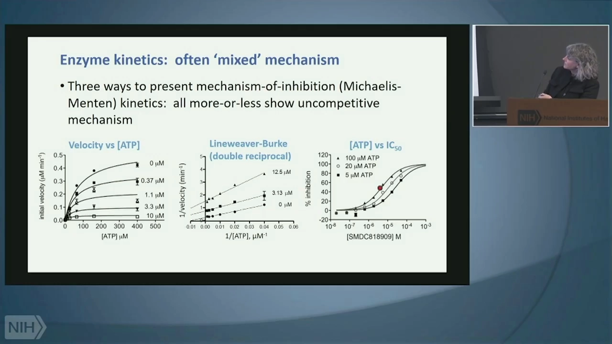

判据很好记：底物浓度升高让化合物**更强**（$IC_{50}$ 变小），是反竞争；让化合物**更弱**（$IC_{50}$ 变大、曲线右移），是竞争性。讲者说这条路线特别实用，因为「即使你的化合物亲和力低、动力学是混合机制、这些参数很难测准」，$IC_{50}$ 随底物移动的方向仍然读得出来。

但酶学测定有个结构性盲区：**它必须有底物才能测**，所以它测不到「无底物状态下的酶」。SPR 可以——把不同状态的酶分别固定，看化合物结合谁：

- **反竞争化合物**：不结合游离酶，结合底物结合的复合物；更进一步，它**更紧地结合产物复合物**——也就是说它真正的作用机制是抑制产物释放；
- **非竞争化合物**：不太在乎有没有核苷酸，对底物结合态或产物结合态略好一点；
- **竞争性化合物**：只要有底物在，就完全不结合酶。

## 八、ITC：唯一「很难作假」的那一个

[【跳转到 27:46】](https://www.youtube.com/watch?v=baTGjyNLGYg&t=1666)

讲者把 ITC 放在最后讲，并且先说了它的短处：慢、低通量、很耗材料，工业界用得不算多。但紧接着一句是它的全部价值：

> 原理是结合会放热。你很难把一个好结果**做假**出来。

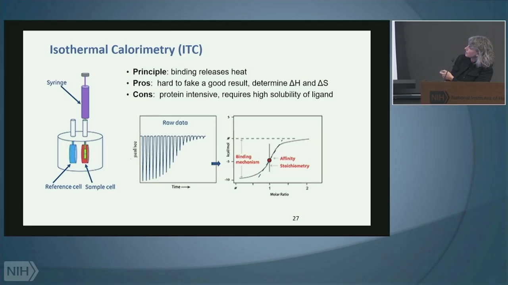

过程是：蛋白放在严格控温的量热池里，逐滴加入化合物。每加一滴，结合发生、放热（或吸热），仪器记录这个热脉冲；热很快被重新平衡掉，于是你看到一串尖峰。一直加到**不再有热**为止——说明结合位点已经饱和了。把每个峰的面积积分、对摩尔比作图，就得到一条 S 形曲线，一条曲线同时给三样东西：

1. **亲和力**：从曲线的位置（相当于 $EC_{50}$）得到 $K_a$，再取倒数得 $K_D$；
2. **化学计量比**：因为实验本身就是按化学计量加料的，S 形曲线的拐点直接落在结合位点的数目上；
3. **机制**：这里讲者说的「机制」是**焓驱动还是熵驱动**——如果热量很大，说明结合主要靠焓；如果亲和力很高但几乎测不到热，说明结合能主要来自熵变。

这三样东西的对应关系可以写成一条链：

$$
\Delta G = -RT\ln K_a = \Delta H - T\Delta S
$$

ITC 直接测的是 $\Delta H$（热量）和 $K_a$（曲线位置），于是 $\Delta G$ 与 $-T\Delta S$ 都是算出来的。这也是为什么 ITC 是唯一能把「亲和力」拆成「焓」和「熵」两栏的方法——SPR、MST、热位移都只给一个 $K_D$ 或一个间接读数。

> 补充（非视频内容）：$\Delta H$ 的符号与大小还决定了 ITC 实验能不能做。弱结合（mM 级片段）需要很高的蛋白浓度才能让曲线出现完整的 S 形；而如果 $\Delta H$ 接近 0（焓熵近乎完全补偿），热量曲线几乎是平的，再高的亲和力也测不出来——这时必须换竞争滴定的做法，用一个已知 $\Delta H$ 的强配体做报告分子。这与本系列 2.1.4 讲的「氢键带来的焓增益常被熵抵消」是同一件事的两面。

## 九、还有两类方法：NMR 与结构

讲者花了不少篇幅讲 NMR，并坦白「我一直很难说服别人去做它」，但她还是讲了，理由很充分：NMR 能回答的问题，别的技术答不了。

### 9.1 配体检测 NMR：只看小分子，蛋白不用标记

[【跳转到 22:41】](https://www.youtube.com/watch?v=baTGjyNLGYg&t=1361)

配体检测 NMR 的思路建立在一个反差上：蛋白大、转得慢、弛豫快，峰又宽又糊；小分子小、转得快，峰又尖又细。当小分子**碰上**蛋白，它会「沾染」上大分子的性质——峰变宽、弛豫变快。讲者打了个很好的比方：这有点像荧光各向异性的 NMR 版本，小东西一旦绑上大东西，就继承了大东西的物理性质。

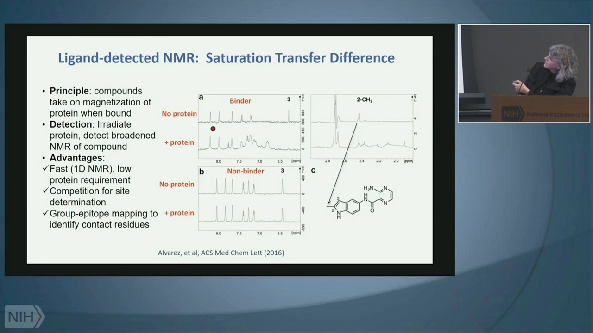

具体做法叫**饱和转移差谱**（STD, Saturation Transfer Difference）：先照射蛋白，磁化会被转移到结合着的小分子上，所以**只有结合的小分子才会出现信号**。同类的还有 WaterLOGSY。这类实验还能做两件更细的事：

- **竞争定位点**：先放一个已知的结合物，看新化合物能不能把它挤掉；
- **基团表位作图**（group-epitope mapping）：展宽得最厉害的那些质子，就是埋得最深的那些——由此知道分子是「怎么」结合进去的。

它的优势是**快**（一维谱）、蛋白用量低、蛋白与化合物的比例接近酶学测定（大约 1:100）。但代价也来自同一处：它依赖信号放大，而放大靠的是「结合—吸收磁化—解离—下一个分子结合」这个循环，所以**只有在 on/off 都很快的时候才好用**。换句话说，它是早期弱结合物（正是高通量筛选刚出来的那一档）的验证工具，化合物结合变紧之后就不灵了。它不是 384 孔技术，但如果化合物谱图差异明显，可以一管里放十个做多重检测。

### 9.2 蛋白检测 NMR：每个酰胺一个峰，位移就是位点

[【跳转到 24:46】](https://www.youtube.com/watch?v=baTGjyNLGYg&t=1486)

如果蛋白骨架已经做了归属，就可以做蛋白检测的 $^{1}$H-$^{15}$N HSQC：二维谱上**每个峰对应一个酰胺键**，也就是一个氨基酸。骨架 N-H 键对环境极其敏感——在蛋白内部和外部化学位移不同，对缓冲液和 pH 也很敏感（讲者提醒「小心盐」）。

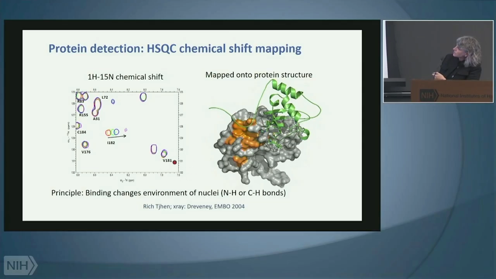

结合改变环境，峰就移动。把移动的残基映射到结构上，得到的就是**结合位点**。讲者举了一个很诚实的例子：他们想找能竞争某个蛋白—蛋白界面的化合物，结果所有化合物都在主界面旁边的一个**别构口袋**上引起位移，而且这些化合物反而**稳定**了那个蛋白—蛋白相互作用。她说这就是为什么这个结果她拿来在报告里讲而不是发表。

即使谱峰没有归属，也仍然有用：你可以说「我这十个化合物都结合在差不多同一个地方」，或者「它们结合的位置和底物一样」。

### 9.3 SAR by NMR 与片段筛选

[【跳转到 26:11】](https://www.youtube.com/watch?v=baTGjyNLGYg&t=1571)

第一个真正被常规使用的片段药物设计方法叫 **SAR by NMR**，用的就是 HSQC 这套对环境敏感的技术。流程是：先筛出结合在第一个亚口袋的片段 → 优化它（追求更大的位移、更多的位移）→ 在这个优化片段**存在的情况下**筛第二个亚口袋 → 优化第二个片段 → 最后把两个片段连起来。

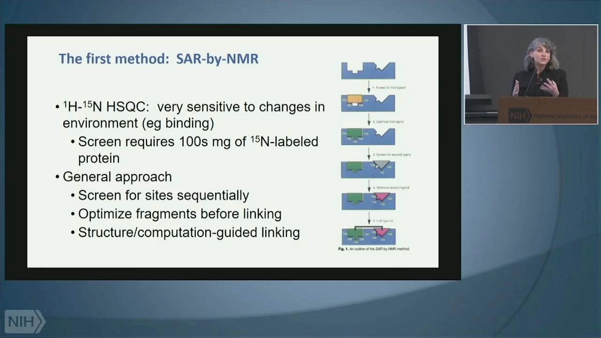

讲者在这里补了一段关于**片段库为什么适合生物物理方法**的解释，这是理解整个方法选择逻辑的关键：

- 片段库比高通量筛选库小得多：**1000 到 10000 个分子**，而不是十万到一百万；
- 库小了，就正好落在生物物理方法能做的通量区间里，可以直接用于初筛；
- 片段与蛋白的结合**很弱**，酶学测定在这个区间假阴性和假阳性都很多；而结合测定既在合适的浓度区间，又直接测结合，因此**出错率低得多**。

### 9.4 结构与其他

讲者最后快速过了几项：光亲和标记（给分子接一个可光活化的反应基团，交联后用质谱找它钉在哪个残基上，从而得到结合模型——用得不多但很有力）；X 射线晶体学的浸泡法（把 10 个分子一组的池子泡进晶体，解结构看有没有可归属的密度，现在通量高到可以做初筛）；以及 cryo-EM——她认为它在 lead optimization 阶段会成为重要工具，因为「你真正想知道的只是它大概结合在哪、我怎么改能让它结合得更好」，低分辨足够回答这个。

## 十、怎么选：按「你想证明什么」选，再用正交方法兜底

[【跳转到 29:17】](https://www.youtube.com/watch?v=baTGjyNLGYg&t=1757)

把全讲收拢成一张对照表，这就是本节要回答的「方法选择」问题：

| 方法 | 测的物理量 | 直接给出的参数 | 主要伪影来源 | 适用边界 |
| --- | --- | --- | --- | --- |
| SPR | 金膜表面折射率（近似质量） | $k_{on}$、$k_{off}$、$K_D$、化学计量比、可逆性 | 固定化（位点遮蔽、表面失活）、体折射率失配、聚集、非特异结合 | 小分子响应只有约 10 RU，依赖参比与表面质量 |
| ITC | 结合热 | $K_D$、$\Delta H$、化学计量比 $n$，由此得 $\Delta S$ | 配体溶解度不足、$\Delta H$ 接近 0、蛋白活性浓度未知 | 耗蛋白、低通量；弱结合需高浓度或竞争滴定 |
| MST | 温度梯度下的荧光分布 | $K_D$ | 荧光标记（位点、效率）、内源荧光不足、缓冲液与表面吸附 | 需要「能被荧光看到」的蛋白；通量较高 |
| 热稳定性位移（DSF/TSA/CETSA） | 熔解温度 $T_m$ | $\Delta T_m$（间接推 $K_D$） | 染料偏好、多结构域双峰、聚集导致的信号下降 | 只对能稳定化蛋白的配体有效；$\Delta T_m$ 不是 $K_D$ |

按讲者的思路，选择顺序其实是三个问题：

1. **我要证明的是哪一条？** 是「不是聚集」（DLS）、「真的结合」（DSF/SPR/MST/ITC）、「可逆」（SPR、NMR、质谱、跳跃稀释）、「几个位点」（SPR、NMR、ITC），还是「结合在哪」（晶体学、NMR、光亲和标记）？先定问题，再定方法——这就是第一节那张表。
2. **我的体系允许哪一条？** 分子量决定 SPR 的响应（1:100 法则）；有没有荧光决定 MST；有没有可标记位点决定 NMR 与 MST；样品量与通量决定 ITC 与 NMR 的位置。片段筛选（弱结合、mM 级）几乎必然走 SPR + NMR + 热位移的组合，因为酶学在这个区间不可靠。
3. **哪两条方法的物理量是正交的？** 这是最关键的一条。SPR 与 DSF 是一对（质量 vs 温度），SPR 与 ITC 是一对（质量 vs 热量），SPR 与 NMR 是一对（质量 vs 磁化转移）。如果两个方法测的是同一个物理量（比如 SPR 与 BLI 都测表面厚度），它们互相印证的价值就有限。

讲者的收尾只有三句话，但每一句都是这条流水线的操作纪律：

> 所有方法都需要**次级测定**来平衡，这就是目标。你知道一些东西，就一定有另一些你不知道的，所以要用多种技术去回答你所有的问题。**早做、常做**。不要把你自己和你化学家的时间浪费在伪影上。

## 小结

- 生物物理方法测的是**结合**，不是**功能**。功能读数（$IC_{50}$、表型）回答不了「是否结合、结合几个位点、可逆与否」，而生物物理方法能给出化学计量比、亲和力与机制。
- 命中验证的正确姿势是证明**正面命题**——可逆、化学计量、单位点——而不是逐个去证伪「不是共价、不是聚集、不是干扰」。证成了正面，伪影自然被排除。
- 四种方法测四个不同的物理量：SPR 测折射率（近似质量）、ITC 测热量、MST 测温度梯度下的荧光分布、热位移测熔解温度。物理量不同，给出的参数与失败方式就不同。
- SPR 的两个数字最容易被忽略：$K_D$ 有「速率常数之比」和「平衡等温线」两条独立读法，应当互相印证；小分子的最大响应只有固定化蛋白的约 1/100（1000 RU 对 10 RU），所以参比通道与表面质量是成败关键。
- SPR 的伪影集中在**固定化**上：活性位点赖氨酸被钉住、表面密度过高或过低、表面活性浓度未知导致化学计量比算错。这些都能用「阳性对照 + 周期性回注 + 多通道参比」查出来。
- ITC 的价值在于「很难作假」：一条曲线同时给 $K_D$、$\Delta H$ 与化学计量比，再由 $\Delta G = -RT\ln K_a = \Delta H - T\Delta S$ 得到熵项。代价是耗蛋白、低通量，且 $\Delta H$ 接近 0 时测不出来。
- 热稳定性位移只能证明「结合并稳定化了蛋白」，$\Delta T_m$ 不是 $K_D$；它的强项是通量与细胞内适用（CETSA），弱项是染料偏好与多结构域双峰。
- 方法选择不是选「最好的一个」，而是**按要证明的性质选主方法，再用一个测不同物理量的方法交叉验证**。两个 $IC_{50}$ 相同、$K_D$ 相差二十倍的化合物，就是这个原则最好的注脚。

## 关键术语速查

| 术语 | 一句话解释 |
| --- | --- |
| 生物物理方法 | 不通过功能或表型、而直接测量「分子间结合」这件事的一类技术 |
| DLS（动态光散射） | 通过颗粒散射光的自相关函数测粒径，用来判断化合物是否聚集成 80–100 nm 的可溶小泡 |
| 临界聚集浓度（CAC） | 化合物开始形成聚集体的浓度；低于它曲线正常，高于它出现超高响应与超长动力学 |
| DSF / TSA | 差示扫描荧光 / 热稳定性测定：用只结合熔球态的疏水染料，读出蛋白的熔解温度 $T_m$ |
| $T_m$ | 熔解温度，一半蛋白去折叠时的温度；配体结合通常使它上移 |
| CETSA | 细胞热稳定化测定：在完整细胞里加热，看某个蛋白在加药前后耐热性差多少 |
| MST（微量热泳） | 用红外激光造温度梯度，通过荧光分布变化测分子在梯度中的迁移，进而得 $K_D$ |
| SPR（表面等离子共振） | 测金膜表面折射率变化（近似质量变化），实时给出 $k_{on}$、$k_{off}$、$K_D$ 与化学计量比 |
| RU（共振单位） | SPR 的响应单位，1000 RU 大致对应 1 ng/mm² 的表面质量 |
| 参比通道 | 芯片上不固定目标蛋白（或固定失活蛋白）的表面，用来扣除体折射率与非特异结合 |
| 体折射率失配 | 样品缓冲液与运行缓冲液成分不同（如 DMSO 浓度差）造成的假跳变 |
| 化学计量比 | 一个靶标分子上结合了几个配体；SPR 由质量比读出，ITC 由滴定曲线拐点读出 |
| ITC（等温滴定量热） | 逐滴加入配体、测每滴释放或吸收的热量，一条曲线给 $K_D$、$\Delta H$ 与化学计量比 |
| 反竞争抑制 | 化合物只结合酶—底物复合物，底物越多结合越紧，$IC_{50}$ 随底物升高而变小 |
| STD / WaterLOGSY | 配体检测 NMR 的两种实验：照射蛋白后磁化转移到结合的小分子上，只有结合物出峰 |
| HSQC | 蛋白检测 NMR：每个酰胺一个峰，结合引起的化学位移扰动可映射到结构上定出位点 |
| SAR by NMR | 用 HSQC 依次筛两个亚口袋的片段、分别优化后再连接起来的片段药物设计流程 |
