# 共价抑制的新策略：两步机制、弹头反应性窗口与选择性风险

> 视频来源：[Emerging strategies in covalent inhibition](https://www.youtube.com/watch?v=OmripYGYVUk)（YouTube · Chemistry World 网络研讨会，讲者 Tilly Bingham、Caroline Rigby、Daniel Glynn、Jamie Stokes，均来自 Concept Life Sciences）｜时长约 59 分钟
> 导读：这是一场面向药物化学从业者的网络研讨会，四位讲者按"弹头化学 → 体外药理学 → PK/PD 与毒理 → 案例"的顺序把共价抑制剂讲了一遍。本文保留全部技术主线（两步动力学、弹头与亲核体的匹配、反应性窗口、washout、化学蛋白质组学、治疗指数四象限、奥希替尼与 KRAS G12C 两个案例），删去会议开场、投票与问答寒暄。可逆结合的 $K_d$ 推导见本小节《Kd，解离常数》，IC50 曲线拟合见《IC50 是怎么测出来的》，本文只做必要引用。

## 本讲要解决的核心问题（SCQA）

**背景**：绝大多数小分子药物靠非共价作用结合靶点——氢键、疏水、静电。这类结合是可逆的：药物浓度掉下来，复合物就解离，靶点功能恢复。衡量它的强弱用 $K_d$，衡量它占位多久用 $k_{off}$。

**冲突**：有一类药物在结合之后还会"焊"上一根真正的共价键。它的占位时间不再由 $K_d$ 决定，而是由蛋白什么时候被降解、什么时候重新合成决定。这带来两个诱人的好处——可以用很低的剂量、很稀疏的给药间隔；也能作用于那些"可逆抑制剂打不动"的靶点（比如对底物有皮摩尔级亲和力的 KRAS）。但"反应性基团"这个词天然让人警惕：一个能在体内主动成键的分子，凭什么只跟目标蛋白成键？

**疑问**：共价抑制到底怎么工作？它的效率该用什么参数衡量？反应性基团带来的收益与风险分别是什么？药物化学家怎么在两者之间取平衡？

**回答（中心思想）**：**共价抑制不是一个"更强的结合"，而是"结合 + 一步化学反应"的两步过程：先靠非共价识别把分子定位到靶点（$K_I$），再靠弹头与邻近亲核残基成键（$k_{inact}$）。因此它的效率参数是 $k_{inact}/K_I$ 而不是 IC50，它的选择性来自"非共价定位 + 亲核体微环境"而不是弹头本身的活泼程度，而它的风险也正来自同一处——弹头在到达靶点之前就与谷胱甘肽、血浆蛋白或脱靶蛋白反应。整个领域的工程做法，就是围绕"反应性窗口"这一个旋钮做取舍。**

## 一、共价抑制不是"更强的结合"，而是多了一步化学反应

### 1.1 老药早就在用共价机制，只是当年不知道

共价抑制在药物发现里一点也不新。阿司匹林、青霉素、奥美拉唑都是通过共价机制起效的，只是它们上市时机制并未被阐明，发现过程基本是偶然的 [【跳转到 07:47】](https://www.youtube.com/watch?v=OmripYGYVUk&t=467)。近年来的"复兴"在于：现在的做法是**有意识地设计**一个弹头，去攻击靶点上某个位置合适的亲核残基——而且越来越多地瞄准**非催化残基**，因为催化残基往往在家族内高度保守，而非催化残基能提供额外的选择性 [【跳转到 08:17】](https://www.youtube.com/watch?v=OmripYGYVUk&t=497)。

### 1.2 两步机制：先"停靠"，再"成键"

把共价抑制拆开看，永远是两步 [【跳转到 09:05】](https://www.youtube.com/watch?v=OmripYGYVUk&t=545)：

1. **非共价结合**：配体按常规方式进入结合口袋，靠形状互补和弱相互作用停靠。这一步的强弱用解离常数 $K_I$ 描述（注意下标是 $I$，表示这是"抑制剂的初始结合常数"，不是产物）。
2. **成键**：停靠之后，弹头与口袋附近某个亲核残基（通常是半胱氨酸的硫、赖氨酸的氮）发生反应，形成共价加合物。

写成反应式就是：

$$
E + I \underset{k_{-1}}{\overset{k_{1}}{\rightleftharpoons}} E{\cdot}I \xrightarrow{k_{inact}} E{-}I
$$

其中 $E{\cdot}I$ 是非共价复合物，$E{-}I$ 是共价加合物，$k_{inact}$ 是"失活速率常数"（inactivation rate constant），单位是时间的倒数。而初始结合常数定义为

$$
K_I = \frac{k_{-1} + k_{inact}}{k_{1}}
$$

它把两步耦合在一起：$K_I$ 越小，说明分子越容易先停靠到位。

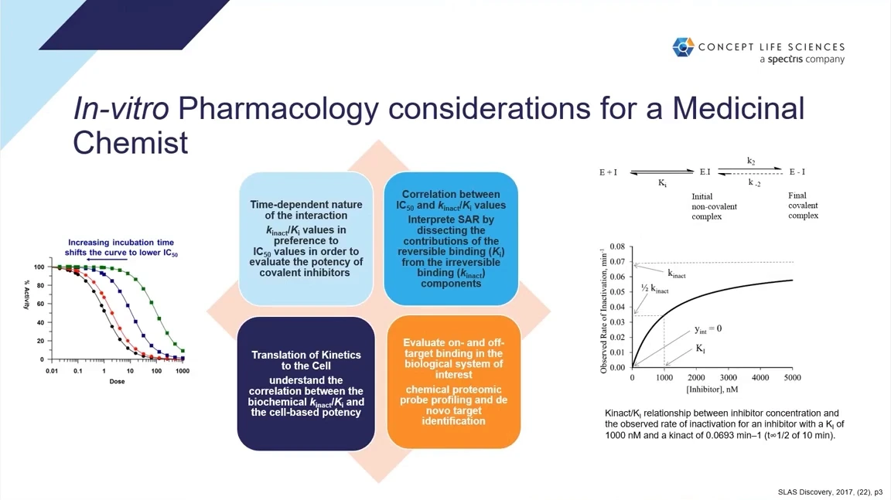

### 1.3 为什么 IC50 会随孵育时间漂移

共价抑制剂最容易踩的坑，是照搬可逆抑制剂的习惯去报 IC50。讲者给了一张很直观的图：同一批化合物，孵育时间从短到长，IC50 曲线整体左移，数值可以差一个数量级以上 [【跳转到 22:27】](https://www.youtube.com/watch?v=OmripYGYVUk&t=1347)。

原因就在两步机制里。在固定抑制剂浓度 $[I]$ 下，被共价修饰的酶比例随时间累积，表观失活速率是

$$
k_{obs} = \frac{k_{inact}\,[I]}{K_I + [I]}
$$

剩余活性按指数衰减：

$$
\frac{v(t)}{v_0} = \exp\!\left(-k_{obs}\,t\right)
$$

所以"抑制 50% 所需的浓度"必然依赖你等了多久。IC50 在这种情况下**不是一个分子常数**，只是某个时间点上的一个读数。这也解释了讲者反复强调的一点：报 IC50 必须严格固定孵育时间，否则不同实验室的数据无法比较。

### 1.4 效率参数：$k_{inact}/K_I$

真正描述共价抑制剂效率的是二级速率常数

$$
\frac{k_{inact}}{K_I} \quad (\text{单位 } \mathrm{M^{-1}s^{-1}})
$$

它的物理含义是"在抑制剂浓度远低于 $K_I$ 时，每单位浓度、每单位时间造成失活的概率"。讲者把它称为共价抑制剂 SAR 优化的"首选方法" [【跳转到 22:27】](https://www.youtube.com/watch?v=OmripYGYVUk&t=1347)。它的两个优点是：**与时间无关**（因为它同时包含了 $k_{inact}$ 与 $K_I$ 的信息），以及**可以拆解**——$K_I$ 反映"结合得好不好"，$k_{inact}$ 反映"弹头摆得对不对、反应快不快"。这两件事在药物化学上是可以分开优化的。

$k_{inact}/K_I$ 怎么测？讲者提到测 $K_I$ 的两种实用手段 [【跳转到 23:39】](https://www.youtube.com/watch?v=OmripYGYVUk&t=1419)：

- **突变体法**：把被攻击的亲核残基突变成甘氨酸，此时只剩非共价结合，测到的就是纯粹的 $K_I$；
- **外推法**：把不同时间点的失活速率外推到 $t=0$，此时"还没有发生共价结合"，得到的也是 $K_I$。

## 二、弹头不是随便挑的：亲核体的软硬决定弹头类型

### 2.1 一张"弹头—氨基酸"配对表

讲者 Caroline Rigby 给出的核心表格，把五个可被共价修饰的氨基酸按"软硬"排开，并配上对应的弹头类型 [【跳转到 11:40】](https://www.youtube.com/watch?v=OmripYGYVUk&t=700)：

| 残基 | 丰度与性质 | 典型弹头 |
| --- | --- | --- |
| 半胱氨酸 Cys | 丰度仅 1.9%，但亲核性最强（"软"亲核体） | 丙烯酰胺、取代丙烯酰胺、氰基丙烯酰胺、乙烯基砜、环氧化物、醛 |
| 赖氨酸 Lys | 丰度 5.8%，生理 pH 下多被质子化，埋在口袋里的可能不带电；"硬"亲核体 | 乙烯基砜、磺酰氟、活化酯、$\alpha$-甲酰基苯硼酸 |
| 丝氨酸/苏氨酸 Ser/Thr | 丰度高，但羟基亲核性弱，需邻近残基活化 | 氟硫酸酯、硼酸、腈 |
| 酪氨酸 Tyr | 中性态亲核性差；蛋白中酪氨酸 $pK_a$ 常被压低，酚氧负离子亲核性强（"硬"） | 磺酰氟、氟硫酸酯 |
| 甲硫氨酸 Met | 最稀有的氨基酸之一，中等亲核性，硫易被氧化 | 氧氮杂环丙烷（oxaziridine）、环氧化物 |

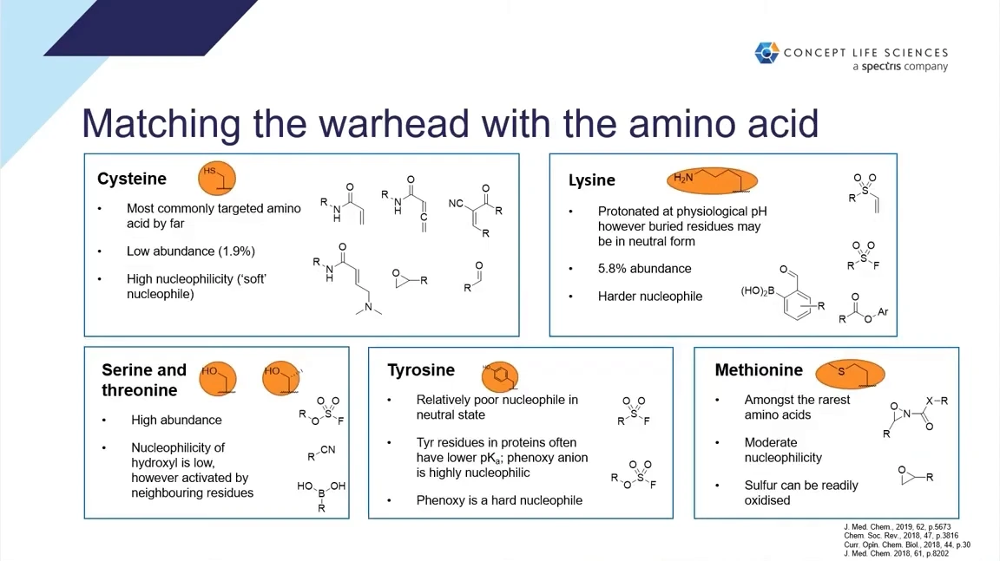

这张表背后的化学逻辑只有一句：**软亲核体配软亲电体，硬亲核体配硬亲电体**。半胱氨酸的硫原子半径大、极化率高，容易被可极化的 $\alpha,\beta$-不饱和羰基（Michael 受体）攻击；赖氨酸的氮、酪氨酸的酚氧是"硬"的，更喜欢磺酰氟、硼酸这类以静电/配位为主导的伙伴。

### 2.2 反应性排序是实测出来的，不是猜的

讲者引了一篇 *Bioorg. Med. Chem.* 的工作：把一系列亲电体分别与 N-Boc 保护的氨基酸甲酯反应，实测反应速率，得到两条不同的排序 [【跳转到 14:06】](https://www.youtube.com/watch?v=OmripYGYVUk&t=846)。她的结论是：**半胱氨酸对烯酰胺、乙烯基磺酸酯、丙烯酰胺这类偏"软"的亲电体反应更快；丝氨酸则偏好硼酸、硼酸酯这类更"硬"的亲电体，对丙烯酰胺类反而很慢。**

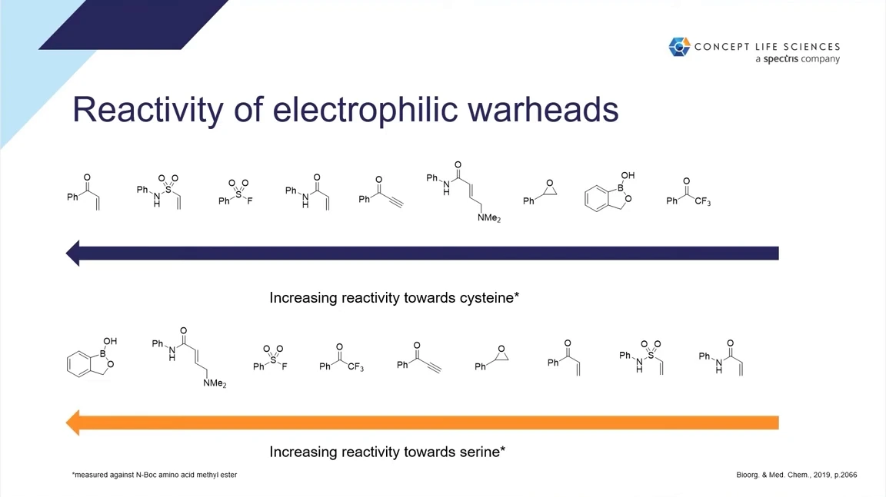

这条实验事实有直接的工程价值：**如果你想要半胱氨酸选择性，就选"对 Cys 快、对 Ser 慢"的弹头**；弹头对丝氨酸的反应性越低，误伤大量丰度极高的丝氨酸水解酶的风险就越小。

### 2.3 弹头的合成化学：越活泼越难做

弹头活泼，意味着它自己也难伺候。讲者列了一串实操约束 [【跳转到 15:46】](https://www.youtube.com/watch?v=OmripYGYVUk&t=946)：弹头尽量放在合成路线的最后一步；水相后处理可能不可行；产物可能热不稳定，纯化后要用冻干而不是旋蒸；反相色谱的 pH 会影响产物稳定性；三乙胺这类清除剂树脂可能与弹头反应，需要换成三丙胺；前几步残留的任何带亲核性的试剂都可能与产物反应。

以磺酰氟为例，1979 年的老路线要经过"硫醚 → 磺酰氯 → 磺酰氟"，用到氯气（可用 NCS 替代），中间体磺酰氯本身就很活泼；较新的路线则走"磺酸酯 + NSi"或直接使用 FDIT、AISF 这类晶态稳定试剂 [【跳转到 17:26】](https://www.youtube.com/watch?v=OmripYGYVUk&t=1046)。讲者最后举了一篇当年的工作：硫酰胺基二咪唑氟（sulfamoyl fluorides）类弹头，16 个例子，并在 HeLa 细胞里做了"洗脱后活性仍保留"的实验，证明共价机制成立 [【跳转到 19:06】](https://www.youtube.com/watch?v=OmripYGYVUk&t=1146)。

## 三、可逆共价：把"焊死"改成"可拆"

### 3.1 两种共价，差别在复合物是否可解离

讲者把共价抑制分成两类 [【跳转到 14:31】](https://www.youtube.com/watch?v=OmripYGYVUk&t=871)：

- **不可逆共价**：形成的键足够牢，理论上要等酶被降解才恢复活性。典型弹头是丙烯酰胺、磺酰氟、环氧化物。
- **可逆共价**：复合物仍可解离，酶活性可以恢复。这里还要再分两种——一种解离后**回收原来的抑制剂**（硼酸、醛/酮、腈），另一种解离时**抑制剂已被水解、结构改变**（碳酸酯、氨基甲酸酯类）。

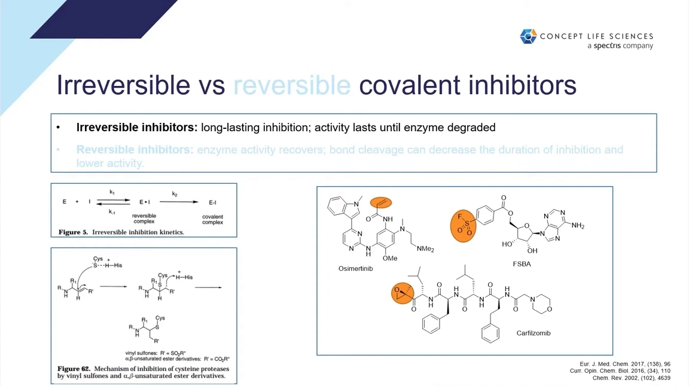

可逆共价的价值在下一节会展开：它把"长占位时间"和"可退出"这两件看似矛盾的事同时拿到了。

### 3.2 为什么"可逆"能改善选择性

讲者 Daniel Glynn 在讨论"什么时候值得做共价"时给了一个判断：**可逆共价抑制剂在改善选择性上非常有前景** [【跳转到 20:12】](https://www.youtube.com/watch?v=OmripYGYVUk&t=1212)。直觉上也不难理解：脱靶蛋白上的结合通常只有非共价那一半，既然键会水解，脱靶占位就是短暂的；而靶点上因为亲核残基位置合适，键形成得快、维持得久。选择性的差异被"时间"放大了。

## 四、选择性从哪里来：定位 + 微环境，不是弹头

### 4.1 两条发现路线

讲者把共价抑制剂的发现策略归为两条 [【跳转到 21:27】](https://www.youtube.com/watch?v=OmripYGYVUk&t=1287)：

- **先有配体，再加弹头**（ligand-first）：从一个已知的非共价抑制剂出发，看结构里哪个位置能伸出一根"向量"指向邻近的亲核残基，把弹头接上去。这条路线的优点是活性主要由非共价结合贡献，**滥交风险低**；难点是找到合适的 linker 把弹头送到位。
- **先有弹头，再长出去**（electrophile-first / covalent fragment）：从一个共价片段筛起，靠片段生长或合并长成完整分子。优点是能高效探查亲核残基附近的口袋；风险是**筛出来的往往是"最活泼的那个"，而不是"结合最好的那个"**。

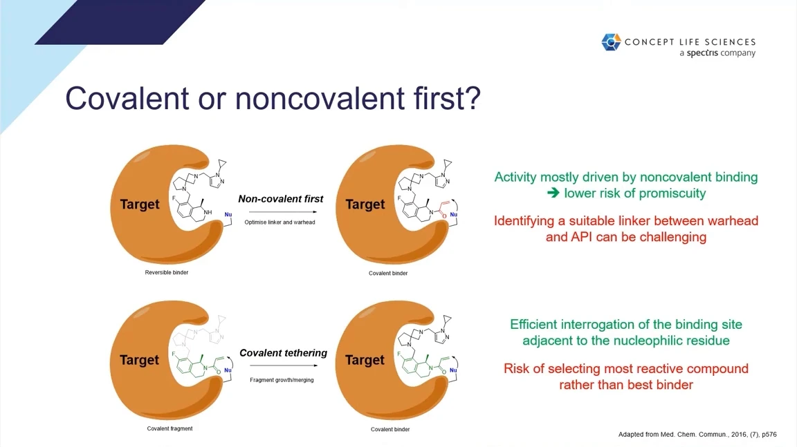

### 4.2 化学蛋白质组学：把"全蛋白组选择性"测出来

共价抑制剂的选择性不能只靠几十个靶点的 panel 判断，因为弹头可以和任何暴露的親核残基反应。讲者介绍的化学蛋白质组学（chemoproteomics）做法是 [【跳转到 27:38】](https://www.youtube.com/watch?v=OmripYGYVUk&t=1658)：

1. 用一个带反应基团、linker 和荧光标签的**广谱探针**去标记整个蛋白质组；
2. 同时加入待测化合物做**竞争**；
3. 酶解成肽段，LC-MS 或 CE-LIF 定量比较"加药"与"不加药"两组，被化合物挡住标记的那些蛋白，就是它真正结合的蛋白。

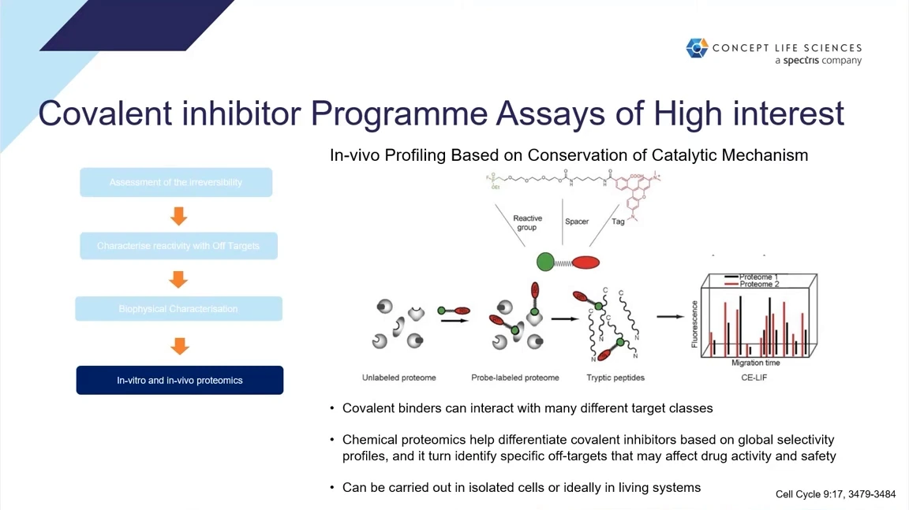

讲者强调两点：这类实验**最好在活细胞里做**（离裂解液里做也可以，但会丢失区室化信息）；它的输出不只是"选择性好不好"，还能**直接找出会导致药效或安全性问题的脱靶蛋白**。

## 五、怎么证明它真的是共价：三组实验

### 5.1 washout：洗掉药物，看表型是否还在

最直接的判定方法是洗脱实验 [【跳转到 24:18】](https://www.youtube.com/watch?v=OmripYGYVUk&t=1458)：先用饱和浓度的化合物短时间处理细胞，然后彻底洗掉，再测生物学读数。

- 如果读数**洗完仍被抑制**，说明药物已经不需要持续存在——符合不可逆/长占位机制；
- 如果读数**洗完就恢复**，说明只是可逆占位。

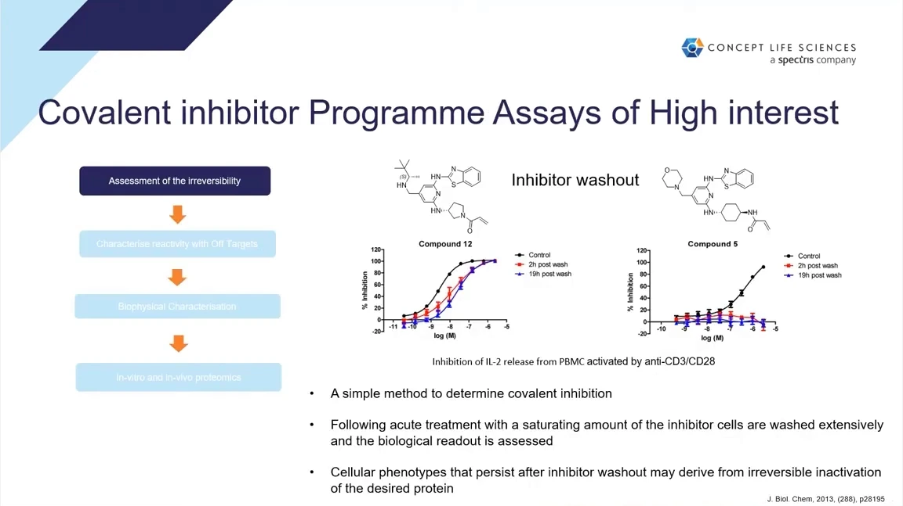

讲者特意提醒了一个反面教训：**分子上有丙烯酰胺，不等于它一定走共价机制**——弹头必须摆到能反应的位置才行。所以这类实验要常规做，用来确认你的化学系列真的按预期机制工作。

### 5.2 SPR：从传感曲线上直接看到"两段式解离"

表面等离子共振（SPR）通常被当成可逆结合的测量手段，但对共价抑制剂有独特价值：把蛋白固定在芯片上、流动相走化合物，如果成键了，解离曲线会出现**两段**——先是快速解离的一小部分（非共价结合的那部分），随后是一条几乎不下降的平台（共价结合的部分）[【跳转到 26:23】](https://www.youtube.com/watch?v=OmripYGYVUk&t=1583)。

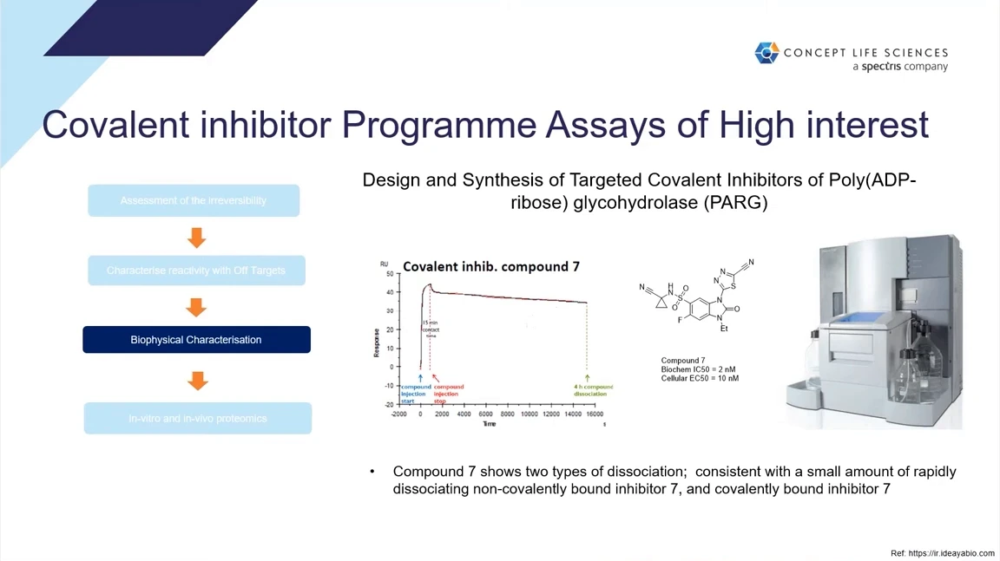

讲者举的例子是 PARG 共价抑制剂化合物 7（生化 IC50 = 2 nM，细胞 EC50 = 10 nM），SPR 上平台对应的驻留时间约 4 小时。

### 5.3 谷胱甘肽加合物：把"滥交程度"量化

这是共价抑制剂项目里最该常规做的一项 [【跳转到 25:08】](https://www.youtube.com/watch?v=OmripYGYVUk&t=1508)：在测 IC50 或 $k_{inact}/K_I$ 的同时，把化合物与谷胱甘肽（GSH）共孵育，用 LC-MS/MS 检测 GSH 加合物的生成速率。

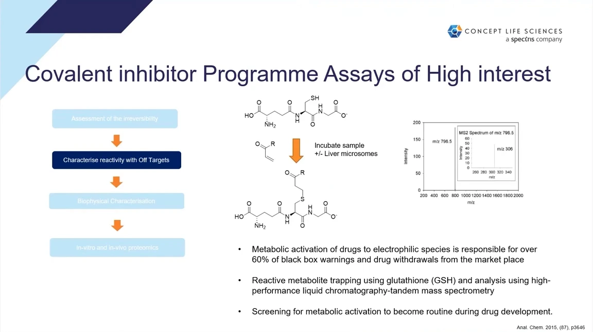

同一套逻辑还可以前移一步：**用肝微粒体孵育**，看化合物会不会被代谢活化生成亲电性代谢物。讲者给出一个很有分量的数字——**代谢活化生成的亲电物种，与超过 60% 的黑框警告和撤市相关**。所以这项筛查要和严格的代谢产物鉴定（MetID）一起做，再用药物化学手段把加合物生成降到最低。

## 六、占位时间与 PK/PD 脱节

### 6.1 药效跟着蛋白再合成走，不跟着血药浓度走

共价抑制最反直觉、也最有用的性质是 **PK/PD 脱节**（PK/PD disconnect）[【跳转到 29:12】](https://www.youtube.com/watch?v=OmripYGYVUk&t=1752)。

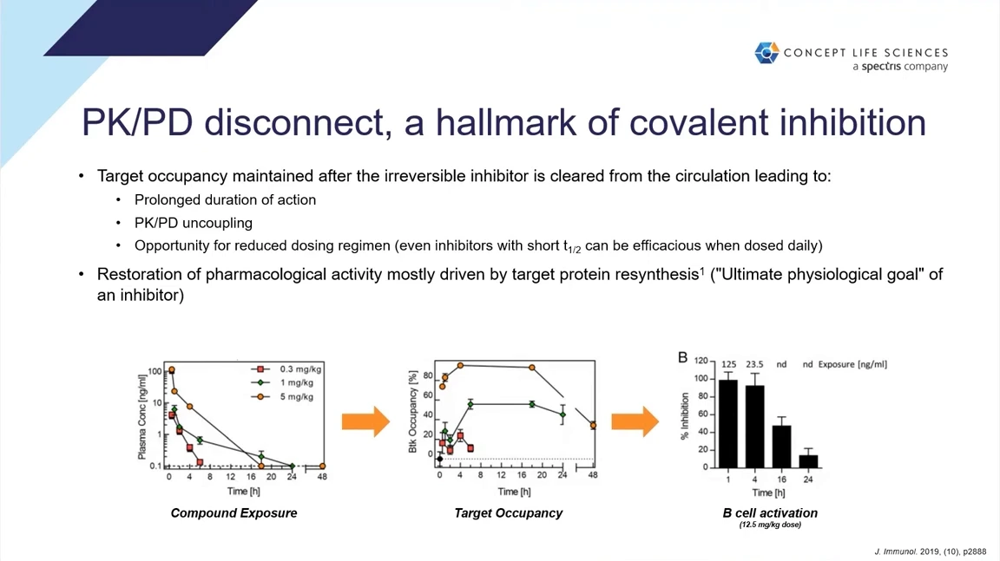

讲者的例子是 BTK 抑制剂：0.3、1、5 mg/kg 三个剂量给药后，血药浓度在 18 小时已经很低，但靶点占位在 1 与 5 mg/kg 组仍显著，B 细胞活化的抑制在 16 h、24 h 仍然存在。逻辑很干净：**共价修饰一旦形成，功能恢复要靠靶蛋白被降解、再重新合成**。所以药效的时间尺度是蛋白的周转半衰期，而不是药物的消除半衰期。

由此推出三条实践结论：

- **给药间隔可以很长**，即使药物本身的 $t_{1/2}$ 很短，每日一次给药也可能有效；
- **清除快不是坏事**——只要在暴露窗口内把靶点"打完"，剩下的药物被清掉反而减少了脱靶暴露；
- 但**"完全灭活"是有代价的**：如果靶点本身对正常细胞也重要，你就没有"随时退出"的余地了。

### 6.2 治疗指数：剂量与清除率的四象限

讲者用四组模拟把"怎么用 PK 换选择性"讲得很清楚 [【跳转到 31:47】](https://www.youtube.com/watch?v=OmripYGYVUk&t=1907)。设定是：靶点 B 的 $k_{inact}/K_I = 1.2\times10^{5}\ \mathrm{M^{-1}s^{-1}}$，反靶点 F 只有 $12\ \mathrm{M^{-1}s^{-1}}$（相差一万倍），比较不同剂量与清除率组合下两个靶点的占位曲线。

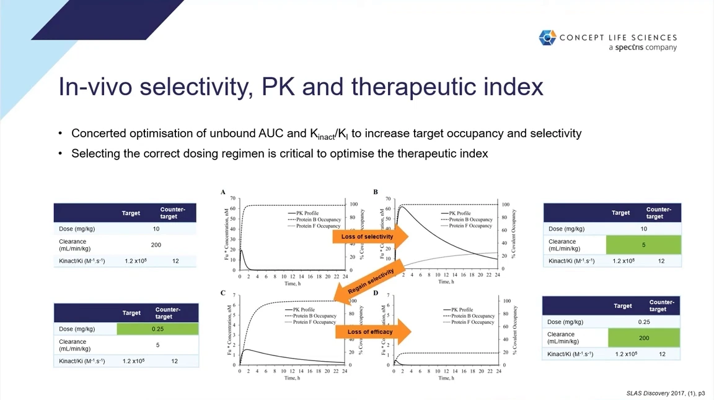

四种情形分别是：

| 情形 | 剂量 | 清除率 | 结果 |
| --- | --- | --- | --- |
| 左上 | 10 mg/kg | 200 mL/min/kg | 清除极快，但靶点占位仍显著——**高清除可以被容忍** |
| 右上 | 10 mg/kg | 5 mL/min/kg | 靶点占位相近，但反靶点占位持续上升，**选择性丢失** |
| 左下 | 0.25 mg/kg | 5 mL/min/kg | 靶点占位好、反靶点占位低，**理想情形** |
| 右下 | 0.25 mg/kg | 200 mL/min/kg | 靶点占位不足，**药效风险** |

这张表把共价抑制的工程本质说透了：**真正要优化的是"非结合 AUC"与 $k_{inact}/K_I$ 的乘积，而不是单纯追求血药浓度曲线好看**。清除率太高会浪费药物，太低会让反靶点也有机会被慢慢修饰。

## 七、毒性风险：反应性的另一面

讲者把毒理风险单独列了一节 [【跳转到 30:32】](https://www.youtube.com/watch?v=OmripYGYVUk&t=1832)，逻辑非常直白：**不可逆结合到非靶蛋白、DNA/RNA 或谷胱甘肽上，就会带来脱靶毒性**；不良事件可以是急性的，也可以是延迟的；而且有在临床后期才暴露的**特异质性**（idiosyncratic）风险。

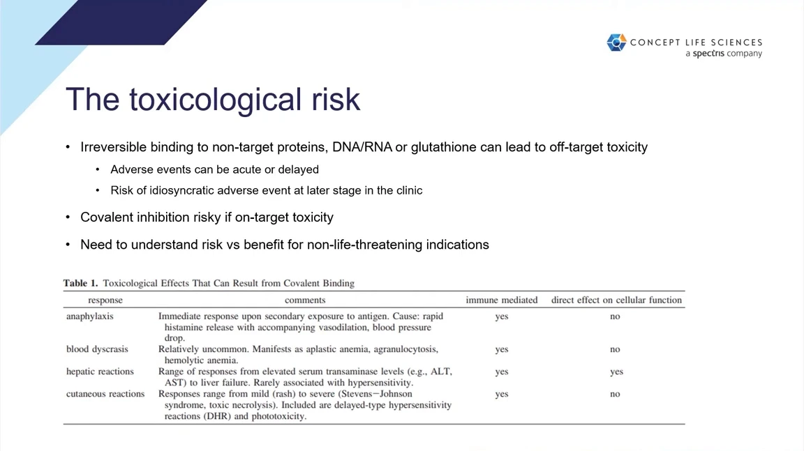

表格里列出的四类反应值得记住：

- **过敏反应（anaphylaxis）**：再次暴露于抗原后迅速发生，组胺释放、血管扩张、血压下降——免疫介导。
- **血液系统异常（blood dyscrasias）**：相对少见，表现为再生障碍性贫血、粒细胞缺乏、溶血性贫血——免疫介导。
- **肝脏反应（hepatic reactions）**：从转氨酶升高（ALT、AST）到肝衰竭——既有免疫介导也有直接细胞毒性。
- **皮肤反应（cutaneous reactions）**：从轻度皮疹到重症多形红斑（Stevens–Johnson 综合征）、中毒性表皮坏死——免疫介导。

讲者另外提了两条判断原则：**如果毒性是"在靶"的（on-target），共价机制就很危险**，因为你没法靠降低占位来脱身；**对于非致命性适应症，风险收益比要重新算**——肿瘤领域能容忍的，慢病领域未必能容忍。

## 八、两个案例：奥希替尼与 KRAS G12C

### 8.1 奥希替尼：用"反应性窗口"替代 $k_{inact}/K_I$

奥希替尼（osimertinib，商品名 Tagrisso）由阿斯利康开发，2015 年获 FDA 批准、2016 年获欧盟批准，用于 EGFR T790M 突变的非小细胞肺癌 [【跳转到 36:41】](https://www.youtube.com/watch?v=OmripYGYVUk&t=2201)。它的设计目标很明确：**不可逆抑制 EGFR，并且对双突变（DM）的活性优于野生型（WT）**——因为野生型 EGFR 抑制不贡献疗效，却要为腹泻和皮疹负责。

背景是一代可逆抑制剂（吉非替尼、厄洛替尼）普遍在 10–16 个月内出现耐药，其中约 60% 是"看门人"残基 T790M 突变：它位于 ATP 口袋入口，突变后提高了对 ATP 的亲和力，使一代药物竞争力下降几个数量级 [【跳转到 37:11】](https://www.youtube.com/watch?v=OmripYGYVUk&t=2231)。

二代不可逆抑制剂（阿法替尼、达克替尼）已经在喹唑啉骨架上挂了丙烯酰胺去攻击 Cys797，但**对双突变没有选择性**。阿斯利康的筛选起点（化合物 1）已有 88 倍双突变选择性；对接显示苯胺的间位是挂丙烯酰胺的最佳位置；第一轮合成得到化合物 2，与 EGFR 共晶确认了共价键；后续通过降低脂溶性、把吡啶换成吲哚、吲哚甲基化等一步步调整，最终得到奥希替尼 [【跳转到 38:26】](https://www.youtube.com/watch?v=OmripYGYVUk&t=2306)。

真正值得学的是他们的**优化指标选择**：阿斯利康没有去测 $k_{inact}/K_I$，而是先建立一个"反应性窗口"，再设法合成落在这个窗口里的化合物 [【跳转到 39:41】](https://www.youtube.com/watch?v=OmripYGYVUk&t=2381)。窗口的判据是**与谷胱甘肽反应的半衰期落在 25–400 分钟之间**：反应性再低的化合物，效力因子会掉到 7 以下。

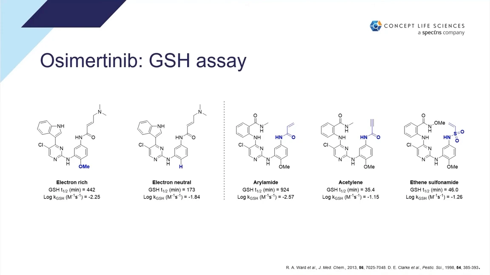

这张幻灯片本身就是一份"弹头反应性标尺"：

| 结构 | GSH $t_{1/2}$ (min) | $\log k_{GSH}$ |
| --- | --- | --- |
| 富电子苯胺 + 丙烯酰胺 | 442 | −2.25 |
| 中性苯胺 + 丙烯酰胺 | 173 | −1.84 |
| 芳基酰胺（aryl amide） | 924 | −2.57 |
| 乙炔基酰胺（acetylene） | 35.4 | −1.15 |
| 乙烯磺酰胺（ethene sulfonamide） | 46.0 | −1.26 |

从 SAR 观察里还能读出两条规律 [【跳转到 40:31】](https://www.youtube.com/watch?v=OmripYGYVUk&t=2431)：右侧苯胺环的电子效应影响巨大（甲氧基换成氢，反应性提高 2.6 倍）；乙炔类和乙烯磺酰胺类比丙烯酰胺活泼 20 倍以上；而改左侧结构对亲电反应性几乎没有影响——**反应性由弹头及其紧邻的电子环境决定，与分子的其余部分关系不大**。

问答环节还有一个很漂亮的细节：MRTX849 上引入的**氟原子反而降低了丙烯酰胺的反应性**。讲者的解释是，氟的孤对电子可以捐入碳氧双键的 $\pi^{*}$ 反键轨道，抬高 LUMO 能量，使碳的正电性下降，因而对半胱氨酸更不活泼 [【跳转到 54:25】](https://www.youtube.com/watch?v=OmripYGYVUk&t=3265)——这与"酯比酮更不活泼"是同一个道理。

### 8.2 KRAS G12C：选择性来自"只有突变体才有那个半胱氨酸"

KRAS 是一个分子开关，在 GTP 结合的活性态与 GDP 结合的失活态之间切换。RAS 基因突变出现在超过 30% 的人类癌症中，其中 G12C 占肺腺癌约 13%、结直肠癌约 5%，全球每年患者超过 10 万人 [【跳转到 41:46】](https://www.youtube.com/watch?v=OmripYGYVUk&t=2506)。突变破坏了 GTP 水解，使 KRAS 卡在活性态。

2013 年之前，KRAS 被视为"不可成药"：它对 GTP/GDP 有皮摩尔级亲和力，细胞内核苷酸浓度又极高，可逆竞争根本打不动；而且表面缺乏明确的结合口袋 [【跳转到 42:36】](https://www.youtube.com/watch?v=OmripYGYVUk&t=2556)。

突破来自 Shokat 组：他们发现 Switch-II 附近有一个此前未被发现的口袋，并且 **G12C 突变恰好在那里提供了一个半胱氨酸**。用共价弹头去攻击这个突变半胱氨酸，就能同时解决"口袋浅"和"选择性"两个问题 [【跳转到 43:01】](https://www.youtube.com/watch?v=OmripYGYVUk&t=2581)。

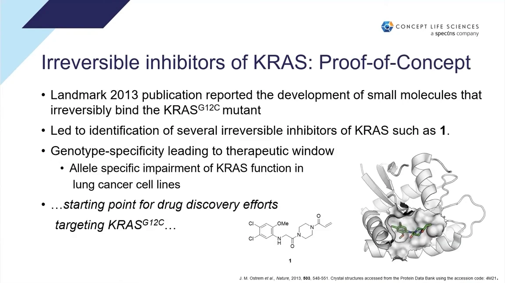

关键的一点是：**野生型 KRAS 没有这个半胱氨酸，因此不会被共价修饰**。选择性不来自弹头有多挑剔，而来自"靶点上有一个别人没有的亲核体"。这也解释了为什么这类"突变残基导向"的策略能拿到极高的安全边际——不可逆在这里不是风险，而是优势。

后续两个药物：

- **AMG 510（sotorasib）**：从半胱氨酸反应性化合物库筛起，结构导向优化。最大挑战是关键异丙基苯基—喹唑啉**联芳键的轴手性**，最初得到的阻转异构体半衰期只有 8 天；通过引入甲基进一步限制旋转，得到构型稳定、半衰期超过 180 年的分子 [【跳转到 44:16】](https://www.youtube.com/watch?v=OmripYGYVUk&t=2656)。一期临床显示耐受良好并有抗肿瘤活性。
- **MRTX849（adagrasib）**：从化合物 1 出发，去掉羟基避免葡糖醛酸化以提高口服生物利用度；引入氰甲基置换一个水分子、与 Gly10 骨架 NH 形成氢键，效力提高 400 倍；R 异构体比 S 异构体活性高 100 倍；引入 8-氯填充一个小疏水口袋；引入**二氟丙烯酰胺降低亲电反应性、减少谷胱甘肽代谢**，从而把全血稳定性提高到半衰期约 50 小时 [【跳转到 45:31】](https://www.youtube.com/watch?v=OmripYGYVUk&t=2731)。

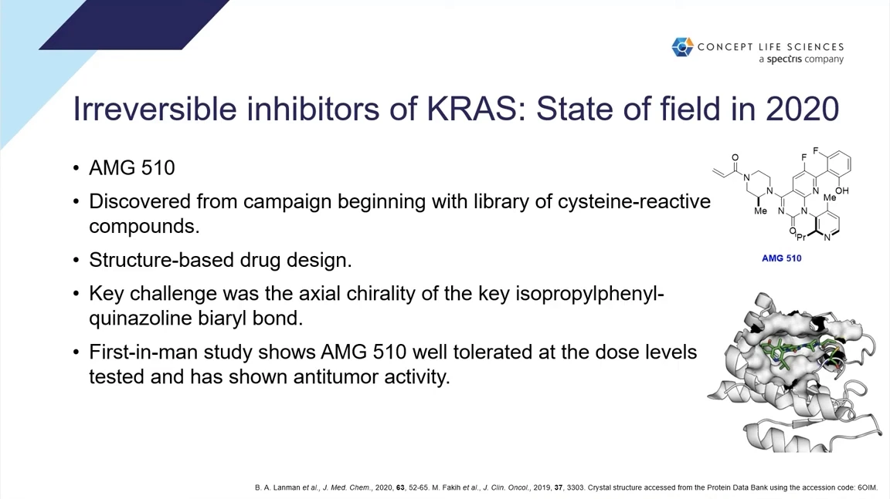

MRTX849 的那一步特别值得记住：**它不是把弹头做得更活泼来提高效力，而是做得更不活泼来提高稳定性**。效力由结合（$K_I$）和位置（$k_{inact}$）提供，稳定性由降低本征反应性提供——两者可以解耦。

## 九、小结

- **共价抑制是两步过程**：非共价定位（$K_I$）+ 化学反应（$k_{inact}$）。效率参数是 $k_{inact}/K_I$，不是 IC50；IC50 会随孵育时间漂移，报数必须固定时间。
- **弹头要与亲核体的软硬匹配**：半胱氨酸（丰度 1.9%、软亲核）配丙烯酰胺类；赖氨酸、酪氨酸（硬亲核）配磺酰氟、硼酸类。配对关系是实测出来的，不是猜的。
- **选择性来自定位与微环境，不来自弹头**：脱靶蛋白缺的不是"活泼的弹头"，而是"位置合适的亲核残基"。可逆共价进一步把这种差异用时间放大。
- **风险与收益同源**：弹头在循环中会与 GSH、血浆蛋白、脱靶蛋白反应。量化手段是 GSH 加合物速率、肝微粒体代谢活化、化学蛋白质组学。
- **占位时间由蛋白再合成决定**，因此 PK/PD 脱节、给药间隔可以很长、清除快未必是坏事；但"完全灭活"也意味着失去退出的余地。
- **治疗指数要靠剂量与清除率一起调**：优化对象是非结合 AUC 与 $k_{inact}/K_I$ 的乘积。
- **"反应性窗口"是可操作的工程旋钮**：奥希替尼用 GSH 半衰期 25–400 min 作为窗口；MRTX849 反过来用氟取代降低反应性换取全血稳定性。
- **最强的选择性来自靶点自身的独特性**：KRAS G12C 的突变半胱氨酸让"不可逆"从风险变成优势。

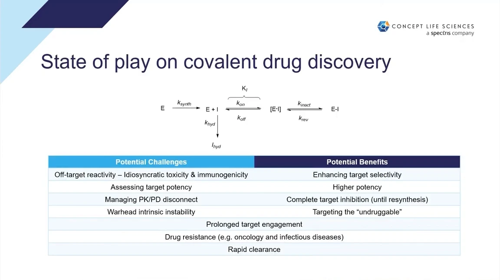

## 关键术语速查

| 术语 | 一句话解释 |
| --- | --- |
| 共价抑制剂 | 先非共价结合、再与靶点形成共价键的抑制剂；占位时间由蛋白降解/再合成决定 |
| 弹头（warhead） | 分子上那个负责成键的亲电基团，如丙烯酰胺、磺酰氟、腈、硼酸 |
| 亲核体（nucleophile） | 有多余电子密度、愿意去攻击亲电中心的基团；蛋白侧链里常见的是 Cys 的硫、Lys 的氮 |
| $K_I$ | 共价抑制剂"初始非共价复合物"的解离常数，反映停靠得好不好 |
| $k_{inact}$ | 失活速率常数，单位 s⁻¹，反映弹头摆位与反应快慢 |
| $k_{inact}/K_I$ | 共价抑制剂的效率参数，单位 M⁻¹s⁻¹，与孵育时间无关 |
| washout 实验 | 短时给药后彻底洗掉药物再测读数；读数仍被抑制说明机制是共价/长占位 |
| GSH 加合物 | 弹头与谷胱甘肽反应生成的产物；生成越快，说明弹头越"滥交" |
| 反应性窗口 | 项目自定的可接受反应性区间（如 GSH 半衰期 25–400 min），用来平衡效力与脱靶风险 |
| 化学蛋白质组学 | 用带标签的反应性探针 + 竞争实验，在全蛋白组尺度上找出化合物真正结合的蛋白 |
| PK/PD 脱节 | 血药浓度已降到零、药效仍维持，因为恢复依赖靶蛋白再合成 |
| 特异质性毒性 | 发生率低、难以用剂量解释、常在临床后期才暴露的不良反应，如特异质性肝损伤 |