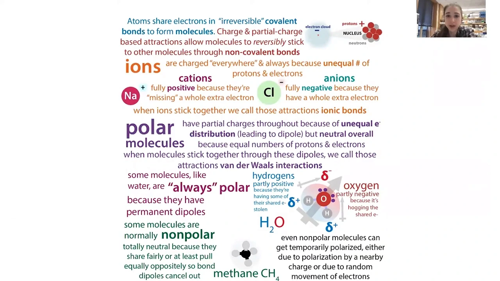
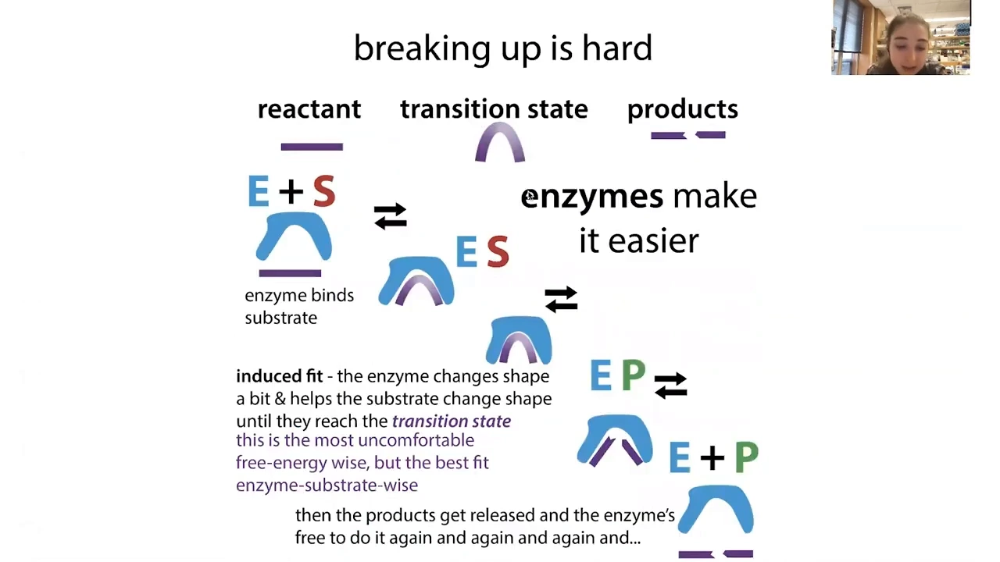
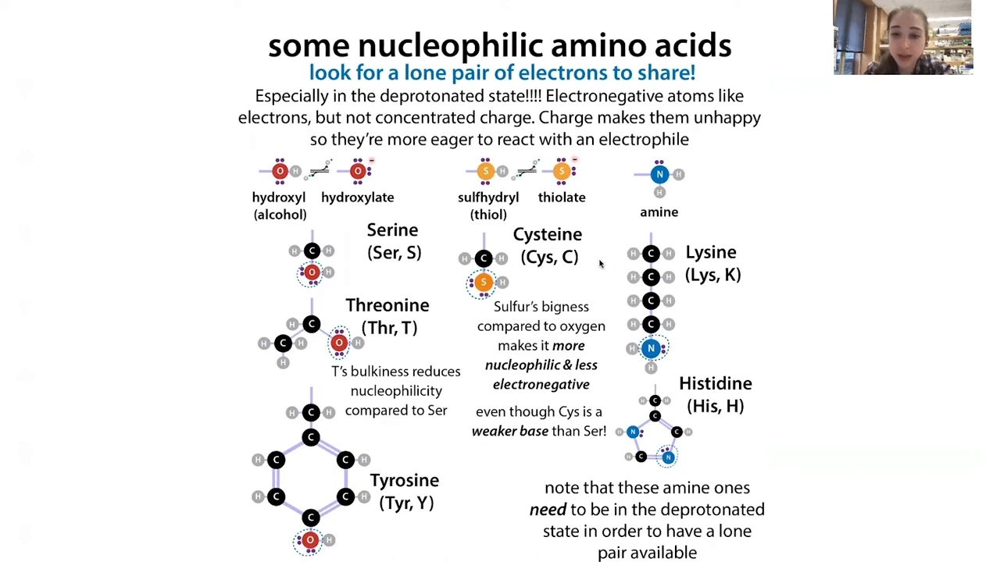
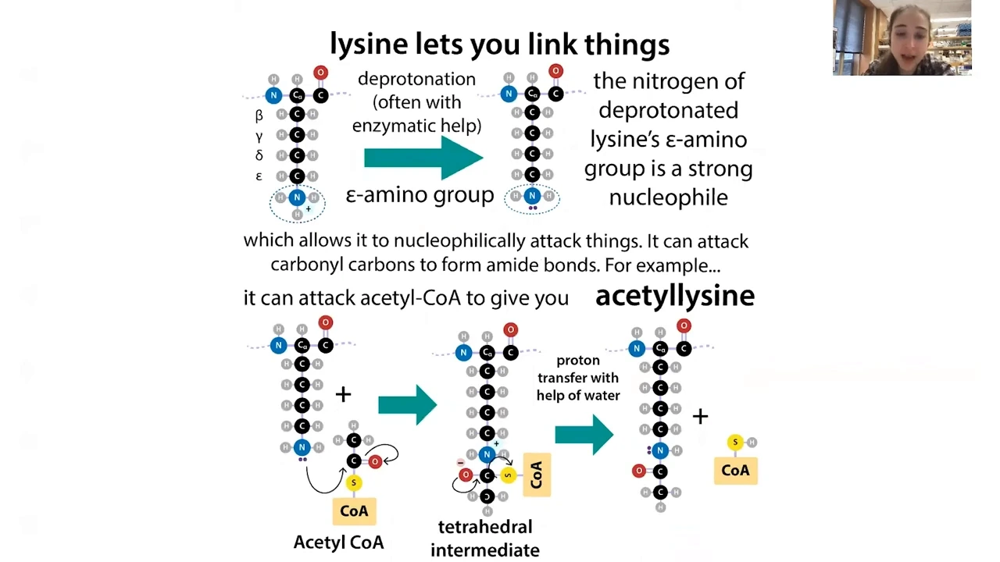
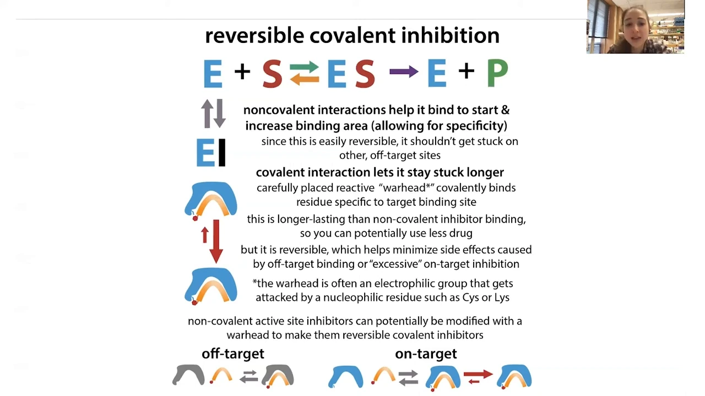
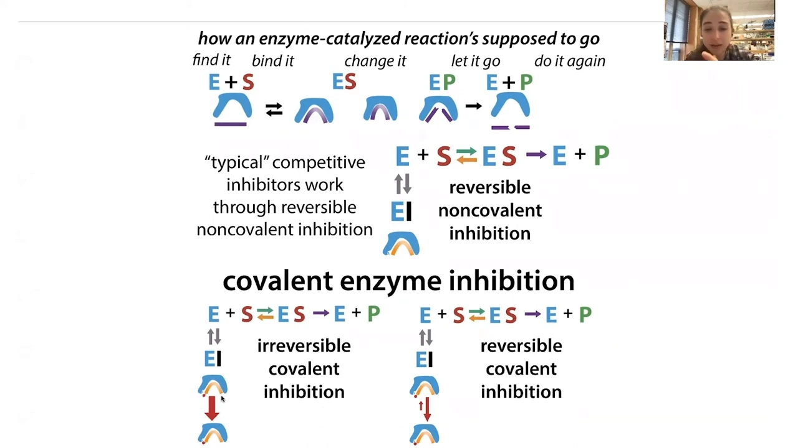
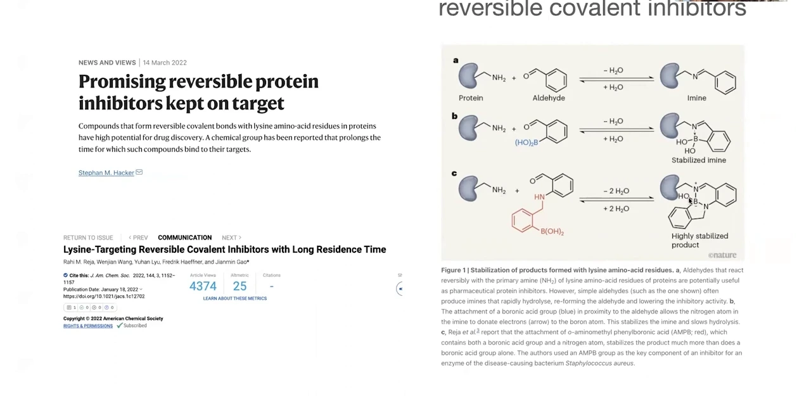
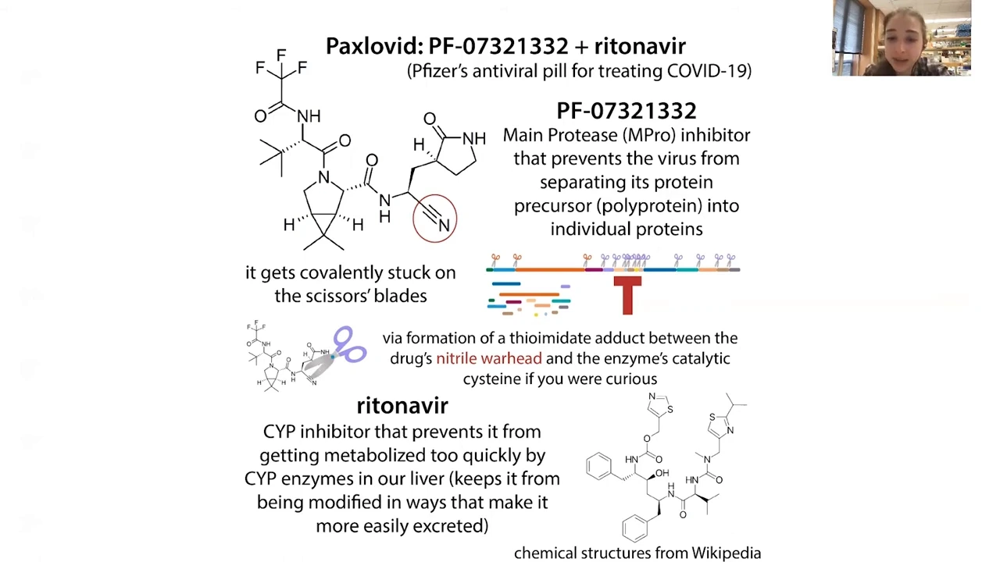
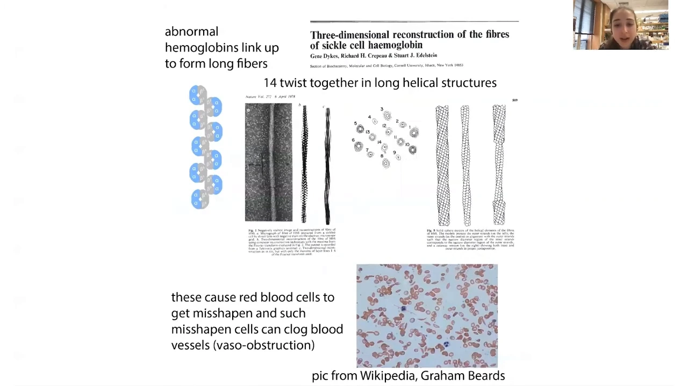
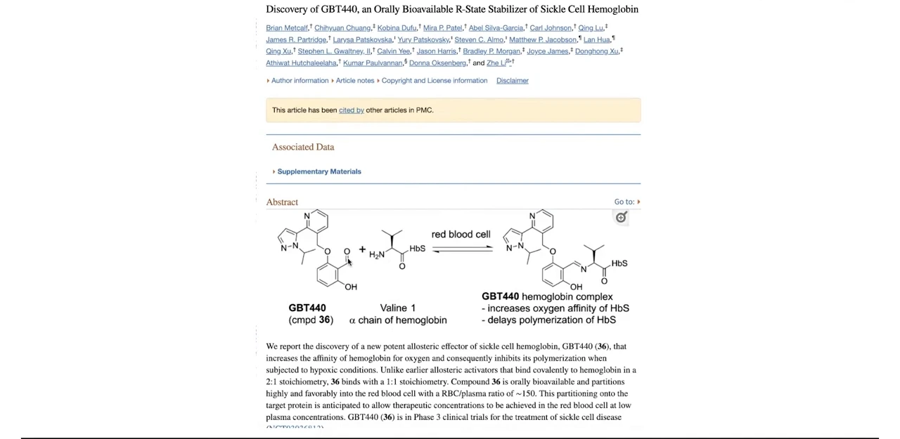

# 靶向共价抑制剂：可逆共价抑制为何能兼顾占位时间与安全性

> 视频来源：[Targeted covalent inhibitors with an emphasis on reversible covalent inhibition](https://www.youtube.com/watch?v=MVxIiqNbwio)（YouTube · the bumbling biochemist）｜时长约 42 分钟
> 导读：这是一支从生物化学而非药物化学角度切入的讲解视频。讲者先用"共价键并不都一样牢"这一点拆掉"共价 = 永久"的直觉，再讲清亲核体/亲电体的配对、两步验证带来的选择性，最后用 Paxlovid、Voxelotor、青霉素、sotorasib 四个例子把可逆与不可逆两条路线对照起来。本文按她的叙述顺序整理，并在需要处补充了必要的背景。字幕为自动生成，人名与药名已按公开信息订正。

## 本讲要解决的核心问题（SCQA）

**背景**：酶抑制剂最常见的形态是"可逆非共价竞争"——分子在活性位点进进出出，靠亲和力（$K_d$）和驻留时间产生效应。这类药物要维持效果，就必须在体内维持足够高的浓度。

**冲突**：有些靶点用这条路打不动：底物浓度太高、亲和力太强（比如 KRAS 对 GTP 是皮摩尔级），或者你想让抑制持续很久却不想一直给药。共价抑制剂能解决这两个问题——它在结合之后再形成一根真正的化学键。但"共价"两个字立刻带来两个疑虑：**第一，键焊死了还能退出吗？第二，"可逆共价"听起来像自相矛盾——共价键不是不可逆的吗？**

**疑问**：共价键真的都不可逆吗？如果可逆，靠什么机制逆转？可逆共价抑制凭什么既拿到长占位时间、又保住安全性？

**回答（中心思想）**：**共价键不是"不可逆"的同义词，它只是一根比较牢的键；牢到什么程度取决于键的极性与环境，而生物体系里有的是办法把它拆开——最常用的就是水解。** 于是"可逆共价"成立：分子先靠非共价作用定位，再与位置合适的亲核残基成键，这根键把驻留时间拉长；但它仍可被水拆掉，因此脱靶位点上的错误结合不会变成永久损伤。**再加上"非共价定位 + 亲核体位置"这两步验证，可逆共价抑制在选择性上往往优于纯非共价抑制剂。**

## 一、先纠正一个直觉：共价键不等于"永久"

### 1.1 共价键的本质只是"共享电子对"

讲者花了不少篇幅做这个铺垫，因为它是全片的地基 [【跳转到 11:57】](https://www.youtube.com/watch?v=MVxIiqNbwio&t=717)。共价键的定义是：两个原子把电子云叠在一起、共享成对电子。原子由带正电的质子、中性的中子和带负电的电子云组成，真正参与成键的是电子。共享一对电子是单键，共享两对是双键。

非共价作用则是另一回事：它只是电荷之间的吸引——可以是完全带电的离子键，也可以是极性分子上部分电荷之间的作用（范德华力），甚至可以是中性分子里偶然出现的瞬时偶极。这些作用里电子云并没有真正重叠。

所以"共价 vs 非共价"的分界线是**有没有共享电子**，而不是"牢不牢"。

### 1.2 但共享得并不公平：极性决定了键的脆弱程度

讲者紧接着说：共价键并不都一样牢，因为共享电子并不总是公平的 [【跳转到 14:21】](https://www.youtube.com/watch?v=MVxIiqNbwio&t=861)。

水的例子最好懂：氧的电负性大，把电子拉向自己，于是氧带部分负电、氢带部分正电。这种不公平的共享带来两个后果：分子有了偶极（所以水"黏"），以及**那个被拉走了电子的氢变得容易被攻击、容易掉下来**。

换句话说，一根键的"可拆性"很大程度上由它周围的电子分布决定。键越极化、成键原子越大（电子云越松散），它就越容易被亲核体攻击。

### 1.3 从能量角度：没有真正"不可逆"的反应

讲者用自由能曲线把这个道理讲到底 [【跳转到 26:16】](https://www.youtube.com/watch?v=MVxIiqNbwio&t=1576)：反应物有一个能量，产物有一个能量。如果产物的自由能低得多，它"过得更舒服"，往回走就很难——但**理论上永远存在往回走的可能**，只是要翻过一座更高的山。

她还举了一个很有说服力的例子：我们平时觉得最牢的键——蛋白的肽键、DNA 的磷酸二酯键——其实都能被水解拆开，只是通常需要强酸强碱，或者需要酶（蛋白酶、核酸酶）来帮忙 [【跳转到 24:41】](https://www.youtube.com/watch?v=MVxIiqNbwio&t=1481)。既然如此，**一根比肽键更弱的键，在生理条件下被水拆掉就完全说得通**。

所以"可逆共价"不是文字游戏，它是一个热力学与动力学问题：键的牢度可以被设计成"够久但可拆"。

## 二、亲核体与亲电体：谁打谁

### 2.1 一对概念：缺电子的与多电子的

共价成键在生化语境里几乎总是同一个剧本：**亲核体攻击亲电体** [【跳转到 15:09】](https://www.youtube.com/watch?v=MVxIiqNbwio&t=909)。

- **亲核体（nucleophile）**：电子密度比自己"舒服"的更多，愿意把这份负担分出去。它不一定带负电——只要电子云富余就行。
- **亲电体（electrophile）**：电子密度不足，想要电子。它也不一定带正电。

讲者给了一个好记的词源：nucleophile 里的 "nucleo-" 指原子核（质子所在处），所以亲核体本质上是"去找质子"的；而亲电体是"去找电子"的。两者一拍即合。

在羰基上看得最清楚：氧把电子拉走，羰基碳就变成了缺电子的亲电中心，等着被攻击。**药物分子上的弹头（warhead），就是被刻意装上的一小块亲电体。**

### 2.2 蛋白这一侧：哪些残基是亲核体

能被共价修饰的蛋白侧链，本质上都是"有孤对电子可分"的基团。讲者列了一张对照表 [【跳转到 16:42】](https://www.youtube.com/watch?v=MVxIiqNbwio&t=1002)：

| 残基 | 亲核中心 | 特点 |
| --- | --- | --- |
| 丝氨酸 Ser | 羟基氧 | 电负性大，本身亲核性弱；需要邻近残基活化 |
| 苏氨酸 Thr | 羟基氧 | 侧链更庞大，亲核性比 Ser 更弱 |
| 酪氨酸 Tyr | 酚羟基氧 | 中性态亲核性差，去质子化后（酚氧负离子）很强 |
| 半胱氨酸 Cys | 巯基硫 | 硫的"体型"比氧大，电子云更松散，因此**亲核性更强、电负性更低** |
| 赖氨酸 Lys | ε-氨基氮 | 需要去质子化才有可用的孤对电子 |
| 组氨酸 His | 咪唑氮 | 常作为酸碱催化中的质子传递者 |

### 2.3 为什么半胱氨酸最常被选中

讲者的解释很物理 [【跳转到 19:04】](https://www.youtube.com/watch?v=MVxIiqNbwio&t=1144)：硫在周期表里比氧低一行，多一层电子壳，价电子离核更远，因此**更容易被拉出来参与反应**——亲核性更强。代价是同一件事的反面：**键也更容易断**。

这正好解释了为什么生物体自己就在用可逆共价的半胱氨酸化学：两个半胱氨酸之间形成二硫键（disulfide bridge），这是蛋白折叠和抗氧化防御的基础；谷胱甘肽（GSH）就是靠这个机制当抗氧化剂的 [【跳转到 18:18】](https://www.youtube.com/watch?v=MVxIiqNbwio&t=1098)。

但同一段话里藏着一个重要的风险提示：**谷胱甘肽本身就是细胞内最丰富的硫醇**。如果你的弹头太活泼，它会在到达靶点之前就被 GSH 消耗掉。讲者说，所以这类化合物通常要**专门做抗 GSH 的筛查**，确认它不会在循环里乱反应。

### 2.4 赖氨酸：丰度更高，但更难驯服

赖氨酸的 ε-氨基在去质子化后是强亲核体，可以攻击羰基碳形成酰胺键——生物体用它来做乙酰化（乙酰辅酶 A 把乙酰基交给赖氨酸，生成乙酰赖氨酸）[【跳转到 19:51】](https://www.youtube.com/watch?v=MVxIiqNbwio&t=1191)。

对药物设计来说，赖氨酸的意义在于**丰度**：讲者说赖氨酸在蛋白里比半胱氨酸常见得多。这是一把双刃剑 [【跳转到 07:10】](https://www.youtube.com/watch?v=MVxIiqNbwio&t=430)：

- **好处**：如果靶点口袋里没有半胱氨酸，赖氨酸给了你第二个机会；
- **坏处**：正因为赖氨酸到处都是，弹头必须"被管得很紧"，否则脱靶反应会成倍增加。

## 三、两步验证：靶向共价抑制的选择性来源

### 3.1 第一步：非共价识别负责"定位"

讲者把可逆共价抑制剂的工作方式拆成两段 [【跳转到 00:48】](https://www.youtube.com/watch?v=MVxIiqNbwio&t=48)：

1. 分子上有一大块结构负责与靶点结合口袋互补，提供**更大的结合面积**，从而提供特异性——这部分完全靠非共价作用，和普通药物没有区别，可以随时进出；
2. 结合到位之后，口袋附近会伸出一个有反应性的残基（赖氨酸或半胱氨酸），它去攻击分子上的**亲电弹头**，形成共价键。

### 3.2 第二步：只有"位置正确"的亲核体才会成键

第二步才是选择性的真正来源。讲者用了一个很贴切的说法：这是**两步验证**（two-step verification）或"双因素认证" [【跳转到 02:24】](https://www.youtube.com/watch?v=MVxIiqNbwio&t=144)。

逻辑是这样的：同家族的酶，活性位点往往长得很像。一个纯非共价抑制剂，很可能在好几个同源酶上都结合得不错。但**共价那一步要求口袋里恰好有一个位置合适的亲核残基**——这个条件比"形状相似"苛刻得多。于是：

- 在脱靶蛋白上，只有第一步发生，结合是可逆的、短暂的；
- 在靶点上，第二步也发生，驻留时间被显著拉长。

**结果就是"在正确的靶点上驻留更久，在错误的靶点上驻留更短"**——这直接翻译成更小的毒性和副作用 [【跳转到 03:10】](https://www.youtube.com/watch?v=MVxIiqNbwio&t=190)。

### 3.3 弹头本身并不活泼，活泼的是口袋

这一点最容易被误解。讲者专门强调：**这些弹头并不是"超级强"的**，它们需要活性位点的特定环境才能反应 [【跳转到 06:23】](https://www.youtube.com/watch?v=MVxIiqNbwio&t=383)。

靶点口袋里通常有一些稳定化、增强反应性的相互作用（邻近的碱性残基降低亲核体的 $pK_a$、疏水环境降低水的活度、构象预组织降低熵损失）。设计者的目标恰恰是：**让弹头在细胞质里"游荡"时尽量不反应，一旦结合到靶点、进入那个特定微环境才变得活泼**。

如果反过来，直接装一个非常活泼的基团进去，它会在细胞内到处反应——这正是老一代共价药物毒性的来源。讲者说，这也是共价药物发现中最容易卡住的地方。

### 3.4 靶向催化残基还是非催化残基

讲者还提了一个设计上的取舍 [【跳转到 07:57】](https://www.youtube.com/watch?v=MVxIiqNbwio&t=477)：

- 攻击**催化残基**（比如蛋白酶的催化半胱氨酸）：位置明确、反应性往往最好，但催化残基在家族内高度保守，选择性提升有限；
- 攻击**非催化残基**：位置可能更"独特"，能带来额外的选择性，但需要结构信息支持。

### 3.5 起点：从已有的非共价抑制剂改

工程上最常见的做法不是从零设计，而是**改造** [【跳转到 04:44】](https://www.youtube.com/watch?v=MVxIiqNbwio&t=284)：先拿一个已知的非共价抑制剂（比如某个 ATP 类似物），看晶体结构里口袋附近有哪些可及的亲核残基，再把弹头接到一个能伸过去的位置上，然后做大量的优化——溶解度、生物可及性、毒性，一样都不能少。

讲者特意提醒：**"往一个普通化合物上粘个弹头"远没有那么简单**。

## 四、可逆共价：把"焊死"变成"可拆"

### 4.1 逆转的机制是水解

可逆共价与不可逆共价的区别只有一句话：**形成的键会不会被水拆掉** [【跳转到 21:27】](https://www.youtube.com/watch?v=MVxIiqNbwio&t=1287)。

水看起来不像什么厉害角色，但当键本身"脆弱"（极化、原子大、电子云松散）时，水就足以攻击它，把药物和蛋白重新分开。讲者说，药物化学里这类键的逆转**主要就是靠水解**。

于是"可逆性"变成了一个可以调节的连续量：键越稳定，驻留时间越长；键越不稳定，越容易退出。讲者把这称为一个正在被积极研究的方向——**为特定场景精细调节驻留时间** [【跳转到 27:06】](https://www.youtube.com/watch?v=MVxIiqNbwio&t=1626)。

用平衡的语言写出来，可逆共价抑制剂的有效解离常数是两步的合并结果：

$$
K_d^{\text{eff}} = \frac{[E]\,[I]}{[E{\cdot}I] + [E{-}I]}
$$

分子里同时包含了非共价复合物 $E{\cdot}I$ 和共价加合物 $E{-}I$。共价那一步越偏向右边，$K_d^{\text{eff}}$ 就越小，表观亲和力就越强——但这个"强"是可逆的。

### 4.2 一个漂亮的例子：从醛到硼酸再到 AMPB

讲者引了 2022 年《JACS》上的一篇工作（配发的 News & Views 评论标题就叫 "Promising reversible protein inhibitors kept on target"），讲的是**靶向赖氨酸的可逆共价抑制剂** [【跳转到 27:57】](https://www.youtube.com/watch?v=MVxIiqNbwio&t=1677)。

故事分三步：

1. **醛 + 赖氨酸氨基 → 亚胺（imine）**。这是可逆共价，但**太容易水解**：亚胺很快被水拆回醛，驻留时间很短，做不成药。
2. **加一个硼酸基团**。硼原子可以与亚胺的氮形成配位键，把亚胺"撑住"，显著减慢水解。这就是"稳定化亚胺"（stabilized imine）。
3. **再加一个氨基（AMPB 基团）**。硼酸 + 邻近氮原子共同作用，稳定化效果比单用硼酸强得多，得到"高度稳定化产物"，驻留时间大幅延长。作者把这个 AMPB 基团用在了针对金黄色葡萄球菌的酶抑制剂上。

这个例子把"可逆性可调"讲得非常具体：**同一类化学（亚胺），只靠改变邻近基团，就能把驻留时间从"太短"调到"刚好"**。

## 五、四个案例：可逆与不可逆各在什么场合赢

### 5.1 Paxlovid：腈弹头 + 催化半胱氨酸

Paxlovid 是辉瑞的口服抗新冠药，由两部分组成：抗病毒成分 **PF-07321332（nirmatrelvir）** 和药代动力学增强剂**利托那韦（ritonavir）** [【跳转到 29:33】](https://www.youtube.com/watch?v=MVxIiqNbwio&t=1773)。

PF-07321332 是新冠病毒**主蛋白酶（Mpro）**的抑制剂。Mpro 的作用是把病毒翻译出来的长多聚蛋白切成一个个功能蛋白；抑制它，病毒就造不出有功能的蛋白。讲者的比喻很形象：**这个药"卡在剪刀的刀刃上"**。

化学上，它靠一大块结构结合活性位点（提供亲和力与特异性），弹头只是一个**腈基（nitrile）**——很小的一块。腈与 Mpro 的**催化半胱氨酸**反应，形成**硫代亚胺酸酯（thioimidate）加合物**。

利托那韦本身不抗病毒，它是 CYP 抑制剂，作用是**阻止 PF-07321332 被肝里的 CYP 酶代谢得太快**，从而提高前者的暴露。

为什么这里选可逆共价而不是不可逆？讲者的理由是 [【跳转到 31:56】](https://www.youtube.com/watch?v=MVxIiqNbwio&t=1916)：细胞内有很多蛋白酶，如果药物把它们也永久灭活了，后果不可控；而且如果靶点是你自己的蛋白酶（只是活性过高），你也不会想把它彻底、永久地关掉。**可逆共价给了"长驻留"但不给"永久损伤"**。

### 5.2 Voxelotor：与 N 端缬氨酸成亚胺，稳定血红蛋白的 R 态

Voxelotor（研发代号 GBT440）是 FDA 已批准的口服药物，用于**镰状细胞贫血** [【跳转到 32:45】](https://www.youtube.com/watch?v=MVxIiqNbwio&t=1965)。它甚至不是酶抑制剂——它抑制的是血红蛋白的**聚合**。

疾病逻辑：血红蛋白负责运氧；突变后异常血红蛋白会彼此连接，形成长纤维，把红细胞撑成镰刀状，堵塞血管（血管闭塞）。血红蛋白有两种主要构象：结合氧时是**松弛态（R 态）**，低氧时是**紧张态（T 态）**，而 T 态更容易发生镰变。

Voxelotor 的做法是**稳定 R 态**：它与血红蛋白 α 链 N 端缬氨酸的**游离伯氨基**形成可逆共价键（亚胺），提高氧亲和力、延缓聚合 [【跳转到 33:33】](https://www.youtube.com/watch?v=MVxIiqNbwio&t=2013)。

这个案例说明了两件事：**第一，可逆共价的靶点不必是酶**——蛋白的 N 端氨基、变构位点都可以；**第二，"可逆"在这里是安全性的关键**——你要的是把血红蛋白往 R 态"推一把"，而不是永久改变化学计量。事实上这个分子的结合化学计量是 1:1，而早期与血红蛋白共价结合的变构激活剂是 2:1。

### 5.3 青霉素：为什么它是不可逆的

青霉素是最经典的反例 [【跳转到 10:20】](https://www.youtube.com/watch?v=MVxIiqNbwio&t=620)。它结合到细菌的转肽酶上之后，β-内酰胺环被打开，形成的键**非常牢**，酶就被永久卡住了。

讲者的措辞是：青霉素形成的是"非常非常牢"的键，而可逆共价抑制剂形成的键"更弱"，所以水能攻击并把它拆开。

这个对照很关键：**不可逆不是共价抑制的必然属性，而是键的稳定性的一个取值**。青霉素能这么做，是因为细菌增殖快、且人体没有转肽酶，永久灭活一个细菌酶不构成安全问题。

### 5.4 Sotorasib / adagrasib：突变半胱氨酸让"不可逆"变成优势

KRAS 是信号通路里的分子开关，在 GTP 结合的活性态与 GDP 结合的失活态之间切换。某些癌症中出现的 **G12C 突变**让 KRAS 过度活跃，持续向下游发信号 [【跳转到 35:08】](https://www.youtube.com/watch?v=MVxIiqNbwio&t=2108)。

长期以来 KRAS 被认为是"不可成药"的，原因讲者讲得很清楚 [【跳转到 38:18】](https://www.youtube.com/watch?v=MVxIiqNbwio&t=2298)：它对 GDP/GTP 的结合极强（皮摩尔级），细胞里这类核苷酸又多，可逆抑制剂要竞争过它需要"难以想象的高浓度"或"极强的结合"；而且只模仿活性位点的话，脱靶风险也高。

2013 年 Shokat 实验室的突破是：发现了 Switch-II 附近一个此前未知的**变构口袋**，而 G12C 突变恰好在那里提供了一个**半胱氨酸**。设计一个分子填进这个浅口袋，把弹头摆到能攻击这个半胱氨酸的位置，就能形成共价键 [【跳转到 36:43】](https://www.youtube.com/watch?v=MVxIiqNbwio&t=2203)。

由此得到的 sotorasib（原 AMG 510）2021 年获 FDA 批准，adagrasib 紧随其后申请上市 [【跳转到 37:31】](https://www.youtube.com/watch?v=MVxIiqNbwio&t=2251)。

这里"不可逆"从风险变成了优势，理由只有一条 [【跳转到 39:54】](https://www.youtube.com/watch?v=MVxIiqNbwio&t=2394)：**需要共价键才能被永久锁死的，是那个带突变半胱氨酸的版本**。正常 KRAS 即使结合上去也不会成键，因此不会被永久灭活。于是"永久"这件事只发生在癌细胞里——这正是最理想的选择性。

## 六、为什么"可逆"能兼顾占位时间与安全性

把全片的论证收拢，可逆共价抑制的收益可以归成三条：

1. **驻留时间够长，因此给药可以更少** [【跳转到 23:53】](https://www.youtube.com/watch?v=MVxIiqNbwio&t=1433)。纯非共价竞争性抑制剂必须维持足够高的浓度才能持续占位，还会被底物竞争掉；有了共价键，药物不需要一直在场。
2. **可退出，因此不会过度抑制** [【跳转到 01:36】](https://www.youtube.com/watch?v=MVxIiqNbwio&t=96)。如果你只需要压低某个过度活跃的激酶的活性、但仍需要保留一部分，那么"能拆"就是安全阀。
3. **两步验证提高了选择性**，因此脱靶驻留时间短、副作用少。

而代价也很清楚：

- **弹头在体内的"存活"是个约束**——它要能穿过循环、避开谷胱甘肽和其他硫醇，最后才在靶点反应；
- **可逆共价的可逆程度必须可控**——太稳定就成了不可逆，太不稳定就退化成普通非共价抑制剂；
- **化学复杂度更高**——多了一个需要优化的维度（键的牢度），也多了一类需要测的性质（水解速率、GSH 稳定性）。

## 七、小结

- **共价键不等于不可逆**。它只是"共享电子对"，牢度由极性与原子大小决定；连肽键和磷酸二酯键都能被水解，更弱的键在生理条件下被水拆掉完全合理。
- **"可逆共价"不是文字游戏**：键形成拉长驻留时间，水解提供退出通道，两者共同定义了一个可调的表观亲和力 $K_d^{\text{eff}}$。
- **选择性来自两步验证**：非共价识别负责定位，位置正确的亲核残基负责成键。弹头本身并不特别活泼，活泼的是口袋的微环境。
- **半胱氨酸是首选亲核体**（硫的亲核性强于氧），但它的低丰度既是机会（脱靶少）也是限制（很多靶点没有）；赖氨酸丰度高但更难驯服。
- **谷胱甘肽是必须做的对照**：它是最丰富的硫醇，弹头太活泼会在到达靶点前就被消耗。
- **不可逆在什么场合是优势**：当亲核残基只存在于致病突变体上时（KRAS G12C），"永久灭活"恰好只发生在该被灭活的细胞里。
- **可逆在什么场合是优势**：当靶点同时也承担正常功能、或体内存在同源蛋白酶时（Paxlovid），"能退出"就是安全边际。
- **可逆性可以被设计**：醛 → 亚胺太易水解，加硼酸稳定化，再加氨基（AMPB）得到长驻留的可逆共价键。

## 关键术语速查

| 术语 | 一句话解释 |
| --- | --- |
| 共价键 | 两个原子共享成对电子形成的键；牢度取决于极化程度与原子大小，并非绝对不可逆 |
| 亲核体 | 电子密度富余、愿意攻击缺电子中心的基团；蛋白中如 Cys 的硫、Lys 的氮 |
| 亲电体 | 电子密度不足、想要电子的中心；药物上的弹头就是被装上去的亲电体 |
| 弹头（warhead） | 分子上负责与靶点成键的亲电基团，如丙烯酰胺、腈、醛、硼酸 |
| 两步验证 | 先非共价定位、再要求位置正确的亲核残基成键；共价抑制剂选择性的主要来源 |
| 驻留时间（dwell time） | 药物停留在靶点上的平均时长；共价键能显著拉长它 |
| 可逆共价 | 形成共价键但仍可被水解拆开的抑制方式；介于纯非共价与不可逆之间 |
| 亚胺（imine） | 醛/酮与伯胺缩合形成的 C=N 键；可逆，易水解，是可逆共价的常见化学 |
| AMPB | 邻氨基甲基苯硼酸类基团，能同时用硼酸与氨基稳定亚胺，显著延长驻留时间 |
| 硫代亚胺酸酯 | 腈与半胱氨酸巯基加成生成的加合物，是 nirmatrelvir 与 Mpro 成键的形式 |
| 变构位点 | 活性位点之外的结合口袋；结合后可改变蛋白构象与功能 |
| 谷胱甘肽（GSH） | 细胞内最丰富的硫醇，既是抗氧化剂，也是弹头最主要的"脱靶消耗者" |