# 活性信号的三种解释：真结合、检测伪影与体系假象

> 视频来源：[Assay Interpretation: Studies in Mechanisms and Methods in Assay Interferences](https://www.youtube.com/watch?v=BnghAptDvik)（YouTube · NIH NCATS「Assay Guidance Workshop」· 讲者 Douglas Auld，Novartis Institutes for BioMedical Research）｜时长约 50 分钟
> 导读：这是一场专门讲「假阳性从哪来」的方法学报告。讲者把干扰分成技术性与非技术性两大类，再逐个拆解聚集、自氧化、单线态氧淬灭、化合物自发荧光、荧光素酶报告基因、金属盐与 DMSO 的机制，并给出对应的排查实验。本文按「机制—证据—对策」的顺序整理，与同小节《生化筛选的第一道设计题》互补：那一篇讲怎么选格式，这一篇讲选好之后读数会在哪里骗你。

## 本讲要解决的核心问题（SCQA）

**背景**：高通量筛选的产出是一张「命中表」。一个化合物在某块板上让信号下降了 80%，它就被写成「抑制剂」，进入下一轮。

**冲突**：但在这张表里，真正与靶点结合的化合物只占一部分。讲者给出的数字很刺眼：在荧光素酶报告基因筛选里，命中表中 **40–98%** 的化合物其实只是抑制了荧光素酶本身；在纯荧光检测中，**约 5% 的化合物库**会自己发出蓝光，而一个优化良好的 assay 的命中率通常只有 1% 左右——也就是说，**干扰的丰度可以超过真实命中一个数量级**。

**疑问**：这些假信号是怎么产生的？有没有一套可复用的实验，能在命中进入下一轮之前把它们识别出来？

**回答（中心思想）**：**任何活性信号都要经过三层解释——它可能来自真正的靶点结合，可能来自检测技术本身的伪影，也可能来自化合物真实的但非预期的生物学作用。** 三层的排查手段不同：技术性伪影靠「正交检测 + 反筛 + 多参数读数」识别，非技术性作用靠「已知机制化合物库」比对，而无论哪一层，都要先理解机制再设计实验——讲者的原话是，他更偏好实验路径而不是数据挖掘路径，因为**理解了机制，才能设计出更稳健的 assay 与排查流程**。

## 一、一个 assay 的「三万英尺视图」：你测的是信号，不是靶点

讲者用一张最简单的图开场 [【跳转到 01:29】](https://www.youtube.com/watch?v=BnghAptDvik&t=89)：左边是 **Target**（你打算测的东西），右边是 **Measurement**（你实际测到的东西），中间那个 **X** 就是全部问题所在。

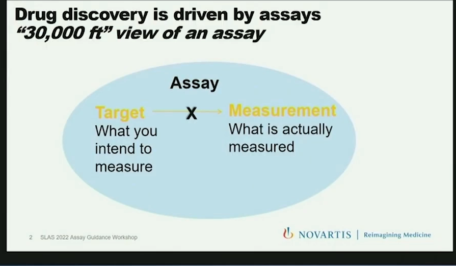

不管体系是细胞还是纯化蛋白，assay 最终都要转成一个光信号——发光或荧光。**「信号变了」与「靶点被调控了」之间隔着一整条链路**：激发光的穿透、荧光团的量子产率、酶的稳定性、化合物的溶解度、板孔表面的吸附，每一环都能单独改变读数。本讲就是把这条链路逐段拆开。

识别伪影有两条路 [【跳转到 02:19】](https://www.youtube.com/watch?v=BnghAptDvik&t=139)：一条是挖历史数据库（PubChem、公司内部 20 年的筛选数据），找「对某种技术富集」或「泛 assay 干扰」（PAINS、frequent hitters、promiscuous compounds）的化合物；另一条是讲者更偏好的——**做实验搞清楚机制**，再据此设计排查流程。他提到 Novartis 内部的 ARES 系统本来想让科学家自己标注 assay 元数据（靶点、蛋白来源、缓冲液、技术类型），结果发现没人愿意花这个时间，最后改成由专职的 assay curator 维护 [【跳转到 03:34】](https://www.youtube.com/watch?v=BnghAptDvik&t=214)。这条经验对任何做筛选的团队都成立：**元数据必须由流程强制采集，不能指望自觉**。

## 二、干扰只有两类，但对策完全不同

讲者把干扰分成两大类 [【跳转到 06:50】](https://www.youtube.com/watch?v=BnghAptDvik&t=410)：

- **技术相关（technology-related artifacts）**：化合物与信号检测本身发生非特异相互作用——淬灭发光、吸收激发光、自身发光。这类作用**与生物学完全无关**；
- **非技术相关（non-technology related）**：化合物有真实的生物学作用，但那是你不想要的——线粒体毒物、细胞毒、泛靶点抑制剂。这类作用**会随细胞状态、通路背景变化**，但不会随检测技术变化。

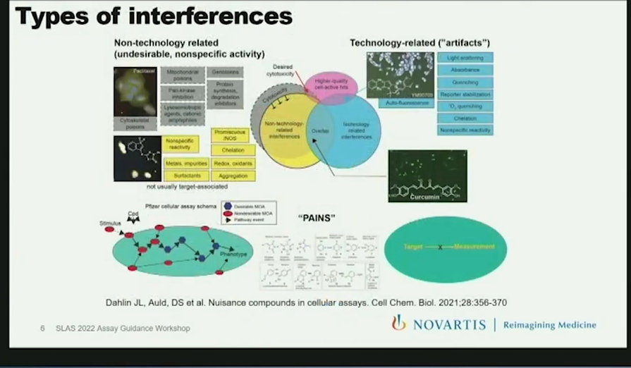

这个二分法非常实用，因为它直接决定你该做哪种确认实验：**换一种检测技术后活性消失的，多半是技术伪影；换技术后活性仍在、但换成无关靶点也仍有活性的，多半是非技术性的泛活性。**

## 三、三类排查策略：反筛、正交、多参数

讲者给了三种标准做法，并画成了一张流程图 [【跳转到 07:40】](https://www.youtube.com/watch?v=BnghAptDvik&t=460)：

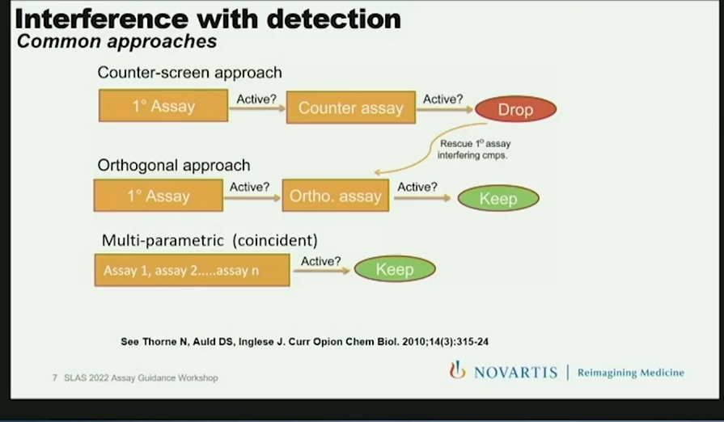

1. **反筛（counter-screen）**：用**不依赖靶点**的方式产生同样的信号。例如初筛是荧光素酶反应，反筛就用同样的酶和底物、但不加你的靶点通路。两次都活 → 丢弃。
2. **正交（orthogonal）**：换一种**检测技术**测同一个靶点。例如荧光 assay 里活性的化合物，换到发光读数里复测，**活性应该保持**。讲者认为正交比反筛更稳健，因为它能救回被误判的化合物——一个化合物可能既有干扰、又真的作用于靶点，反筛会把它一起丢掉，正交则能保留 [【跳转到 08:55】](https://www.youtube.com/watch?v=BnghAptDvik&t=535)。
3. **多参数（multiparametric / coincident）**：在同一个孔里同时读多个信号，用信号之间的一致性判断。

还有一个更巧的「反筛」写法，专门对付**信号生成被干扰**的情况 [【跳转到 11:50】](https://www.youtube.com/watch?v=BnghAptDvik&t=710)：正常 assay 是把酶、底物、抑制剂一起孵育一段时间再读数；反筛则让酶和底物先反应到接近完成，**最后才加抑制剂**。如果两种顺序下都看到同样的「抑制」，那这个化合物干扰的就不是酶，而是信号生成过程本身。

## 四、生化体系里的三类假抑制

讲者用一张图把生化 assay 的常见干扰归成三类 [【跳转到 09:45】](https://www.youtube.com/watch?v=BnghAptDvik&t=585)：

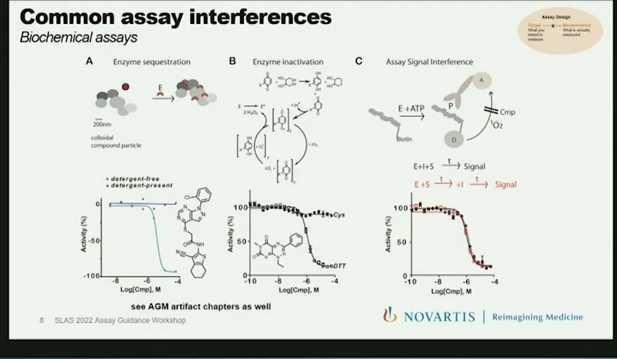

### 4.1 聚集：最普遍、也最容易被误读的假抑制

**机制**：化合物在缓冲液里形成直径约 100–500 nm 的胶体颗粒（不是沉淀），这些颗粒表面会吸附并部分解析叠靶点蛋白，把酶「隔离」掉 [【跳转到 09:45】](https://www.youtube.com/watch?v=BnghAptDvik&t=585)。因为颗粒对蛋白的亲和力极高（pM–nM 级），抑制曲线会**异常陡峭**。

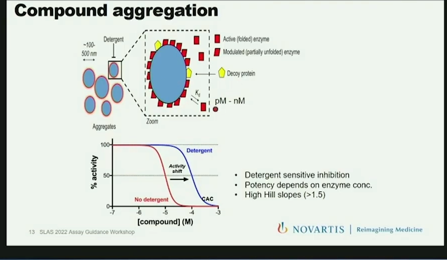

**四个可观察特征**（这张图右下角就是判据清单）：

- **去垢剂敏感**：加 Triton X-100、CHAPS 等（低于临界胶束浓度）后抑制消失或曲线右移；
- **表观强度依赖酶浓度**：酶越多，需要的聚集体越多，表观 $IC_{50}$ 会漂；
- **Hill 斜率异常高**（常 > 1.5）：因为不是 1:1 结合，而是「颗粒—蛋白」的多价吸附；
- **存在临界聚集浓度（CAC）**：低于 CAC 完全没有抑制，高于 CAC 突然出现。

**它有多普遍**：讲者在 NIH 用 β-内酰胺酶 assay 对约 7 万个化合物做滴定，**2% 的化合物表现出聚集型抑制**，其中 **95% 是去垢剂敏感的聚集**，其余才是其他非特异机制或真正的酶抑制 [【跳转到 17:40】](https://www.youtube.com/watch?v=BnghAptDvik&t=1060)。

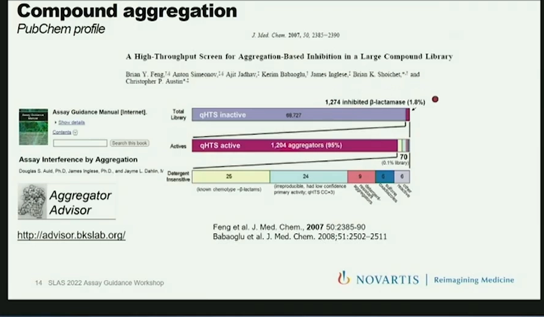

**对策**：加去垢剂（把 CAC 推到筛选浓度范围之外）、加诱饵蛋白（BSA 先「涂满」颗粒表面）、或直接降低筛选上限浓度 [【跳转到 17:15】](https://www.youtube.com/watch?v=BnghAptDvik&t=1035)。

### 4.2 自氧化与还原剂：DTT 会把化合物变成过氧化物发生器

第二类假抑制来自**化合物在缓冲液中的化学不稳定**。讲者的例子是一个邻醌：在 DTT 存在时被还原成氢醌，进入氧化还原循环，最终产生过氧化氢，而过氧化氢能失活很多生化 assay 里的靶点 [【跳转到 10:10】](https://www.youtube.com/watch?v=BnghAptDvik&t=610)。

**诊断方法非常干净**：换还原剂。同一个化合物（二氢大豆苷元）在 DTT 缓冲液里表现为强抑制，**把还原剂换成胱氨酸（更低的氧化还原电位）后活性消失** [【跳转到 10:35】](https://www.youtube.com/watch?v=BnghAptDvik&t=635)。也可以直接用过氧化物检测（如 HRP 体系）测一下孔里到底有没有过氧化氢 [【跳转到 11:00】](https://www.youtube.com/watch?v=BnghAptDvik&t=660)。

> 这与上一篇里 Coussens 讲的「还原剂是缓冲液的六个变量之一」是同一件事的两面：还原剂既影响酶，也通过化合物影响读数。**降低 DTT 浓度（如从 10 mM 降到 1 mM）本身就是一种缓解手段。**

### 4.3 信号生成被干扰：AlphaScreen 的单线态氧淬灭

AlphaScreen/AlphaLISA 的信号链是「供体珠 → 单线态氧 → 受体珠」，中间那一步靠**单线态氧在溶液里扩散**。任何能淬灭单线态氧的化合物都会直接压低信号，看起来像抑制 [【跳转到 11:25】](https://www.youtube.com/watch?v=BnghAptDvik&t=685)。这类干扰的识别方法就是前面说的「改变加样顺序」的反筛。

### 4.4 PAINS 与反应性化合物：换技术也救不了

讲者特别指出一类**正交方法也无能为力**的化合物：含 Michael 受体等亲电基团、能直接共价修饰靶点的化合物 [【跳转到 18:30】](https://www.youtube.com/watch?v=BnghAptDvik&t=1110)。因为无论你换成哪种检测技术，酶都已经被共价失活了——**这不是检测伪影，而是真实的化学反应，只是不是你想要的机制**。这类化合物需要额外的生物物理手段去判断化学计量与抑制机制（见本系列《四种生物物理方法测的不是同一件事》）。

## 五、荧光干扰：5% 的库自己会发光

讲者在 NIH 做过一项系统研究：把 7 万个化合物在纯缓冲液里做七点滴定，在从蓝（伞形酮/香豆素）到绿（荧光素）再到红外的多个波长上测自发荧光 [【跳转到 12:15】](https://www.youtube.com/watch?v=BnghAptDvik&t=735)。

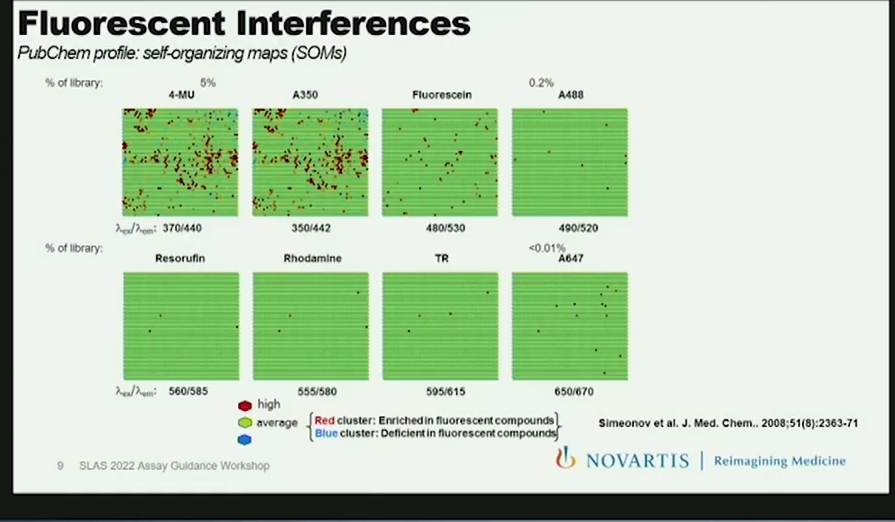

结论很直接：**蓝光通道约 5% 的化合物库会自发荧光，越往长波长走越少**。5% 听起来不多，但对比「优化良好的 assay 命中率通常只有 1%」——干扰比真实命中多五倍 [【跳转到 13:05】](https://www.youtube.com/watch?v=BnghAptDvik&t=785)。

还有两个更隐蔽的坑：

- **荧光可能来自杂质而不是化合物本身**：讲者试图用 SAR 规则预测荧光，但很多情况下发光的是样品里的荧光杂质。所以用历史数据库排查干扰时，**要按 sample ID（来源批次）而不是 compound ID 检索**，否则是在拿苹果比橘子 [【跳转到 14:20】](https://www.youtube.com/watch?v=BnghAptDvik&t=860)。
- **TR-FRET 也怕**：镧系元素（铽、铕）的寿命是微秒级，比化合物荧光的纳秒级长得多，所以延迟 50 微秒再测就能避开大部分背景荧光 [【跳转到 14:45】](https://www.youtube.com/watch?v=BnghAptDvik&t=885)。但**淬灭还在**：铽的激发波长是 340 nm，恰好落在蓝光区，吸收这一波段的化合物会淬灭供体。

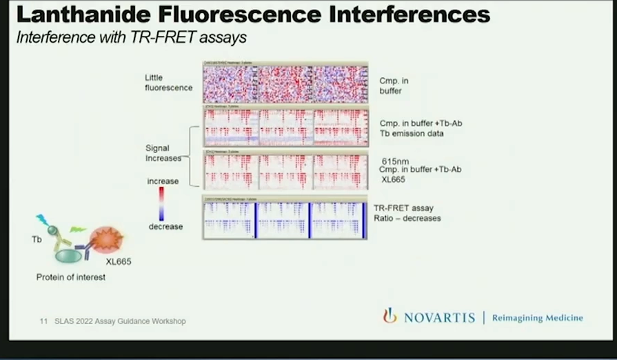

这张图是全讲最实用的一页：**比值读数并不能消除干扰**。化合物同时抬高了供体与受体通道的原始信号，比值一除反而下降，于是被当成命中。讲者的建议是：**除了比值，一定要看未经归一化的供体、受体原始通道，与 DMSO 对照比较**，显著偏离的就标记为潜在干扰物 [【跳转到 16:25】](https://www.youtube.com/watch?v=BnghAptDvik&t=985)。

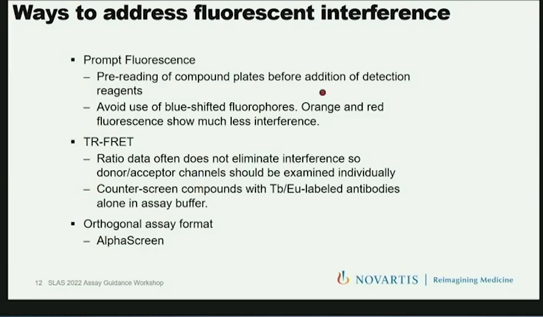

## 六、报告基因：荧光素酶自己就是一个靶点

这是本讲最长也最精彩的一段。荧光素酶报告基因（luciferase reporter gene assay）在 HTS 里极其流行：加化合物、裂解、加底物、读光，全自动、动态范围大。但讲者说，**这个反应比它看起来复杂得多**。

### 6.1 亮反应与暗反应

荧光素酶的发光反应是：D-荧光素 + ATP → 荧光素酰腺苷酸 →（加氧）→ 二氧杂环丁酮 → 氧化荧光素 + 光子 [【跳转到 20:10】](https://www.youtube.com/watch?v=BnghAptDvik&t=1210)。

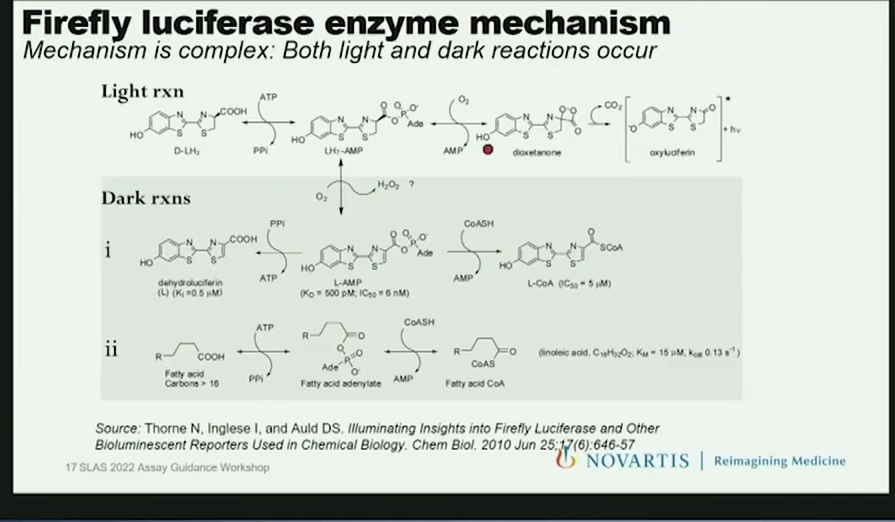

关键在于**暗反应**：中间体可以被氧化成脱氢荧光素酰 AMP，这是酶的强抑制剂（$IC_{50}$ 约 6 nM），会关掉发光；但它能被辅酶 A 切割成弱得多的抑制剂。所以商品化检测试剂（如 Promega 的 Bright-Glo）里不只加了高浓度 D-荧光素和 ATP，**还加了辅酶 A** 来解除这个自抑制 [【跳转到 21:00】](https://www.youtube.com/watch?v=BnghAptDvik&t=1260)。此外荧光素酶与脂肪酸合成酶同源，长链脂肪酸也能形成腺苷酸加合物。**这些副反应都不在你的读数里，却决定了读数。**

### 6.2 4% 的库是荧光素酶抑制剂

讲者在 NIH 把 PubChem 全部 35 万化合物、在 Novartis 把 150 万化合物库，都用**生化荧光素酶 assay**（底物在 $K_m$ 附近、无细胞）筛了一遍 [【跳转到 21:50】](https://www.youtube.com/watch?v=BnghAptDvik&t=1310)。两次结果一致：**约 4% 的化合物在 10 μM 下显著抑制荧光素酶**。

而在**细胞报告基因** assay 的命中表里，这个比例被放大成灾难 [【跳转到 22:40】](https://www.youtube.com/watch?v=BnghAptDvik&t=1360)：很多命中表里 **40% 到 98%** 的化合物，其活性可以完全归因于对报告酶本身的调控。

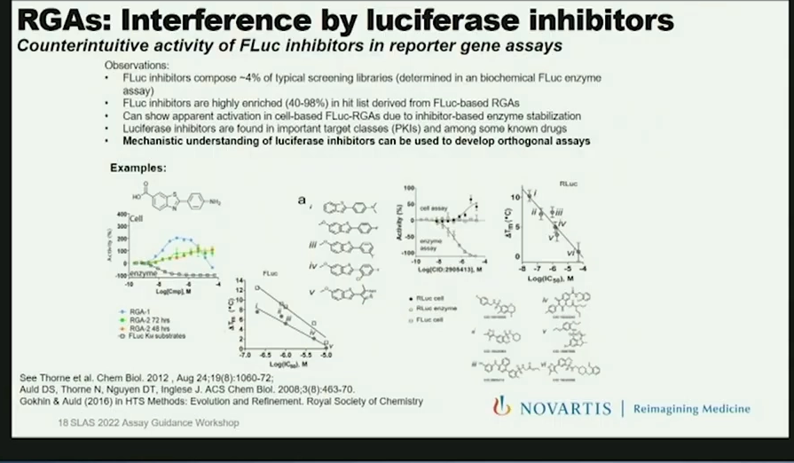

更反直觉的是**方向**：很多荧光素酶抑制剂在细胞 assay 里表现为**发光升高**，曲线呈钟形或双相 [【跳转到 23:05】](https://www.youtube.com/watch?v=BnghAptDvik&t=1385)。机制是**配体稳定酶结构**——和细胞热位移（CETSA）同一个原理：抑制剂在细胞内结合酶、延长其半衰期，于是酶量变多、发光变强，看起来像「通路被激活」[【跳转到 23:30】](https://www.youtube.com/watch?v=BnghAptDvik&t=1410)。讲者给出了定量证据：这一系列苯并噻唑化合物的效价与**荧光素酶熔点的升高**呈良好相关 [【跳转到 23:55】](https://www.youtube.com/watch?v=BnghAptDvik&t=1435)。

### 6.3 案例：PTC124 与「通读」活性

讲者用 PTC124（Ataluren）说明这类伪影有多难识破 [【跳转到 25:10】](https://www.youtube.com/watch?v=BnghAptDvik&t=1510)。一家公司想找能促使终止密码子「通读」的化合物：他们在荧光素酶基因第 190 位放一个终止密码子，找能让发光升高的化合物——PTC124 就是这样被发现的，并发表在 Nature 上。

但讲者团队刚做完荧光素酶抑制剂的全库图谱，手里正好有一批二芳基噁二唑类强抑制剂，于是做了三组对照 [【跳转到 26:00】](https://www.youtube.com/watch?v=BnghAptDvik&t=1560)：

- PTC124 在**生化酶学** assay 里是强抑制剂，滴定到与酶浓度（约 25 nM）相当的化学计量；
- 它有 SAR：把苯环上的取代从间位换到对位、邻位，酶抑制效价下降，**通读活性也同步下降**；
- **换成海肾荧光素酶（Renilla）报告同样的终止密码子，化合物完全无活性** [【跳转到 26:50】](https://www.youtube.com/watch?v=BnghAptDvik&t=1610)。

结论是：PTC124 的「通读」活性被荧光素酶报告体系严重偏置了。结构生物学进一步解释了机制——PTC124 占据荧光素结合口袋，其羧基与 ATP 形成磷酸酐加合物，成为**多底物加合物抑制剂**，$K_d$ 约 120 pM；它让荧光素酶的 $T_m$ 升高近 15 °C [【跳转到 27:40】](https://www.youtube.com/watch?v=BnghAptDvik&t=1660)。那为什么细胞里看到的是发光升高？因为细胞内的辅酶 A 会把加合物切割成弱抑制剂，而检测试剂里高浓度的 D-荧光素与 ATP 又能把它竞争下来 [【跳转到 28:05】](https://www.youtube.com/watch?v=BnghAptDvik&t=1685)。

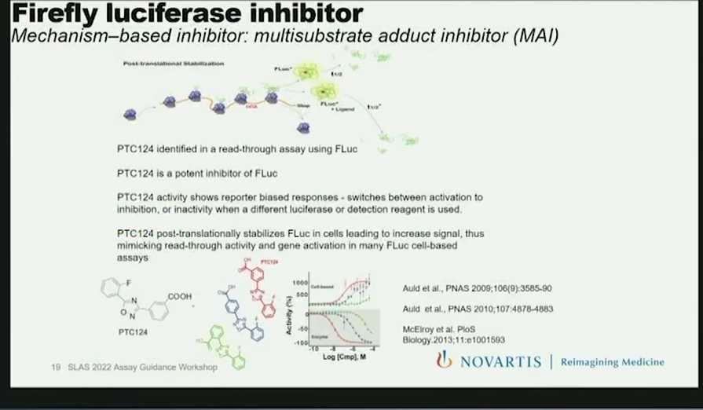

### 6.4 换酶、加底物、双报告：三种工程解法

讲者随后比较了多种发光酶在 5 万化合物多样性库里的「被抑制率」[【跳转到 29:20】](https://www.youtube.com/watch?v=BnghAptDvik&t=1760)：萤火虫荧光素酶（FLuc）约 4%；NanoLuc 约 2%，**用过量底物（全强度检测试剂）可降到约 1%**，因为很多化合物是竞争性抑制剂；海肾荧光素酶（RLuc）反而最高，某些情况下超过 8%。而不同物种来源的荧光素酶，其抑制剂结构重叠很少——说明这确实是「酶的特异 SAR」，不是泛泛的化合物毒性 [【跳转到 30:10】](https://www.youtube.com/watch?v=BnghAptDvik&t=1810)。

工程上的终极解法是**双报告 coincidence 检测** [【跳转到 30:35】](https://www.youtube.com/watch?v=BnghAptDvik&t=1835)：把 FLuc 与 NanoLuc（或 Renilla）通过 P2A 核糖体跳跃肽串在同一个转录本上，翻译后自动切成两个等摩尔的报告酶。两个酶的抑制剂谱不重叠，因此**只有在两个报告上都表现一致的化合物才值得保留**；只偏向其中一个的，就是报告酶抑制剂 [【跳转到 31:25】](https://www.youtube.com/watch?v=BnghAptDvik&t=1885)。

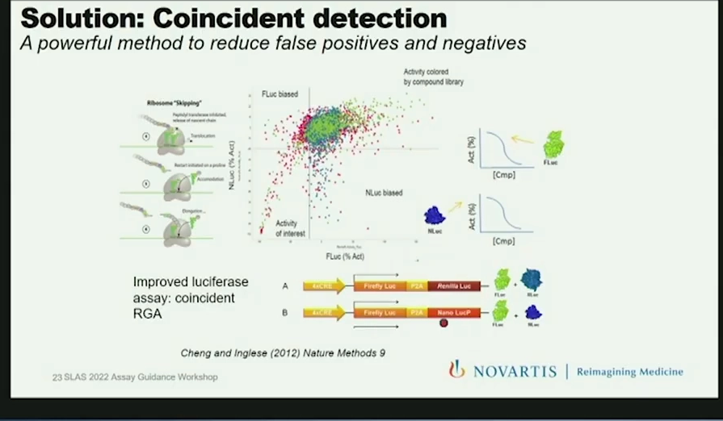

## 七、细胞层面：聚集、自发荧光与「长得像 GFP」

技术伪影在细胞 assay 里同样存在，只是表现形式变了。

**聚集在细胞里表现为 U 形曲线** [【跳转到 37:15】](https://www.youtube.com/watch?v=BnghAptDvik&t=2235)。Shoichet 组的工作显示：浓度超过 CAC 后，化合物形成大聚集体，**反而进不了细胞**，于是活性随浓度先升后降，形成 U 形。讲者举了一个漂亮的例子：台盼蓝（trypan blue）之所以能用来判断细胞死活，正是因为它形成胶体聚集体——**活细胞的膜不让聚集体进入，只有死细胞膜破损后才染色** [【跳转到 37:40】](https://www.youtube.com/watch?v=BnghAptDvik&t=2260)。

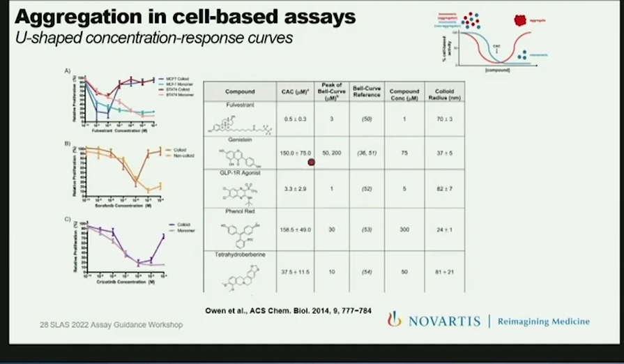

**化合物自发荧光在高内涵成像里同样致命**：讲者的团队发现，即便是注释完善、有明确人源靶点的工具化合物，也有约 5% 在蓝/绿通道有明显荧光 [【跳转到 38:05】](https://www.youtube.com/watch?v=BnghAptDvik&t=2285)。更麻烦的是，有些化合物不只是「亮」，还会呈现**类似细胞器的染色图案**（可能因为富集在溶酶体等低 pH 区室），看起来像真实的生物学信号。讲者提到一项已发表研究：一个简单的 GFP 报告 assay，把全部初筛阳性放到**不带报告基因的空细胞**上复测，结果 **100% 的阳性都只是自身发绿光** [【跳转到 39:09】](https://www.youtube.com/watch?v=BnghAptDvik&t=2349)。

**对策**：对高荧光化合物可以直接标记剔除（容易），对有染色图案的则必须靠**反筛**（同样的化合物加到不带报告基因的细胞上）才能识别 [【跳转到 39:34】](https://www.youtube.com/watch?v=BnghAptDvik&t=2374)。

## 八、样品与溶剂：金属盐与 DMSO

**金属盐**：化合物样品里常带有合成步骤残留的金属。讲者在 assay 开发阶段会专门跑一块「金属盐板」，看这个生化 assay 对哪些金属敏感 [【跳转到 41:32】](https://www.youtube.com/watch?v=BnghAptDvik&t=2492)。

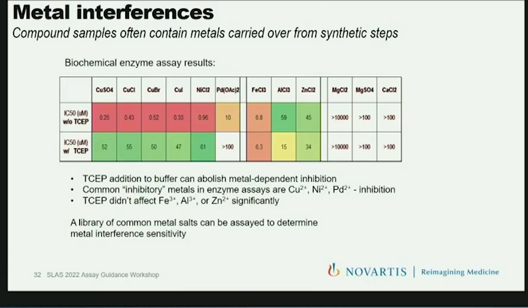

这张表的用法是双向的：如果命中表里富集了含铜的样品，就知道该去查注册信息；如果 assay 本身对金属敏感，可以用实验设计（design of experiment）调整缓冲液组分来缓解 [【跳转到 41:57】](https://www.youtube.com/watch?v=BnghAptDvik&t=2517)。

**DMSO**：它是化合物库的通用溶剂，绝大多数情况下是正确的选择，但**不是对所有化合物都正确**。讲者引了一项已发表分析：顺铂（cisplatin）在 DMSO 中，DMSO 会作为配体取代氯与氨配体，使化合物失活——而文献里大量体外研究恰恰是用 DMSO 配制的，导致活性数据被系统性偏置 [【跳转到 42:47】](https://www.youtube.com/watch?v=BnghAptDvik&t=2567)。

## 九、把干扰排查变成流程：MoA box 与「滋扰化合物库」

讲者最后介绍了两种「前置化」的做法。

**MoA box（mechanism of action box）**：一个约 4500 个化合物的集合，每个化合物都有实测的亲和力与明确的人源靶点（激酶、GPCR、蛋白酶、离子通道、酶等），其中很多靶点有多个不同骨架的化合物 [【跳转到 33:30】](https://www.youtube.com/watch?v=BnghAptDvik&t=2010)。用法是在**表型/细胞 assay 开发早期**跑一遍，看命中表里富集了哪一类靶点：

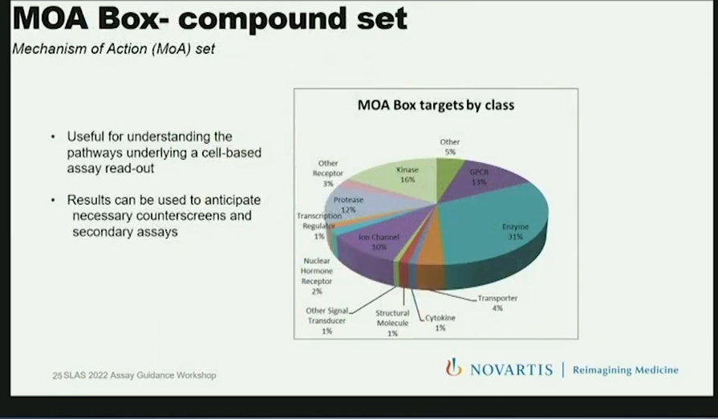

如果发现命中表里全是 HDAC 抑制剂，而你不想要 HDAC 活性，就应该在流程里加一个 HDAC 酶学反筛把这类化合物标出来 [【跳转到 36:00】](https://www.youtube.com/watch?v=BnghAptDvik&t=2160)。讲者还提到，同一个库被用作他们 cell painting 的参照集：把未知化合物与这些已知机制的化合物一起聚类，看它落在哪个簇里。

**滋扰化合物库（nuisance compound library）**：讲者与 NCATS、多家企业以及 Jonathan Baell 的团队正在共建一个「反 MoA box」——收录机制明确、但属于**不想要的机制**的化合物，供各实验室在表型筛选早期跑一遍，看自己的读数会被哪些讨厌的机制触发 [【跳转到 40:17】](https://www.youtube.com/watch?v=BnghAptDvik&t=2417)。

## 小结

- **活性信号要经过三层解释**：真结合、技术伪影、非技术性的真实生物学作用。三者的排查手段不同，不能混为一谈。
- **技术伪影与生物学无关**，换检测技术后通常消失；**非技术性作用**换技术仍在，但会随细胞背景变化。
- **三种排查策略**：反筛（无关靶点）、正交（换技术，能救回被误判的化合物）、多参数（同孔多读数）。对「信号生成被干扰」，最巧的反筛是**改变加样顺序**。
- **聚集是最普遍的生化假抑制**：约 2% 的库会聚集，其中 95% 去垢剂敏感；判据是陡峭的 Hill 斜率、酶浓度依赖、CAC 与去垢剂可解除。
- **化合物化学不稳定**会伪造抑制：邻醌在 DTT 下产生过氧化氢，换还原剂即可验证。
- **荧光干扰的丰度超过真实命中**：蓝光通道约 5% 的库自发荧光，而命中率通常只有 1%。
- **TR-FRET 的比值会骗人**：必须看未归一化的供体/受体原始通道。
- **荧光素酶本身是靶点**：约 4% 的库抑制 FLuc，在报告基因命中表里富集 40–98%，还能通过稳定酶结构表现为「激活」；解法是双报告 coincidence 检测或换用更难被抑制的发光酶。
- **细胞层面同样有伪影**：聚集导致 U 形曲线，化合物自发荧光与染色图案会被当成生物学信号，空细胞反筛是标准对策。
- **样品与溶剂是常被忽略的变量**：金属盐（Cu²⁺、Ni²⁺、Pd²⁺）与 DMSO（顺铂）都能单独改写结论。

## 关键术语速查

| 术语 | 一句话解释 |
| --- | --- |
| 技术伪影（technology artifact） | 化合物与信号检测本身相互作用造成的假信号，与生物学无关 |
| 反筛（counter-screen） | 在不依赖靶点的体系里复测，两次都活则判为干扰 |
| 正交检测（orthogonal assay） | 换一种检测技术测同一靶点，活性保持才保留 |
| 多参数读数（multiparametric） | 同一个孔里读多个信号，用一致性判断活性来源 |
| 聚集（aggregation） | 化合物形成 100–500 nm 胶体颗粒吸附并解析叠蛋白，造成陡峭的假抑制 |
| CAC（临界聚集浓度） | 化合物开始形成聚集体的浓度，低于它不出现聚集型抑制 |
| 去垢剂敏感 | 加 Triton X-100/CHAPS 后抑制消失，是聚集型假抑制的判据 |
| PAINS | 泛 assay 干扰化合物，含醌类、儿茶酚、Michael 受体等结构警示 |
| 单线态氧淬灭 | 化合物消耗 AlphaScreen 信号链中的单线态氧，直接压低信号 |
| hook effect | 三明治格式中分析物过量反而拆散信号复合物 |
| coincidence 检测 | 用两个抑制剂谱不重叠的报告酶同时读数，只保留两者一致的活性 |
| MoA box | 一批靶点与亲和力都已知的化合物，用于早期识别命中表里的非预期机制 |
| $Z'$ 因子 | 用阳性与阴性对照的分离度衡量板质量，是判断 assay 能否用于筛选的指标 |