# 生化筛选的第一道设计题：检测格式怎么选，读数才可信

> 视频来源：[Strategies for Assay Selection and for the Development of Robust Biochemical Assays](https://www.youtube.com/watch?v=1_afso13vMM)（YouTube · NIH NCATS「Assay Guidance Workshop」· 讲者 Nathan Coussens，Frederick National Laboratory for Cancer Research）｜时长约 44 分钟
> 导读：这是一场面向高通量筛选（HTS）方法学的讲座，讲者把「怎么选一个检测格式」拆成了三块：生化体系与细胞体系的取舍、酶学与结合型两大类检测的物理基础、以及把体系钉在可信区间上的一整套工程动作（缓冲液、去垢剂、$K_M$、初速度、DMSO 容差、仪器设置）。本文按这条线索整理，并把讲者反复强调的一句话放在最前面：**任何检测格式都能做出高质量的 assay，前提是你知道它在测什么、以及它会在哪里骗你。**

## 本讲要解决的核心问题（SCQA）

**背景**：药物发现的早期几乎全靠「assay」推进——把待测化合物加到含靶点的体系里，读一个光信号，信号变了就说明化合物起了作用。为了让几十万个化合物都能被筛一遍，实验体系必须被简化：用纯化的蛋白代替细胞，用发光或荧光代替真实的生理输出。

**冲突**：简化带来了可解释性，也带来了盲区。纯化的重组蛋白可能被截短、缺翻译后修饰、缺结合伙伴；一个 1536 孔板上的「信号下降」既可能是化合物抑制了靶点，也可能只是它吸收了激发光、淬灭了发光、让酶粘在板底，或者干脆把 DMSO 带多了。也就是说，**你测到的从来不是靶点活性，而是某个经过检测体系转换后的信号**。

**疑问**：那么，一个生化筛选的检测体系应该怎么选？选完之后，又该用哪些实验证明「这个读数确实对应靶点活性」？

**回答（中心思想）**：**选格式要按「阶段目标」选，验证读数要按「物理来源」查。** 初筛要的是单点也能站得住的稳健数据，复筛要的是更接近生理的测量；而无论哪种格式，都必须先把三件事钉死——信号在检测范围内线性、测量发生在反应初速度区间、载体（DMSO）与仪器设置不引入系统性偏差。讲者的一个具体例子很能说明问题：同一块板，只把荧光偏振的激发波长从 340 nm 换到 405 nm、再跑一次板内优化，$Z'$ 就从 0.68 升到 0.90。

## 一、生化体系是「化简」，不是「还原」

### 1.1 一张对照表说清取舍

讲者开场先给了一张生化与细胞体系的对照表 [【跳转到 01:22】](https://www.youtube.com/watch?v=1_afso13vMM&t=82)。生化体系的优势都来自「条件已知」：体系比细胞简单得多，反应条件明确，因此构效关系（SAR）的解读歧义更小；还能拿到机制信息，包括结合强度、动力学转化速率、抑制模式（竞争性、非竞争性、反竞争性）；并且生化体系能耐受更高的 DMSO 与化合物浓度，弱活性的命中也能被捞出来。

代价同样明确：**它可能漏掉重要的生物学特征**——截短的重组蛋白、缺失的翻译后修饰、缺失的结合伙伴。

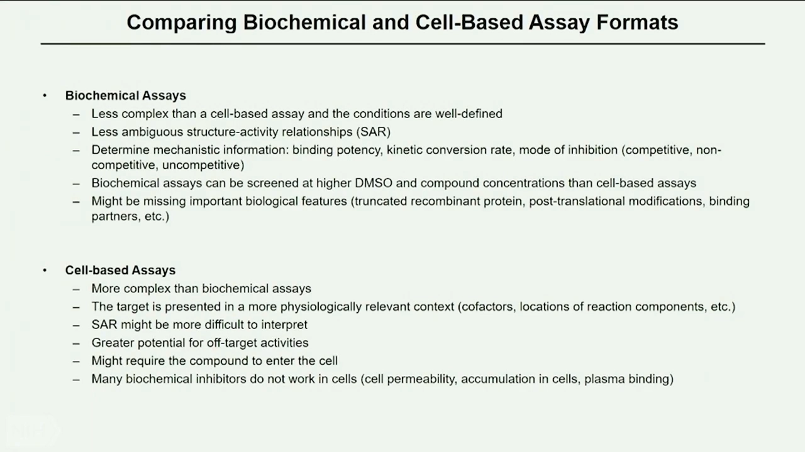

反过来，细胞体系把靶点放回更真实的上下文（辅因子、反应组分的位置都对），但复杂度上升，SAR 更难解释，脱靶活动更多；如果靶点在胞内，化合物还必须能进细胞、并在胞内达到足够浓度——而溶解度差、与血清蛋白结合强，都会把有效浓度压下去 [【跳转到 02:42】](https://www.youtube.com/watch?v=1_afso13vMM&t=162)。

讲者由此给出一句很实用的判断：**很多生化抑制剂在细胞里根本不工作**。所以如果靶点在胞内、而你直接用细胞体系做初筛，可能会漏掉那些「先拿到生化活性、后续再改细胞通透性」的化学系列。

### 1.2 纯化靶标的缺口，要在解读时补上

把上面这段话翻译成对「纯化靶标」的具体提醒，就是四个必须在写结论时交代的缺口：

- **结构不完整**：截短的重组蛋白缺少结构域、缺少翻译后修饰、缺少结合伙伴，测出来的活性可能只是片段的行为；
- **体系不完整**：细胞里的辅因子、区室化、底物浓度梯度在试管里都没有了；
- **试剂身份不确定**：讲者特别强调试剂验证，因为「纯化蛋白被错误标识、细胞系被错误标识、抗体特异性差」都有实例 [【跳转到 07:54】](https://www.youtube.com/watch?v=1_afso13vMM&t=474)；
- **试剂状态会漂移**：同一批酶在室温台面上放 24 小时，活性会下降（讲者的例子里信噪比仍很好，但活性确实降了），因此要先用实验定出「关键试剂可用多久」 [【跳转到 08:19】](https://www.youtube.com/watch?v=1_afso13vMM&t=499)。

> **补充（非讲者原话）**：纯化蛋白常见的另两个坑是标签残留（如 His 标签未切除影响构象）与批间比活性差异。工程上的对策与讲者的思路一致——关键试剂尽量单批号采购、留足后续确认实验的用量，并把比活性作为放行指标记录在案。

## 二、按阶段选格式：初筛要「单点也稳」，复筛要「更像真的」

讲者把筛选拆成两个阶段，各自有不同的格式要求 [【跳转到 03:57】](https://www.youtube.com/watch?v=1_afso13vMM&t=237)：

| 阶段 | 目标 | 对格式的要求 |
| --- | --- | --- |
| 初筛（primary screen） | 从几十万化合物里捞出命中 | 单浓度单次测试就能给出稳健数据；有统计验证；数据质量足以支撑后续 SAR |
| 复筛（secondary assays） | 确认命中、排除假象 | 通量可以更低；更复杂、更接近生理；通常在 HTS 之前就要把「复筛与反筛（counter assay）」规划好 |

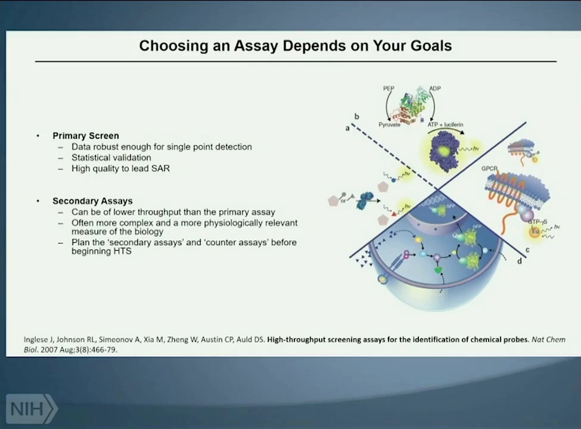

这张表最容易被忽略的是最后一句：**复筛不是筛完之后才想的事**。如果初筛用的是间接读数（比如偶联酶放大、或竞争置换），那么复筛就应该安排一个直接读数的格式来确认 [【跳转到 15:46】](https://www.youtube.com/watch?v=1_afso13vMM&t=946)。讲者举的实际决策例子是成本：两个生化 assay 性能指标相近，最终让**化学发光**做初筛、**HTRF** 做复筛，理由就是每个孔的成本 [【跳转到 05:37】](https://www.youtube.com/watch?v=1_afso13vMM&t=337)。

除了成本，还有几个常被低估的维度：仪器（你自己的读板机、CRO 或合作中心的读板机，型号会直接决定哪些格式可做）、板型（96/384/1536，微型化能降低每孔成本但不是所有 assay 都能微型化）、是否要多重读数（multiplex，比如同时区分「通路被调控」与「细胞被毒死」）[【跳转到 07:04】](https://www.youtube.com/watch?v=1_afso13vMM&t=424)。

## 三、读数的物理来源：灵敏度阶梯与四类常用格式

### 3.1 灵敏度是有排序的

讲者给了一条清晰的经验排序：**化学发光比荧光灵敏，荧光比比色/吸光度灵敏** [【跳转到 11:47】](https://www.youtube.com/watch?v=1_afso13vMM&t=707)。但紧接着补了一句同样重要的话：任何一类检测模态都能做出高质量的 assay——灵敏度决定的是「你需要多少蛋白、多少化合物」，不是「你能不能筛」。

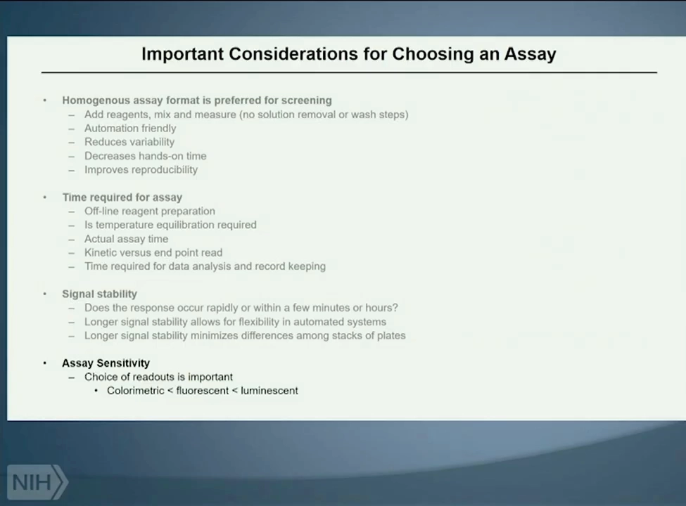

### 3.2 生化筛选实际在用什么

讲者统计了 PubChem 上 146 个肿瘤相关生化 HTS assay 的检测技术分布 [【跳转到 12:12】](https://www.youtube.com/watch?v=1_afso13vMM&t=732)：荧光强度 44 个、荧光偏振 43 个，AlphaScreen 与 TR-FRET 各 12 个，化学发光 11 个，FRET 9 个，吸光度 5 个，其余是流式、NMR、比色、电泳迁移率等。

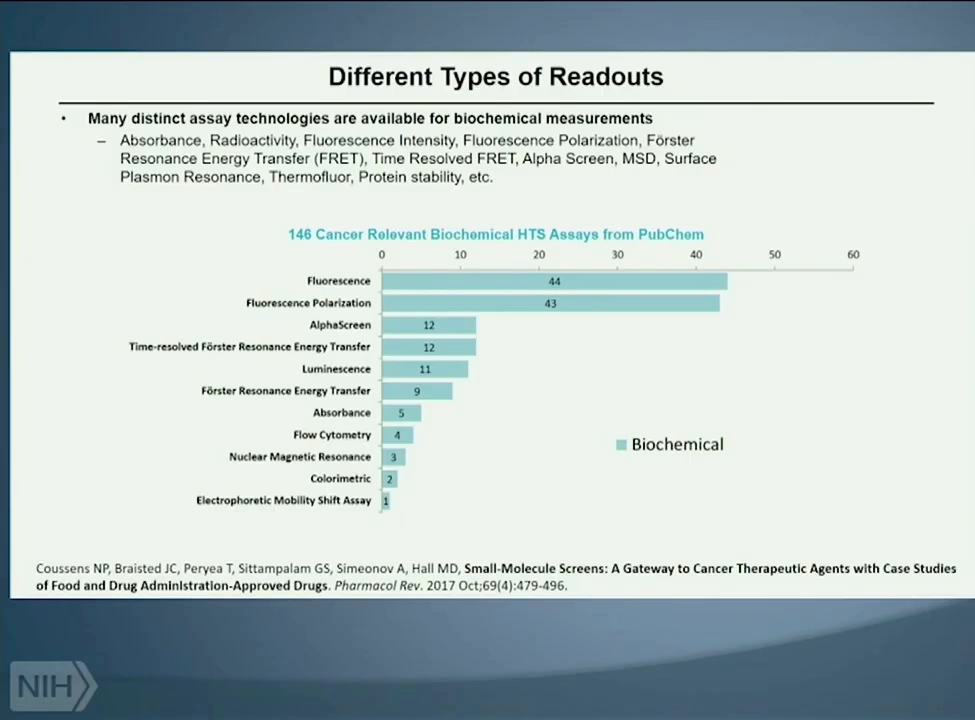

这张图对初学者的意义是：**「荧光」不是一个方法，而是一族方法**。荧光强度、荧光偏振、TR-FRET、AlphaScreen 都靠荧光，但它们测的物理量完全不同，因此怕的干扰也完全不同（这一点在下一篇《活性信号的三种解释》里展开）。

### 3.3 酶学检测：你可以在反应式的四个位置装探头

酶学 assay 的本质是「盯住反应式里的某一个物种」[【跳转到 13:27】](https://www.youtube.com/watch?v=1_afso13vMM&t=807)：

- **测底物消耗**：信号与剩余底物量成正比；
- **测产物生成**：底物被转化成可测产物（如带上荧光），或用偶联酶把产物再转一步产生信号，或让产物竞争置换掉一个标记分子；
- **测结合**：用标记的底物或标记的抑制剂做竞争置换，直接看化合物是否占据了酶。

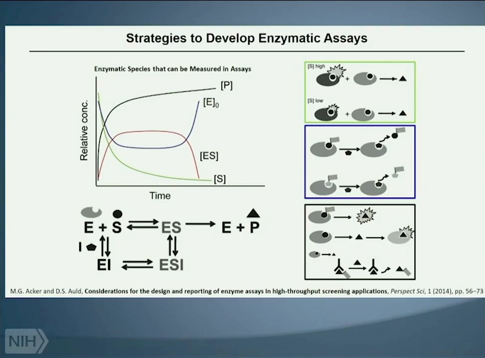

这张图还画了反应进程曲线：底物 $[S]$ 单调下降、产物 $[P]$ 单调上升并趋于平台、酶-底物复合物 $[ES]$ 先升后降。**所有「速率」都必须取自曲线还接近直线的区段**，这就是下一节要钉死的东西。

### 3.4 结合型检测：四种格式，四种脾气

当你要测的不是「酶转了多少底物」而是「两个分子有没有结合」时，常用的是下面四种格式。讲者逐个讲了它们的物理原理与工程特性：

| 格式 | 测的是什么 | 要不要洗 | 典型特点与软肋 |
| --- | --- | --- | --- |
| ELISA / DELFIA | 三明治夹心，抗体上带酶（ELISA）或带铕（DELFIA） | 要洗 | 灵敏度极高（DELFIA 可到每孔飞克级），动态范围 4–5 个数量级；**洗步骤让化合物干扰很低**，但通量与自动化成本上升 |
| TR-FRET（HTRF） | 供体（铽/铕）与受体距离小于 20 nm 时的共振能量转移 | 不洗 | 均相、无洗涤；**延迟测量**避开短寿命的背景荧光；动态范围通常不到 10 倍；比值读数能减少部分伪影 |
| 荧光偏振（FP） | 标记配体结合到大分子后旋转变慢、发射光去偏振程度下降 | 不洗 | **直接测结合**；灵敏度可到 nM 级探针；动态范围约 3–5 倍；对荧光团与连接臂极其敏感 |
| AlphaLISA / AlphaScreen | 供体珠受激发产生单线态氧，扩散到 200 nm 内的受体珠上发光 | 不洗 | 灵敏度可到每孔飞克级；**能容忍的分子尺寸范围最宽**；怕光、怕单线态氧淬灭；三明治格式有 hook effect |

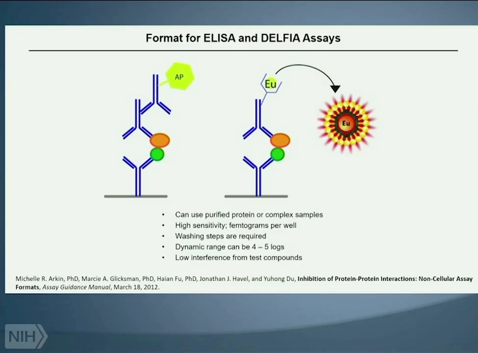

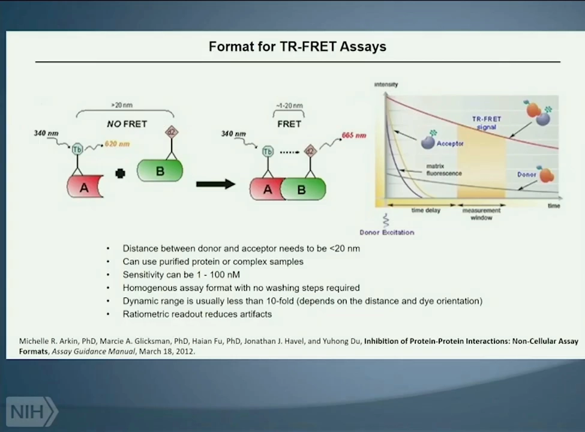

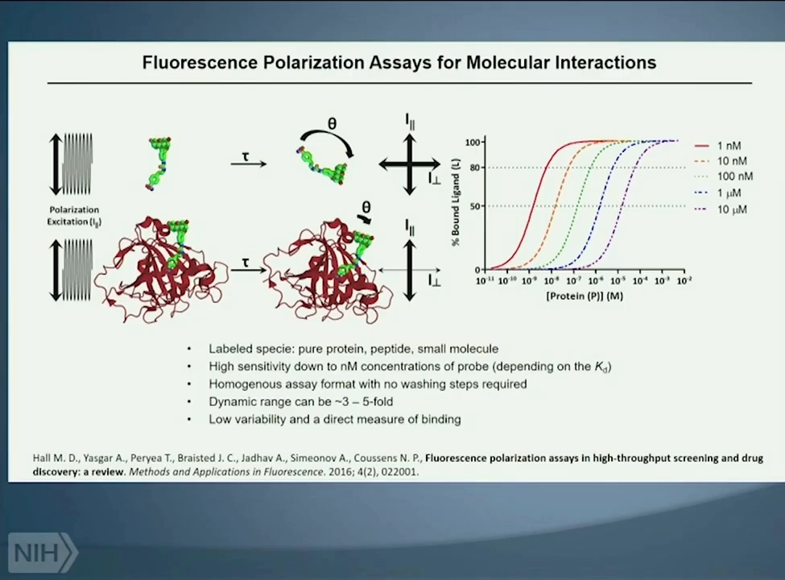

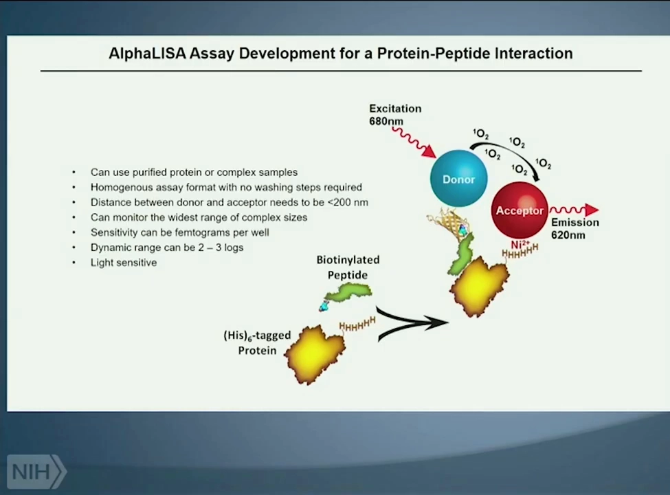

讲者用他自己的一个合作项目串起了这四种格式的取舍 [【跳转到 32:30】](https://www.youtube.com/watch?v=1_afso13vMM&t=1950)：目标是一个「只有配体存在时才发生」的蛋白-肽相互作用。先用**纯化蛋白 + TAMRA 标记肽**做 FP，成功微型化到 1536 孔，但受亲和力限制，**每块板要近 2 mg 蛋白**，太贵；于是换成 **AlphaLISA**——把肽换成生物素化版本挂链霉亲和素供体珠，蛋白靠 His 标签挂镍螯合受体珠，用现成试剂就搭起了替代方案，蛋白用量降到**每板 61 μg**。而 FP 并没有白做：它测的是直接结合，于是被留作复筛，用来确认初筛命中的真实性 [【跳转到 36:50】](https://www.youtube.com/watch?v=1_afso13vMM&t=2210)。

### 3.5 三明治格式的 hook effect：信号不是越高越好

AlphaLISA 的开发过程里有一个必须知道的坑。讲者用「生物素化肽 × His 标签蛋白」做矩阵滴定，16 个技术重复，热图里红为低信号、绿为高信号 [【跳转到 34:10】](https://www.youtube.com/watch?v=1_afso13vMM&t=2050)。

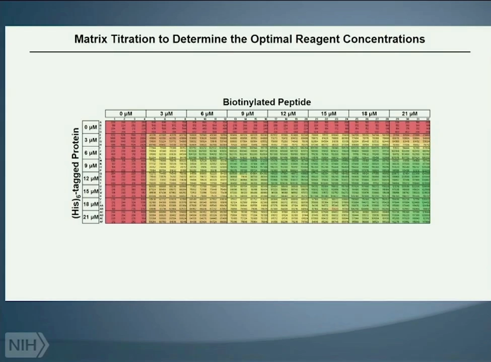

注意 12 μM 那一列：信号先升后降。这就是 **hook effect（钩状效应）**，所有三明治格式都有 [【跳转到 34:35】](https://www.youtube.com/watch?v=1_afso13vMM&t=2075)。机制是：分析物浓度低时，每个分析物都把供体珠与受体珠拉到一起，信号随浓度线性上升；一旦检测体系饱和，**多余的分析物会分别占满两种珠**，反而拆散了能发光的复合物，信号就掉下来。所以「信号低」既可能是「没有结合」，也可能是「结合太多」——这正是必须做矩阵滴定、确认自己落在上升段的原因。

## 四、把体系钉住：缓冲液、去垢剂、$K_M$ 与初速度

### 4.1 缓冲液不是背景，是变量

讲者把缓冲液拆成六个可调项 [【跳转到 16:11】](https://www.youtube.com/watch?v=1_afso13vMM&t=971)：

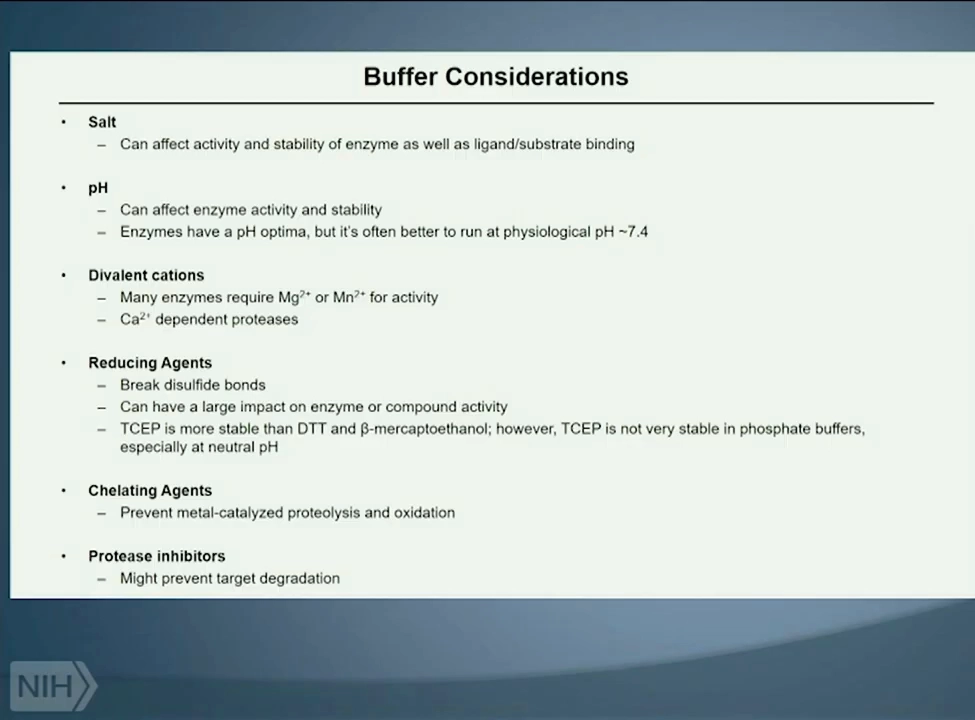

- **盐**：影响酶的活性与稳定性，也影响配体/底物结合；
- **pH**：酶有最适 pH，但除非有理由，**尽量跑在生理 pH 7.4 附近**；
- **二价阳离子**：很多酶需要 Mg²⁺ 或 Mn²⁺，钙依赖蛋白酶需要 Ca²⁺，浓度要滴定；
- **还原剂**：会打断二硫键，对酶和化合物活性影响都很大。TCEP 比 DTT 与 β-巯基乙醇稳定，**但 TCEP 在磷酸缓冲液、中性 pH 下并不稳定**；
- **螯合剂与蛋白酶抑制剂**：前者抑制金属催化的蛋白水解与氧化，后者防止靶点降解。

还有两个「配方级」的坑：磷酸缓冲液与需要镁/钙的反应不兼容；Tris 带自由氨基，既能与酶或底物反应，也能螯合金属离子 [【跳转到 19:06】](https://www.youtube.com/watch?v=1_afso13vMM&t=1146)。

### 4.2 去垢剂是双刃剑

去垢剂（Triton X-100、NP-40、Tween-20、Brij-35、CHAPS）通常加在**临界胶束浓度以下**，作用是：抑制化合物聚集、稳定 assay 组分、减少酶吸附到板孔与液路管壁上 [【跳转到 17:26】](https://www.youtube.com/watch?v=1_afso13vMM&t=1046)。

但讲者提醒：正因为减少了吸附，**加去垢剂会让表观活性升高**。他的例子里，加 Triton X-100 或 NP-40 都让酶活上升，Tween-20 则没有。这意味着「有没有去垢剂」本身就是两组不可直接比较的条件——换缓冲液配方时，必须重新确认对照。

### 4.3 $K_M$ 必须自己测，因为它决定你筛到哪一类抑制剂

即使文献里报过底物 $K_M$，也要用**你自己的酶、底物、溶液条件、读板机**重测 [【跳转到 19:31】](https://www.youtube.com/watch?v=1_afso13vMM&t=1171)。原因不是「文献不可信」，而是底物浓度会系统性地改变你看到的抑制强度：

- **竞争性抑制剂**（与底物争自由酶）：底物浓度越高，表观越弱，**高底物条件下会被漏掉**；
- **反竞争性抑制剂**（结合 ES 复合物）：底物浓度越高，表观越强，**低底物条件下会被漏掉**；
- **非竞争性抑制剂**（对 E 与 ES 结合一样好）：表观强度不随底物浓度变化。

所以把底物浓度设在 $K_M$ 附近，是对三类抑制剂都相对不偏的选择 [【跳转到 20:46】](https://www.youtube.com/watch?v=1_afso13vMM&t=1246)。测 $K_M$ 的标准做法是：先把底物浓度设到远高于 $K_M$，测一系列酶浓度下的初速度，选线性区间的酶浓度；再测至少**八个底物浓度、覆盖 $5\times K_M$ 到 $0.2\times K_M$**，用 Michaelis-Menten 拟合 [【跳转到 21:11】](https://www.youtube.com/watch?v=1_afso13vMM&t=1271)。如果数据拟合不上，可能的原因之一是底物溶解度不够。

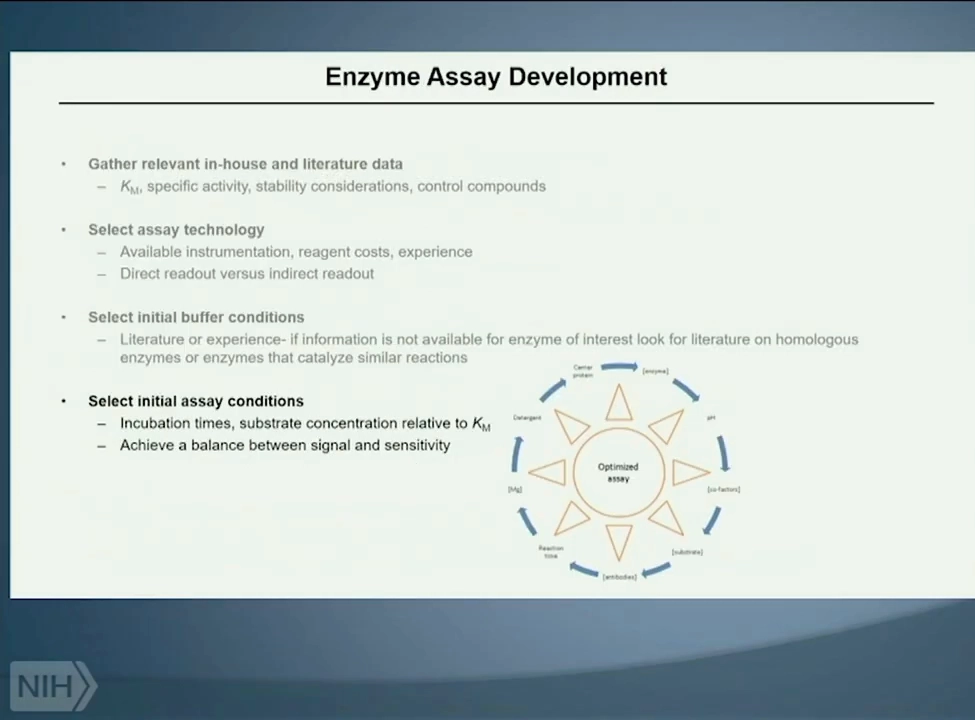

### 4.4 初速度窗口：三种平台期，三种病因

这是本讲最值得记住的一组图 [【跳转到 24:35】](https://www.youtube.com/watch?v=1_afso13vMM&t=1475)。反应进程曲线走平，可能是三件完全不同的事：

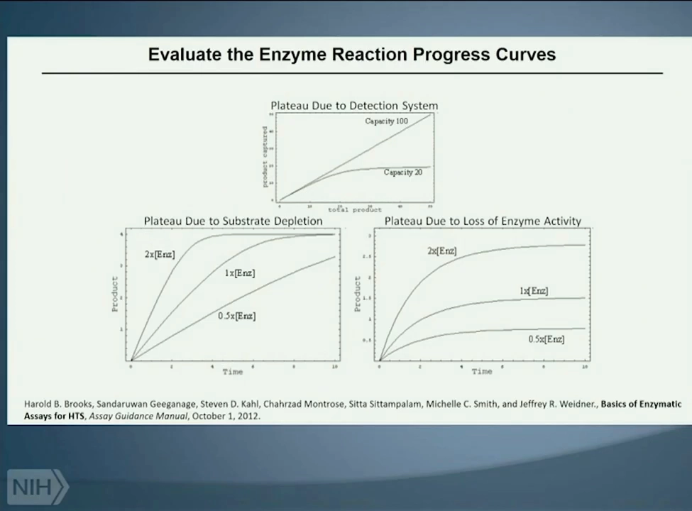

- **检测系统饱和**：所有酶浓度的曲线都在**同一个高度**走平——这时你测的是读板机的量程，不是反应；
- **底物耗尽**：平台高度随酶浓度升高——底物被吃完了；
- **酶失活**（或酶吸附到板孔表面）：平台高度也随酶浓度升高，但曲线形状不同；加去垢剂、调缓冲液可能改善。

区别的方法就藏在「平台高度是否随酶浓度变化」里。而**为什么必须取初速度**，讲者用一张图说透了 [【跳转到 25:50】](https://www.youtube.com/watch?v=1_afso13vMM&t=1550)：

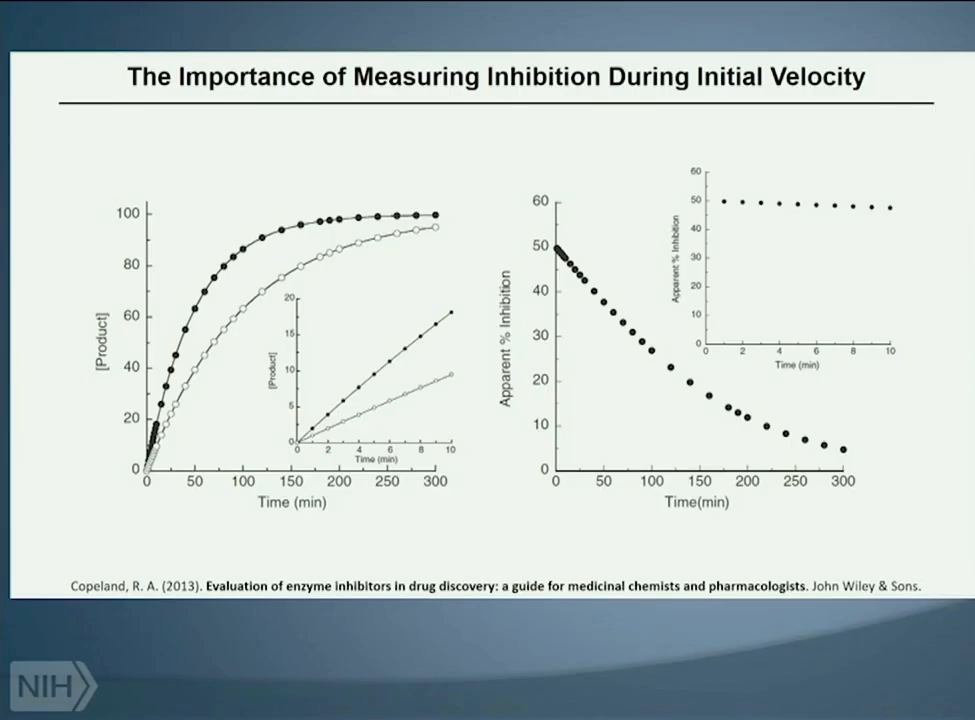

前 10 分钟的线性区里，抑制稳定在 50%；反应一旦走出线性区，表观抑制率一路衰减。而 **30% 抑制是判定命中的常用阈值**——也就是说，读晚一点，一个真正的抑制剂就会被判成「无活性」。

同一条逻辑还给出一个硬边界：**能测到的最小 IC50 是酶浓度的一半** [【跳转到 26:40】](https://www.youtube.com/watch?v=1_afso13vMM&t=1600)。初筛为了信号强、读数稳，往往把酶浓度开得很高，这在初筛没问题；但到了先导优化阶段要比较化合物强弱时，高酶浓度会让所有强抑制剂都「顶到地板」，$IC_{50}$ 全被压到同一个下限上，排名失去意义。

## 五、载体、板与仪器：系统性偏差藏在这三处

### 5.1 DMSO 容差必须先测

几乎所有化合物库都溶在 DMSO 里，所以 DMSO 浓度要**低且恒定**。但「低」是多少，必须实测。讲者给了一个极端例子：一个 1536 孔的细胞 assay，用 pin tool 把对照与溶剂点到板上，结果板子右半边的信号整体塌陷 [【跳转到 27:55】](https://www.youtube.com/watch?v=1_afso13vMM&t=1675)。把染料点进缓冲液检查转移均匀性后，发现**右侧的针转移了更多 DMSO**；再做 DMSO 滴定，确认了这个 assay 对溶剂极其敏感——DMSO 从 0.3% 加倍到 0.6%，信号几乎被完全消灭 [【跳转到 29:10】](https://www.youtube.com/watch?v=1_afso13vMM&t=1750)。

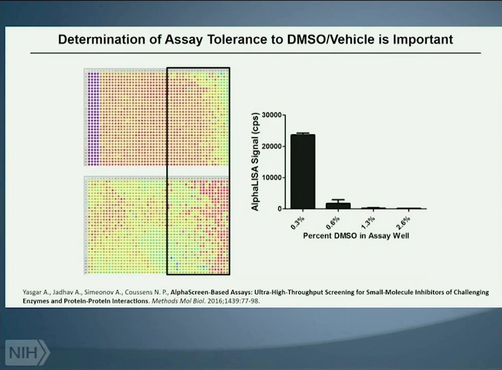

注意这个例子里「板内梯度」和「化合物活性」长得很像：如果只看到右半边信号低，很容易误判成「右半边有抑制剂」。**排查顺序应该是先看溶剂转移是否均匀，再看化合物。**

### 5.2 仪器设置也是变量

最后一张图把「仪器」这一项单独立出来 [【跳转到 37:15】](https://www.youtube.com/watch?v=1_afso13vMM&t=2235)：一个荧光偏振 assay，只把激发波长从 340 nm 换到 405 nm，信噪比就显著改善；再对读板机跑一次板内优化算法，消除了从上到下的信号梯度，$CV$ 从 9.6% 降到 2.5%，$Z'$ 从 0.68 升到 0.90 [【跳转到 38:05】](https://www.youtube.com/watch?v=1_afso13vMM&t=2285)。

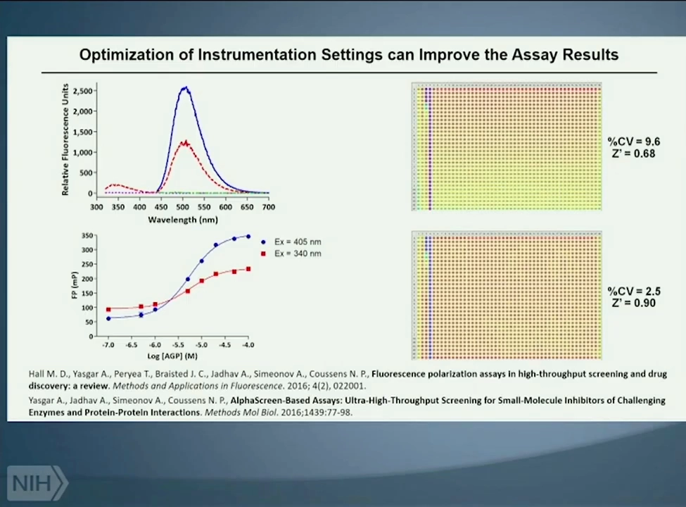

> **补充（非讲者原话）**：$Z'$ 的定义是「阳性对照与阴性对照的均值差，除以两者波动的三倍之和」，用来衡量一块板能否用于筛选。讲者在这里用 $Z'$ 的变化说明：同一套试剂，仪器设置不同，板的可用性就不同。**同一套生化试剂，换一个读板设置就能从「勉强可用」变成「优秀」**——这也是为什么方法学部分必须写清仪器与参数。

## 六、这套流程与相邻问题的接口

- **浓度—响应曲线怎么拟合、$IC_{50}$ 与 $K_i$ 的关系**：见本系列《IC50 是怎么测出来的：浓度梯度的范围、点数与非线性拟合》。本节只处理「曲线之前」的事：你的读数是否线性、是否取自初速度、酶浓度是否把 $IC_{50}$ 压到了地板。
- **生物物理方法（SPR、ITC、MST、热位移）如何独立验证结合**：见《四种生物物理方法测的不是同一件事》。本节讲的是「功能读数」，它证明的是「信号变了」，不是「化合物结合了」。
- **化合物本身如何伪造信号**（聚集、自发荧光、淬灭、金属、反应性基团）：见同小节的《活性信号的三种解释：真结合、检测伪影与体系假象》。

## 小结

- **生化体系是化简**：条件已知换来 SAR 可解释与机制信息，代价是可能漏掉截短蛋白、翻译后修饰、结合伙伴与辅因子。
- **按阶段选格式**：初筛要单点稳健、可统计验证；复筛可以更低通量但更接近生理，且必须在 HTS 之前就规划好。
- **灵敏度有排序**：化学发光 > 荧光 > 比色；但任何模态都能做出高质量 assay，灵敏度决定的是成本而不是可行性。
- **四种结合型格式测的物理量不同**：ELISA/DELFIA 靠洗涤换低干扰，TR-FRET 靠时间门避开背景荧光，FP 直接测结合，AlphaLISA 靠单线态氧扩散——它还有 hook effect。
- **底物浓度决定你筛到哪类抑制剂**：竞争性在高底物下变弱、反竞争性在低底物下变弱，$K_M$ 附近最不偏。
- **平台期有三种病因**：检测饱和（平台高度与酶浓度无关）、底物耗尽、酶失活（后两者平台高度随酶浓度升高）。
- **最小可测 $IC_{50}$ 是酶浓度的一半**：初筛可以开高酶浓度，先导优化不行。
- **系统性偏差藏在载体与仪器里**：DMSO 容差要实测，板内梯度要先排除溶剂转移，激发波长与板内优化能把 $Z'$ 从 0.68 拉到 0.90。

## 关键术语速查

| 术语 | 一句话解释 |
| --- | --- |
| HTS（高通量筛选） | 在 384/1536 孔板上一次性测试几十万个化合物，靠单浓度单次读数挑出命中的流程 |
| 均相格式（homogeneous） | 所有试剂加进孔里、不洗不分离直接读数，自动化和重复性最好 |
| 初筛 / 复筛 | 初筛求通量与稳健，复筛求机制与生理相关性，两者要互补设计 |
| 荧光偏振（FP） | 标记配体结合到大分子后旋转变慢、发射光偏振度升高，是结合事件的直接读数 |
| TR-FRET / HTRF | 用长寿命镧系供体做时间分辨 FRET，延迟测量以避开短寿命背景荧光 |
| AlphaScreen / AlphaLISA | 供体珠受激发产生单线态氧，扩散到 200 nm 内的受体珠发光，灵敏度高、耐大分子 |
| hook effect | 三明治格式中分析物过量反而拆散信号复合物，导致信号先升后降 |
| $K_M$ | 米氏常数，反应速率达到最大速率一半时的底物浓度；决定 assay 对哪类抑制剂敏感 |
| 初速度 | 反应进程曲线起始的线性段速率，只有这一段才对应真实的酶活性 |
| $Z'$ 因子 | 用阳性与阴性对照的均值差除以波动之和，衡量一块板能否用于筛选（> 0.5 通常可接受） |
| DMSO 容差 | assay 能承受的溶剂上限；超过后信号本身被抑制，会被误读为化合物活性 |