# 在细胞里证明靶点被占住：CETSA 与酶互补法的实战

> 视频来源：[Cellular target engagement as a new paradigm in Drug Discovery - Elmar Nurmemmedov, PhD](https://www.youtube.com/watch?v=YggyTa61yU8)（YouTube · Precision Evolution Global 线上研讨会，讲者 Elmar Nurmemmedov，Saint John's 癌症研究所）｜时长约 33 分钟
> 导读：这是一场以方法学为主的报告：前半段讲「为什么必须在细胞里测靶点占据」以及两类主流技术，后半段用 β-catenin 与 PLK1 两个项目演示怎么把占据实验放进筛选级联、怎么用它排序化学系列。本文按「为什么 → 怎么测 → 怎么用」重排；整条证据链的框架见本小节《靶标验证的四个支柱》，推理陷阱见《如何不被数据骗到》。

## 本讲要解决的核心问题（SCQA）

**背景**：药物发现有一个大家都熟悉的漏斗：设计、发现、优化、开发，最后进临床。前面每一层都在筛化合物，越往后越贵。

**冲突**：讲者开篇给了一张失败原因饼图：**52% 的失败来自疗效不足**，而疗效不足又被拆成三块——**靶点占据不足或药代不佳、临床前模型不能外推、以及「把靶点调控与疾病联系起来的验证数据不足」**。换句话说，很多项目走到临床才第一次真正问「药到底有没有在细胞里打中靶点」，而这时候已经过去七八年 [【跳转到 02:53】](https://www.youtube.com/watch?v=YggyTa61yU8&t=173)。

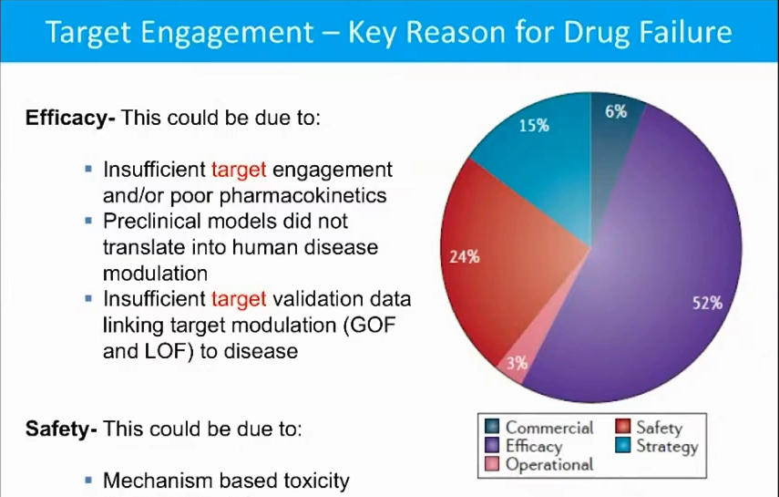

**疑问**：生化结合实验已经证明分子能结合纯化蛋白了，为什么还不够？如果在完整细胞里测占据，用什么方法？测出来的数字怎么用？

**回答（中心思想）**：**生化结合只说明「能结合」，不说明「在细胞里占得住」。细胞靶点占据要回答的是「在活细胞里、在真实浓度下，靶点被占了多少」，它把可及性、游离浓度、结合强度合成一个可排序的数。** 讲者给出的技术路线是两条：**细胞热位移（CETSA）**用于确认与排序，**酶互补/BRET 类报告体系**用于规模化；用法上则要把占据实验放在**筛选级联的最顶端**，让它先于所有下游功能读出。

## 一、为什么「细胞里的占据」是一个独立问题

讲者把两个问题并列写在幻灯片上：**你的药真的是治疗药物吗？它在细胞里占据靶点了吗？** 这两个问题必须在早期回答，而不是等临床 [【跳转到 04:30】](https://www.youtube.com/watch?v=YggyTa61yU8&t=270)。

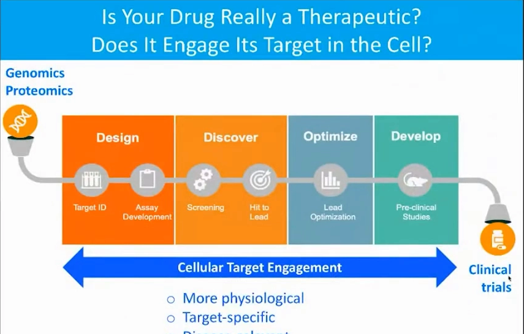

他给了四条理由，说明为什么细胞内的占据与试管里不同：

1. **更接近生理**：细胞里有膜、有转运、有结合蛋白、有区室化；
2. **靶点特异**：读出直接来自目标蛋白，而不是某个共同的下游报告；
3. **与疾病相关**：占据发生在真实细胞背景里；
4. **能对付「难靶点」**：像转录因子这类在试管里很难重建功能的蛋白，在细胞里反而有天然构象与辅因子。

这也是为什么他把细胞靶点占据称为「新范式」：**它不是把生化实验做得更精细，而是把「是否打中」这个问题换到一个更接近真实的环境里问。**

## 二、技术地图：细胞 vs 非细胞、成熟 vs 新兴

讲者画了一张二维地图，横轴是「成熟到新兴」，纵轴是「非细胞到细胞」[【跳转到 06:14】](https://www.youtube.com/watch?v=YggyTa61yU8&t=374)。

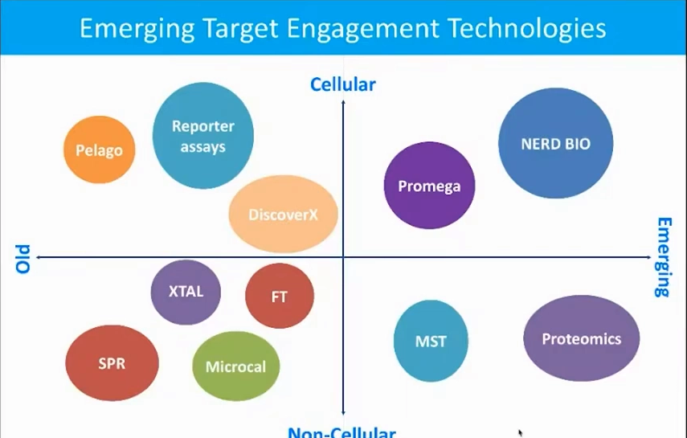

这张图的价值在于**定位**：如果你的问题是「化合物有没有在细胞里结合靶点」，那么左下角那些精确的 biophysics（SPR、ITC、MST）**回答不了**——它们测的是纯化蛋白在缓冲液里的结合；它们能给出 $K_d$，但给不出「细胞内占据」。

> 补充：SPR、ITC、MST 与热稳定性位移这些生物物理方法的原理与边界，见本系列 3.1.6，这里只讨论它们在「细胞占据」问题上的位置。

## 三、CETSA：用「热稳定性」读出结合

### 3.1 原理：配体让蛋白「更耐热」

细胞热位移的原理很朴素：把细胞（或细胞裂解液）放在一个温度梯度里加热，蛋白会随温度升高而变性、聚集、从可溶组分里消失；**当一个小分子结合上去，蛋白往往更稳定，变性曲线整体右移**。把每个温度下剩余的可溶蛋白量画出来，就得到熔解曲线；有药与无药两条曲线之间的温差 $\Delta T_m$ 就是占据的间接证据 [【跳转到 07:54】](https://www.youtube.com/watch?v=YggyTa61yU8&t=474)。

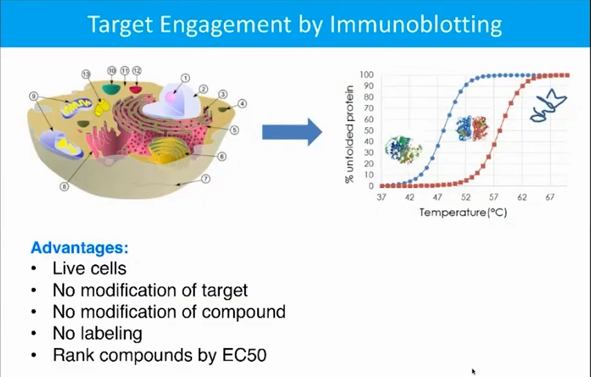

讲者列出的优点很关键，因为它解释了为什么这个方法在化学生物学里流行：

- **活细胞**：化合物在真实细胞环境里作用；
- **不改造靶点**：不需要融合标签、不需要过表达；
- **不改造化合物**：不需要荧光标记或光亲和基团；
- **可按 $EC_{50}$ 排序**：能给出可比较的效价数字。

缺点也很实在：**依赖免疫印迹，通量低、劳动密集、难以规模化**。这直接决定了它在流程里的位置——**确认与排序，而不是初筛**。

### 3.2 两种读法：全温度曲线，或单温度剂量曲线

讲者特别区分了两种实验设计 [【跳转到 15:30】](https://www.youtube.com/watch?v=YggyTa61yU8&t=930)：

- **固定剂量、扫温度**：得到完整的熔解曲线与 $\Delta T_m$，适合确认「结合是否发生」；
- **固定温度、扫剂量**：在靶点 $T_m$ 附近选一个温度，测不同浓度下的稳定化程度，得到**占据的 $EC_{50}$**，适合排序化学系列。

第二种读法更省事，也更接近「占据曲线」：它假设稳定化幅度与占据比例单调相关。讲者在两个项目里都用了它。

## 四、酶互补与 BRET：把占据做成可规模化的读数

CETSA 的通量瓶颈，催生了另一类方法：把靶点融合一个**小片段标签**（讲者说通常是 12 到 45 个氨基酸），再导入细胞；加入互补的另一半后，只有标签在正确位置时才能重组出活性酶，产生可测信号。当化合物占据靶点时，构象或可及性改变，信号随之变化 [【跳转到 09:08】](https://www.youtube.com/watch?v=YggyTa61yU8&t=548)。

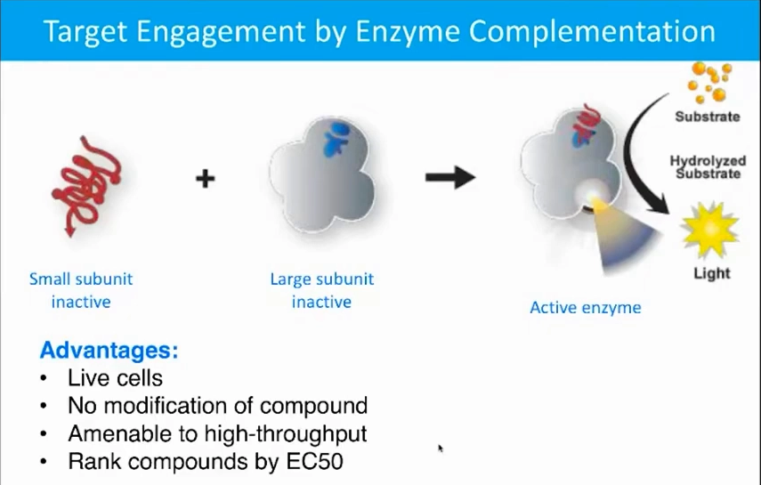

它的优缺点正好与 CETSA 互补：

| 维度 | CETSA（免疫印迹） | 酶互补 / BRET 类 |
| --- | --- | --- |
| 是否改造靶点 | 不需要 | 需要融合 12–45 aa 标签 |
| 是否改造化合物 | 不需要 | 不需要 |
| 通量 | 低，劳动密集 | 高，可自动化 |
| 输出 | $\Delta T_m$ 或单温度 $EC_{50}$ | 占据曲线 $EC_{50}$ |
| 主要风险 | 通量、抗体特异性 | 标签可能影响定位、折叠或结合 |

讲者的做法不是二选一，而是**串联**：先用高通量方法筛与排序，再用 CETSA 在无标签条件下复核。这种「一个方法排序、另一个方法确认」的组合，本质上就是正交验证。

## 五、案例一：β-catenin——把占据放在级联顶端

### 5.1 为什么选直接抑制剂

Wnt/β-catenin 通路在结肠癌、乳腺癌、肺癌、胶质母细胞瘤与血液肿瘤里被驱动或共同驱动；另一面，适度激活 β-catenin 又能促进组织再生。讲者团队的目标是**直接抑制 β-catenin**，而不是打上游，理由是这样不会干扰上游通路与其他通路的交叉对话 [【跳转到 11:05】](https://www.youtube.com/watch?v=YggyTa61yU8&t=665)。

他们的起点是结构：扫描 β-catenin 表面找「热点」，找到四个变构结合位点；虚拟筛选 20 万个化合物，约 1155 个能结合到不同位点；重点关注 site C，得到一个化合物 C2，相对其他结合物更选择性、毒性更低。

### 5.2 筛选级联：占据实验排在功能实验前面

经过药物化学优化，他们分出两个化学系列（代表化合物为 1525 与 1766），每个系列超过 100 个化合物。接下来的问题是**怎么排序**。讲者展示了级联图 [【跳转到 13:48】](https://www.youtube.com/watch?v=YggyTa61yU8&t=828)：

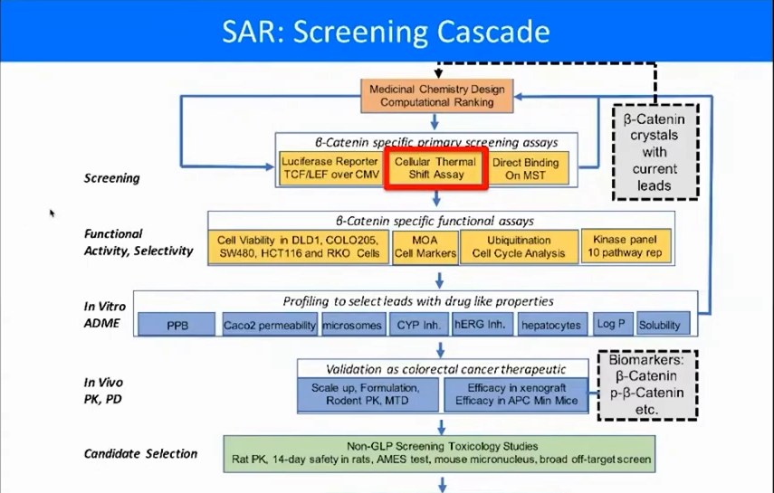

注意这张图里的顺序：**热位移与直接结合被放在「筛选」这一层，与报告基因并列，而不是放在最后做验证**。讲者的解释是：先把「打中靶点」的分子挑出来，后面所有功能实验才有意义——「所有后续 assay 都依赖它」。

### 5.3 报告基因要带对照：TOPflash 与 CMV

他们的通路读出是 TOPflash（β-catenin 依赖的荧光素酶报告基因）。但讲者强调，**必须同时看一个不受通路调控的组成型报告（CMV）**：1525 抑制 TOPflash 信号，却**不抑制 CMV 信号**，这才说明它抑制的是通路而不是荧光素酶本身或细胞状态。

> 这一点与 3.2.1 里讨论的「报告基因本身会成为靶点」是同一个问题的两面：**任何荧光素酶报告基因都要有第二报告做对照**。

### 5.4 热位移给出的是「排序」，不是「结合位点」

CETSA 结果很干净：DMSO 组 β-catenin 的 $T_m$ 约 49.1 °C，加入 1525 或 1766 后升到约 52.5–52.8 °C；一个参考化合物 PRI724 不改变 $T_m$，而同一系列的 2092 有位移 [【跳转到 16:42】](https://www.youtube.com/watch?v=YggyTa61yU8&t=1002)。

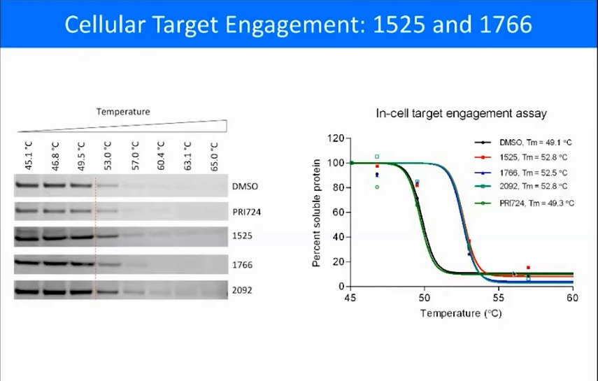

讲者把这一步定位为「早期信号」：**它告诉我们这些化合物确实在细胞里碰到了 β-catenin，从而给我们信心去推动药物化学**。它不告诉你结合在哪个位点——那是共晶或突变实验的事。

### 5.5 占据之后：把下游事件一层层接上

拿到占据证据后，他们补了一整条机制链：

- 化合物**剂量依赖地降低** β-catenin 水平，通过泛素—蛋白酶体途径降解；
- β-catenin 被磷酸化，说明它被「标记」为降解对象；
- **核内与胞质组分**里 β-catenin 都显著下降（不只是在某一个区室）；
- 细胞周期受阻（G1 期比例上升，随后在 G2/M 期累积），最终走向凋亡；
- 用 MST 测纯化 β-catenin 的直接结合，用 CETSA 在细胞里确认；
- 动物实验看到疗效。

其中最有说服力的一步是**遗传学与化学的对照**：他们用遗传学方法敲低 β-catenin，再把「敲低的转录组」与「化合物 1525 处理的转录组」放在一起比较 [【跳转到 18:48】](https://www.youtube.com/watch?v=YggyTa61yU8&t=1128)。

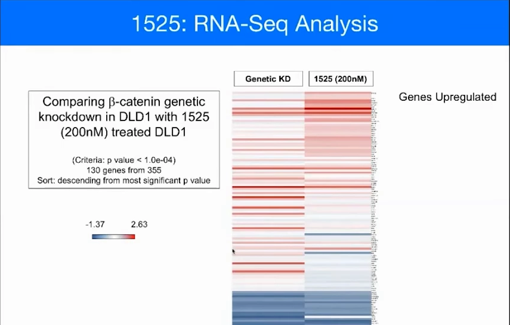

两条通路（基因扰动与化学扰动）给出**几乎相同的转录谱**，这是「化合物通过 β-catenin 起效」的强证据：如果化合物有大量脱靶，它的转录谱应当偏离遗传学扰动。

## 六、案例二：PLK1——先定温度，再三剂量筛，最后全曲线定选择性

第二个案例更能说明 CETSA 在真实项目里的工程用法。合作方要的是**只打 PLK1、不打 PLK3** 的选择性抑制剂（PLK 家族已有泛抑制剂），分子设计基于 PLK1 的一个隐蔽口袋。

### 6.1 第一步：分别测出 PLK1 与 PLK3 的熔解温度

做单温度筛选之前，必须先知道**在哪个温度下测**。他们先跑完整温度梯度：PLK1 的 $T_m$ 约 56 °C，PLK3 约 48 °C [【跳转到 21:50】](https://www.youtube.com/watch?v=YggyTa61yU8&t=1310)。

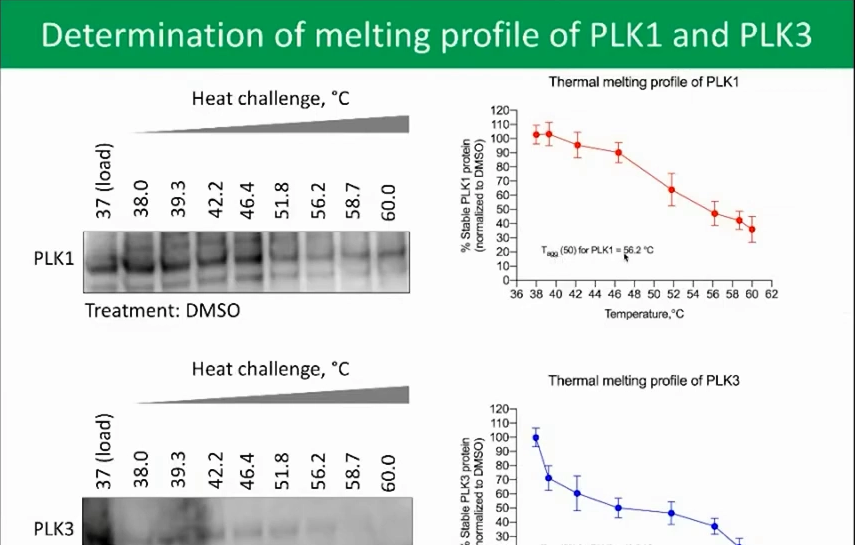

这一步常被忽略，但它决定了后面所有数字的含义：**温度选得太低，稳定化看不出来；选得太高，蛋白已经变性，窗口消失**。

### 6.2 第二步：单温度、三剂量，先粗筛

化合物数量大，跑全曲线不现实。他们的做法是**在 56 °C 下每个化合物测三个浓度（0.03、0.3、3 μM）**，把「稳定化倍数」画成散点，并设一条 **1.2 倍的筛选基线**：只有超过这条线的化合物才进入下一步 [【跳转到 22:58】](https://www.youtube.com/watch?v=YggyTa61yU8&t=1378)。

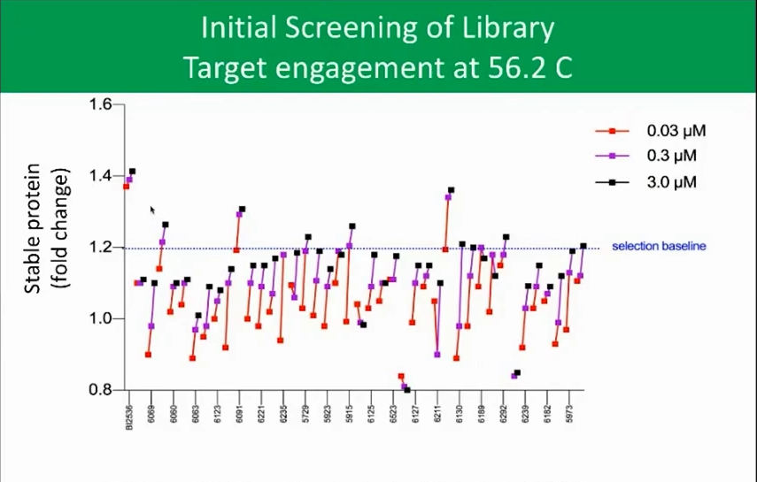

注意这里的设计逻辑：**三剂量既能给出粗略的剂量依赖性，又能压低单点假阳性**。如果只有最高浓度有信号，很可能只是化合物毒性或检测噪声。

### 6.3 第三步：全剂量曲线，同时看 PLK1、PLK3 与内参

进入复筛的化合物做完整剂量—响应，并且**在同一张印迹上同时检测 PLK1、PLK3 与 GAPDH**。这样一次实验同时回答三个问题：靶点是否被占据、同家族旁系是否被误伤、上样是否一致 [【跳转到 24:36】](https://www.youtube.com/watch?v=YggyTa61yU8&t=1476)。

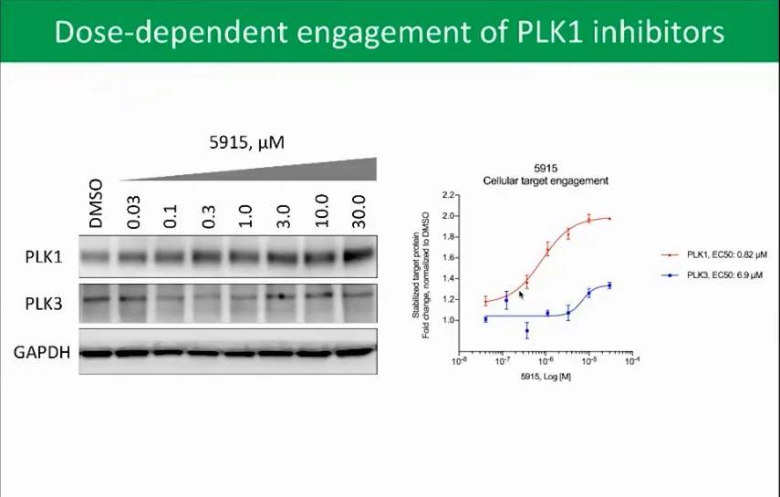

讲者给出的数字是：5915 对 PLK1 的 $EC_{50}$ 约 0.82 μM，对 PLK3 明显更弱（图上约 6.9 μM）；另一个化合物 6125 对 PLK1 约 0.61 μM、对 PLK3 约 3.7 μM，选择性约 6 倍。

### 6.4 第四步：用「惰性化合物」和「泛抑制剂」校准体系

这是全讲最值得学的对照设计。讲者展示了三类化合物在同一个体系里的表现：

- **选择性化合物**（5915、6125、1691）：只稳定 PLK1；
- **泛 PLK 抑制剂 BI2536**：同时稳定 PLK1 与 PLK3；
- **惰性化合物 6130**：两个靶点都不稳定。

**「体系对选择性、非选择性与惰性分子都给出预期反应」**，这句话是方法学上的关键：它证明你看到的位移不是「所有化合物都让蛋白变稳定」的非特异效应。没有惰性对照，热位移实验的说服力会大打折扣。

### 6.5 第五步：换一种技术复核

最后，他们把 PLK1 抑制剂拿到**酶互补平台**上重做，得到的排序与 CETSA 一致，而且通量足以筛成百上千个化合物 [【跳转到 27:00】](https://www.youtube.com/watch?v=YggyTa61yU8&t=1620)。

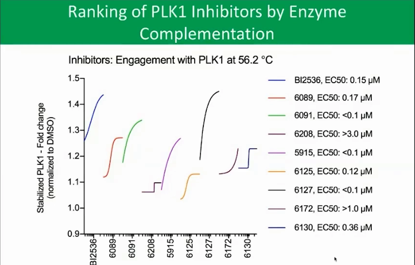

### 6.6 占据之外：机制与体内验证

占据只是第一层。后续他们发现这些抑制剂结合在 PLK1 两个结构域的**二聚化界面**，阻止二聚化，进而促使 PLK1 降解；与一种微管毒物联用时，PLK1 水平先被推高，再加抑制剂仍能把它降下来——这是「化合物确实在细胞里作用于 PLK1」的又一重证据。

问答环节也点出了占据实验的边界 [【跳转到 30:26】](https://www.youtube.com/watch?v=YggyTa61yU8&t=1826)：

- 有人问是否做了**广泛的脱靶面板**。讲者的回答是：机制与选择性研究会持续进行，但这是资源密集型工作；合作方接下来会做**野生型与突变体 PLK1** 的对比，以更严格地判断选择性；
- 他们还计划把带报告体系的细胞植入小鼠，**在体内读占据**，同时观察疗效与全身毒性；
- 讲者的总结是：**靶点占据本身不足以回答所有问题**，它必须与其他组件配合。

## 七、把方法用对：几条来自实践的经验

1. **先定 $T_m$，再定筛选温度**。不同蛋白的热稳定性差别很大（PLK1 56 °C 与 PLK3 48 °C），温度选错，窗口就没了。
2. **单温度三剂量用于粗筛，全曲线用于排序**。前者省化合物省时间，后者给可比较的 $EC_{50}$。
3. **一定要有惰性化合物与泛抑制剂做双向对照**。前者证明体系不「见谁都亮」，后者证明体系能识别同一家族的不同成员。
4. **CETSA 与酶互补互为正交**。一个无标签但低通量，一个高通量但带标签；两者结论一致，才敢把化合物推进到功能实验。
5. **占据实验要放在级联顶端**。它不产生「漂亮的表型」，但它决定后面的表型值不值得追。
6. **占据不等于疗效**。占据之后还要有通路响应、表型与体内证据；反过来，没有占据的功能读出，很难排除脱靶。

## 小结

- **52% 的临床失败来自疗效不足**，其中「靶点占据不足」「模型不能外推」「靶点验证数据不足」都指向同一个缺口：没有在细胞里证明打中靶点。
- **生化结合回答不了细胞占据**：SPR、ITC、MST 测的是纯化蛋白，细胞里的可及性、游离浓度与区室化都不在它们的视野里。
- **CETSA 用热稳定性读出结合**：活细胞、无需标记、无需改造化合物，但通量低；两种读法是全温度曲线与单温度剂量曲线。
- **酶互补/BRET 类方法把占据做成可规模化读数**，代价是给靶点加 12–45 个氨基酸的标签。
- **β-catenin 案例示范了完整链条**：占据 → 报告基因（带 CMV 对照）→ 降解与定位 → 遗传学敲低与化合物转录谱重合 → 体内。
- **PLK1 案例示范了工程化用法**：先定 $T_m$，再三剂量粗筛（1.2 倍基线），再全曲线定选择性，最后换平台复核。
- **对照决定说服力**：惰性化合物、泛抑制剂、内参、正交平台，缺一个都会被审稿人问住。

## 关键术语速查

| 术语 | 一句话解释 |
| --- | --- |
| 细胞靶点占据 | 活细胞内靶点被化合物结合的比例，综合了可及性与亲和力 |
| CETSA | 细胞热位移实验，用配体引起的熔解温度升高判断结合 |
| $T_m$ | 熔解温度，半数蛋白变性时的温度 |
| $\Delta T_m$ | 加药后 $T_m$ 的位移，越大通常表示稳定化越强 |
| 单温度剂量响应 | 在 $T_m$ 附近固定温度、扫化合物浓度，得到占据的 $EC_{50}$ |
| 酶互补法 | 把靶点融合小片段标签，与互补片段重组出活性酶产生信号 |
| BRET / NanoBRET | 以生物发光共振能量转移读细胞内分子邻近与占据的方法 |
| 惰性化合物 | 结构相似但不结合靶点的对照，用来排除非特异稳定化 |
| 泛抑制剂 | 同时抑制同一家族多个成员的化合物，用来验证选择性 |
| 筛选级联 | 按顺序排列的 assay 漏斗，前一层结果决定是否进入下一层 |