# 如何不被数据骗到：靶标验证里的相关、因果与必要性

> 视频来源：[William G. Kaelin, Jr.: Preclinical Cancer Target Validation: How to Avoid Being Wrong](https://www.youtube.com/watch?v=TVbCu4XR6xo)（YouTube · NIH NCATS「Assay Guidance Manual」系列首场，讲者 William G. Kaelin Jr.，Dana-Farber 癌症研究所，2019 年诺贝尔生理学或医学奖得主）｜时长约 56 分钟
> 导读：这不是一堂技术课，而是一堂「推理课」。讲者用自己实验室的 VHL–HIF2α、IDH 与来那度胺三个项目，演示同一个错误如何反复出现：把相关当因果、把「变差」当机制、把对照当成安全网。本文按「逻辑错误 → 实验设计对策 → 三个案例」重排；「四支柱」式的流程框架见本小节另一篇。

## 本讲要解决的核心问题（SCQA）

**背景**：在肿瘤领域，验证一个新靶点的标准动作已经非常固定：找到一个在肿瘤里高表达或突变的基因，敲低它，看到肿瘤长得慢；再做一张生存曲线，显示它的表达与预后相关；最后用一个小分子抑制剂在细胞和小鼠身上看到效果。论文的图 5、图 6 通常就是这么来的。

**冲突**：讲者给出的数字很刺眼——**制药公司反复报告，超过一半、有时高达 80% 到 90% 的情况下，它们无法复现学术实验室关于新肿瘤靶点的结论**。问题严重到进入大众媒体，公众开始质问：给了这么多科研经费，为什么连结果都复现不了？

**疑问**：这些结论是在哪一步走偏的？是技术不够好，还是推理本身有漏洞？如果漏洞在推理，那应该补哪些实验？

**回答（中心思想）**：**大多数「靶点验证」失败不是手法问题，而是逻辑问题：把相关当因果、把必要性当充分性、把「系统变差」当成「靶点被抑制」。** 讲者的对策可以浓缩成三条：第一，先想清楚**必要性**与**充分性**的区别；第二，尽量把「下调型读出」换成「上调型读出」，因为让复杂系统变差的路子远比让它变好的多；第三，用**抗扰动的 rescue 实验**（耐药突变体、沉默突变回补、下游代谢物回补）把「在靶」与「脱靶」分开。

## 一、复现性危机的根源，是四种「相关当因果」

讲者先做了一个概念清理。两件事 A 与 B 经常一起出现，至少有四种解释 [【跳转到 07:41】](https://www.youtube.com/watch?v=TVbCu4XR6xo&t=461)：

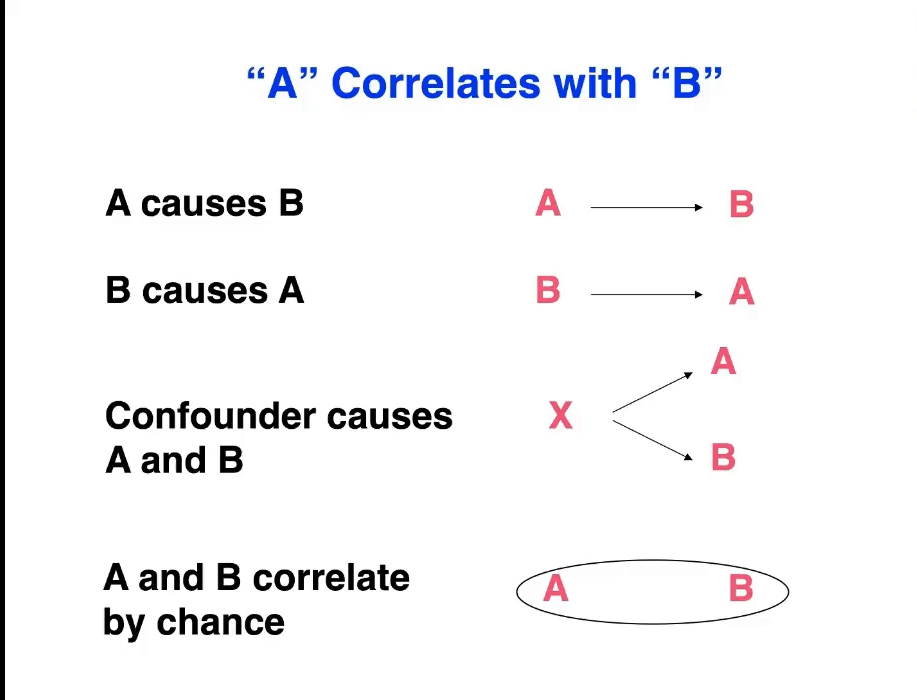

1. **A 导致 B**；
2. **B 导致 A**（反向因果）；
3. **隐藏的混杂因素 X 同时导致 A 与 B**；
4. **纯属偶然**——在大数据与多重假设检验的时代，测的够多总会撞上相关。

第四种解释常被忽略，讲者的提醒很具体：**必须做多重检验校正**，否则「显著」只是搜索次数的函数。

### 1.1 必要性与充分性：一把锁的比喻

在相关之外，讲者强调另一组更基础的概念 [【跳转到 08:31】](https://www.youtube.com/watch?v=TVbCu4XR6xo&t=511)：

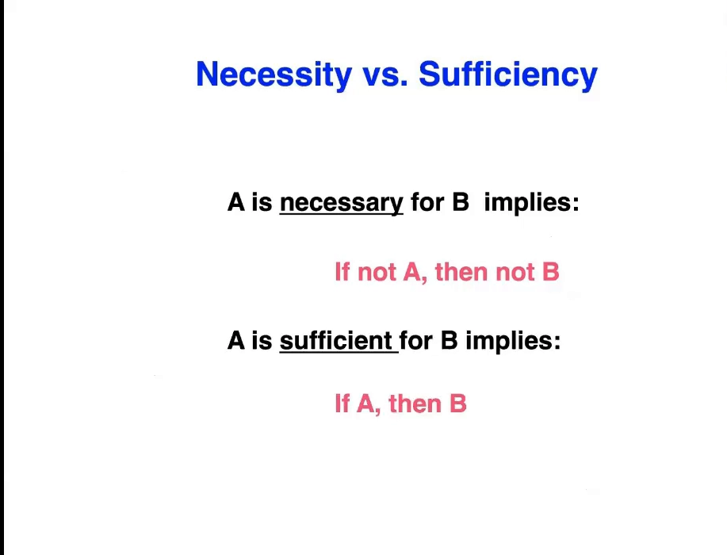

- **A 对 B 必要**：没有 A，就不可能有 B；
- **A 对 B 充分**：有 A，就一定有 B。

他用 2003 年前后的一桩真实争论说明混淆两者的代价：当 B-Raf 激活突变在恶性黑色素瘤里被发现后，立刻有人反驳——**良性痣里也能找到同样的突变，所以 B-Raf 不是好靶点** [【跳转到 08:56】](https://www.youtube.com/watch?v=TVbCu4XR6xo&t=536)。讲者的分析是：痣里有突变，只说明 B-Raf 突变**不充分**（还需要其他协同事件），**完全没有回答「黑色素瘤细胞是否持续依赖 B-Raf 活性」这个必要性问题**。后来的 BRAF 抑制剂上市，说明必要性的答案是真。

### 1.2 「突变太多所以没法治」也是同一个错误

由此引出讲者称为「多突变问题」的流行说法：常见上皮癌突变太多，靶向治疗注定失败，要治就得同时打多个突变，而这不可能。他用一把密码锁反驳 [【跳转到 10:30】](https://www.youtube.com/watch?v=TVbCu4XR6xo&t=630)：

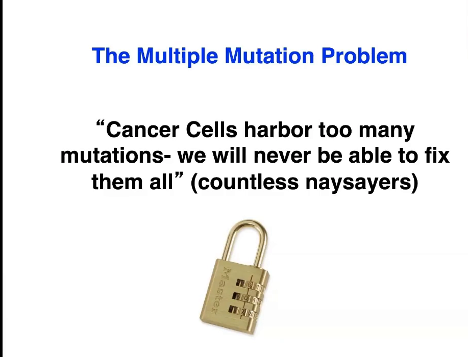

三个转轮都归位，锁才开——所以三个突变对癌变都是**必要**的；但要让锁保持锁死，**只需要一个转轮错位**。换句话说，正因为每个驱动突变都是必要的，**单独打掉其中任何一个，原则上都应该带来治疗效应**。他也给了实验支持：在遗传学上复杂的癌细胞里，纠正单个遗传缺陷就能降低肿瘤生长，有时甚至降低培养皿里的存活。

## 二、预后关联既非必要也非充分

论文里最常见的「临床相关性」证据是 Kaplan-Meier 曲线：靶点高表达的病人活得更短。讲者的态度是：这类图可以放，但**它是一张很弱的靶点论证**。

### 2.1 呼吸机的类比

他先给了一个荒诞但有效的例子：慢性肺病病人里，「曾经上过呼吸机」的那组生存曲线明显更差。上呼吸机当然是更晚期肺病的标志，但**没有人会因此得出结论说呼吸机在杀人、应该把 ICU 的呼吸机全撤掉** [【跳转到 12:16】](https://www.youtube.com/watch?v=TVbCu4XR6xo&t=736)。

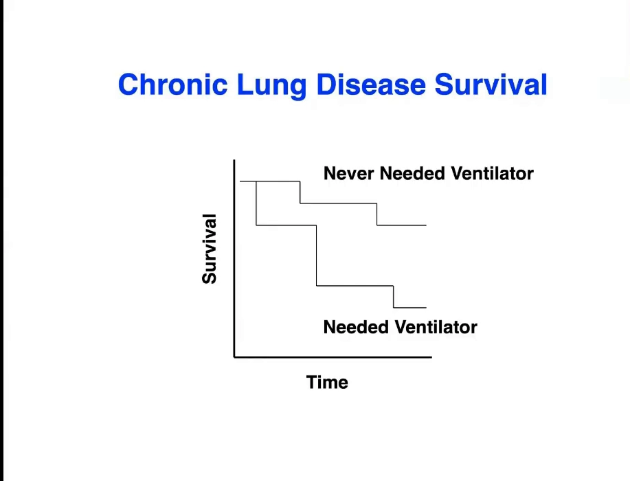

### 2.2 缺氧与 HIF：同一个相关，三种因果结构

更贴近科研的例子是缺氧与 HIF。肿瘤里有明显缺氧、或 HIF 上调，预后确实更差。但这至少有三种解释 [【跳转到 13:06】](https://www.youtube.com/watch?v=TVbCu4XR6xo&t=786)：

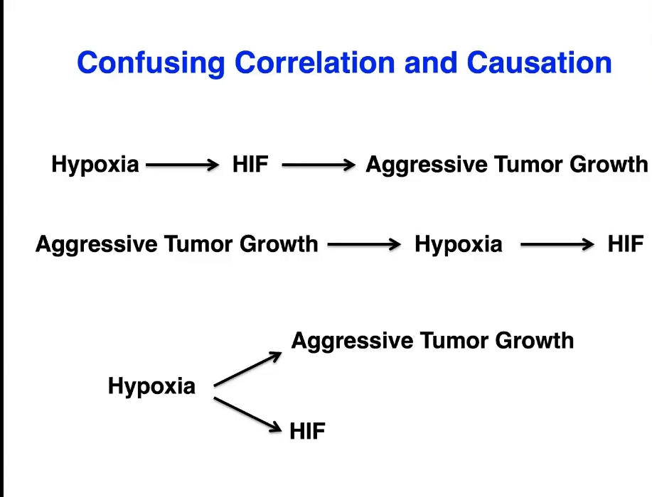

- 缺氧 → HIF → 侵袭性生长（HIF 是因果链中间环节）；
- 侵袭性生长 → 缺氧 → HIF（HIF 只是结果）；
- 缺氧同时导致侵袭性生长与 HIF（HIF 是旁观者）。

**这三种结构对「HIF 是不是好靶点」的含义完全不同**，而生存曲线无法区分它们。讲者的结论只有一句：**相关加上「机制上讲得通」，仍然不是因果证明**；必须卷起袖子做能区分这些结构的实验。

### 2.3 预后好也一样不能否证靶点

反过来的错误同样常见。IDH 突变在胶质瘤里被发现时，伴随的是**更好的预后**，于是有人说「突变 IDH 不是好靶点」，甚至有一位教授说用突变 IDH 抑制剂治疗是「医疗事故」。讲者用乳腺癌雌激素受体反驳：**ER 阳性乳腺癌的预后确实好于 ER 阴性，但 ER 恰恰是肿瘤学里验证得最好的靶点之一** [【跳转到 15:36】](https://www.youtube.com/watch?v=TVbCu4XR6xo&t=936)。

他的总结是：**与不良预后相关，对成为好靶点既不必要也不充分**。预后是疾病状态的标签，不是靶点依赖性的测量。

## 三、「下调型读出」天然逆风：为什么变差比变好更容易被骗

这是全讲最实用的一段方法学。讲者把实验分成两类 [【跳转到 17:16】](https://www.youtube.com/watch?v=TVbCu4XR6xo&t=1036)：

- **下调型（down assay）**：某个过程变差了——增殖下降、存活下降、肿瘤变小、蛋白降解；
- **上调型（up assay）**：某个过程变好了——报告基因变亮、细胞存活下来、肿瘤重新长出来。

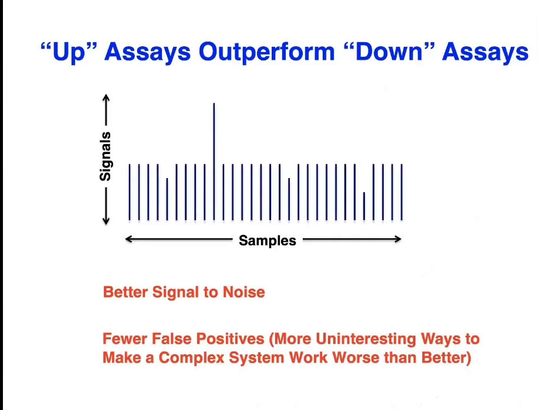

他给了两个理由：

1. **信噪比更好**。在一片阴性里找一个阳性，比在一片阳性里找一个阴性容易——这也是天文学能工作的原因。
2. **假阳性更少**。原话的逻辑是：**让一个复杂系统「变差」的无趣方式，比让它「变好」的方式多得多**。他的思想实验是：从汽车发动机里随便拆零件，车几乎总是变得更差，很少变得更好。生物学过程越复杂，必要的部件越多，能被「随便一碰就变差」的路径就越多。

### 3.1 下调型读出的真正危险：脱靶

讲者把危险画成一张图 [【跳转到 18:56】](https://www.youtube.com/watch?v=TVbCu4XR6xo&t=1136)：

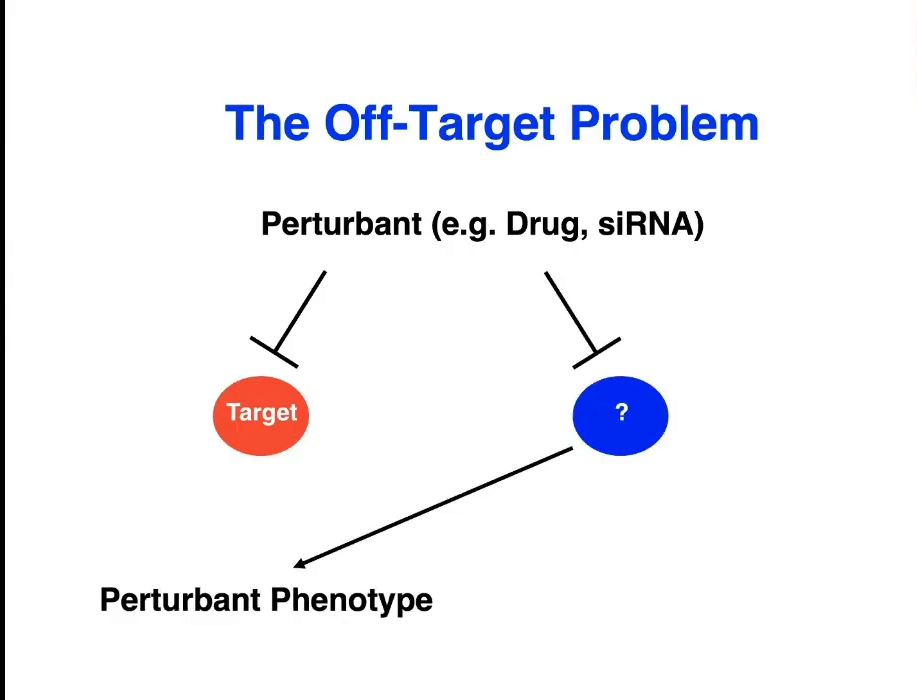

我们往细胞或小鼠里加一个扰动——药物、siRNA、CRISPR guide——它被设计成打中某个靶点，然后我们测一个表型。**但表型可能来自那个我们不知道的「问号」**。在下调型读出里，这个风险被放大，因为任何损伤都会让系统变差。

讲者把复现性问题的成因串成一条链 [【跳转到 19:46】](https://www.youtube.com/watch?v=TVbCu4XR6xo&t=1186)：**功能缺失扰动 + 一连串下调型读出 + 多重假设检验 + 只奖励阳性结果的发表与晋升体系**。四个因素叠加，就得到了「大量不能被复现的靶点」。

### 3.2 阴性对照本身也有偏倚

还有一个很少被提起的坑：**对照被预先筛干净了**。讲者的观察是，实验里用的对照几乎总是被（有意或无意地）选成「没有任何脱靶效应」，很多情况下「完全没有效应」。商业对照 siRNA 甚至会骄傲地宣称「经实证确认无任何效应」。

问题在于：**任何对细胞适应度有损害的东西，都不可能长期作为阴性对照存在**。于是对照被预先剔除了生物学效应，而你的实验组没有。这个不对称会系统性地把「靶点效应」估高 [【跳转到 24:20】](https://www.youtube.com/watch?v=TVbCu4XR6xo&t=1460)。

## 四、Rescue：把「在靶」与「脱靶」分开的标准动作

讲者给出的核心工具是 **rescue（回补）实验**：造一个**对扰动不敏感**的靶点版本，看它能不能把表型「救回来」[【跳转到 22:16】](https://www.youtube.com/watch?v=TVbCu4XR6xo&t=1336)。

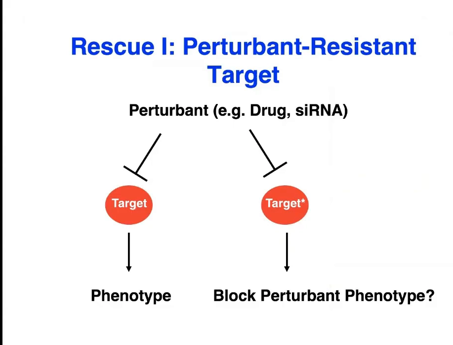

### 4.1 案例一：HIF2α 的 shRNA 与沉默突变回补

VHL 是一个泛素连接酶复合物的底物识别亚基，在氧气充足时把 HIFα 送去蛋白酶体降解；VHL 失活（肾癌里常见）时 HIFα 累积，与 ARNT 二聚化，激活 VEGF 等下游基因 [【跳转到 20:49】](https://www.youtube.com/watch?v=TVbCu4XR6xo&t=1249)。

他们最早的实验是下调型的：用 shRNA 打掉 HIF2α，肿瘤不再形成。为了排除 shRNA 的脱靶，他们做了两件事：**换多条 shRNA** 看结果是否一致；以及最关键的一步——利用遗传密码的简并性，造一个**编码野生型蛋白、但 shRNA 识别位点被沉默突变破坏**的 cDNA（他们叫它「empty star」）。把它导入细胞后，肿瘤重新长出来 [【跳转到 22:31】](https://www.youtube.com/watch?v=TVbCu4XR6xo&t=1351)。

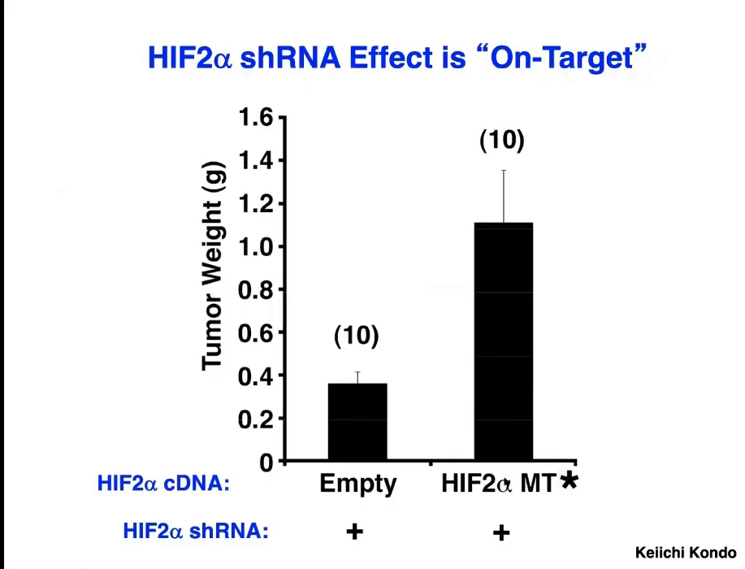

### 4.2 Rescue 也有盲区：布尔「与」的情形

讲者主动交代了 rescue 的局限：如果表型是**在靶效应与脱靶效应的「与」**（两者都必须发生才出现），那么 rescue 只去掉了在靶那一支，表型消失，**你会误以为脱靶不存在** [【跳转到 23:30】](https://www.youtube.com/watch?v=TVbCu4XR6xo&t=1410)。

对策是**不要把鸡蛋放一个篮子**：多条 shRNA、CRISPR、显性负性突变体、药物，尽量用**机制不同的扰动**互相印证。

### 4.3 案例二：从下调到上调，把 VHL–HIF2α 讲成完整的因果

讲者特别强调他们后来补的「上调型」实验：把 VHL 功能恢复到 VHL 缺失的肾癌细胞里，细胞失去成瘤能力（下调型）；再把一个**VHL 结合位点突变、因此不被 VHL 识别**的 HIF2α 导入，细胞**重新获得成瘤能力**（上调型）。

一上一下合起来，才能说：**HIF2α 的下调对 VHL 的抑癌作用既是必要的，也可能是充分的** [【跳转到 25:35】](https://www.youtube.com/watch?v=TVbCu4XR6xo&t=1535)。

## 五、药物验证：耐药突变体是最强的「在靶」证据

HIF2α 曾被认为不可成药，直到 PAS-B 结构域上被发现一个可成药口袋；小分子结合后诱导构象变化，使 HIF2α 无法与 ARNT 结合。这些化合物由 UT Southwestern 的高通量筛选发现，授权给 Peloton（后被默克收购），经药物化学优化得到工具化合物 PT2399 [【跳转到 26:05】](https://www.youtube.com/watch?v=TVbCu4XR6xo&t=1565)。

PT2399 在临床前模型里「该做的都做了」：降低 HIF 依赖的 mRNA、降低增殖、降低肿瘤生长。讲者的提醒是：**这三个动词都是「降低」**，全是下调型读出 [【跳转到 27:00】](https://www.youtube.com/watch?v=TVbCu4XR6xo&t=1620)。

### 5.1 用耐药突变体做同基因对照

幸运的是，结构工作已经找到一个点突变（S304M）：HIF2α 功能基本完好，但药物结合不上了。讲者展示了结合数据：野生型 $K_d$ 约 91 nM，S304M 突变体 $K_d$ 大于 5000 nM [【跳转到 27:30】](https://www.youtube.com/watch?v=TVbCu4XR6xo&t=1650)。

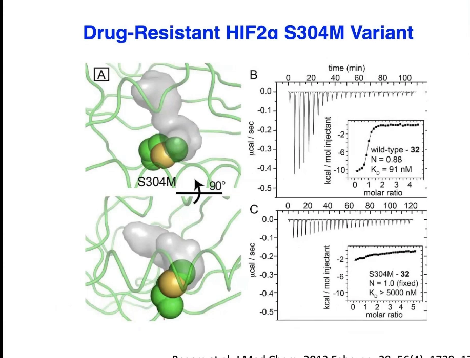

随后他们做了同基因细胞：CRISPR 敲掉内源 HIF2α，再分别导入野生型、S304M 或空载体。软琼脂实验里，野生型细胞在 0.2 与 2 μM 下生长被抑制，**S304M 细胞不敏感**——这就是「在靶」的证据。

讲者在这里插了一句极重要的话：**在 10 到 20 μM，这个化合物会杀死所有癌细胞，不管它表不表达 HIF2α**。也就是说，同一条剂量—响应曲线，在低浓度是机制，在高浓度只是毒性。他自己调侃：**「我拿漂白水也能做出这种图，只要剂量滴得好。」**

### 5.2 没有现成耐药突变体时，自己造

讲者给了两条造耐药突变体的路线 [【跳转到 29:30】](https://www.youtube.com/watch?v=TVbCu4XR6xo&t=1770)：

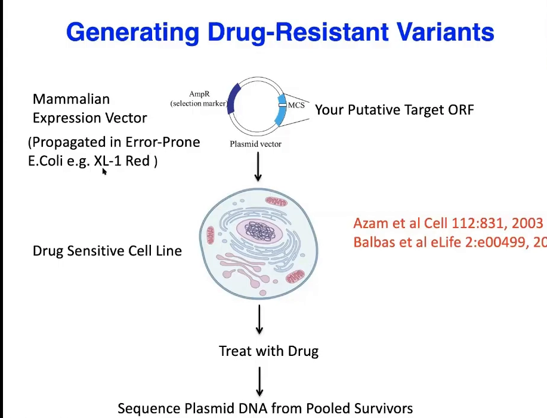

1. **易错 PCR + 选择**：把靶点 cDNA 放在易错的大肠杆菌（如 XL-1 Red）里扩增，让序列布满点突变；把文库导入敏感细胞，加药，从存活者里回收质粒测序。这条路线源自 Bcr-Abl 与格列卫耐药的研究。
2. **CRISPR 碱基编辑**：直接在内源基因座上做饱和突变，然后做**上调型筛选**——找那些「靶点没被抑制」的细胞。讲者举了他们做 STT3A 抑制剂 NGI-1 的例子。

第二条路线的优势是**处理的是内源基因**，突变谱更接近临床耐药。

### 5.3 细胞背景的异质性：不是所有同基因型细胞都依赖同一个靶点

讲者讲了一个「差点被审稿人劝退」的细节：他们在多个 VHL 缺陷的肾癌细胞系里重复实验，结果**有些敏感，有些不敏感**。编辑最初说「你还没理解这种异质性，论文先别发」；讲者的回答是：**只报敏感系、把不敏感系留到以后，本身就是今天发表体系的问题之一**。最终他们如实报告，而 Broad 研究所的 DepMap 数据也独立显示：同样是 VHL 缺陷，有些肾癌细胞系依赖 HIF2α，有些不依赖 [【跳转到 31:06】](https://www.youtube.com/watch?v=TVbCu4XR6xo&t=1866)。

临床数据与这个异质性一致：Belzutifan 在晚期肾癌的二期试验里，一部分病人肿瘤缩小并持续缓解，另一部分没有 [【跳转到 32:35】](https://www.youtube.com/watch?v=TVbCu4XR6xo&t=1955)。

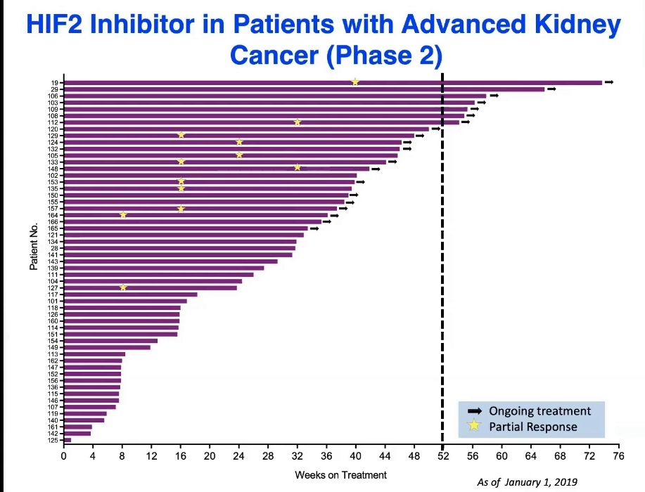

## 六、下游回补：当靶点本身不能做 rescue

如果靶点无法工程化改造，还有一条路：**回补靶点的下游效应分子**，看能否绕过药物。IDH1/IDH2 突变的肿瘤里，突变酶产生毫摩尔级的 R-2HG（一种致癌代谢物），干扰依赖 2-酮戊二酸的多种酶。Agios 的工具化合物阻断 2-HG 生成，突变细胞里的 2-HG 下降、增殖受抑——**又是一串下调型读出** [【跳转到 34:13】](https://www.youtube.com/watch?v=TVbCu4XR6xo&t=2053)。

他们的 rescue 很巧：不给细胞突变 IDH，而是**直接给细胞一种可穿膜的 R-2HG 酯**，让它在细胞内积累到肿瘤相关浓度。结果这些细胞**对「阻断 2-HG 生成」的药物不再敏感**——因为下游代谢物已经被补上了。这就把「药物是通过降低 2-HG 起效」这件事钉住了。

## 七、来那度胺：一个「下调型读出」把机制讲反的经典案例

沙利度胺的历史众所周知：上世纪五六十年代作为非处方药广泛使用，孕妇服用后导致严重的肢体缺陷。后来通过纯粹的临床偶然，人们发现沙利度胺及其类似物（来那度胺等）对多发性骨髓瘤等 B 细胞肿瘤有惊人疗效 [【跳转到 35:28】](https://www.youtube.com/watch?v=TVbCu4XR6xo&t=2128)。

### 7.1 第一步：找到结合蛋白，却把机制读反了

Hiroshi Honda 把沙利度胺固定在 Sepharose 珠上，钓出了一个含 Cereblon 的泛素连接酶复合物。论文最后一图是一串**下调型实验**，结论是「沙利度胺大概是 Cereblon 的拮抗剂」[【跳转到 36:29】](https://www.youtube.com/watch?v=TVbCu4XR6xo&t=2189)。

但临床观察给出了矛盾：骨髓瘤细胞对来那度胺耐药时，**常常不再产生 Cereblon**；而 Cereblon 水平高反而预示对这类药敏感。讲者的推理是纯逻辑的：**如果它只是简单拮抗剂，那么「失去 Cereblon」应该模拟药物的效果（细胞自杀），而不是导致耐药**。所以「拮抗剂」这个解释站不住。

结论只能是：**Cereblon 一旦结合这类药物，就获得了降解某个骨髓瘤癌蛋白的能力**——药物不是关掉连接酶，而是给它换了一个底物。

### 7.2 用双报告稳定性筛选找到底物

为了找那个蛋白，他们做了一个**蛋白稳定性**的高通量筛选：目标蛋白融合萤火虫荧光素酶（FLuc），同一转录本上再编码海肾荧光素酶（RLuc），用 **FLuc/RLuc 比值**反映目标蛋白的稳定性变化 [【跳转到 37:44】](https://www.youtube.com/watch?v=TVbCu4XR6xo&t=2264)。

他们构建了约 12000 个 ORF 的文库，加来那度胺或溶剂，找被降解或被稳定的蛋白。真阳性是两个 B 细胞转录因子 **IKZF1 与 IKZF3**；用 HA 标签替代荧光素酶后，降解依然发生，说明不是融合标签的伪影 [【跳转到 39:05】](https://www.youtube.com/watch?v=TVbCu4XR6xo&t=2345)。

### 7.3 从下调到上调：把「在靶」做实

接下来是标准动作：针对 IKZF1 与 IKZF3 各做三条 shRNA，做竞争实验（带 RFP 的敲低细胞与不带 RFP 的对照细胞混合），看到敲低细胞**选择性消失**——但讲者立刻提醒：**这仍然是下调型读出**，很多基因被敲低都会损害细胞适应度 [【跳转到 39:30】](https://www.youtube.com/watch?v=TVbCu4XR6xo&t=2370)。

真正的上调型实验来自一个观察：**IKZF2 对来那度胺不敏感，而它与 IKZF1 只差 7 个氨基酸**。他们逐个替换这些残基，找到了关键位点，进而造出**完全耐药的 IKZF1/IKZF3 版本**。导入耐药版本后，细胞对来那度胺不再敏感——rescue 成立 [【跳转到 40:34】](https://www.youtube.com/watch?v=TVbCu4XR6xo&t=2434)。

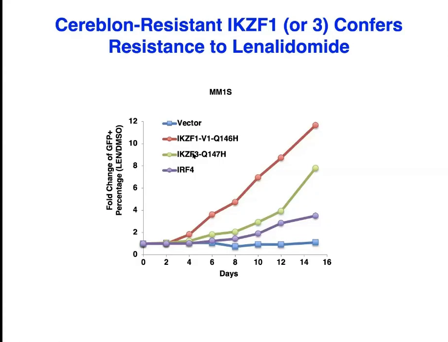

### 7.4 反面教材：一张 vinculin 对照掩盖的「降解」

讲者顺手拆了一张文献里常见的图：某个化合物（YM155）让 HIF2α 的 Western 条带变淡，看起来像降解剂。但 **vinculin 这种上样对照半衰期很长，而 HIF2α 即使在没有 VHL 的细胞里半衰期也很短**——用放线菌酮或放线菌素 D 处理，同样能让 HIF2α 条带消失 [【跳转到 41:41】](https://www.youtube.com/watch?v=TVbCu4XR6xo&t=2501)。

也就是说，**「条带变淡」可能只是把短寿命蛋白的合成关掉了**，与降解机制无关。要证明降解，需要更多对照（蛋白酶体抑制、合成速率、泛素化等）。

### 7.5 给降解剂专门设计一个上调型读出

为了不再被下调型读出坑，他们做了一个**存活型上调读出**：目标蛋白融合一个改造过的「自杀激酶」（CK*），它能把无毒的核苷类似物 BVdU 转成毒素；同一转录本上再带 GFP。逻辑是：**如果药物降解了目标蛋白，细胞就不再产生毒素，于是活下来、发绿光** [【跳转到 42:05】](https://www.youtube.com/watch?v=TVbCu4XR6xo&t=2525)。

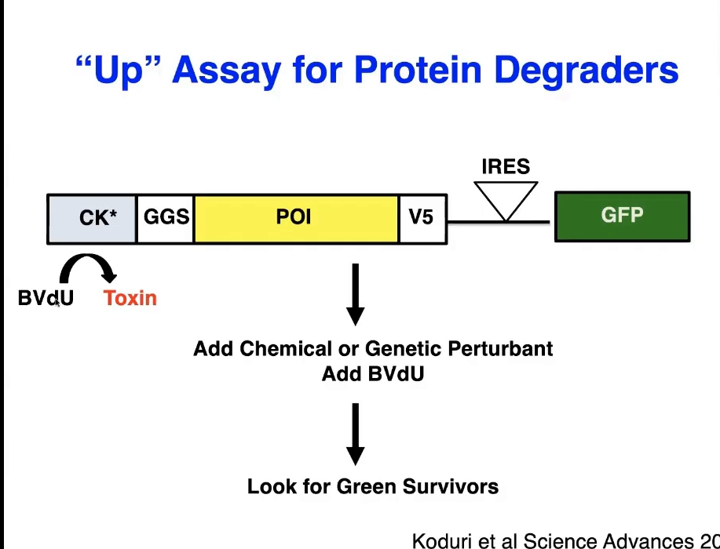

这个概念验证用泊马度胺（pomalidomide）与 IMiD 靶点做通了，随后被用来寻找多个高价值「不可成药」蛋白的降解剂。

## 八、为什么还要联合用药：必要性的算术

讲者最后回到临床。BRAF 抑制剂在黑色素瘤里能带来「拉撒路式」的缓解，但很快出现耐药。有人据此质疑靶向治疗的整体价值，讲者认为这仍然是「多突变问题」的变体 [【跳转到 43:22】](https://www.youtube.com/watch?v=TVbCu4XR6xo&t=2602)。

他的算术是：一立方厘米肿瘤约 $10^8$ 到 $10^9$ 个细胞，而多数病人的肿瘤负荷是 $10^{10}$ 到 $10^{12}$ 个细胞。**即使只有百万分之一的细胞耐药，单药治愈的概率也几乎为零**。三种机制不同、不交叉耐药的药，如果各自耐药概率是 $10^{-6}$，那么同时对三者耐药的细胞概率是 $10^{-18}$——**数学开始站在治疗这一边**。这也是结核病联合化疗与非霍奇金淋巴瘤可治愈的原因。

## 小结

- **相关不等于因果**：A→B、B→A、混杂因素、偶然，四种解释都要逐一排除；预后关联对靶点判断既不必要也不充分。
- **必要性与充分性要分开想**：良性痣里有 BRAF 突变只说明不充分；密码锁的比喻说明「多突变」不构成放弃单靶点的理由。
- **下调型读出天然逆风**：让复杂系统变差的路子太多，假阳性高、信噪比差；能改成上调型读出就改。
- **阴性对照可能被预先筛干净**，这会系统性高估靶点效应。
- **Rescue 是区分在靶与脱靶的核心工具**：沉默突变回补、耐药突变体、下游代谢物回补；但要提防「布尔与」的盲区，尽量用机制不同的扰动互证。
- **浓度决定结论**：同一个化合物在低浓度是机制，在高浓度只是毒性。
- **异质性要如实报告**：同基因型的细胞系可以有的依赖靶点、有的不依赖，临床数据会重现这种异质性。
- **下调型读出会把机制讲反**：来那度胺从「拮抗剂」被纠正为「分子胶」，靠的正是逻辑矛盾加耐药突变体 rescue。

## 关键术语速查

| 术语 | 一句话解释 |
| --- | --- |
| 必要性 / 充分性 | 没有 A 就没有 B / 有 A 就有 B，两者不能互相替代 |
| 混杂因素（confounder） | 同时导致 A 与 B 的第三个变量，使相关看起来像因果 |
| 下调型读出（down assay） | 以「变差」为阳性信号的实验，如增殖下降、肿瘤变小 |
| 上调型读出（up assay） | 以「变好」为阳性信号的实验，如报告基因变亮、耐药细胞存活 |
| Rescue 实验 | 用抗扰动的靶点版本恢复表型，验证效应是否在靶 |
| 沉默突变回补 | 改造 cDNA 的密码子但不改氨基酸，使 shRNA 失效而蛋白不变 |
| 耐药突变体 | 靶点上使药物无法结合、但功能保留的突变，用于同基因对照 |
| 同基因细胞（isogenic） | 除目标基因外遗传背景相同的细胞对，用于干净比较 |
| 分子胶（molecular glue） | 结合连接酶后改变其底物选择性、促使新底物被降解的小分子 |
| DepMap | 大规模细胞系依赖性图谱，可查某基因在各细胞系中的必需性 |