# 靶标验证的四个支柱：从细胞暴露到靶点占据再到通路响应

> 视频来源：[Tim Foley: Applying AGM Philosophies to Build Translatable Biochemical & Cell-based Screening Assays](https://www.youtube.com/watch?v=32b0S_MLsb8)（YouTube · NIH NCATS「Assay Guidance Manual」研讨会，讲者 Timothy Foley，辉瑞初级药理学组与 DNA 编码库筛选组负责人）｜时长约 49 分钟
> 导读：这是一堂用 TBK1 激酶项目串起来的实验设计课。讲者先给出「靶标验证四支柱」的框架，再逐层演示生化 assay 怎么调、细胞靶点占据怎么定位、通路读出怎么选、细胞实验怎么做到可复现。与同小节另外两篇互补：那两篇分别讲「怎么不被推理骗到」和「怎么在细胞里测占据」，本篇讲**整条证据链怎么搭**。

## 本讲要解决的核心问题（SCQA）

**背景**：做药物发现的人手里最常见的两个数字，是生化酶学 assay 的 $IC_{50}$ 和细胞表型 assay 的 $IC_{50}$。前者说明分子能抑制纯化的酶，后者说明细胞出了变化——比如肿瘤细胞不再增殖、免疫细胞不再分泌干扰素。

**冲突**：这两个数字之间隔着一整条链路。讲者开门见山地指出：化合物从生化 assay 走进细胞，**效价通常会变弱**；而在细胞里让细胞死掉、让分泌减少，**有无数条与靶点无关的路**（他的说法是，体外让细胞死掉的方法很多）。更糟的是，很多人一旦看到细胞表型漂亮，就顺着表型继续优化化学，**慢慢偏离了「靶点是否真的被占住」这个前提**。讲者说，这是他读文献时觉得**最被低估的一类实验**。

**疑问**：那么，凭什么说一个化合物是「通过某个靶点」起效的？这条证据链应该由哪几层组成，每一层各自要用什么实验来支撑？

**回答（中心思想）**：**靶标验证是一条四层链条——作用部位的暴露、靶点占据、功能药理学（近端生物标志物）、相关表型。四层缺一层，就只能说「相关」，不能说「通过该靶点」。** 而且每一层都要有独立的读出：暴露靠化合物性质与浓度，占据靠细胞内的占据实验，功能药理学靠**尽量靠近靶点**的磷酸化读出，表型只作为最后一环。讲者用 TBK1 项目演示了这条链怎么落地：先把生化 assay 调到能预测细胞，再把细胞读出压到 pIRF3 这一层，最后才谈表型与剂量预测。

## 一、四支柱：靶标验证是一条链，不是一次实验

讲者引用的框架来自辉瑞化学生物学团队发表在 *Nature Chemical Biology* 的一篇方法学文章，用来回答「用化学探针验证一个靶点，到底需要发生什么」。答案是四根柱子，顺序不能颠倒 [【跳转到 05:03】](https://www.youtube.com/watch?v=32b0S_MLsb8&t=303)。

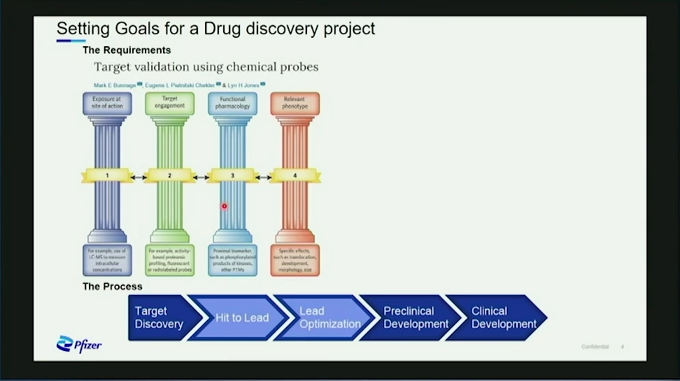

1. **作用部位的暴露（exposure at site of action）**。给细胞、动物或人给药后，分子必须先到得了地方：能被吸收、在血液里维持暴露、经得起肝脏代谢，最终**让作用部位的浓度越过靶点的 $IC_{50}$**。讲者的说法很直白：化合物得先到那儿。
2. **靶点占据（target engagement）**。到了之后要能证明它确实结合了靶点——「你需要有办法证明这件事会发生」。
3. **功能药理学（functional pharmacology）**。占据之后要看到**近端生物标志物**被真实调控，例如靶点直接磷酸化的底物。
4. **相关表型（relevant phenotype）**。最后才轮到表型。讲者特别点出抗感染与肿瘤领域的难点：**这里的「相关表型」就是细胞死亡**，而细胞死亡恰恰是最容易被非特异机制伪造的读出。

第四根柱子的危险性，讲者用一句话概括：**必须有中间步骤与生物标志物把「死细胞」和「靶点」绑在一起**，否则你无法排除多药理学（polypharmacology）或伪影。

### 1.1 化合物性质表：把「能不能进细胞」写成可验收的指标

四支柱不是口号，它会被翻译成一张化合物性质表。讲者展示的表里，每一行都对应一个必须达标的判据：酶学 $IC_{50}$ 小于 1 nM、**细胞 assay 的 $IC_{50}$ 小于 50 nM**、对需要避开的靶点选择性大于 100 倍、CYP 抑制的 $IC_{50}$ 大于 100 倍治疗暴露、hERG 的 $IC_{50}$ 大于 30 倍治疗暴露、CYP 诱导小于 2 倍、迷你 Ames 阴性、PK 达标、动物模型有效 [【跳转到 08:23】](https://www.youtube.com/watch?v=32b0S_MLsb8&t=503)。

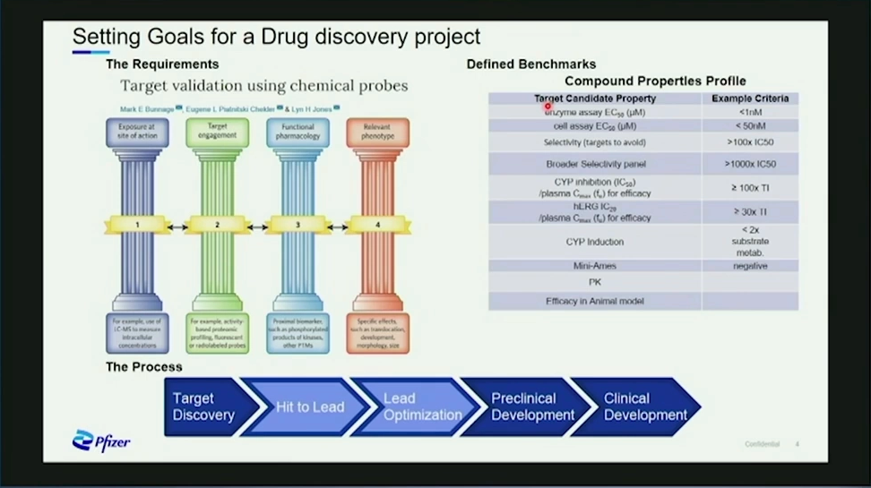

这张表之所以重要，是因为它把「可及性」问题变成了工程问题：**渗透性、代谢稳定性、外排、血浆蛋白结合**这些性质，最终都体现在「作用部位的自由浓度能不能压过靶点」上。讲者举了两个反面例子：

- **CYP 诱导**：一个化合物首剂时暴露足够、能看到药效，但它诱导了肝里的 CYP 酶，代谢加快、清除上升，**到实验结束时靶点覆盖可能已经掉下去了**。同一剂量、不同时间点，结论可以完全相反。
- **hERG**：这是心脏里的一个钾通道（讲者口语里说成钙通道），极其容易被打中，打中就会心律失常甚至死亡。他提到疫情早期有分子在体外对病毒无效，但有人吃了很大剂量后死亡，原因正是打中 hERG——**这是「安全靶点」的经典案例**。讲者没有点名具体分子，本文也不替它补名。

> 补充：跨膜与外排的分子机制、以及血浆蛋白结合如何决定自由浓度，分别见本系列 2.2.2 与 2.2.3，这里只作为「暴露」这一层的输入。

## 二、命中到先导与先导优化：两条漏斗，目标根本不同

很多人把「筛选」当成一件事，讲者把它拆成两个阶段，因为**目标不同，assay 的设计哲学就不同** [【跳转到 11:52】](https://www.youtube.com/watch?v=32b0S_MLsb8&t=712)。

- **命中到先导（hit to lead）**：目标是**把真命中从坏分子里分出来**。所以漏斗里塞满了防御性实验：干扰反筛（interference counterscreen）、滋扰机制排查（nuisance mechanism triage）、正交 assay、选择性。
- **先导优化（lead optimization）**：目标变成**给化学家提供定量的构效关系**——「你改了这个基团，我的实验测出来是变好还是变差」。所以这里要的是**宽的药理学动态范围**，而不是防御。

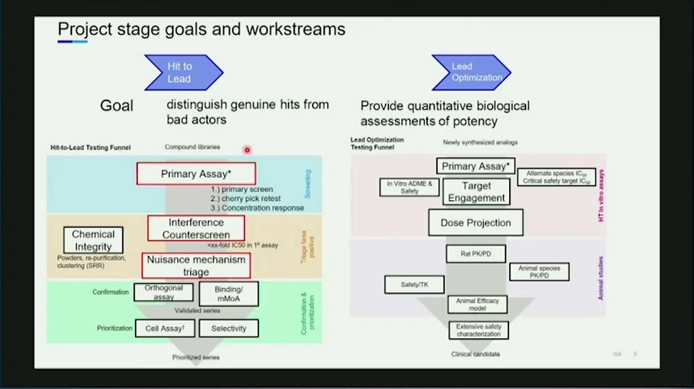

这张图里最值得记住的细节，是**「靶点占据」被放在先导优化漏斗的第二格**，紧接主筛、位于剂量预测之前。也就是说，在讲者的流程里，**占据不是可选项，而是进入剂量预测的入场券**。

### 2.1 命中阶段：先排除「信号被干扰」，再谈活性

讲者给了一个极简但极有效的干扰反筛：**把化合物加到反应已经跑完之后**。正常 assay 是酶、底物、化合物一起孵育；反筛则让反应先充分进行，最后才加化合物。如果这样还能看到「抑制」，那它干扰的就不是酶，而是信号生成本身 [【跳转到 14:47】](https://www.youtube.com/watch?v=32b0S_MLsb8&t=887)。

他还提醒了另一类需要单独排查的东西：**滋扰机制**——化合物在实验里确实有活性，但那不是你想追的活性，最典型的是**聚集**。这类问题与「干扰检测」不同：它不是把信号改掉，而是真的在生物学上「踢」了系统一脚。

### 2.2 先导优化阶段：高通量 assay 的靶点浓度会掩盖效价差异

讲者引用了同场另一位讲者（Sam Hoare）的观点：**生化 assay 里的靶点浓度本身就是一个变量**。命中阶段用高浓度靶点没问题，信号大、窗口好；但到了先导优化，高靶点浓度会带来一个**很高的信号地板**，让亲和力差别很大的化合物在 $IC_{50}$ 上看起来差不多——因为测量被靶点浓度「混淆」了 [【跳转到 13:32】](https://www.youtube.com/watch?v=32b0S_MLsb8&t=812)。

这就是为什么同一个靶点、同一个化合物，在命中阶段和先导优化阶段**需要两套 assay**：一套追求稳健与通量，一套追求动态范围与可解释性。

## 三、细胞靶点占据：被低估的那一步

讲者对「细胞靶点占据」的定位非常明确：**它是给分子发「能在细胞内占住靶点」的证书**。原话大意是，在把化合物推进到那些「很难分辨靶点占据」的高级读出之前——比如肿瘤模型里的细胞杀伤——你得先知道它确实在靶点上，并且把这个效价记录下来 [【跳转到 17:42】](https://www.youtube.com/watch?v=32b0S_MLsb8&t=1062)。

为什么这一步容易被跳过？因为**高级读出会给反馈，而占据实验不给**。细胞杀伤、细胞因子分泌这些实验每天都能出数，化学家能立刻看到 SAR；占据实验更像一次「体检」，做一次就放在那里。讲者的观察是：项目一旦开始追高级生物学活性，就很容易顺着它跑偏。

> 具体怎么测占据（细胞热位移、酶互补、化学蛋白质组学等），见本小节《在细胞里证明靶点被占住：CETSA 与酶互补法的实战》。

## 四、让生化 assay 能预测细胞：先解决「位移」问题

进入 TBK1 案例后，讲者先花了不少时间讲生化 assay，理由很实在：**如果生化 assay 本身不能预测细胞里的效价，那么后面所有的「生化到细胞位移」都无法解释**。

### 4.1 先确认信号真的来自你想测的酶

TBK1 是激酶，把 ATP 的磷酸基转移到蛋白底物上。激酶 assay 的格式很多（直接测磷酸化肽、抗体夹心 FRET、放射性 ATP、测 ATP 消耗或 ADP 生成），讲者团队选了 HTRF 的肽底物格式，原因是**可以很方便地改 ATP 浓度**，从而判断化合物是否与 ATP 竞争 [【跳转到 24:14】](https://www.youtube.com/watch?v=32b0S_MLsb8&t=1454)。

但激酶 assay 有一个共性陷阱：**肽底物不专一，样品里低丰度的污染激酶也能产生信号**。讲者的做法是找一个小分子工具化合物——文献里已知对 TBK1 有较好选择性的抑制剂——来证明「我看到的活性来自 TBK1」。他强调这不是锦上添花：他自己的多个项目里，最初建立的 assay 测到的其实是**一个 SDS-PAGE 上根本看不见的污染蛋白** [【跳转到 28:49】](https://www.youtube.com/watch?v=32b0S_MLsb8&t=1729)。

### 4.2 用 Cheng-Prusoff 预判「换 ATP 浓度会位移多少」

确定底物肽之后，讲者测了 ATP 的 $K_m$：九点滴定得到约 100 μM，文献报道 80 μM，二者吻合。接着做了一件很关键的事：**在 $K_m$ 浓度与 1 mM ATP 下各测一条抑制曲线**，看位移是否符合理论。

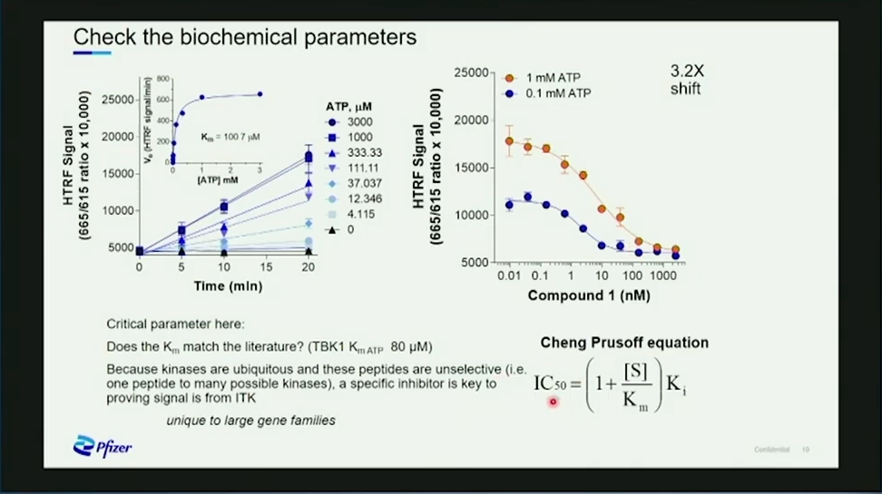

$$
IC_{50} = \left(1 + \frac{[S]}{K_m}\right) K_i
$$

按这个式子，从 $K_m$ 换到 1 mM（约 10 倍 $K_m$）应该看到约 9 倍位移；实测是 **3.2 倍**。讲者的评价是「方向对了，幅度没到，但足够继续往下走」。这个细节很有教育意义：**公式给的是预期，实测才是证据**；位移幅度不符，可能意味着机制不是纯竞争性，也可能意味着 assay 里还有别的因素。

对筛选实践的含义是分阶段的：

- **命中阶段**在 $K_m$ 下跑，避免对竞争性机制产生偏倚；
- **先导优化阶段**要让生化 assay **尽量预测细胞**，所以更接近生理的 ATP 浓度（1 mM 量级）更合适，目的是**把生化到细胞的位移压到最小**。

### 4.3 溶剂与板质量：2% DMSO 是权衡出来的

讲者测了 DMSO 耐受度：高到 8% 仍可接受，最终选 2%。理由有两面：**有机助溶剂多一点能抑制聚集等异常行为**，但**太多会扰动生物学**。最终筛选板的信号背景比 2.2、$Z'$ 约 0.6，团队据此批准 assay 进入生产 [【跳转到 32:34】](https://www.youtube.com/watch?v=32b0S_MLsb8&t=1954)。

## 五、细胞读出要尽量靠近靶点

这是全讲最核心的设计判断。TBK1 位于胞质核酸感知通路的交汇点：dsRNA 经 RIG-I/MDA5、dsDNA 经 cGAS-STING，都汇到 TBK1，TBK1 再磷酸化 IRF3，后者入核启动干扰素转录，干扰素分泌后通过受体反作用于自身与邻近细胞，最后诱导干扰素刺激基因（ISG）[【跳转到 20:33】](https://www.youtube.com/watch?v=32b0S_MLsb8&t=1233)。

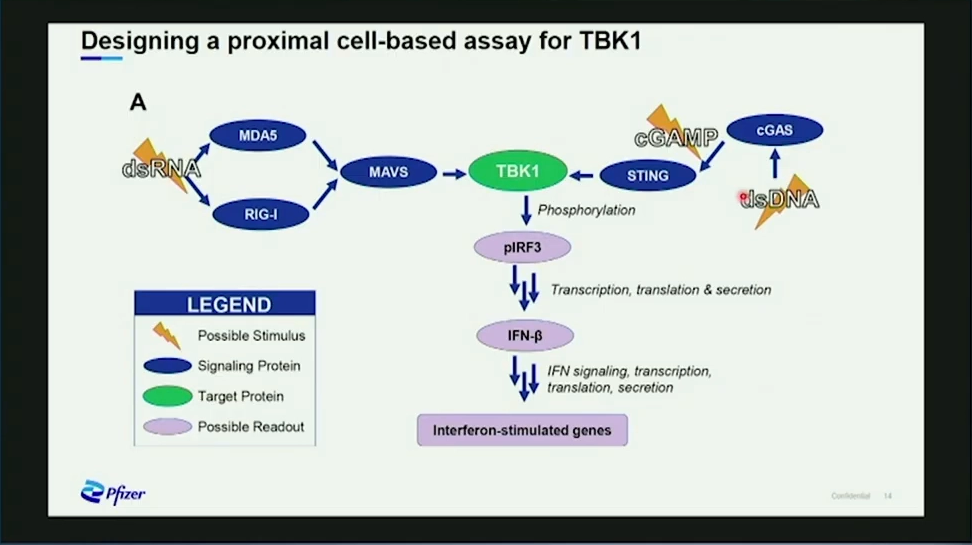

沿着这条通路，可选的读出至少有三层，讲者把取舍讲得很清楚 [【跳转到 35:15】](https://www.youtube.com/watch?v=32b0S_MLsb8&t=2115)：

| 读出 | 距离靶点 | 信号放大 | 掺入的脱靶环节 |
| --- | --- | --- | --- |
| pIRF3（磷酸化 IRF3） | 最近，TBK1 的直接底物 | 最小 | 最少 |
| IFN-β 分泌 | 中等 | 有转录、翻译、分泌三层 | 中等 |
| ISG 表达 | 最远 | 每一步都放大，信号最强 | 最多 |

讲者的结论是：**这次实验的目的是给化合物的靶点占据发证书，所以读出要尽量贴近 TBK1**，于是选 pIRF3。ISG 虽然信号最漂亮，但它把转录、翻译、分泌、旁分泌全裹进来了，**任何一步被化合物影响都会伪装成「TBK1 被抑制」**。

这条原则可以推广成一句话：**读出的距离，决定了你能把结论说得多强**。想证明「靶点被抑制」，就用最近端的事件；想证明「通路整体被关掉」，才用远端读出，但那时必须补上近端证据。

## 六、把细胞实验做稳：细胞、刺激、时间、窗口

讲者给了一份细胞 assay 的开发清单，并特意标出哪些条目与生化 assay 相同、哪些是细胞特有的 [【跳转到 33:29】](https://www.youtube.com/watch?v=32b0S_MLsb8&t=2009)。

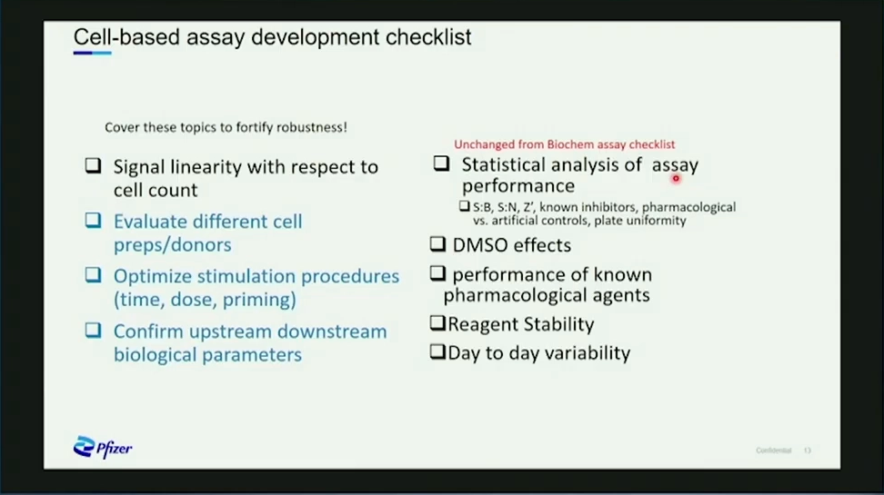

### 6.1 细胞本身是一个试剂：先建库、再谈实验

讲者团队用 THP1（髓系）细胞，第一步不是做实验，而是**建细胞库并表征**：先建中间库、跟踪生长曲线确认倍增时间正常，再用它生产工作库（100 支、每支 1000 万细胞）。这一步看起来像「实验室管理」，实际上决定了后面所有数据的可比性 [【跳转到 36:55】](https://www.youtube.com/watch?v=32b0S_MLsb8&t=2215)。

最初的刺激条件是用免疫印迹摸索出来的：10 μg/mL cGAMP 刺激后，磷酸化 IRF3 的条带很弱，但足以看到时间趋势——这决定了后续要用更灵敏的 HTRF 试剂盒，而不是继续用印迹做筛选 [【跳转到 36:05】](https://www.youtube.com/watch?v=32b0S_MLsb8&t=2165)。

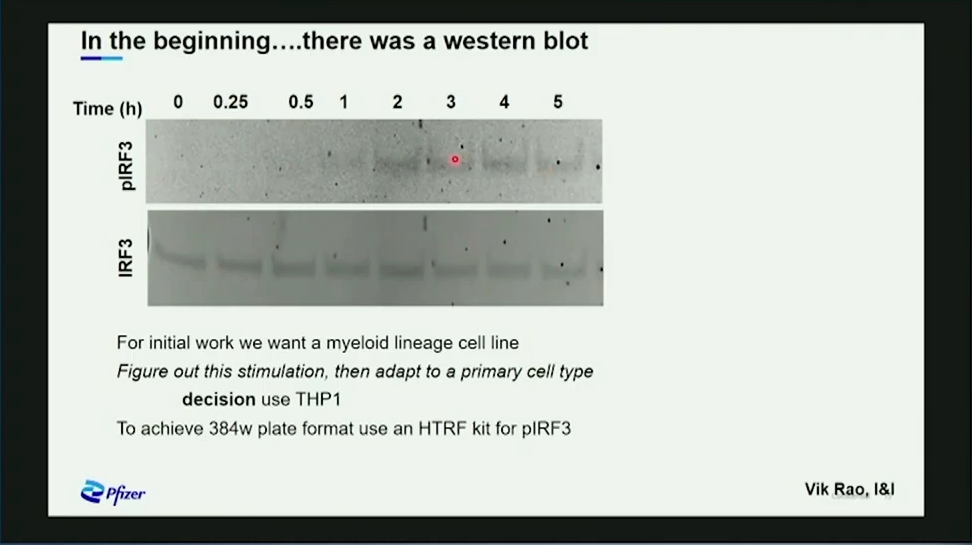

### 6.2 用磷酸酶抑制剂确认「信号窗口的上限」

买来的 HTRF 试剂盒自带阳性对照，讲者先用它标定检测能力；然后用**磷酸酶抑制剂**（calyculin A、okadaic acid）把细胞内磷酸化水平整体推高，看信号能到多高。两种抑制剂效价不同，但**收敛到同一个上限**——这说明在 10 万个细胞/孔的密度下，**检测系统还有余量，窗口上限是 4 倍** [【跳转到 37:45】](https://www.youtube.com/watch?v=32b0S_MLsb8&t=2265)。

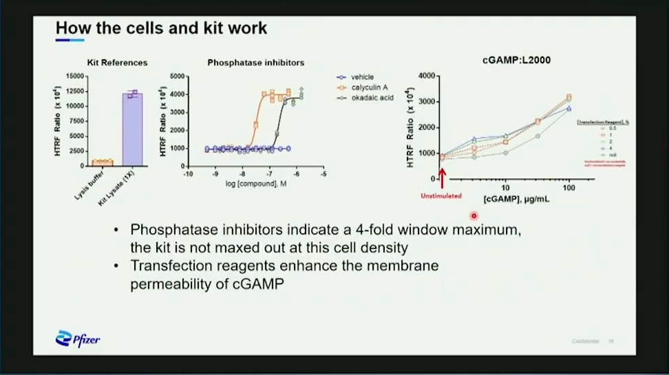

### 6.3 刺激物也要「进得去细胞」

TBK1 的刺激物 cGAMP 是一个带负电的环核苷酸，**本身不容易过膜**。讲者的第一批实验就看到了这个现象，于是加转染试剂提高膜通透性，信号明显改善；随后又发现 cGAMP 在 100 μg/mL 附近开始饱和——**加更多细胞能提高信号，但如果刺激物不够，信号会被「吸干」** [【跳转到 38:10】](https://www.youtube.com/watch?v=32b0S_MLsb8&t=2290)。

这一段与「细胞暴露」是同一个道理的两面：**不只是候选化合物要进细胞，刺激物、底物、探针也都要进细胞**。任何一端的通透性不足，都会让剂量—响应曲线变形。

### 6.4 时间点要落在窗口内：3 小时饱和，就跑 2.5 小时

讲者把时间过程称为「这里最重要的特征」。他们看到刺激 3 小时后信号进入平台，于是把终点**提前到 2.5 小时**，理由是：万一实验台上有延误，assay 还有继续上升的余地，不至于落在已经饱和的平台上——**平台期会让 assay 对抑制不敏感** [【跳转到 39:50】](https://www.youtube.com/watch?v=32b0S_MLsb8&t=2390)。

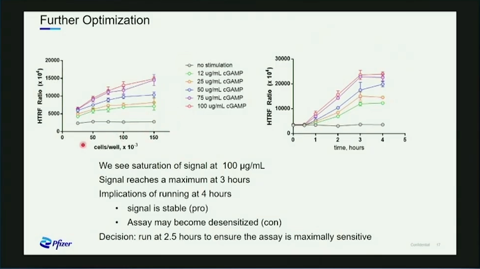

### 6.5 最终 assay 的验收指标

定稿的 assay 有两点特征：**刺激的饱和在加入更高浓度点后变得清楚**，以及**数据紧、统计指标好**——DMSO 对照的 $Z'$ 为 0.74，TBK1 抑制剂对照为 0.81。团队据此批准 assay，开始给项目化合物排序，并着手把方案迁移到原代人巨噬细胞 [【跳转到 40:40】](https://www.youtube.com/watch?v=32b0S_MLsb8&t=2440)。

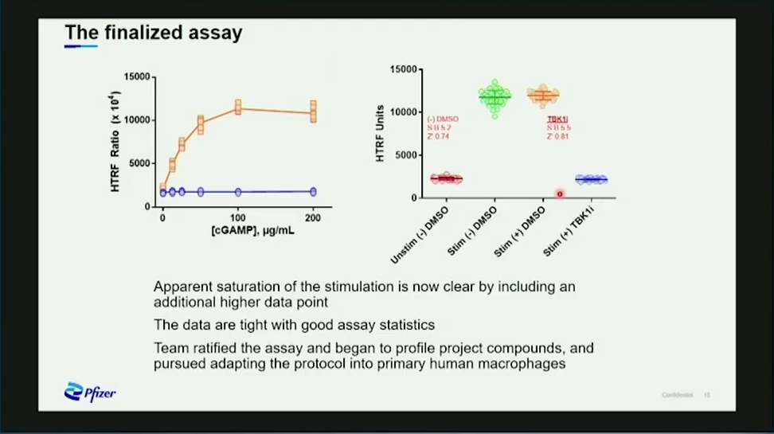

## 七、几个容易误判的地方

讲者在正文与问答里散落了几条经验，值得单独收拢：

1. **把「细胞死了」当成「靶点被抑制」**。这是四支柱里第四根柱子的固有风险。对策不是换更漂亮的表型，而是**回到第二、第三根柱子**：先证明占据，再证明近端通路被调控。
2. **把「生化活性」当成「细胞活性」**。两者之间隔着通透性、外排、代谢、蛋白结合，效价通常变弱；细胞 $IC_{50}$ 才是做剂量预测的那个数。
3. **忽略供体差异**。原代细胞里，不同供体的**信号幅度**会变，但**药理学应当保持**。讲者的判断标准很干脆：如果药理学随供体变化，那要怀疑的不是供体，而是**自己的生物学是否真的稳** [【跳转到 43:21】](https://www.youtube.com/watch?v=32b0S_MLsb8&t=2601)。
4. **忽略溶剂与聚集**。2% DMSO 是权衡的结果；助溶剂多一点能压住聚集，但会扰动生物学。
5. **用复杂表型代替机制验证**。问答里有人问：如果筛的是只有几千个化合物的小库，命中很少，能不能直接跳到表型 assay？讲者的回答是：可以省一些步骤，但**必须先把那个表型 assay 的生物学「发证书」**——用一组机制已知的化合物（他举了 MoA box 的例子）去问：这个 assay 会捡起哪些机制？会不会顺带捡起你不想要的滋扰生物学？然后针对它做反筛 [【跳转到 45:23】](https://www.youtube.com/watch?v=32b0S_MLsb8&t=2723)。

## 小结

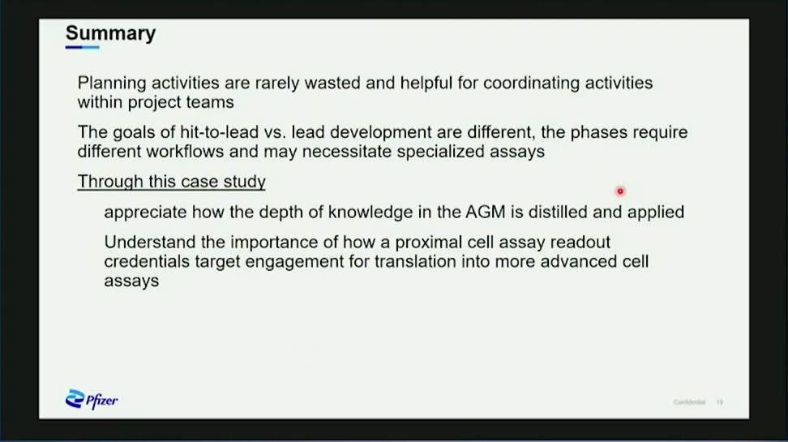

- **靶标验证是四层链条**：作用部位暴露 → 靶点占据 → 功能药理学（近端标志物）→ 相关表型。缺一层，结论就只能停在「相关」。
- **「细胞死了」是最容易被伪造的表型**，必须用中间层的生物标志物把它与靶点绑定。
- **细胞靶点占据是进入高级读出的入场券**，也是最容易被项目进度挤掉的一步。
- **生化 assay 要先能预测细胞**：底物肽要能证明信号来自目标酶，ATP 浓度要按阶段选择，$IC_{50}$ 位移要用 Cheng-Prusoff 预判再实测。
- **读出越靠近靶点，结论越强**：pIRF3 优于 IFN-β，IFN-β 优于 ISG。
- **细胞实验的稳健性来自细节**：细胞库、刺激物通透性、细胞密度饱和、时间窗口、磷酸酶抑制剂标定的窗口上限、$Z'$ 验收。
- **供体差异可以接受，药理学漂移不可以**。

## 关键术语速查

| 术语 | 一句话解释 |
| --- | --- |
| 四支柱（four pillars） | 暴露、占据、功能药理学、相关表型四层验证框架 |
| 作用部位暴露 | 化合物在靶器官/细胞内达到足以压过靶点 $IC_{50}$ 的自由浓度 |
| 靶点占据（target engagement） | 化合物在细胞内实际结合靶点的程度，常以占据曲线或热位移衡量 |
| 近端生物标志物 | 紧邻靶点下游、被靶点直接修饰的读出，如靶点底物的磷酸化 |
| 干扰反筛（interference counterscreen） | 让反应先完成再加化合物，用来识别干扰信号生成的分子 |
| 滋扰机制（nuisance mechanism） | 化合物在实验体系里真实存在、但不是你想追的活性，如聚集 |
| 生化到细胞位移 | 同一化合物在细胞 assay 中效价相对生化 assay 的变弱幅度 |
| Cheng-Prusoff 方程 | 由 $IC_{50}$、底物浓度与 $K_m$ 推算 $K_i$ 的关系式 |
| $Z'$ 因子 | 用阳性与阴性对照的分离度衡量板质量，越接近 1 越好 |
| ISG | 干扰素刺激基因，通路最远端的转录读出，信号放大最强但脱靶环节最多 |