# 表型筛选给出「有效」，激酶组谱给出「为什么有效」

> 视频来源：[Combining Phenotypic and Biochemical Screening to Identify Drug Targets](https://www.youtube.com/watch?v=Yg3g895lSBM)（YouTube · 讲者 Hassan，Miami Project to Cure Paralysis / 迈阿密大学 Bixby 与 Lemmon 实验室）｜时长约 47 分钟
> 导读：这是一份完整的「表型筛到靶点」实战报告。讲者先用 1600 多个激酶抑制剂筛出能促进神经轴突生长的化合物，再把这些化合物送进 190 个激酶的活性谱里，用统计学习把「表型有效」翻译成「抑制了哪几个激酶、避开了哪几个激酶」，最后用 siRNA 敲低与两种动物模型闭环。本文按「取舍—读出—解卷积—验证」的顺序整理，与同小节《靶点解析没有单一解法》互补：那一篇讲工具箱，这一篇讲一套工具箱怎么串成证据链。

## 本讲要解决的核心问题（SCQA）

**背景**：药物发现长期有两条路。一条是**靶标驱动筛选**（target-based screening）：先认定某个蛋白是病因，再用纯化的蛋白去筛化合物，谁的抑制活性强谁进下一轮。另一条是**表型筛选**（phenotypic screening）：把化合物加到细胞或组织上，只看细胞表现有没有变好，不看它碰了谁。

**冲突**：两条路各有致命缺口。表型筛选能捞到真正让细胞恢复正常的化合物——包括那些靠同时作用于多个靶点才起效的，但它**不告诉你靶点是谁**，而没有靶点，后续的化学优化就像在黑暗里调参；靶标驱动筛选的优化路径很清晰，可它对「这个靶点被调控之后细胞到底会不会变好」是盲的，甚至不区分这个作用是治病的还是致病的。

**疑问**：能不能让一次筛选同时拿到「有效」和「为什么有效」这两样东西？

**回答（中心思想）**：**把表型读数当作筛选标准、把靶标读数当作解释变量，用统计学习在两者之间建立可检验的相关性，就能把「哪些靶点的组合在起作用」从数据里逼出来。** 讲者的做法是：表型筛出 hit 与 non-hit → 对同一批化合物做广谱激酶活性谱 → 用最大相关算法与支持向量机找出「hit 普遍抑制、non-hit 普遍不抑制」的激酶（候选靶点）与反向模式的激酶（候选**反靶点**）→ 用 siRNA 敲低与动物模型验证。结论中最反直觉的一条是：**最强的那个化合物并不是最「干净」的那个，而是同时压制了 7 个候选靶点中 5 个、又完全不碰反靶点的那个**——表型改善来自靶点组合，而不是单一靶标。

## 一、两条路线的取舍，决定了你必须做哪种「第二次测量」

### 1.1 表型筛选买的是「相关性」，靶标筛选买的是「可优化性」

讲者把两条路线画成一张对照图 [【跳转到 03:23】](https://www.youtube.com/watch?v=Yg3g895lSBM&t=203)：左边是靶标驱动筛选，化合物库进入活性/结合检测，读数来自单一靶点，按结合或抑制强弱排序；右边是表型筛选，化合物库直接进入细胞或组织的表型生物检测，读数来自细胞的表现，按细胞层面的效应排序。

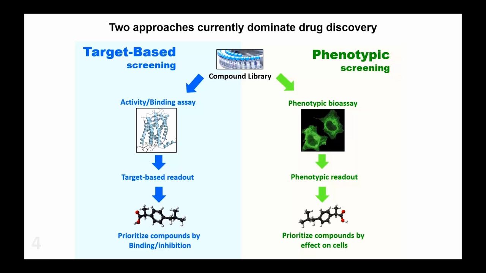

两条路的优缺点几乎正好互补：

- **表型筛选**不需要靶点假设，因此能发现高效化合物，**包括那些要靠有益的多靶点作用（beneficial polypharmacology）才起效的**；代价是靶点常常难以鉴定、甚至一直未知，**没有靶点，先导化合物优化（lead optimization）就很困难**——你不知道 potency 该往哪个方向推，也不知道选择性该对谁做。
- **靶标驱动筛选**的先导优化路径非常直接：结构-活性关系（SAR）就建立在那个纯化蛋白上；但它对靶点效应是「不可知」的，**它不区分你抑制的这个靶点是带来疗效还是带来毒性**。

### 1.2 「脱靶一定有害」是个需要修正的常识

讲者开场先纠正了一个流行说法 [【跳转到 01:00】](https://www.youtube.com/watch?v=Yg3g895lSBM&t=60)：常识认为脱靶（off-target）导致副作用与毒性，所以药物应当对目标靶点做到最大选择性。这个说法缺了一半——**在某些情况下，同时作用于额外的靶点反而会增强想要的效果**，这就是有益多药理学。他举的例子是激酶抑制剂：伊马替尼（imatinib）等一批药物被证明是通过多个激酶靶点起效的 [【跳转到 01:48】](https://www.youtube.com/watch?v=Yg3g895lSBM&t=108)。

这也解释了为什么系统生物学想做的事——建立高分辨率模型、预测「该扰动哪几个靶点的组合」——这么难 [【跳转到 02:03】](https://www.youtube.com/watch?v=Yg3g895lSBM&t=123)：生物层级复杂（用基因层数据推细胞功能状态会丢信息）、时间维度复杂（非线性过程采样不足）、大数据分析难（既要视野宽又要聚焦关键事件），再加上大部分蛋白组仍被预测为「不可成药」。

### 1.3 组合两种读数的具体做法：让 non-hit 当对照组

讲者的方案可以拆成三步 [【跳转到 04:37】](https://www.youtube.com/watch?v=Yg3g895lSBM&t=277)：

1. 在**表型检测**里筛化合物，按想要的表型读数挑出 hit；
2. 把这些 hit 送进**一系列靶标检测**（比如一组激酶的抑制活性），拿到生化活性谱；
3. 找**与表型结果强相关的生化活性模式**。

关键在于第三步必须把 non-hit 一起放进来。讲者用一个玩具例子说明 [【跳转到 05:25】](https://www.youtube.com/watch?v=Yg3g895lSBM&t=325)：只看 hit，蛋白 10 和蛋白 18 都像是候选；一旦加入 non-hit 的数据，就会发现蛋白 18 在 non-hit 里也被抑制，于是只剩蛋白 10。反过来，**「只有 non-hit 才抑制」的蛋白就是候选反靶点**。

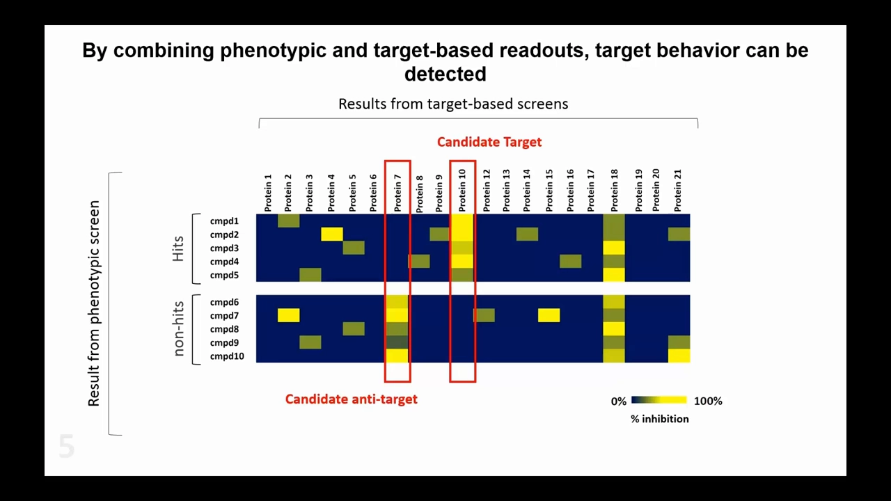

讲者在这里扩展了「反靶点」（anti-target）的定义 [【跳转到 05:55】](https://www.youtube.com/watch?v=Yg3g895lSBM&t=355)：它不只指引起毒性副作用的蛋白，**还包括那些「抑制了就会抵消疗效」的蛋白**。这个扩展很重要——它把反靶点从安全性问题变成了**疗效问题**，也直接解释了后文「为什么不能把表型改善归给单一靶标」。

## 二、表型读出：只用一条曲线，但那条曲线必须站得住

### 2.1 生物学问题本身就在说「单靶点可能不够」

讲者研究的表型是中枢神经系统的轴突再生 [【跳转到 07:13】](https://www.youtube.com/watch?v=Yg3g895lSBM&t=433)。脊髓损伤后，下行轴突几乎不再生，原因有两个：一是**中枢神经元随年龄出现的内在再生能力丧失**（程序性的），二是**中枢微环境里存在外在抑制分子**。两者叠加导致瘫痪。

他特别指出 [【跳转到 07:48】](https://www.youtube.com/watch?v=Yg3g895lSBM&t=468)：**绝大多数只针对单个靶点、甚至单条通路的策略，都没有产生足够强的再生效果**。这构成了选择表型筛选的理由——当网络被双重锁死时，撬动一个节点往往不够。

### 2.2 高内涵读出：采几十个参数，只用一个做判据

表型检测的体系是 [【跳转到 08:18】](https://www.youtube.com/watch?v=Yg3g895lSBM&t=498)：从胚胎大鼠脑皮层分离出 CNS 神经元，解离后低密度铺在包被了多聚-D-赖氨酸（PDL）的板上，加入不同剂量的化合物，培养两天，固定并做免疫荧光染色，用自动化的机械臂显微镜成像并追踪神经突，数据用 MATLAB 分析。

这套检测**对单个神经元采集几十个参数**，属于高内涵分析（high content analysis, HCA）。但在这个应用里，讲者只用其中一个参数做判据：**神经突总长度（neurite total length, NTL）**，以 DMSO 对照归一化后表示为百分比 %NTL。

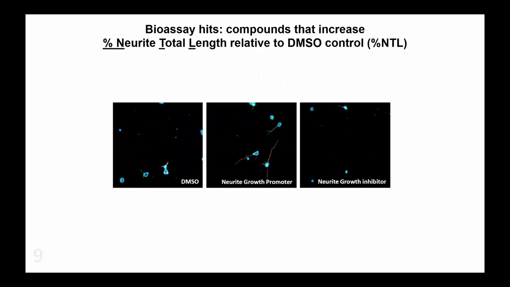

这张图同时说明了表型读出的两个要点：**它有明确的生理意义**（神经突长度就是再生能力的代理指标），**它的动态范围足够大**（同一视野里从几乎无突起可以到长突起），因此效应量可以被肉眼和算法同时确认。

### 2.3 筛 1600 个化合物：hit 的定义要先写死

讲者筛了 1600 多个激酶抑制剂，来源包括商业供应商，以及 GSK、芬兰分子医学研究所（FIMM）、SGC 的合作化合物，每个化合物测 5 个剂量 [【跳转到 09:57】](https://www.youtube.com/watch?v=Yg3g895lSBM&t=597)。

hit 的定义是：**在两次独立筛选中都让 %NTL 比对照提高 30% 或以上**。检测的假发现率（false discovery rate, FDR）约 7%，$Z'$ 因子在 0.7–0.8 之间——后者是衡量检测窗口与变异程度的常用指标，0.5 以上通常认为可用于筛选：

$$
Z' = 1 - \frac{3\sigma_{\text{pos}} + 3\sigma_{\text{neg}}}{\lvert \mu_{\text{pos}} - \mu_{\text{neg}} \rvert}
$$

（$Z'$ 的公式是标准定义，属补充说明；讲者只报告了数值区间。）

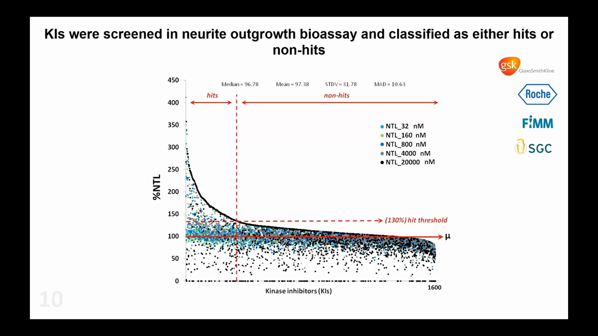

这张分布图值得多看两眼，因为它暴露了表型筛选的结构性问题：**命中是长尾**。绝大多数化合物对 %NTL 几乎没有影响，真正的 hit 集中在曲线最左端的一小撮；而紧贴阈值的那一段，正是「效应真实但微弱」和「噪声」最难区分的地方。

## 三、从 1600 到 10 组：把「表型相关」变成「靶点假设」

### 3.1 先做分层，把边界上的化合物剔掉

下一步不是直接做谱，而是先挑「最有信息量」的化合物。讲者用了一个叫**分层（stratification）**的手法 [【跳转到 10:47】](https://www.youtube.com/watch?v=Yg3g895lSBM&t=647)：如果两组样本在某个连续变量上重叠，想找出区分它们的特征，就把落在交界处的样本去掉，从而放大两组的特征差异。

具体做法是：**剔除 %NTL 落在 hit 阈值上下一个标准差以内的化合物**，于是得到两组「分层后的 hit」与「分层后的 non-hit」。这一步的代价是样本量减少，收益是后面统计学习的信噪比提高——这是一个在表型筛选中很值得抄的操作：**不要用全部数据去解卷积，用最能代表两端的子集**。

### 3.2 265 个化合物 × 190 个激酶

最终进入解卷积分析的是 **265 个化合物**（分层 hit 与分层 non-hit 的混合）对 **190 个激酶**的活性谱 [【跳转到 11:37】](https://www.youtube.com/watch?v=Yg3g895lSBM&t=697)。其中大部分数据由 GSK 的合作者提供，讲者自己又补了约 20 个 hit 的谱，用来强化能反映靶点的特征。

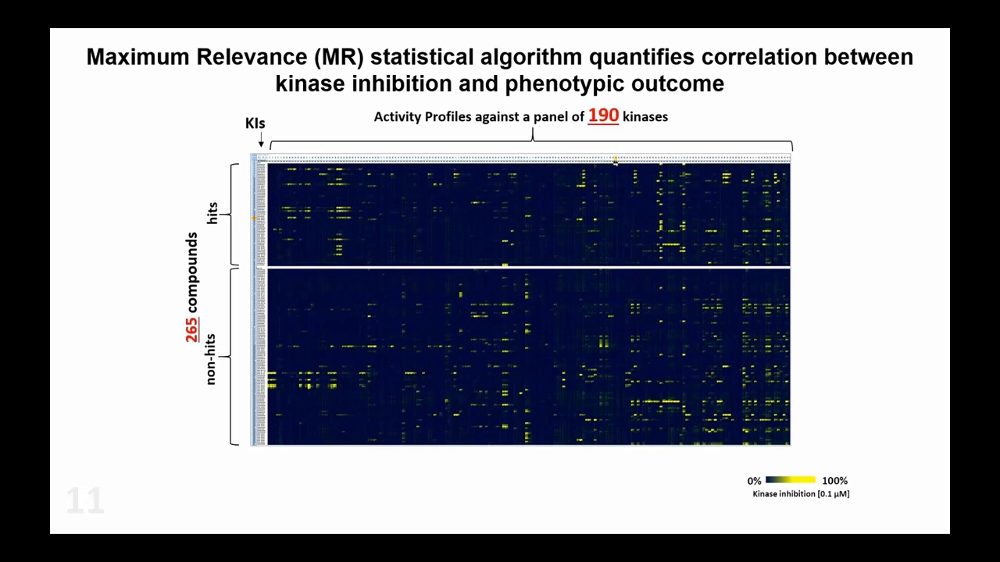

这就是「第二次测量」的成本所在：**表型筛选的规模是千级，靶标谱的规模只能是百级**。所以表型筛选的漏斗不是「筛完就完」，而是要在中间插一道「选出代表性化合物」的工序。

### 3.3 用最大相关算法给激酶排序

讲者用**最大相关（maximum relevance）算法**按「对两类化合物的信息量」给激酶排序 [【跳转到 12:20】](https://www.youtube.com/watch?v=Yg3g895lSBM&t=740)。判据很直观：

- **高相关**：某个激酶几乎只被 hit 抑制（候选靶点），或者几乎只被 non-hit 抑制（候选反靶点）；
- **低相关**：要么谁都不抑制它（对表型没有信息），要么两类化合物对它的抑制模式几乎一样（无法区分）。

相关性用两类化合物的**联合活性概率与边缘活性概率**计算 [【跳转到 13:10】](https://www.youtube.com/watch?v=Yg3g895lSBM&t=790)。这个量在信息论里就是激酶活性与表型类别之间的互信息：

$$
I(K;C) = \sum_{c \in \{\text{hit},\,\text{non-hit}\}} \sum_{a \in \{0,1\}} p(a,c) \log \frac{p(a,c)}{p(a)\,p(c)}
$$

（互信息形式是补充说明，用于解释「联合概率与边缘概率之比」的含义；讲者未在视频中写出该式。）按此排序后取**前 50 个激酶**进入下一步。

### 3.4 支持向量机：先证明「谱能预测表型」，再压缩到最小靶点集

有了 50 个激酶的活性特征，讲者训练了一个**支持向量机（support vector machine, SVM）**——一种把样本映射到高维空间、找最优分界面的分类算法——来做 10 折交叉验证，任务是「只看激酶谱，判断这个化合物是 hit 还是 non-hit」 [【跳转到 14:28】](https://www.youtube.com/watch?v=Yg3g895lSBM&t=868)。

结果是 **80% 的准确率**，远高于随机猜测。讲者对「为什么不是 100%」的解释很关键：**190 个激酶只是全部可能靶点里的一小部分**，信息本来就不完整。

接下来是压缩 [【跳转到 14:53】](https://www.youtube.com/watch?v=Yg3g895lSBM&t=893)：让 SVM 一个一个地移除激酶，如果移除后预测性能下降，这个激酶就被判为「有影响力」并放回；否则丢掉，继续测下一个。这样做的目的是找到**对表型影响最大的最小靶点集合**。讲者还设计了一个差分预测指标，通过最大化敏感度与错误率之间的代数间隔来跟踪性能 [【跳转到 15:43】](https://www.youtube.com/watch?v=Yg3g895lSBM&t=943)。

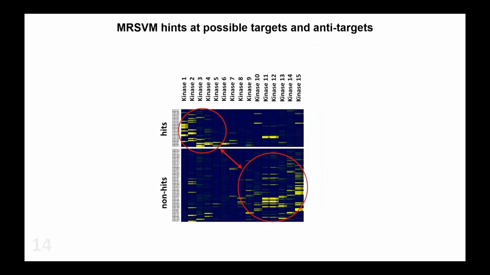

### 3.5 一个必须承认的混杂：近缘激酶无法区分

图上「左靶点、右反靶点」的漂亮分区有一个陷阱 [【跳转到 16:38】](https://www.youtube.com/watch?v=Yg3g895lSBM&t=998)：激酶催化域的同源性导致抑制剂**天然多靶点**，两个近缘激酶往往有几乎相同的抑制模式。对算法来说，它们被当成等价的特征——**即使其中只有一个在生物学上真的与表型相关**。

解决办法是**把激酶组（kinome）按「药理学上联动」分组** [【跳转到 17:33】](https://www.youtube.com/watch?v=Yg3g895lSBM&t=1053)：以催化域序列相似性为主（序列越近，越可能结合同一批化合物），再用已有的抑制数据校正——把序列差异大但结合模式相似的激酶并到一组。这一步用了 Metz 提出的药理学相互作用强度参数，最后得到 **305 个激酶组**。

于是分析单位从「单个激酶」变成了「一组可能被同一化合物同时打中的激酶」。这个转换不是技术细节，而是**结论性质的改变**：后面所有的「靶点」其实都是「靶点组」。

## 四、验证：从相关性到因果，要过三道关

### 4.1 第一关：siRNA 敲低能不能复现表型

相关性不等于因果。讲者用 **siRNA 介导的敲低**来测每组激酶对表型的真实贡献 [【跳转到 19:18】](https://www.youtube.com/watch?v=Yg3g895lSBM&t=1158)：敲低候选靶点组的成员，应当促进神经突生长；敲低候选反靶点组的成员，应当抑制生长。

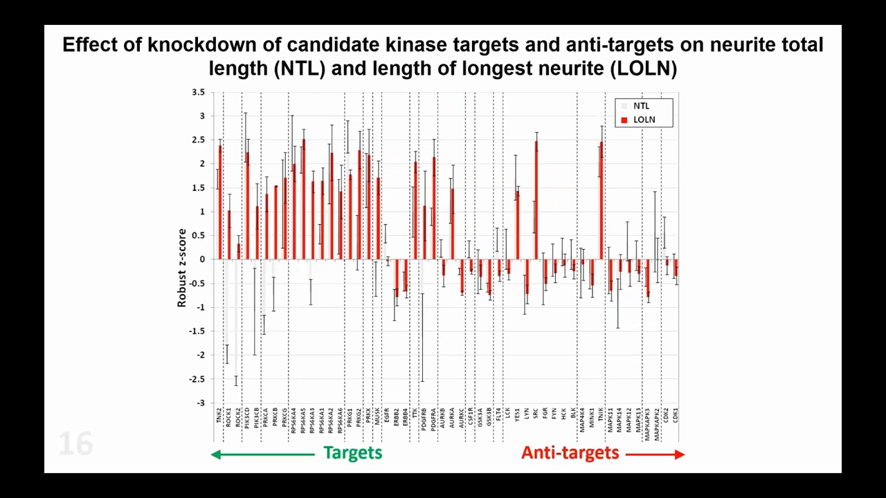

讲者提醒了一个方法学上的折扣：**敲低（去掉蛋白）与药理抑制（压住活性）不是同一件事**，所以不能指望严格一一对应；要看的是整体模式。

模式确实出现了，而且出现得很有规律 [【跳转到 20:08】](https://www.youtube.com/watch?v=Yg3g895lSBM&t=1208)：**组内成员行为一致的组，抑制偏向最强**（全当靶点的组落在最左，全当反靶点的组落在最右）；**组内成员作用方向相反的组，则挤在中间**。

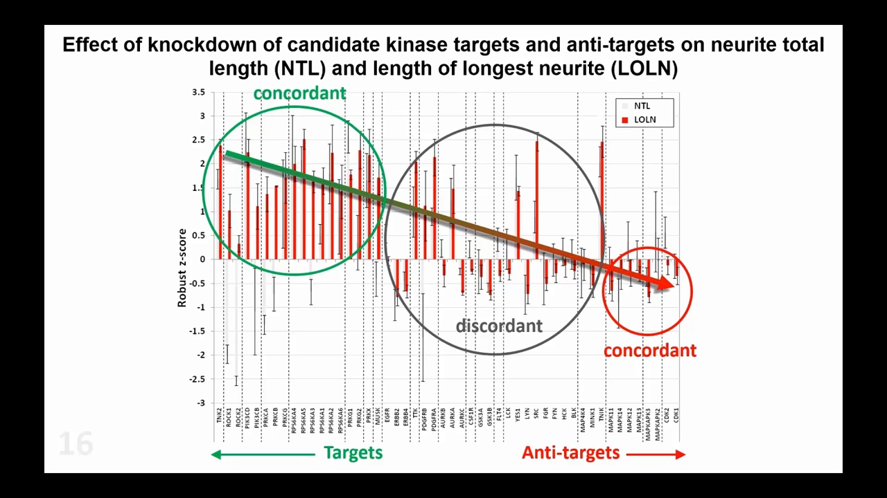

原因讲得很清楚 [【跳转到 20:33】](https://www.youtube.com/watch?v=Yg3g895lSBM&t=1233)：如果一组激酶在药理学上联动，抑制其中一个往往也抑制其他成员，**你读到的其实是整组的平均效应**。成员同向，读数被推向一端；成员互相抵消，读数就悬在中间。这解释了为什么「分组」是必要的，也提醒读者：**用化合物做靶点推断时，读到的常常是组合效应而非单点效应**。

### 4.2 第二关：已知文献能不能对上

取抑制偏向最强的 10 个组，得到 **7 个靶点组 + 3 个反靶点组** [【跳转到 21:23】](https://www.youtube.com/watch?v=Yg3g895lSBM&t=1283)。

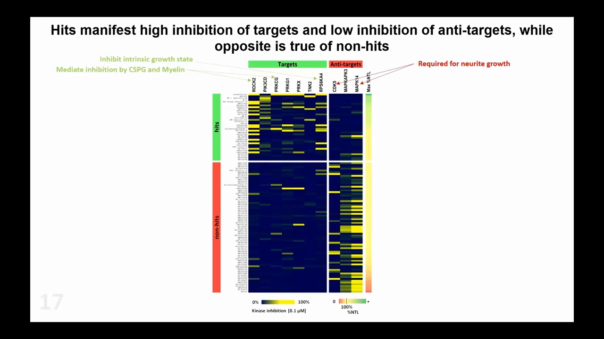

这张图上有几条来自文献的旁证 [【跳转到 21:47】](https://www.youtube.com/watch?v=Yg3g895lSBM&t=1307)：**ROCK 与 PKC 早已被证明介导中枢基质分子对轴突生长的抑制**；**S6 激酶已知抑制中枢神经元的内在生长能力**；**CDK5 与 p38 则已知是轴突生长所必需的**。前两类落在靶点侧、后一类落在反靶点侧，与算法给出的方向一致。讲者把这称为「来自已知文献的一份额外验证」。

### 4.3 第三关：动物模型能不能复现

最强化合物的特征很反直觉 [【跳转到 22:37】](https://www.youtube.com/watch?v=Yg3g895lSBM&t=1357)：它对 7 个靶点中的 5 个有强多药理学作用，对反靶点完全没有活性，而它在细胞检测里的促生长效应**远高于其他所有化合物**。

体内验证用了两个模型。第一个是**锥体束切断术（pyramidotomy）模型** [【跳转到 23:26】](https://www.youtube.com/watch?v=Yg3g895lSBM&t=1406)：在小鼠脑干一侧切断皮质脊髓束的轴突，另一侧用 GFP 标记病毒标记胞体，被切断的轴突会退化，而 GFP 标记的轴突会向空出来的区域发芽（sprouting）。通过渗透泵向脑脊液持续输注化合物 28 天。

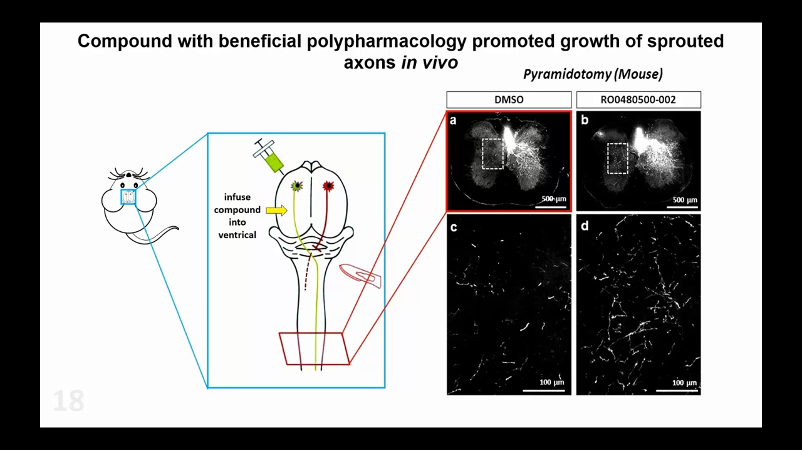

结果是**发芽量翻倍**。

第二个模型更严格 [【跳转到 24:49】](https://www.youtube.com/watch?v=Yg3g895lSBM&t=1489)：在小鼠脊髓背侧造成损伤，把下行皮质脊髓束切断，然后**只在皮层做一次注射**。对照组看不到任何再生，轴突反而从损伤处回缩；治疗组的轴突**穿过了损伤区并沿损伤远端长距离延伸**，还向灰质大量发芽——按合作者的说法，这是非常不典型的结果。

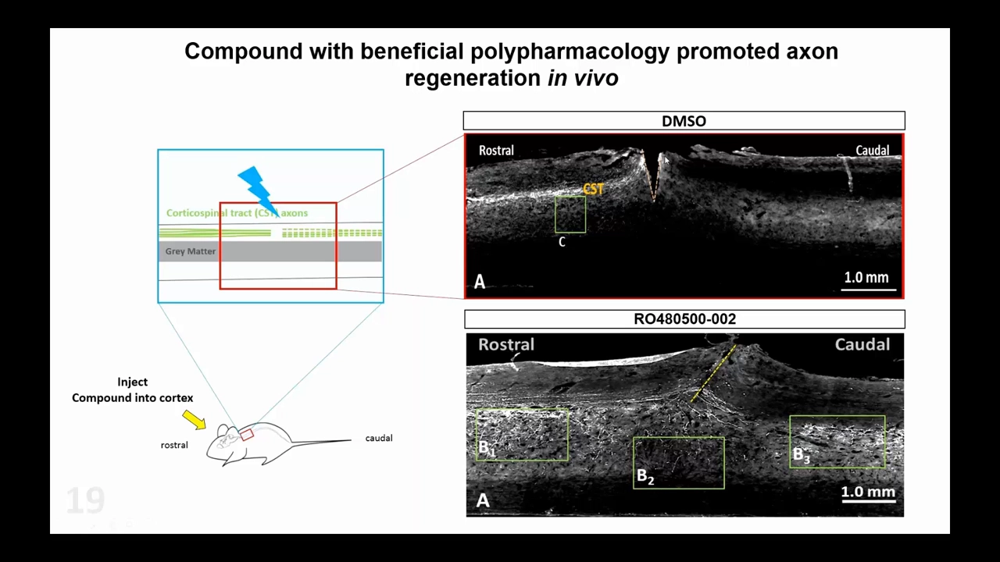

每组 7 只动物，并给出了代表性的三维重建 [【跳转到 26:04】](https://www.youtube.com/watch?v=Yg3g895lSBM&t=1564)。

## 五、为什么不能把表型改善归给单一靶标

这一节是整场报告最值得带走的部分，讲者用四组观察把「单靶标归因」逐条拆掉。

### 5.1 证据一：不同化学骨架的 hit 共享同一套多药理学谱

GSK 的合作者用这 10 个代表性靶点与反靶点又分析了表型筛选里的其他高活性 hit，发现**若干高活性 hit 与先导化合物共享同一套多药理学谱**，而它们的**化学骨架非常不同** [【跳转到 27:10】](https://www.youtube.com/watch?v=Yg3g895lSBM&t=1630)。

这个观察有两层意义：一是**表型效应更可能由靶点组合驱动，而不是由某个骨架特有的非特异作用驱动**；二是对药物化学很实用——**骨架跃迁（scaffold hopping）可以不丢失关键的生化与表型活性**。

讲者在问答里补了一条反面证据 [【跳转到 34:13】](https://www.youtube.com/watch?v=Yg3g895lSBM&t=2053)：他试过按结构相似性聚类，**结构与活性之间没有相关性**；同一骨架里有的化合物有效、有的无效，而有效与无效的差别恰好可以用「是否打中靶点、是否打中反靶点」来解释。

### 5.2 证据二：互补的多药理学组合能产生单药做不到的效应

讲者取了两个 hit，它们合起来覆盖全部 7 个靶点、且都不碰反靶点。把两者合用后，细胞检测里出现了**极强的促生长效应** [【跳转到 28:15】](https://www.youtube.com/watch?v=Yg3g895lSBM&t=1695)。

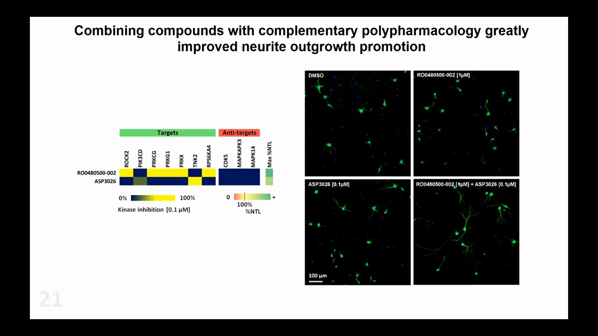

他特别说明，此前**系统性地组合强 hit 并没有产生过这个量级的效应**；组合指数（combination index）因为低浓度下效应已经饱和而无法拟合，需要换更低的剂量范围重做 [【跳转到 28:40】](https://www.youtube.com/watch?v=Yg3g895lSBM&t=1720)。也就是说，**协同来自靶点覆盖的互补，而不是来自「更强的 hit 相加」**。

### 5.3 证据三：换一个细胞语境，同一个激酶的角色会翻转

讲者把同一套方法搬到癌症 [【跳转到 29:31】](https://www.youtube.com/watch?v=Yg3g895lSBM&t=1771)。合作者用**药物敏感性评分（drug sensitivity score, DSS）**——不是记录绝对的细胞死亡量，而是衡量化合物对癌细胞相对于对照细胞的**选择性**细胞毒——重新给同一批 GSK 激酶抑制剂打分。用 HER2 阳性的乳腺癌细胞系 SKBR3 跑这套流程，**HER2 组确实进入了排名最前的靶点**；流程还挑出了一些近期才被证明介导该细胞系对 HER2 靶向治疗产生适应性应答的激酶 [【跳转到 30:21】](https://www.youtube.com/watch?v=Yg3g895lSBM&t=1821)。

更有意思的是培养条件的影响 [【跳转到 30:51】](https://www.youtube.com/watch?v=Yg3g895lSBM&t=1851)：在三维培养与二维培养的三阴性乳腺癌细胞里，**同一个激酶在 3D 中表现为靶点、在 2D 中却不是**。而在滑膜肉瘤的筛选里，他们发现了一个**非常稳健的反靶点**：抑制这个激酶会强烈**促进**细胞增殖 [【跳转到 31:31】](https://www.youtube.com/watch?v=Yg3g895lSBM&t=1891)。他们找了四个相对选择性的抑制剂，全部都能诱导增殖，RNA 数据也支持这个观察，siRNA 验证仍在进行中。

这三条合起来说明：**「靶点」不是一个化合物的固有属性，而是「化合物 × 细胞状态 × 培养条件」的函数**。同一支化合物在神经细胞里压住的是促生长刹车，在肿瘤细胞里可能压住的是增殖刹车。

### 5.4 证据四：被排除掉的那部分，恰恰是「毒性靶点」

问答里有人问：你们从神经元做到癌症，那些激酶在不同组织里的分布不同，怎么处理？讲者的回答很坦诚 [【跳转到 35:53】](https://www.youtube.com/watch?v=Yg3g895lSBM&t=2153)：**他在分析时排除了对细胞有明显毒性的化合物**，因此这套解卷积拿不到毒性相关信息；他所说的「反靶点」**只针对这个表型效应**，不涵盖毒性意义上的反靶点。先导化合物后面还要过毒性 panel，这一步他们还没做。

这条限制值得单独记住：**表型筛选的「反靶点」是相对于你所选的那个表型定义的**，换一个表型、换一个读数，靶点与反靶点的名单都可能重排。

## 六、这套方法的边界：三个必须交代的实验条件

讲者在问答里给出了一组很具体的经验参数，对想复现的人比正文更有用。

**第一，靶标谱的浓度不能随便挑** [【跳转到 38:48】](https://www.youtube.com/watch?v=Yg3g895lSBM&t=2328)。他在 0.1 µM 与 1 µM 两个浓度做了激酶谱，两者效果接近，但 **0.1 µM 的预测更好**；另有一批在 10 µM 采集的数据**噪声太大、选择性被淹没**，预测质量明显下降。0.5 µM 的另一批数据也不如 0.1/1 µM。

**第二，表型浓度与谱浓度必须可比** [【跳转到 40:28】](https://www.youtube.com/watch?v=Yg3g895lSBM&t=2428)。他的表型检测覆盖 32 nM 到 20 µM；由于谱是在 0.1 µM 做的，他在关联时**只使用表型浓度等于或高于谱浓度的数据点**。否则你是在拿 10 µM 的体外活性去解释 1 µM 的细胞效应，中间隔着溶解度、膜通透性等一堆无法校正的因素。

**第三，激酶谱用的是活性检测而非结合检测** [【跳转到 37:58】](https://www.youtube.com/watch?v=Yg3g895lSBM&t=2278)。合作方提供的是基于电泳迁移率变化的活性检测：底物带荧光，反应终止后过 HPLC，按峰的位置判断反应了多少。这一点会影响结论的措辞——**你测的是「化合物能否压住这个激酶催化底物的能力」，不是「化合物是否结合这个激酶」**。

## 小结

- **两条路线的缺口正好互补**：表型筛选拿到「有效」但缺靶点、难优化；靶标筛选优化路径清晰但对疗效无知。把表型当筛选标准、靶标谱当解释变量，可以让一次筛选同时产出两者。
- **non-hit 是解卷积的必要对照**。只比较 hit 会得到一堆假相关；加入 non-hit 才能把「候选靶点」与「候选反靶点」分开。
- **反靶点不只等于毒性靶点**，还包括「抑制了就抵消疗效」的靶点。这是「不能把表型改善归给单一靶标」的第一个理由。
- **激酶同源性使「单靶点」在物理上就难以成立**。必须先把激酶组按药理学联动分组，否则算法会把近缘激酶当成等价特征。这是第二个理由。
- **验证要过三关**：siRNA 敲低复现表型方向、已知文献方向一致、动物模型复现功能改善。缺任何一关，靶点假设都还只是相关性。
- **表型改善往往是靶点组合的函数**：最强化合物同时压住 5 个靶点、不碰反靶点；互补组合的效应超过任何单药；换细胞语境后同一激酶的角色会翻转。
- **这套方法的成本结构是「千级表型 × 百级靶标谱」**，所以中间必须插入分层抽样；而靶标谱的浓度选择、与表型浓度的匹配、以及活性检测与结合检测的区别，都会直接改变结论。

## 关键术语速查

| 术语 | 一句话解释 |
| --- | --- |
| 表型筛选（phenotypic screening） | 把化合物加到细胞或组织上，按细胞表现的变化排序，不需要先知道靶点 |
| 靶标驱动筛选（target-based screening） | 先认定一个靶点，用纯化蛋白测结合或抑制，按对靶点的活性排序化合物 |
| 有益多药理学（beneficial polypharmacology） | 同时作用于多个靶点反而增强疗效的情形，与「脱靶即有害」的常识相反 |
| 反靶点（anti-target） | 被抑制后会抵消疗效或带来毒性的蛋白；本文语境下特指抵消疗效 |
| %NTL（神经突总长度百分比） | 以 DMSO 对照归一化的神经突总长度，本讲的表型判据，≥130% 记为 hit |
| 高内涵分析（HCA） | 从显微图像中对每个细胞采集几十个形态参数的分析方式，本文只取其中一个做判据 |
| 分层（stratification） | 剔除两组交界处的样本以放大组间特征差异的抽样手法 |
| 最大相关算法（maximum relevance） | 按「对 hit/non-hit 两类的信息量」给特征排序，本文用于给 190 个激酶排序 |
| 支持向量机（SVM） | 在高维空间寻找最优分类界面的监督学习算法，本文用于「用激酶谱预测 hit/non-hit」 |
| 激酶组分组（kinome grouping） | 按催化域序列相似性与实测抑制模式把激酶并成 305 个药理学联动组 |
| 锥体束切断术（pyramidotomy） | 在小鼠脑干切断皮质脊髓束的损伤模型，用于观察轴突发芽 |
| 药物敏感性评分（DSS） | 衡量化合物对癌细胞相对对照细胞的选择性细胞毒，而非绝对杀伤量 |