# 靶点解析没有单一解法：把化学、组学与遗传学的证据拼成一张图

> 视频来源：[Best Practices for Phenotypic Drug Discovery, Part Two: Target Identification](https://www.youtube.com/watch?v=-MMajtuYnS4)（YouTube · 欧洲药物化学联合会 EFMC「药物化学最佳实践」工作组系列网络研讨会 第二部分）｜时长约 29 分钟
> 导读：这是 EFMC 表型药物发现最佳实践系列的第二讲，专门讲「表型筛完之后，靶点怎么找」。讲者把方法分成四大类——蛋白亲和力方法、组学与形态学方法、遗传学方法、计算与知识方法——逐个交代原理、能解决什么、会在哪里骗你，最后落在一句很实务的结论上：靶点鉴定需要多块拼图，验证必须多方法并行，而且要和化合物优化同时开工。本文按「要不要做—有哪些工具—怎么拼」的顺序整理，与同小节《表型筛选给出有效，激酶组谱给出为什么有效》互补：那一篇是一套方法的完整实战，这一篇是方法地图。

## 本讲要解决的核心问题（SCQA）

**背景**：表型筛选重新流行起来，理由是它更可能产出机制上真正相关的化合物——细胞层面的效应已经证明这个分子在真实系统里管用。

**冲突**：但细胞筛选**不会直接告诉你靶点是谁**。更麻烦的是，「不做靶点解析」在监管上并不违规：FDA 批准过靶点未知的药物，患者和照护者也不需要知道靶点。于是靶点解析在很多项目里被当成可选项——而它偏偏又耗时、耗资源，成功率不稳定。

**疑问**：既然不是必需的，为什么还要做？如果要做，几十种方法里该挑哪一种，又该在什么阶段做？

**回答（中心思想）**：**靶点解析的价值不在「满足好奇心」，而在它把后续每一步都变得可计算——可做结构导向的优化、可开平行的靶标项目、可提前砍掉不安全的机制、可开发用于临床转化的生物标志物。** 而方法上没有「一招通吃」：蛋白亲和力方法回答「谁结合了」，组学方法回答「像什么」，遗传学方法回答「少了它行不行」，计算方法回答「最可能是什么」。**四类证据互相独立，拼起来才构成靶点假设；单一方法的结论只能当作待验证的假设。**

## 一、先回答「要不要做」：不是必需，而是一个风险决策

讲者把这个问题直接写在第一张幻灯片上 [【跳转到 00:30】](https://www.youtube.com/watch?v=-MMajtuYnS4&t=30)：**靶点的鉴定是必需的吗？该在哪个阶段做？** 他的回答是——**并非绝对必需，这更多是一个风险判断与心态选择**。理由很硬：FDA 批准过没有明确靶点的药物；照护者和患者也不需要知道靶点，他们要的是安全有效的药。

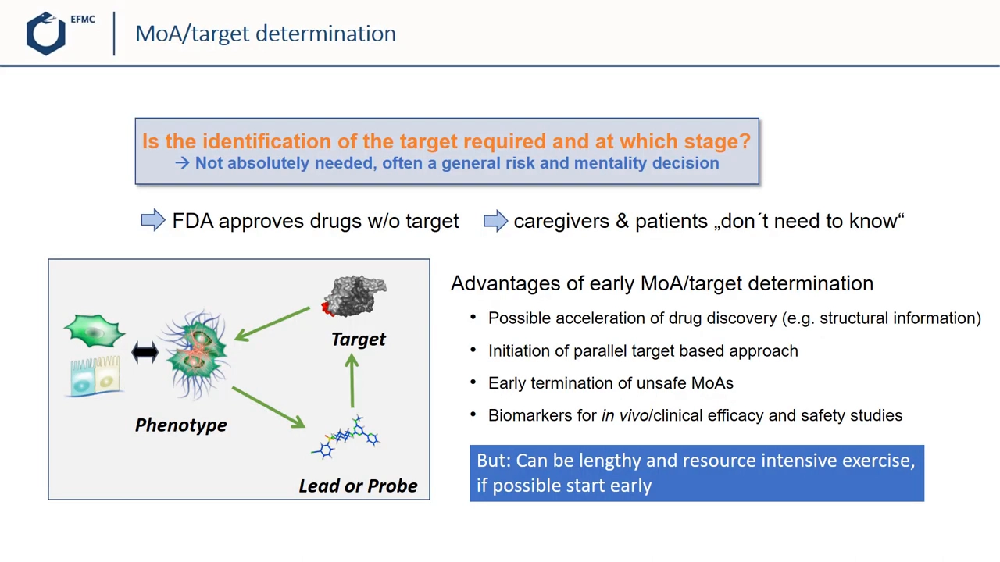

但紧接着，他列出了**早期做机制/靶点解析的四条好处**：

- **可能加速药物发现**，例如拿到结构信息后可以做结构导向的优化；
- **可以启动一条平行的靶标驱动项目**，为优化提供额外的起点；
- **可以早期终止不安全的机制**（early termination of unsafe MoAs）；
- **可以产出用于体内与临床疗效/安全性研究的生物标志物**——这一点讲者特别强调，因为**知道靶点之后，从临床前到临床的转化才有可测量的桥**。

代价也写在图上：**这可能是一个漫长且资源密集的过程，所以如果要做，就尽早开始**。

### 1.1 为什么「没有一招通吃」

讲者反复强调一句话 [【跳转到 02:10】](https://www.youtube.com/watch?v=-MMajtuYnS4&t=130)：**没有任何单一方法能提供通用解**。他同时提醒，靶点解析耗时耗资源这一点，经常被拿来当作反对表型筛选的论据，但**现代科学不应该因此回避它**。

还有一个前置条件值得记住：**在大多数情况下，解析靶点需要高活性的工具化合物或先导化合物**。也就是说，靶点解析的成败在很大程度上取决于化学——这一点在最后一部分还会回来。

## 二、蛋白亲和力方法：给化合物装一只钩子

这一类的共同思路是：**把 hit 或工具化合物修饰上一个标签，用这个标签去「钓」靶点蛋白**。讲者按「结合是否可逆」把它分成三小类。

### 2.1 可逆结合 + 拉下（pull-down）

最基本的流程是 [【跳转到 03:21】](https://www.youtube.com/watch?v=-MMajtuYnS4&t=201)：先给 hit 分子接一个连接臂（linker），连接臂上带标签或报告基团（有时标签在更晚的步骤才装上）；然后与来自表型筛选体系的生物样本——最常见是细胞裂解液或组织匀浆——孵育，让带标签的分子结合靶点；接着把配体-蛋白复合物捕获下来、洗掉未结合成分，这一步叫 **pull-down**；最后做捕获与可视化。

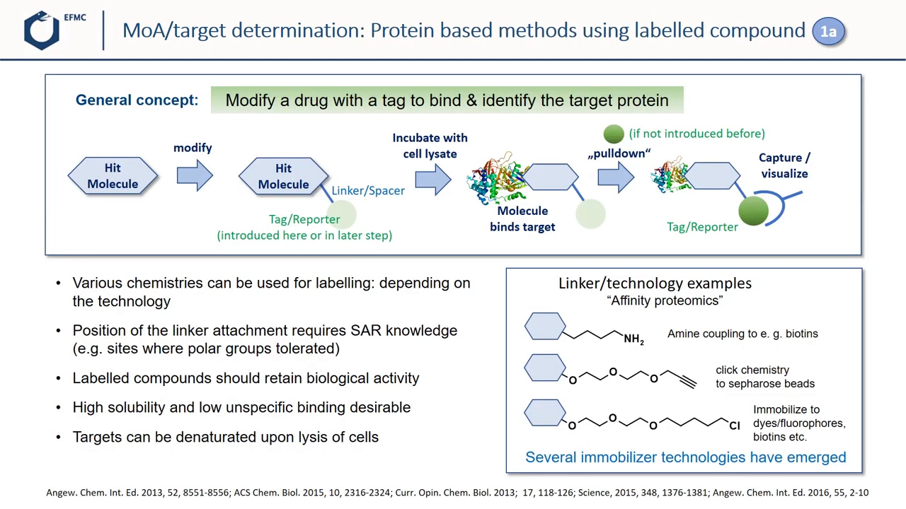

连接臂的化学有很多选择：氨基偶联到生物素、点击化学接琼脂糖珠、直接固定到染料/荧光团或生物素上。这类方法统称**化学沉淀（chemo-precipitation）**或**亲和蛋白质组学**，但它有四个必须提前想清楚的坑 [【跳转到 04:36】](https://www.youtube.com/watch?v=-MMajtuYnS4&t=276)：

- **连接位点需要 SAR 知识**：你得先知道分子上哪些位置容忍极性基团，否则一接就死；
- **标记后的化合物必须保留生物活性**；
- **理化性质会变**：溶解度、非特异蛋白结合都可能被改变；
- **裂解细胞时靶点可能变性**——这是可逆方法最要命的一条，因为变性会让真实的结合消失。

### 2.2 定量化学蛋白质组学：把「结合」变成一条剂量曲线

更精细的版本是把药物固定在固相载体上，然后**在不同浓度的游离、未标记药物存在下**与细胞裂解液孵育 [【跳转到 05:31】](https://www.youtube.com/watch?v=-MMajtuYnS4&t=331)。洗掉非特异结合后，洗脱结合的蛋白，用质谱做鉴定与定量。

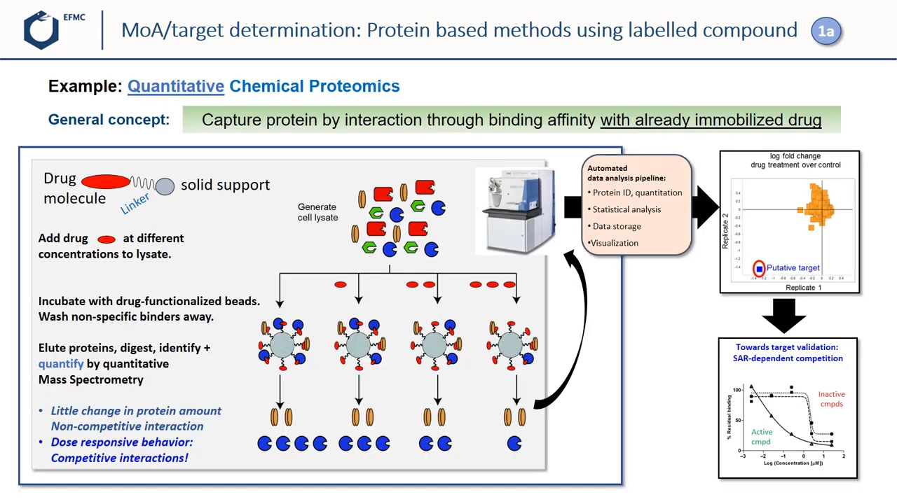

这个设计的精妙之处在于**读出是「剂量依赖性」**：真正的靶点，其结合量会随游离药物浓度升高而被竞争下来，画出一条剂量响应曲线；非特异结合的蛋白则不受影响。讲者说，这类数据通常用稳定同位素标记（SILAC，细胞培养中的氨基酸稳定同位素标记）来增强定量比较——重同位素标记会在质谱里造成可识别的质量差。

**这一条判据值得所有做靶点解析的人记住：不是「被拉下来了」，而是「被竞争下来了」。** 前者只能说明有结合，后者才说明结合是特异的、可饱和的。

### 2.3 共价与光亲和标记：把结合变成一根化学键

可逆方法有两个致命失败点——**靶点亲和力太弱，或者裂解时靶点变性**。共价策略正是为了绕开它们 [【跳转到 07:30】](https://www.youtube.com/watch?v=-MMajtuYnS4&t=450)：给 hit 分子接上**反应性连接臂或光反应性连接臂**，与裂解液（有时直接在活细胞里）孵育后，分子结合靶点并被共价交联，再用报告基团可视化。

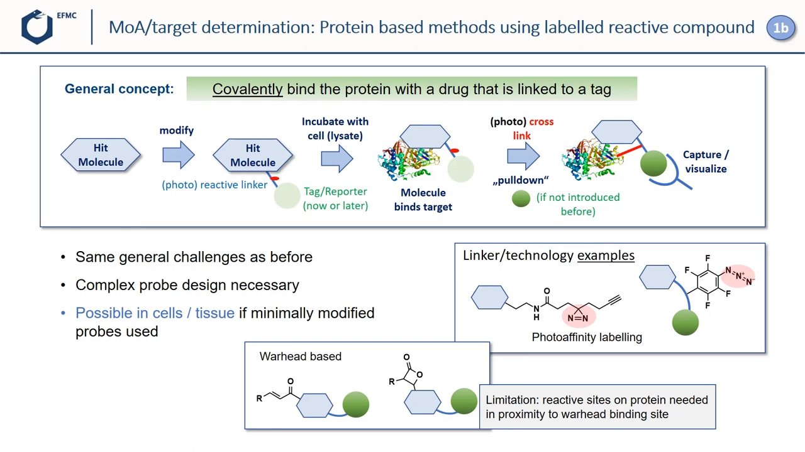

常用的光反应基团是**双吖丙啶（diazirine）**与**叠氮（azide）**——紫外一照就产生高活性中间体，与邻近残基成键。也可以用所谓**弹头（warhead）**基团，这时唯一的限制是**蛋白上结合位点附近必须有亲核基团**。

这一类的最大好处是：**它允许用亲和力更低的 hit 分子做饵**，而且因为探针改动可以做到很小，**可以在细胞甚至体内进行**。

### 2.4 ABPP：只钓「有功能的那一类」蛋白

**活性依赖的蛋白质谱分析（activity-based protein profiling, ABPP）**是共价策略的一个变体 [【跳转到 09:02】](https://www.youtube.com/watch?v=-MMajtuYnS4&t=542)。它的探针被设计成**以功能依赖的方式**与某一类蛋白相互作用——比如蛋白酶、激酶——靠的是这类蛋白共享的结构 motif。

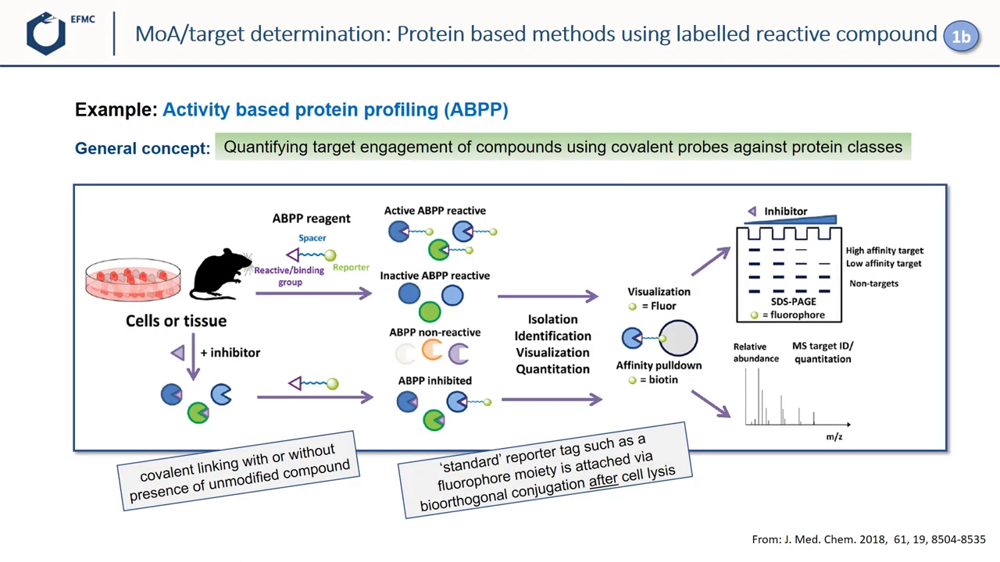

和定量化学蛋白质组学一样，**要在不同浓度的游离药物存在下做，才能显示剂量依赖性**。这类方法还发展出了生物正交偶联策略，使游离化合物与探针都能进入活细胞甚至体内。

### 2.5 无标记方法：不改造化合物，改造的是「蛋白的性质」

如果不想动化合物，还有一类方法利用的是**结合本身会改变蛋白的物理性质** [【跳转到 09:58】](https://www.youtube.com/watch?v=-MMajtuYnS4&t=598)。体系可以是细胞裂解液，也可以是一组重组蛋白（后者读数更干净，但需要投入人力把蛋白备齐）。

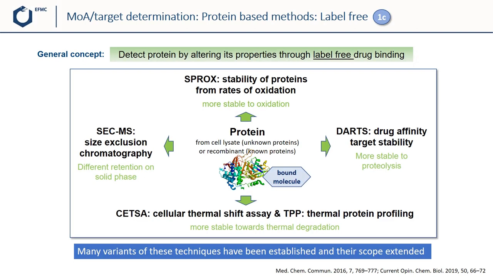

- **SEC-MS（尺寸排阻色谱-质谱）**，也叫**色谱共流出法（TICC）**：蛋白结合药物后，其在色谱上的保留时间会位移，同时小分子本身也能在相应组分中被质谱检出；
- **CETSA（细胞热位移检测）与 TPP（热蛋白质组分析）**：结合会提高蛋白的热稳定性；
- **DARTS（药物亲和响应靶点稳定性）**：配体结合会保护靶点蛋白不被蛋白酶降解；
- **SPROX（氧化速率稳定性）**：配体介导的稳定化让蛋白更抗氧化。

讲者只做了高层概括，并说明这些技术还有很多变体、适用范围还在扩展。

## 三、组学与形态学：把「表型」本身变成指纹

### 3.1 分子表型：先看它「像哪个已知机制的药」

**分子表型（molecular phenotyping）**的思路是检测并分析 RNA、蛋白、代谢物水平的变化 [【跳转到 11:57】](https://www.youtube.com/watch?v=-MMajtuYnS4&t=717)。最常用的是**基因表达签名**：用定量 mRNA 测序得到一组基因的上调/下调模式，再与已知机制化合物的表达谱做计算比对。

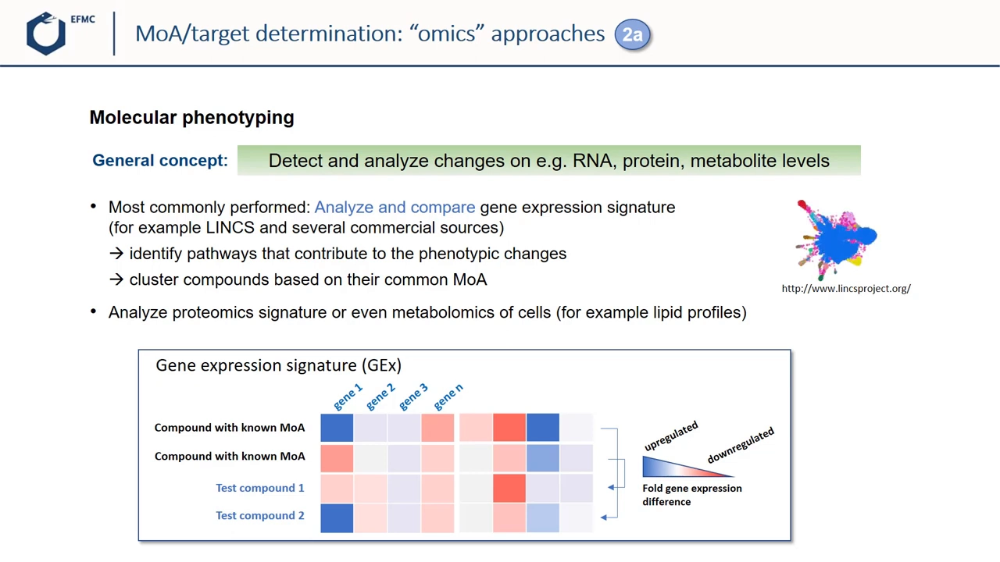

用途有三层 [【跳转到 12:22】](https://www.youtube.com/watch?v=-MMajtuYnS4&t=742)：**找出贡献于表型变化的通路**，从而生成靶点假设；**按共同机制给化合物聚类**；以及反向使用——**通过与已知谱比对，发现不想要的机制**。讲者提到公开数据库 **LINCS** 就是这类数据的例子，并且这套策略可以扩展到细胞的代谢组与蛋白质组。

### 3.2 形态学画像：把细胞的样子变成几千个数字

**形态学画像（morphological profiling）**，常被称为 **cell painting** [【跳转到 13:37】](https://www.youtube.com/watch?v=-MMajtuYnS4&t=817)。原理是从细胞的显微图像中提取定量数据，用来识别样本之间在生物学上有意义的相似与差异：可以观察细胞核、线粒体等组分的改变，**以相对无偏的方式捕获数百到数千个特征**。

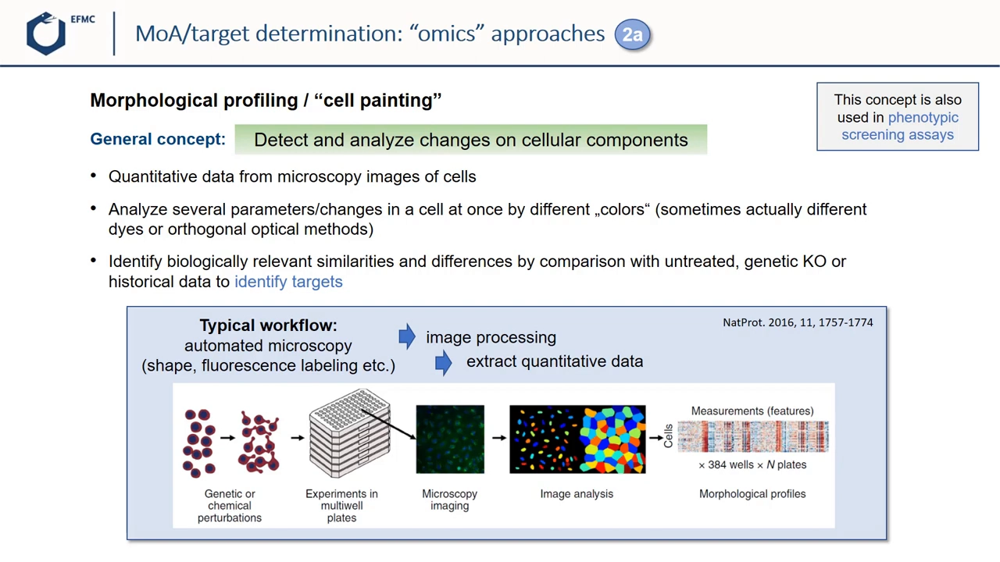

讲者特意指出，这项技术**不只能用于靶点鉴定**，还能研究遗传扰动的效应、直接用于化合物筛选、以及识别疾病的签名。工作流是：扰动、染色、成像，然后用软件把形态特征提取成画像，再与未处理的疾病状态、基因敲除或历史数据比对。

## 四、表达克隆与展示：用基因把蛋白「钓」出来

这一类方法的核心是**把基因与蛋白绑定** [【跳转到 15:06】](https://www.youtube.com/watch?v=-MMajtuYnS4&t=906)：把一大批人工构建的蛋白展示出来（噬菌体展示、细菌展示、酵母展示、核糖体展示、mRNA 展示等），让化合物去结合，**读数由基因组学方法介导**——有时候信号还能被基因组学方法放大。

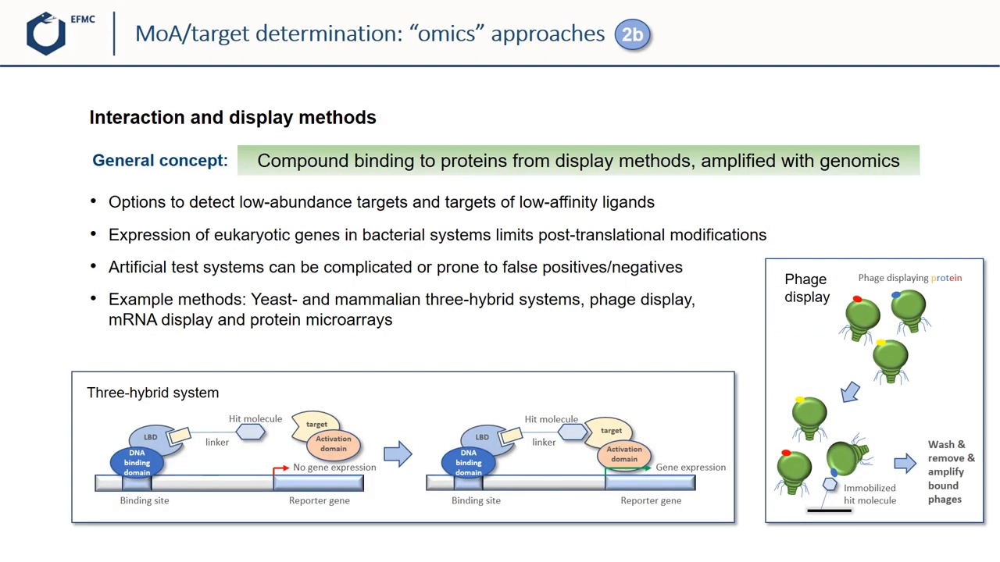

优点是**灵敏度更高**，因此能鉴定**低丰度蛋白**的配体，也能鉴定**只有低亲和力配体**的靶点。缺点同样明确：

- 这类体系在实施上**相当复杂**；
- 常用的**非哺乳动物表达系统往往无法完全模拟翻译后修饰或辅因子环境**，因此可能产生假阴性，也可能因非特异激活产生假阳性。

讲者还介绍了**三杂交系统（three-hybrid）**：一个组分是 DNA 结合域融合配体结合域，第二个组分是柔性连接着 hit 分子的配体，第三个组分是转录激活域融合来自 cDNA 文库的候选靶点蛋白 [【跳转到 16:46】](https://www.youtube.com/watch?v=-MMajtuYnS4&t=1006)。**hit 与靶点结合会让三个组分形成三聚体复合物，激活报告基因**；只有表达报告基因的细胞被挑出来，提取 DNA 测序，再通过序列比对鉴定靶点。

它相对表达克隆法的一个优势是 [【跳转到 18:01】](https://www.youtube.com/watch?v=-MMajtuYnS4&t=1081)：**小分子与靶点蛋白的相互作用发生在活细胞里，而不是体外体系**。

## 五、功能基因组学：用「敲掉基因」来问靶点是不是它

遗传学方法的逻辑与前几类完全不同 [【跳转到 18:26】](https://www.youtube.com/watch?v=-MMajtuYnS4&t=1106)：**如果一个体系里某个基因被突变、蛋白因此改变，那么用化合物处理它时，它的表现应当与原生体系不同**。如果化合物针对的正是这个基因，两者的行为就会出现可解释的差异。

常用手段包括**基因敲除**（CRISPR/Cas、TALEN）与**基因沉默**（反义寡核苷酸、RNA 干扰如 siRNA）。讲者强调，这类方法**通常用于验证一个已经由其他正交方法提出的靶点假设**，而且**只能观察功能缺失（loss-of-function）类型的效应**。

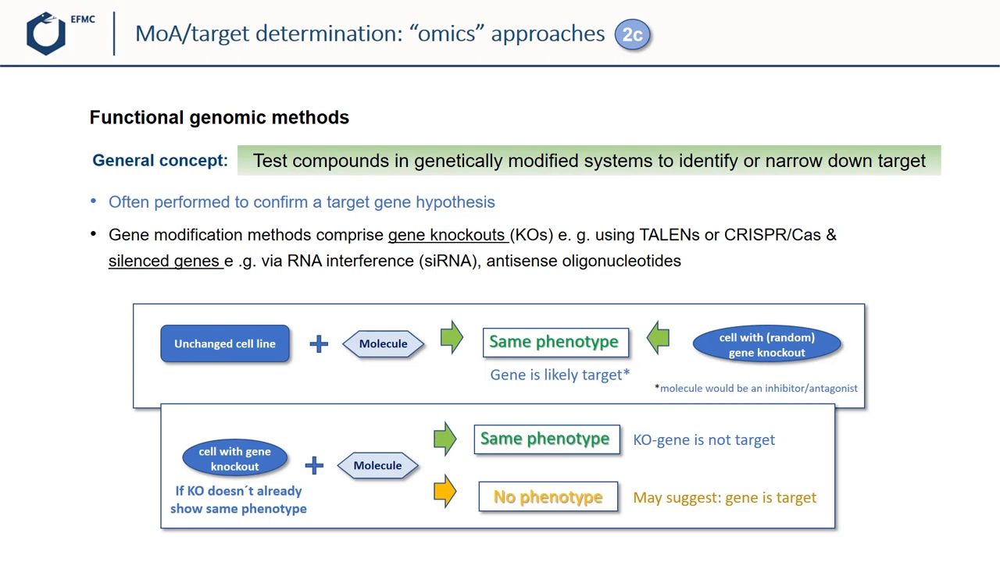

三种情形的判读值得背下来：

1. **未改造的细胞 + 化合物 → 出现表型；同时，基因敲除的细胞本身就表现出同样的表型** → 这个基因很可能是靶点（化合物是抑制剂或拮抗剂）；
2. **敲除细胞本身不表现该表型，加入化合物后却出现了该表型** → 说明这个基因**不是**靶点（否则化合物已经无靶可打）；
3. **敲除细胞不表现表型，加入化合物后仍然不表现表型** → 提示这个基因**可能**是靶点。

第 3 条最容易被误读：它给出的只是「可能」，因为「加了药也没反应」也可能来自通路冗余或细胞状态改变。

## 六、计算与知识方法：先给假设，再去验证

讲者把计算方法定位得很清楚 [【跳转到 21:14】](https://www.youtube.com/watch?v=-MMajtuYnS4&t=1274)：**计算方法是用来「提示」一个靶点的**，它本身不构成证据。具体分四类：

- **配体导向（ligand-based）**：把表型筛选得到的新化合物结构，与大量药物-靶点相互作用数据库里的已知结构做相似性搜索，得到一个「这个 hit 可能作用于某个已知靶点」的置信分；
- **对接（docking）**：对结构研究得比较清楚的靶点，做高通量结构导向的对接计算；
- **网络导向**：把药物相似性、靶点相似性、对这些靶点的活性，再加上表型终点或脱靶效应等信息组合起来做复杂计算；
- **机器学习**：把已知化学空间与「组学」数据空间对齐，构建**药理学空间（pharmacological space）**，再预测新化合物最可能作用于哪个靶点。

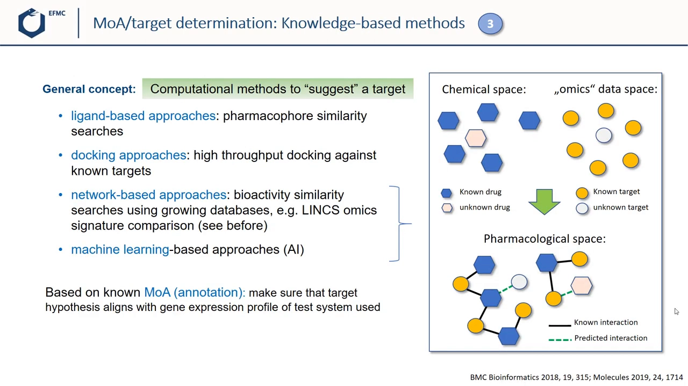

讲者点出了这类方法的通病：**公共数据的完整性不足**，而计算正是建立在这些数据之上。

### 6.1 注释数据最大的陷阱：已知靶点不等于唯一机制

这一条是全场最值得记住的提醒 [【跳转到 23:44】](https://www.youtube.com/watch?v=-MMajtuYnS4&t=1424)：**仅仅知道一个化合物-靶点的对应关系，并不能排除这个化合物是通过另一种机制产生了你观察到的表型**。

他的解法很实用：**把这个已知化合物（以及被注释的化合物）的基因表达谱，与测试体系里实际观察到的表达谱做比对，找出不吻合的地方（misfits）**。如果表达谱对不上，那么「它就是通过那个已知靶点起效」这个假设就需要重新审视。

### 6.2 广谱 panel：最朴素，但常常最快给出方向

最后一类方法在概念上最简单 [【跳转到 24:59】](https://www.youtube.com/watch?v=-MMajtuYnS4&t=1499)：**把 hit 化合物直接丢进一组已知靶点的广谱检测里**——激酶、离子通道、GPCR 等类别都有商业 panel。

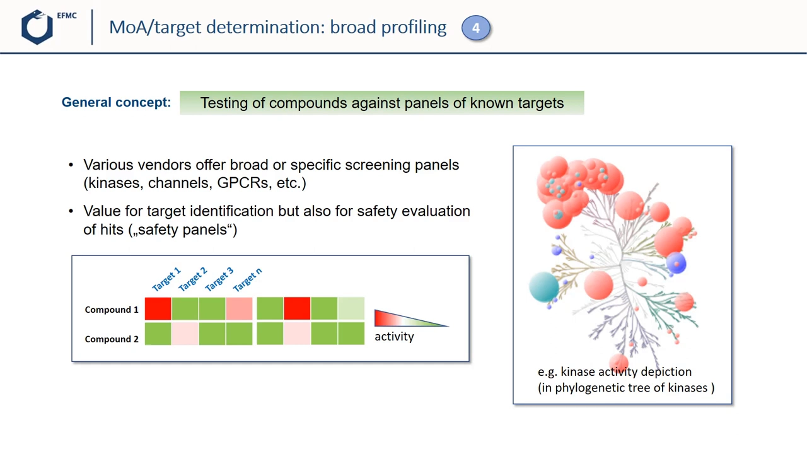

它有两个用途：**排除某些靶点假设**，以及**尽早拿到安全性数据**——因为 panel 里往往包含那些已知的、有问题的安全性相关脱靶靶点。结果通常以热图或激酶系统树上的抑制图呈现。

## 七、拼图：为什么必须多方法，且必须和化学同步

### 7.1 靶点鉴定是拼图，不是打靶

讲者用一张拼图图收尾 [【跳转到 25:54】](https://www.youtube.com/watch?v=-MMajtuYnS4&t=1554)：**靶点鉴定需要多块拼图才能成功**——化学蛋白质组、组学、靶点 panel、化学信息学、已知注释，每一块都只能补上一角。

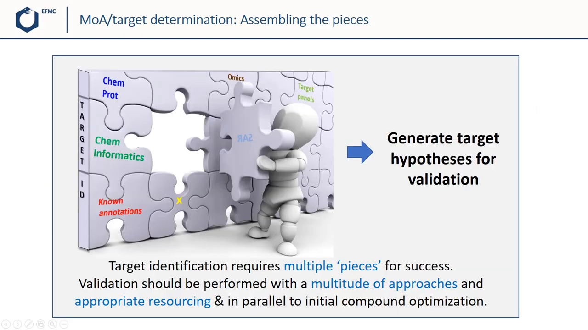

由此推出三条实务结论：

- **验证必须用多种方法**，单一方法的结论只能算假设；
- **要为这件事配足资源**，并且在规划表型项目时就把它算进去；
- **验证要与初期的化合物优化并行进行**，而不是等化合物优化完了再回头找靶点。

他还提了一条常被忽略的管理要求 [【跳转到 26:07】](https://www.youtube.com/watch?v=-MMajtuYnS4&t=1567)：**必须预设明确的战略决策点**——万一分子靶点最终鉴定不出来该怎么办。这种情况并不少见，而它出现的概率与前面投入的资源直接相关。

### 7.2 化学不是配角：没有 SAR 就没有靶点解析

最后一部分讲的是化学为什么在这个流程里不可替代 [【跳转到 26:32】](https://www.youtube.com/watch?v=-MMajtuYnS4&t=1592)。

先说「靶点还没找到时怎么办」：**只能在没有已知生物靶点的条件下优化 hit**，这时靠的是配体导向的方法，用细胞检测体系本身来驱动 potency 的提升。讲者明确说，**这不是理想状态，但可行**。

再说化学在正常流程里的三重作用：

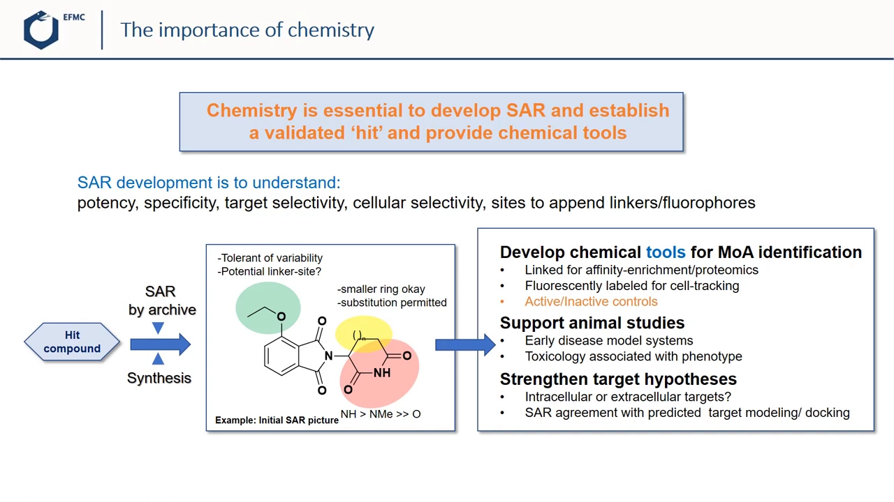

- **SAR 本身就在评估 hit 质量**：能识别 potency 悬崖与选择性悬崖；
- **早期先导化合物可以优化成探针分子**，用于后续的靶点鉴定实验——**带连接臂的探针用于蛋白质组实验，活性/非活性分子对（active/inactive pairs）是理解靶点生物学的重要工具**；
- **化学工具支撑动物实验与靶点假设的强化**：早期体内实验能验证通路，SAR 与对接/建模结果的一致性则能反过来支持靶点假设（比如判断靶点是胞内还是胞外）。

讲者最后提到，EFMC 还做了几个案例研究的网络研讨会，展示表型发现项目在实践中长什么样。

## 小结

- **靶点解析不是监管必需，而是风险决策**：不做也能报批，但做了才能拿到结构信息、平行靶标项目、早期砍掉不安全机制、以及可用于临床转化的生物标志物。
- **四类方法回答四个不同的问题**：蛋白亲和力方法回答「谁结合了」，组学与形态学回答「像什么」，遗传学回答「少了它行不行」，计算方法回答「最可能是什么」。它们互相独立，因此可以互相验证。
- **特异性判据是「被竞争掉」，不是「被拉下来」**：定量化学蛋白质组学的剂量依赖竞争曲线，是把真结合与非特异结合分开的关键设计。
- **每个方法都有自己的假阴/假阳来源**：可逆方法怕低亲和力与裂解变性，展示方法怕非翻译后修饰缺失，遗传学方法只能看功能缺失，计算方法受制于公共数据的完整性。
- **已知靶点不等于唯一机制**：注释数据必须用表达谱去核对，否则会把「这个药历史上被认为作用于 X」当成「它这次是通过 X 起效」。
- **靶点鉴定是拼图**：需要多方法、足够资源、明确的「找不到怎么办」决策点，并且必须与化合物优化并行——因为探针分子、活性/非活性对照这些关键工具，都是化学做出来的。

## 关键术语速查

| 术语 | 一句话解释 |
| --- | --- |
| 靶点解析（target deconvolution） | 表型筛选得到有效化合物之后，反向确定它作用于哪个（些）蛋白的过程 |
| 化学沉淀 / 亲和蛋白质组学 | 给化合物接标签或固定到固相上，从裂解液里把结合蛋白拉下来再鉴定 |
| pull-down | 把配体-蛋白复合物捕获、洗去未结合成分的操作 |
| 定量化学蛋白质组学 | 用不同浓度游离药物竞争，靠质谱定量画出剂量曲线来区分真靶点与非特异结合 |
| 光亲和标记 | 用双吖丙啶、叠氮等光反应基团，紫外照射后与邻近残基共价成键 |
| ABPP（活性依赖的蛋白质谱分析） | 用只标记「有功能的那一类蛋白」的共价探针，量化化合物对某类蛋白的靶点占据 |
| CETSA / TPP | 结合会提高蛋白热稳定性，据此判断化合物在细胞内/蛋白质组层面结合了谁 |
| DARTS | 配体结合保护靶点蛋白不被蛋白酶降解，据此鉴定靶点 |
| SEC-MS / TICC | 结合药物后蛋白的色谱保留时间位移，据此鉴定靶点 |
| 分子表型 | 用基因表达（或蛋白、代谢物）签名与已知机制化合物比对，推断受试化合物的机制 |
| cell painting（形态学画像） | 从显微图像提取数百到数千个形态特征，形成可比对的细胞「指纹」 |
| 三杂交系统 | 在活细胞内用三个组分的重组装激活报告基因，检测小分子与候选靶点蛋白的结合 |
| 功能基因组学验证 | 用 CRISPR/TALEN 敲除或 siRNA 沉默基因，看化合物效应是否改变，据此验证靶点 |
| 药理学空间 | 把化学空间与组学数据空间对齐后构建的网络，用于预测化合物-靶点关系 |
| 活性/非活性分子对 | 结构相近但活性相反的一对化合物，用于证明效应确实来自靶点结合 |