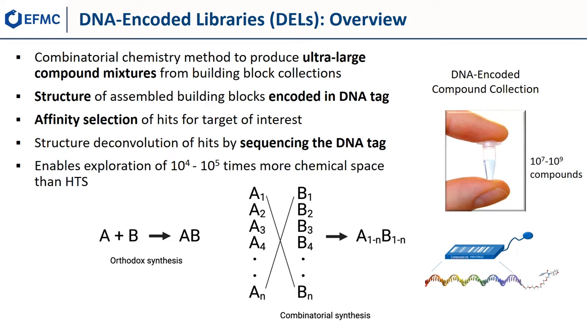
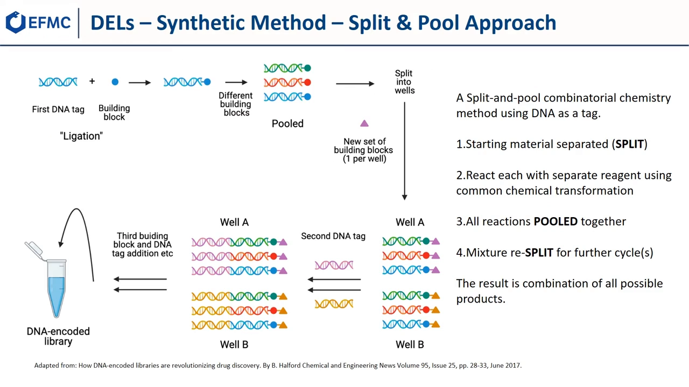
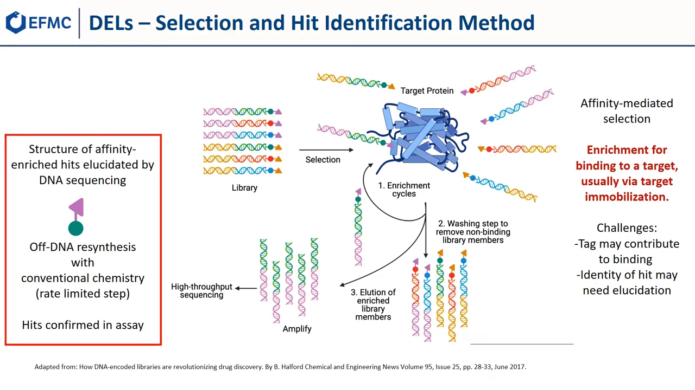
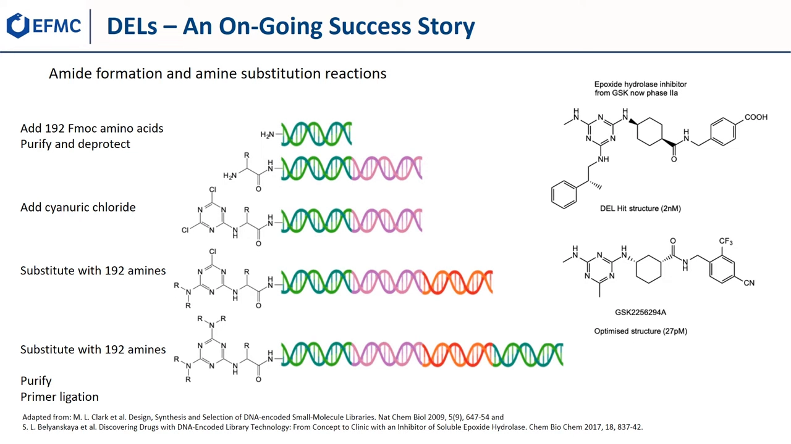
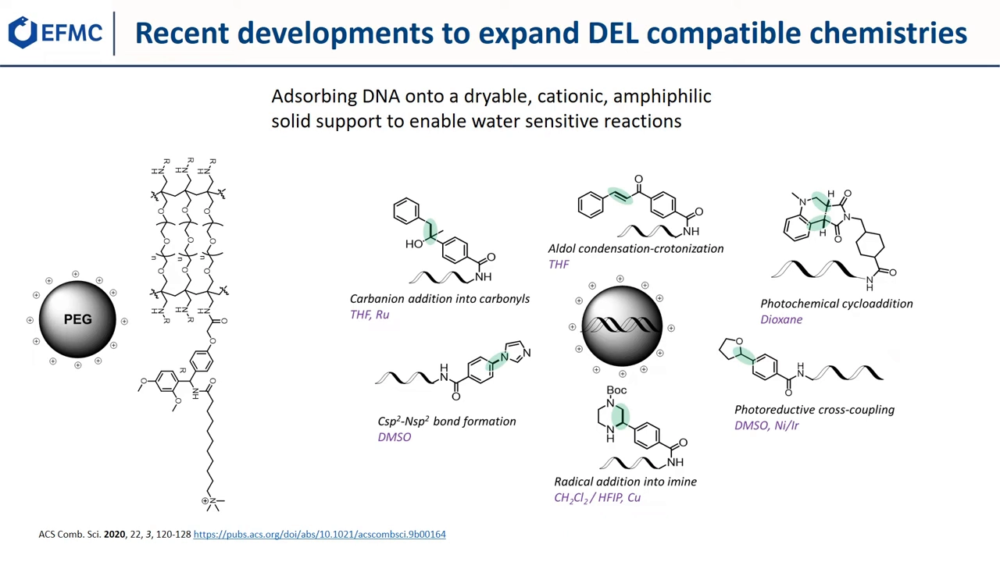
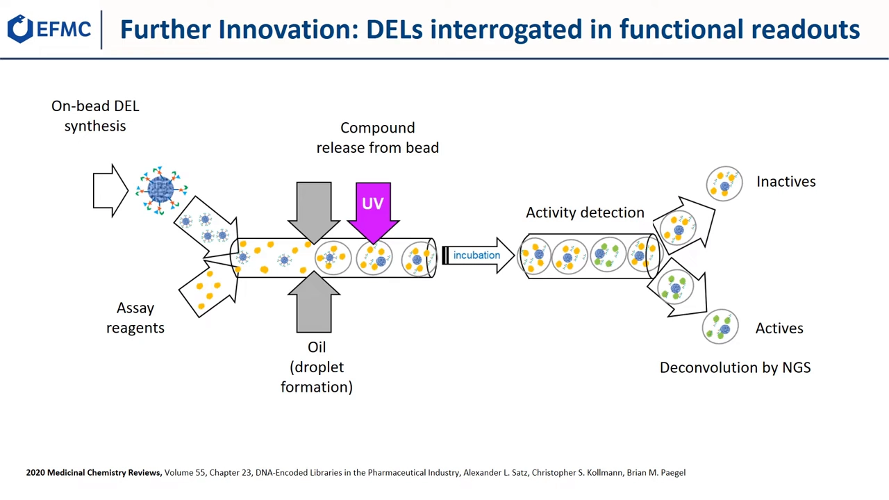
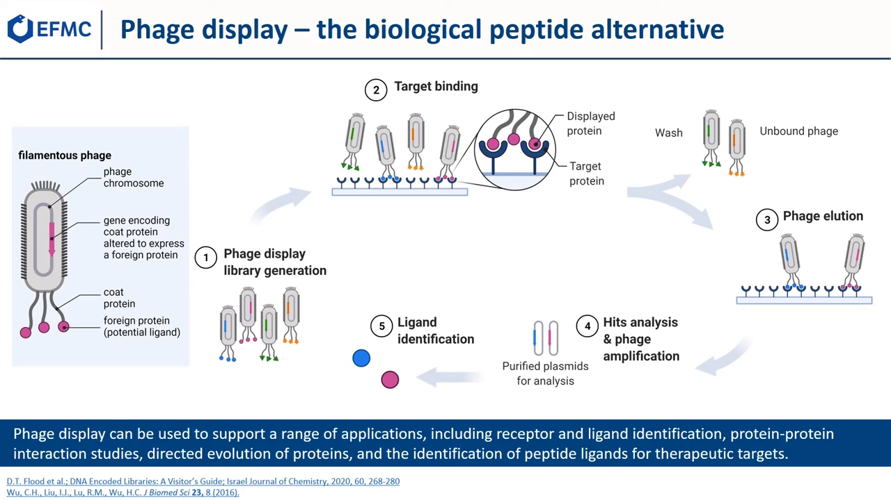
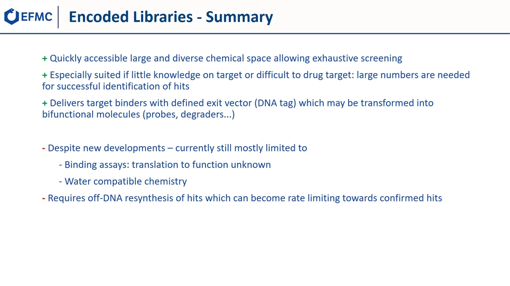

# DNA 编码库：一管溶液里装下十亿个化合物

> 视频来源：[Hit Generation - Webinar (Part Six: DNA Encoded Libraries and Evolutionary Techniques)](https://www.youtube.com/watch?v=-MJe9fuv3YM)（YouTube · EFMC 药物化学与化学生物学联合会「Best Practices for Hit Generation」系列第六讲 · 讲者 Brian Cox）｜时长约 13 分钟
> 导读：这一讲用 13 分钟把 DNA 编码库（DEL）从「组合化学的历史包袱」讲到「微流控里的功能筛选」。核心是一笔账：用一条 DNA 标签给每个化合物做记号，就能把 $10^{7}$–$10^{9}$ 个化合物装进一管溶液，一次孵育完成筛选，再靠测序读出命中是谁。代价写在最后一张幻灯片上——它测的是「结合」不是「功能」，化学只能用能耐受 DNA 的水相条件，而且命中必须靠常规合成重新做出来。

## 本讲要解决的核心问题（SCQA）

**背景**：高通量筛选一次能测几十万个化合物，这已经是实体化合物的极限——每个化合物都要占一个孔、一次读数，规模一大，试剂、板子和人力就顶不住。可化学空间是 $10^{60}$ 量级的，几十万个只是其中极小一片。

**冲突**：如果「一个化合物一个孔」是唯一的形式，那筛选规模就被物理条件锁死了。要突破这个锁，必须换一种「混合」的思路：把成千上万个化合物放在同一个孔里一起孵育，然后还能知道最后是谁结合上了靶标。

**疑问**：怎么在混合物里保住「身份」信息？怎么把结合的少数从大量不结合里挑出来？挑出来之后又怎么确认它真的有用？

**回答（中心思想）**：**DEL 用一条 DNA 标签把「合成」和「识别」解耦——合成时用拆分-合并并行地造出组合爆炸的化合物，识别时靠 PCR 扩增 + 测序读出标签序列。** 于是筛一次的成本与「化合物数量」几乎脱钩，只与「孵育和测序」有关，可以一次探索比 HTS 多 $10^{4}$–$10^{5}$ 倍的化学空间。但它换来的是三个必须付的账：**测的是结合不是功能；化学被限制在能耐受 DNA 的水相条件里；每个命中都要脱掉 DNA 用常规化学重新合成才能确认。**

## 一、先解决「怎么造这么多」：从组合化学到 DNA 标签

讲者从最朴素的合成讲起 [【跳转到 00:25】](https://www.youtube.com/watch?v=-MJe9fuv3YM&t=25)：一个羧酸和一个胺在成酰胺键的条件下反应，生成一个新分子。传统做法的缺点是，要合成一系列类似物（比如做构效关系研究），**每做一个新分子都要重做一遍同样的化学和纯化**；优点是产物通常很容易纯化，适合各种生物筛选。

组合化学换了个思路：在同一个容器里，把羧酸 A1 和一系列胺 B 按合适化学计量比混合，得到酰胺产物的混合物 [【跳转到 01:40】](https://www.youtube.com/watch?v=-MJe9fuv3YM&t=100)。好处是做多个类似物的时间大大缩短；坏处是**要把每个化合物纯化出来做常规单独测试，工作量很大**。于是发展出「直接测混合物 + 解卷积（deconvolution）确定活性成分」的方法——在固相上用**拆分-合并（split and pool）**策略，配合氨基酸三联体之类的编码标签来识别活性物 [【跳转到 01:50】](https://www.youtube.com/watch?v=-MJe9fuv3YM&t=110)。

讲者在这里说了一句很关键的话：**说到理想的编码标签，大自然早就提供了最好的一个——DNA** [【跳转到 01:55】](https://www.youtube.com/watch?v=-MJe9fuv3YM&t=115)。而让这个想法真正可用的，是 2000 年代 PCR 扩增与测序技术的革命：它让「读标签」变得又便宜又快。

## 二、DEL 到底是什么：五个要点与一个数字

讲者用一张幻灯片把 DEL 的定义讲完了 [【跳转到 02:25】](https://www.youtube.com/watch?v=-MJe9fuv3YM&t=145)：

- 它是**组合化学方法**，从构建块集合生成**超大的化合物混合物**；
- 每个化合物的**结构被编码在 DNA 标签里**；
- 命中靠**亲和选择**（affinity selection）得到；
- 命中的**结构解卷积靠测序 DNA 标签**；
- 因此可以探索**比 HTS 多 $10^{4}$–$10^{5}$ 倍的化学空间**——一管溶液里有 **$10^{7}$–$10^{9}$ 个化合物**。

对比一下同系列第二讲讲的高通量筛选：典型规模 25 万个，最多几百万个。DEL 的起点就是**一千万到十亿**，这是量级上的差别，不是优化出来的差别。

### 2.1 拆分-合并：组合爆炸是怎么发生的

具体怎么造？讲者用了一张流程图 [【跳转到 02:30】](https://www.youtube.com/watch?v=-MJe9fuv3YM&t=150)：

流程可以拆成四步，讲者也逐条写在幻灯片右侧：

1. **拆（SPLIT）**：把起始物料分到不同孔里；
2. **反应**：每孔加一种单独的试剂，用**同一套化学转化**；
3. **合（POOLED）**：所有反应物合并到一起；
4. **再拆（re-SPLIT）**：进入下一轮循环。

每一轮都同时做两件事：**接上一个构建块**，并**接上这个构建块对应的 DNA 标签**。循环几轮之后，库里就包含「所有构建块组合」的化合物，每个都带着自己唯一的 DNA 编码 [【跳转到 02:55】](https://www.youtube.com/watch?v=-MJe9fuv3YM&t=175)。这就是为什么 192 个氨基酸 × 192 个胺 × 192 个胺能变成百万级的库——**组合数是指数增长的，而合成轮数只是线性增长**。

## 三、怎么从一管里把命中捞出来

筛选流程讲者用一张图讲完 [【跳转到 03:05】](https://www.youtube.com/watch?v=-MJe9fuv3YM&t=185)：

1. 把库加到**固定化的靶标蛋白**上；
2. 靠亲和力选择，经过若干轮**富集循环**；
3. **洗涤**去掉不结合的库成员；
4. **洗脱**富集到的成员；
5. **PCR 扩增**标签，然后**高通量测序**读出结合者的结构；
6. 用**常规化学方法把分子重新合成出来**（脱 DNA 合成），再做命中确认。

这张图上讲者特意标了两个「软肋」，值得单独拎出来：

- **标签本身可能参与结合**（tag may contribute to binding）：DNA 是带负电的大分子，它自己就可能与蛋白表面作用，于是测到的「结合」有一部分来自标签而不是小分子；
- **命中的身份可能需要澄清**（identity of hit may need elucidation）：测序读出的是标签，不是结构，标签与结构的对应关系要靠建库记录来还原。

而红框里那句 **off-DNA resynthesis with conventional chemistry (rate limited step)** 是整条流程的瓶颈：**测序一天能给你几百个候选，但每一个都要用常规化学重新合成出来才能验证**。讲者在总结里也把这条列为 DEL 的主要限制之一。

## 四、一个从命中到候选的完整案例：2 纳摩尔到 27 皮摩尔

讲者给了一个 GSK 的完整故事 [【跳转到 03:16】](https://www.youtube.com/watch?v=-MJe9fuv3YM&t=196)：他们从 DEL 库里找到一个 **2 纳摩尔的环氧化物水解酶抑制剂**作为命中，优化后得到 **27 皮摩尔**的候选化合物（现已进入 II 期临床）。

合成路线本身很朴素，正好说明 DEL 化学的「窄」：把 **192 个 Fmoc 保护的氨基酸**加到一段 DNA 上，纯化、脱保护、加标签；加**三聚氰酸**形成二氯三嗪；然后**分两轮、每轮用 192 个胺**做取代并加标签。三轮组合下来就是百万级的库，而用到的化学只有「酰胺生成」和「芳香亲核取代」两种。

这个故事里最值得记住的是**从 2 nM 到 27 pM 的优化空间**：DEL 给出的起点已经是有明确构效关系的真实分子，不是需要从零解释的「黑箱命中」。这正是 DEL 相对片段筛选的一个结构性优势——它给的起点分子量已经在类药区间，不需要再「长」上去（对照同小节的《片段起步：用三千个片段穿透化学空间》，那里的起点只有微摩尔到毫摩尔）。

## 五、化学的边界：为什么 DEL 只能用「水相、温和」的反应

讲者花了不少篇幅讲限制，因为这是 DEL 最容易被低估的地方 [【跳转到 03:59】](https://www.youtube.com/watch?v=-MJe9fuv3YM&t=239)：**DNA 是复杂的分子，在某些条件下很容易被修饰或降解**。所以做 DEL 合成时，化学一般在**近中性或碱性的水相溶剂体系**里进行。

这个限制曾经把 DEL 可用的反应压得很窄，但最近有不少进展在扩围：

- **胶束介导的反应**：让 DNA 标签留在反应环境之外（胶束内部才是反应场所）。讲者举的例子是酸催化的 Pauson-Khand 反应——反应发生在胶束内部，从而保护标签不受强酸破坏 [【跳转到 04:09】](https://www.youtube.com/watch?v=-MJe9fuv3YM&t=249)。
- **可干燥的阳离子两亲性固体载体**：把 DNA 吸附在这种载体上，让对水敏感的反应也能做 [【跳转到 04:34】](https://www.youtube.com/watch?v=-MJe9fuv3YM&t=274)。

这张幻灯片列出的反应从羟醛缩合一直到光化学环加成，说明**DEL 的化学空间正在从「两种反应」扩到「一大类反应」**。但讲者的措辞仍然谨慎：这些进展「大大扩展了可用于 DEL 合成的反应数量」，而不是取消了限制。

## 六、从「结合」到「功能」：一珠一化合物的微流控方案

DEL 最大的软肋是它测的是**结合**，不是**功能**——一个化合物可能结合得很好却完全不抑制酶。讲者介绍了 Pagel 和同事的一项创新，试图在 DEL 框架里直接测活性 [【跳转到 04:59】](https://www.youtube.com/watch?v=-MJe9fuv3YM&t=299)。

做法是「一珠一化合物」（one-bead one-compound, OBOC）的 DEL：

- 库在双功能 TentaGel Rink 酰胺载体上用标准拆分-合并方法组装：**小分子通过可光解的连接子连在珠子上，DNA 条形码通过正交的连接子单独连接**；
- 库装进微流控装置，**每颗珠子被包在皮升尺度的液滴里**，液滴里也含检测所需的全部组分；
- 液滴流过光反应器，**365 纳米紫外光把小分子从载体上切下来**，于是毫摩尔浓度的自由溶解小分子与生化检测孵育；
- 液滴流过荧光检测器，按活性分选：某个液滴的荧光相对背景群体有统计显著下降，就判为活性；
- 命中重新合成并确认活性，身份靠 NGS 解卷积。

讲者给的结果很关键：**与标准亲和筛选方法相比，作者确实发现大量在重合成后被判定为无活性的结合物被从命中列表里剔除掉了** [【跳转到 05:59】](https://www.youtube.com/watch?v=-MJe9fuv3YM&t=359)。换句话说，功能筛选直接减少了「脱 DNA 重合成」这个瓶颈上的浪费——这正是 DEL 最贵的一步。

## 七、演化类技术：噬菌体展示与多肽库

讲者用最后几分钟把「编码」这个思路推广到生物体系 [【跳转到 06:07】](https://www.youtube.com/watch?v=-MJe9fuv3YM&t=367)。

**噬菌体展示（phage display）** 用丝状噬菌体表达外来蛋白或多肽，这些蛋白/多肽与决定外壳蛋白的基因变异相关联。库与固定化靶标混合，洗掉未结合的噬菌体后，把结合的噬菌体扩增、纯化质粒，再鉴定所展示的蛋白或多肽。讲者列出的用途包括：发现受体与配体、研究蛋白-蛋白相互作用、做蛋白的定向演化、鉴定治疗靶标的多肽配体。

**多肽发现平台**则把编码思路推到化学层面：用天然和非天然氨基酸做编码多肽库，方法是 **Flexizyme**——一个体外演化出来的核糖体，能以很高效率给几乎任何 tRNA 装上几乎任何标准或非标准氨基酸；再配合模板指导的核糖体合成（PDTS），多肽库可以包含 **400 多种不同的氨基酸构建块**，做到「一管库里就有上万亿条多肽」[【跳转到 06:51】](https://www.youtube.com/watch?v=-MJe9fuv3YM&t=411)。

## 八、总结：DEL 强在哪、弱在哪

讲者的收尾幻灯片把优缺点排成两列，这张表值得直接记住 [【跳转到 07:43】](https://www.youtube.com/watch?v=-MJe9fuv3YM&t=463)：

**优势（+）**：

- **快速获得大而多样的化学空间**，从而对靶标做穷尽式筛选；
- **特别适合靶标知识有限、或难成药的靶标**——这类靶标往往需要筛很大数量才能找到命中；
- 给出的结合物带一个「出口」把手（DNA 标签），可以进一步转化成**双功能分子**，比如探针、降解剂。

**限制（−）**：

- 尽管有新进展，目前**仍以结合检测为主**，把结合翻译成功能还是未知；
- **化学限于水相兼容的反应**；
- **命中需要脱 DNA 重合成**，这一步可能成为通往「确认命中」的限速环节。

## 九、把三条路线放在一起看

把这一讲和同小节另外两篇放在一起，三条命中发现路线的分工就很清楚了：

| 维度 | 高通量筛选（HTS） | DNA 编码库（DEL） | 片段筛选（FBDD） |
| --- | --- | --- | --- |
| 库规模 | $10^{5}$–$10^{6}$（典型 25 万） | $10^{7}$–$10^{9}$ | $10^{3}$–$10^{4}$（典型 3100） |
| 化学空间 | 类药空间的一小片 | 比 HTS 多 $10^{4}$–$10^{5}$ 倍 | 片段空间，比类药空间小 16 个数量级 |
| 一次筛选的成本 | 每孔成本 × 化合物数，随规模线性上升 | 孵育 + 测序，与化合物数几乎脱钩 | 每化合物成本 × 几千个，几天测完 |
| 读的是什么 | 功能或结合的检测信号 | 结合（亲和选择） | 结合（生物物理检测） |
| 起点质量 | 已在类药区间，可直接优化 | 已在类药区间，可直接优化 | 微摩尔到毫摩尔，必须「长」上去 |
| 主要验证负担 | 假阳性与验证通量 | 脱 DNA 重合成（限速） | 晶体学与片段演化（12–15 个月） |
| 什么时候选它 | 靶标成熟、检测通量够 | 靶标知识有限、命中率低、需要海量化合物 | HTS 给不出好命中、且拿得到结构信息 |

三条路线的共同点是：**命中只是起点，不是结论**。HTS 的命中要过假阳性和验证通量这两关，DEL 的命中要脱掉 DNA 重新合成，片段命中要从微摩尔长到纳摩尔——**命中来源决定了你接下来要付哪一笔账**，这也是本小节要对照规模、成本与覆盖的原因。

## 小结

- DEL 用**一条 DNA 标签**把「合成」与「识别」解耦：合成靠拆分-合并做组合爆炸，识别靠 PCR + 测序读标签。
- 规模上是量级差别：一管 **$10^{7}$–$10^{9}$** 个化合物，可探索比 HTS 多 **$10^{4}$–$10^{5}$** 倍的化学空间。
- 筛选流程是「孵育 → 富集 → 洗涤 → 洗脱 → 扩增 → 测序 → 脱 DNA 重合成 → 检测确认」。
- 三个必须付的账：**测的是结合不是功能**、**化学限于水相**、**每个命中都要重新合成**（限速步骤）。
- GSK 的案例说明起点质量：DEL 命中 2 nM，优化后 27 pM——起点已在类药区间，不需要「长」上去。
- 化学边界正在扩围（胶束、可干燥阳离子固体载体），但限制没有取消。
- 功能筛选是前沿方向：OBOC 微流控方案直接在液滴里测活性，能提前剔掉「只结合不抑制」的假命中。
- 编码思路还能推广到生物体系：噬菌体展示与多肽库（Flexizyme）都是「用可读的标签承载不可读的多样性」。

## 关键术语速查

| 术语 | 一句话解释 |
| --- | --- |
| DNA 编码库（DEL） | 每个化合物带一段独特 DNA 标签的超大化合物混合物 |
| 拆分-合并（split and pool） | 分孔反应、合并、再分孔的组合合成策略，使组合数指数增长 |
| 亲和选择（affinity selection） | 用固定化靶标把结合成员从混合物里富集出来 |
| 解卷积（deconvolution） | 通过测序 DNA 标签反推命中的化学结构 |
| 脱 DNA 重合成（off-DNA resynthesis） | 用常规化学重新合成不含 DNA 的分子以确认活性，是 DEL 的限速步骤 |
| 标签贡献结合 | DNA 标签本身可能与蛋白作用，导致假阳性 |
| OBOC（一珠一化合物） | 每个珠子承载一个化合物（和它的 DNA 条形码），可包进液滴做单分子级筛选 |
| 噬菌体展示 | 把多肽/蛋白展示在噬菌体表面，用「基因型-表型」偶联做亲和筛选 |
| Flexizyme | 体外演化的核糖体酶，可给 tRNA 装载非标准氨基酸，用于构建多肽库 |