# 命中从哪里来：无偏筛选、聚焦筛选与计算筛选的规模—成本—覆盖对照

> 视频来源：[Hit Generation - Webinar (Part Two: Classical Screening Strategies - Screening Approaches)](https://www.youtube.com/watch?v=LUtxw2E6iR0)（YouTube · EFMC 药物化学与化学生物学联合会「Best Practices for Hit Generation」系列第二讲）｜时长约 30 分钟
> 导读：这一讲只回答一个问题——**要开筛了，该筛哪些化合物、筛多少个**。讲者把「经典筛选」拆成无偏筛选、聚焦筛选、计算筛选三类，每一类都给了库规模、成本、覆盖和验证负担的具体数字。本文按「先定策略—再定库—再定试点—再定阈值」的顺序整理；同小节的《片段起步：用三千个片段穿透化学空间》与《DNA 编码库：一管溶液里装下十亿个化合物》分别展开另外两条路线。

## 本讲要解决的核心问题（SCQA）

**背景**：命中生成（hit generation）是药物发现链条上第一个真正的化学动作：在靶标确定之后，先找到几个能调节靶标活性的化合物，再谈优化。传统上这一步靠「筛」——把一大批化合物逐个加到含靶标的检测体系里，看谁让信号变了。

**冲突**：能筛的化合物数量不是无限的。检测通量、每孔成本、验证人力和周期共同决定了这一轮只能筛几万个到几百万个化合物（$10^{5}$–$10^{6}$ 量级）；而化学空间随分子变大呈指数膨胀，量级可达 $10^{60}$，任何实体库都只覆盖其中极小的一片。于是「筛得多」和「筛得准」变成一对必须权衡的选择：筛得多，成本高、验证负担重；筛得少，可能整片化学空间都没碰到。

**疑问**：那么，经典筛选到底分几种？每一种的库有多大、钱花在哪、覆盖到哪片化学空间、又会把什么样的负担留给后面？

**回答（中心思想）**：**三类经典筛选的本质区别不在「用什么仪器」，而在「筛哪一片化学空间」——无偏筛选用规模换多样性，聚焦筛选用先验知识换速度和成功率，计算筛选用模型换实验次数。** 讲者最后用一张对照表把三者钉在同一组维度上：化学空间（已有化合物还是含虚拟化合物）、化合物数量（1 万到上百万）、机会（多样性 / 快而省 / 覆盖最大）、挑战（贵而慢 / 窄 / 依赖模型质量）。而所有的数字都指向同一件事：**库的规模是被检测通量和成本「反推」出来的，不是先定一个「越大越好」的目标。**

## 一、先分清三种策略：分野在「筛哪一片化学空间」

讲者开场就把「命中识别」拆成两个输入：**筛选化合物库**（筛哪些化合物）和**筛选检测体系**（用什么监测靶标活性）。两者一确定，筛选就能跑，输出就是命中。而化合物怎么挑，取决于检测体系本身和你对靶标的了解程度 [【跳转到 00:31】](https://www.youtube.com/watch?v=LUtxw2E6iR0&t=31)。

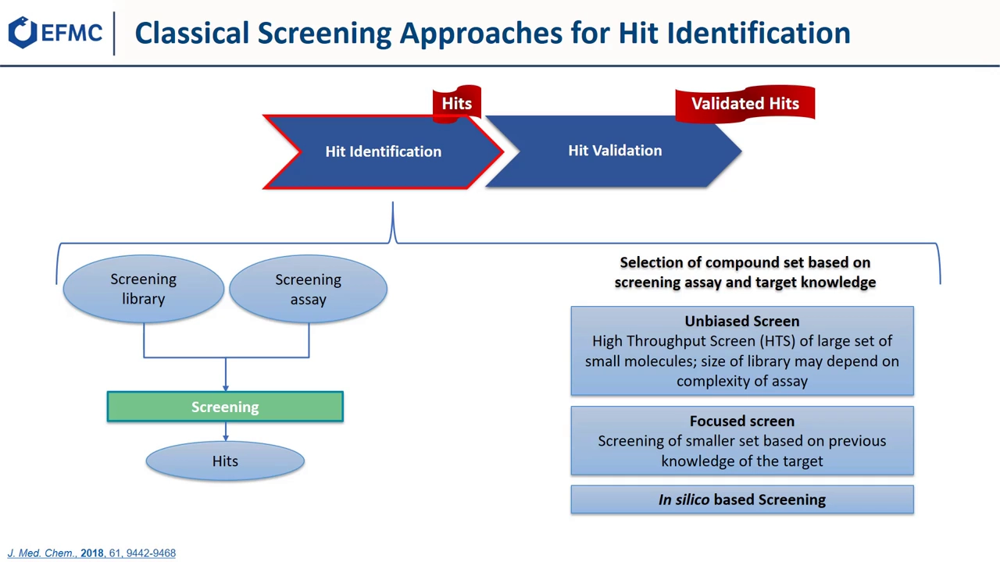

三条分支的定义都很朴素 [【跳转到 01:21】](https://www.youtube.com/watch?v=LUtxw2E6iR0&t=81)：

- **无偏筛选（unbiased screen）**：对一大批小分子做高通量筛选（HTS），库的大小取决于检测的复杂程度；
- **聚焦筛选（focused screen）**：用更小的一批化合物，依据是此前对靶标或靶标类别的知识；
- **计算筛选（in silico screening）**：用计算方法先挑一遍，只把挑出来的化合物拿到实验里测。

这三条路后面各有一整套工程细节，但它们的差别可以先记成一句话：**前两条只能筛「已经存在的化合物」，计算筛选还能筛「不存在的化合物」。**

## 二、无偏筛选：规模和成本是被检测通量「反推」出来的

无偏筛选至今仍是最常用的命中生成方式，逻辑很直白：筛得越多，找到命中的机会越大。为此必须有一个可用的化合物库，而库是这么攒起来的 [【跳转到 02:07】](https://www.youtube.com/watch?v=LUtxw2E6iR0&t=127)：购买商业化合物、设计定制库以增加多样性、把自家发现项目里做过的化合物收进来，还有一些库包含天然产物。既然要筛几十万个化合物，就必须上机器人自动化，用孔板一孔一化合物地铺。

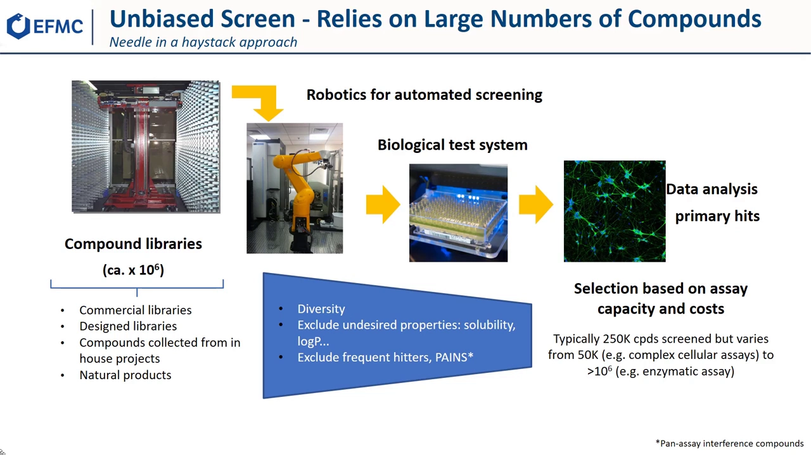

这张幻灯片给出了本讲最实用的几个数字 [【跳转到 03:22】](https://www.youtube.com/watch?v=LUtxw2E6iR0&t=202)：

- **典型规模约 25 万个化合物**（$2.5 \times 10^{5}$）；
- 浮动范围很大：**复杂的细胞检测约 5 万个**，**简单的酶学检测可以到几百万个**。

也就是说，「筛多少」的第一约束不是「库里有几个」，而是**检测通量和每孔成本**。挑化合物时还要过几道筛子：多样性要够（否则碰不到靶标）、排除性质不理想的（溶解度低、亲脂性过高），以及排除两类「专业假阳性」——**频繁命中物**（frequent hitters，被发现能打中很多靶标的化合物）与含 **PAINS** 结构片段（pan-assay interference compounds，泛检测干扰化合物）的化合物 [【跳转到 03:47】](https://www.youtube.com/watch?v=LUtxw2E6iR0&t=227)。

### 2.1 从「全库都筛」到「分层抽片」

很长一段时间里的默认做法是：只要检测允许，就把整个库全筛一遍。这些年观念变了——很多人认为筛库的一个子集不仅省时省钱，还可能更成功。讲者用诺华 2020 年发表的筛选库（screening deck）举例 [【跳转到 04:23】](https://www.youtube.com/watch?v=LUtxw2E6iR0&t=263)。

做法分三步：先给每个化合物**打性质标记**（深蓝=溶解度和通透性都好；浅蓝=无标记；警告标记=溶解度偏低、频繁命中物、含不良结构片段或纯度有限）；再按**多样性类别**分层（化学多样性看骨架、二维/三维聚类；生物学多样性看对各靶标的活性或 HTS 指纹）；最后**从每个类别里挑性质最好的那个**，必要时优先挑能同时覆盖多个类别的化合物。

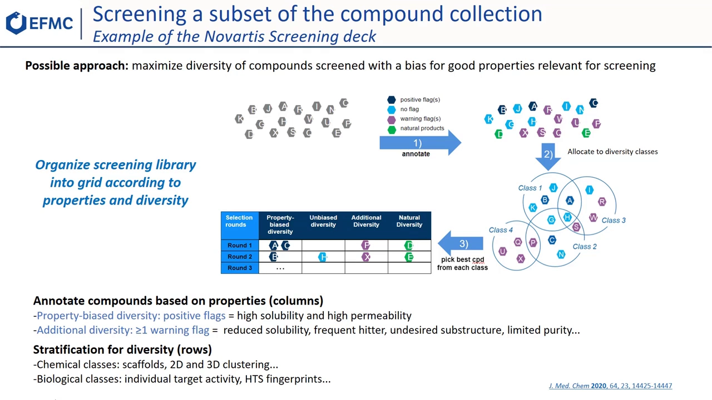

结果是这张网格 [【跳转到 07:06】](https://www.youtube.com/watch?v=LUtxw2E6iR0&t=426)：列按性质排序，行按多样性排序。你可以任选其中一层来筛——通常从性质最好的开始，往下走覆盖度越来越高，筛多少完全跟着检测能力走。

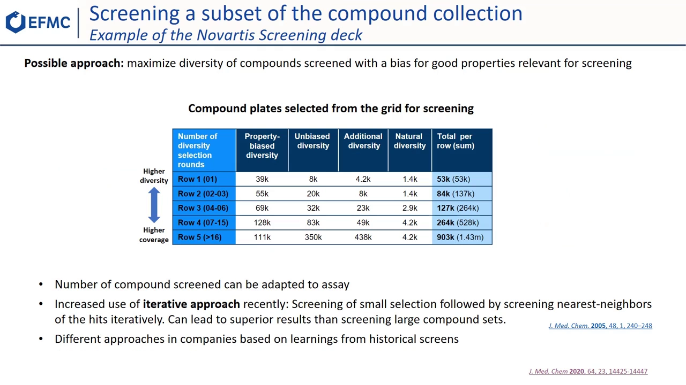

这套「可分层」的库还带来一个用法：**迭代筛选**——先筛一小批，再迭代地筛命中的近邻化合物；讲者引用的结果表明它可能优于一次筛一大批。他也提醒这只是其中一种做法，各家公司基于自己的历史筛选经验走了不同的路 [【跳转到 07:31】](https://www.youtube.com/watch?v=LUtxw2E6iR0&t=451)。

## 三、开筛之前：先用试点把检测体系钉住

库选好了，下一步不是开筛，而是**试点（pilot）**：用一个小型多样性集合（讲者说 1000 到 1 万个化合物）先检验检测体系和流程 [【跳转到 08:10】](https://www.youtube.com/watch?v=LUtxw2E6iR0&t=490)。

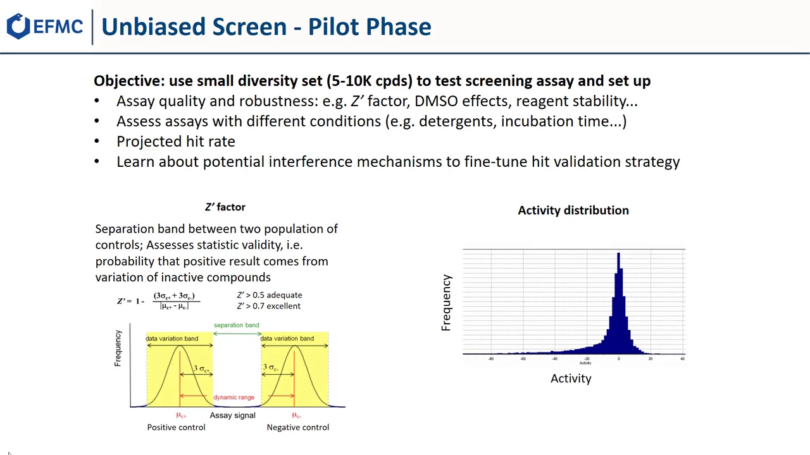

试点要回答四个问题：

1. **检测质量与稳健性**——核心指标是 **Z' 因子**，它衡量阳性对照与阴性对照两个群体之间的分离程度。因为生物检测本身有波动，Z' 实际上在回答「阳性结果来自非活性化合物波动的概率有多大」。判读标准讲者给得很明确：**Z' 大于 0.5 合格，大于 0.7 优秀**。
2. **对照品与载体**——化合物溶在 DMSO 里，所以要专门考察 DMSO 对检测的影响；检测要跑好几天，还要评估试剂稳定性。
3. **条件优化**——试不同的去垢剂、孵育时间，看哪种组合表现最好。
4. **命中率预估**——命中率太高说明检测可能过于灵敏，太低则可能漏掉化合物。典型情况是右侧那种活性分布：大量化合物对靶标完全无活性，活性越高、化合物数量越少。

最后一点常被忽略：试点还能帮你**提前了解干扰机制**，从而把命中验证策略调好 [【跳转到 09:50】](https://www.youtube.com/watch?v=LUtxw2E6iR0&t=590)。

## 四、初筛之后：阈值、重测、曲线，以及「数字会掩盖真相」

正式开筛时，化合物铺在 96、384 或 1536 孔板里，其中一些孔放阳性对照、一些放阴性对照，DMSO 通常充当实际的阴性对照，筛选浓度一般在 10 到 30 微摩尔 [【跳转到 10:20】](https://www.youtube.com/watch?v=LUtxw2E6iR0&t=620)。

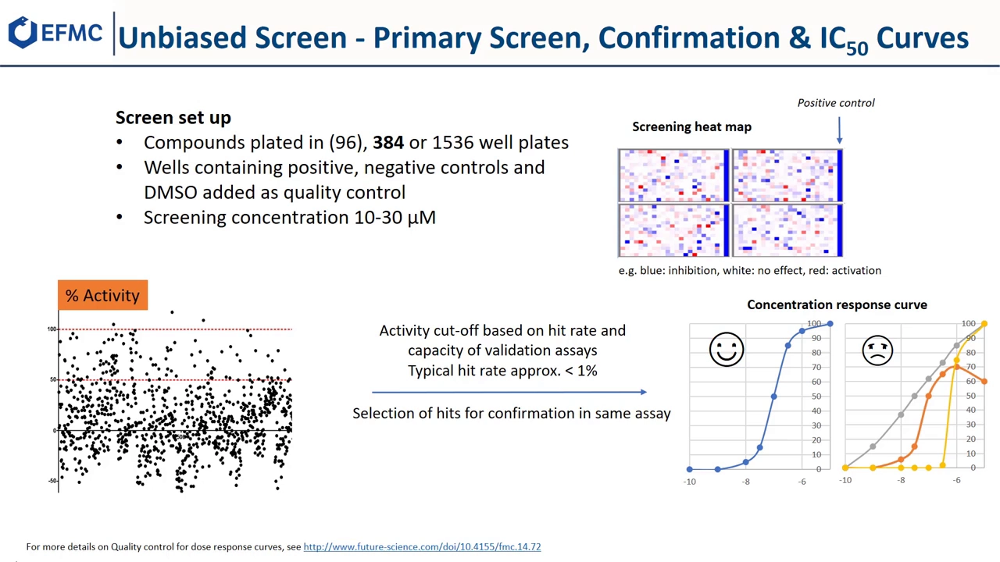

读数据有三个动作 [【跳转到 11:10】](https://www.youtube.com/watch?v=LUtxw2E6iR0&t=670)：

- **定阈值**：在散点图上按纵轴活性切一刀，切在哪里由**命中率**和**验证通量**共同决定。讲者给的参考是：**命中率通常希望低于 1%**。
- **重测确认**：把命中的化合物在同一个检测里再测一遍，只保留能确认的。
- **跑浓度-效应曲线**：这里他强调不要只看数值（比如 IC50），还要看**曲线形状**——通常希望看到 S 形曲线，但有些化合物会给出形状异常的曲线。这不一定意味着要淘汰，但一定要在验证阶段仔细看。「数字会掩盖真相」，要和分析专家、生物学家一起看曲线 [【跳转到 12:25】](https://www.youtube.com/watch?v=LUtxw2E6iR0&t=745)。

### 4.1 一个真实的无偏筛选：140 万个化合物如何收敛到 3.9 万个

讲者用 SPPL2a（signal peptide peptidase-like 2a，自身免疫疾病的一个靶点）做例子 [【跳转到 12:41】](https://www.youtube.com/watch?v=LUtxw2E6iR0&t=761)。研究者选了**全库 140 万个化合物**——检测通量允许，他们也认为需要这么大的量才能找到有意思的起点。

检测是高内涵成像：细胞表达 SPPL2a，同时表达带 EGFP 标记的 TNFα 跨膜段作为该蛋白酶的底物；底物被切开后，带荧光的片段从胞质转位到细胞核，所以**抑制效果可以靠「核内/胞质 EGFP 强度比」来读**。板型 1536 孔，测试浓度 20 微摩尔，DMSO 作阴性对照，已知抑制剂 LY411,575 作阳性对照，Z' 为 0.71。

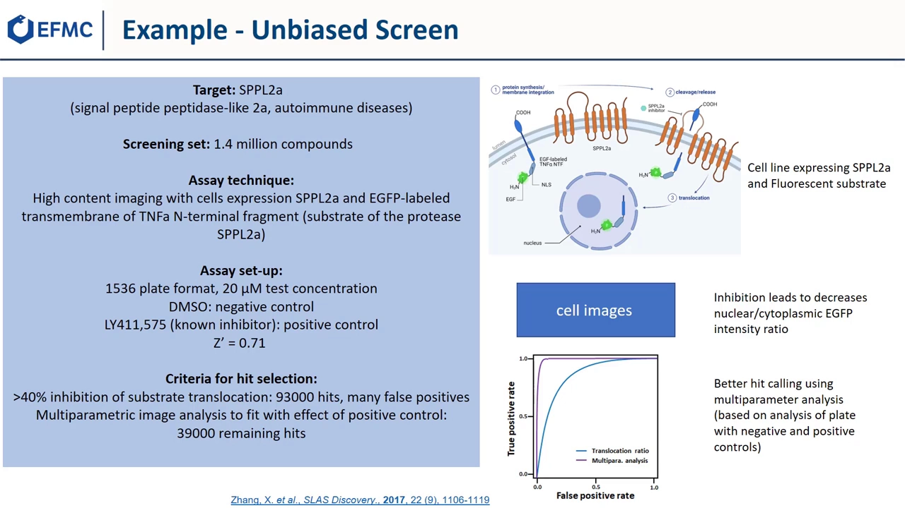

结果很能说明无偏筛选的「验证负担」从哪来 [【跳转到 13:56】](https://www.youtube.com/watch?v=LUtxw2E6iR0&t=836)：把抑制率大于 40% 的都算命中，一共 **93000 个命中，命中率超过 6%**，而且初步看有大量假阳性。高内涵成像的好处是可以同时读细胞里的很多参数，于是他们做**多参数图像分析**，只保留那些效应模式与阳性对照相似的化合物，最终收窄到 **39000 个**——砍掉一半多，假阳性率也明显下降 [【跳转到 14:46】](https://www.youtube.com/watch?v=LUtxw2E6iR0&t=886)。

> **补充（非讲者原话）**：这里的教训不是「多参数分析很神」，而是**命中率本身是一个需要被管理的量**。6% 的命中率意味着 8 万多个化合物要进入验证流程，验证通量立刻成为瓶颈；把命中率压到 1% 以下，验证才做得完。这也是为什么「筛多少」和「怎么定阈值」必须一起规划。

## 五、聚焦筛选：用靶标知识把库缩到两万个

聚焦筛选的目标是：用已有的靶标知识挑一批更可能有活性的化合物。讲者给了三条思路，每条都可以从现有筛选集合里挑，也可以专门做一个库 [【跳转到 14:58】](https://www.youtube.com/watch?v=LUtxw2E6iR0&t=898)：

1. **挑对该靶标类别有活性的化合物**——做离子通道或激酶，就挑那些对同家族其他靶标有活性的化合物；
2. **挑带特定作用模式的化合物**——比如想做共价抑制剂，就挑一批带反应性基团的化合物；
3. **挑含已知结合基元的化合物**——激酶的铰链区结合基元（一个氢键供体加一个受体）、金属酶需要的金属螯合基团（羧酸、异羟肟酸、硫醇）、丝氨酸蛋白酶需要的 S1 口袋匹配（正电荷对天冬氨酸 189，加上合适的尺寸）。

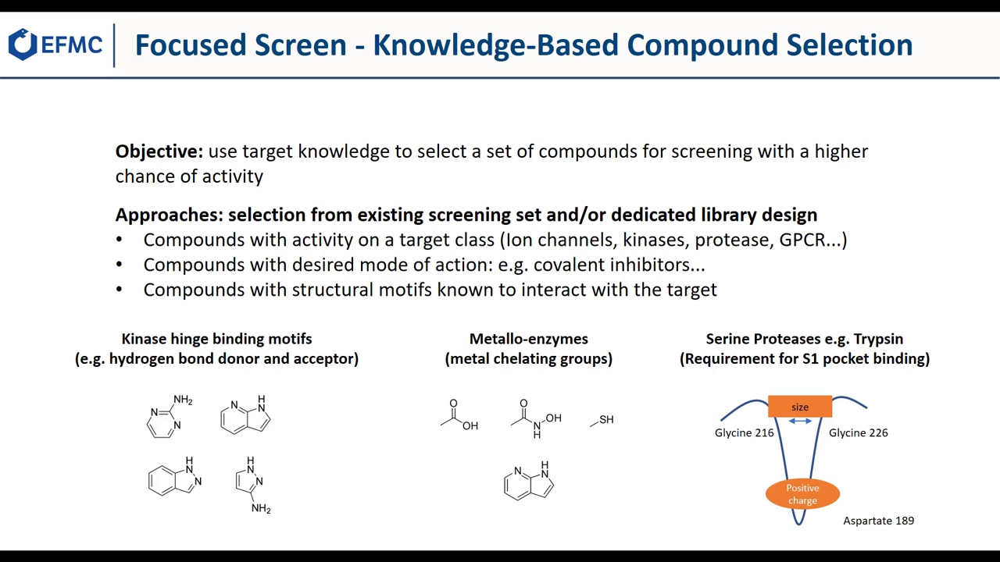

### 5.1 两万个化合物换一个药物候选的故事

例子是突变 EGFR 激酶：目标是找到对 T790M 耐药突变体有活性、同时对野生型有选择性的抑制剂。他们只选了一个 **2 万化合物的多样性激酶可逆抑制剂靶向库**，用酶学光谱检测测 ADP 生成，同时跑野生型和 T790M/L858R 双突变两个检测 [【跳转到 16:52】](https://www.youtube.com/watch?v=LUtxw2E6iR0&t=1012)。

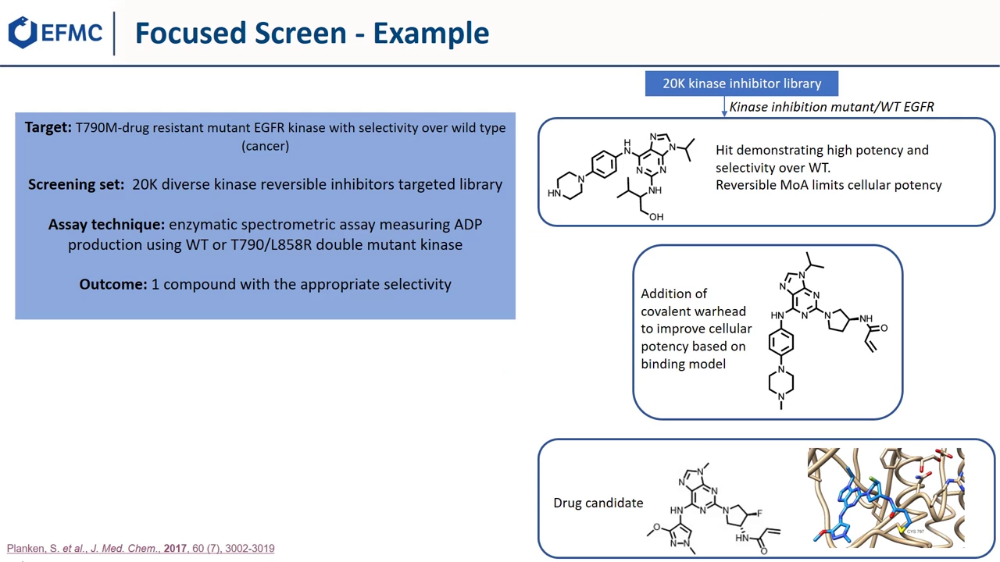

他们找到一个选择性和活性都合适的化合物，但**可逆作用机制导致细胞活性很差**。解法是加一个共价弹头（丙烯酰胺），并借助结合模型把它放在能与 Cys797 反应的位置，之后进一步优化成药物候选 [【跳转到 17:42】](https://www.youtube.com/watch?v=LUtxw2E6iR0&t=1062)。讲者的评价是：只筛 2 万个化合物就找到了能做成候选药物的起点，说明**对知识积累充分的靶标（激酶是典型），筛少量化合物也能找到好起点**。

## 六、计算筛选：把实验次数从「几十万」压到「几十个」

计算筛选的思路是用靶标知识先在计算层面预筛，减少要拿到实验里测的化合物数量 [【跳转到 18:37】](https://www.youtube.com/watch?v=LUtxw2E6iR0&t=1117)。

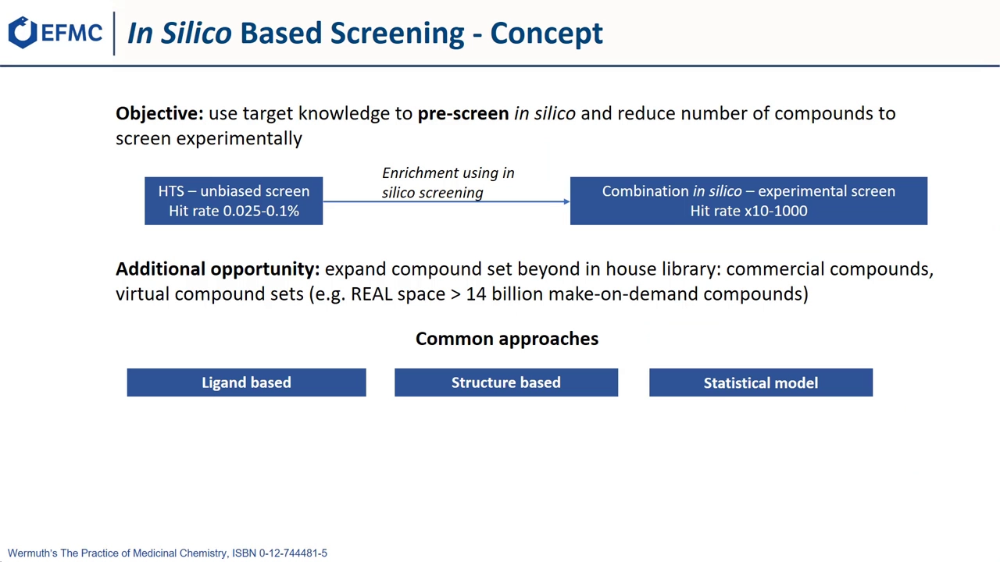

这张幻灯片有两个关键数字：

- **命中率**：无偏筛选通常在 **0.025% 到 0.1%**；把计算筛选和实验筛选结合做富集，命中率可以提高 **10 到 1000 倍**；
- **化学空间**：计算筛选还能把化合物集合扩展到自有库之外——商业化合物，甚至还不存在的虚拟化合物。例如 **REAL space 有超过 $1.4 \times 10^{10}$ 个按需合成（make-on-demand）的化合物**，只要计算筛出了命中，就能买来做实验 [【跳转到 19:02】](https://www.youtube.com/watch?v=LUtxw2E6iR0&t=1142)。

计算筛选有三条常见路线：

- **基于配体（ligand-based）**：从一个或几个已知化合物出发做相似性搜索，最常用的是二维指纹，也可以做三维形状或分子场比较；另一条是**药效团**——把关键相互作用（氢键供体/受体、离子作用、疏水、芳环）及其三维取向抽象出来，再找相互作用类型与几何都相似的化合物 [【跳转到 20:35】](https://www.youtube.com/watch?v=LUtxw2E6iR0&t=1235)。
- **基于结构（structure-based / docking）**：用 X 射线、NMR 或同源模型得到的蛋白结构，预测分子能否装进结合位点并形成有利相互作用 [【跳转到 22:10】](https://www.youtube.com/watch?v=LUtxw2E6iR0&t=1330)。

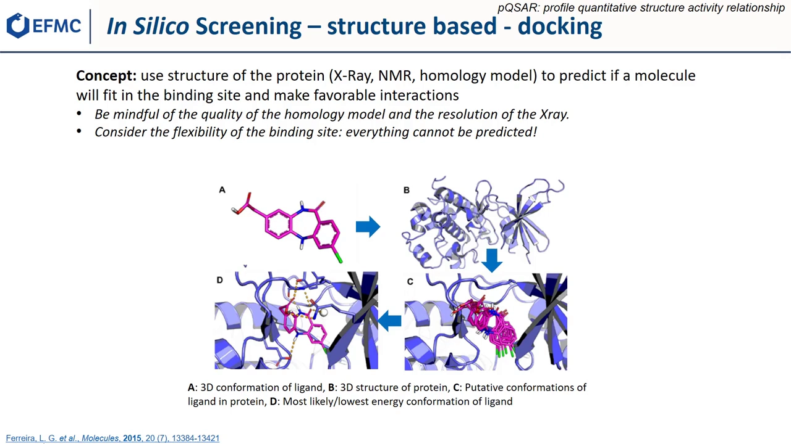

讲者对对接提了两条限制，都很实务 [【跳转到 23:00】](https://www.youtube.com/watch?v=LUtxw2E6iR0&t=1380)：**模型质量**（同源模型或 X 射线结构的分辨率）和**结合位点柔性**——结构给的是蛋白的一个静态快照，配体结合本身也会让一些残基移动，「并不是什么都能预测」。所以对接之后一定要有人工检查，确认结果在相互作用和几何上说得通。

- **统计模型（statistical model）**：用一大批已知活性和非活性配体的活性数据，预测化合物对靶标有活性的可能性。讲者用 profile-QSAR 举例：起点是 1800 万个 pIC50 数据点，先为每个检测建立单检测 QSAR 模型把缺失值补上，再把「预测出的活性谱」当作化合物描述符去预测新检测里的表现 [【跳转到 24:45】](https://www.youtube.com/watch?v=LUtxw2E6iR0&t=1485)。

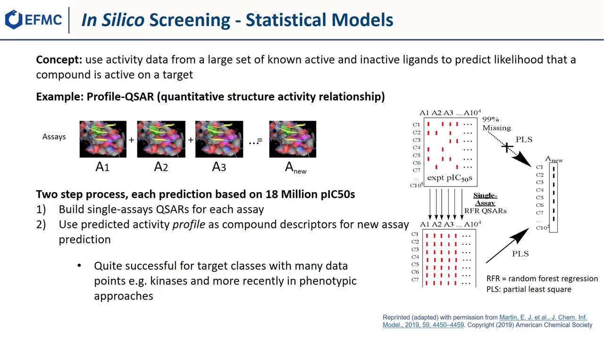

这条路在数据点多的靶标类别（激酶最典型）上相当成功，最近也有工作表明它在表型方法里同样可用 [【跳转到 25:35】](https://www.youtube.com/watch?v=LUtxw2E6iR0&t=1535)。讲者举的实例是 cGAS 抑制剂：从 150 万个商业化合物出发做对接，手里还有蛋白与配体复合的结构；聚类和目视检查后只挑了 **59 个化合物**买来测，用热位移和生化检测，得到 **4 个命中** [【跳转到 26:15】](https://www.youtube.com/watch?v=LUtxw2E6iR0&t=1575)。

## 七、把三条路线放进同一张表

讲者最后的总结表，是这一讲最值得抄下来的一页 [【跳转到 27:05】](https://www.youtube.com/watch?v=LUtxw2E6iR0&t=1625)：

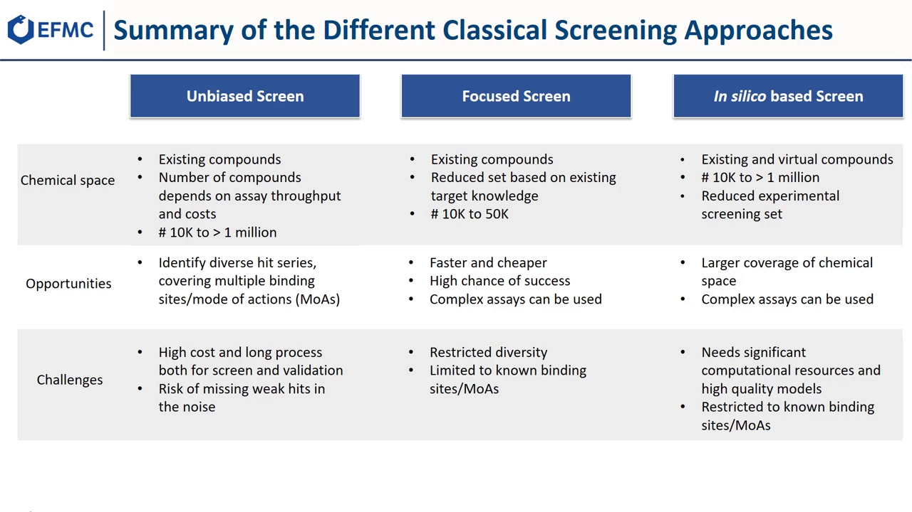

| 维度 | 无偏筛选 | 聚焦筛选 | 计算筛选 |
| --- | --- | --- | --- |
| 化学空间 | 已有化合物 | 已有化合物，按靶标知识缩减 | 已有化合物 + 虚拟化合物 |
| 化合物数量 | 1 万到 100 万以上，取决于检测通量与成本 | 1 万到 5 万 | 1 万到 100 万以上，取决于计算方法 |
| 机会 | 能识别多样的命中系列，覆盖多个结合位点与作用模式 | 更快更省、成功率高、可用复杂检测 | 化学空间覆盖最大、可用复杂检测 |
| 挑战 | 成本高、周期长（筛选与验证都耗时）；弱命中可能埋在噪声里 | 多样性受限；被限制在已知结合位点与作用模式 | 需要大量计算资源与高质量模型；同样受限于已知结合位点与作用模式 |

把这张表和前面的数字连起来看，可以得到三条判断：

1. **规模是被反推的。** 25 万、5 万、140 万这些数字都不是目标，而是检测通量、每孔成本和验证能力的结果。无偏筛选之所以「贵」，贵的不只是筛，还有验证——SPPL2a 那个例子里 93000 个命中就是账单。
2. **覆盖与先验是一对跷跷板。** 聚焦筛选和计算筛选都靠「已知知识」换取效率，代价是把自己限制在已知的结合位点和作用模式里；无偏筛选唯一不可替代的价值，正是它能碰到你没想到的位点和机制。
3. **命中率决定了后面所有工作的形状。** 0.025%–0.1%（无偏）与提高 10–1000 倍（计算富集）之间，差的是「验证几个化合物」和「验证几万个化合物」的差别。

## 小结

- 经典筛选分三类：无偏、聚焦、计算。分野不在仪器，而在**筛哪一片化学空间**（已有化合物 vs 已有 + 虚拟化合物）。
- 无偏筛选的规模由**检测通量与成本**决定：典型 25 万个，复杂细胞检测约 5 万个，简单酶学检测可到几百万个。
- 库要「可分层」才有用：按性质打标记、按多样性分类、每类挑最优，就能按检测能力任选一层来筛；由此还衍生出迭代筛选。
- 开筛前必须做试点：**Z' > 0.5 合格、> 0.7 优秀**，同时考察 DMSO 效应、试剂稳定性、条件优化和命中率预估。
- 初筛后按命中率（通常 <1%）定阈值、重测确认、跑浓度-效应曲线；**曲线形状和数值一样重要**。
- 聚焦筛选用靶标知识把库缩到 2 万量级，成功率高、周期短，代价是多样性和新位点。
- 计算筛选能把命中率提高 10–1000 倍，并把化合物集合扩展到 REAL space 的 140 亿个按需合成化合物；代价是模型质量与结合位点柔性。
- 三条路线不是互斥的：讲者在系列最后一讲里明确建议**同时跑多种命中生成策略**（integrated hit generation）。

## 关键术语速查

| 术语 | 一句话解释 |
| --- | --- |
| 命中（hit） | 在某个检测体系里能调节靶标活性的化合物 |
| 无偏筛选（unbiased screen） | 不依赖靶标先验，对一大批化合物做高通量筛选 |
| 聚焦筛选（focused screen） | 用靶标类别、作用模式或结合基元等先验知识挑出缩减集合来筛 |
| 计算筛选（in silico screening） | 用基于配体、基于结构或统计模型的方法先在计算层面挑化合物 |
| 频繁命中物（frequent hitter） | 被发现能打中很多靶标的化合物，多为检测伪影来源 |
| PAINS | pan-assay interference compounds，泛检测干扰化合物，已知会干扰多种生物检测 |
| Z' 因子 | 阳性/阴性对照两个群体的分离度指标；>0.5 合格，>0.7 优秀 |
| 命中率（hit rate） | 命中数占筛过的化合物数的比例；无偏筛选通常 0.025%–0.1%，讲者建议控制在 1% 以下 |
| 迭代筛选 | 先筛一小批，再迭代地筛命中的近邻化合物 |
| REAL space | 可按需合成并购买的虚拟化合物集合，规模超过 140 亿 |
| 药效团（pharmacophore） | 把配体与靶标的关键相互作用类型及其三维取向抽象出来的模型 |
| 对接（docking） | 把配体放进蛋白结合位点、枚举构象并给出低能构象的计算方法 |