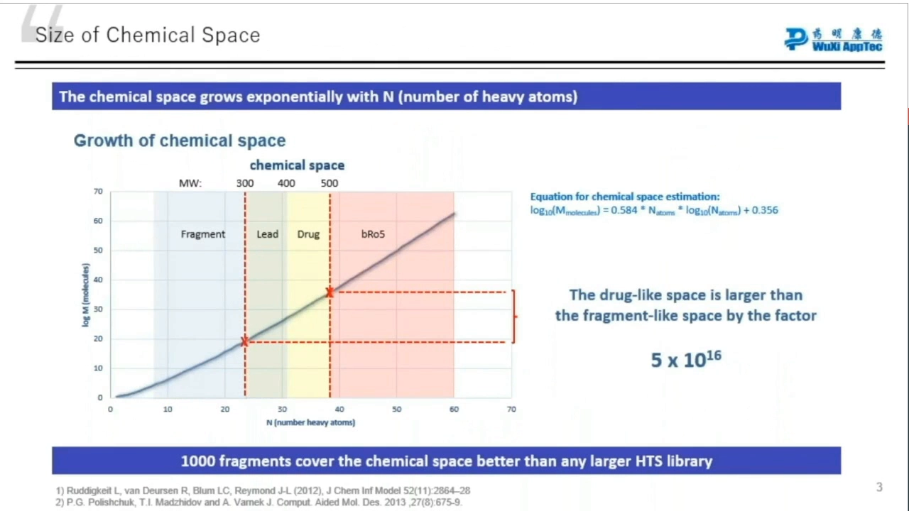
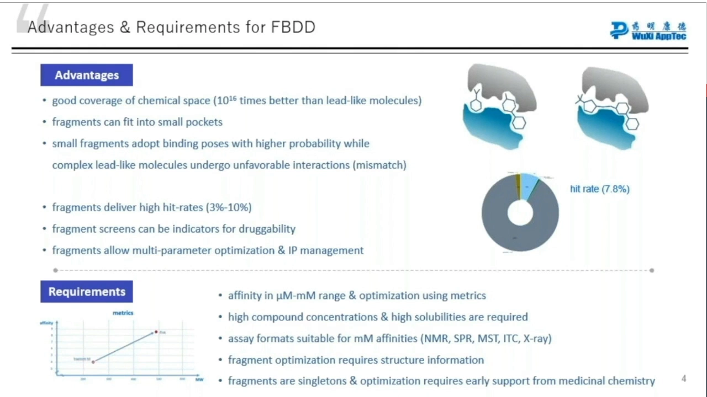
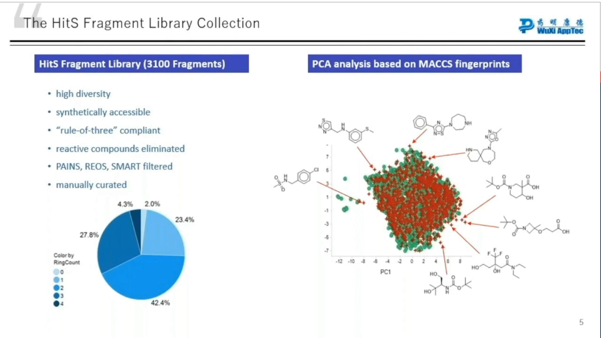
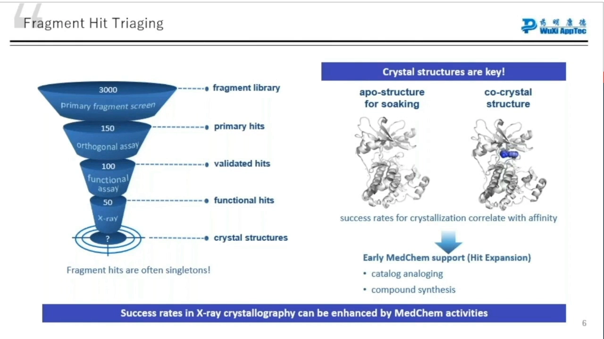
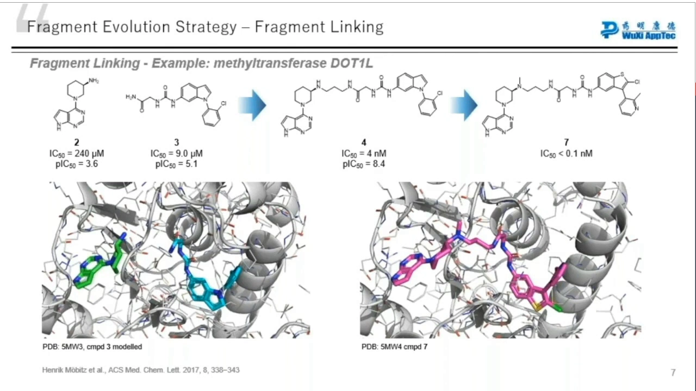
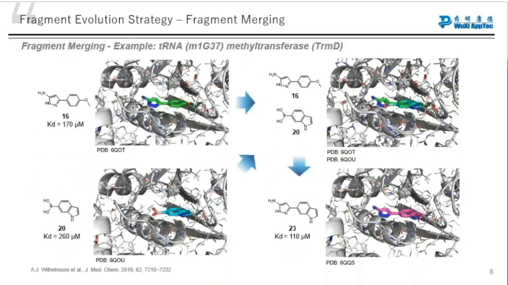
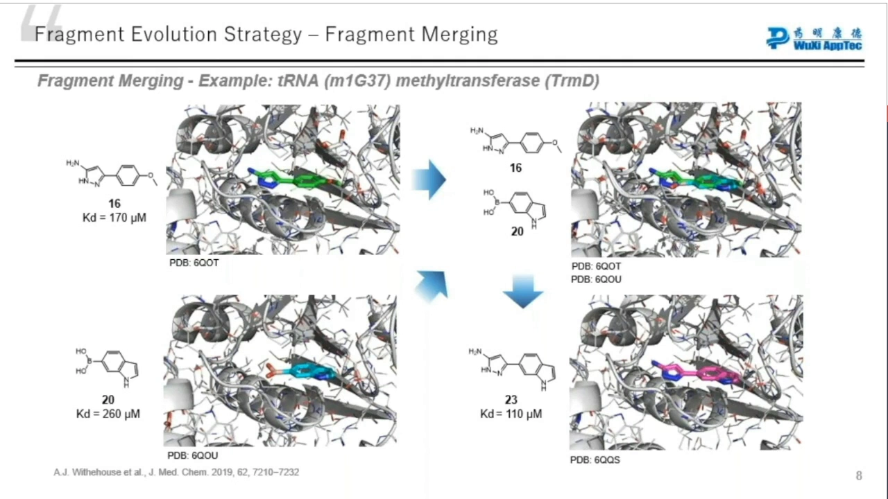
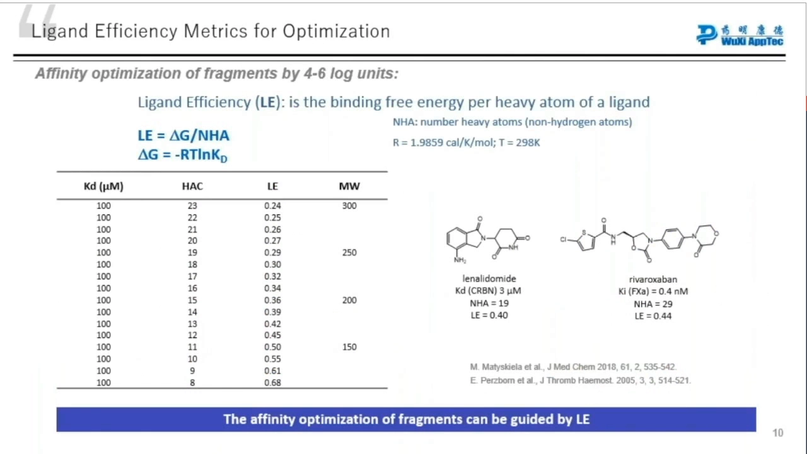
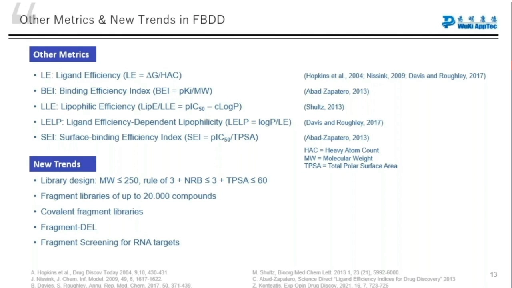
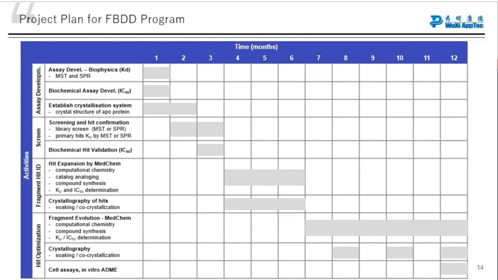

# 片段起步：用三千个片段穿透化学空间

> 视频来源：[Introduction into Fragment Based Drug Discovery](https://www.youtube.com/watch?v=TbtVdjYsQWg)（YouTube · C&EN Webinars，药明康德赞助 · 讲者 Andreas Schoop（药物化学）与 Morena Gerber-Williamson（生物物理与筛选））｜时长约 54 分钟
> 导读：这场研讨会的核心论点只有一句——**片段库之所以只有三千个化合物，是因为它面对的化学空间比类药空间小了 16 个数量级**。讲者先算清这笔账，再把 FBDD 的完整流水线拆开：库怎么建、命中怎么分诊、晶体结构怎么拿到、片段怎么长成先导、配体效率怎么当方向盘；后半场由生物物理负责人讲怎么用 MST/SPR 在 500 微摩尔单浓度下筛完 3100 个片段，以及 Q&A 里那些「FBDD 到底比 HTS 强在哪、贵在哪」的实话。

## 本讲要解决的核心问题（SCQA）

**背景**：命中生成的主流做法是筛得越多越好——高通量筛选面对的是百万级化合物，DNA 编码库面对的是十亿级。按这个逻辑，一个只有三千个化合物的库看起来毫无竞争力。

**冲突**：但片段筛选偏偏只用三千个化合物，而且它的命中率（3%–10%）比 HTS 高得多。矛盾的关键在于：**筛的不是同一个化学空间**。分子每多几个重原子，可能的分子数就指数级膨胀；类药空间（分子量 500）比片段空间（分子量 300）大 16 个数量级。也就是说，三千个片段覆盖的那一小片空间，是任何规模的 HTS 库都覆盖不到的。

**疑问**：既然片段这么划算，为什么不是所有人都做 FBDD？三千个片段筛出来的命中只有微摩尔到毫摩尔亲和力，怎么把它变成一个能成药的分子？这条路上每一步的代价是什么？

**回答（中心思想）**：**FBDD 用「化学空间覆盖」换「起点质量」——它给你一个又小又好的起点和一张清晰的结构地图，代价是你必须自己把分子「长」上去，并且全程依赖晶体学。** 这条路的经济学因此和 HTS 完全不同：入门便宜（三千个片段、几天测完），但总成本不低（片段演化要 12–15 个月，做到个位数纳摩尔），而且有一个硬前提——**你得拿得到结构信息**。

## 一、先把化学空间这笔账算清：16 个数量级

讲者开场不谈技术，先谈化学空间。因为「为什么片段库只有三千个」这个问题的答案，全在这一张图里 [【跳转到 05:49】](https://www.youtube.com/watch?v=TbtVdjYsQWg&t=349)。

这张图的来历讲者交代得很清楚：Lon 的课题组枚举了重原子数不超过 17 的小分子化学空间，Alexandra Von 的课题组在此基础上拟合出一个对数形式的函数，图上给出的估计式是

$$
\log_{10}\left(M_{\text{molecules}}\right) = 0.584 \cdot N_{\text{atoms}} \cdot \log_{10}\left(N_{\text{atoms}}\right) + 0.356
$$

用这个函数看分子量 300 与 500 两个边界，可以算出**类药空间（分子量 500）比片段空间（分子量 300）大 16 个数量级**（幻灯片上标的是 $5 \times 10^{16}$ 倍）。讲者的结论也很直接：**片段库对化学空间的覆盖可以远好于一个覆盖分子量 500 空间的更大规模 HTS 库** [【跳转到 06:39】](https://www.youtube.com/watch?v=TbtVdjYsQWg&t=399)。

> **补充（非讲者原话）**：这就是常被引用的「化学空间约 $10^{60}$」的来源之一——按这类估计式，重原子数到 60 左右时分子数的量级就落在 $10^{60}$ 附近。而任何实体库（HTS 的 $10^{5}$–$10^{6}$、DEL 的 $10^{7}$–$10^{9}$）都只是这个数字里的一粒沙。所以「覆盖率」永远是个位数甚至更小的百分比，选择策略的意义就在于**把有限的名额花在哪一片空间上**。

## 二、片段的优势与前提，是一枚硬币的两面

讲者把 FBDD 的优势和前提并排放在一张幻灯片上，这个排法本身就是观点：**每一条优势都对应一条你必须付出的条件** [【跳转到 09:58】](https://www.youtube.com/watch?v=TbtVdjYsQWg&t=598)。

**优势一侧**：

- **化学空间覆盖好**——比类先导化合物好 $10^{16}$ 倍；
- **片段能进小口袋**，而复杂的类先导分子常常因为体积大而发生不利相互作用（图上画的就是「装不进去」的示意）；
- **结合姿态的概率更高**——小分子在口袋里能采取的姿态少，试错空间小；
- **命中率高**——讲者给的区间是 **3%–10%**（幻灯片上标了一个 7.8% 的实例），而且这个命中率本身可以作为**靶标是否可成药**的指标；
- **支持多参数优化与知识产权管理**——从一个小片段起步，后面还有几百道尔顿的腾挪余地，可以把化学结构带进新的分子空间。

**前提一侧**，每一条都直接决定了实验怎么做：

- 亲和力只在**微摩尔到毫摩尔**量级，所以必须靠优化指标（metrics）来引导；
- 必须在**高浓度**下工作，因此化合物要有高溶解度，检测方法也要能承受高浓度——这就是为什么常用 **NMR、SPR、MST、ITC 或 X 射线**；
- 从片段走到类药分子要跨越很大的化学空间，所以**必须有结构信息引导**，晶体结构或 NMR 结构是 FBDD 的核心组成部分；
- 因为库很小，片段大多是**单例（singleton）**，没有同系列类似物可参考，所以很值得在项目早期就引入药物化学，支持优化和结晶。

## 三、库怎么建：三千一百个片段，三规则，人工过一遍

讲者给了自家片段库的具体编制标准 [【跳转到 10:04】](https://www.youtube.com/watch?v=TbtVdjYsQWg&t=604)：**3100 个片段**，要求多样性高、合成上可得，并符合「三规则（rule of three）」——分子量上限 300、氢键供体不超过 3、氢键受体不超过 3、cLogP 低于 3。

在此之上还有几道过滤：剔除反应性化合物、用经典药物化学规则过滤、最后**逐个人工目视检查**，只留下「有吸引力、符合药物化学审美」的化合物。另一个重要参数是**可旋转键数量要受限**，所以库偏好含环系的分子——环数分布里只有约 2% 没有环，其余分别有一个、两个甚至三个环 [【跳转到 10:54】](https://www.youtube.com/watch?v=TbtVdjYsQWg&t=654)。

右侧那张主成分分析图是「多样性」的可视化：绿点是初代库，红点是第二代化合物，目标是把点云摊得更开、进入更大的化学空间 [【跳转到 11:19】](https://www.youtube.com/watch?v=TbtVdjYsQWg&t=679)。

## 四、分诊漏斗：从 3000 个片段到几个晶体结构

筛完之后不是「命中即用」，而是一条逐级收窄的分诊（triaging）漏斗。讲者给的假设是命中率 5% [【跳转到 11:37】](https://www.youtube.com/watch?v=TbtVdjYsQWg&t=697)：

- **3100 个片段 → 约 150 个初筛命中**；
- 用**正交检测**验证，收敛到**约 100 个**；
- 如果可能，再做**功能检测**，收敛到**约 50 个**；
- 然后进入晶体学。

讲者反复强调这一页的核心：**晶体结构是关键**。通常先拿 apo 结构做浸泡（soaking），有时也直接做共晶；但结晶本身很难，能结晶出来的片段数量有时很少。于是有了一个很实用的动作——**命中扩展（hit expansion）**：把药物化学提前拉进来，做目录类似物筛选或合成新化合物 [【跳转到 12:52】](https://www.youtube.com/watch?v=TbtVdjYsQWg&t=772)。

这一步有两个好处：一是目录类似物能给出同一簇里的多个化合物，形成「捆绑」效应，让晶体学对几乎相同的化合物有多次结晶机会；二是多做化合物还有机会提高亲和力。讲者给了一条经验：**亲和力最好的化合物通常更容易结晶**。所以「在化合物结晶之前就引入药物化学」不是浪费，而是在给晶体学加成功概率 [【跳转到 13:42】](https://www.youtube.com/watch?v=TbtVdjYsQWg&t=822)。

## 五、片段怎么长大：连接、合并、生长

一旦有片段结晶出来，就进入片段演化（fragment evolution）。药物化学上有三种做法，讲者各给了一个真实案例。

### 5.1 片段连接（linking）：把两个相邻的命中缝起来

以 DOT1L 甲基转移酶为例：两个命中在空间上靠近但结合在不同位点，用一个连接子把它们连起来得到化合物 4（IC50 从 240 µM 与 9.0 µM 变成 4 nM），再优化得到化合物 7（IC50 < 0.1 nM），并拿到晶体结构证实体外设计时假设的构象确实成立 [【跳转到 14:26】](https://www.youtube.com/watch?v=TbtVdjYsQWg&t=866)。

讲者对这条路的评价很平衡：**策略上很直接，技术上相当困难**。它需要连接子化学，而连接子通常只对柔性连接有效，有时会给出柔性过高的分子——这并不总是想要的 [【跳转到 15:16】](https://www.youtube.com/watch?v=TbtVdjYsQWg&t=916)。

### 5.2 片段合并（merging）：不要连接子，做分子杂交

这是 Whitehouse 课题组在 tRNA 甲基转移酶（TrmD）上的例子：两个片段 16（Kd 170 µM）和 20（Kd 260 µM）在口袋里能很好地重叠，合并时不需要连接子，本质上是把骨架或药效团以分子杂交的方式拼在一起，生成新骨架 23（Kd 110 µM）[【跳转到 15:29】](https://www.youtube.com/watch?v=TbtVdjYsQWg&t=929)。

讲者把这一步称为「涌现（emerging）」——不是简单的加法，而是把两个片段的相互作用模式整合进一个新骨架。

### 5.3 片段生长（growing）：在同一个骨架上逐步加基团

还是 TrmD 这个例子：拿化合物 23，逐步加基团——23 到 25 加氰基（Kd 5.0 µM），再到 26f 加甲基吡唑（Kd 0.5 µM），最后加哌啶得到 29a（Kd 0.027 µM）[【跳转到 16:19】](https://www.youtube.com/watch?v=TbtVdjYsQWg&t=979)。

讲者给片段生长提了一个约束：**加上的分子量要确实换来足够的活性**，最终分子量落在 500 或以下，同时还要有好的活性 [【跳转到 16:53】](https://www.youtube.com/watch?v=TbtVdjYsQWg&t=1013)。这句话翻译过来就是：不能靠「堆原子」把活性堆上去，否则分子量涨得比活性快，最后得到一个又大又弱的东西。

## 六、配体效率：给「长大」这件事装一个方向盘

片段活性只有微摩尔到毫摩尔，要做到类药物水平需要优化 4–6 个数量级。问题是怎么判断这一步「加得值不值」。讲者的答案是**配体效率（ligand efficiency, LE）**——每个重原子的自由结合能 [【跳转到 17:18】](https://www.youtube.com/watch?v=TbtVdjYsQWg&t=1038)：

$$
\mathrm{LE} = \frac{\Delta G}{\mathrm{NHA}}, \qquad \Delta G = -RT \ln K_D
$$

其中 NHA 是重原子数（非氢原子数），$R = 1.9859\ \mathrm{cal/(K\cdot mol)}$，$T = 298\ \mathrm{K}$。

这张表读起来很直观：**同样的亲和力，分子越小，LE 越高**。所以 LE 惩罚「靠堆原子换活性」。讲者还给了两个真实药物的锚点：来那度胺重原子数 19、LE 0.40；利伐沙班重原子数 29、活性 0.4 nM、LE 0.44 [【跳转到 18:20】](https://www.youtube.com/watch?v=TbtVdjYsQWg&t=1100)。

由此得到一条可操作的规则 [【跳转到 19:35】](https://www.youtube.com/watch?v=TbtVdjYsQWg&t=1175)：药物化学里有一条通用规则，类药化合物应当做到个位数纳摩尔活性、分子量最多 500；把这个点画到「活性—分子量」图上，对应的 LE 是 **0.33**。所以从片段命中出发时，**从 LE 0.3 或以上起步相当好**（讲者说 0.45 会是很好的起点），偶尔从更低的 LE 起步也可行，但你会希望**尽快把 LE 提到 0.3** [【跳转到 20:00】](https://www.youtube.com/watch?v=TbtVdjYsQWg&t=1200)。

回到 TrmD 那个例子，讲者把每个化合物都算了一遍 LE 并画到 pIC50 对分子量的图上：IC50 一路改善，最后 LE 为 0.34。但他同时指出一个**普遍趋势**——优化过程中 LE 通常会下降，这正是「起步时就要挑 LE ≥ 0.3 的片段」的理由 [【跳转到 21:14】](https://www.youtube.com/watch?v=TbtVdjYsQWg&t=1274)。

除了 LE，讲者还列了一组指标并说明自己的偏好 [【跳转到 21:39】](https://www.youtube.com/watch?v=TbtVdjYsQWg&t=1299)：

- **BEI（结合效率指数）**：$\mathrm{pIC_{50}}/\mathrm{MW}$，与 LE 类似；
- **LLE（亲脂效率）**：$\mathrm{pIC_{50}} - \mathrm{cLogP}$，看的是活性与亲脂性之间的距离，讲者希望这个差距做到 5–6 个对数单位，并在优化中把它做大；
- **LELP（配体效率依赖的亲脂性）**：$\log P/\mathrm{LE}$；
- **SEI（表面结合效率指数）**：$\mathrm{pIC_{50}}/\mathrm{TPSA}$。

他的原话是：**我的偏好始终是配体效率和亲脂效率**——一个管分子量，一个管亲脂性，正好是片段优化最容易失控的两个方向。

## 七、领域在变：库更小、极性更强，片段开始和其他技术混用

讲者最后给了一页「新趋势」，这页信息量很大，因为它说明 FBDD 的默认参数正在被重新设定 [【跳转到 23:44】](https://www.youtube.com/watch?v=TbtVdjYsQWg&t=1424)。

- **库设计更严**：分子量上限从 300 降到 **250**，三规则里加了**可旋转键 ≤ 3**，并要求**极性表面积一开始就足够低（TPSA ≤ 60）**；
- **库更大**：有供应商提供多达 **2 万个化合物**的片段库；
- **共价片段库**开始被使用；
- **片段与 DEL 结合**：一旦找到片段，可以用它来设计 DNA 编码库；
- **片段筛选用于 RNA 靶标**。

## 八、生物物理怎么做：500 微摩尔单浓度，一周测几千个

后半场由 Morena Gerber-Williamson 讲实验侧。她的部门建立了一套很宽的工具箱 [【跳转到 26:48】](https://www.youtube.com/watch?v=TbtVdjYsQWg&t=1608)：研究结合动力学用 **SPR 和 BLI**；**MST 和 ITC** 在自由溶液中测亲和力；蛋白完整性、热稳定性和聚集用 **nanoDSF 和 DLS**；ITC 还能给结合热力学。

对片段筛选，流程是这样的 [【跳转到 31:14】](https://www.youtube.com/watch?v=TbtVdjYsQWg&t=1874)：

1. **先表征蛋白**：nanoDSF 和 DLS 确认正确折叠，测不同缓冲液与添加剂对热稳定性的影响，同时做与阳性对照的结合测试；
2. **建立结合检测**：用 MST 和 SPR，并顺便把正交的验证方法一起建立起来；
3. **初筛**：在 **500 微摩尔单浓度**下测，确定结合者（binder）；
4. **KD 排序**：结合者用 MST 或 SPR 做 KD ranking；
5. **结构**：最有希望的结合者浸泡进 apo 蛋白晶体；
6. **交给药物化学**：KD 信息 + 结构信息用于先导优化和片段演化。

通量上，讲者的说法是：SPR、MST、TRIC 都完全能胜任片段筛选，**一周内可以测几千个化合物**；筛 3000 个片段的测量时间大约**两三天** [【跳转到 29:41】](https://www.youtube.com/watch?v=TbtVdjYsQWg&t=1781)。她也强调**可行性研究很重要**——有些靶标对某种技术表现更好，所以建检测时两种方法都试，再决定用哪种做初筛。

一个具体的项目数据（人源 STING）[【跳转到 32:19】](https://www.youtube.com/watch?v=TbtVdjYsQWg&t=1939)：筛了 3100 个片段，用 MST 确认了 **66 个** KD 在 10–500 微摩尔之间的结合者，用 nanoDSF 和 SPR 做了额外表征，**11 个有希望的 MST 命中里有 9 个在基于配体的 NMR 中得到确认**。

## 九、代价、边界与「什么时候该用 FBDD」

Q&A 部分是这场研讨会最有价值的部分，因为讲者在这里说了不少实话。

### 9.1 便宜是错觉：12 个月的项目计划，15 个月到个位数纳摩尔

讲者给了一张 12 个月的项目甘特图 [【跳转到 24:48】](https://www.youtube.com/watch?v=TbtVdjYsQWg&t=1488)：

前 6 个月做检测开发、筛选、命中扩展与片段结晶；第 7–12 个月做片段演化，中间穿插多轮晶体学，最后接细胞检测与体外 ADME。

而在 Q&A 里，讲者把这个时间表说得更直白 [【跳转到 40:06】](https://www.youtube.com/watch?v=TbtVdjYsQWg&t=2406)：FBDD 看起来入门便宜，但把生物学和化学的额外优化算进去，**并不比 HTS 便宜多少**，只是需要额外的时间——**要做到个位数纳摩的活性，大概需要 15 个月**。所以「便宜」这个印象要打个折：省的是筛库的钱，花的是演化的时间。

### 9.2 硬前提：拿不到结构就别做

被问到「FBDD 相比 HTS 的优势」时，讲者把答案收在化学空间上 [【跳转到 38:26】](https://www.youtube.com/watch?v=TbtVdjYsQWg&t=2306)：用更小的片段，面对的是更小的化学空间，因此即使化合物数量更少，也能更好地穿透这个空间，更容易找到新的化学实体、进入新的化学空间。他举的例子是激酶这种竞争拥挤的领域——那里挤满了人，很难找到新骨架，而 FBDD 确实能帮上忙，找到新东西之后也更容易管理知识产权。

但被问到「什么时候适合把 FBDD 当作主要筛选方法」时，他给了一个很硬的边界 [【跳转到 43:01】](https://www.youtube.com/watch?v=TbtVdjYsQWg&t=2581)：**通常的标准做法是先做 HTS；HTS 给不出足够的、质量好的命中时，FBDD 作为第二选择，有时能给出更好的命中，或者给出 HTS 给不出的命中。** 而唯一的限制是——**你需要结构信息，这是前提条件**；拿不到结构信息，大概就不该走 FBDD。

### 9.3 几个实操数字

- **命中率**：生物物理筛选通常 **2%–8%**；之后能拿到结构的比例取决于靶标，大概 **5%–20%**，这通常是药物化学项目不错的起点 [【跳转到 40:56】](https://www.youtube.com/watch?v=TbtVdjYsQWg&t=2456)。
- **单化合物还是混合物**：可逆片段库通常用单化合物浓度（MST、Dianthus 或 SPR）；共价片段筛选则常把五个片段混在一起 [【跳转到 43:26】](https://www.youtube.com/watch?v=TbtVdjYsQWg&t=2606)。
- **共价片段**：用低反应性弹头做共价片段筛选的兴趣在明显上升；传统做法是用质谱测化合物池，MST 的好处是能同时挑出共价与非共价的片段，之后再用质谱确认共价结合不可逆 [【跳转到 46:21】](https://www.youtube.com/watch?v=TbtVdjYsQWg&t=2781)。
- **热位移检测的局限**：如果检测搭建正确，SPR、MST 与 ITC 之间有相当好的相关性；但**微摩尔级结合物或片段不一定会在热稳定性上显示效应**，所以片段命中始终建议用正交方法验证 [【跳转到 47:36】](https://www.youtube.com/watch?v=TbtVdjYsQWg&t=2856)。
- **弱到什么程度还算数**：500 微摩尔对片段筛选来说已经相当弱，很多情况下与溶解度有关——要解析 0.5 mM 的 KD，为了达到饱和你需要把化合物浓度做到 10 mM 左右，这非常困难。所以可靠的表征大概到 **200 微摩尔**左右为止 [【跳转到 49:16】](https://www.youtube.com/watch?v=TbtVdjYsQWg&t=2956)。
- **分辨率要多高**：越高越好，但大概至少要到 2.0 Å 左右；真正的门槛不是分辨率数字，而是**晶体学专家能否确信电子密度只有一种解释**——因为片段姿态错了，后面所有化学工作都会白做 [【跳转到 44:16】](https://www.youtube.com/watch?v=TbtVdjYsQWg&t=2656)。

## 小结

- **片段库小，是因为它面对的化学空间小**：类药空间（MW 500）比片段空间（MW 300）大 16 个数量级，所以三千个片段对那一小片空间的覆盖，好过任何规模的 HTS 库对类药空间的覆盖。
- **优势与前提是一枚硬币的两面**：覆盖好、能进小口袋、命中率高（3%–10%）的另一面，是亲和力只在 µM–mM、需要高浓度与高溶解度、需要适合弱亲和的生物物理检测、需要结构信息。
- **库的编制标准是可核查的**：三规则（MW ≤ 300、HBD ≤ 3、HBA ≤ 3、cLogP < 3）、去反应性、去 PAINS、限制可旋转键、人工目视检查。
- **分诊是一条漏斗**：3100 → 150（初筛）→ 100（正交）→ 50（功能）→ 晶体结构；晶体学是关键，命中扩展是提高结晶成功率的手段。
- **片段长大有三条路**：连接（快但依赖柔性连接子）、合并（不要连接子，做分子杂交）、生长（逐步加基团，但每一步都要换来足够的活性）。
- **配体效率是方向盘**：同样的亲和力，分子越小 LE 越高；起步挑 LE ≥ 0.3 的片段，优化中 LE 通常会下降，所以要盯住它。亲脂效率（LLE）管另一个失控方向。
- **代价在时间上**：12 个月的项目计划、约 15 个月做到个位数纳摩尔；总成本不比 HTS 低多少。
- **边界很清楚**：标准做法是先 HTS，HTS 给不出好命中时 FBDD 作为第二选择；**拿不到结构信息就不要走 FBDD**。

## 关键术语速查

| 术语 | 一句话解释 |
| --- | --- |
| 片段（fragment） | 分子量约 150–300 的小分子，亲和力通常在微摩尔到毫摩尔 |
| 三规则（rule of three） | 片段库的筛选标准：MW ≤ 300、HBD ≤ 3、HBA ≤ 3、cLogP < 3 |
| 化学空间 | 所有可能分子的集合；随重原子数指数增长 |
| 片段分诊（triaging） | 把初筛命中逐级用正交检测、功能检测、晶体学收窄的过程 |
| 命中扩展（hit expansion） | 用目录类似物或新合成化合物扩充同一簇片段，提高结晶与优化成功率 |
| 片段连接（linking） | 用连接子把两个相邻片段连成一个分子 |
| 片段合并（merging） | 不要连接子，把两个片段的骨架/药效团杂交成新骨架 |
| 片段生长（growing） | 在片段骨架上逐步添加基团以提高亲和力 |
| 配体效率（LE） | $\Delta G$ 除以重原子数，衡量「每个原子换来多少结合能」 |
| 亲脂效率（LLE） | $\mathrm{pIC_{50}} - \mathrm{cLogP}$，衡量活性与亲脂性之间的距离 |
| 单例（singleton） | 库里没有同系列类似物的化合物，优化时缺少参考 |
| 热位移检测（TSA/nanoDSF） | 通过配体结合引起的蛋白热稳定性变化来判断结合；对弱结合物可能不敏感 |