# 多参数优化：在活性、选择性与可开发性之间找平衡

> 视频来源：[Finding balance in drug discovery through multi-parameter optimisation](https://www.youtube.com/watch?v=tnHi159GtmQ)（YouTube · Optibrium 网络研讨会，讲者 Matt，时长约 61 分钟）
> 本文覆盖这支研讨会的主线：为什么单指标排序会骗人、帕累托前沿能做什么不能做什么、把「可接受范围」写成期望函数、以及把实验误差与模型误差一并折算成「成功概率」的排序方法。字幕为 YouTube 自动生成，术语已按药物化学惯例订正（如「Lian efficiency」→ ligand efficiency、hERG、Caco-2）。

## 本讲要解决的核心问题（SCQA）

**背景**：先导优化的每个性质都已经有成熟的测法与算法——溶解度怎么测、logP 怎么算、肝微粒体稳定性怎么判读，前面的小节都讲过。项目组手里因此有一张密密麻麻的性质表。

**冲突**：有表不等于会选。这支视频里的真实案例正是：项目组按「选择性最好 + 活性最高」挑化合物进体内实验，结果大鼠口服生物利用度一塌糊涂。被扔掉的化合物里，有一个后来证明是整批里 PK 最好的，还是全新的骨架类型。

**疑问**：当活性、选择性、溶解度、代谢稳定性彼此拉扯时，凭什么说 A 比 B 好？排序之后，又凭什么说「这个方向没戏了，换一条」？

**回答（中心思想）**：把「给每个化合物算一个分数、按分数排队」换成三件事的组合——用帕累托前沿看「谁支配谁、哪些点无法互相比较」，用期望函数把「多好算好、差一点有多糟」写成曲线，用概率评分把实验与预测的误差一起折算成「达到目标的概率」。这样得到的不是一个漂亮的名次，而是一个能指导下一步做什么、以及什么时候才敢放弃的判断。本文按「单指标为什么不够 → 帕累托 → 期望函数 → 概率评分 → 真实案例 → 判据从哪来 → 设计阶段」的顺序展开。

## 一、单参数优化的失败是结构性的，不是执行不到位

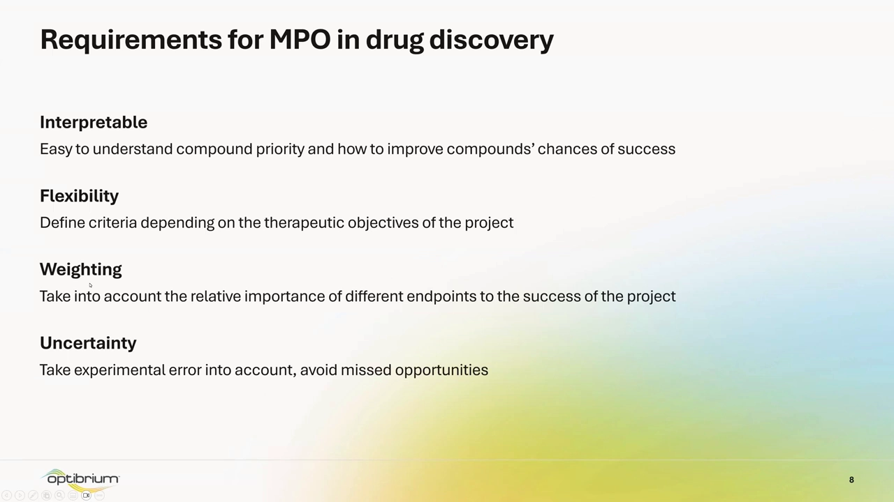

讲者开场就把药物发现的目标定义成一句话：**找到一组合适的化学结构，使安全有效药物所需的那些性质同时达到最优平衡**。注意「同时」和「平衡」——不是 potency 越高越好，而是 potency、理化性质、ADME、安全性都要落在可接受区间里，并且**落在同一个分子上**。项目通常从一个还算有活性的 hit 或 lead 出发，任务是在化学空间里尽快走到那个「甜点区」。

反面情况同样重要：当「给出活性的那片化学空间」与「给出其他性质的化学空间」不重叠时，无论怎么优化都做不出药。这时业界常说 *fail fast, fail cheap*——别把时间浪费在做出来注定失败的化合物上。但讲者给这句话加了一个限定，而这个限定是全场的技术核心：

> 我们只想在**有把握**的时候放弃——也就是当所有数据能让我们「排除合理怀疑」地相信，正在探索的这片化学里没有好药。

「有把握」三个字之所以重要，是因为药物发现里每一份数据都带误差：实验有重复性波动，模型有统计误差。误差会让一个其实合格的化合物「看起来不合格」而被扔掉——这是最昂贵的错误，因为它是**隐形的**：你永远不会知道自己扔掉了什么。

由此，讲者提出一个多参数优化方法必须满足的四条要求：

| 要求 | 含义 | 不满足会怎样 |
| --- | --- | --- |
| 可解释 | 能说清一个化合物为什么被排在前面，以及要改什么才能提高成功率 | 变成黑箱，化学家无法据此设计新分子 |
| 可定制 | 判据随项目治疗目标而变：CNS 还是外周、口服还是静脉或吸入、慢性还是急性 | 拿口服药的规则去筛 CNS 药，方向就错了 |
| 可加权 | 能表达不同终点的相对重要性：有些是硬指标，有些可以让步 | 所有性质等价，等于没有优先级 |
| 能处理不确定性 | 把实验误差与预测误差纳入排序 | 在阈值附近误杀化合物 |

## 二、六种方法排成一条谱系：从经验规则到概率评分

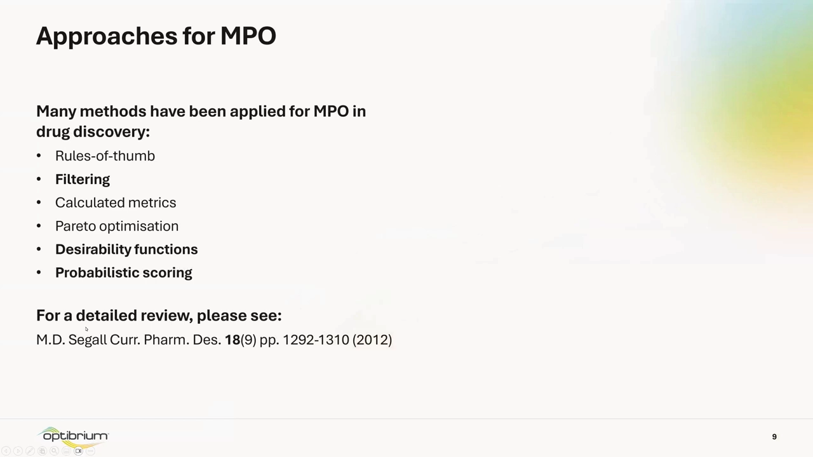

讲者把历史上用过的方法列成一张清单，并说明本次只深入讲其中三类（过滤、期望函数、概率评分），另外三类先做个交代。这张清单本身就是一张地图：**自上而下，方法的表达能力在增强，代价是透明度与使用门槛也在变化**。

### 2.1 经验规则：好用在简单，坏也坏在简单

最著名的是 Lipinski 五规则（针对**口服**化合物）：四个可计算的简单判据。此外还有 Hughes 的 3/75 规则、片段筛选用的 rule of three 等等，名单极长。

优点很直接：简单、易用、易解释——logP 太高就降 logP，化学家立刻知道该干什么。

但讲者列了三个「但是」：

1. **它们是针对特定目标定制的**。很多人把五规则当成「类药性」的定义，可它当初只为口服药提出。用它筛 CNS 药、吸入药或注射剂，前提就不成立。
2. **有过度刚性应用的风险**。规则是指导线，不是硬边界：logP 5.1 和 4.9 在化学上并没有本质差别，把 5.1 直接判死是滥用。连 Lipinski 本人也把它们称作 rule of thumb。
3. **它们只覆盖少数几个维度**，无法表达「活性—选择性—稳定性」之间的交换。

### 2.2 复合指标：把多个数压成一个数，代价是丢掉信息

另一类常见做法是把多个参数合成**单一指标**：配体效率（ligand efficiency, LE）、亲脂效率（ligand lipophilicity efficiency, LLE）、以及近年很流行的人体剂量预测（把清除率、活性等合成一个「人体需要多少毫克」的估计）。

以 LLE 为例，它把活性与亲脂性放在同一把尺子上：

$$
\mathrm{LLE} = \mathrm{pIC}_{50} - \log P
$$

意思是「每单位亲脂性换来的活性」。它的用处是提醒你：如果一个化合物的活性提升是靠把分子做得更油，那 LLE 不会涨。

这类指标的优点是**只有一个数可看**，且能追溯到构成它的性质。缺点同样明确：

- 有大量文献在争论某些配体效率指数的有效性；
- 它们往往是为特定目标定制的，而这一点**并不透明**；
- 它们**覆盖的因素太少**。LLE 只合并了活性和 logP，而安全有效药物要优化的远不止这两项。人体剂量估计虽然合并了更多因素，仍然漏掉提名临床候选前必须看的许多项目。

## 三、帕累托：承认「没有唯一最优，只有一组互不支配的点」

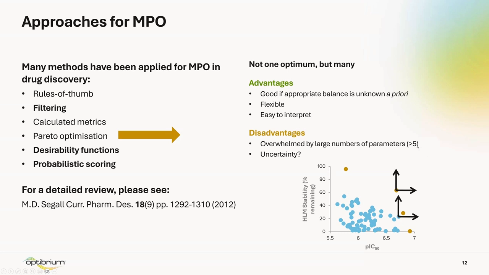

帕累托优化的出发点是一个认识论上的让步（[跳转到 07:15](https://www.youtube.com/watch?v=tnHi159GtmQ&t=435)）：**最优不是一个点，而是一组点**。它们在不同性质的组合上「同样最优」，谁也不能在所有维度上压过谁。

以活性（pIC₅₀）和微粒体稳定性（HLM 剩余百分比）两维为例。把每个化合物画成平面上的点：

- 若存在另一个点，在两个维度上都更好，则这个点被**支配**（dominated），应当淘汰。图中箭头标出的正是这种关系：从被支配点指向支配它的点。
- 所有不被任何点支配的点构成**帕累托前沿**（Pareto front）。形式化地说，点 $x$ 支配 $y$ 当且仅当

$$
\forall i:\ f_i(x) \ge f_i(y) \quad \text{且} \quad \exists j:\ f_j(x) > f_j(y)
$$

其中 $f_i$ 是第 $i$ 个性质（越大越好；越小越好的指标取负号）。前沿上的点满足：想改进任何一个指标，必须牺牲另一个。

**它好在哪**：当「合适的平衡点」事先并不知道时，帕累托前沿把「所有值得考虑的取舍」一次摊开，让项目组去看、去讨论，而不是被一个加权公式替他们决定。它还很灵活（任意性质组合都能画）且直观。

**它差在哪**，讲者给了两条，都很致命：

1. **维度一多就失效**。超过五个参数，前沿上的点会多到你只是把「从 150 个化合物里选」变成了「从 40 个化合物里选」，仍然不知道选谁。
2. **它完全忽略不确定性**。每个点都有误差棒；当前沿上几个点的误差棒互相重叠时，「谁在前沿上」本身就没有统计意义。讲者原话的意思是：这些化合物之间并不存在统计上显著的优劣，那实践中到底该挑哪个？

这两条缺点正好指向后面两节的方法：期望函数解决「怎么把偏好写下来」，概率评分解决「误差怎么办」。

## 四、把「可接受」写成曲线：期望函数

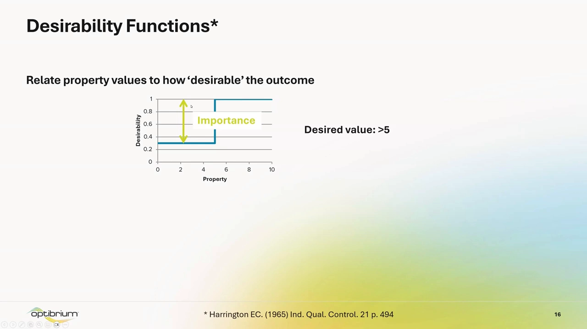

期望函数（desirability function）的想法很朴素（[跳转到 11:25](https://www.youtube.com/watch?v=tnHi159GtmQ&t=685)）：**把每个性质的取值映射成 0 到 1 之间的「满意度」**。它并非药物发现原创，最早可追溯到 1960 年代的工业质量管理（Harrington, 1965）。

最简单的形式就是硬过滤的等价写法：设阈值为 5，则

$$
d(x) =
\begin{cases}
1, & x > 5 \\
0, & x \le 5
\end{cases}
$$

这是一个阶跃函数——本质和「过滤」一模一样，只是换了个坐标系。

真正的价值在下一步：**允许「不合格」也有非零的满意度**。比如「大于 5 是理想的，但 4 也不算灾难」，于是曲线在 5 以下不再掉到 0，而是维持在一个较低的水平。

这样一来，**「重要性」有了一个可操作的几何解释**：理想值处满意度为 1，失败处满意度为某个下界；两者之间的落差就是权重。落差大 = 这个性质一旦不达标后果严重；落差小 = 属于「有更好、没有也能过」。

再往上一层，曲线形状可以任意设计：

- **趋势型**：理想值大于 8 得满分，最差值小于 2 得零分，中间平滑过渡；
- **区间型**：理想区间 4–6，两端是软边——注意这张图里「高于 8」比「低于 3」更糟，这种不对称正是把领域知识写进曲线的办法。

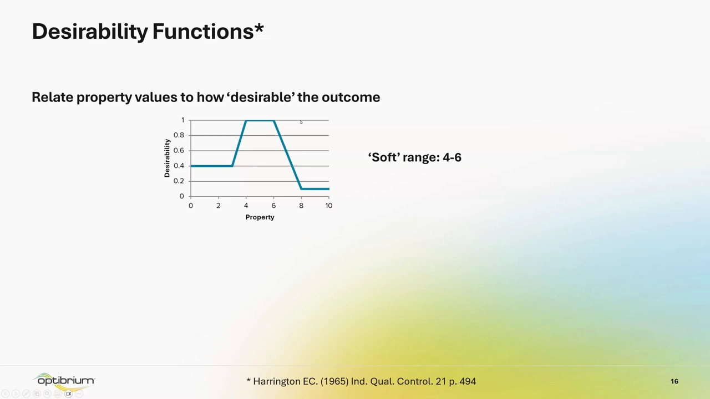

讲者强调用它的理由：**避免硬截断在相似化合物之间画出人为的鸿沟**。logP 5.1 与 4.9 不该有命运差别，阶跃函数却会给它们 0 和 1。

### 4.1 曲线从哪来：用外部数据把「影响」量化

期望函数的形状不该拍脑袋。讲者用 Caco-2 渗透性举例（[跳转到 14:20](https://www.youtube.com/watch?v=tnHi159GtmQ&t=860)）：把文献里一批化合物的 Caco-2 表观渗透性与临床人体肠道吸收率（HIA）画在一起。

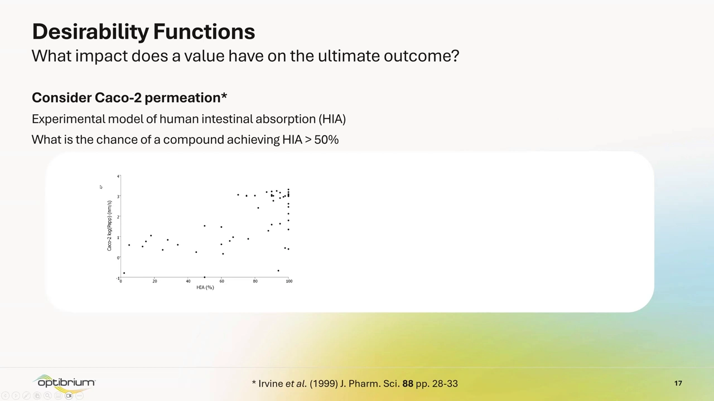

读图要点：高渗透性一侧几乎必然高吸收；但**低渗透性一侧非常分散**——低 Caco-2 并不意味着一定吸收差。如果把它当硬阈值，就会误杀。

于是换个问法：若目标是 HIA > 50%，那么给定一个 Caco-2 测量值，「达标」的概率是多少？把数据按渗透性分箱统计，就得到一条单调上升的概率曲线。

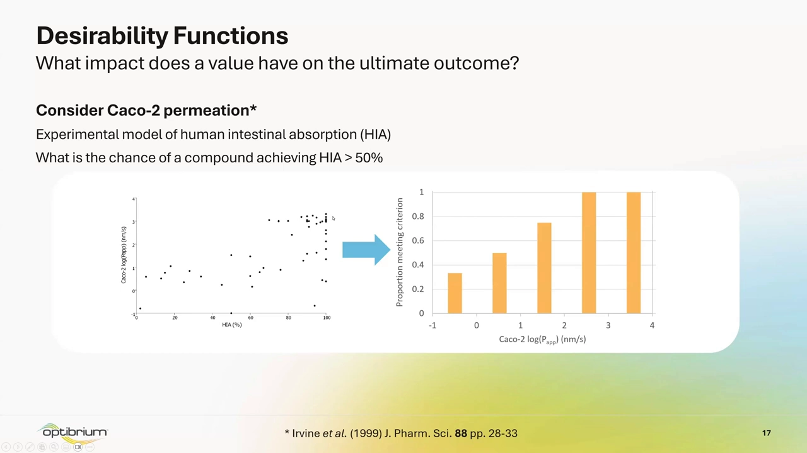

关键数字：高渗透性区间几乎 100% 达标，而**低渗透性区间仍有约 30% 的化合物达标**。所以「渗透性差」不该判死，只该降权——这条蓝色曲线本身就可以直接当作期望函数使用。这是本讲一个很实用的方法论：**期望函数可以由「给定测量值时的达标比例」直接估计出来**，而不必凭主观打分。

## 五、同一批化合物，三种方法给出三种名次

讲者用一个只有 9 个化合物的玩具数据集，把「过滤 → 期望函数 → 概率评分」三套方法跑了一遍，性质包括活性（pKi）、溶解度（logS）、logP、hERG 抑制、脑血比（BBB），其中绿色底纹是计算值、其余是实验值。

**第一步：硬过滤。**（[跳转到 10:05](https://www.youtube.com/watch?v=tnHi159GtmQ&t=605)）设定 pKi > 9.0、logS > 2.0、logP < 3.5、hERG pIC50 < 5、BBB > -0.2，逐格判断通过与否。

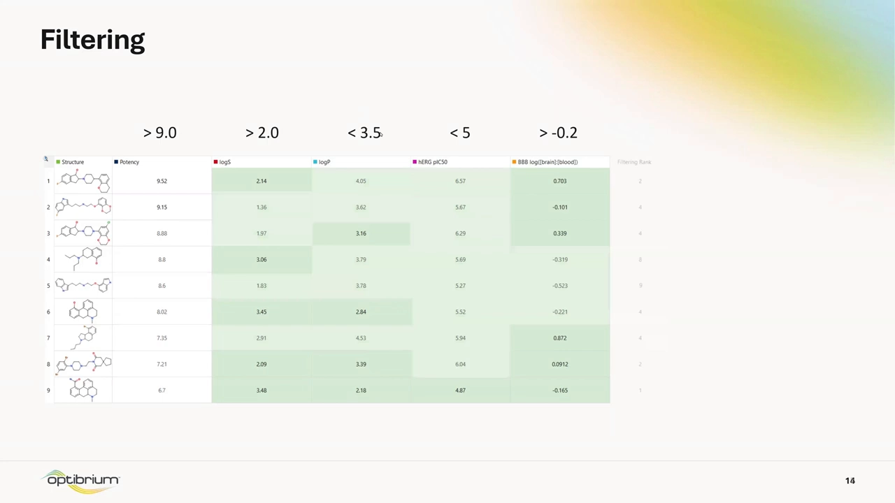

结果暴露了过滤法的根本缺陷：**没有一个化合物通过全部五项**。于是只能退而求其次，数「通过了几项」——第 9 号通过 4 项排第一，有的通过 3 项，有的通过 2 项。问题立刻出现：通过 2 项的那几个谁更好？各项的重要性一样吗？「通过项数」这个计数把「差一点」和「差很多」抹平了。

**第二步：期望函数。** 给每个性质配一条曲线（趋势型、阶跃型、区间型各一），再把五个满意度**相乘**得到总分：

$$
S = \prod_{i=1}^{n} d_i(x_i)
$$

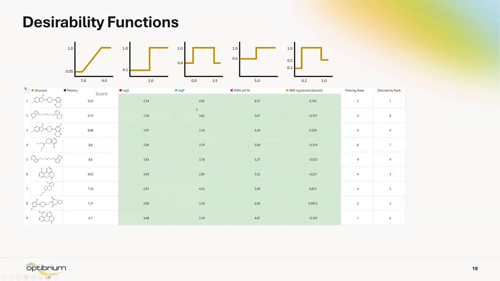

对比表里两列名次：过滤法排第 1 的第 9 号，在期望函数下掉到第 6；而过滤法排第 2 的第 1 号升到第 1。**同一批数据、同一批判据，只因为「差一点有多糟」的表达方式不同，结论就翻转了**。这正是本小节学习目标要说的：不存在「中立的排序」，任何排序都隐含了价值判断，区别只在于这个判断是显式的还是隐式的。

用乘积而不是加权求和，也有讲究：乘积对「某一项接近 0」极其敏感，等于把「硬约束」内建进去了——只要有一项满意度极低，总分就被拉垮，不会被其他项的高分掩盖。若写成加权形式

$$
S = \prod_{i=1}^{n} d_i(x_i)^{w_i}
$$

则 $w_i$ 相当于给第 $i$ 项加权，同时保留了「一项很差就压住全局」的性质。这比线性加权求和 $\sum_i w_i d_i$ 更接近「必须同时满足」的语义。

**第三步：概率评分。** 因为上面的满意度都是用「点估计」算的，而每个点估计都有误差。

## 六、不确定性不是噪声，而是决策的一部分

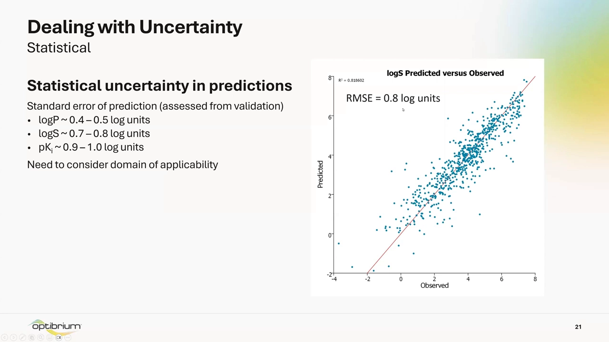

讲者给了两组数字，值得记住：

- **实验侧**：单次测定的 pKi 或 pIC₅₀ 波动约 0.3–0.7 个对数单位，也就是 Ki/IC₅₀ 上 2 到 5 倍的差别；有多次重复时，用均值与标准误描述，并据此得到均值的概率分布。
- **预测侧**：典型 logP 模型的预测标准误 0.4–0.5；logS 模型 RMSE 约 0.8；pKi 预测误差可达 1 个对数单位（10 倍）。讲者的推论很直接：**溶解度预测分不清 1 与 5 μM，勉强能分 1 与 10 μM**——所以别拿预测值在小数点后做决策。

把误差放进决策，做法是把「点」换成「分布」，然后问：**这个化合物的真实值落在合格区的概率是多少？**

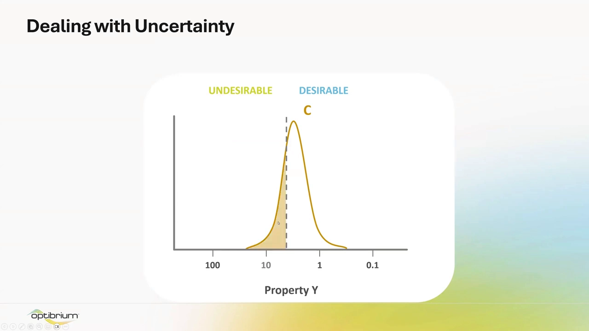

三个化合物的对比最能说明问题：

- **A**：分布整体在阈值左侧，超标的概率可忽略——可以放心淘汰。
- **C**：点估计最好，但分布跨过阈值，有相当一块概率质量落在不合格区。
- **B**：点估计在阈值错误的一侧，但同样有一块概率质量落在合格区。

结论不是「C 比 B 好」，而是：**A 可以淘汰，B 与 C 处于灰区，凭现有数据无法区分**，需要更高精度的测量或更多重复才能定。这是对「排序」这件事最诚实的态度。

还有一个反直觉的例子：D 与 E 都在阈值错误一侧，必须二选一时，直觉会选「离阈值更近」的 E；但若 E 的误差棒很小（测量很确定），而 D 的误差棒很大（数据不足），那么**D 超过阈值的概率反而更大**。此时正确的动作不是选 E，而是「把资源投给 D，去把它测准」。讲者的原话大意是：如果只能投入一份时间精力，就投在这里。

### 6.1 概率评分：把上面三件事合成一个数

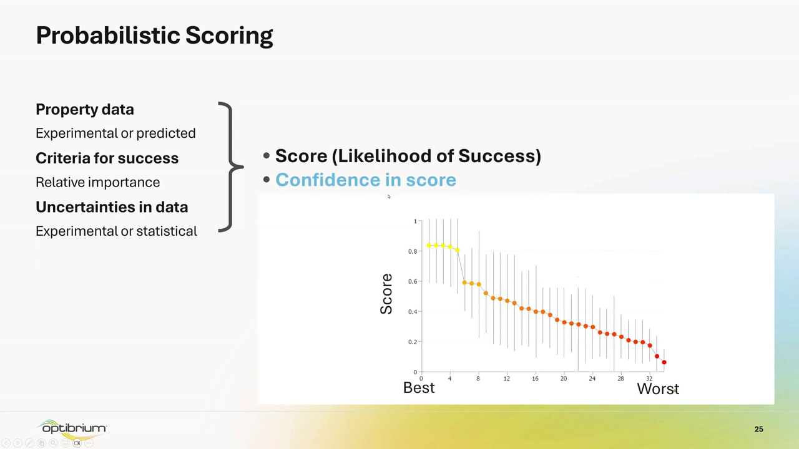

概率评分（probabilistic scoring）把三样东西拼在一起：

1. **性质数据**（实验或预测均可）；
2. **成功判据**：一组期望函数，编码了各性质的目标值与相对重要性；
3. **不确定性**：实验误差与模型误差。

输出不是一个分数，而是**两个**：一个「成功率」（likelihood of success），以及这个成功率本身的**置信度**。数学上，它就是期望满意度在性质不确定性分布上的积分：

$$
P(\text{success}) = \int \left[ \prod_{i=1}^{n} d_i(y_i) \right] p(y \mid \text{data})\, dy
$$

直观理解：把每个化合物的性质值「抖动」到它可能的范围里，看有多少比例的抖动结果仍然满足全部判据。

**蛇形图（snake plot）**是这套方法的标志性可视化（[跳转到 24:04](https://www.youtube.com/watch?v=tnHi159GtmQ&t=1444)）。横轴把化合物从最好排到最差，纵轴是成功率，每个点带误差棒。它一眼回答两个问题：

- **最好的那几个能不能分出高下？** 图中前五名的误差棒几乎完全重叠——不能。此时说「1 号最好，就它了」是没有证据的，要么补数据，要么引入新的判据来打破平局。
- **哪些可以放心淘汰？** 后 50% 的误差棒互不重叠，可以确信它们不如头部化合物，于是把资源集中到头部。

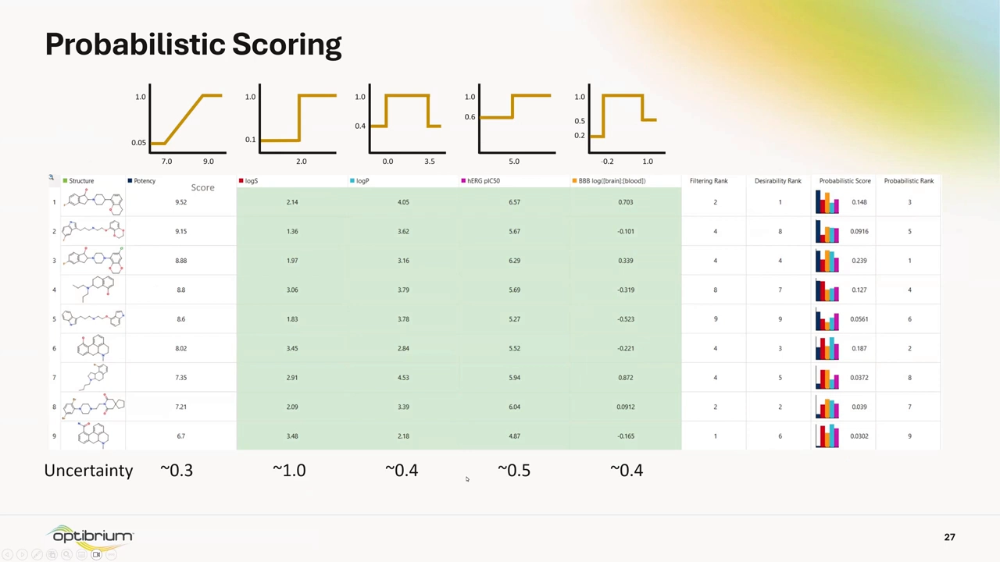

同一批 9 个化合物，概率评分给出的名次又变了：第 3 号升到第 1，第 9 号掉到最后。表下方还标出了各性质的误差量级（活性约 0.3、logS 约 1.0、logP 约 0.4、hERG 约 0.5、BBB 约 0.4 个对数单位）。右侧那些彩色小条是**贡献分解**：它告诉你这个化合物的总分是被哪一项拖下来的——这正好满足了第一节里「可解释」的要求。

## 七、真实案例：只看活性和选择性，把最好的化合物扔掉了

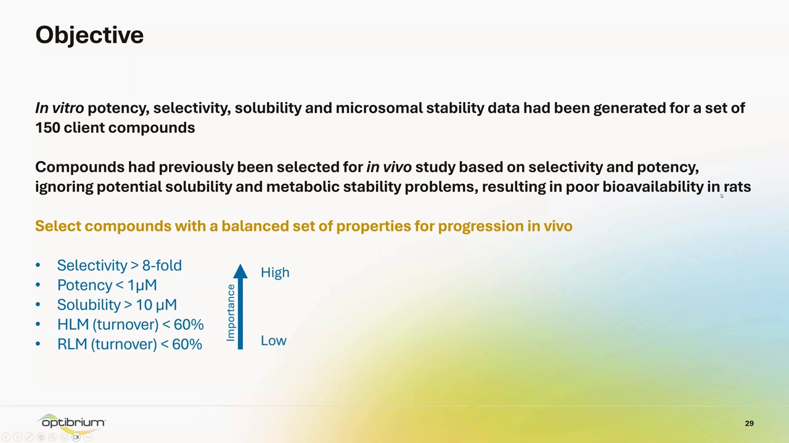

这是全场最有说服力的部分（[跳转到 27:31](https://www.youtube.com/watch?v=tnHi159GtmQ&t=1651)），而且**全部用实验数据，不含任何预测值**：150 个化合物，测了体外活性、选择性、溶解度和（人与大鼠）肝微粒体稳定性。

历史做法：主要按选择性和活性挑化合物进体内实验，忽略溶解度与代谢稳定性。后果：大鼠模型里口服生物利用度很差。

项目目标因此改为「挑出性质平衡的化合物」。判据按重要性从上到下排列：

| 判据 | 目标 | 相对重要性 |
| --- | --- | --- |
| 选择性（对脱靶） | 大于 8 倍 | 最高（本项目核心难点） |
| 活性 | 优于 1 μM | 高 |
| 溶解度 | 大于 10 μM | 中 |
| 人肝微粒体稳定性 | 转化率低于 60% | 较低 |
| 大鼠肝微粒体稳定性 | 转化率低于 60% | 最低 |

然后讲者做了三次排序，逐层加信息：

1. **Profile 1：只看活性 + 选择性**（历史做法，[跳转到 29:08](https://www.youtube.com/watch?v=tnHi159GtmQ&t=1748)）。化合物 **572** 达标（11 倍选择性、约 200 nM 活性），但它既不是最活性的也不是最选择性的，所以排在第 14 位，没进前列。
2. **Profile 2：同样的判据，但把不确定性算进去**。572 从第 14 升到第 7——因为它「稳稳达标」，而有些点估计更漂亮的化合物其实在阈值边缘摇摆。另一个化合物 **561** 从第 28 名升到第 12：它活性极好（略优于 100 nM），选择性 7 倍没到 8 倍，但**选择性是两个活性值之比，误差很大**，所以它达标的概率并不低。
3. **Profile 3：把全部体外数据纳入**（[跳转到 31:43](https://www.youtube.com/watch?v=tnHi159GtmQ&t=1903)）。

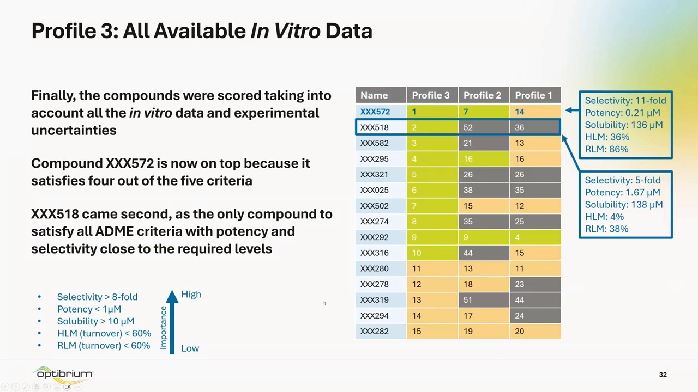

结果值得逐条看：

- **572 升到第 1**：选择性好、活性好、溶解度高（136 μM）、人肝微粒体稳定（36% 转化）。唯一短板是大鼠肝微粒体转化率偏高（86%）——而这恰好是重要性最低的一项。这就是「加权」的意义：短板落在低权重项上，不该否决全局。
- **518 从第 52 名（倒数）升到第 2**：它选择性只有 5 倍、活性 1.67 μM，两项都没达标，但**在误差范围内有相当概率达标**；同时它是溶解度最高的化合物之一（138 μM），人肝微粒体几乎不动（4%），大鼠肝微粒体也稳定（38%）。
- 最终这项研究找出了 **4 个被传统方法完全忽略的化合物**。其中 518 被推进体内测试，**PK 表现优于其他候选**，解决了项目一直头疼的生物利用度问题。
- 更有价值的是：518 是某个**全新骨架类型**的唯一代表。此前他们凭直觉做过这个骨架，因为活性、选择性不够就放弃了，再没探索。现在知道这个骨架能给出「可接受的活性 + 可接受的选择性 + 优秀的 ADME/PK」，项目就有了一条新路线：在这个「ADME 已经很好」的化学空间里，去优化他们本来就很擅长的活性与选择性。

这一段的说服力在于：**多参数优化不是让排序更精致，而是改变了「哪些化学值得投入」的判断**。被扔掉的不只是一个化合物，是一整片化学空间。

## 八、判据从哪来：没有先验知识时，从数据里学规则

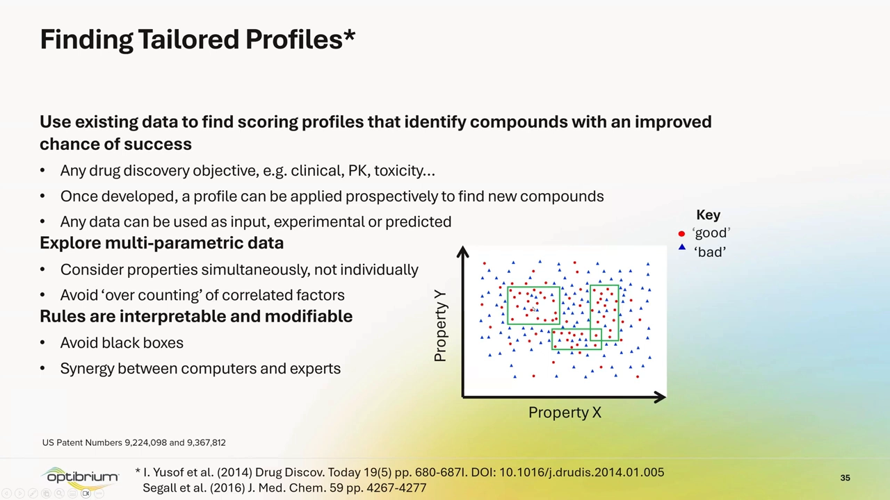

前面所有方法都假设你已经知道「什么算好」。但很多时候并不知道。讲者给了一条出路（[跳转到 35:00](https://www.youtube.com/watch?v=tnHi159GtmQ&t=2100)）：**用已有的好/坏标记数据，反推出判据**。

思路：在性质空间里找若干「盒子」（box），使盒子里好化合物比例显著高于外面。每个盒子就是一套判据（即一个 scoring profile），而且可以找到多个盒子，对应不同的取舍方案。

方法叫 **patient rule induction method（PRIM）**。它的目标函数有两个，彼此拉扯：

- **纯度**：盒子里好化合物相对坏化合物的比例（或某个连续指标的均值）要尽量高；
- **覆盖率**：盒子要覆盖足够比例的样本。只装一个好化合物的盒子毫无意义——它对那个化合物是完美判据，但无法推广到新化合物。

这就是经典的**特异性与灵敏度权衡**。此外，盒子边界也可以是软的（自动拟合软边），避免硬截断。

讲者强调三条性质，正好对应第一节的「可解释」要求：

- 规则**可解释**：能看出是哪些性质、什么范围；
- 规则**可修改**：化学家可以基于经验去调整，形成「计算机 + 专家」的协同，而不是接受一个黑箱的结论；
- **同时考虑多个性质**，因此不会重复计算相关因素（若把高度相关的几个指标各自独立计数，等于给同一个因素加了多次权）。

### 8.1 与 QSAR 的区别

提问环节有人问：这跟 QSAR 有什么不同？讲者的回答可以概括为三点：

1. **输入不同**：QSAR 是从结构预测某个性质；多参数优化是把「已有的性质数据」（实验或预测）与「成功判据」对照。两者是上下游关系——多参数优化可以调用 QSAR 模型来填补缺失的性质值。
2. **目标不同**：有人会想「干脆建一个 QSAR 模型直接预测临床成功」。讲者认为这非常困难：临床成功由太多因素驱动；而且数据极端不平衡——失败案例成千上万，成功案例寥寥无几，这样的数据很难训练出可靠模型。
3. **可解释性不同**：多参数优化给出的是「哪一项拖了后腿」这种可执行的诊断；而一个端到端的成功预测模型给不出这种信息。

## 九、设计阶段：修好一个问题，常常造出另一个

研讨会后半段是软件演示（约 39–51 分钟），用的数据集是 5-HT1A 靶标的约 300 个化合物，含实验活性与一批计算理化/ADME 性质。几个片段值得记录：

**只看活性会选错系列。** 单看活性分布，indenol 系列平均最活性，自然会成为首选。但把理化与 ADME 判据一起打分后，indenol 的总分分布反而很差（理化/ADME 有系统性问题），而 aminotetraline 系列里那些高活性化合物同时也有很好的理化/ADME 性质——它才是值得投入的系列。

**多维散点图不可读。** 讲者现场做了个五维散点图（活性 × 溶解度 × BBB，再按 hERG 上色、按 2C9 调大小），然后直说：这样的图我没法看出哪个化合物最好。这其实是对帕累托那节缺点的现场演示——维度一多，可视化本身就失效了，必须换成评分。

**蛇形图用于系列决策。** 在这个 300 化合物的集合里，最好的化合物成功率约 40%，但误差棒很大，**前 80 名之内无法可靠区分**。于是策略不是「选第一名」，而是：至少从四个系列里各取样一些，补测 ADME 实验数据把误差棒压小；另有两个系列可以**有把握地排除**。

**设计循环里的真实取舍。**（[跳转到 48:41](https://www.youtube.com/watch?v=tnHi159GtmQ&t=2921)）在 arylpiperazine 系列里挑出得分最高的化合物，看贡献分解发现短板是 hERG（pIC₅₀ 大于 6，即抑制偏强）。用「发光分子」视图看结构贡献：红色区域倾向增强 hERG 抑制，蓝色区域倾向减弱。据此把柔性连接臂上的碱性氮改成酰胺，hERG 抑制降低了约 0.6 个对数单位——但总分反而下降了：因为碱性降低同时**大幅削弱了血脑屏障穿透**，而这是 CNS 药物的关键要求。

这一段几乎是本小节的题眼：**在真正的多参数问题里，几乎不存在「只改善一个指标而不动其他指标」的修饰**。每一次结构改动都是一次多目标交换，评分的作用是让这个交换变得可见、可比较，而不是让它消失。

讲者还提到可以接入生成式化学：给定「我愿意替换分子这一端」的约束，让算法生成能提高总分的建议。这属于「设计—测试—学习」循环里的生成环节，但评分判据仍然是人工定义的。

## 十、几个实操结论

**缺失数据怎么处理**（[跳转到 53:39](https://www.youtube.com/watch?v=tnHi159GtmQ&t=3219)）。缺失值等价于「无限不确定」的值，直接纳入概率评分即可，它会自动表现为「分数中等、误差棒很大」。这带来一个很有用的行为：如果一个化合物其他各项都很好、只缺一项关键数据，它会得到「中等分数 + 大误差棒」，提示你去补测；如果它已经在四五项上失败，缺的那项补不补都救不回来，评分会自动给出「低分 + 小误差棒」，明确告诉你别浪费资源。

**误差估计要不要每项都做。** 讲者的态度是「有比没有好」：不必每个实验都有严格的标准误，哪怕去问做这个实验的生物学家「两个化合物的数值差多少你才认为是真的不同」，把这个粗略判断编码成不确定度，也远好于忽略不确定性。

**什么时候可以停。** 全场的隐含判据可以归纳成三条：

1. **能区分时才排序**：误差棒重叠的头部化合物之间不存在可信的先后，此时排序是自欺。
2. **有把握时才放弃**：只有当所有数据（含误差）都指向「这片化学里做不出平衡的化合物」时，才该转向。
3. **短板落在低权重项上时可以接受**：572 的大鼠微粒体稳定性不理想，但那是本项目重要性最低的判据，因此不构成否决。

需要说明的是，讲者并没有给出「候选化合物的完整标准清单」或剂量预测的完整流程；他只在复合指标一节提到人体剂量估计，并指出**它虽然合并了更多因素，仍然漏掉提名临床候选前必须看的许多项目**。换句话说，多参数优化负责「在给定判据下把化合物排好」，而判据本身（尤其是安全性、剂量覆盖这些下游要求）仍要由项目组按治疗目标去定义，这是本文需要与后续小节衔接的地方。

## 小结

- **单指标排序必然失败**：活性、选择性、溶解度、代谢稳定性之间存在结构性交换；把多个数压成一个数（LE、LLE、人体剂量）能提高可读性，但会丢掉维度、且往往隐含了不透明的目标假设。
- **帕累托前沿回答「谁支配谁」**：它不给出唯一最优，只给出互不支配的一组点；优点是先验平衡未知时能摊开所有取舍，缺点是维度一多就失效、且完全不处理不确定性。
- **期望函数把偏好写成曲线**：硬过滤只是阶跃型的特例；允许「不合格也有非零满意度」，并用落差表达重要性，就能避免在相似化合物之间画人为鸿沟。曲线形状可以由「给定测量值时的达标比例」从数据中估计（Caco-2 例子：低渗透仍有约 30% 达标）。
- **同一批数据、三种方法、三种名次**：9 化合物玩具集里，过滤法第 1 的化合物在期望函数下掉到第 6，概率评分下掉到最后。排序从来不是中立的。
- **不确定性是决策变量**：pKi 单次测定波动 0.3–0.7 个对数单位，logS 预测误差约 0.8；把点估计换成分布后，结论从「谁更好」变成「谁可以淘汰、谁在灰区、该去补哪个数据」。
- **概率评分输出两个数**：成功率与它的置信度；蛇形图用误差棒重叠与否告诉你「能不能分出高下」。
- **真实案例的教训**：只看活性与选择性导致大鼠生物利用度差；把全部体外数据与不确定性纳入后，一个排第 52 的化合物升到第 2，最终成为 PK 最优的候选，并打开了一个被放弃的新骨架。
- **设计阶段没有单赢的修饰**：把碱性氮改成酰胺降低了 hERG，却牺牲了血脑屏障穿透，总分反而下降。
- **判据可以从数据中学**（PRIM：纯度与覆盖率的权衡），但规则必须可解释、可修改；这与「用 QSAR 直接预测临床成功」是两件事。

## 关键术语速查

| 术语 | 一句话解释 |
| --- | --- |
| 多参数优化（MPO） | 同时考虑活性、选择性、理化、ADME、安全性等多个性质，寻找整体平衡而非单项最优 |
| 帕累托前沿 | 一组互不支配的解：改进任一指标都必须牺牲另一个 |
| 支配（dominated） | 若某点在所有指标上都不差、且至少一项更好，则它支配另一点 |
| 期望函数 | 把性质取值映射为 0 到 1 的满意度曲线，落差大小即该性质的重要性 |
| 概率评分 | 把期望满意度在性质的不确定度分布上积分，得到「达到目标的概率」 |
| 蛇形图 | 化合物按得分排序、每点带误差棒的图，用来判断「能否区分高下」 |
| 配体效率（LE） | 活性按重原子数归一，衡量「每个原子贡献多少结合能」 |
| 亲脂效率（LLE） | pIC50 减 logP，衡量活性提升是否只是靠增加亲脂性 |
| 人体剂量估计 | 把活性、清除率等合成一个预测的人体用药剂量，作为复合指标 |
| PRIM | patient rule induction method，在性质空间中寻找「好化合物富集」的盒子作为判据 |
| 覆盖率与纯度 | 规则覆盖多少样本、盒内好化合物占比多高，二者互相拉扯 |
| 灰区 | 两个化合物的可信区间都跨过阈值、无法用现有数据区分的情形 |