# AI 时代的逆合成：机会、陷阱与可合成性评分

> 视频来源：[Retrosynthesis in the AI era: opportunities and pitfalls](https://www.youtube.com/watch?v=I2cdBHaWDxE)（YouTube · ChemSpace 网络研讨会，讲者 Quentin Perron，Iktos 联合创始人兼 CSO，时长约 42 分钟）
> 本文覆盖这支演讲的主线：逆合成问题为什么难、切断规则从哪来、为什么"切得开"不等于"做得出来"、路线分数由什么构成，以及这些分数在设计流程里能当什么用、不能当什么用。字幕为 YouTube 自动生成，术语已按有机化学惯例订正（如「Spire」→ 产品名 Spaya、「radioselectivity」→ regioselectivity、「chemotherapy」→ chemoselectivity、「greenhouse」→ Grignard）。

## 本讲要解决的核心问题（SCQA）

**背景**：前面几个小节已经解决了"分子从哪来"和"哪个分子更值得做"——高通量筛选、DNA 编码库、片段筛选给出起点，多参数优化给出排序。但所有这些分子，最后都要有人在一个真实的通风橱里，用买得到的瓶子把它们做出来。

**冲突**：计算工具现在能对任意一个结构给出"可合成性"分数，甚至能直接画出一棵合成树。问题是这棵树经常是纸面上的：它可能在某一步把分子从化学上根本不会被切断的地方切开，可能假设了一个数据库里没有记载的选择性，也可能把某个中间体当成"买得到"，而那个中间体其实只是目录里的一条报价。

**疑问**：计算机到底怎么判断一个分子能不能合成？它给出的分数由什么构成？在哪一步开始，这个分数就不可信了？

**回答（中心思想）**：现代逆合成工具是三件东西的组合——**切断预测**（怎么把分子拆成前体）、**反应可行性判断**（拆出来的这一步在化学上成不成立）、**搜索策略**（在指数级膨胀的可能性里挑几条路走）。它输出的不是"能/不能"的判决，而是一组带分数的路线候选；分数主要由模型概率、适用域、步数与汇聚程度决定。真正的盲区不在"切不切得开"，而在**选择性**（化学选择性、区域选择性）和**数据里根本没有的信息**（试剂当量、温度、价格、放大）。因此这类工具的正确用法是当参谋：先批量筛掉明显做不出来的设计，再让人去判断剩下的那几条。

## 一、逆合成问题：把目标分子一路切到"买得到"为止

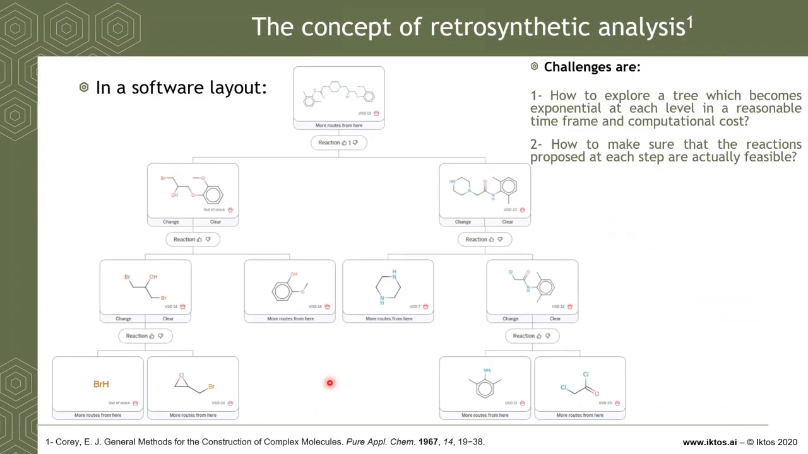

逆合成的概念本身很朴素：你有一个想做的分子，把它切成碎片，一直切到碎片都是**商业可得的起始原料**为止 [【跳转到 6:09】](https://www.youtube.com/watch?v=I2cdBHaWDxE&t=369)。讲者把这件事交给计算机的困难归结为两条：

1. **搜索树是爆炸的**：每个分子可以被切断的键有很多，切出来的每个子分子又能继续切，很快"可能性"就多到无法枚举。这既要时间，也要算力。
2. **每一步都要保证化学上成立**：切开的两块必须真的能在正确的位置上反应起来。切开容易，判断"这两块放在一起会不会反应、反应在哪个位点"才是难点 [【跳转到 6:34】](https://www.youtube.com/watch?v=I2cdBHaWDxE&t=394)。

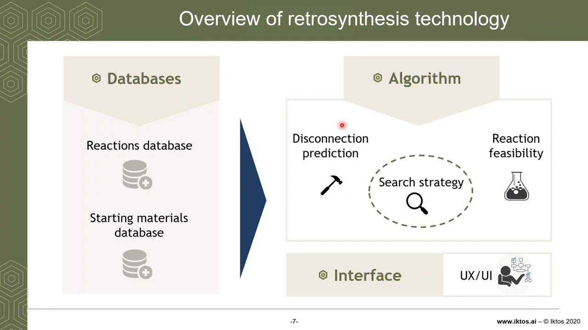

所以一个能用的系统需要四块积木，缺一不可 [【跳转到 8:06】](https://www.youtube.com/watch?v=I2cdBHaWDxE&t=486)：

| 积木 | 作用 | 缺了会怎样 |
| --- | --- | --- |
| 反应数据库 | 训练算法"学化学" | 模型没有化学可学 |
| 起始原料数据库 | 告诉搜索什么时候可以停 | 永远切不到底，或停在买不到的东西上 |
| 算法（切断 + 可行性 + 搜索） | 决定切哪、切得对不对、往哪走 | 树要么爆炸，要么全是废路线 |
| 界面 | 让化学家能看、能改、能存 | 结果无法落到实验台上 |

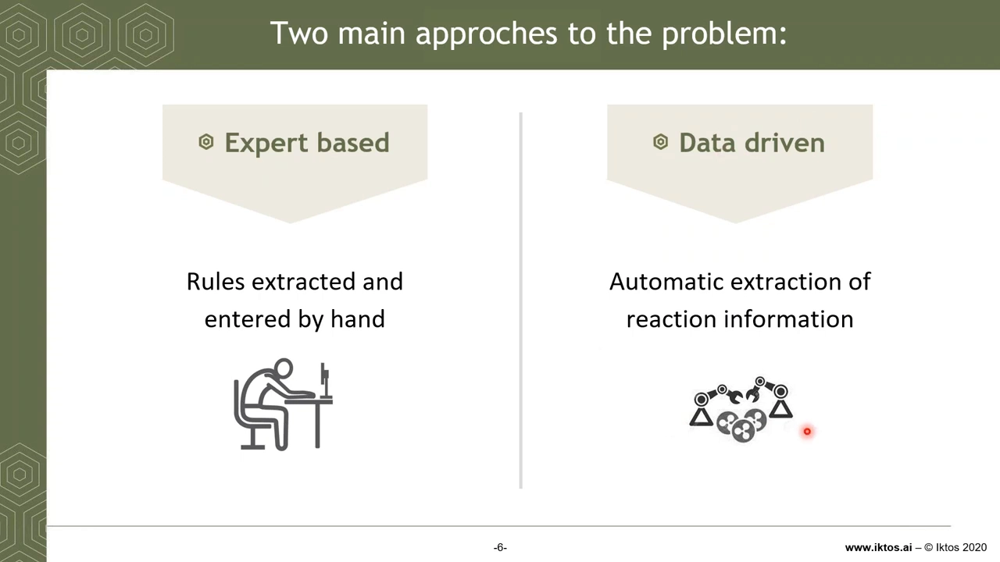

在"规则从哪来"这件事上，行业分成两派：**专家法**由化学家和化学信息学家人工编码反应规则，需要理解反应中心与反应环境；**数据驱动法**让算法自己从反应数据库里把化学抽出来——Iktos 走的是后者 [【跳转到 7:41】](https://www.youtube.com/watch?v=I2cdBHaWDxE&t=461)。这个选择决定了后面所有的优点和缺点：数据驱动的方法上限由数据决定，盲区也由数据决定。

## 二、切断规则从哪来：把专利反应洗成模板

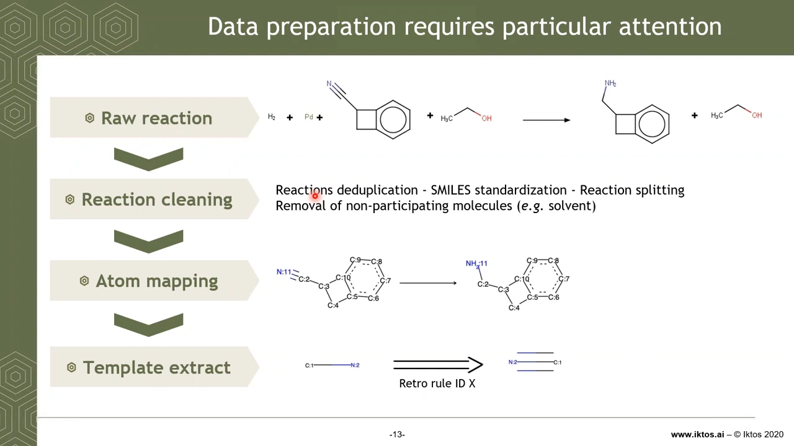

模板（template）听起来玄，讲者给的定义非常直白：**模板就是一条正则表达式**。比如"碳-氮单键可以由碳-氮三键加氢得到"，写成一条对 SMILES 生效的匹配规则；把这条规则套到目标分子上，就得到两个前体分子 [【跳转到 9:46】](https://www.youtube.com/watch?v=I2cdBHaWDxE&t=586)。

但模板不能凭空写，得从反应里抽。而**原始反应是脏的**：催化剂、试剂、溶剂有时写在反应物一侧，有时写在产物一侧，这些都会干扰原子映射。所以必须有一条全自动的清洗流水线 [【跳转到 10:31】](https://www.youtube.com/watch?v=I2cdBHaWDxE&t=631)：

1. **清洗**：去重、SMILES 标准化、拆反应、剔除不参与的分子（溶剂等）；
2. **原子映射**：把反应物和产物里的同一个原子对上号，才能看出"哪个键变了"；
3. **模板抽取**：把"变了的那个局部"抽成一条 retro rule。

讲者给的数字很能说明这条流水线的损耗：在 NextMove Software 提供的 Pistachio 数据库（自动抽取欧美专利）上，去重清洗后剩 **350 万条干净反应**，做完原子映射后抽出 **280 万条**，即约 **80%** 被成功利用；剩下的 20% 多半是抽取本身有问题或映射失败，只能扔掉 [【跳转到 12:11】](https://www.youtube.com/watch?v=I2cdBHaWDxE&t=731)。

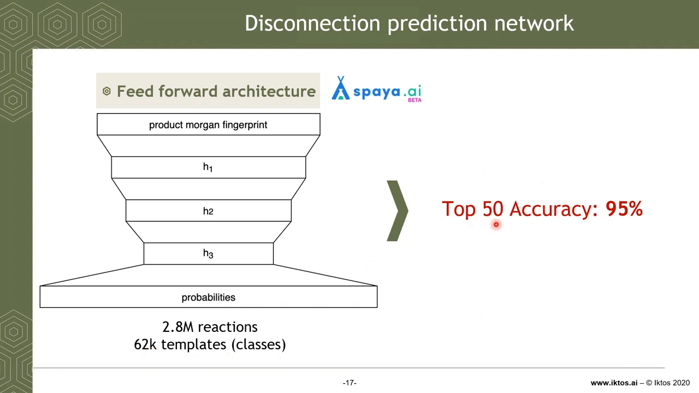

有了模板库，切断预测就变成一个**多分类问题**：输入产物分子的指纹，输出 6.2 万个模板各自的概率，取概率最高的前 50 条去套用。讲者给出的指标是 **Top-50 命中率 95%**——也就是说，文献里真正用的那条规则，有 95% 的概率落在这 50 条里 [【跳转到 13:26】](https://www.youtube.com/watch?v=I2cdBHaWDxE&t=806)。

这个 95% 很容易被误读，值得停一下：它衡量的是"正确答案有没有被排进候选集"，而不是"排第一的那条对不对"。候选集越大，这个指标越好看；真正昂贵的是后面那一步——从 50 条里挑出该用的那一条。

## 三、"切得开"不等于"做得出来"：模板到处套会切出荒唐的键

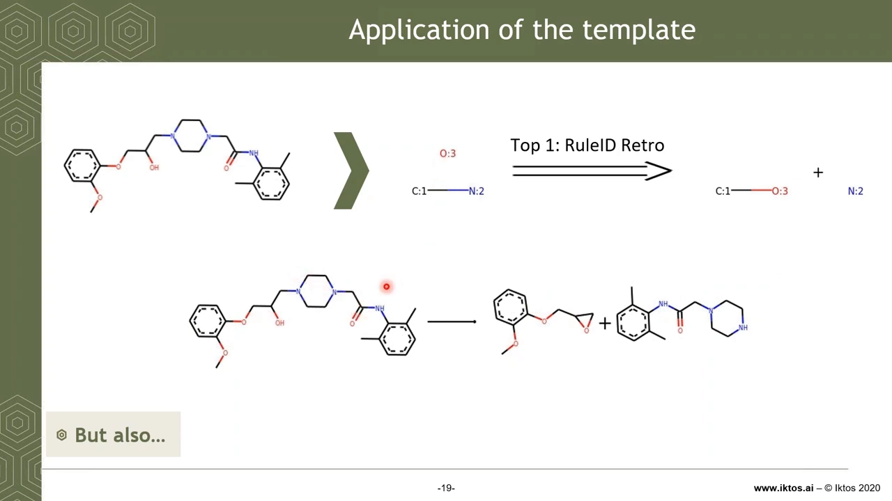

模板是局部规则，它只认"这一小片结构长什么样"，不认整个分子的环境。于是把一条模板套到雷诺嗪（ranolazine）上时，除了化学家认可的那一刀，还会在所有"氧 + 碳-氮"同时出现的位置切出各种**荒唐的切断**——这些在化学上根本不成立的连接，必须被剔除 [【跳转到 14:46】](https://www.youtube.com/watch?v=I2cdBHaWDxE&t=886)。

更麻烦的是另一类：切断在纸面上说得通，但**在实验室里没人愿意做**。讲者举的例子是某条规则提议对吲哚做傅-克反应（Friedel-Crafts）——"也许是个好主意，也许不是，但如果我进实验室对吲哚做傅-克，我可能会有一堆麻烦" [【跳转到 15:11】](https://www.youtube.com/watch?v=I2cdBHaWDxE&t=911)。这就是"可合成性"里最难量化的部分：不是不可能，而是**不划算、不可靠、没人愿意碰**。

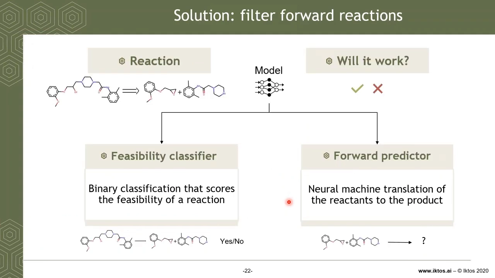

业界对这个问题有两条思路 [【跳转到 15:36】](https://www.youtube.com/watch?v=I2cdBHaWDxE&t=936)：

- **可行性分类器**（feasibility classifier）：用真实反应当正样本，把起始原料和模板随机组合造出"假反应"当负样本，训练一个二分类模型判断"这步反应会不会成立"。Segler 的工作是这一类。
- **正向预测器**（forward predictor）：从起始原料出发预测产物，如果预测出来的产物正好是你要的那个分子，说明这条切断说得通。Schwaller 用分子 transformer 做这件事。

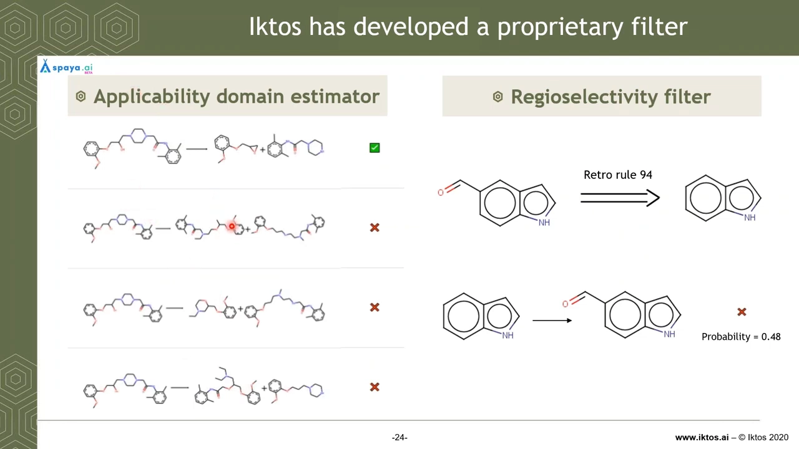

Iktos 把这件事拆成两个专用算法：**适用域估计**（判断这条切断是否落在模型可信的化学范围里）和**区域选择性过滤器**（一旦检测到可能的选择性问题就介入）[【跳转到 16:51】](https://www.youtube.com/watch?v=I2cdBHaWDxE&t=1011)。截图里能看到具体形态：同一个分子的多条切断里，只有一条通过适用域检查；而区域选择性过滤器给某个反应打出 **0.48** 的概率，等于告诉化学家"这一步不靠谱" [【跳转到 17:41】](https://www.youtube.com/watch?v=I2cdBHaWDxE&t=1061)。

这两个过滤器的细节讲者没有公开（属于专有部分），但它们的**存在本身**就是本节最该记住的信息：一个可用的逆合成系统，切断模型和过滤器是两件事，后者往往才是决定路线能不能进实验室的那一半。

## 四、真正的硬骨头是选择性，而选择性常常不在数据里

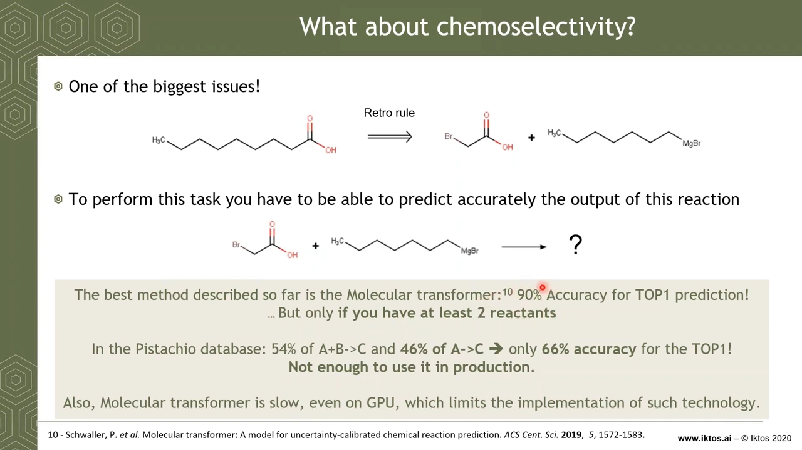

讲者把化学选择性称为"最大的问题之一"。例子极其具体：把一个格氏试剂加到同时含有醛、酮、酯的分子上，如果只加**一当量**，格氏试剂会被酸性质子淬灭，反应不成；加**两当量**才work。而数据库里通常没有这种信息 [【跳转到 18:06】](https://www.youtube.com/watch?v=I2cdBHaWDxE&t=1086)。它还依赖溶剂和温度：零度能做的反应，零下 20 度可能就不做。

用正向预测来解决这条路也有明确的天花板。分子 transformer 号称 Top-1 准确率 90%，但**前提是反应至少有两个反应物**；在 Pistachio 数据库里，双反应物反应占 54%、单反应物反应占 46%，混在一起算，Top-1 只有 **66%**——讲者的判断是"这个水平不能上生产" [【跳转到 19:21】](https://www.youtube.com/watch?v=I2cdBHaWDxE&t=1161)。另外这类模型要跑在 GPU 上，架构复杂且慢，而他们需要的是快。

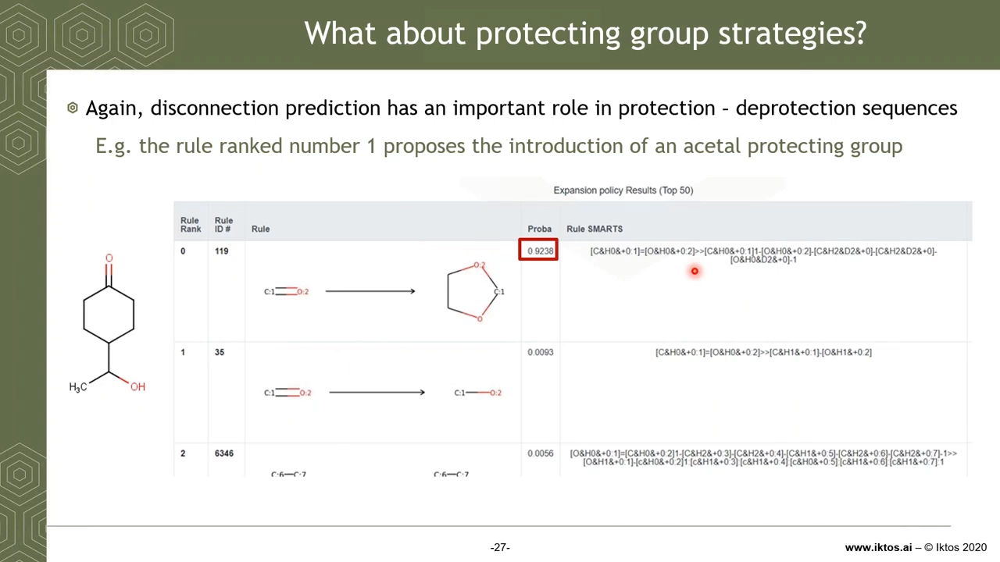

不过讲者给了一个让人意外的正面结论：**一个好的切断模型能部分绕开选择性问题**。因为模型是从真实反应里学的，它知道化学家实际怎么做——比如同一个分子，模型给出的最高概率路线不是直接还原酮，而是先上缩醛保护基（概率 **0.9238**），而直接还原酮的概率只有 **0.0093** [【跳转到 21:39】](https://www.youtube.com/watch?v=I2cdBHaWDxE&t=1299)。换句话说，保护基策略这种"化学家的手艺"，只要在数据里出现过，模型就能学到。

系统还留了两个人工反馈通道：用户可以对某条切断点"赞/踩"，也可以把满意的路线保存下来——保存这个动作本身就在告诉系统"这条切断成立" [【跳转到 22:04】](https://www.youtube.com/watch?v=I2cdBHaWDxE&t=1324)。

## 五、搜索与排序：分数是怎么算出来的

在切断与可行性之后，第三块是搜索。Iktos 用强化学习驱动蒙特卡洛树搜索（MCTS），讲者用"吃豆人"打比方：在一个有怪物、有奖励的迷宫里，根据当前状态和奖励决定往哪走 [【跳转到 23:08】](https://www.youtube.com/watch?v=I2cdBHaWDxE&t=1388)。他们的一个特点是这套 MCTS **与数据库强耦合、有记忆**：今天做不通的路线，明天如果有人补了某个中间体，算法就能利用；他们也已经把整个 Camber 数据集预先跑过一遍逆合成，所以新分子进来时算法"大概知道该往哪走"，从而又快又能给出多样的解 [【跳转到 24:04】](https://www.youtube.com/watch?v=I2cdBHaWDxE&t=1444)。

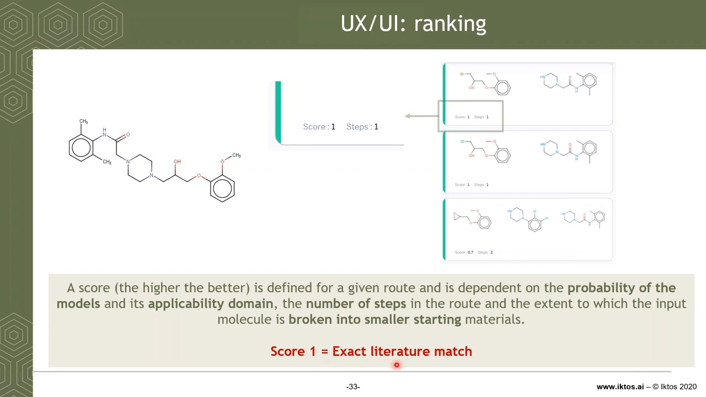

搜索出来的路线怎么排序？讲者给了一个统一分数，**越高越好，1 分表示与文献精确匹配**；非 1 分的分数同时考虑四件事 [【跳转到 25:04】](https://www.youtube.com/watch?v=I2cdBHaWDxE&t=1504)：

1. 模型给出的概率；
2. 适用域估计的结果；
3. 路线步数——越短分越高；
4. 分子被切碎的程度、路线的**汇聚程度**（convergency）。

第 4 条值得展开，因为它是化学家判断路线好坏的核心直觉之一，而讲者只是一句带过：**汇聚式路线**（先分别做两个较大的片段，最后一步拼起来）通常优于**线性路线**（一步一步往上接）。原因是收率的数学——若每一步收率为 $y_i$，一条 $n$ 步路线的总收率是各步之积：

$$
Y_{\text{total}} = \prod_{i=1}^{n} y_i
$$

（这一段的收率公式与下面的讨论是**补充背景**，讲者本人没有展开推导。）举例：每步 80% 收率，线性做 10 步，总收率 $0.8^{10}\approx 10.7\%$。需要说清的是，**汇聚式并不会改变这个乘积**——把 10 步拆成两条 5 步支路再拼一刀，总步数反而变成 11 步，理论总收率还略低。汇聚式真正的价值在别处：**最长线性序列变短**（两条支路并行，时间从 10 步缩到 6 步），**风险被分摊**（一条支路失败不会毁掉另一条已经做出来的片段），以及**中间体可以囤货**（同一个高级中间体喂给整个类似物系列）。这就是为什么"步数"和"汇聚度"会同时进入路线分数，而它们衡量的其实是不同的事：前者是总工作量，后者是时间与风险。

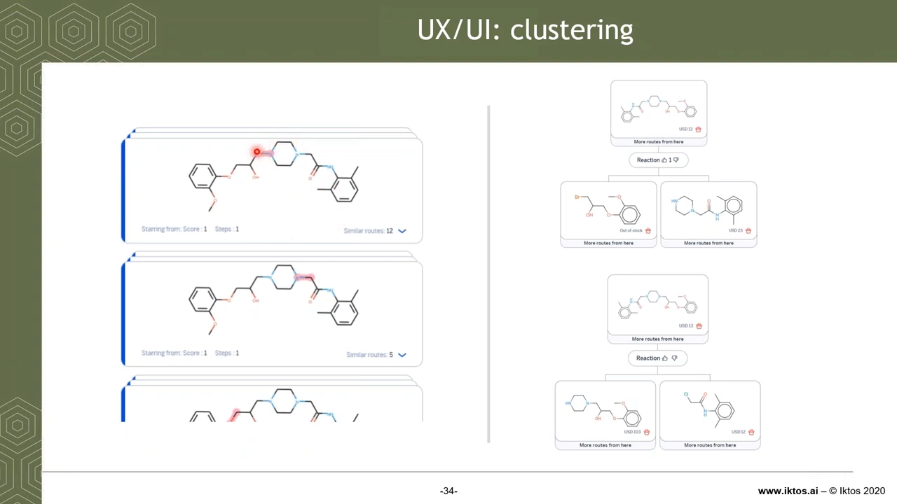

界面上的另一个设计是**聚类**：路线太多时，按"第一步逆合成切断"（也就是正向合成的最后一步）分组，每组显示组内最高分 [【跳转到 25:54】](https://www.youtube.com/watch?v=I2cdBHaWDxE&t=1554)。这个分组方式对设计很有用——同一组的路线往往共享同一个关键中间体，只是起始原料不同；而不同组意味着完全不同的策略。讲者建议的读法是：先看最高分的组，再判断这个组的"第一步切断"落在分子的哪个位置，因为那个位置决定了你后面能引入什么多样性。

## 六、可合成性评分怎么反作用于设计：从"事后检查"变成"设计约束"

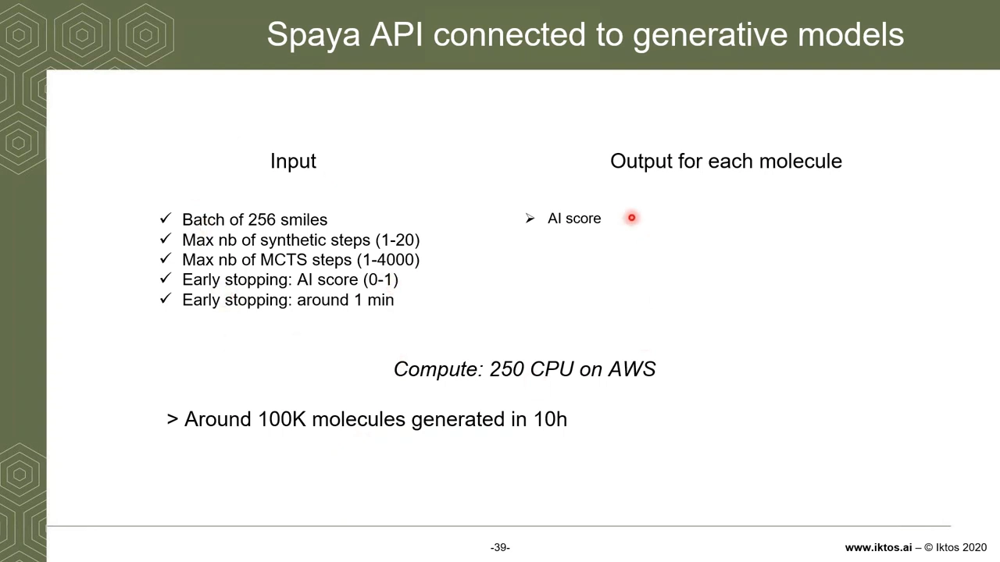

这一节最实用的信息是：可合成性评分已经可以**批量、在线**地算，因此可以在设计阶段就当作约束，而不是等分子设计完了再去检查。

- API 的输入是一批 SMILES，加上若干约束：最大合成步数（1–20）、最大 MCTS 步数（1–4000）、按 AI 分数提前停止（0–1）、按时间提前停止；输出是每个分子的 **AI 分数**与**最短路线步数** [【跳转到 27:31】](https://www.youtube.com/watch?v=I2cdBHaWDxE&t=1651)。
- 算力账：平均每个分子每个 worker 约 **3 秒**，1 个 worker = 6 个 CPU；在 AWS 上 250 CPU 时约 **5 万分子/小时**，扩到 1000 CPU 可到 **20 万分子/小时**，且不需要改架构 [【跳转到 28:46】](https://www.youtube.com/watch?v=I2cdBHaWDxE&t=1726)。
- 与生成模型闭环：每次送 256 个 SMILES 进去打分，把分数回灌给生成模型做奖励；受"最慢的那个分子"拖累会慢一点，但 10 小时左右仍能生成约 **10 万个**分子 [【跳转到 29:36】](https://www.youtube.com/watch?v=I2cdBHaWDxE&t=1776)。

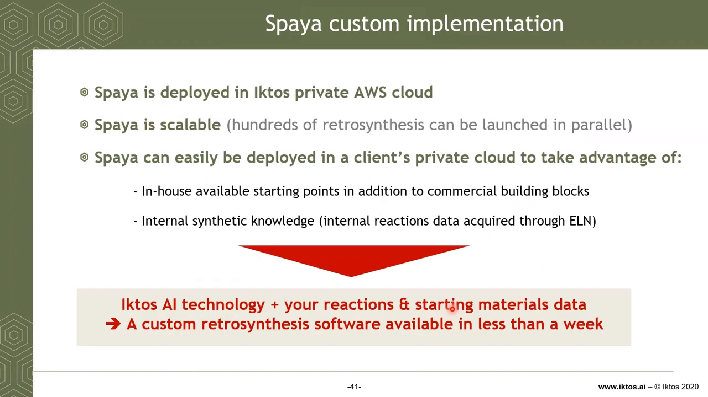

对工业界更有意义的是**定制**：把系统部署进客户私有云，接入公司**自己的起始原料库存**和 **ELN 里的内部反应数据**，一周内就能得到一个贴合自家化学的版本 [【跳转到 31:41】](https://www.youtube.com/watch?v=I2cdBHaWDxE&t=1901)。这一条直接对应"实验可获得性反作用于设计"：当系统知道"我们仓库里有这 20 个中间体"，它给出的路线就会集中在这些中间体附近，而不是建议你去买一个报价 12 周、每克几千块的 building block。

还有一个专门为**系列化合物**设计的功能：给 100 个结构类似的类似物，让它找关键中间体，目标是"5 步做中间体 + 每步各做 1 个类似物"，总步数从 100 个分子各自独立合成时的上千步压到约 105 步 [【跳转到 30:26】](https://www.youtube.com/watch?v=I2cdBHaWDxE&t=1826)。这正是药物化学做 SAR 时的真实诉求：不是把每个类似物都从头做一遍，而是把差异放在最后一两步。

## 七、这些分数不能替代什么

讲者自己反复强调"Spaya 并不完美"，把这场演讲的标题里"陷阱"两个字落到实处。把散落在各处的限制收拢起来，就是一份使用说明书：

| 盲区 | 具体表现 | 后果 |
| --- | --- | --- |
| 选择性 | 化学选择性、区域选择性依赖当量、溶剂、温度，数据库里常常没有 | 路线在纸面成立，进实验室失败 |
| 单反应物反应 | 正向预测 Top-1 在双反应物时 90%，混入单反应物后降到 66% | 无法用于生产级自动判断 |
| 数据覆盖 | 模板只能提出模板库覆盖过的化学 | 真正新颖的切断提不出来 |
| 数据质量 | 原始专利反应脏，约 20% 无法成模板 | 部分化学根本没有进入模型 |
| 价格与库存 | 价格来自目录报价，库存状态会变 | "买得到"是某一时刻的快照 |
| 放大与工艺 | 分数不含安全、结晶、杂质谱、绿色化学 | 毫克级可行不等于公斤级可行 |

最后一条需要说明：讲者**没有**讨论工艺放大，本文也不展开。但把"可合成性"当成一个二元判断是危险的——它至少有四个层级：**纸面上有路线**、**文献里有先例**、**实验室里做得出毫克级**、**工厂里做得出公斤级**。逆合成工具的分数大致覆盖前两层，偶尔触及第三层，对第四层基本无话可说。

## 小结

- 逆合成 = **切断预测 + 反应可行性 + 搜索策略**，再配一个能让人改路线的界面；缺任何一块都不成系统。
- 切断规则的来源决定了能力边界：模板是从清洗过的专利反应里抽出来的正则表达式，**Top-50 命中率 95%** 只说明答案在候选集里，不说明排第一的对。
- 模板到处套会切出化学上不成立的连接，所以必须有**可行性过滤器**；Iktos 的做法是适用域估计 + 区域选择性过滤，后者会直接给出类似 0.48 的否决概率。
- 最硬的骨头是**选择性**：格氏试剂的当量、溶剂与温度，这些信息常常不在数据库里；正向预测在单反应物反应上只有 66% Top-1，上不了生产。
- 但好模型能**部分绕开**选择性问题——它会像化学家一样先上保护基（缩醛 0.9238 对直接还原 0.0093）。
- 路线分数 = 模型概率 × 适用域 × 步数 × 汇聚度，**1 分等于文献精确匹配**；步数与汇聚度之所以重要，是因为总收率是各步收率之积。
- 可合成性评分可以批量算（3 秒/分子/worker，250 CPU 约 5 万/小时），因此能从"事后检查"变成"设计约束"，甚至接进生成模型的奖励函数。
- 但分数只覆盖"有路线、有先例"，不覆盖"做得出来、放得大"；把可合成性当二元判断，是这类工具最常见的误用。

## 关键术语速查

| 术语 | 一句话解释 |
| --- | --- |
| 逆合成分析（retrosynthesis） | 从目标分子出发反复切断，直到所有片段都是可得的起始原料 |
| 切断（disconnection） | 在逆合成方向上"断开"一根键，得到一组前体分子 |
| 模板 / retro rule | 描述某类键如何由前体生成的局部规则，实现上就是一条对 SMILES 的正则 |
| 原子映射（atom mapping） | 把反应物与产物中同一个原子对应起来，从而看出哪些键发生了变化 |
| 适用域估计（applicability domain） | 判断一条切断是否落在模型训练数据覆盖的化学范围内 |
| 化学选择性 / 区域选择性 | 同一分子有多个可反应位点时，反应"只在该去的地方发生"的能力 |
| 汇聚式路线（convergent） | 先分别制备若干片段再拼接，区别于一步一步往上接的线性路线 |
| MCTS | 蒙特卡洛树搜索，用"选择—扩展—模拟—回传"在巨大搜索树里分配算力 |
| AI score | 工具给出的路线总分，越高越好，1 分表示与文献路线精确匹配 |