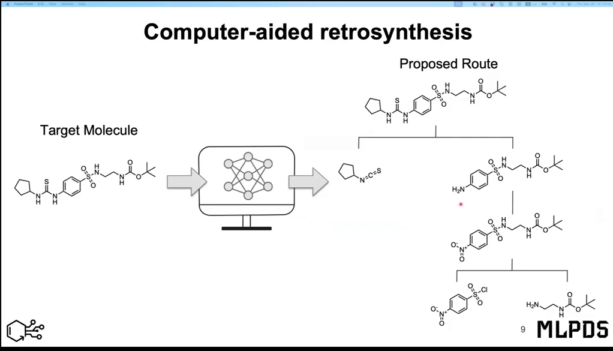
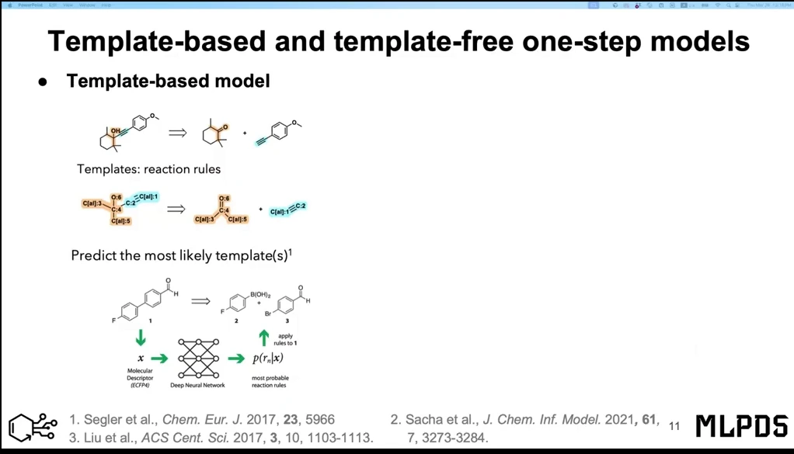
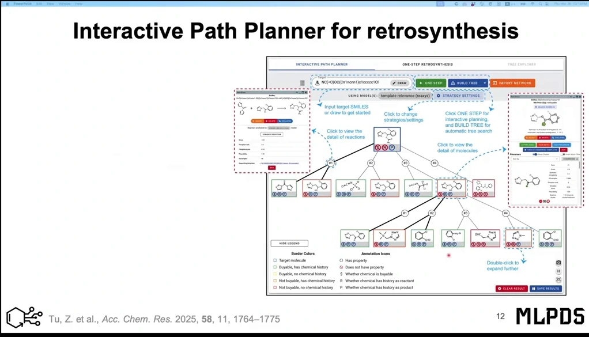
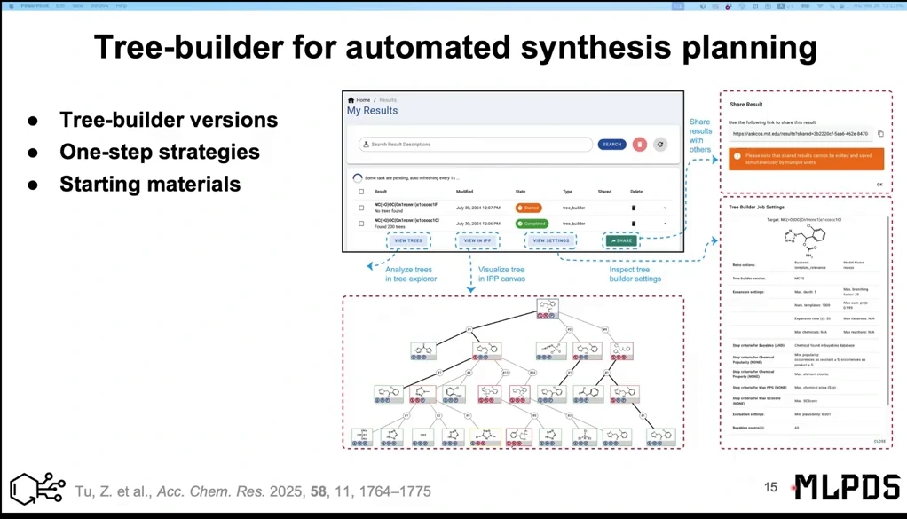
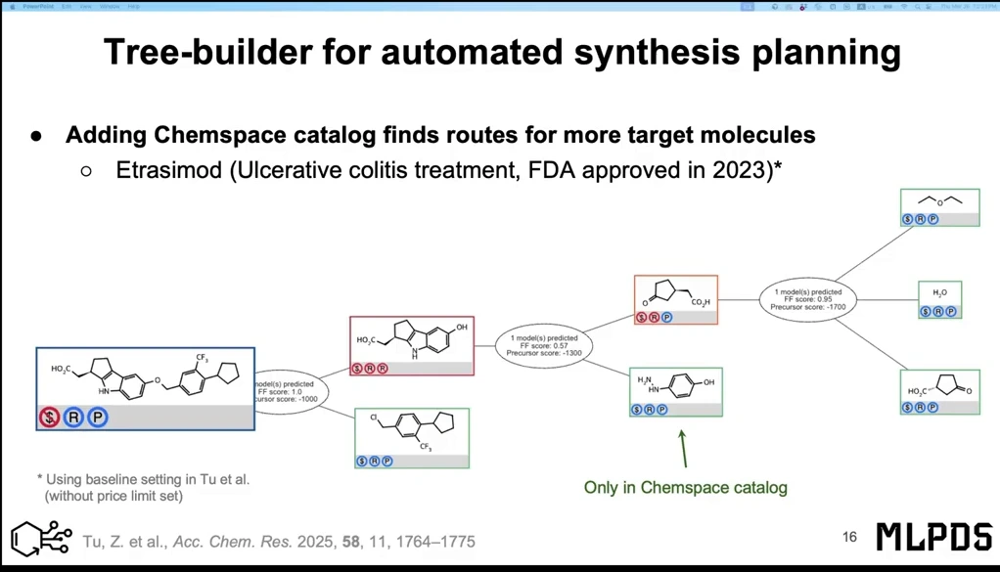
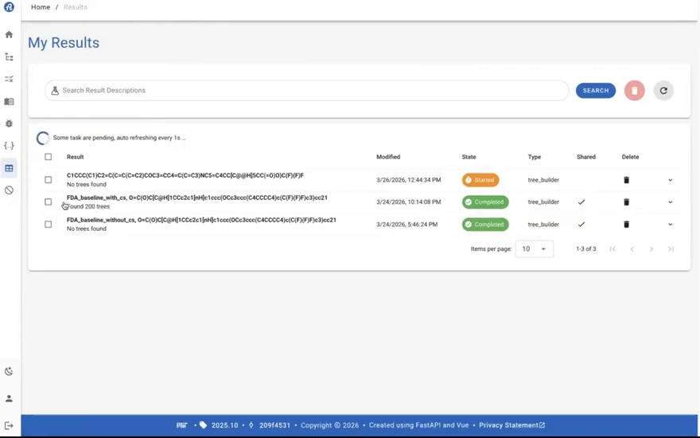
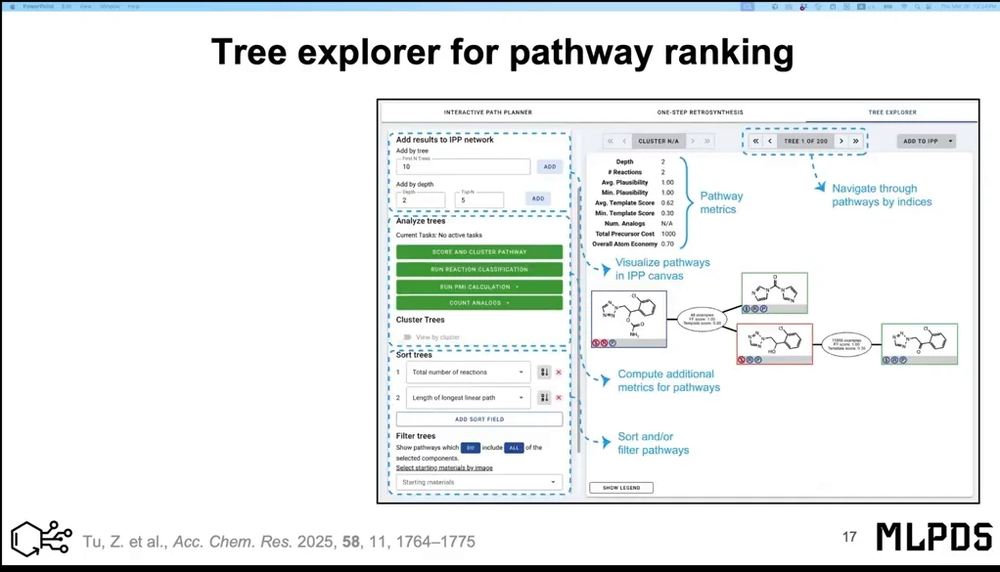
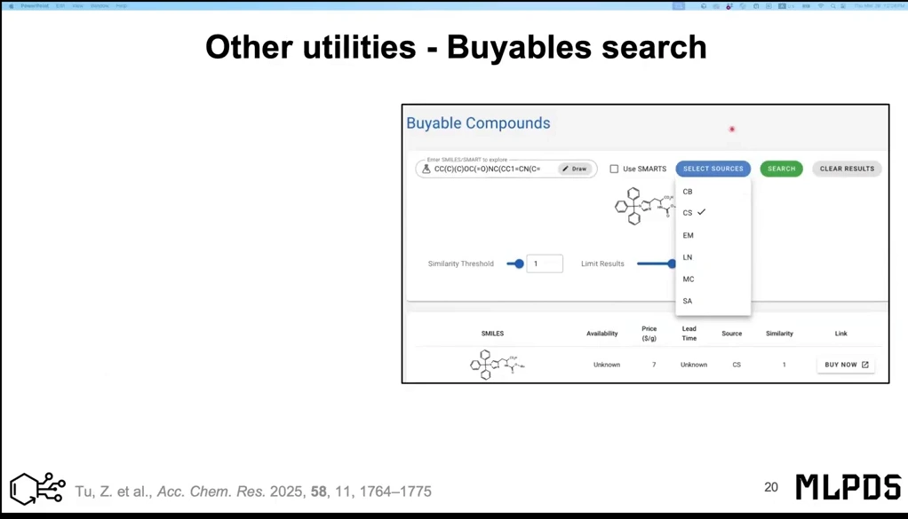
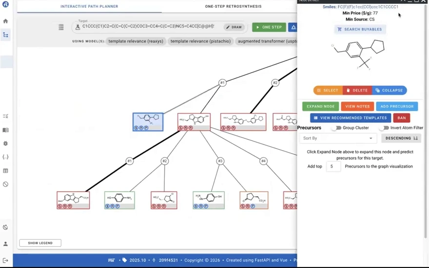
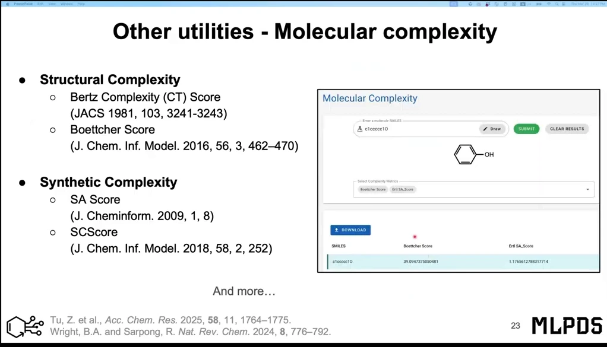

# 买得到才做得出来：ASKCOS 与 ChemSpace 的合成规划整合

> 视频来源：[Integration Of Chemspace Into The ASKCOS Platform To Facilitate Synthesis Planning](https://www.youtube.com/watch?v=U4XJkoiL3jQ)（YouTube · ChemSpace 网络研讨会，讲者 Connor Coley 与 Jihye 李，MIT Coley 课题组 / ASKCOS 团队，时长约 50 分钟）
> 本文覆盖这支研讨会的技术主线：计算机辅助合成规划怎么定义"可得"、把商业 building block 目录接进规划器之后发生了什么、路线排序看哪些指标，以及"买得到"与"做得出来"之间那条常被忽略的界线。字幕为 YouTube 自动生成，术语已按化学惯例订正（如「ASCOS/ASKES」→ ASKCOS、「Camber」→ Camber、「atracurium」→ etrasimod、「Bible lookup」→ buyable lookup）。

## 本讲要解决的核心问题（SCQA）

**背景**：上一节讲过，逆合成工具会从目标分子一路切断，直到所有片段都是"商业可得的起始原料"。整套逻辑的终点，就落在这句话上。

**冲突**：可是"商业可得"到底由谁定义？如果规划器认为某个片段可以买到，而它其实不在任何供应商的目录里，那整条路线就是一张空头支票——纸面上十步做完，实验台上第一步就卡住。反过来，目录里多出一个 building block，能解锁的路线可能成百上千，而算法一行没改。

**疑问**：把商业目录接进合成规划工具，究竟改变了什么？"买得到"和"做得出来"之间还差几道关？

**回答（中心思想）**：在合成规划里，**"可得"是一个可以被工程化的判据**——它由"终止节点怎么定义"决定：是哪些 building block 集合、允许多少钱一克、允许多少个碳。把 ChemSpace 的目录接进 ASKCOS 之后，同一个分子从"找不到任何路线"变成"找到 200 棵树"，差别不在算法而在库存 [【跳转到 44:25】](https://www.youtube.com/watch?v=U4XJkoiL3jQ&t=2665)。但目录只解决"买得到"，路线排序指标（步数、前体成本、可塑性、模板分、原子经济）解决"值不值得做"，而"做得出来"——选择性、条件、放大——仍然要靠正向预测工具和化学家来兜底。

## 一、计算机辅助合成规划的目标：用买得到的片段拼出目标分子

讲者把目标定义得很干脆：**给定一个目标分子，提出若干条合成路线，而这些路线要由某种组合的商业可得 building block 拼出来** [【跳转到 13:35】](https://www.youtube.com/watch?v=U4XJkoiL3jQ&t=815)。做法是反复应用"一步逆合成模型"——输入产物，输出一组前体——直到所有叶节点都落进 building block 集合。

模型的家族可以分成两大类 [【跳转到 14:25】](https://www.youtube.com/watch?v=U4XJkoiL3jQ&t=865)：

| 类型 | 原理 | 优点 | 局限 |
| --- | --- | --- | --- |
| 模板法（template-based） | 从反应数据里抽出"产物子结构→反应物子结构"的规则，再预测哪条规则适用于当前产物 | 规则可**回溯到文献**：能查到这条反应的实际条件与操作步骤 | 只能提出模板库覆盖过的化学，模板之外的新反应提不出来 |
| 无模板法（template-free） | 把分子当图（原子是节点、键是边）或当字符串，直接"翻译"成反应物 | 不受模板边界限制 | 少了文献锚点，可信度需要另外验证 |

ASKCOS 里两类都提供，具体的一步策略包括 [【跳转到 16:30】](https://www.youtube.com/watch?v=U4XJkoiL3jQ&t=990)：模板相关性（template relevance，模板法）、增强 transformer（序列到序列）、graph-to-SMILES，以及三种非机器学习策略——模板枚举（把模板集里所有模板穷举套一遍）、RetroSim（找数据集中相似产物，套用它们的模板）、Exact Match（直接查文献精确先例）。训练数据可选 Reaxys、USPTO、Pistachio、BKMS（酶催化反应专用）[【跳转到 18:10】](https://www.youtube.com/watch?v=U4XJkoiL3jQ&t=1090)。

这个界面的图例值得单独看一眼，因为它把"可合成性"拆成了两个正交维度 [【跳转到 16:55】](https://www.youtube.com/watch?v=U4XJkoiL3jQ&t=1015)：

- **可买 / 不可买**（buyable or not）：这个分子在目录里有没有报价；
- **有化学史 / 无化学史**（has chemical history or not）：这个分子在文献或专利里有没有被合成过。

四象限里最危险的是"**可买、但无化学史**"——目录里有报价，却没人发表过合成路线，说明它的可得性依赖供应商的一条内部工艺，你既看不到也验证不了；最舒服的是"可买、有化学史"，价格和路线都有据可查。而"不可买、有化学史"恰恰是设计的富矿：文献里有人做过，说明化学上成立，只是没有商品化，可以自己合成或委托合成。

## 二、ASKCOS 是什么：开源、可私有部署、可替换数据

讲者花了几分钟讲历史，但这段历史解释了它为什么适合与商业目录对接。ASKCOS 起源于 DARPA 的 **Make-It** 项目——一个把"AI 辅助合成规划"与"流动化学、连续合成"结合起来的大型计划，当年的演示是机械臂自己组装流路完成合成 [【跳转到 7:54】](https://www.youtube.com/watch?v=U4XJkoiL3jQ&t=474)。项目结束后，团队把"数据驱动的合成规划"从机器人执行里解耦出来，成立了 MIT 的 MLPDS 产学研联盟继续推进 [【跳转到 9:57】](https://www.youtube.com/watch?v=U4XJkoiL3jQ&t=597)。

今天它是一个**开源软件套件**：公共网页版免费使用（ascos.mit.edu），代码在 GitLab 上，已有超过 **35,000 名用户** [【跳转到 11:37】](https://www.youtube.com/watch?v=U4XJkoiL3jQ&t=697)。开源带来的关键能力是**私有部署**——你可以把它装进自己的环境，换成内部的反应数据训练模型，或者加入**自己的 building block 库** [【跳转到 12:02】](https://www.youtube.com/watch?v=U4XJkoiL3jQ&t=722)。这一条对工业界尤其重要：一家公司的"可得"从来不是公共目录，而是"我们仓库里有什么 + 我们和哪几家供应商有框架协议"。

## 三、把"可得"写进搜索的终止条件

多步搜索（tree builder）会自动完成"选节点→扩展→回传更新"的循环，直到找到完整路线 [【跳转到 19:25】](https://www.youtube.com/watch?v=U4XJkoiL3jQ&t=1165)。真正决定结果形态的是设置里的三组参数 [【跳转到 20:15】](https://www.youtube.com/watch?v=U4XJkoiL3jQ&t=1215)：

1. **一步策略**：用哪个模型、哪个数据集，可以多个混用；
2. **终止节点定义**：什么算"起始原料"。可以只认 ChemSpace 的 building block（界面上缩写为 **CS**），也可以认 ChemSpace 加其他来源的混合集合；还可以不用来源，改成结构规则，比如"碳原子数不超过 5 的片段"；
3. **搜索参数**：允许跑多久、搜索深度多少。公共网页版的**默认深度是 5 步**，可以调大以寻找更长的路线 [【跳转到 30:23】](https://www.youtube.com/watch?v=U4XJkoiL3jQ&t=1823)。

这三组参数里，第 2 组是本节的核心。**"可合成性"在算法里不是分子的属性，而是搜索的终止条件**：同一棵树，把终止条件从"任意 building block"换成"ChemSpace 目录里的 building block"，能走通的路线集合就变了。讲者还提到可以给前体设**价格上限**，这等于把"太贵"这个化学家天天挂在嘴边、却很少写进算法的判据，变成了一个可执行的约束。

## 四、目录决定成败：一个分子，两种命运

讲者给的核心例子是 **etrasimod**（溃疡性结肠炎治疗药，2023 年获 FDA 批准）。在**没有**接入 ChemSpace building block 目录时，树搜索对这个分子**找不到任何路线**；接入之后，它给出了多条路线，其中最短的一条里有一个中间体**只存在于 ChemSpace 目录**中 [【跳转到 21:30】](https://www.youtube.com/watch?v=U4XJkoiL3jQ&t=1290)。

这个对比在结果页上看得更直白：同一个目标分子，带 ChemSpace 目录的那次跑出 **200 棵树**，不带的那次显示 **No trees found** [【跳转到 44:25】](https://www.youtube.com/watch?v=U4XJkoiL3jQ&t=2665)。

这件事的意义超出了"多了一个供应商"。它说明：**可合成性判断的失败，很多时候不是化学的失败，而是库存的失败**。一个分子被判"做不出来"，可能只是因为它需要的那个片段恰好没进你的目录；而目录是可以买的——这是整场演讲里最实用的一条工程结论。

## 五、路线排序：从"有没有路"到"哪条路值得做"

树搜索一次可能返回**几百条**路线，所以排序比生成更关键。ASKCOS 的树浏览器给出的指标是一张相当完整的判据清单 [【跳转到 22:20】](https://www.youtube.com/watch?v=U4XJkoiL3jQ&t=1340)：

| 指标 | 含义 | 化学家为什么在意 |
| --- | --- | --- |
| 深度（Depth） | 最长线性序列的步数 | 步数越多，总收率按 $\prod_i y_i$ 掉得越快，时间也越长 |
| 反应数（# Reactions） | 整棵树里的反应总数 | 反映总工作量，与深度不同 |
| 平均/最低可塑性（Plausibility） | 每步反应的可信度评分及其最差值 | **最低值**才是风险所在：一条路线里最烂的那一步决定成败 |
| 平均/最低模板分（Template Score） | 所用模板的匹配质量 | 模板分低意味着"这一步只是勉强套上" |
| 类似物数（Num. Analogs） | 该路线能顺带做出多少类似物 | 做 SAR 时，一条能通向整个系列的路线远比一条只能做一个分子的路线值钱 |
| 前体总成本（Total Precursor Cost） | 所有起始原料的价格之和 | 直接对应"买不买得起" |
| 总体原子经济（Overall Atom Economy） | 各步原子经济的综合 | 与废物产生量、绿色化学相关 |

除了排序，还可以**过滤**：指定必须包含某个起始原料或某个中间体，只看经过它的路线 [【跳转到 22:45】](https://www.youtube.com/watch?v=U4XJkoiL3jQ&t=1365)。这个功能在实际项目里非常有用——如果实验室的架子上正好有 10 克某个中间体，你只想看"怎么把它用掉"，而不是看一堆从零开始的美妙路线。

## 六、买得到 vs 做得出来：价格、来源与库存

ASKCOS 里有一个独立的"买得到查询"（buyable search）页面：可以用 SMILES 做精确查询，也可以用相似性阈值找类似物，还可以用 SMARTS 做子结构搜索；来源可以多选（ChemSpace 在其中缩写为 CS）[【跳转到 24:31】](https://www.youtube.com/watch?v=U4XJkoiL3jQ&t=1471)。结果表里给出的字段很实在：**可得性、价格（美元/克）、货期、来源**，并附一个"立即购买"的链接跳到供应商页面 [【跳转到 24:56】](https://www.youtube.com/watch?v=U4XJkoiL3jQ&t=1496)。

这个信息也直接嵌进了规划画布：点开一个绿色（可买）节点，会显示 **Min Price（美元/克）** 与 **Min Source**——截图里是 77 美元/克、来源 CS [【跳转到 42:43】](https://www.youtube.com/watch?v=U4XJkoiL3jQ&t=2563)。这个数字对设计的反作用很直接：一条路线里如果有一步要用 77 美元/克的前体做 5 克，光原料就是 385 美元；而换成另一个贵 3 倍但只需 0.2 克的片段，总价反而更低。**"便宜"是路线级的属性，不是分子级的属性。**

至于"做得出来"，界面能给的只有"有化学史"这个布尔值。它背后的含义是：文献或专利里有人做过这个化合物。但这既不代表条件可复制，也不代表放大可行——这一步必须交给下一节的工具与化学家。

## 七、另一类可合成性评分：不跑搜索也能算的复杂度

除了"跑一遍搜索看有没有路线"，还有一条更便宜的路：直接给分子算复杂度分数。ASKCOS 的分子复杂度页面把指标分成两类 [【跳转到 26:11】](https://www.youtube.com/watch?v=U4XJkoiL3jQ&t=1571)：

- **结构复杂度**：Bertz CT 分数、Boettcher 分数——衡量分子本身的连接复杂程度；
- **合成复杂度**：**SAscore**、SCScore——由模型从"这个分子在数据里有多难做"学出来的分数。

这类分数的价值在于**快**：不需要搜索树，一个分子几毫秒就能算完，所以适合在生成模型的每一轮里当过滤器。代价是**没有路线**：它只告诉你"这个分子看起来难做"，不告诉你"为什么难、该怎么改"。截图里对苯酚（`c1ccccc1O`）算出的 SAscore 是 1.18、Boettcher 分数是 39.09——数值本身没有绝对意义，只有放在同一批分子里比较才有意义。

这正好和上一节的路线分数形成互补：

| 判据 | 计算成本 | 能回答的问题 | 不能回答的问题 |
| --- | --- | --- | --- |
| 复杂度分数（SAscore / SCScore / Bertz） | 毫秒级 | 这个分子"看起来"难不难做 | 具体走哪条路、原料买不买得到 |
| 路线搜索（tree builder） | 秒到分钟级 | 有没有路线、几步、原料多少钱 | 选择性成不成立、能不能放大 |
| 正向预测（条件、产物、杂质） | 秒级 | 这一步反应可不可信 | 整条路线的经济性 |

## 八、正向工具补什么：条件、产物、杂质、选择性

逆合成是倒着走的，所以它的每一步都缺"正向证据"。ASKCOS 用一组正向模块来补 [【跳转到 23:16】](https://www.youtube.com/watch?v=U4XJkoiL3jQ&t=1396)：

- **反应条件推荐**：给一条反应，推荐温度、催化剂、溶剂、试剂；新版本 **QUIRK** 是定量版，还会给出各组分**用量**；
- **反应结果预测**：预测主要产物；
- **反应合理性评估**：判断这条反应靠不靠谱；
- **杂质预测**：按不同杂质生成模式预测副产物；
- **选择性预测**：预测区域选择性等。

讲者在演示里展示了"评估反应"按钮的用法：在规划画布上选中一步，点它就会带着反应物与产物跳到正向预测页面，直接看这一步的条件与产物预测 [【跳转到 45:33】](https://www.youtube.com/watch?v=U4XJkoiL3jQ&t=2733)。这个动线设计的意图很清楚：**逆合成负责"想"，正向预测负责"验"**。

讲者还特别强调了一句使用建议：因为这些是数据驱动的模型，**结果本质上受数据影响**，所以官方始终建议用 SciFinder 或 Reaxys 之类的文献工具再做一次复核 [【跳转到 26:36】](https://www.youtube.com/watch?v=U4XJkoiL3jQ&t=1596)。

## 九、边界与陷阱：这套工具不该被用来做什么

把散落在问答与演示里的限制收拢，能列出一份相当具体的边界清单：

| 边界 | 具体表现 | 该怎么处理 |
| --- | --- | --- |
| 深度是参数不是化学结论 | 公共版默认深度 5，超过 5 步的分子会被判"无路线" | 调大深度再试，别把参数当判决 [【跳转到 30:23】](https://www.youtube.com/watch?v=U4XJkoiL3jQ&t=1823) |
| "可得"依赖目录快照 | 价格、库存、货期随时变；不同来源差别很大 | 把目录当成时点数据，关键原料要人工确认 |
| 模板法有化学边界 | 模板库没覆盖的反应提不出来 | 换无模板模型，或补内部反应数据 |
| 数据不平衡 | 专利数据里常有原子不守恒、试剂被误分类 | 训练时靠过滤阶段剔除"产物原子没有来源"的反应 [【跳转到 31:59】](https://www.youtube.com/watch?v=U4XJkoiL3jQ&t=1919) |
| 保守与创造的取舍 | 越偏离已有先例，建议越冒险 | ASKCOS 把"想点子"（ideation）与"过滤评估"解耦，让后者兜底 [【跳转到 34:27】](https://www.youtube.com/watch?v=U4XJkoiL3jQ&t=2067) |
| 不含放大与工艺 | 分数里没有安全、结晶、杂质谱、成本曲线 | 毫克级可行 ≠ 公斤级可行，工艺开发是另一门学问 |

最后一条要说得更明确一些：这支演讲从头到尾讨论的都是**发现阶段**的合成规划——毫克到克、几十个类似物、几周之内。从克到公斤的那段路（路线选择、溶剂替换、结晶与多晶型、杂质谱、安全评估、绿色化学指标）完全不在这些工具的判据里。把"ASKCOS 找到 200 条路线"理解成"这个分子能生产"，是这类工具最典型的误读。

## 小结

- 计算机辅助合成规划的目标是：**用商业可得的 building block 拼出目标分子**；算法的终点就是"可得"的定义处。
- 在算法里，**"可得"是搜索的终止条件**：building block 集合、价格上限、结构规则（如碳数上限）、搜索深度，共同决定了哪些路线"存在"。
- 目录能直接改变结论：etrasimod 在接入 ChemSpace 目录前**找不到任何路线**，接入后有多条路线，其中最短路线依赖一个只在 ChemSpace 目录里的中间体；同一分子带目录跑出 **200 棵树**，不带则 **No trees found**。
- 路线排序看七类指标：深度、反应数、平均/最低可塑性、平均/最低模板分、类似物数、前体总成本、总体原子经济；其中"最低值"往往比"平均值"更能预示失败。
- **买得到 ≠ 做得出来**：界面把分子分成"可买/不可买 × 有/无化学史"四象限，最危险的是"可买但无化学史"，最有用的是"不可买但有化学史"。
- 复杂度分数（SAscore、SCScore、Bertz、Boettcher）是廉价的粗筛，路线搜索是中等成本的验证，正向预测（条件、产物、杂质、选择性）才是最后的兜底；三者回答的是不同问题。
- 这套工具覆盖"有路线、有先例、原料买得起"，不覆盖"选择性成立、能放大、成本可控"；官方自己也建议用 SciFinder / Reaxys 复核。

## 关键术语速查

| 术语 | 一句话解释 |
| --- | --- |
| 计算机辅助合成规划（CASP） | 用算法从目标分子倒推出一组可用商业原料实现的合成路线 |
| building block | 作为合成起点的商品化小分子片段，路线的"叶子" |
| 终止节点（terminal node） | 搜索停止的条件，通常定义为"落在某个 building block 集合里" |
| 模板相关性（template relevance） | 用神经网络预测哪条反应模板适用于当前产物 |
| 无模板模型（template-free） | 不依赖模板，直接把分子图或字符串翻译成反应物 |
| 可塑性（plausibility） | 对单步反应可信度的评分；路线里最低的那一步最关键 |
| 原子经济（atom economy） | 反应物原子进入产物的比例，衡量废物产生量 |
| SAscore / SCScore | 由数据学出的"合成复杂度"分数，快但不知道具体路线 |
| 买得到查询（buyable search） | 在多个供应商目录里按结构、相似性或子结构查价格与货期 |