# 对接分数之后：一位药物化学家眼中的预测与实验对接

> 视频来源：[How to Interpret Your Docking Scores - A Medicinal Chemistry Perspective](https://www.youtube.com/watch?v=rMl3ukxTt3A)（YouTube · CCPBioSim 研讨会，讲者 Jeff Wells，伦敦大学学院 UCL 药学院药物化学与配体结合实验组）｜时长约 42 分钟
> 导读：这是一堂"反过来讲"的课——讲者不是建模的人，而是**要拿对接结果去合成、去测活性**的药物化学家。他逐条列出对接结果在实验台前会怎么坏掉：配体建错、位姿站不住、分子根本到不了靶点、实验选错把对的判成错的。本文按"三类证据 → 四层排查 → 边界"重排他的案例；对接的姿态搜索与打分函数数学细节见同节 4.2.1，细胞靶标验证的实验方法见 3.2.2。

## 本讲要解决的核心问题（SCQA）

**背景**：分子对接已经能给出一个位姿和一个小数点后两位的打分。很多人据此给化合物排序，挑前几十个去买、去合成、去送测。

**冲突**：讲者的开场白就把矛盾摆出来了——他引用 2012 年 *PLoS One* 那篇《Inside the Mind of a Medicinal Chemist》，让一群药物化学家从同一个筛选库里挑片段，**每个人挑出来的都不一样**，唯一能达成共识的是"他们不喜欢哪些"；而且他们做决定时**只用了一两个判据** [【跳转到 04:28】](https://www.youtube.com/watch?v=rMl3ukxTt3A&t=268)。也就是说，建模端交出去的那一列分数，到了实验端很可能被压缩成一个数字、一个直觉。

**疑问**：那么，对接给出的"预测"和实验给出的"证据"之间，到底该怎么对接？当预测和实验对不上时，应该怪位姿、怪打分、怪亲和力预测，还是怪分子根本没进细胞？

**回答（中心思想）**：**对接是"富集"和"假设生成"工具，不是判决书。** 要把它的输出真正接上实验，必须分清三类证据（结合预测 / 靶点占据 / 细胞药效），并按四层顺序排查失败：**输入准备 → 位姿 → 亲和力 → 体系与暴露**；同时要承认，选错实验本身就会制造假的失败。讲者的原话是：对接的预测潜力"是有限的"，"也许最好当作一种富集活动或假设生成活动来用"。

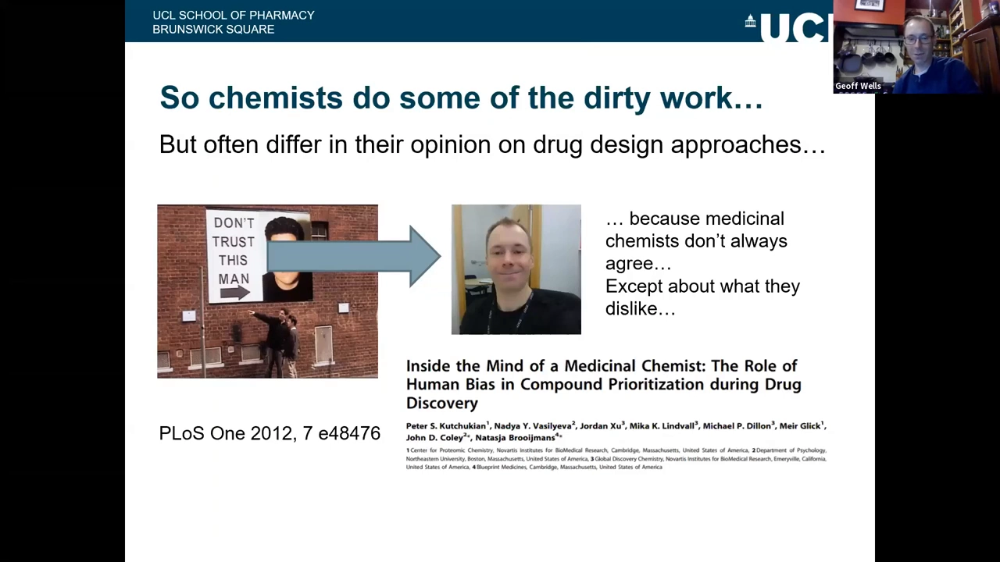

## 一、先分清三类证据：算出来的、测到的、细胞里发生的

讲者没有给这三类证据编号，但他的案例正好把它们分开了。初学者最容易犯的错，是把它们当成同一个东西的不同精度版本。

| 证据类型 | 典型来源 | 回答的问题 | 讲者提到的坑 |
| --- | --- | --- | --- |
| ① 结合预测 | 对接位姿 + 打分、MD 稳定性、更贵的自由能方法 | 这个分子**可能**怎么结合、相对排序如何 | 输入结构/配体建错、位姿站不住 |
| ② 靶点占据 | 纯化蛋白的结合实验、配体结合 assay | 它**是否真的**结合了这个靶点、结合多紧 | 前药不是活性形式、选择性没测 |
| ③ 细胞药效 | 细胞 assay、表型读出 | 在细胞这个复杂环境里**有没有**产生效应 | 到不了靶点、被快速代谢、脱靶致死 |

三者的关系是**逐层加条件**，不是逐层加精度。第 ① 层算得再准，也推不出第 ② 层（分子可能是前药）；第 ② 层测到了，也推不出第 ③ 层（可能进不了细胞）。反过来，第 ③ 层看到效应，更推不出第 ① 层说的那个位姿就是真的。

讲者给的一个数字很能说明"第 ② 层"为什么要单独做：已批准药物里，作用于**病原体蛋白**的小分子只有 215 个，作用于**人蛋白**的小分子有 999 个——如果你做的是抗病毒靶点，从 FDA 药物库里捞出来的命中，绝大多数本来就有一个人体内的靶点，那意味着**脱靶毒性**而不是新用途。

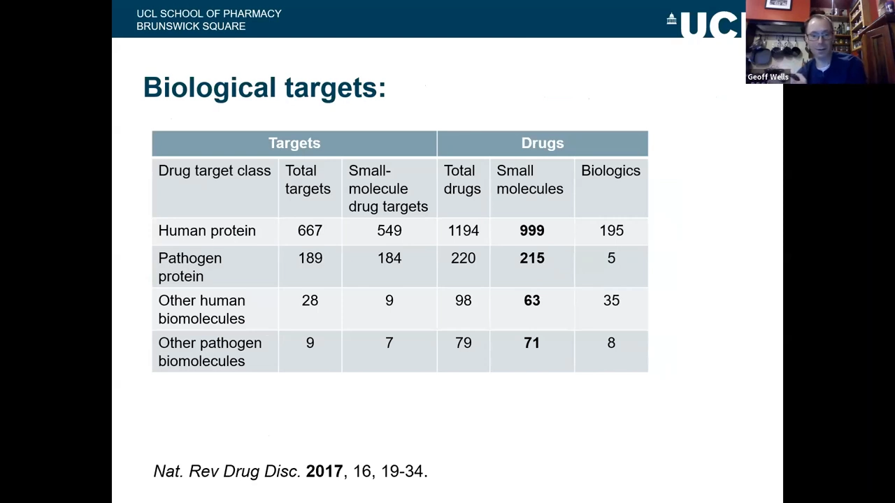

## 二、第一层排查：输入错了，后面全错

讲者把这一层放在最前面，并且说得很直白：大家都在担心蛋白结构，"你可能不太担心那个小家伙——你手里的小分子配体，你觉得那是最简单的部分，但它同样会出错"。

### 2.1 连 PDB 里的配体都可能是坏的

他引用 2012 年 *J Comput Aided Mol Des* 那篇《The good, the bad and the twisted: a survey of ligand geometry in protein crystal structures》。幻灯片上那个"激酶抑制剂"的吡啶环与取代基之间有一个明显不合理的键角——本该共平面，却被扭开了。除此之外还有坏键长、原子重叠。**如果你拿这些结构当基准集去验证对接程序，你验证的是一个错误答案。** [【跳转到 08:35】](https://www.youtube.com/watch?v=rMl3ukxTt3A&t=515)

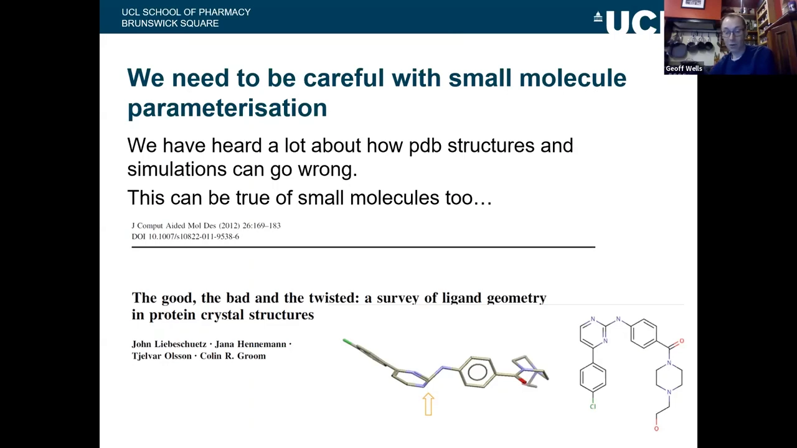

### 2.2 从 2D 到 3D 的三件事：几何、立体化学、质子化态

数据库里的分子往往以 SMILES 或 2D 形式下载（文件小、好批量），要变成可对接的 3D 结构，需要重建几何、分配原子类型与部分电荷、指定 pKa。讲者点名了几个免费工具（Molconvert、Open Babel、Balloon），并提醒"有些不太好，会引入错误"。

三个必须逐项检查的点：

- **键几何**：环是否平、取代基是否共平面；
- **立体化学**：普萘洛尔有一个手性中心，3D 化之后要确认手性被正确保留；手性未知时应当**两种对映体都建**；手性中心多于一个时，组合数会迅速膨胀；
- **质子化态**：普萘洛尔的仲胺在生理 pH 下大概率被质子化、带正电。如果软件把它建成中性形式，静电项就整体错了。

难点在于规模化：**你没法把几万个分子一个个点开看**，所以"有时候你只有在拿到对接结果之后才会发现这个问题" [【跳转到 11:05】](https://www.youtube.com/watch?v=rMl3ukxTt3A&t=665)。

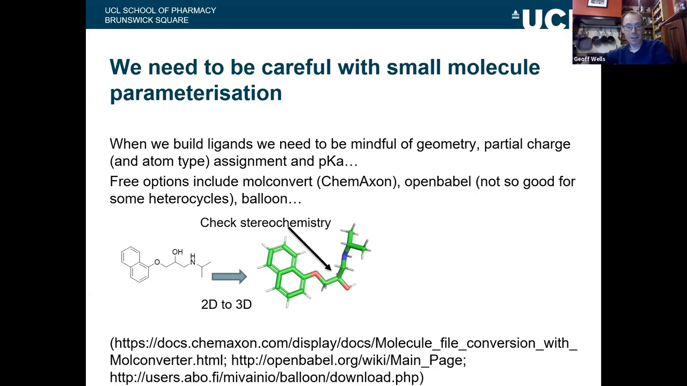

> 补充：质子化态与 pKa 如何改变分子的电荷分布与分配系数，见本系列 2.1.1 与 2.1.2；这里只强调它是**对接的输入参数**，不是事后讨论。

## 三、第二层排查：位姿站不住，分数再高也没意义

讲者团队在新冠疫情期间做 SARS-CoV-2 解旋酶 nsp13 的对接（幻灯片上写的是“over the summer”）。命中里有一批化合物"一开始看起来很有意思"，形成了一堆氢键、和蛋白贴合得很漂亮。他们没有直接送测，而是**又跑了一段分子动力学**：

> "当只跑了 50 纳秒的动力学，这个分子在最后 15 纳秒决定离开，然后再也没回来。" [【跳转到 21:56】](https://www.youtube.com/watch?v=rMl3ukxTt3A&t=1316)

这就是第二层排查的典型结果：**对接的位姿是一个静态快照，MD 检验的是这个快照能不能维持**。讲者对这个结果的态度很克制——"对接仍然是有启发性的，我们可以滤掉一些命中，再通过跑动力学看复合物是否稳定，把名单进一步缩小"。

注意这里的因果方向：MD 没有证明"这个分子不结合"，它只证明了"对接给出的这个位姿不稳定"。要区分这两件事，需要第 ② 层证据（结合实验）。

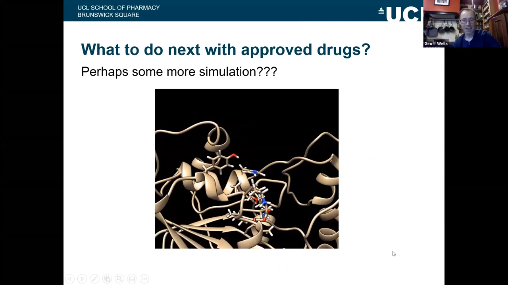

## 四、第三层排查：亲和力之外，分子可能根本到不了靶点

这一层是讲者讲得最细的部分，也是"预测对了但实验失败"最常见的来源。他的原话是：**"对接命中里的一些化合物，可能并不是安全的药物。"**

### 4.1 给药途径决定了这个分子能不能全身起效

讲者给了一张按给药途径统计的已批准药物分布表：口服 62%、注射 22.5%、皮肤外用 8.7%、黏膜（鼻、颊、眼、阴道、直肠、舌下、宫内）5.2%、吸入 1.3%。

这张表的意义是：**FDA 药物库不是"全身可用的分子集合"**。皮肤外用的药，脂溶性是为了穿透角质层设计的，全身给药可能有毒；黏膜给药的药，你可能根本不会吞下去。如果你的靶点在细胞内，那么"能做成软膏"和"能进细胞"是两件不同的事 [【跳转到 14:44】](https://www.youtube.com/watch?v=rMl3ukxTt3A&t=884)。

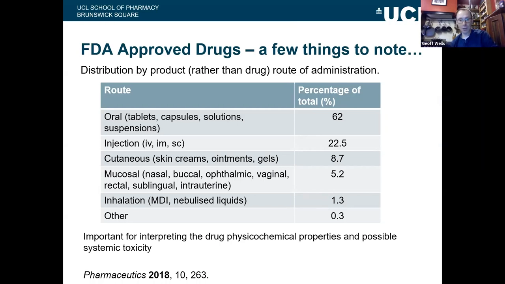

### 4.2 前药不是活性形式

瑞德西韦在他们的 nsp13 对接里出现了。但讲者提醒：**它是前药**——给药形式是磷酰胺酯（protide），在体内分解成单磷酸，真正的活性形式是三磷酸。拿前药去对接，等于在算一个**体内并不存在的分子**的结合 [【跳转到 17:32】](https://www.youtube.com/watch?v=rMl3ukxTt3A&t=1052)。

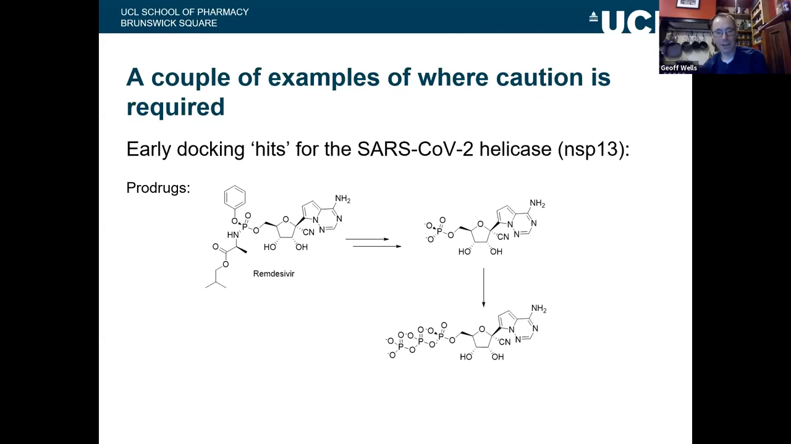

### 4.3 有靶点不等于能当药

同一批命中里还有几个分子，讲者用"需要小心"来概括：

- **地高辛（digoxin）**：强心苷，效力极强、剂量很低、治疗窗很窄——重定位项目里这是毒性风险；
- **普萘洛尔（propranolol）**：β 受体阻滞剂，给别的适应症用会降血压；
- **地诺前列酮（dinoprostone）**：催产药，用于引产——同样不适合当抗病毒药；
- **蔗糖**：能形成大量氢键，所以会和极性位点"结合"得很好，但它是食物，"如果蔗糖能治新冠，西方世界的人就都不会感染了"；
- **碘海醇（iohexol）**：含三个碘的造影剂，主要留在血浆里，"不是适合细胞内靶点的药物"。

讲者真正感兴趣的少数几个是**四环素类**（抗生素，本来就没有人靶点）和**地塞米松**（本身对新冠有抗炎作用）。他的筛选逻辑因此不是"打分高不高"，而是：**这个分子如果被重定位，会不会是安全的？**

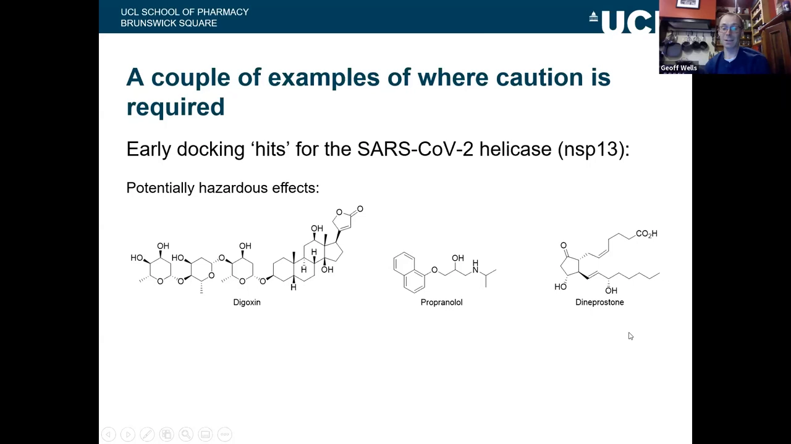

## 五、第四层排查：实验选错，会把对的判成错的

这是全篇最重要的一段，也是很多教程不会讲的。讲者说，做完对接、拿到命中之后，"下一件事就是做一个实验"——但**做哪个实验**决定了你能不能得到有效信息。

他的建议是：如果设计的是针对某个蛋白靶点的分子，**最好做一个针对该蛋白的特异性结合实验**，而不是一上来就做细胞 assay。理由是两个方向的误判：

- **假阳性方向**：一个为肿瘤靶点设计的分子杀死了癌细胞，但它可能根本没有作用于你预期的靶点——"你可能以为你的观点被证明了，其实你错了"。细胞里的死亡有很多条与靶点无关的路。
- **假阴性方向**：一个分子在细胞里没有活性，但它可能对靶蛋白结合得很好，只是**进不了细胞、被快速代谢、或被快速清除**——"你是对的，但你觉得自己错了"。

这两句话合起来就是一个判据：**当细胞读出与结合预测冲突时，先别改模型，先确认你测的是哪一层证据** [【跳转到 40:05】](https://www.youtube.com/watch?v=rMl3ukxTt3A&t=2405)。 这正是四层排查里最容易被跳过的一层，因为它不涉及计算，只涉及实验设计。

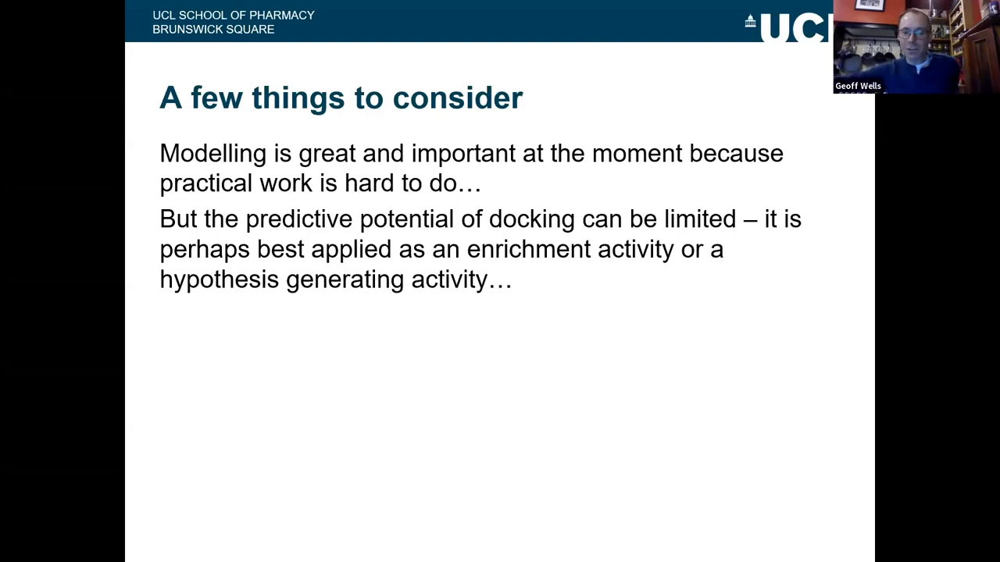

讲者接着把"之后要做什么"列成一张清单：体外测试与细胞 assay、理化性质（$\log S$、$\log P$、$\log D_{7.4}$）、体内药效与耐受性、ADME-Tox（hERG、CYP 抑制/诱导、微粒体稳定性）、制剂、临床试验。他的建议是**在项目一开始就为这些指标留出空间**：保留让分子可溶的官能团，避开硝基、Michael 受体这类"毒性基团"（可能共价反应或生成活性代谢物伤肝）。

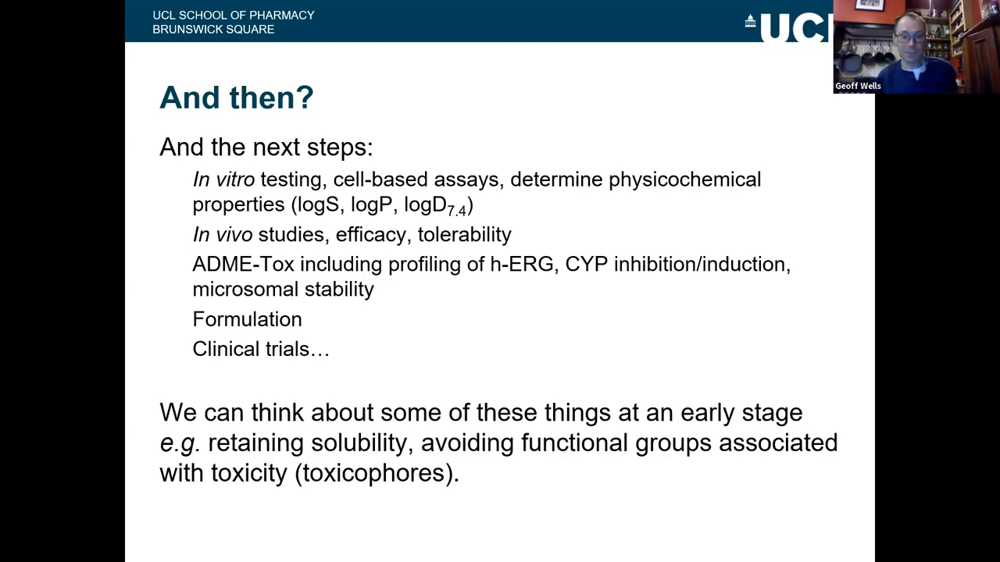

## 六、片段路线：把计算当假设生成器的正面案例

讲者并没有否定对接。他给了一个"它确实好用"的完整案例，用来对照上面的失败模式。

### 6.1 片段为什么适合用计算来筛

片段的定义很窄：分子量小于 300、计算脂溶性 $\mathrm{c\log P}$ 小于 3、氢键给体与受体各不超过 3 个。好处是对接快（可旋转键少、构象空间小），坏处是**绝对亲和力天然很低**。讲者还给了一张相互作用统计：在 PDB 的大规模蛋白—配体复合物里，疏水作用与氢键占绝对主导；而片段相对药物**更富氢键、更多 $\pi$-堆积**——也就是说，片段的结合模式与"正常药物"略有偏移，用大分子的直觉去看片段会看错。

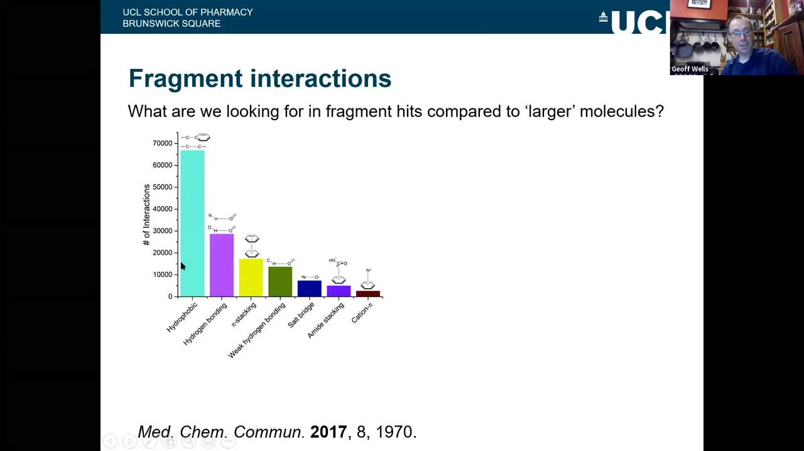

因此片段筛选看的不是绝对分数，而是**配体效率**（每个非氢原子贡献多少结合能）、有没有氢键、有没有可修饰的官能团、能不能买到或简单合成、有没有多个可以往外长的方向。

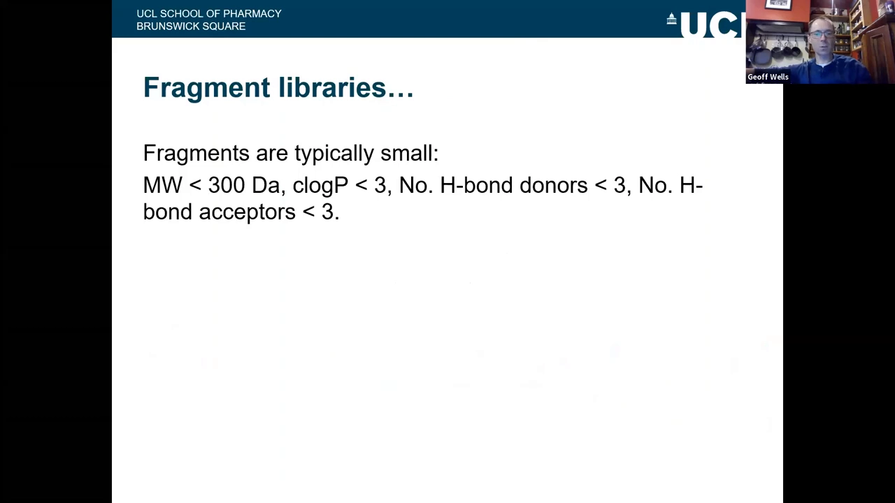

### 6.2 KEAP1：从三个毫摩尔级片段到亚微摩尔抑制剂

讲者引用 Astex 2016 年在 KEAP1 上的工作。高通量晶体学筛出三个片段，分别结合在口袋的不同位置，**IC₅₀ 都在毫摩尔级**——单看活性毫无吸引力。

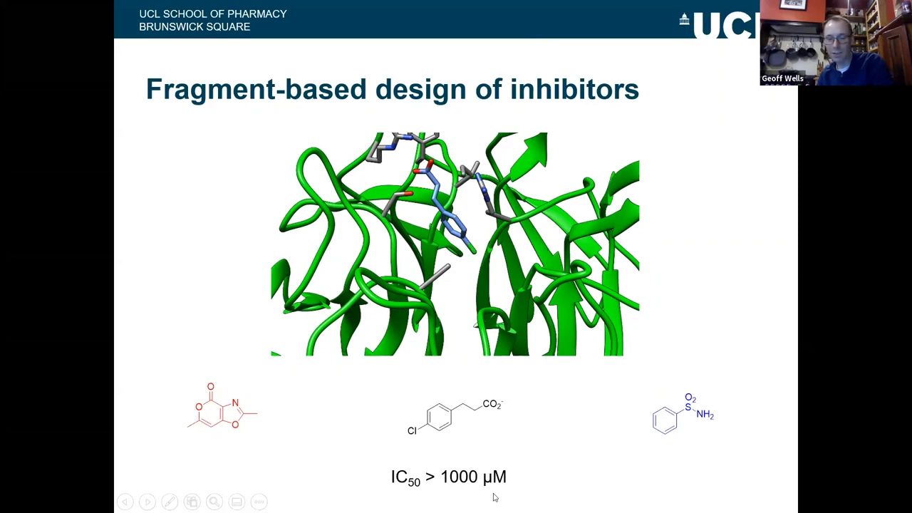

后续步骤完全依赖"片段在哪里"这个空间信息：

1. 把中间和左侧两个片段**连起来**，得到 61 微摩尔（结合取向与原来基本一致——讲者特意说"这不总是成立"）；
2. 引入类似磺酰胺的官能团，效力再提升约 20 倍；
3. 再改几处，得到**亚微摩尔**抑制剂。

从毫摩尔到亚微摩尔，靠的不是打分更准，而是**位姿提供了"往哪儿长"的假设** [【跳转到 30:13】](https://www.youtube.com/watch?v=rMl3ukxTt3A&t=1813)。

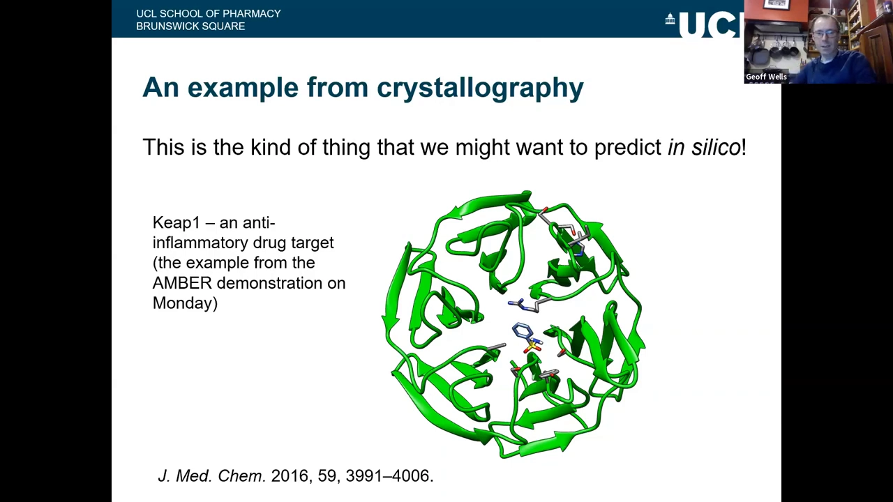

### 6.3 nsp13：把 2000 个片段压到 50–100 个的三条判据

讲者团队自己在 nsp13 上做片段对接时，用了三条筛选判据：

1. 结合能好；
2. 对接构象里**至少形成一个氢键**；
3. 配体效率（打分除以非氢原子数）过阈值。

三条一起用，把约 2000 个片段压到 50–100 个 [【跳转到 32:05】](https://www.youtube.com/watch?v=rMl3ukxTt3A&t=1925)。之后的工作是看叠合、想怎么改（把羰基换成胺、把氢键受体换成给体、把 6-5 并环换成 6-6 并环），再去 ZINC 里找相似的可买分子。

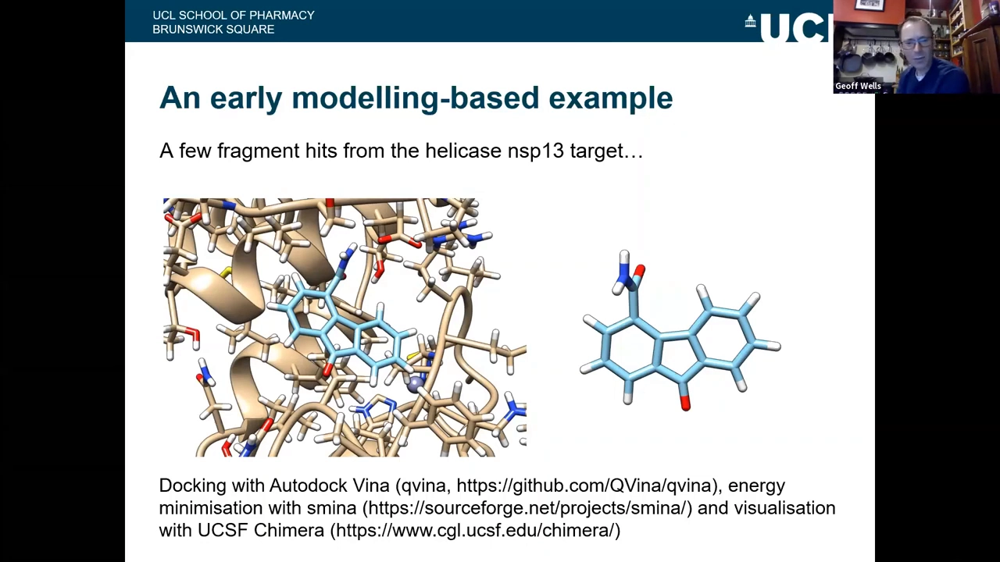

讲者还给了两条"别走太远"的警告：片段一直往外长，会越来越难合成、越来越贵；而且这个阶段还在**验证假设**，所以必须停留在"买得到或几步能合成"的范围内。下一步可以用药效团搜索（ZINCPharmer）把分子表示成芳环 + 氢键受体 + 氢键给体去找类似物，也可以用 SPRINT、AutoGrow 这类自动生长工具。

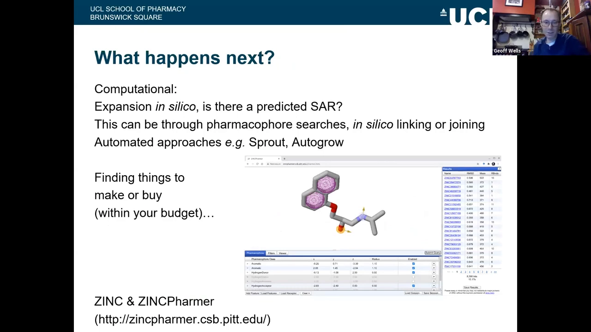

## 七、边界：对接能做排序和假设，不能做判决

讲者最后自己下了结论，措辞比很多建模讲座更保守：

- **"对接的预测潜力可能是有限的"**——它"也许最好被当作一种富集活动，或一种假设生成活动"来用 [【跳转到 38:50】](https://www.youtube.com/watch?v=rMl3ukxTt3A&t=2330)；
- 我们常常是在**新靶点**上工作，"没有针对我们的对接方法或结果的验证"；
- 所以要在早期就用实验检验方向对不对，并且要考虑**这些实验做不做得起**：买几个小分子、做几个简单的，先看设计前提站不站得住；
- 建模的价值在实验者眼里是"过山车"：帮上忙就被当成有用，指错方向、浪费了实验就会被怀疑。所以**管理预期**本身是建模工作的一部分。

讲者用一句自嘲收尾：他自己是做分子的人，"经常失望"；但他仍然认为，"谨慎而有条件地使用对接，在药物设计里是极有价值的"。

把这一节和前四层排查合起来，可以得到一张排查表：

| 现象 | 先怀疑哪一层 | 该做的诊断 |
| --- | --- | --- |
| 打分很高但完全测不到结合 | 输入准备 / 位姿 | 检查配体 3D 化、立体化学、质子化态；MD 看位姿是否维持 |
| 结合测到了，细胞里没活性 | 体系与暴露 | 溶解度、透膜、外排、代谢稳定性、给药途径 |
| 细胞里有活性，但结合测不到 | 实验选择 | 换特异性结合实验；排除脱靶与检测干扰 |
| 排序整体不准 | 打分函数 | 换打分/自由能方法；只在同一靶点内比较 |

## 小结

- **三类证据要分开**：结合预测（算出来的位姿与相对排序）、靶点占据（测到的结合）、细胞药效（细胞里发生的效应）。三者是逐层加条件，不能互相替代。
- **失败按四层排查**：输入准备 → 位姿 → 亲和力 → 体系与暴露；再补一条"实验选择"——选错实验会制造假失败。
- **输入层最常见的三个错**：配体几何、立体化学、质子化态；PDB 里的配体本身也可能是坏的。
- **位姿层最便宜的诊断是 MD**：跑一段动力学，看对接位姿是否维持；但"位姿不稳"不等于"不结合"。
- **体系层最容易被忽略**：前药不是活性形式、给药途径决定能不能全身起效、有靶点不等于能当药。
- **实验层的关键判据**：细胞读出与结合预测冲突时，先确认测的是哪一层，再改模型。
- **片段路线是正面样本**：毫摩尔级片段靠"位姿给出往哪儿长"的假设，快速做到亚微摩尔。
- **对接的定位是富集与假设生成**，不是判决；建模者要主动管理实验方的预期。

## 关键术语速查

| 术语 | 一句话解释 |
| --- | --- |
| 位姿（pose） | 配体在结合口袋里的位置与取向，对接的输出之一 |
| 打分函数 | 给每个位姿打一个近似结合能分数的函数 |
| 配体效率 | 结合能除以非氢原子数，衡量"每个原子贡献多少" |
| 前药（prodrug） | 给药形式本身无活性，需在体内转化才成为活性分子 |
| $\log D_{7.4}$ | 在 pH 7.4 下考虑电离的分配系数，比 $\log P$ 更接近生理条件 |
| hERG | 心脏钾通道，被抑制会引发心律失常，是常见的脱靶毒性 |
| 毒性基团（toxicophore） | 容易引起共价反应或生成活性代谢物的结构片段，如硝基、Michael 受体 |
| 片段连接（fragment linking） | 把结合在相邻亚位点的两个片段用化学键连成一个分子 |
| 富集（enrichment） | 用计算把活性分子的比例在候选名单里提高，而不是预测绝对活性 |