# 计算能不能真正推动项目：从虚拟筛选命中率到 FEP 的一千卡精度

> 视频来源：[Richard Friesner: Computational Methods for Structure Based Drug Discovery](https://www.youtube.com/watch?v=kfZgicLrKMA)（YouTube · Camille and Henry Dreyfus Foundation 讲座，讲者 Richard Friesner，哥伦比亚大学化学系，Schrödinger 创始人之一）｜时长约 31 分钟
> 导读：这是一场用"前瞻性结果"回答质疑的报告。讲者把计算证据按精度分层——快速对接、诱导契合对接、水结构、自由能微扰（FEP）——并给每一层配上与实验对照的数字。本文重点不是方法怎么实现，而是**每一层证据能支持什么结论、不能支持什么结论**；对接打分函数的数学细节见同节 4.2.1，适用域与数据切分见 4.2.3。

## 本讲要解决的核心问题（SCQA）

**背景**：基于结构的药物设计用了几十年，对接、分子动力学、自由能计算在药企里都不陌生。

**冲突**：讲者一开场就把行业里那句最难反驳的话摆出来——如果问项目组"你们怎么用这些软件的"，经常得到的回答是：**"是啊，我很高兴我跑了那个计算，挺有意思的，但我本来也会做这个分子。"** [【跳转到 01:33】](https://www.youtube.com/watch?v=kfZgicLrKMA&t=93) 这句话质疑的不是方法准不准，而是计算**有没有改变决策**。

**疑问**：要让计算真正进入候选排序，需要什么样的证据？每一层计算方法的精度上限在哪里，越过这条线之后它还能做什么、不能做什么？

**回答（中心思想）**：**计算要按精度分层使用，每层只承担它能承担的判断。** 快速对接负责把上亿分子压到几十个（富集）；诱导契合对接负责把位姿选对（成功率从 41% 提到 95%）；FEP 负责在同系列内排序（精度上限约 1 kcal/mol，与实验误差同量级）。**FEP 的 1 kcal/mol 是"排序精度"而不是"绝对活性预言"**——它足够判断"这个取代基让结合变好还是变坏"，不足以判断"这个分子的 $K_d$ 是多少"。而所有这一切的最终判据，都是前瞻性实验：先预测、再合成、再实测。

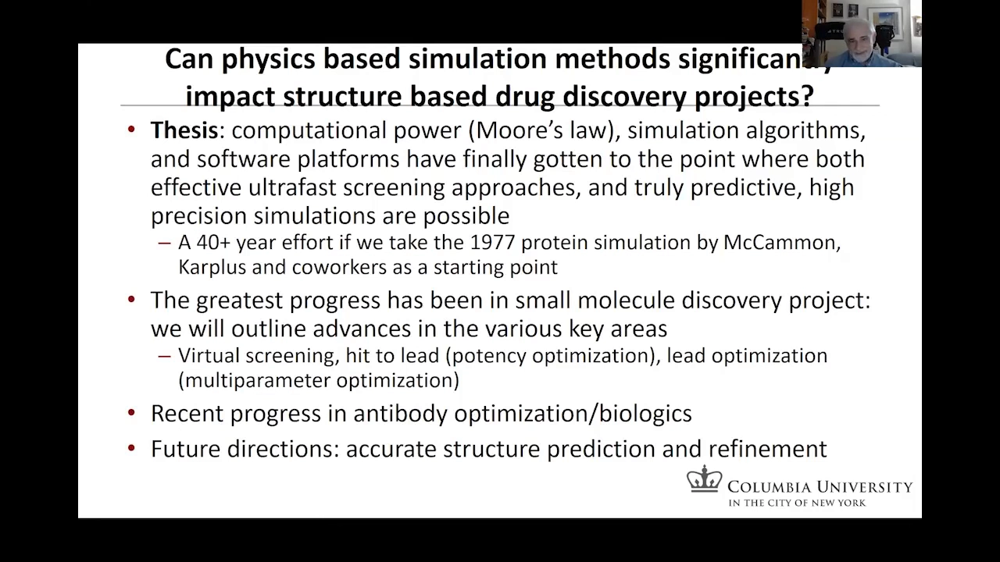

## 一、先把工具分层：每一层回答不同的问题

讲者的第一张"架构图"不是流程图，而是一张**精度阶梯**。他强调：如果要把计算真正用在项目上，就必须有"一套分层的计算工具"，因为不同阶段问的问题根本不同。

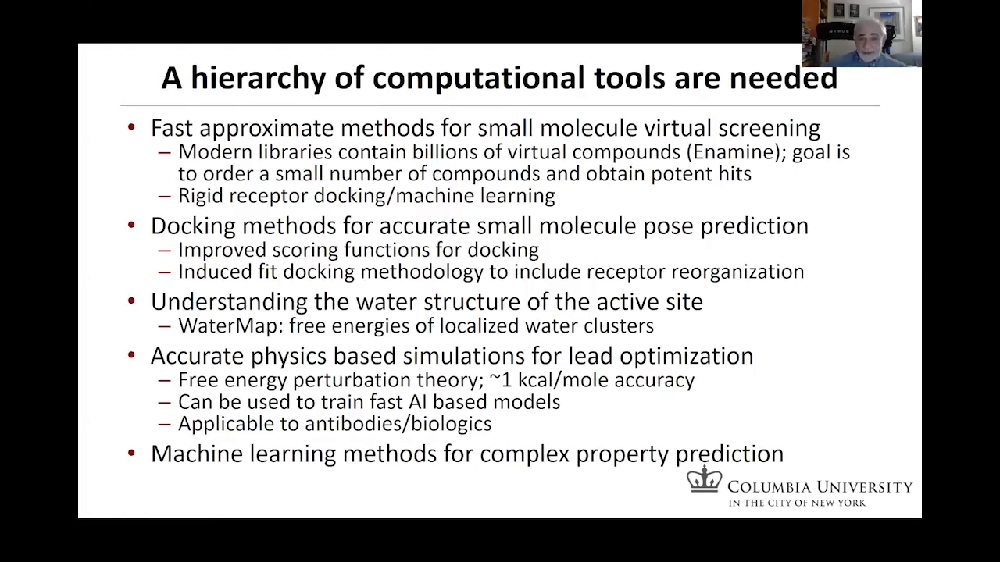

| 层级 | 代表方法 | 单分子成本 | 能回答的问题 | 不能回答的问题 |
| --- | --- | --- | --- | --- |
| 富集 | 刚性受体对接、机器学习打分 | 秒级 | 上亿分子里哪些值得看 | 位姿对不对、活性多少 |
| 位姿 | 诱导契合对接（含 MD） | 分钟到小时 | 结合模式是哪一个 | 亲和力的数值 |
| 位姿细化 | 水结构分析（WaterMap） | 小时 | 哪些水该被置换、往哪儿长 | 绝对结合自由能 |
| 亲和力 | 自由能微扰（FEP） | 数十到数百 CPU·时 | 同系列内谁更强、强多少 | 跨靶标的绝对比较 |

讲者特别强调这张表里最容易被忽略的一格：**"这不总是成立"**。刚性受体对接的前提是蛋白不动；而实际上"很多时候，小分子结合进蛋白靶点会让蛋白重排"，这时就必须上诱导契合对接。同理，水结构也必须显式处理——"你需要理解活性位点的水结构" [【跳转到 04:53】](https://www.youtube.com/watch?v=kfZgicLrKMA&t=293)。

## 二、富集层：把水放回打分函数，命中率从 0/50 变成 38/50

讲者用两个具体改进说明富集层的进步，而且都给了与实验对照的数字。

### 2.1 为什么"水"能决定一个分子是死是活

他先讲 WaterMap：把受体里局部水分子的自由能映射出来。幻灯片是因子 Xa（凝血因子，商品药利伐沙班的靶点）。这个靶点被尝试了几十年，早期思路是放带正电的氮去和底部凹陷的天冬氨酸成盐——"那些化合物效果不好，因为生物利用度差，很难进细胞"。

真正的解法是**置换一个位置极差的水**：它被疏水基团包围，"位移到溶液里能回收非常大的结合自由能"，所以正确的做法是在那个位置放一个甲基或氯。这个结论**靠肉眼看结构看不出来**，靠显式水的自由能图能看出来 [【跳转到 08:29】](https://www.youtube.com/watch?v=kfZgicLrKMA&t=509)。

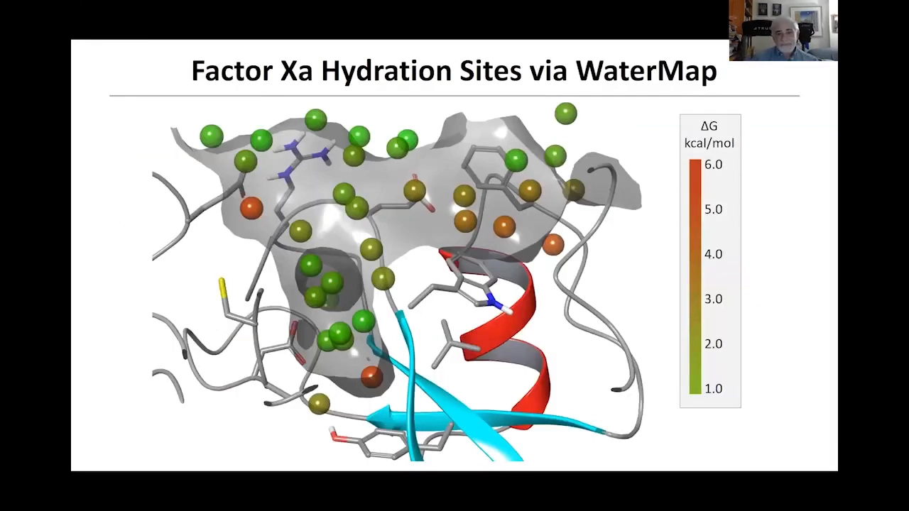

### 2.2 hsp90 的三氢键水：一个"死化合物"判据

第二个例子更锋利：hsp90 口袋里有一个水分子**同时形成三个氢键**（与 Asn51、Phe138、Gly155）。配体要置换它，就得拿一个基团去替代三个氢键——"羟基能替代两个氢键的，但三个非常难"。所以很多配体会挤进去把这个水顶掉，**那些就是死化合物**。

把这类信息写进打分函数（WScore）之后，讲者给了一组对照：对接 5 万个性质匹配的 decoy（专门设计得像活性分子的假分子），

- 标准打分函数（GlideSP，业界仍在大量使用）：**top 50 里命中 0 个已知活性分子**；
- WScore：**top 50 里命中 38 个** [【跳转到 11:10】](https://www.youtube.com/watch?v=kfZgicLrKMA&t=670)。

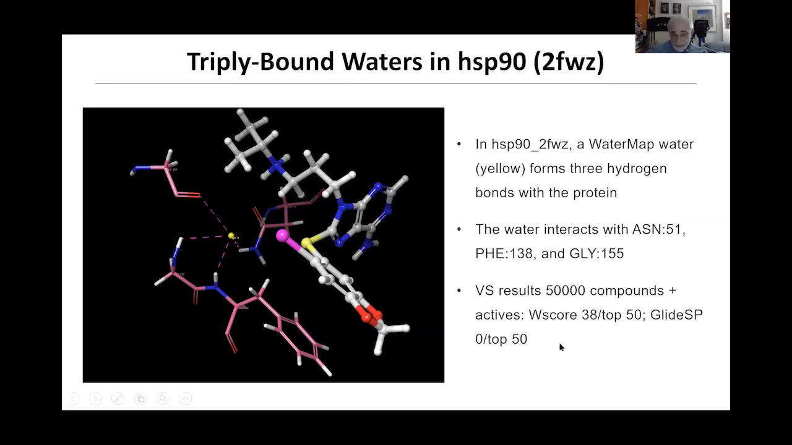

这组数字的解读方式很重要：它证明的是**富集能力**（把活性分子挤到名单前面），不是"打分等于结合自由能"。0/50 与 38/50 的差别说明，一个错误的打分函数可以让整个虚拟筛选**完全失效**——不是排序略有偏差，而是一个真命中都进不了前 50。

## 三、位姿层：成功率从 41% 提到 95%，靠的是"可靠性"而不是"个案"

讲者把位姿预测的难点讲得很清楚：锁钥模型里"锁是刚性的"这个前提是错的，侧链和主链都在动。他给了一个 cdk2 的例子——把一个构象里取出的配体对接到另一个构象里，正确的结合模式会和几个赖氨酸撞上；人看一眼就知道"把这些侧链挪开就行"，但**要在自动化流程里做对这件事很难**，而且经常会出现"看着不显然为什么这个该输、那个该赢"的备选结构。

关键的一段是他对"什么叫可信"的定义：

> "拿单个案例出来说'这个案例有效'并不难；但你要拿几百个、几千个案例都做对——那才是你在项目里敢相信它的理由，因为接下来有人要基于这个结构花几百万美元做化合物。"

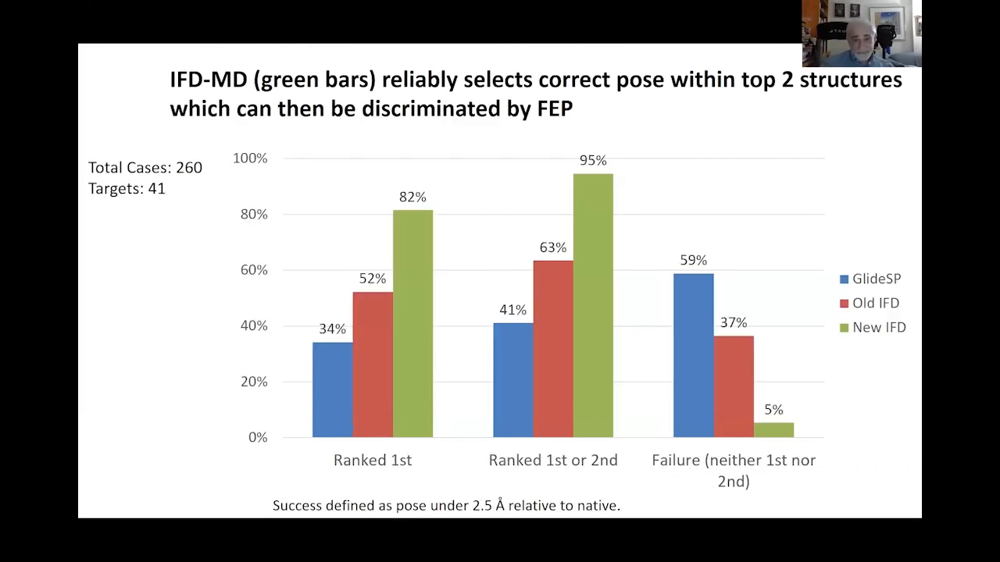

260 个案例、41 个靶点的统计结果：

- **排名第 1 就正确**：新诱导契合 82%，旧方法 52%，刚性对接 34%；
- **前 2 名内有正确位姿**：新方法 **95%**，旧方法 63%，刚性对接 41%；
- **前 2 名都没有**（失败）：新方法 **5%**，旧方法 37%，刚性对接 59%。 [【跳转到 14:16】](https://www.youtube.com/watch?v=kfZgicLrKMA&t=856)

这张图还隐含一个方法学要点：**位姿层不需要一次就对**。前 2 名里有一个对的，就可以交给下一层（FEP）去区分——这正是"分层"的意义：每层不必独立解决问题，只需把候选集缩到下一层能处理的规模。

讲者也说了这类方法的实战检验方式：**先预测、后拿晶体结构、再看是否一致**。这种"预测在前、验证在后"的顺序，才是计算证据的可信来源。

## 四、亲和力层：FEP 的精度上限约 1 kcal/mol

### 4.1 一千卡为什么是条硬线

FEP 的思路很简单：直接算两个相似配体（比如环上氢换成氯）之间的**相对**结合自由能差，而不是分别算两个绝对值。讲者说现在这套平台"大概能改 10 到 12 个原子，并且期望得到相当好的答案——前提是其他一切都正常"。

"其他一切都正常"这句话是重点。他给的第一组数据是回顾性验证：8 个文献靶点、每个 10–40 个配体，比较不同力场版本的 RMSE。

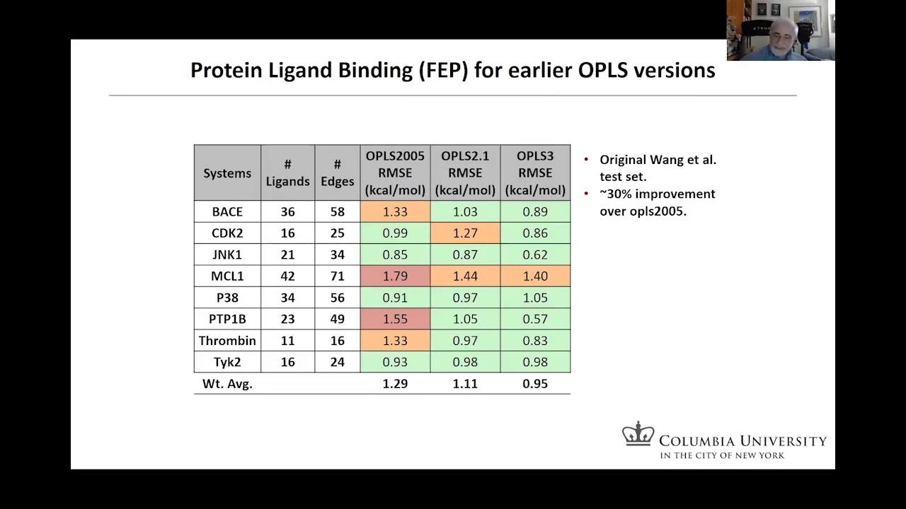

加权平均 RMSE：OPLS2005 **1.29** → OPLS2.1 **1.11** → OPLS3 **0.95** kcal/mol [【跳转到 17:52】](https://www.youtube.com/watch?v=kfZgicLrKMA&t=1072)。讲者的解读很值得记住：单看数字"并不惊艳"，但**当 RMSE 是 1.5 kcal/mol 时，你几乎无法排序**——因为药物化学要改进的往往就是"一两个千卡"的差别。

### 4.2 平均值会掩盖"离群项目"

第二组数据更能说明边界在哪：新版力场专门改善离群系统。表里 project A–D 是 Schrödinger 内部项目，旧版 RMSE 从 0.91 到 2.31 kcal/mol 不等，新版降到 0.80–1.31。

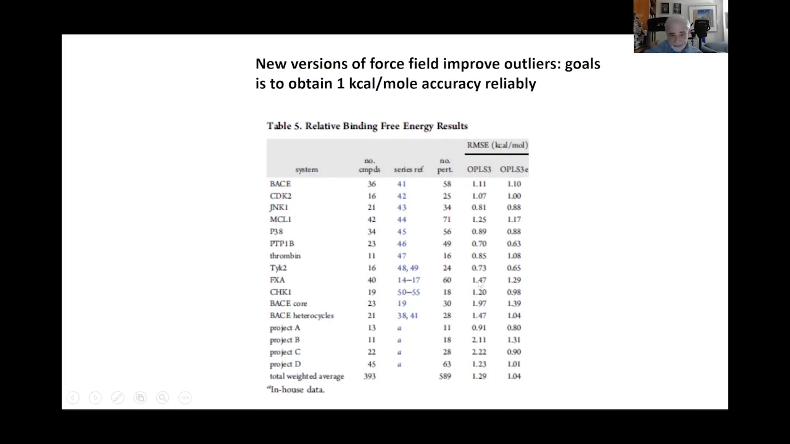

这里的教训是：**看一个方法的平均精度不够，要看它的误差分布尾部**。讲者的目标是"让越来越多的系统落进 1 kcal/mol 这个区间"，因为只有落进这个区间，排序才真的可用。

### 4.3 工业规模的数据：92 个项目、3000 多个分子

讲者强调，要真正检验这类方法，"你需要工业规模产生的数据，需要一个反馈回路：看几千、几万个数据点，再优化、再测、再做新预测"。他给的汇总：约 90 个不同项目（含 GPCR、同源模型、蛋白—蛋白界面、抗体、共价抑制剂、蛋白侧链突变）、3000 多个分子、37 个合作方（药企、生物技术公司、高校）。

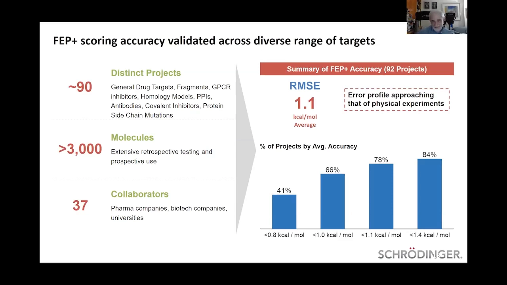

平均 RMSE **1.1 kcal/mol** [【跳转到 19:45】](https://www.youtube.com/watch?v=kfZgicLrKMA&t=1185)；按项目平均精度看，41% 的项目优于 0.8 kcal/mol，66% 优于 1.0，78% 优于 1.1，84% 优于 1.4。讲者的判断是：**"这看起来是真的，不是挑了几个数据集的结果。"**

同时他也说清了这条线的来源：**实验本身的误差**在结合实验里"最好也就是半个千卡左右"。所以 1 kcal/mol 不是一个可以靠算法无限逼近的极限，而是**计算精度与实验精度已经同一量级**之后自然停下来的地方。这也直接决定了用法：**同系列内比较 ΔΔG 有意义，跨靶标比较绝对值没有意义。**

## 五、前瞻性证据：2500 个里挑 10 个，8 个比参照物更强

回顾性验证再漂亮，也只是"事后能解释"。讲者给的最硬的证据是一场**盲测**：一家药企不服气，拿出 hCatL（人组织蛋白酶 L）的 2500 个化合物库，让四组人各挑 10 个，由他们合成并实测 $K_i$。四组是：FEP+、药物化学家人工判断（medchem）、基于结构的药物设计（SBDD）、对接。

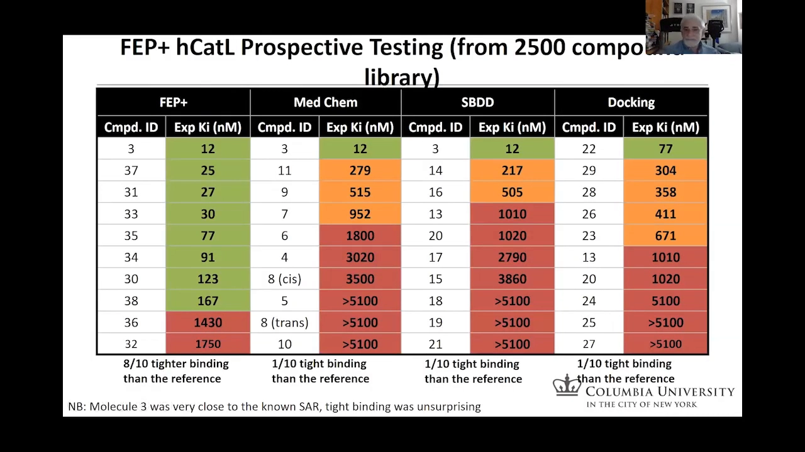

结果：

- **FEP+：10 个里 8 个比参照物结合更紧**（12–1750 nM，前 8 个都在亚微摩尔以内）；
- medchem、SBDD、对接：**各只有 1 个**比参照物更紧 [【跳转到 21:32】](https://www.youtube.com/watch?v=kfZgicLrKMA&t=1292)。

讲者还诚实地标注了一个保留意见：FEP+ 挑中的第 3 号分子"离已知的构效关系很近，它结合得紧并不意外"。这句话本身就是"如何正确报告计算证据"的示范——**把容易的命中和难的命中分开报**。

## 六、闭环：4000 个想法、100 个分子、6 个月

讲者把 FEP 与机器学习结合的做法讲成一条循环：从一个巨大的组合库（三个取代位点、每点一千个候选就是 $10^9$ 量级）里随机取一批跑 FEP，用这些结果训练模型，再用模型挑下一批去跑 FEP，如此往复；每一轮把排在最前面的几个真的做出来测。

Nimbus 的 TYK2 项目是这个循环的实例：**约 4000 个"想法分子"全部跑 FEP+ 打分，同期只合成了约 100 个**，用时约 6 个月——讲者的说法是，这相当于"超过 5 年的湿实验工作量"才能把全部想法分子做出来。

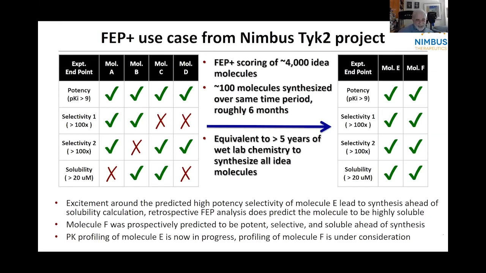

这张表的结构值得注意：它同时列了**效价（pKi 大于 9）、两条选择性（大于 100 倍）、溶解度（大于 20 μM）** 四个终点，用勾叉表示。也就是说，计算在这里承担的不是"预测一个数"，而是**多参数优化的排序** [【跳转到 23:27】](https://www.youtube.com/watch?v=kfZgicLrKMA&t=1407)。表下还有一条自我修正的记录：分子 E 因为预测的高效价与选择性被提前合成，溶解度当时还没算，事后回顾性 FEP 分析才预测它高度可溶——**这正是"计算顺序错了"造成的返工**，讲者没有隐去它。

## 七、边界：这些数字能支持什么结论

讲者自己划了几条线，值得逐条记住。

**能做的：**

- **同系列内排序**：ABL 激酶 T315I 突变抗性这个例子里，FEP 预测的 $\Delta\Delta G$ 与实验的相关系数 $R^2 = 0.77$（$p = 0.0003$），AUE 0.87。这类问题（"这个突变会不会让药失效"）是 FEP 最擅长的形态：变化小、体系相同、只需相对值 [【跳转到 24:47】](https://www.youtube.com/watch?v=kfZgicLrKMA&t=1487)。

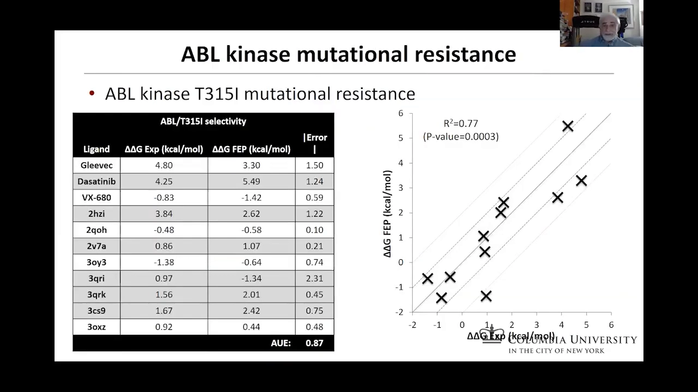

- **选择性排序**：TYK2 与 JAK 家族其他成员在活性位点第一壳层只差几个氨基酸，靠肉眼"完全看不出来"哪个分子选择性更好；把 4000 个分子对四个靶点各跑一遍 FEP（讲者说"每次计算几美元"），再挑选择性大于 100 倍的去做实验。
- **位姿预测**：先预测、后被晶体结构证实。

**不能做的：**

- **跨靶标比较绝对值**。1 kcal/mol 的精度决定了 $\Delta\Delta G$ 可用、$\Delta G$ 不可用。
- **脱离实验误差谈精度**。实验误差本身约 0.5 kcal/mol，计算再准也无法区分更细的差异。
- **把糖基化这类复杂体系当已解决问题**。讲者在抗体—gp120 的工作里必须显式建模表面的聚糖，"不做这个计算就是垃圾"；但他在问答里也承认，糖—蛋白相互作用的预测质量"远不如小分子体系成熟"。
- **把"生成候选更快"等同于"分子更好"**。讲者说他们能在 18 个月内产出开发候选、有 25 个项目在跑，但"这些化合物到底好不好"这个问题"要更长时间才能回答，因为得看它们过不过临床"。

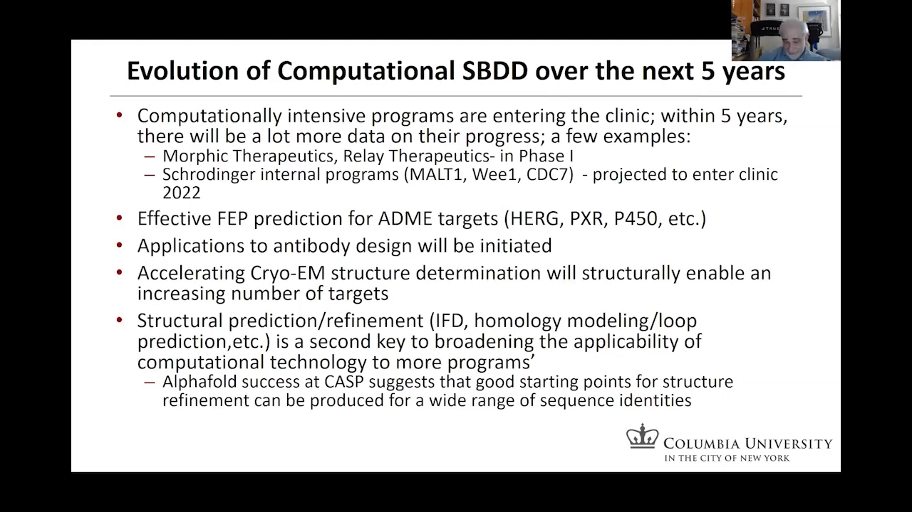

## 小结

- **计算证据要分层**：富集（快速对接）→ 位姿（诱导契合）→ 水结构 → 亲和力（FEP）。每层只承担它能承担的判断，上一层不必独立解决问题，只需把候选缩到下一层能处理的规模。
- **富集层的失败是"全灭"而非"略差"**：同一个 decoy 集，标准打分 top 50 命中 0 个，显式水打分命中 38 个。
- **位姿层要看统计而不是个案**：260 个案例里，新诱导契合在前 2 名内选对位姿的比例 95%，刚性对接 41%；可信度来自"几千个案例都对"，而不是"这个案例很漂亮"。
- **FEP 的精度上限约 1 kcal/mol**，与实验误差同量级；因此它支持同系列排序（$\Delta\Delta G$），不支持跨靶标绝对值（$\Delta G$）。
- **看误差分布尾部，不只看平均值**：平均值好看的力场，仍可能在某些项目上 RMSE 超过 2 kcal/mol。
- **最硬的证据是前瞻性盲测**：2500 个里挑 10 个，FEP+ 8/10 优于参照物，其余三组各 1/10；并且要如实标注"这个命中太容易"。
- **闭环形态是多参数排序**：4000 个想法分子打分、6 个月合成 100 个、四个终点同时看；顺序错了（先合成后算溶解度）就会返工。
- **最终判据仍是临床**：算得快不等于分子好，后者需要更长时间才能回答。

## 关键术语速查

| 术语 | 一句话解释 |
| --- | --- |
| 刚性受体对接 | 把蛋白当作不动，只搜索配体位姿的对接，速度最快 |
| 诱导契合对接 | 允许蛋白侧链（甚至主链）重排的对接，用于蛋白柔性重要时 |
| WaterMap | 计算受体口袋内各局部水分子自由能的方法，用来判断哪些水值得置换 |
| decoy | 与活性分子性质相近但没有活性的假分子，用来检验打分函数是否只是"认得性质" |
| 富集 | 让活性分子在候选名单里比例升高的能力，用 top-N 命中数等指标衡量 |
| FEP（自由能微扰） | 通过热力学循环计算两个相似配体相对结合自由能差的方法 |
| $\Delta\Delta G$ | 两个配体（或野生型与突变体）之间的相对结合自由能差，FEP 的直接输出 |
| RMSE | 预测值与实验值之差的均方根，衡量整体误差大小 |
| AUE | 平均无符号误差，衡量预测偏差的平均幅度，不看方向 |
| 多参数优化 | 同时优化效价、选择性、溶解度、代谢稳定性等多个终点 |