# 适用域之外没有答案：从三种数据切分看预测模型能走多远

> 视频来源：[AI in Drug Discovery – Model Validation and Applications (Andreas Bender)](https://www.youtube.com/watch?v=VSS-sOVuVEo)（YouTube · Ellis Unit 研讨会；主讲 Andreas Bender，剑桥大学，另有 Morgan Thomas 与 Benoit 报告组内工作）｜时长约 58 分钟
> 导读：这是一场"讲验证而不是讲模型"的研讨会。前 20 分钟 Bender 用一组幻灯片说明：化学空间里没有坐标系，所以"测试集分数"不是模型的属性，而是训练集与测试集之间距离的属性；后半场 Benoit 用一个真实实验把随机切分、骨架切分、蛋白切分并排跑了一遍，并给出适用域的经验曲线。本文按"为什么难 → 三种切分 → 实测结果 → 适用域 → 为什么不能拿去做决策"重排；对接打分与位姿的细节见同节 4.2.1，预测与实验的对账见 4.2.2。

## 本讲要解决的核心问题（SCQA）

**背景**：机器学习模型的常规验证流程是：留出一部分数据当测试集，在测试集上算一个 RMSE 或 AUC，数字好看就认为模型"能用"。Bender 把这个问题摆在最前面："我们怎么知道一个东西真的有效？" [【跳转到 00:55】](https://www.youtube.com/watch?v=VSS-sOVuVEo&t=55)

**冲突**：Bender 一开场就把这条路堵住了——在药物发现里，"基本上你做的每一件事都是分布外预测"（out-of-distribution prediction）。化学空间没有类似蛋白序列那样的系统发育树，你无法假设数据背后的分布，也无法判断训练集到底落在化学空间的哪个位置 [【跳转到 01:50】](https://www.youtube.com/watch?v=VSS-sOVuVEo&t=110)。于是同一个模型，在一种切分下 R² 是 0.52，在另一种切分下掉到 0.41，而基线模型是 0.42——换句话说，**换一种切分，模型就退回基线**。

**疑问**：既然"测试集分数"这么不稳，那到底该怎么切分数据，才能知道模型在什么范围内可信？域外的那部分预测，为什么不能直接拿去做合成、买货、进临床的决策？

**回答（中心思想）**：**模型的性能是"训练集与测试集之间距离"的函数，不是模型自身的常数。** 随机切分、骨架切分、蛋白切分分别把"新分子""新骨架""新靶点"三种距离强制拉开，因此给出三张不同的成绩单；而适用域就是"测试分子与训练集的最大相似度"这条横轴。域外预测之所以不能直接用于决策，是因为决策发生在项目上下文里（疾病、靶器官、随访实验、损失函数），而模型对这些一无所知——Bender 的原话是：**"每一个模型都是一个局部模型"**。

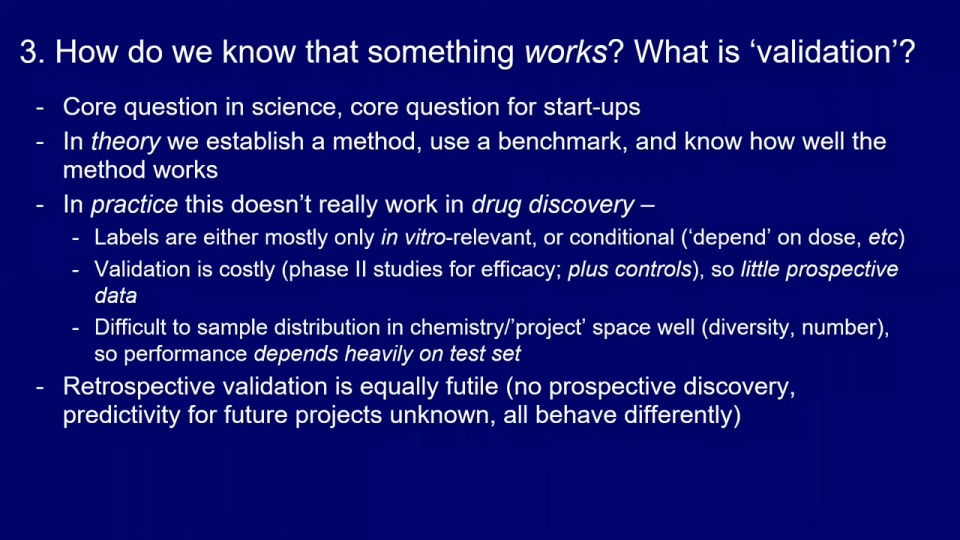

## 一、化学空间里的验证，为什么天生比图像分类难

Bender 拿 AlexNet 做对照：图像分类的标签（图里是什么）基本无条件，而且可以批量标注。药物发现不是这样。

### 1.1 标签本身是"有条件的"

- **只有体外相关性**：绝大多数标签来自 proxy assay（替代性检测），"很便宜、很容易做、数据很多，但它在临床上不重要"；
- **条件性极强**：同一个化合物，剂量、细胞类型、时间点不同，标签就不同。Bender 举的极端例子是水——"连水都可能有毒"，那你要不要在机器学习模型里把水标成有毒？大概不会。

这就是"标签不可靠"的具体含义：不是标注员粗心，而是**这个体系里"是/否"本身依赖于条件**。

### 1.2 前瞻验证太贵，回顾验证又太便宜

前瞻验证（prospective validation）意味着把化合物推进临床：一期试验几百万，后期二期、三期是数千万级。所以真正的前瞻数据极少。而回顾验证（retrospective validation）——用历史数据训练、再用历史数据测试——Bender 的评价很刻薄：

> "回顾验证总是有点像预测昨天的天气。" [【跳转到 02:40】](https://www.youtube.com/watch?v=VSS-sOVuVEo&t=160)

在药物发现领域，"你发现了一个过去已经被发现的药"几乎没有说服力。

### 1.3 化学空间没有坐标系

这是全篇最关键的类比。蛋白序列空间里有系统发育树、有突变频率，你知道"这个氨基酸换成那个"有多大概率；化学空间里什么都没有——**你既不知道数据背后的分布，也无法给一个分子标出绝对坐标**。更麻烦的是，"数值距离在不同区域的化学空间里含义不同"：同一个结构改动，在一个区域里可能是加分项，在另一个区域里可能反过来。

所以"在某个化学空间区域里得到的性能，对下一个项目基本没有信息量" [【跳转到 04:39】](https://www.youtube.com/watch?v=VSS-sOVuVEo&t=279)。这句话直接否定了"一次验证、长期复用"的做法。

## 二、训练集、验证集、外部测试集，在化学空间里究竟站在哪儿

Bender 用一张星系图来画这件事：每一颗星、每一个星系，都是化学子空间的一部分。

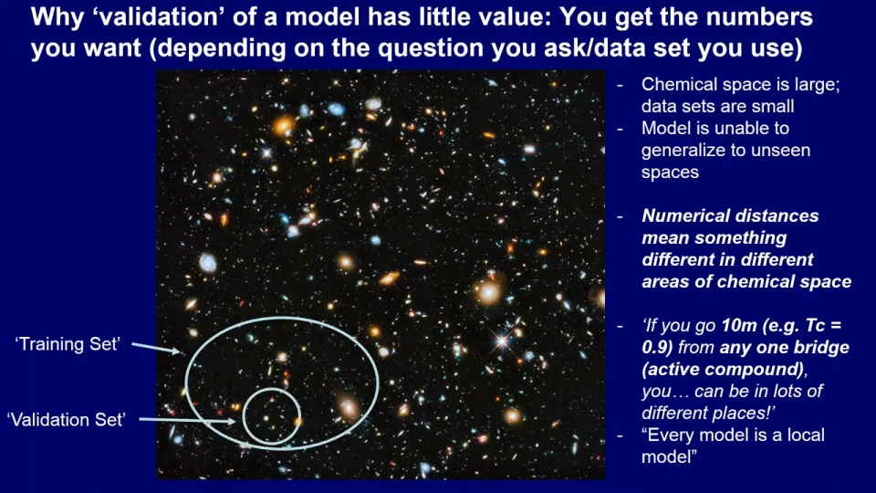

三个圈的含义值得逐条说清：

1. **训练集**：你自己也不知道它覆盖了化学空间的哪一块，因为没有绝对坐标；
2. **验证集**：因为数据来源相同（同一批项目、同一个检测平台），它往往与训练集高度相似。Bender 用临床数据打比方：只在同一家医院做验证，模型会更好看，但对新数据的产出率很低；
3. **"外部测试集"**：他特意加了引号——"我们乐观地称之为外部测试集，很多情况下它并不真的外部"。真正的下一个项目，可能落在图上任何一个位置 [【跳转到 04:14】](https://www.youtube.com/watch?v=VSS-sOVuVEo&t=254)。

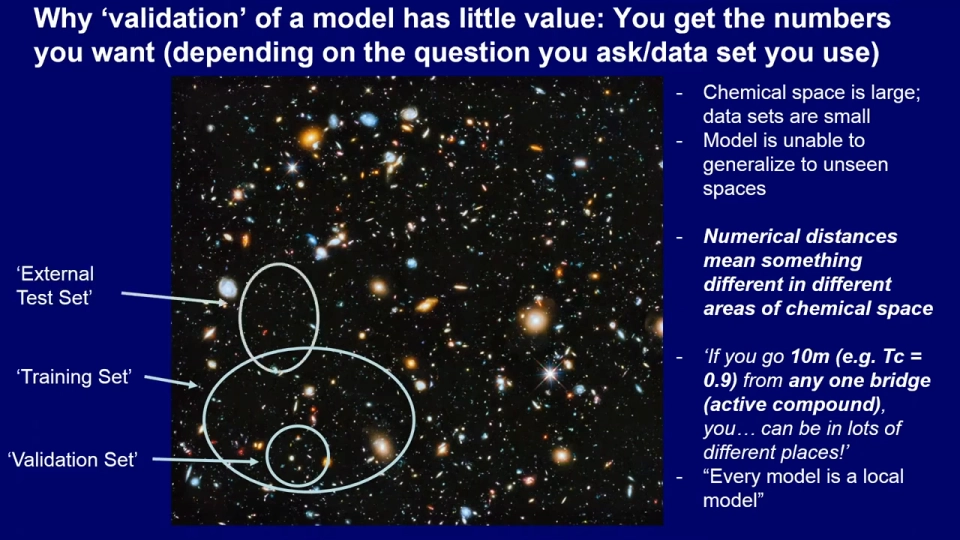

幻灯片上还有两句可以直接当判据用的话：

- "如果你从任何一个桥（活性化合物）出发走 10 米（例如 Tanimoto 相似度 0.9），你可能已经在很多不同的地方了。"
- "每一个模型都是一个局部模型。"

**这就是适用域（applicability domain）的通俗定义**：模型只在训练集附近的那一小块化学空间里有效，而"附近"这件事无法用绝对坐标衡量，只能用"与训练集的最大相似度"这类相对量来近似。

## 三、三种切分：把三种"距离"分别拉开

研讨会后半场，Benoit 报告的工作是"用原子级神经网络挑选类生物活性构象"。为了让结论可信，他没有只做一个随机切分，而是做了三个：

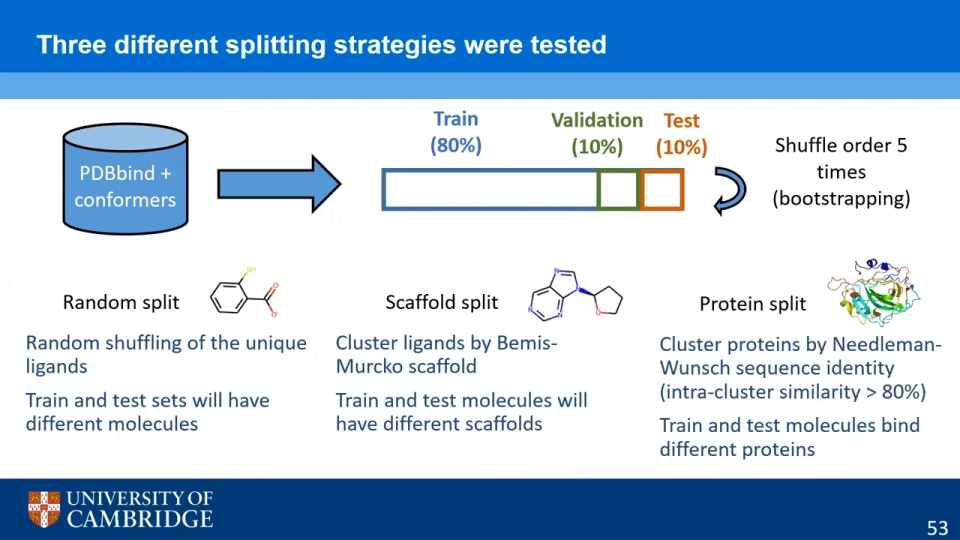

| 切分方式 | 被强制分开的东西 | 模拟的现实场景 |
| --- | --- | --- |
| 随机切分（random split） | 不同分子，但骨架可能相同 | 在已熟悉的化学系列内部做预测 |
| 骨架切分（scaffold split） | Bemis-Murcko 骨架不同的分子 | 换一个化学系列，做骨架跃迁 |
| 蛋白切分（protein split） | 配体所结合的蛋白不同（按 Needleman-Wunsch 序列相似度聚类，簇内相似度大于 80%） | 换一个靶点，做靶点跃迁 |

三个切分共用同一套流程：PDBbind 配体构象加生成的构象，80% 训练、10% 验证（用于早停）、10% 测试，顺序打乱 5 次做 bootstrap，因此图上的误差棒是"切分随机性"而不是"模型随机性" [【跳转到 46:24】](https://www.youtube.com/watch?v=VSS-sOVuVEo&t=2784)。Benoit 说得很直接：做三种切分的目的，就是"也检验模型的适用域——它在什么样的化学结构上是有缺陷的" [【跳转到 46:19】](https://www.youtube.com/watch?v=VSS-sOVuVEo&t=2779)。

### 3.1 为什么"骨架切分"比"随机切分"更接近真实使用

随机切分只保证"分子不同"，但同一个骨架的类似物会同时出现在训练集和测试集里。模型只要学会"这个骨架大致什么活性"，就能在测试集上拿到不错的分数——**它测的是插值能力，不是外推能力**。骨架切分把同一骨架的分子整体分到一侧，强迫模型对没见过的骨架做预测，这才是"下一个项目"的处境。

### 3.2 蛋白切分：把"域外"推到靶点层面

蛋白切分更进一步：测试集的配体结合的蛋白，在训练集里没有出现过（或只出现过序列相似度低于 80% 的同家族成员）。这模拟的是"换靶点"——药物发现里最常见、也最容易被忽略的一种分布偏移。

### 3.3 时间切分：把"未来"当成一个切分维度

视频里没有出现 "time split" 这个词，但 Bender 讲的是同一件事的两端：**回顾验证 vs 前瞻验证**。把这句话操作化，就是时间切分——用较早年份的数据训练，用较晚年份的数据测试。它强制拉开的是"时间距离"，而时间距离在化学数据里几乎总是伴随三件事一起变化：

- **化学系列在变**：项目在推进，新的骨架不断被合成出来；
- **检测平台在变**：assay 的读出方式、仪器、阈值会随年份改变；
- **知识在变**：早期数据里混着后来被证伪的结论。

所以时间切分给出的分数，通常比随机切分低、比蛋白切分高，它回答的是"如果明天来一批新数据，这个模型还能不能用"。Bender 对此的判断是：真正有意义的是前瞻验证，而这需要数据共享（他提到 IMI 等计划）与可复现的建模实践——他和合作者专门写了一篇 Nature Reviews Chemistry 的文章，讨论模型无法复训、数据拿不到的问题 [【跳转到 05:19】](https://www.youtube.com/watch?v=VSS-sOVuVEo&t=319)。

## 四、实测结果：随机≈骨架，蛋白切分掉回基线

Benoit 的模型叫 BioSchNet，任务是预测一个构象相对"最近的生物活性构象"的 RMSD。回归结果如下（数值读自幻灯片柱状图，取近似值）：

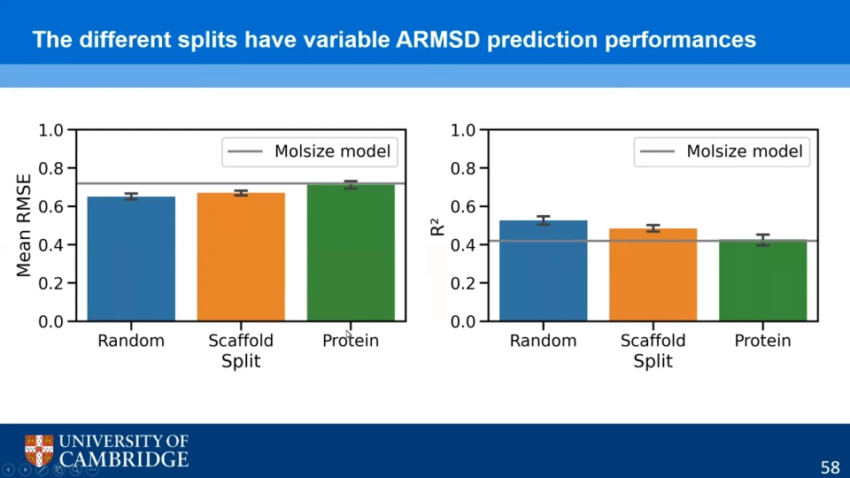

| 切分 | 平均 RMSE（越低越好） | $R^2$（越高越好） |
| --- | --- | --- |
| 随机切分 | 约 0.65 | 约 0.52 |
| 骨架切分 | 约 0.67 | 约 0.48 |
| 蛋白切分 | 约 0.72 | 约 0.41 |
| 分子量基线（MolSize） | 约 0.70 | 约 0.42 |

这张表最值得读的不是"模型赢了基线"，而是三件事：

1. **随机切分与骨架切分的差距很小**：说明这个任务里"骨架"不是主要的信息来源，模型学到的是更局部的几何规律；
2. **蛋白切分的 R² 掉到 0.41，低于分子量基线**：换靶点之后，模型连"分子越大偏差越大"这种粗糙规律都不如；
3. **同一模型、同一数据，只换切分方式，结论就从"显著优于基线"变成"不如基线"**。这正是 Bender 那句"你会得到你想要的数字，取决于你问的问题和你用的数据集"的实证版本。

### 4.1 回归指标之外，还要看排序指标

Benoit 强调，回归指标不是全部——真正要问的是"模型能不能把类生物活性的构象排到前面"。他用富集因子（enrichment factor, EF）衡量：在前 10% 的排序里，类活性构象的比例相对随机高多少倍。

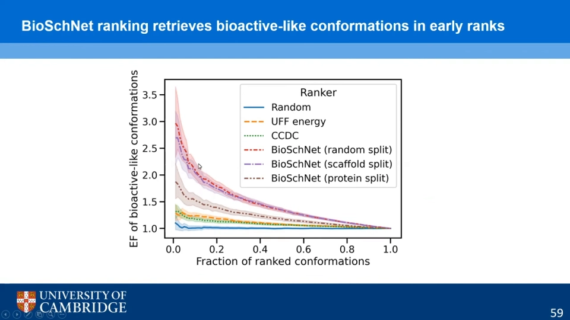

结论是：**排序能力比回归能力更稳健** [【跳转到 51:57】](https://www.youtube.com/watch?v=VSS-sOVuVEo&t=3117)。即使在蛋白切分下，模型在早期排序里仍有富集，只是幅度明显小于随机切分。这提示一个实用判据：如果下游只用模型做"排序、挑前 N 个"，那么该看的是富集曲线；如果下游要用预测值做阈值判断（比如"预测毒性小于某值就放行"），那么必须看回归误差，而且要看它在哪种切分下的误差。

## 五、适用域长什么样：一条随相似度上升的曲线

Benoit 最后把测试集按"与训练集的最大相似度"分箱，画出富集因子的分布。他的原话是："像化学里的大多数模型一样，模型性能和测试分子与训练集的相似程度之间总是存在相关性" [【跳转到 52:22】](https://www.youtube.com/watch?v=VSS-sOVuVEo&t=3142)。

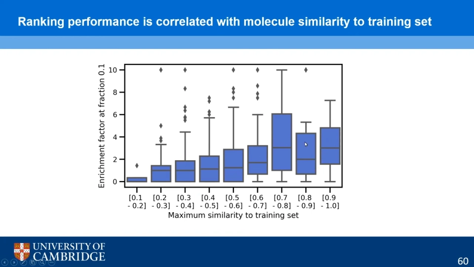

这张箱线图就是"适用域"最实用的形态：

- 横轴左端（相似度 0.1–0.2）：中位富集因子接近 0，**模型在这些分子上没有任何排序能力**，个别离群点的高值不能当作"偶尔能猜中"；
- 横轴右端（相似度 0.9–1.0）：中位数 3–4，而且方差仍然很大；
- 中间是连续过渡，没有"突然失效"的悬崖——**适用域是一条斜率，不是一个门槛**。

Benoit 自己的总结也承认这一点：模型的主要局限就是适用域有限，"当你在结合不同蛋白的配体上测试，或者分子与训练集差异太大时，它就不工作了" [【跳转到 54:52】](https://www.youtube.com/watch?v=VSS-sOVuVEo&t=3292)。

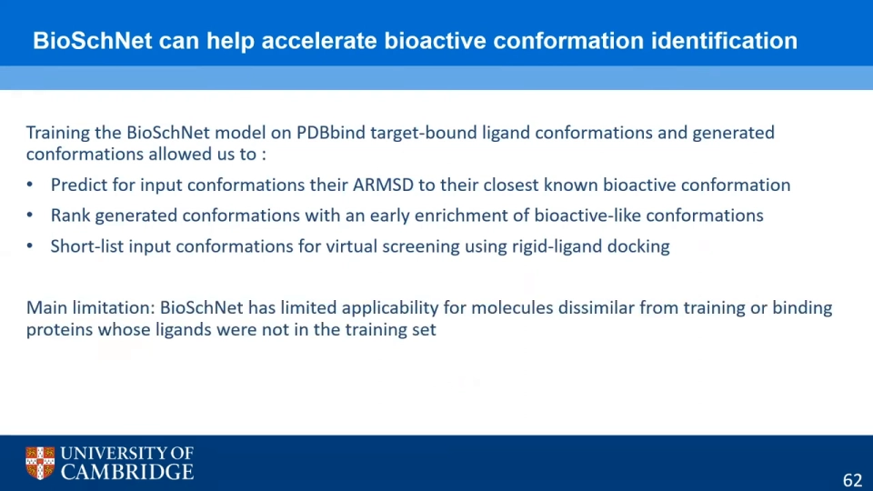

### 5.1 适用域之内，收益是真的

同一套方法在域内是有价值的：对 DRD2 的虚拟筛选，只保留模型排序前 5% 的构象去对接，就能找回与"全部构象都对接"相当数量的活性化合物，相当于 10–100 倍加速 [【跳转到 54:02】](https://www.youtube.com/watch?v=VSS-sOVuVEo&t=3242)。

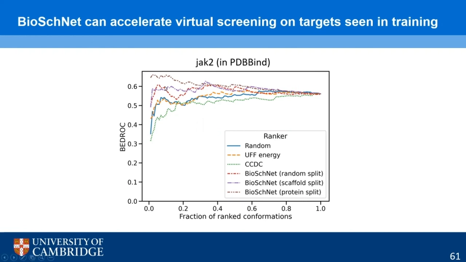

这也是本小节最想传达的平衡：**适用域不是用来否定模型的，而是用来划定"哪一段收益可以兑现"**。

## 六、生成模型把适用域问题放大了一档

研讨会中间，Morgan Thomas 讲的是生成模型（用 RNN 生成 SMILES），表面上与"适用域"无关，实际上把同一个问题放大了一档：**当模型被用来优化另一个模型时，它会主动往域外跑**。

### 6.1 基准数据集可能与你的问题不对齐

MOSES 是生成模型的常用基准，它的预处理会删掉带电荷的分子，理由是"这些带电基团在数据集中两种形式都存在"。Morgan 去查了原始数据：实际删掉了 35% 的数据，而其中只有 0.7% 真的两种形式都有。

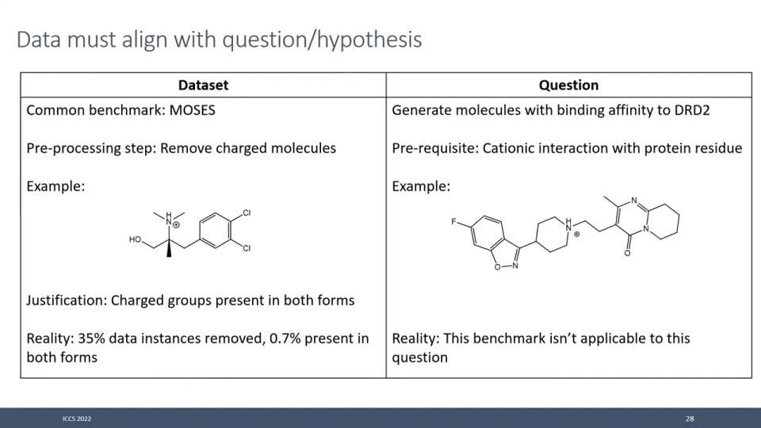

问题在于，他要问的问题是"生成能结合 DRD2 的分子"，而 DRD2 的结合前提就是与口袋残基形成阳离子性相互作用——**基准的预处理恰好删掉了这个问题最需要的那类结构** [【跳转到 29:34】](https://www.youtube.com/watch?v=VSS-sOVuVEo&t=1774)。这不是数据脏，而是"基准的适用域不覆盖你的问题"。初学者最容易犯的错就是拿一个经典 benchmark 直接用，而不检查它和问题是否对齐。

### 6.2 优化压力会把分子推到训练分布之外

更直接的证据来自 Renz 等人的"生成模型失败模式"实验：用一个随机森林当打分函数，让生成模型去最大化它的输出 [【跳转到 32:20】](https://www.youtube.com/watch?v=VSS-sOVuVEo&t=1940)。

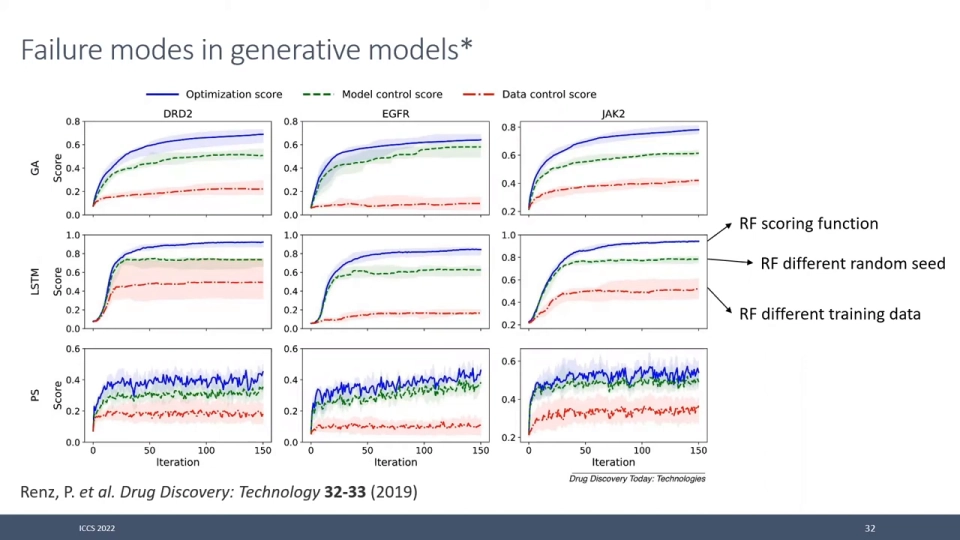

三条线的含义很清楚：

- 蓝线是生成模型优化时看到的分数，一路升到 0.8；
- 绿线是"同一个模型、换一个随机种子重训"的分数，明显更低；
- 红线是"同一个模型、换一个数据切分重训"的分数，更低。

也就是说，生成模型优化的是**这一棵具体的树**，而不是"这个性质"。Morgan 还补充：换不同的 QSAR 算法（随机森林 vs 逻辑回归），生成分子的唯一性指标会差出显著水平；用 SVM 打分和用对接打分，生成分子的性质、多样性、对新化学空间的覆盖也不同——**打分函数的选择，本身就在改变适用域**。

他还提到一个更隐蔽的域外信号：强化学习过程中，某些参数设置下生成的分子会落进"预训练数据里不存在的性质空间"（图上的灰色区域）。这在他看来是需要避免的——"那意味着你在利用打分函数，或者没有忠实于你的先验分布"。

## 七、为什么域外预测不能直接用于决策

到这里，"域外预测不准"还只是一个统计事实。Bender 前半场给的框架解释了它为什么是**决策问题**。

### 7.1 模型嵌在流程里，而不是悬在空中

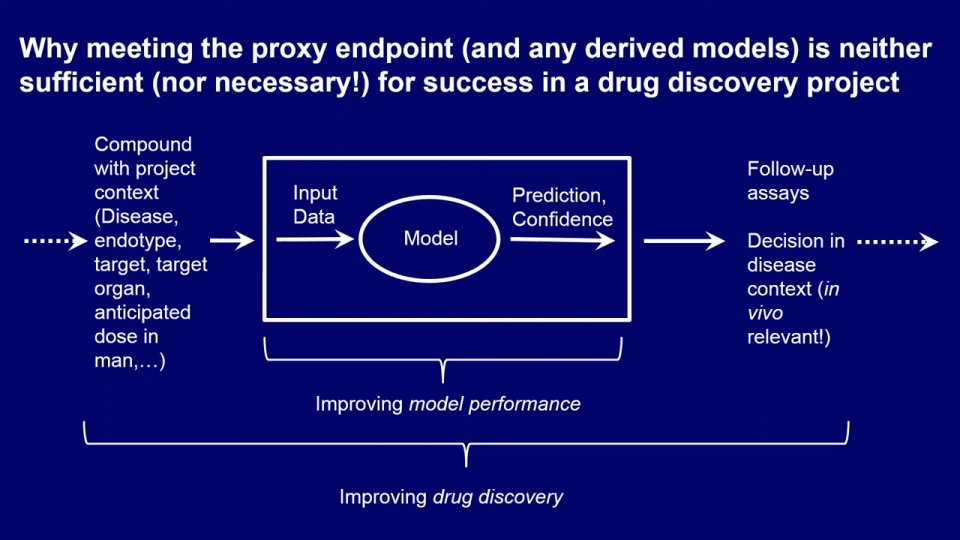

这张图值得逐块读：

- **输入侧**：化合物带着项目上下文进来——疾病、内表型、靶点、靶器官、预期人体剂量；
- **中间**：模型给出预测与置信度；
- **输出侧**：必须能接上随访实验（follow-up assay），再进入"疾病上下文中的决策"。

Bender 的判断是，论文几乎只优化中间那个盒子，而**真正决定成败的是两侧** [【跳转到 09:29】](https://www.youtube.com/watch?v=VSS-sOVuVEo&t=569)。他自己在阿斯利康安全部门带队时的经验是：如果模型预测了毒性，但你不知道接下来做什么实验去验证，"这个预测就是没有意义的，因为没有人会因为模型说了什么就砍掉项目"。

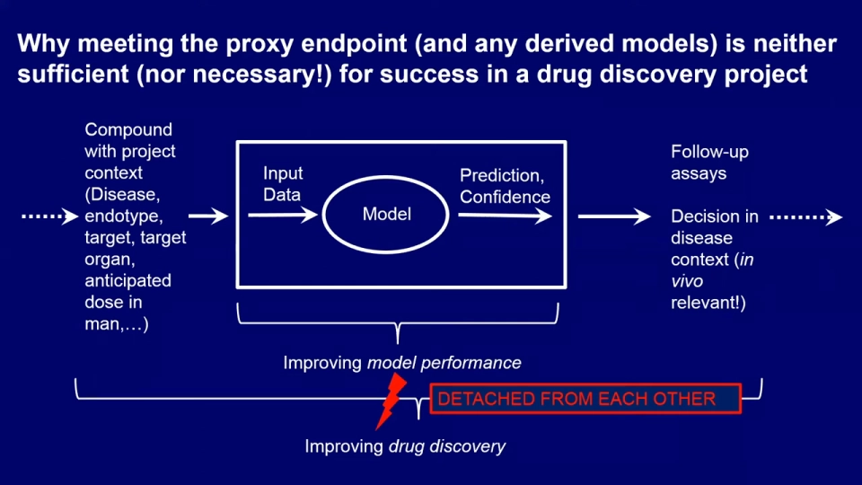

### 7.2 损失函数取决于环境：稀缺还是丰裕

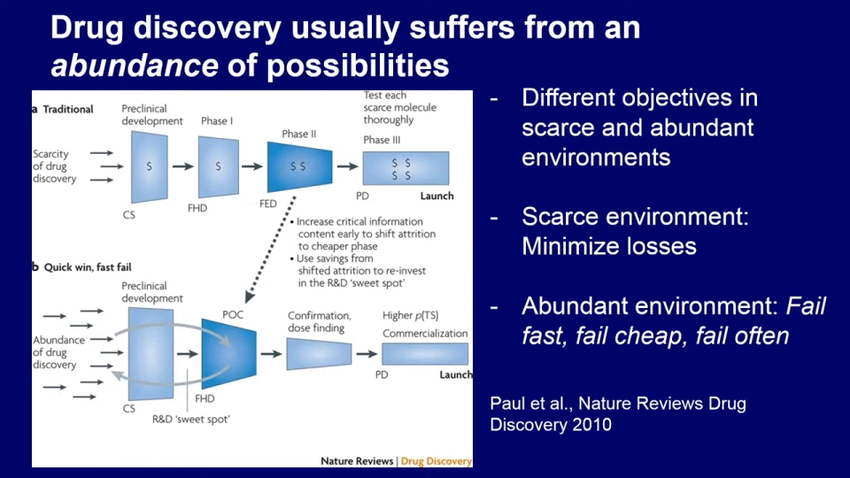

Bender 引了 Paul 等人 2010 年发表在 Nature Reviews Drug Discovery 上的图：传统流程是"稀缺"的（每个阶段只有少数分子），而"快速失败、便宜失败、频繁失败"的流程是"丰裕"的。

- **稀缺环境**（起点很少）：最重要的是**别漏掉能成的分子**，也就是最小化假阴性；
- **丰裕环境**（起点很多，药物发现通常如此）：最重要的是**尽早筛掉失败**。

这直接推出一个反直觉的结论：**AUC 之类的指标不是决策指标** [【跳转到 12:28】](https://www.youtube.com/watch?v=VSS-sOVuVEo&t=748)。同一个模型，在"从一万个分子里挑 50 个去测"和"给 20% 的分子打毒性红旗"这两个任务里，应该优化完全不同的损失函数。所以"模型在测试集上 AUC 0.9"这句话，本身不构成"可以用于决策"的理由。

### 7.3 四类让数字虚高的做法

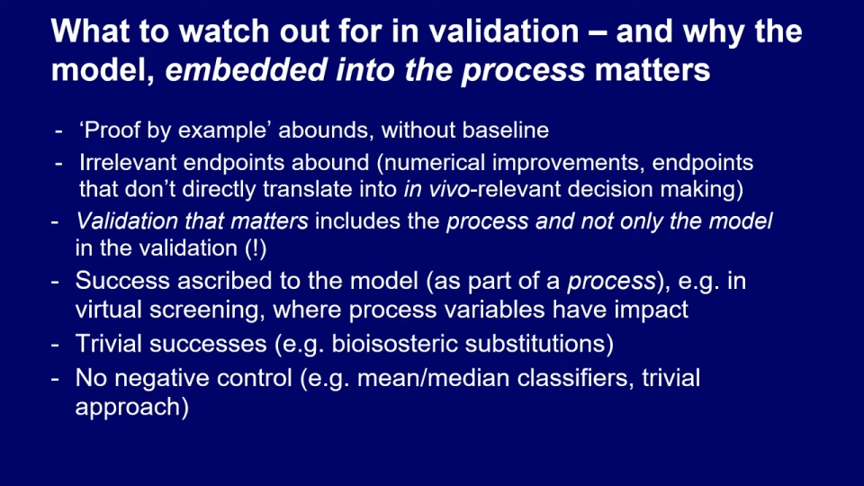

Bender 列了一张清单，每一条都能对应到"域外预测被当成决策依据"的具体场景：

1. **证明式举例（proof by example）**：项目成了就归功于模型，但一个新药是上千个决策的结果；
2. **无关终点**：指标在涨，但它不转化成为体内相关的决策；
3. **只验证模型、不验证流程**：虚拟筛选的成绩里混着"哪些化合物买得到"这类流程变量；
4. **琐碎成功**：把生物电子等排替换包装成"AI 发现新药"，药物化学家一眼就看出这是显然的改动；
5. **没有负对照**：至少要和均值/中位数分类器、以及"什么都不做"的流程比。

他还给了一个具体的偏倚报告案例：一篇用电子健康记录做深度学习的论文，摘要写 0.93、0.75 的高分，而逻辑回归基线被放在补充材料里，数字"基本一样"，置信区间也是重叠的——"这不算撒谎，但和基线比的时候，请用现实的方式报告结果" [【跳转到 17:42】](https://www.youtube.com/watch?v=VSS-sOVuVEo&t=1062)。

### 7.4 把"适用域"写进决策流程

把上面几节合起来，可以得到一张检查表。它的用法不是"给模型打分"，而是"判断这个预测能不能进入决策"。

| 要问的问题 | 具体做法 | 不通过时怎么办 |
| --- | --- | --- |
| 测试集离训练集多远 | 报告测试分子与训练集的最大相似度分布，而不是只报一个平均分 | 按相似度分箱重画性能曲线，标出可信区间 |
| 切分方式对应哪种现实 | 至少同时给随机切分与骨架切分；跨靶点任务加蛋白切分；有年份信息时加时间切分 | 只用与目标场景同构的那张成绩单 |
| 指标是否等于决策 | 明确下游是排序还是阈值判断，选富集曲线或回归误差 | 换指标重评，或改下游用法 |
| 域外样本怎么处理 | 对相似度低于经验阈值的分子，输出"不适用"而不是一个数字 | 转人工评估或补实验 |
| 预测之后做什么 | 事先写清随访实验与决策规则 | 没有随访实验的预测不进决策 |

## 小结

- **性能不是模型的常数，而是距离的函数**：化学空间没有坐标系，"测试集分数"衡量的是训练集与测试集之间的距离，而不是模型的能力上限。
- **三种切分对应三种域外**：随机切分测插值（新分子）、骨架切分测骨架跃迁、蛋白切分测靶点跃迁；时间切分测"明天的新数据"，是前瞻验证的可操作版本。
- **实测教训**：同一模型在随机切分下 R² 约 0.52、蛋白切分下降到约 0.41，已低于分子量基线 0.42——换一种切分，"显著优于基线"就变成"不如基线"。
- **排序比回归稳健**：早期富集在三种切分下都还在，只是幅度不同；下游若只做排序，应看富集曲线。
- **适用域是一条斜率**：最大相似度 0.1–0.2 时富集因子接近 0，0.9–1.0 时中位数 3–4，中间连续过渡；域内收益真实（虚拟筛选 10–100 倍加速），域外则没有结论。
- **生成模型会主动跑到域外**：优化一个随机森林时，换种子或换切分，分数就大幅下降；基准数据集的预处理若与问题不对齐，等于一开始就站在域外。
- **域外预测不能直接决策**：模型嵌在"项目上下文 → 预测 → 随访实验 → 决策"的流程里，损失函数取决于稀缺还是丰裕环境；AUC 不是决策指标，缺负对照与随访实验的预测不该进入决策。

## 关键术语速查

| 术语 | 一句话解释 |
| --- | --- |
| 适用域（applicability domain） | 模型预测可信的那片化学空间；实践中用"与训练集的最大相似度"近似 |
| 分布外预测（out-of-distribution） | 测试分子的结构或性质落在训练数据覆盖范围之外，模型没有依据 |
| 随机切分（random split） | 随机分配分子，只保证分子不同，骨架可能重复，测的是插值 |
| 骨架切分（scaffold split） | 按 Bemis-Murcko 骨架分组后整体分到一侧，测的是骨架跃迁 |
| 蛋白切分（protein split） | 测试集配体结合的蛋白与训练集不同（按序列相似度聚类），测的是靶点跃迁 |
| 时间切分（time split） | 用较早数据训练、较晚数据测试，是前瞻验证的可操作版本 |
| 富集因子（EF） | 在前若干百分比的排序里，命中率相对随机高多少倍 |
| BEDROC | 强调早期命中的排序指标，适合虚拟筛选评价 |
| 前瞻验证与回顾验证 | 前者用未来数据检验，后者用历史数据自我检验；后者被比作"预测昨天的天气" |
| 证明式举例（proof by example） | 项目成功就归功于模型，缺少对照与样本量 |
| 负对照（negative control） | 均值/中位数分类器或"什么都不做"的流程，用来确认模型真的带来了增量 |