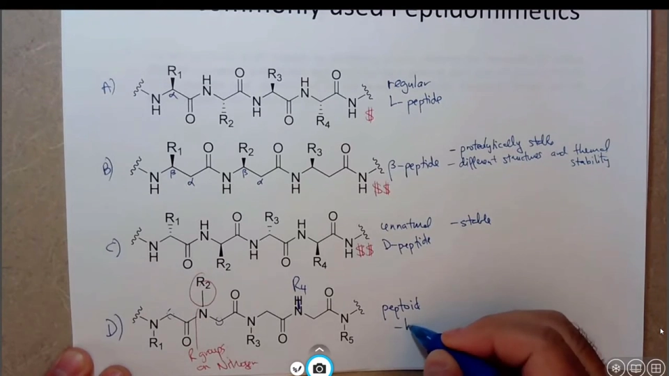
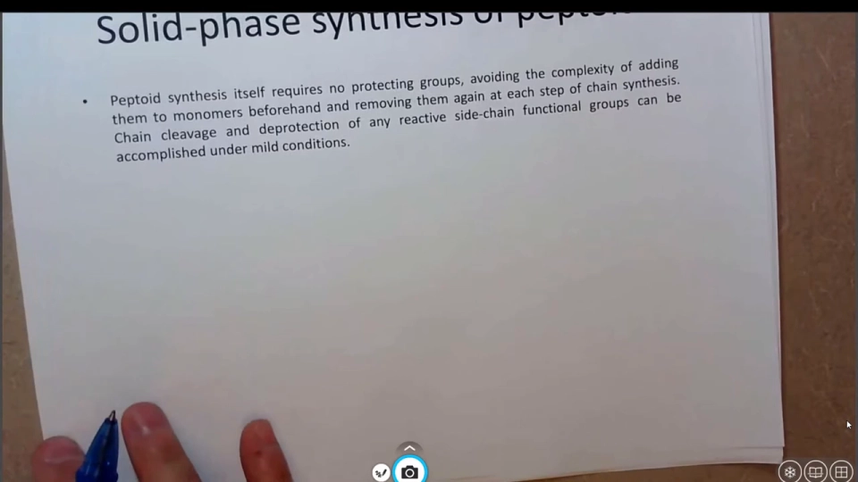
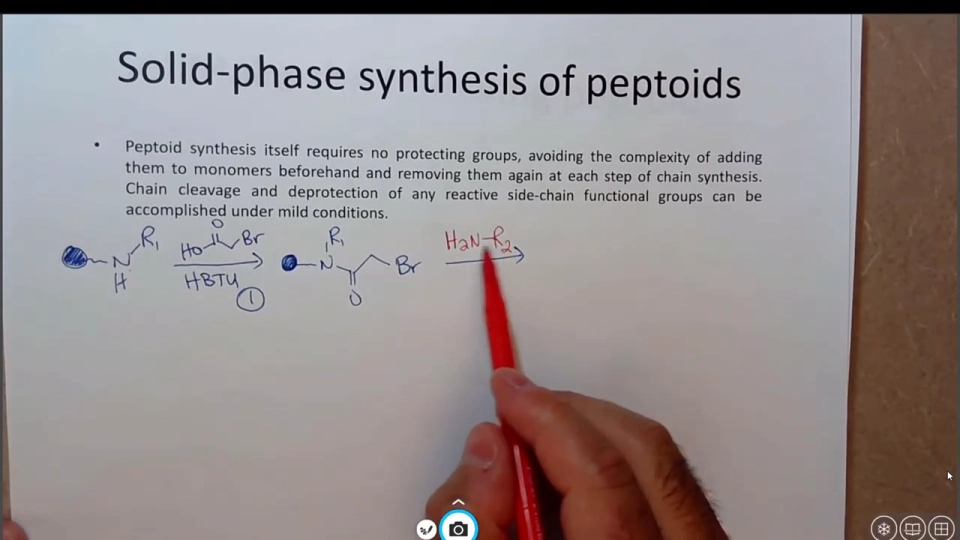
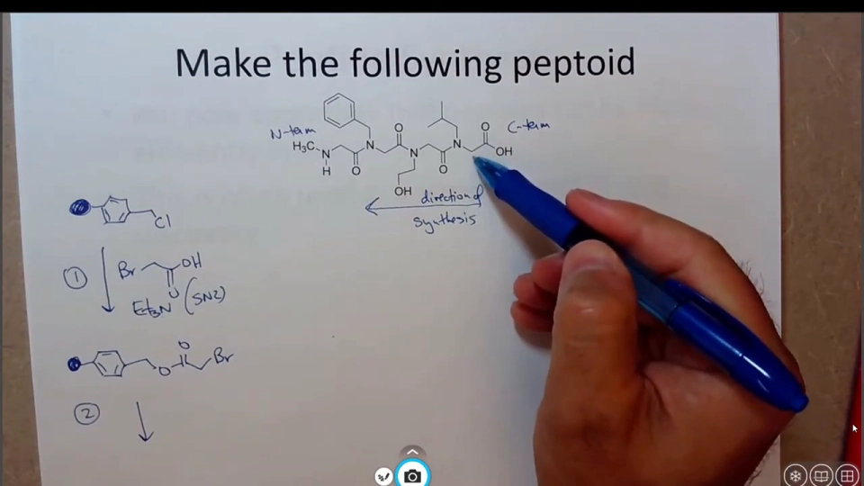
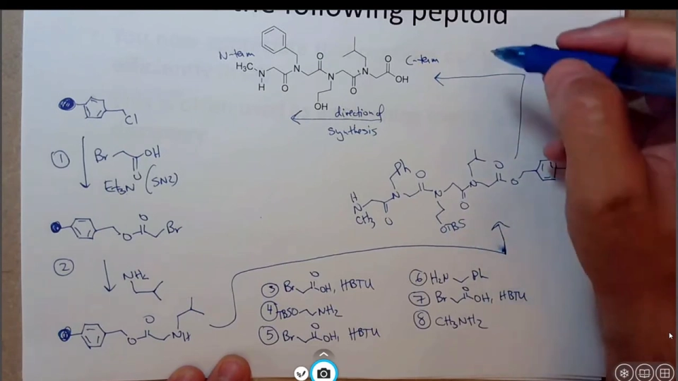
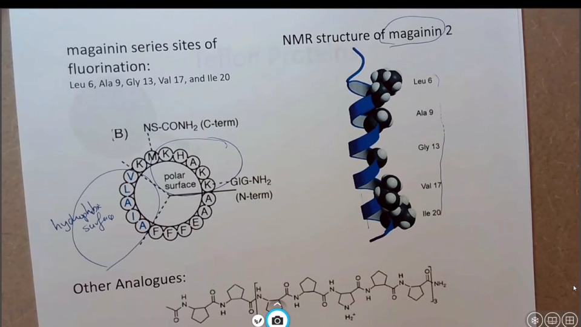
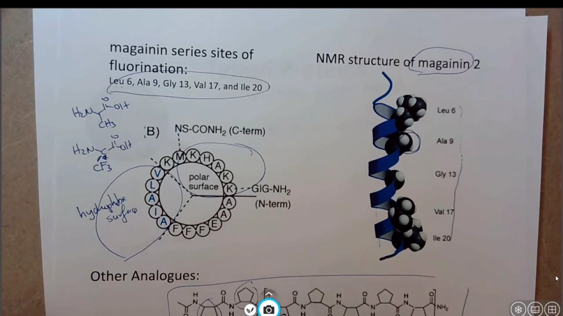
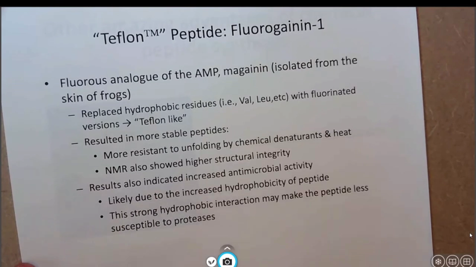
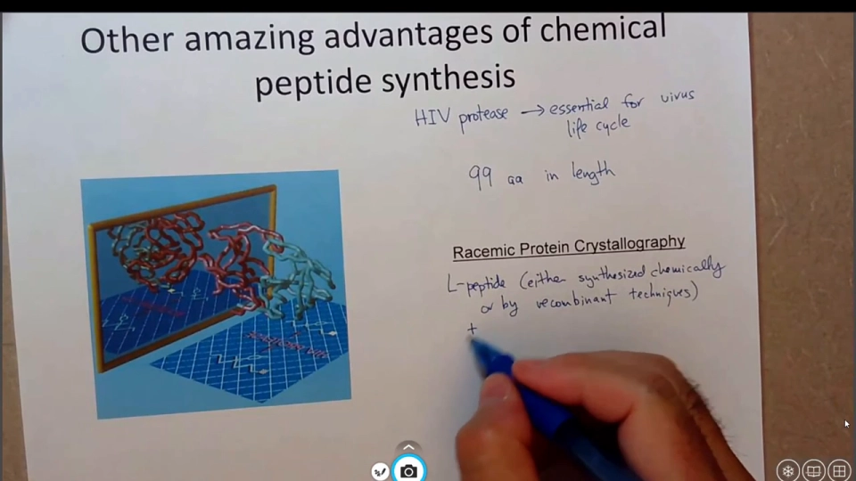

# 肽拟似物的三条改造路线：D型肽、β-肽与peptoid的稳定性与合成代价

> 视频来源：[CHEM 4110U: Peptides and Proteins - Part 3B](https://www.youtube.com/watch?v=y8wc-QMJjRk)（YouTube · Jean-Paul Desaulniers，大学课程录播）｜时长约 34 分钟
> 导读：这是一节讲"肽拟似物（peptidomimetics）"的本科课程。讲者用四张结构式把三类改造摆在一起，再用一块树脂把 peptoid 一步步做出来。本文只取与"非天然残基与主链改造"有关的部分；片尾用抗菌肽举例时涉及的膜穿孔机制，属于本系列 5.1.4 的范围，这里只讲残基替换本身。字幕为自动生成，术语已按上下文订正。

## 本讲要解决的核心问题（SCQA）

**背景**：肽是身体里最常用的一类信号分子和酶底物，所以它天然就是药物设计的起点。但一条由 L-型氨基酸连成的普通肽，进了体内会被蛋白酶当成"食物"切掉，口服也吸收不好。

**冲突**：药物化学的对策是"把肽改得不像肽"——让蛋白酶认不出来，同时尽量保住与靶点结合所需的那些侧链和主链氢键。可"改得不像肽"有很多种改法：动主链、动手性、动侧链的挂接位置，每一种都对应不同的化学操作和不同的代价。

**疑问**：这几类改造各自改在了分子的哪个位置？换来的稳定性是从哪来的？付出的代价又是什么？"设计上说得通"和"实验室里做得出来、买得起"之间差多远？

**回答（中心思想）**：**三类常见改造动的是三个互不相同的位置——β-肽在主链上多插一个碳，D-型肽把手性中心整体翻转，peptoid 把侧链从α碳挪到酰胺氮上。** 它们的稳定性收益几乎来自同一个机制：蛋白酶不认识这个底物。但代价各不相同：β-肽贵在砌块，D-型肽贵在手性合成，peptoid 便宜好做却牺牲了氢键能力与溶解度。真正决定一条改造路线能不能落地的，往往不是设计，而是固相合成能不能便宜、可控地把它做出来。

## 一、肽拟似物：像肽，但不是肽

讲者给的定义很朴素：肽拟似物（peptidomimetic）是"肽的模拟物"，它保留肽的许多结构要素——比如酰胺键、比如某些和天然氨基酸一样的侧链——但也可能含有不寻常的官能团。它们在尺寸和结构上跨度很大，可以很小，也可以很大 [【跳转到 00:43】](https://www.youtube.com/watch?v=y8wc-QMJjRk&t=43)。

为什么值得专门做一类"像肽的东西"？因为肽作为受体配体、作为酶的底物实在太常见，药物化学不想因为"肽不好成药"就整体放弃肽这个化学空间。而上一节讲过的固相肽合成（SPPS，在 Merrifield 树脂上一条链一条链长出来）恰好提供了一个平台：同一套方法不只可以合成天然肽，也可以用来合成肽拟似物，从而系统地做构效关系（SAR）研究、筛选先导化合物 [【跳转到 01:11】](https://www.youtube.com/watch?v=y8wc-QMJjRk&t=71)。

这句话是整节课的骨架：**改造的自由度来自合成方法的通用性。** 你能想到的非天然砌块，只要能用同一套固相化学装进去，就能被拿来做 SAR。

## 二、三条路线改的是三个不同的位置

讲者把四种结构并排画在一张幻灯片上，从上到下依次是：普通 L-肽、β-肽、D-肽、peptoid。这张图是整节课最该记住的一张——它把"改造"从形容词变成了可以指认的位置 [【跳转到 02:19】](https://www.youtube.com/watch?v=y8wc-QMJjRk&t=139)。

把这张图拆成文字，就是下面这张对照表。注意"改造位置"这一列：三者并不重叠。

| 类型 | 改在哪个位置 | 主链上发生了什么 | 蛋白酶还认不认 | 讲者标注的相对成本 |
| --- | --- | --- | --- | --- |
| 普通 L-肽 | 无（基准） | 重复单元是 −NH−CH(R)−CO− | 认 | 低（一个 `$`） |
| β-肽 | α碳与羰基之间多一个碳 | 重复单元变长，多出一个β碳 | 不认 | 高（两个 `$`） |
| D-肽 | 每个手性中心翻转 | 主链原子不变，整体成镜像 | 不认 | 高（三个 `$`） |
| peptoid | 侧链从α碳挪到酰胺氮上 | 主链失去 NH，只剩 −N(R)−CH₂−CO− | 不认 | 低（一个 `$`） |

先解释两个词，后面才好往下走：

- **α碳**：氨基酸里同时连着氨基、羧基和侧链的那个碳。它旁边的碳叫β碳。天然蛋白质用的都是α-氨基酸。
- **手性中心**：一个碳上接四个不同基团时，它的空间排布有两种互为镜像的可能，就像左手和右手。天然蛋白质几乎只用其中一种（L-型）。

## 三、β-肽：主链多一个碳，换来抗酶解与新的二级结构

β-肽的改法是在α碳和羰基之间再插一个碳，于是侧链挂到了β碳上。讲者的评价是：这类分子**基本上是非天然的**，只有少数例外 [【跳转到 03:01】](https://www.youtube.com/watch?v=y8wc-QMJjRk&t=181)。

多出来的这个碳带来三项好处：

1. **疏水性略增**——多一个碳就多一分疏水；
2. **形状不同**——肽能形成的结构、二级结构和热稳定性都会跟着变；
3. **抗酶解**——蛋白酶不把它们当底物识别，因此在治疗上可能更有优势。

代价也很直白：β-氨基酸在自然界并不丰富，**β-肽难合成**；要买 β-氨基酸砌块，通常需要一笔不小的投入，而普通 L-肽的原料相当便宜 [【跳转到 04:16】](https://www.youtube.com/watch?v=y8wc-QMJjRk&t=256)。

这里要提醒初学者一句：**"多一个碳"不是装饰性的微调。** 主链的重复单元长度变了，链能盘成的螺旋类型、能形成的分子内氢键网络都会跟着变——这正是它"能给出不同二级结构"的原因，也是它不能简单当成"更疏水的天然肽"来用的原因。

## 四、D-型肽：整体镜像，蛋白酶和靶点一起被"骗"

D-肽的改法是把每个氨基酸的手性翻过来，得到的分子是原肽的**镜像**。我们生活在一个 L-氨基酸的世界里，但化学合成完全可以做出全 D 的肽；自然界虽然也有 D-氨基酸，但相当罕见 [【跳转到 04:36】](https://www.youtube.com/watch?v=y8wc-QMJjRk&t=276)。

它的优点是稳定：**蛋白酶识别不了 D-型底物**，所以在细胞环境里相当稳定。而它的结构与 L-型肽"同型"，只是镜像——这一点在第七章会变成一个非常有用的工具。

代价是：**这类分子做起来很贵**（讲者在成本栏标了三个 `$`）。原因不难理解：每一个残基都要用非天然的手性砌块，而且合成路线越长、非天然砌块越多，成本叠得越快。

## 五、peptoid：把侧链挪到氮上，合成变简单、溶解度变差

第四类结构最特别：主链上的碳"什么都没有"，只有两个氢；侧链不是挂在碳上，而是**挂在氮上**。这类分子叫 peptoid（聚 N-取代甘氨酸）[【跳转到 06:05】](https://www.youtube.com/watch?v=y8wc-QMJjRk&t=365)。

它的优点清单很长：能形成非常规的二级结构、相当稳定、是构建化合物库的好骨架、**合成相对容易**、而且相对便宜。缺点只有一个，但很致命：**把 NH 去掉之后，就失去了与溶剂或其它基团形成氢键的能力**；如果侧链又比较疏水，peptoid 常常会难溶，在水相里做实验就会遇到麻烦 [【跳转到 07:20】](https://www.youtube.com/watch?v=y8wc-QMJjRk&t=440)。

### 5.1 亚单体法：两步一循环，不需要保护基

peptoid 的固相合成用的是"亚单体（submonomer）"策略，讲者特别强调它最大的好处：**合成本身通常不需要保护基**，省掉了"每一步给单体加保护基、做完再脱掉"的麻烦 [【跳转到 08:09】](https://www.youtube.com/watch?v=y8wc-QMJjRk&t=489)。

一个循环只有两步 [【跳转到 09:34】](https://www.youtube.com/watch?v=y8wc-QMJjRk&t=574)：

1. **酰化**：用溴乙酸（bromoacetic acid）在 HBTU 这类缩合剂作用下活化，与树脂上的胺形成酰胺——于是链端多了一个α-溴代酰胺；
2. **取代**：加入一个伯胺，胺作为亲核试剂走 $S_N2$ 取代掉溴，于是氮上就装好了新的侧链（R₂）。

接着回到第 1 步，如此循环到想要的长度，最后从树脂上切下来。

### 5.2 一个完整的例子：从 Merrifield 树脂到八步之后

讲者随后带着学生把一条具体的 peptoid 从头做了一遍。第一步和普通 SPPS 不一样：Merrifield 树脂（氯代聚苯乙烯）先和溴乙酸反应，三乙胺把羧酸去质子化得到羧酸根，羧酸根再以 $S_N2$ 进攻苄氯，形成一个酯键——**这一步不加缩合剂**，因为这里要的是成酯而不是成酰胺 [【跳转到 14:29】](https://www.youtube.com/watch?v=y8wc-QMJjRk&t=869)。

之后的顺序就是"酰化—取代"的交替：接异丙胺、再接一分子溴乙酸、接乙醇胺（羟基先用 TBS 硅醚保护起来，免得它去当亲核试剂捣乱）、再接溴乙酸、接苯胺、再接溴乙酸、最后接甲胺。全部接完后，用**氢氟酸**把产物从树脂上切下来，同时顺带脱掉 TBS 保护基 [【跳转到 17:16】](https://www.youtube.com/watch?v=y8wc-QMJjRk&t=1036)。

讲者在这里点出了固相合成的真正优势：每一步做完，**把过量的试剂洗掉就行**，想要的产物留在树脂珠上，所以整个流程既高效又简单 [【跳转到 18:05】](https://www.youtube.com/watch?v=y8wc-QMJjRk&t=1085)。

## 六、把非天然残基装进真实序列：β-氨基酸与氟化残基

课程后半段转向"改造真实肽"的例子，讲者选的是抗菌肽（AMP）。这里只取与残基替换有关的部分；AMP 如何靠两亲性螺旋穿孔细菌膜，属于 5.1.4 的内容，不在此展开。

AMP 的背景只需要三句话：长度通常在 15–30 个残基，能形成α螺旋，螺旋的一面偏疏水、另一面偏正电（Lys、Arg、His 这类），这种排布让它们能贴合并破坏带负电的细菌膜；它们由几乎所有动物产生，是天然的第一道防线 [【跳转到 22:13】](https://www.youtube.com/watch?v=y8wc-QMJjRk&t=1333)。讲者举的天然模板是蛙皮来源的 magainin：Leu、Ala、Gly、Val、Ile 这些疏水残基排在一侧，Lys、His、甚至 Glu 排到另一侧，于是分子有了"极性面"和"疏水面" [【跳转到 23:41】](https://www.youtube.com/watch?v=y8wc-QMJjRk&t=1421)。

问题是细菌已经产生了耐药性。于是设计问题变成：**能不能保住这个"疏水面 + 正电面"的排布，同时把分子做得更稳定？** 讲者给了两条基于非天然残基的答案。

### 6.1 用β-氨基酸搭骨架

第一条是把骨架换成β-氨基酸：幻灯片下方的类似物把"带正电的环状氨基"和"疏水的环戊烷型环"交替排布，讲者称其为 **β17** [【跳转到 24:48】](https://www.youtube.com/watch?v=y8wc-QMJjRk&t=1488)。

这张图值得对照着看：左边是天然的 magainin，螺旋轮上"极性面/疏水面"分得很清楚，标注的氟化位点是 Leu6、Ala9、Gly13、Val17、Ile20；右下角"Other Analogues"那一行，就是换成β-氨基酸骨架之后的样子。**同一个设计意图（一面正电、一面疏水），换了一套主链来实现。**

### 6.2 用氟化残基替换疏水侧链

第二条是氟化氨基酸。讲者先讲了一个类比：C–F 键极强，所以聚四氟乙烯（PTFE，也就是特氟龙）耐热、稳定、什么东西都不粘 [【跳转到 25:23】](https://www.youtube.com/watch?v=y8wc-QMJjRk&t=1523)。

研究者做的事很直接：把 magainin 里那些疏水残基的 $\mathrm{CH_3}$ 换成 $\mathrm{CF_3}$——Leu、Ala、Gly、Val、Ile 都换；甘氨酸本来有两个氢，就换成两个氟 [【跳转到 27:40】](https://www.youtube.com/watch?v=y8wc-QMJjRk&t=1660)。

得到的分子叫 **"Teflon" 肽 fluorogainin-1**，是 magainin 的含氟类似物。结果有三条 [【跳转到 28:18】](https://www.youtube.com/watch?v=y8wc-QMJjRk&t=1698)：

- **更抗变性**：对化学变性剂和热的抵抗更强；
- **结构更完整**：NMR 显示结构完整性更高；
- **活性更强**：抗菌活性也上升了，讲者推测与疏水性增强、更能稳定地插进膜有关；同时这种强疏水作用可能让肽更不容易被蛋白酶切。

讲者在这里给了一句方法论上的总结：**固相肽合成的能力，让研究者可以把非天然氨基酸"定点"装进序列里**，而不是只能整体替换 [【跳转到 29:18】](https://www.youtube.com/watch?v=y8wc-QMJjRk&t=1758)。这句话解释了为什么"设计上可行"这一步在肽领域比在小分子领域更容易实现——你不需要重新设计一条合成路线，只需要换一个砌块。

## 七、D-型肽的另一种用法：把蛋白质"骗"进晶体

课程最后一个例子不是药物，而是结构生物学：HIV 蛋白酶。它对病毒生命周期必不可少，长度 99 个氨基酸；因为结构信息能直接指导抑制剂设计，人们很想拿到它的高分辨结构，但晶体一直长不好 [【跳转到 30:32】](https://www.youtube.com/watch?v=y8wc-QMJjRk&t=1832)。

99 个残基对固相合成来说偏长，但可以**分两段合成，再用天然化学连接（native chemical ligation）拼起来**。真正解决问题的是"外消旋蛋白质晶体学"：把化学合成的 L-型蛋白和它的全 D-型镜像混在一起，让两者共同结晶，从而拿到高分辨结构 [【跳转到 32:15】](https://www.youtube.com/watch?v=y8wc-QMJjRk&t=1935)。

这里的关键限制条件值得记住：**D-型蛋白只能靠化学合成拿到**，因为它的每一个残基都是非天然的，重组表达系统做不出来。换句话说，D-型肽在这里的价值不是"更稳定"，而是"提供了一个自然界不存在的镜像对照物"——这正是非天然残基带来的、别的手段拿不到的能力 [【跳转到 33:06】](https://www.youtube.com/watch?v=y8wc-QMJjRk&t=1986)。

## 八、设计可行不等于实际可合成：一张对照表

把全课的例子按"设计意图—合成代价—副作用"三列摆开，落差就很清楚了：

| 改造 | 设计上想解决什么 | 合成上的真实代价 | 换来的新问题 |
| --- | --- | --- | --- |
| β-肽 | 抗酶解、改变二级结构与热稳定性 | β-氨基酸砌块贵，合成难 | 疏水性上升，可能影响溶解与吸收 |
| D-型肽 | 抗酶解、细胞内稳定 | 每个残基都是非天然手性砌块，成本最高 | 镜像结构未必被靶点以同样方式识别 |
| peptoid | 抗酶解、易建库、可有非常规二级结构 | 亚单体法简单、便宜、多数情况无需保护基 | 失去主链 NH，氢键能力下降，易难溶 |
| 氟化残基 | 提高疏水性与抗变性能力 | 需要固相合成定点引入非天然砌块 | 疏水性进一步上升 |
| 长序列（如 99 aa） | 拿到可结晶的均一蛋白 | 需分段合成 + 天然化学连接 | 路线长、总收率与成本压力大 |

这张表的读法是：**每一行的"代价"都不在化学原理上，而在物料与步骤数上。** 讲者反复强调的成本符号（`$`、`$$`、`$$$`）不是随口一说——它对应的是"砌块能不能买到"和"每一步要不要保护基"这两件很具体的事。

## 小结

- 肽拟似物是"像肽但不是肽"的分子，靠固相合成平台可以系统地做 SAR 与先导发现。
- 三类常见改造动的是三个不同位置：β-肽在主链多插一个碳，D-型肽翻转手性，peptoid 把侧链挪到氮上。
- 三者的稳定性收益机制相同：蛋白酶不认识这个底物；但代价分别是砌块成本、手性合成成本、氢键与溶解度损失。
- peptoid 的亚单体法只有"酰化 + $S_N2$ 取代"两步一循环，多数情况不需要保护基，因此便宜好用。
- 非天然残基可以定点装进真实序列：β-氨基酸骨架与氟化残基都能在保住设计排布的同时提高稳定性。
- D-型肽还有一个非药物用途：与 L-型配对做外消旋晶体学，解决难结晶蛋白的结构问题。
- 判断一条改造路线能否落地，先看砌块与步骤，而不是先看结合能。

## 关键术语速查

| 术语 | 一句话解释 |
| --- | --- |
| 肽拟似物（peptidomimetic） | 保留肽的部分结构要素、但含有非天然官能团或骨架的分子，用来绕开肽的药代与稳定性缺陷 |
| α碳 / β碳 | 氨基酸中连着氨基与羧基的那个碳是α碳，它旁边的是β碳；β-氨基酸的侧链挂在β碳上 |
| β-肽 | 主链重复单元比α-肽多一个碳的肽，天然少见，蛋白酶不易识别 |
| D-型肽 | 所有手性中心都与天然 L-型相反的肽，是天然肽的镜像，只能化学合成 |
| peptoid | 侧链挂在酰胺氮上的聚 N-取代甘氨酸，主链没有 NH |
| 亚单体法（submonomer） | 用"溴乙酸酰化 + 伯胺取代"两步循环合成 peptoid 的固相方法，多数情况无需保护基 |
| 固相肽合成（SPPS） | 在树脂上逐步延长肽链、每步洗去过量试剂、最后统一切割的合成策略 |
| 天然化学连接（NCL） | 把两条较短的肽片段化学拼接成长肽/蛋白的方法，用于超出单次合成能力的序列 |
| 外消旋蛋白质晶体学 | 让 L-型蛋白与其 D-型镜像共同结晶，以改善晶体质量、获得高分辨结构 |
| 氟化氨基酸 | 侧链上的氢被氟取代的非天然氨基酸，C–F 键极强，可提高稳定性与疏水性 |