# 酰胺键的五种替身：烯烃、酮、胺、硫代酰胺与N-甲基化的取舍

> 视频来源：[Endogenous Compounds, Peptidomimetics and Oligonucleotides as Drugs](https://www.youtube.com/watch?v=_4at-cHe1GA)（YouTube · NPTEL-NOC IITM，药物化学课程）｜时长约 24 分钟
> 导读：这一讲的主题是"内源性化合物、肽拟似物与寡核苷酸作为药物"。本文只取其中讲肽拟似物的那一段（约 13:07–23:07），前面关于神经递质、激素、PEG 化与抗体的内容，以及片尾关于寡核苷酸的内容，都不属于本小节范围。讲者的幻灯片把五种酰胺键替身并排画在同一张图上，正好可以用来做"取舍"的对照。字幕为自动识别，术语已按上下文订正。

## 本讲要解决的核心问题（SCQA）

**背景**：有些天然肽和蛋白激素早就在当药用了——胰岛素治糖尿病、降钙素、促红素都是常见例子。既然身体自己就用肽做信号分子，肽理应是很好的药物起点。

**冲突**：但讲者指出，许多内源性肽和蛋白作为药物其实**效果很差**，原因有三条：容易被消化酶和代谢酶切掉；极性太高、吸收很差；又因为极性高而被迅速清除。这三条合在一起，使得一条天然肽很难变成一个能口服、能维持血药浓度的药。

**疑问**：既然不能整体放弃肽这个化学空间，那具体能改哪里？每一种改法保住了什么、又丢掉了什么？

**回答（中心思想）**：**蛋白酶识别一条肽，靠的是主链酰胺的形状与氢键。所有"酰胺键替身"本质上都在两个变量上做交易：氢键给体/受体是否还在，以及主链的双键刚性是否还在。** 没有一种替换能同时保住两者——烯烃最抗酶解，却把给体和受体一起丢掉；酮和胺各留一个，但失去了双键带来的刚性；硫代酰胺保住了平面性与给体，受体却变差；N-甲基化干脆不动酰胺，只用一个甲基当"空间盾"挡住酶的识别。此外还有两条不动主链的路线：翻转手性、替换成非天然残基。而无论走哪条路，都会引出两个新的麻烦：分子更疏水、链仍然太柔。

## 一、先看问题：内源肽为什么当不了药

讲者在进入肽拟似物之前，先给了一张"天然激素、肽与蛋白作为药物"的幻灯片，把病灶列清楚：许多内源性肽与蛋白被证明无效，因为它们**高度易被消化酶与代谢酶攻击、吸收差、从体内清除快** [【跳转到 08:32】](https://www.youtube.com/watch?v=_4at-cHe1GA&t=512)。

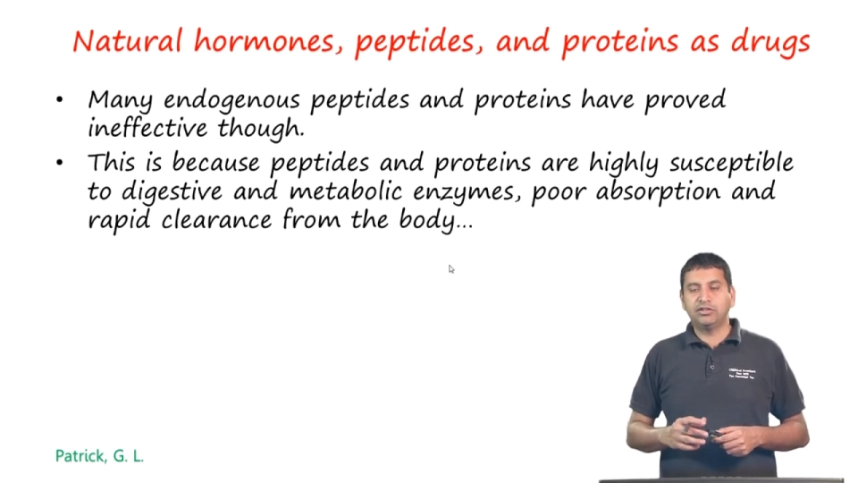

这张图是整节课的问题陈述。请注意它列的是三件事，而不是一件：**稳定性、吸收、清除**。后面所有的化学改造，主要只解决第一件（稳定性），对第二、第三件的作用是间接的——这一点在第六节还会回来。

## 二、肽拟似物：把"肽性"藏起来

讲者给的定义是：**肽拟似物（peptidomimetic）是"看起来像、感觉像、行为像"肽的分子** [【跳转到 13:07】](https://www.youtube.com/watch?v=_4at-cHe1GA&t=787)。

为什么要造这种东西？因为肽作为受体配体、作为酶底物太常见，药物化学不想放弃；但第一代"直接用肽"的候选药，药代动力学性质往往不能令人满意。于是策略变成：**把先导化合物的"肽性"伪装起来或削弱掉**，得到一个更容易从胃肠道吸收、更抗消化与代谢酶的结构 [【跳转到 13:57】](https://www.youtube.com/watch?v=_4at-cHe1GA&t=837)。

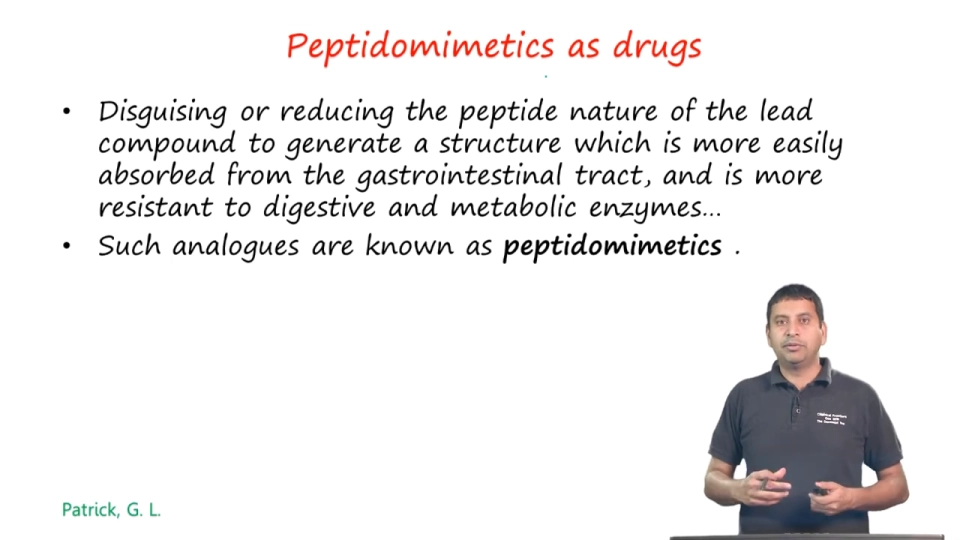

这里要替初学者把一个容易含糊的地方说清楚：**"肽性"不是一个玄学词，它指的是主链上一串重复的酰胺键。** 酰胺键既是结构单元，也是蛋白酶识别底物的"把手"。所以"削弱肽性"最直接的做法，就是动这个把手。

## 三、酰胺键为什么会被切：它同时是氢键给体和受体

在给出五种替身之前，讲者先讲了一件事：**先导化合物里的酰胺键常常参与和靶点结合口袋的氢键作用——NH 当氢键给体，羰基的 C=O 当氢键受体** [【跳转到 15:12】](https://www.youtube.com/watch?v=_4at-cHe1GA&t=912)。

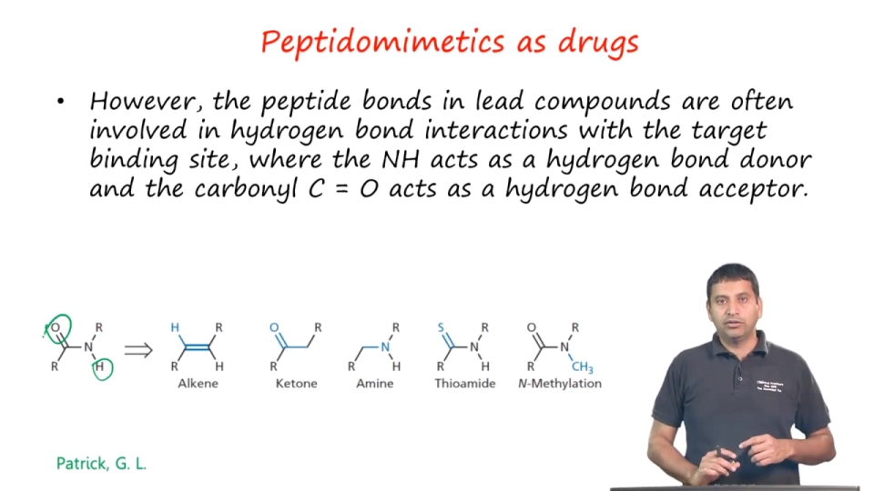

这句话是后面所有取舍的判据。它意味着：**你每改掉一个酰胺键，就有可能同时改掉两处结合能。** 而蛋白酶之所以能切肽，也是靠识别这个酰胺（尤其是羰基与 NH）。于是"抗酶解"和"保活性"在化学上就变成了同一枚硬币的两面——这就是为什么没有免费的改造。

## 四、五种替身：一张面板上的取舍

讲者把五种替换画在同一张幻灯片上，从左到右是：烯烃（alkene）、酮（ketone）、胺（amine）、硫代酰胺（thioamide）、N-甲基化（N-methylation）[【跳转到 14:47】](https://www.youtube.com/watch?v=_4at-cHe1GA&t=887)。

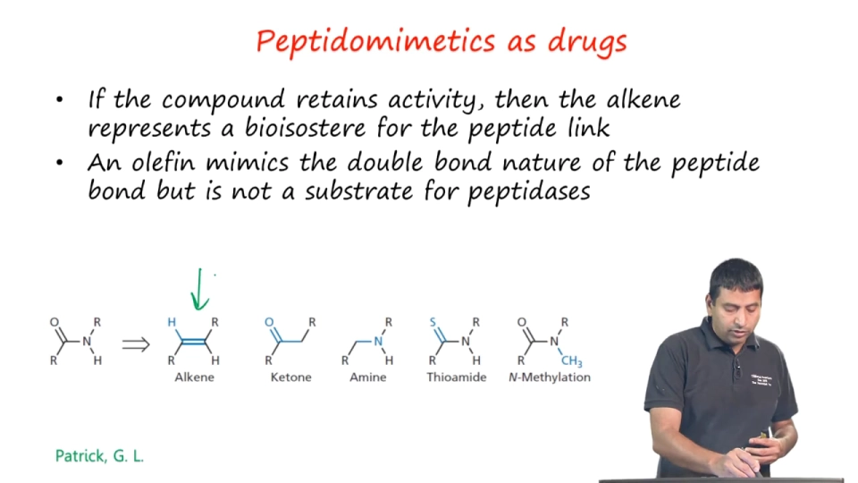

把讲者的逐条讲解整理成表，取舍关系就一目了然：

| 替身 | 氢键给体（NH） | 氢键受体（C=O） | 双键刚性/平面性 | 抗酶解 | 讲者点出的主要风险 |
| --- | --- | --- | --- | --- | --- |
| 烯烃（或炔烃） | 无 | 无 | 保留双键，但不是酰胺 | 最强 | 两处氢键同时丢失，结合强度可能大幅下降 |
| 酮 | 无 | 有 | 丢失 | 较强 | 只剩一个相互作用，且链变柔 |
| 胺 | 有 | 无 | 丢失 | 较强 | 只剩一个相互作用，且链变柔 |
| 硫代酰胺 | 有 | 很弱 | 保留平面性 | 较强 | 硫是差的氢键受体 |
| N-甲基化 | 被封住 | 有 | 保留 | 较强 | 只是挡住酶，不改主链骨架 |

下面逐条解释。

### 4.1 烯烃/炔烃：最抗酶解，但两处氢键一起丢

讲者的第一个例子是把酰胺键换成烯烃（幻灯片上写作 alkene；讲者在口述里也提到炔烃）。理由很直接：酰胺键有显著的双键性质，**烯烃模拟了这种双键性质，但它不是肽酶（peptidase）的底物**，因此在代谢中极其稳定 [【跳转到 15:12】](https://www.youtube.com/watch?v=_4at-cHe1GA&t=912)。

代价也是全表最大的：把酰胺整个拿掉，就等于**同时去掉了氢键给体和氢键受体**，因此可能显著丢失结合强度。讲者用了一句很克制的话：如果化合物**仍然保留活性**，那么这个烯烃才算得上是肽键的"生物等排体（bioisostere）" [【跳转到 15:37】](https://www.youtube.com/watch?v=_4at-cHe1GA&t=937)。换句话说，"等排"不是画上去就成立的，要靠活性数据来证明。

### 4.2 酮与胺：各留一个相互作用，但丢了刚性

如果不想两个氢键一起丢，可以换成**酮**（保留羰基）或**胺**（保留氮上的氢）。这样只丢失两处相互作用中的一处，可能可以补偿一部分损失。

但讲者紧接着指出这两条路的共同问题：**双键性质完全消失了，链变得更柔**；而原来的酰胺键是更受限、更"硬"的 [【跳转到 16:02】](https://www.youtube.com/watch?v=_4at-cHe1GA&t=962)。

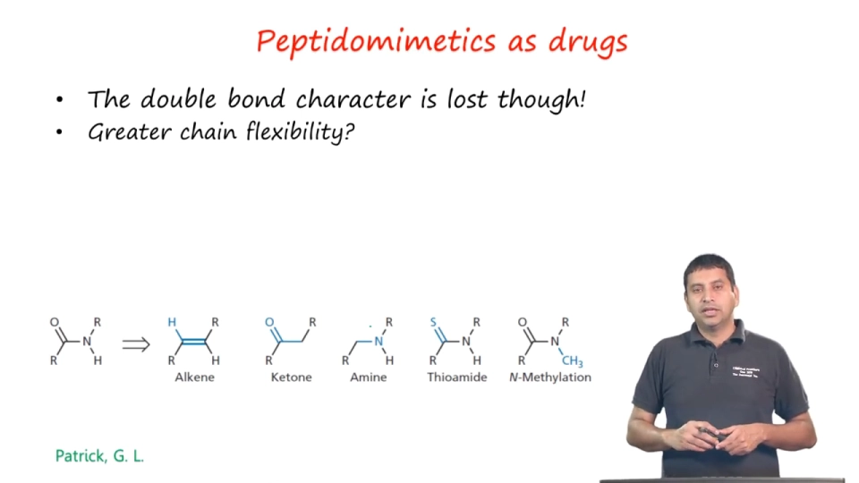

对初学者来说，这里值得停一下：**"柔性"不是中性词。** 一条链越柔，它在溶液里采样的构象越多，结合时要付出的构象熵代价越大。这一点在第六节会以另一个面貌出现（可旋转键太多不利于口服）。

### 4.3 硫代酰胺：保住平面与给体，受体变差

把羰基氧换成硫，就得到硫代酰胺。讲者列出它的三条性质 [【跳转到 16:52】](https://www.youtube.com/watch?v=_4at-cHe1GA&t=1012)：

- **保留酰胺的平面形状**；
- **NH 仍然可以当氢键给体**；
- **硫是差的氢键受体**——硫原子较大、电负性明显低于氧。

这个"缺点"在特定情形下会变成优点：如果原来的**羰基氧正是与肽酶活性位点形成氢键、从而被识别并水解的那个点**，那么换成硫之后，被酶水解的可能性就下降了。也就是说，硫代酰胺的价值不在于"全面更好"，而在于**精准地破坏酶识别所依赖的那一处相互作用**。

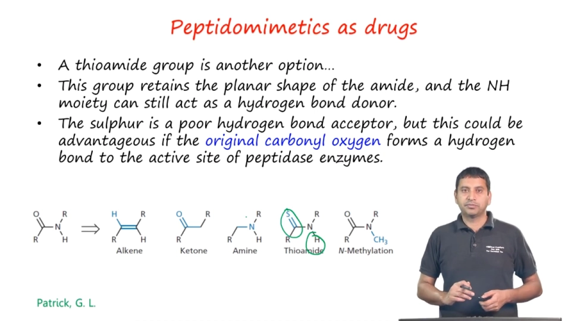

### 4.4 N-甲基化：不动酰胺，只加一个"空间盾"

最后一种最保守：**保留酰胺不变，只在氮上挂一个甲基**。讲者的解释是，甲基起**空间屏蔽（steric shield）**的作用，阻止原本应当发生在"酰胺 NH"与"肽酶活性位点"之间的那一步氢键识别；识别被挡住之后，水解速率就显著下降 [【跳转到 17:42】](https://www.youtube.com/watch?v=_4at-cHe1GA&t=1062)。

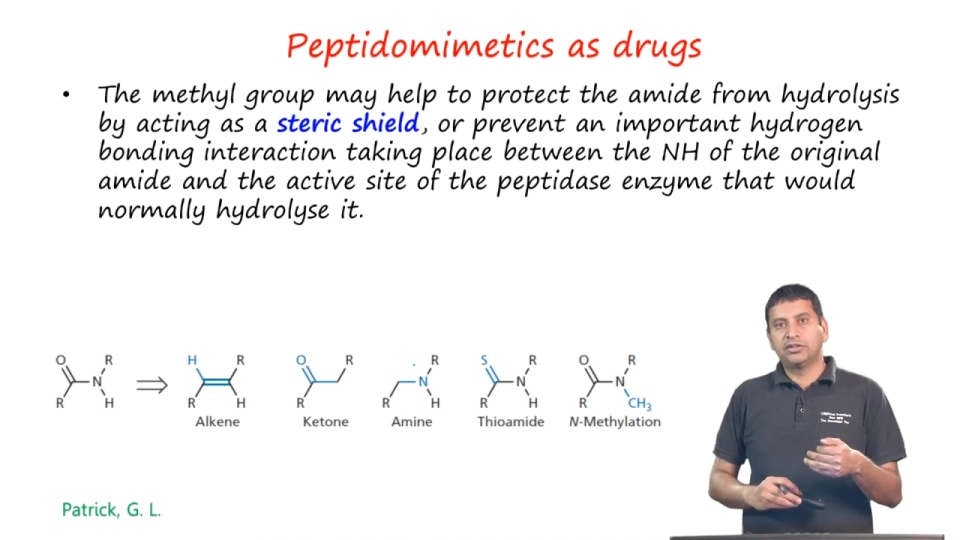

这条策略的性价比很高：它基本保留了酰胺的全部性质（平面性、羰基受体），只用一个甲基换来了抗酶解。代价则转移到别处——多一个甲基就多一分疏水，而疏水性问题正是第六节的主题。

## 五、不动主链的两条路：翻手性与换残基

### 5.1 把 L 换成 D：让酶"看不懂"相对取向

除了改主链，还可以改手性。讲者的说法是：把 L-对映体换成 D-对映体，会**改变侧链相对于分子其余部分的取向**，从而让分子对消化酶或代谢酶变得"不可识别"——尤其是当这个侧链本身参与结合相互作用时 [【跳转到 18:07】](https://www.youtube.com/watch?v=_4at-cHe1GA&t=1087)。

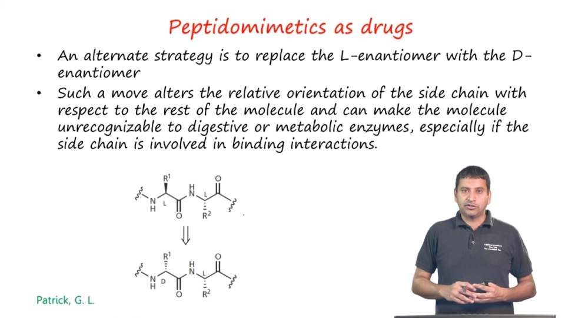

但讲者立刻给出了这条路的**反面风险**：这样改也可能让肽拟似物**对想要作用的靶点也变得不可识别**。因为前面已经讲过，侧链的相对位置对结合很重要 [【跳转到 18:57】](https://www.youtube.com/watch?v=_4at-cHe1GA&t=1137)。

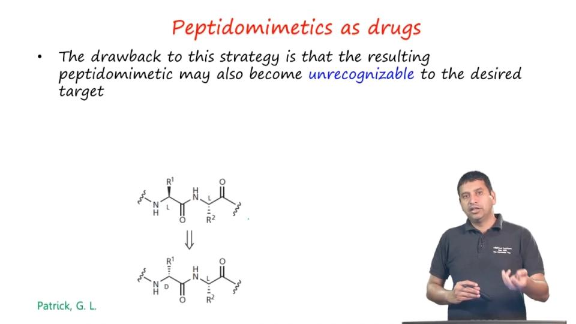

这两张图要连起来看：**"让酶认不出"和"让靶点认不出"在化学上是同一个动作。** 区别只在于你希望哪一个发生。这是本小节最核心的"功能权衡"。

### 5.2 换成非天然残基：从结构出发去设计

第三条路是把天然残基换成**非天然氨基酸**。讲者给的理由是：非天然残基在自然界不存在，因此在某些情况下能比天然残基存活更久。而它真正的用武之地是**基于结构的药物设计**：先用 X 射线晶体学与分子模拟画出配体与活性位点之间的主要结合相互作用，再据此设计一个"保留相同或相似相互作用、但不含天然氨基酸"的分子；由于可以针对各个亚口袋（subsite）设计得更贴合，**结合亲和力甚至可能提高**，同时对消化与代谢酶更不易被识别 [【跳转到 19:22】](https://www.youtube.com/watch?v=_4at-cHe1GA&t=1162)。

讲者给的实例是抗病毒药 **saquinavir** 的先导化合物：其中有一个 **L-脯氨酸残基**占据病毒蛋白酶的疏水亚口袋。在药物设计过程中，这个脯氨酸被换成了**十氢异喹啉（decahydroisoquinoline）环**——它不仅更抗水解，而且能更充分地填满那个疏水亚口袋，带来更好的结合相互作用 [【跳转到 21:02】](https://www.youtube.com/watch?v=_4at-cHe1GA&t=1262)。

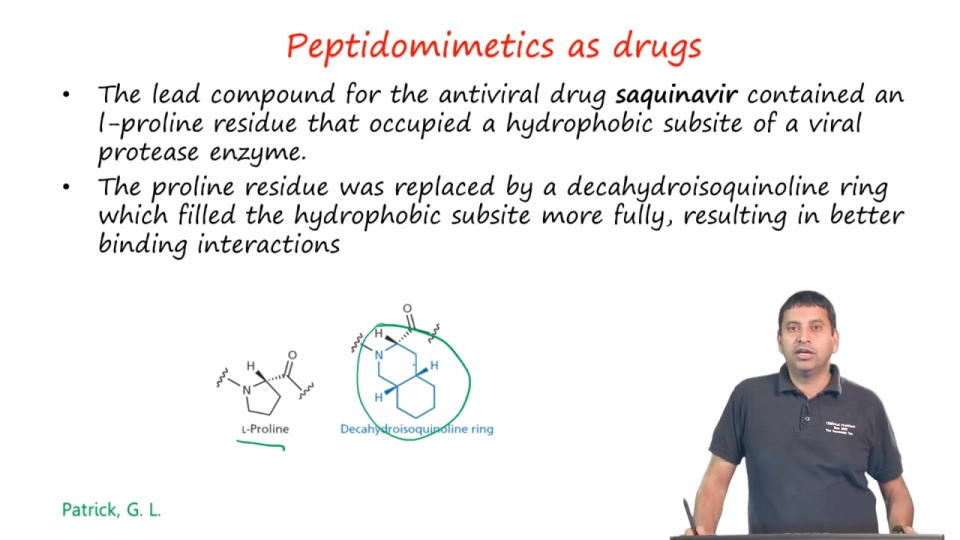

这个例子值得记住的地方在于：**它不是"为了稳定而稳定"，而是把稳定性收益和结合收益叠在同一个改动上。** 这也是非天然残基相对"硬改主链"的优势——你可以在侧链空间里做文章，而不必动主链的氢键网络。

## 六、改造带来的两个新问题：更疏水、更柔

讲者在讲完所有替换之后，话锋一转，指出肽拟似物的两个通病。

**第一，太疏水。** 因为这些改造往往要"加碳"（甲基、环、芳环），分子疏水性上升，水溶性变差，口服时吸收很差。补救办法是提高残基的极性，例如把一个芳环换成**吡啶环** [【跳转到 21:27】](https://www.youtube.com/watch?v=_4at-cHe1GA&t=1287)。

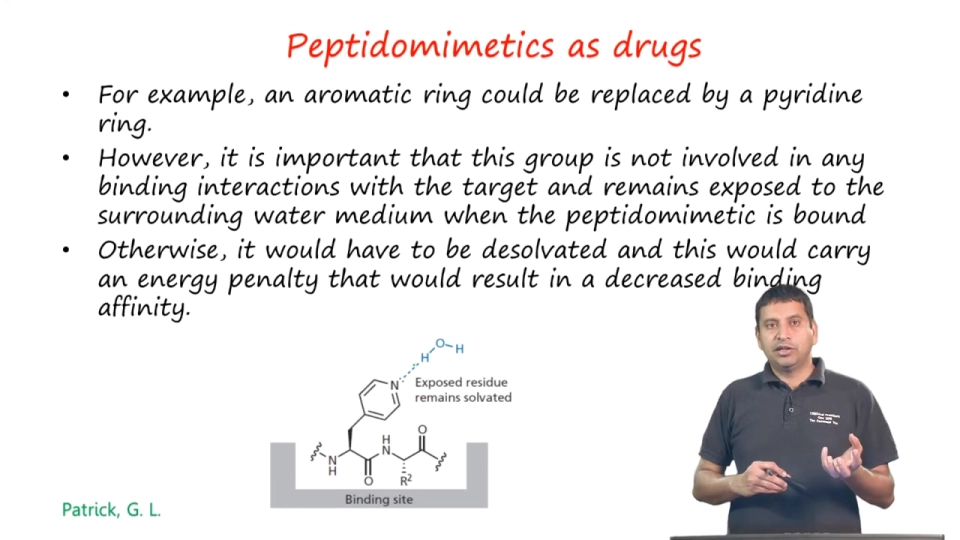

但这里有一个必须遵守的前提，讲者讲得很清楚：**这个改动不能涉及主要结合位点**；这个环在肽拟似物结合之后应当仍然暴露在周围的水环境中。否则，这个基团在进入结合口袋前必须先**去溶剂化**，这要付出能量代价，结果是结合亲和力下降、活性丢失 [【跳转到 22:17】](https://www.youtube.com/watch?v=_4at-cHe1GA&t=1337)。

**第二，太柔。** 肽类先导化合物往往柔性很大、可自由旋转的键很多；不少研究提示，这种柔性对口服生物利用度并不有利，因此前面讲过的各种"刚性化"手段可能是有益的 [【跳转到 22:42】](https://www.youtube.com/watch?v=_4at-cHe1GA&t=1362)。

把这两条与第四节连起来看，会发现一个闭环：**你为了抗酶解而动主链，动完主链可能更疏水、更柔；为了救溶解度去加极性基团，又要小心别碰到结合位点。** 这就是"功能权衡"在真实项目里的样子。

## 七、边界说明：同一套逻辑也用在寡核苷酸上

讲者在最后几分钟把话题转到寡核苷酸（反义核酸与适配体），指出核苷酸也有类似的改造空间：磷酸可以改成硫代磷酸酯或甲基磷酸酯，糖可以被修饰，碱基也可以被修饰，这些改动能提高稳定性、有时还会改变结合 [【跳转到 23:07】](https://www.youtube.com/watch?v=_4at-cHe1GA&t=1387)。

这一段与本小节的关系是"同一套思路、不同分子"：**都是通过化学修饰让酶认不出、同时尽量不破坏结合。** 但它属于寡核苷酸药物的独立话题，本文不展开。

## 小结

- 内源肽当药的三道关是：易被酶切、吸收差、清除快；化学改造主要解决第一道。
- 肽拟似物的目标是"削弱肽性"，而"肽性"具体指主链上一串可被酶识别的酰胺键。
- 酰胺键在结合中同时充当氢键给体（NH）与受体（C=O），因此每改一处都可能丢掉两处结合能。
- 五种替身的取舍：烯烃最抗酶但两个氢键全丢；酮/胺各留一个却失去双键刚性；硫代酰胺保住平面与给体、受体变差；N-甲基化不动酰胺、只加空间盾。
- 不动主链的两条路：D-型翻转（酶与靶点可能同时认不出）与替换非天然残基（可以在提高稳定性的同时改善结合，saquinavir 即例）。
- 改造会带来两个新问题：疏水性上升（可用吡啶等极性替换补救，但不能碰结合位点）与链仍然过柔（需要刚性化）。
- 判断一条替换是否成立，看的是活性数据，而不是"结构上像不像"。

## 关键术语速查

| 术语 | 一句话解释 |
| --- | --- |
| 肽拟似物（peptidomimetic） | 削弱了"肽性"、但仍能模拟肽与靶点相互作用的分子 |
| 生物等排体（bioisostere） | 在结构上替换某个基团、且能基本保留其功能作用的基团；是否成立要靠活性验证 |
| 肽酶（peptidase） | 水解肽键的酶，识别底物依赖酰胺键的形状与氢键 |
| 硫代酰胺（thioamide） | 把酰胺的羰基氧换成硫的基团，保留平面性与 NH 给体，但硫是弱氢键受体 |
| N-甲基化 | 在酰胺氮上加甲基，用空间屏蔽阻止酶识别，同时保留酰胺性质 |
| 对映体翻转 | 把 L-型残基换成 D-型，改变侧链相对取向，使酶难以识别 |
| 十氢异喹啉（decahydroisoquinoline） | 一个双环脂肪族骨架，用来替换脯氨酸以更充分地填充疏水亚口袋 |
| 去溶剂化代价 | 极性基团进入疏水口袋前必须脱去水化层，需要付出能量，会降低结合亲和力 |
| 可旋转键 | 分子中可自由旋转的单键，数量多意味着构象熵代价大、口服性往往更差 |