# 从分配到相结构：模型膜如何判定抗菌肽的杀菌机制

> 视频来源：[Antimicrobial peptide-membrane interactions. Biophysical approaches and exploring the bridge to their pathogen effects](https://www.youtube.com/watch?v=X_yzSByV2CI)（YouTube · PATh 研究组网络报告，讲者 Margarida Bastos，波尔图大学化学与生物化学系）｜时长约 63 分钟
> 导读：本文覆盖同一场报告的后半段（约 25–63 分钟），主线是"结构证据"：用 SAXS 看肽把膜变成了什么相，再回到白色念珠菌与分枝杆菌的显微镜与读数上验证；随后用 cecropin A–melittin 杂合肽把整套流程走一遍，最后回答"模型膜到底能证明什么"。前半段的电荷、两亲性与结合读数见同目录的《电荷与两亲性：抗菌肽如何选择细菌膜》。字幕为自动识别，术语错拼已按上下文订正。

## 本讲要解决的核心问题（SCQA）

**背景**：前半场已经建立了这条链：细菌膜更负 → 阳离子肽被静电拉过去 → 折叠成两亲性螺旋 → 插进膜里。DSC 能说"有没有扰动"，CD 能说"有没有折叠"，荧光能给出分配系数 $K_p$。

**冲突**：这些读数都还是"结合"层面的。$K_p$ 高只说明肽喜欢待在膜里，并不说明它把膜**变成了什么**。而抗菌肽的杀伤机制恰恰是结构性的：孔、地毯式溶解、堆叠、立方相——这些差别在 $K_p$ 上看不出来。更麻烦的是，$K_p$ 最高的那个肽，在 DSC 上并不强。

**疑问**：怎样才能直接看到"肽把膜变成了什么结构"？这种在模型膜上看到的结构，真的能对应到真实病原体身上吗？如果对应上了，一个"高分配、低膜活性"的分子又该怎么解释？

**回答（中心思想）**：**用 SAXS 读"相"，可以把抗菌肽的杀伤分成一个由弱到强的结构阶梯：脂质分凝 → 胶束立方相 → 双连续立方相。** 这个阶梯与冷冻蚀刻电镜在白色念珠菌上看到的形态一一对应；而"高 $K_p$ 却没有膜活性"的例外，恰好证明**分配与破坏是两个独立的环节**，也提醒我们：抗菌活性读数（如 MIC、LC50）必须与结构证据、毒性读数三方对齐，才能判定一个肽到底是不是"膜活性"的。

## 一、SAXS 给的是"相"，不是"结合"

讲者用一张图把 SAXS（小角 X 射线散射）的原理讲清楚 [【跳转到 25:39】](https://www.youtube.com/watch?v=X_yzSByV2CI&t=1539)。

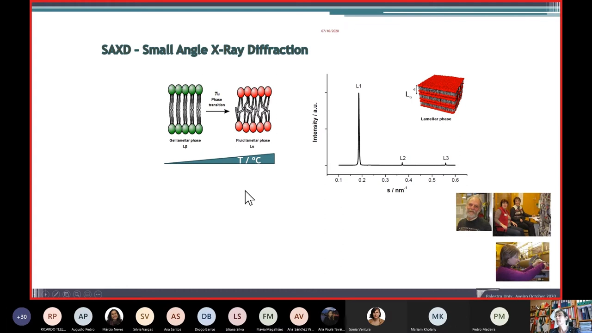

要点有三条：

1. **必须有周期性**：只有多层堆叠（多层膜）才有可测的信号，单层囊泡没有"重复"就没有峰。所以样品要制备成多层体系。
2. **峰位给层间距**：相邻峰的间距对应一个重复距离 $d$，由 $d$ 可以算出层间距，进而追踪相变温度。
3. **峰的比例给"相"**：层状相（lamellar）的峰位比是 $1:2:3:\dots$；六角相、立方相各有自己的峰位比序列。**看到什么比例，就知道膜处在什么相。**

这就是 SAXS 与前面所有技术的分工：DSC 说"扰动多大"，CD 说"肽是什么构象"，$K_p$ 说"结合多强"，**SAXS 说"膜变成了什么"**。

## 二、三个肽，三种膜命运：分凝、胶束立方相、双连续立方相

三个乳铁蛋白肽在同一个模型膜体系（阴离子膜）里，给出了三种完全不同的结构结局。把它们排在一起，就是本节最重要的那张"结构阶梯"。

### 2.1 Lfcin17-30：只把膜"分家"，不破坏

Lfcin17-30 的 SAXS 曲线在降温过程中出现了**两套层状相**的峰：$L_\alpha(1)$、$L_\beta(1)$、$L_\alpha(2)$、$L_\beta(2)$ [【跳转到 26:39】](https://www.youtube.com/watch?v=X_yzSByV2CI&t=1599)。

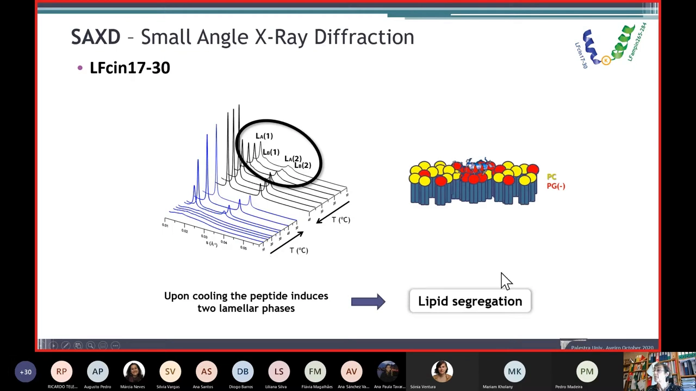

讲者的解读是**脂质分凝（lipid segregation）**：阳离子肽把带负电的 PG 拉到自己周围，形成"富 PG + 肽"的一相，剩下的"富 PC + 少量 PG"成为另一相 [【跳转到 27:17】](https://www.youtube.com/watch?v=X_yzSByV2CI&t=1637)。

**关键判断：这个肽没有破坏膜，只是让膜分了家。** 讲者特意说"记住这一点，后面会很重要"——因为分凝正是后面解释"协同作用"的钥匙。

### 2.2 LFampin265-284：胶束立方相，像去污剂

第二个肽的行为完全不同：它诱导出**胶束立方相（micellar cubic phase，空间群 Pm3n）** [【跳转到 27:47】](https://www.youtube.com/watch?v=X_yzSByV2CI&t=1667)。

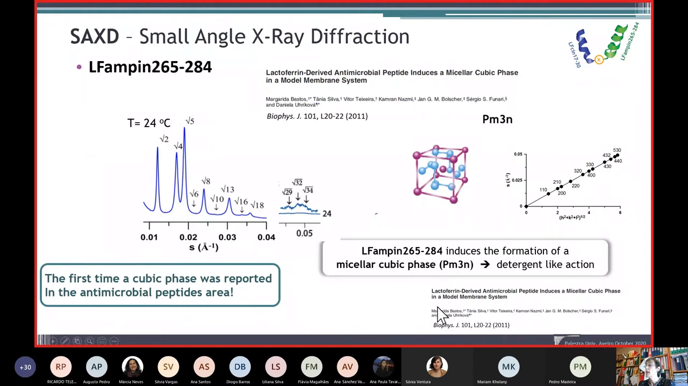

这张幻灯片上有一句被框起来的话：**"这是抗菌肽领域第一次报道立方相。"** 讲者说这项工作 2011 年以 letter 形式发表在 Biophysical Journal，此后"立方相在抗菌肽作用机制中的重要性被广泛认可"。

"胶束立方相"意味着什么？脂双层不再是双层，而是被拆成了胶束状的单元再排成立方晶格——**这就是去污剂式的溶解（detergent-like action）**。与 2.1 相比，这是从"分家"升级到"拆房"。

### 2.3 LFchimera：两种双连续立方相叠加，膜彻底破坏

第三个肽（电荷最高的 +12）给出的信号更复杂：峰位同时符合 **Im3m 与 Pn3m 两种双连续立方相** [【跳转到 28:17】](https://www.youtube.com/watch?v=X_yzSByV2CI&t=1697)。

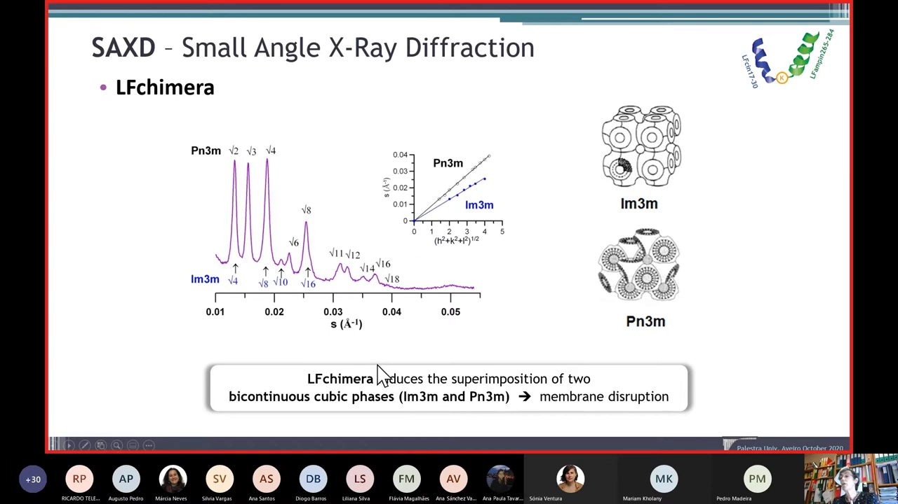

讲者的措辞很直接：**"不是一种，而是两种双连续立方相……膜被彻底破坏了。"** 双连续立方相（bicontinuous cubic）与胶束立方相的区别在于：脂双层仍然连续，但被弯成了三维周期性的"迷宫"结构。对细胞而言，这已经是不可修复的膜重构。

### 2.4 结构阶梯

| 肽（名义电荷） | SAXS 看到的相 | 膜的命运 | 破坏程度 |
| --- | --- | --- | --- |
| Lfcin17-30（+6） | 两套层状相 | 脂质分凝（富 PG 区 / 富 PC 区） | 弱：膜还在，只是分区 |
| LFampin265-284（+4） | 胶束立方相 Pm3n | 去污剂式溶解 | 中：双层被拆成胶束 |
| LFchimera（+12） | 双连续立方相 Im3m + Pn3m | 彻底破坏 | 强：双层重构成三维迷宫 |

注意这个阶梯**不与电荷单调对应**：+6 的 Lfcin 破坏最轻，+4 的 LFampin 居中，+12 的 LFchimera 最强。也就是说，**破坏程度不是电荷的单调函数**——电荷决定"贴不贴上去"，而"贴上去之后干什么"由肽的具体序列与插入方式决定。这正是本节要建立的第二条判据：**净电荷解释"去哪"，两亲性的具体几何（疏水面多大、插多深）解释"干什么"。**

## 三、和真菌显微镜对上：模型膜的预测被念珠菌验证

模型膜的结果如果只停在脂质体里，就只是"物理"。讲者把它与 Bolscher 等人早年的白色念珠菌冷冻蚀刻电镜（freeze-fracture EM）结果并排放 [【跳转到 28:47】](https://www.youtube.com/watch?v=X_yzSByV2CI&t=1727)：

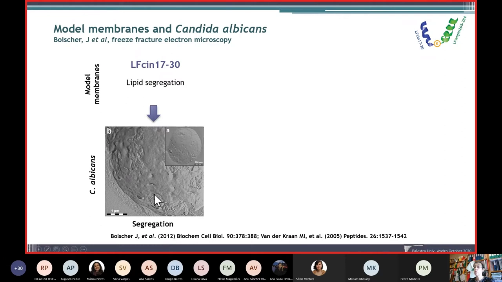

- **Lfcin17-30**：模型膜上是分凝；念珠菌电镜下同样是**分凝**，膜表面出现分区，但没有被撕开。讲者的原话是"这是个漂亮的结果"（a damn good result）。
- **LFampin265-284**：模型膜上是胶束立方相（去污剂式）；电镜下可以看到**囊泡状结构**（vesicles-like structures）——膜被"抽"出来变成小泡。
- **LFchimera**：模型膜上是两种双连续立方相；电镜下是**彻底破坏**。

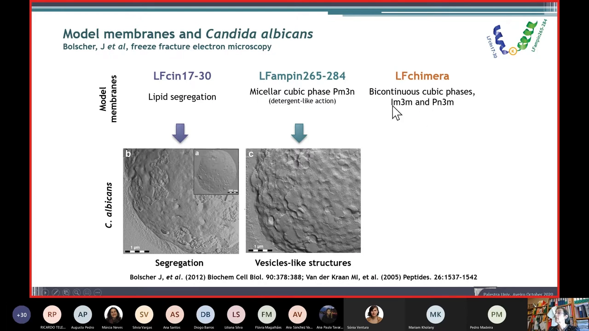

这张对照图的价值在于它回答了"模型膜是不是太简单"的质疑：**在"破坏方式"这一层，极简模型膜给出的分类与真实真菌一致。** 讲者后来在问答里把这个立场讲得更清楚（见第七节）。

## 四、平台总结：五种技术各回答什么问题

讲者用一张"Overall"幻灯片把整套流程收口 [【跳转到 29:56】](https://www.youtube.com/watch?v=X_yzSByV2CI&t=1796)：

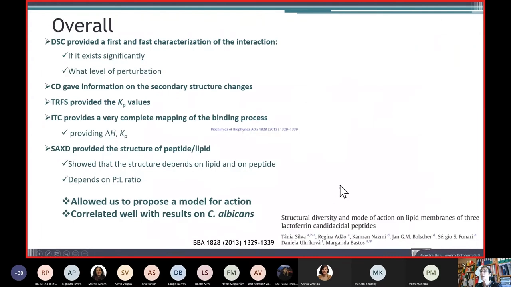

| 技术 | 回答的问题 | 给出的量 |
| --- | --- | --- |
| DSC | 有没有相互作用？扰动多大？ | $T_m$、$\Delta H$、峰形 |
| CD | 二级结构变了吗？ | 无规卷曲 / α 螺旋（208、222 nm） |
| TRFS | 结合多强？ | $K_p$ |
| ITC | 结合过程的完整映射 | $\Delta H$、$K_p$、有效电荷 |
| SAXS | 膜变成了什么相？ | 层间距、相类型（层状/六角/立方） |

讲者的总结是：这些结果"允许我们提出作用模型，并与白色念珠菌的结果很好地对应"。**注意这句话的顺序——先有结构证据，再有模型，最后才与微生物学对齐。** 反过来（先有活性数据再猜机制）在这套方法里是不成立的。

## 五、警告：高 $K_p$ 不等于膜活性

紧接着，讲者在同一张幻灯片上贴了一个"Caution"框 [【跳转到 30:26】](https://www.youtube.com/watch?v=X_yzSByV2CI&t=1826)：

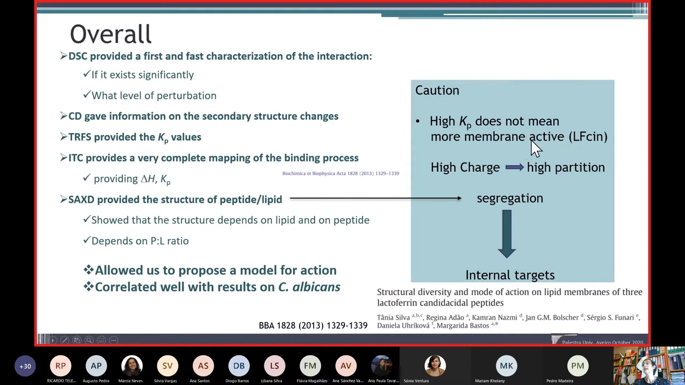

框里写的是：

- **高 $K_p$ 并不意味着更强的膜活性（Lfcin 就是例子）**；
- 高电荷 → 高分配 → 分凝 → **胞内靶点**。

这三步是一条完整的解释链。Lfcin17-30 的 $K_p$ 是三者中最高的（$(7.3\pm2.6)\times10^5$），但它在 DSC 上并不强、在 SAXS 上只造成分凝——**它确实进了膜，却没有把膜拆掉**。讲者说，后来的研究（别人的工作）证明这个肽的主要作用其实在**胞内靶点**上，"所以它并不溶膜，一切都对上了" [【跳转到 31:26】](https://www.youtube.com/watch?v=X_yzSByV2CI&t=1886)。

这一段对读者的意义，是给出一条**判读规则**：

> 一个肽"能结合膜"（$K_p$ 高）只是必要条件；要判定它是"膜活性"的，还需要结构证据（相变/孔/溶解）与活性读数（MIC、LC50）同时支持；否则它的杀伤很可能来自膜内靶点。

这也解释了为什么论文里"膜活性"这个词必须谨慎使用：**结合 ≠ 插入 ≠ 破坏 ≠ 杀死**，这是四个不同的环节。

## 六、协同：只分凝不破坏，也能帮别的药进门

既然 Lfcin17-30 只让膜分凝而不拆膜，讲者提出一个很实用的假设：**这种"分家"能不能帮别的抗生素进门？** [【跳转到 32:12】](https://www.youtube.com/watch?v=X_yzSByV2CI&t=1932)

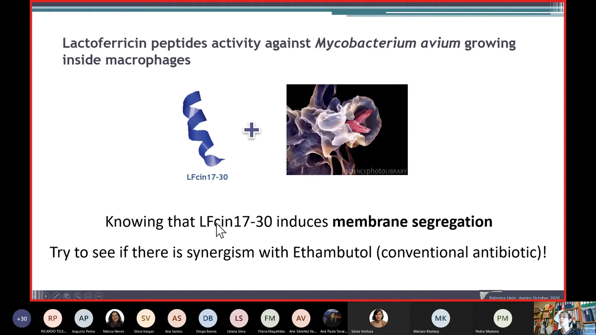

实验对象是**在巨噬细胞内生长的鸟分枝杆菌**（*Mycobacterium avium*）——一个更接近真实感染的体系。读数用的是 CFU（菌落形成单位）的 log 增量 [【跳转到 32:20】](https://www.youtube.com/watch?v=X_yzSByV2CI&t=1940)：

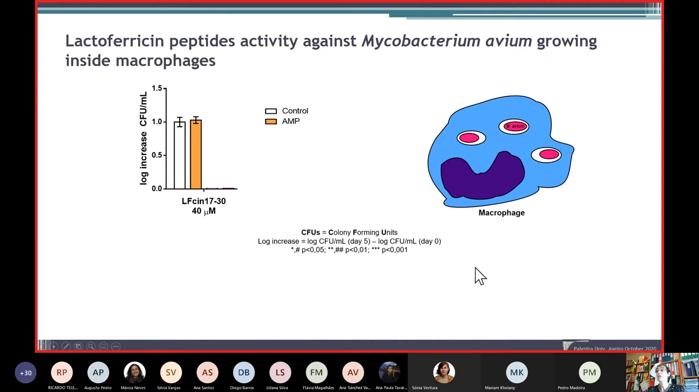

讲者的结论是：**确实存在协同作用**，解释是"肽帮膜打开一个口子，让常规抗生素更容易进去，于是后者在肽存在时作用更好" [【跳转到 32:20】](https://www.youtube.com/watch?v=X_yzSByV2CI&t=1940)。她强调："这个肽不是在破坏膜，它是一个**促进者**（facilitator）。"

这条结果对"机制分类"是一个重要补充：**膜活性不是二元的（破坏/不破坏），中间还有"改变膜的组织方式"这一档**。分凝不杀死细菌，却改变了膜的透性屏障，从而在联合用药里产生价值。

## 七、第二个案例：cecropin A–melittin 杂合肽

第二个案例换了一个设计思路：不是从蛋白上切片段，而是把两条天然肽拼起来。

- **cecropin A**（天蚕素，来自蛾）：抗革兰阴性菌，**不溶血**；
- **melittin**（蜂毒肽，来自蜜蜂）：抗革兰阴性与阳性菌，**强溶血**。

讲者的描述很形象："melittin 太强，cecropin 太温和。" 于是巴塞罗那的 David Andreu 组做了大量杂合肽，本文只讲其中一个：**CA(1-7)M(2-9)**，即 cecropin A 的前 7 个残基 + melittin 的第 2–9 个残基 [【跳转到 33:04】](https://www.youtube.com/watch?v=X_yzSByV2CI&t=1984)。

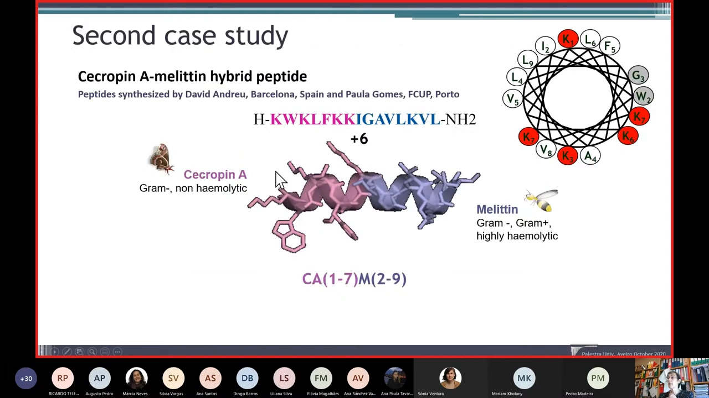

这张幻灯片值得停下来看右上角的**螺旋轮（helical wheel）**：把序列沿螺旋轴投影到平面上，4 个赖氨酸（K1、K7、K8、K11，红色）集中在一侧，亮氨酸、异亮氨酸、苯丙氨酸、缬氨酸、丙氨酸（白色）集中在另一侧。**这就是"两亲性"最直观的画法**——也正是前文"疏水矩"概念的可视化：疏水向量都指向同一侧，合向量长，$\mu_H$ 大。

### 7.1 DSC：与"毒性膜"也有作用

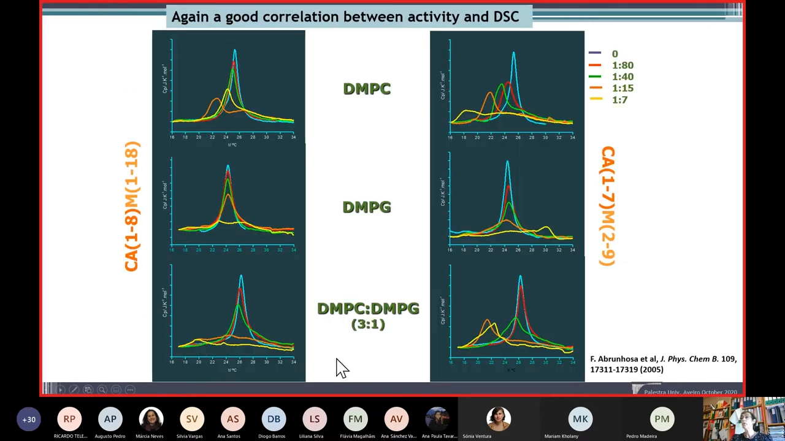

与第一个案例的乳铁蛋白肽不同，这个杂合肽**在两性离子的 DMPC 上也明显作用**——而 DMPC 是红细胞的模型 [【跳转到 34:23】](https://www.youtube.com/watch?v=X_yzSByV2CI&t=2063)。讲者的原话是："这些肽与之前那些无活性的肽非常不同，它们真的与 DMPC 作用，尤其是大的那个。"

这句话在逻辑上很重要：**"与 PC 膜作用"就是"可能溶血"的物理解释**。前面乳铁蛋白肽里只有 LFchimera 与 DMPC 作用，而它恰好也是唯一显著溶血的——两个案例互相印证了同一条判据。

### 7.2 CD 与 ITC：螺旋、分配与有效电荷

CD 显示这是一个"行为良好的螺旋"：缓冲液中最小值在 200 nm 之前（无规卷曲），加入 POPC/POPG 后出现 208 与 222 nm 的典型双负峰 [【跳转到 35:01】](https://www.youtube.com/watch?v=X_yzSByV2CI&t=2101)。

ITC 则给出三个数 [【跳转到 36:31】](https://www.youtube.com/watch?v=X_yzSByV2CI&t=2191)：

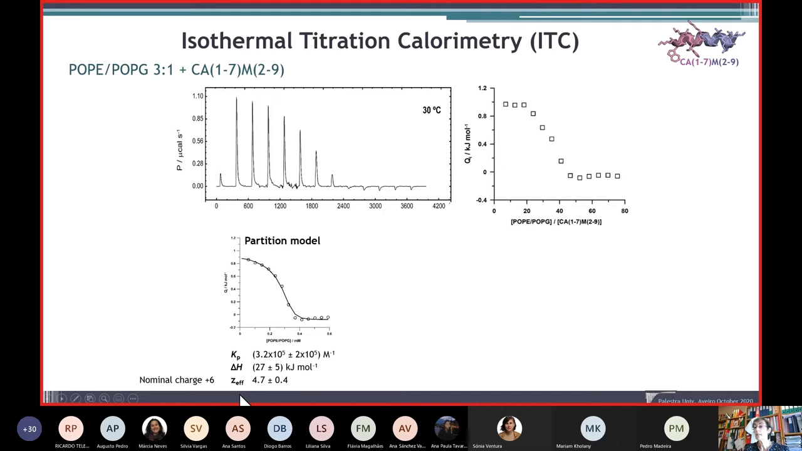

| 量 | 数值 | 含义 |
| --- | --- | --- |
| $K_p$ | $(3.2\times10^{5} \pm 2\times10^{5})\ \mathrm{M^{-1}}$ | 分配强度（与 TRFS 同量级） |
| $\Delta H$ | $(27 \pm 5)\ \mathrm{kJ\,mol^{-1}}$ | 结合焓：放热，说明相互作用有利 |
| 名义电荷 | +6 | 序列里有 6 个正电荷 |
| 有效电荷 $Z_{\text{eff}}$ | $4.7 \pm 0.4$ | 膜实际感受到的电荷 |

**名义 +6、有效 4.7**——这个数字把前文的抽象概念落了地：折叠成螺旋后，约五分之一的电荷"用不上"。讲者还提到，同一体系在 5 °C（凝胶相）与 17 °C（凝胶/流体共存）下滴定曲线形状完全不同，解释起来很困难，细节留在论文里 [【跳转到 37:01】](https://www.youtube.com/watch?v=X_yzSByV2CI&t=2221)。这一点对读者是个提醒：**ITC 的"漂亮拟合"依赖相态，换温度可能换故事。**

### 7.3 SAXS：洋葱状多层结构，肽插在双层之间

在 PE/PG 模型膜里，纯脂质是寡层囊泡（oligolamellar，只有两三层，峰很宽）；加入肽之后，峰变得**尖锐**——说明层数大幅增加 [【跳转到 38:20】](https://www.youtube.com/watch?v=X_yzSByV2CI&t=2300)。

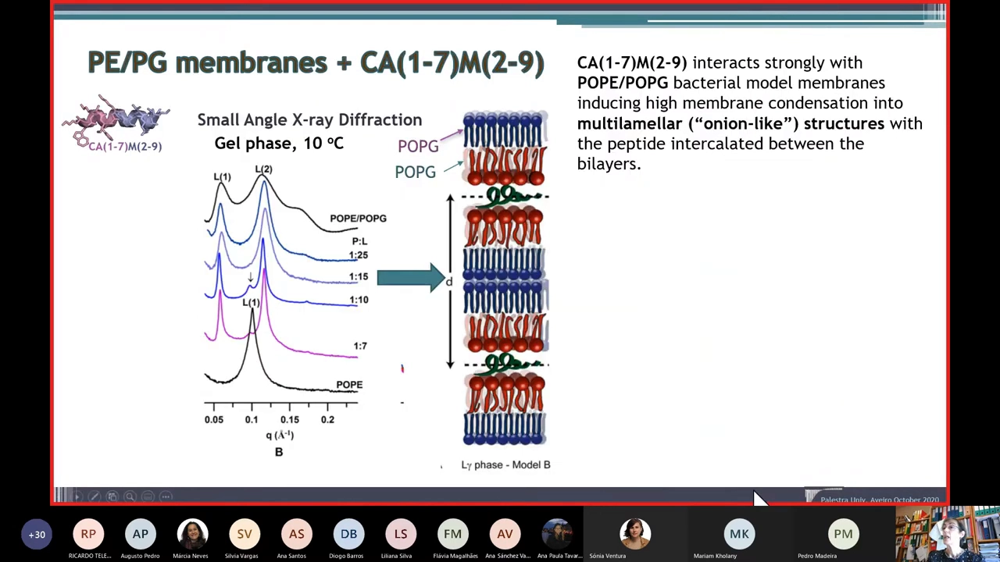

这张图给出的结构模型很具体：**肽插在双层之间，把带负电的 PG 从相邻双层"抽"到自己身边，剩下的两性离子脂质另成一层**，于是重复距离 $d$ 变成原来的两倍 [【跳转到 40:10】](https://www.youtube.com/watch?v=X_yzSByV2CI&t=2410)。

光学与共聚焦显微镜给出同一件事的两个侧面：加肽前能看到清晰的囊泡（脂质用 Texas Red 标记），加肽后"一切都被彻底破坏"；偏振光显微镜下出现**双折射**与**马尔他十字（Maltese cross）**图案 [【跳转到 39:17】](https://www.youtube.com/watch?v=X_yzSByV2CI&t=2357)。

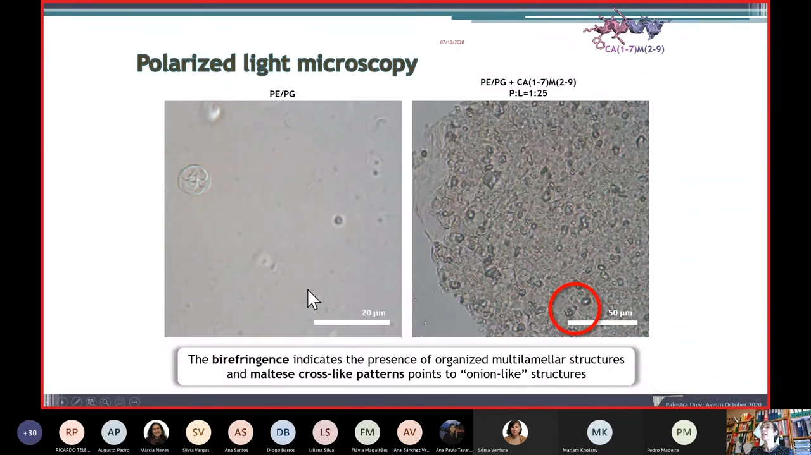

讲者对判据的解释很干脆：**双折射说明存在有序的多层结构，马尔他十字说明是"洋葱状"（onion-like）的同心堆叠** [【跳转到 39:40】](https://www.youtube.com/watch?v=X_yzSByV2CI&t=2380)。这与 SAXS 的层状峰、以及"肽插在层间"的模型完全自洽。

顺带一个方法学教训：讲者说她们在**凝胶相**的数据上卡了两年多，几乎想放弃，因为"多数人只在流体相做 SAXS，那才是生理相关的相"；但正是凝胶相的数据最终让整套结果讲得通 [【跳转到 41:25】](https://www.youtube.com/watch?v=X_yzSByV2CI&t=2485)。她的结论是："如果想得够久，就能理解。"

## 八、模型膜的边界：做因子分析，而不是复制细胞

问答环节的第一个问题很尖锐：模型膜没有膜蛋白，凭什么代表真实细胞？ [【跳转到 53:14】](https://www.youtube.com/watch?v=X_yzSByV2CI&t=3194)

讲者的回答值得完整复述，因为它是整场报告的方法论核心：

1. 她**从不声称**模型膜接近真实生物膜；第一次去阿姆斯特丹报告时，就有人当面说"这东西一文不值，因为它没有我们的细胞复杂" [【跳转到 54:44】](https://www.youtube.com/watch?v=X_yzSByV2CI&t=3284)。
2. 她主张模型膜的作用是**因子分析**：把电荷、胆固醇、脂质类型、链长这些因素**逐个**改变，看各自贡献多大 [【跳转到 56:03】](https://www.youtube.com/watch?v=X_yzSByV2CI&t=3363)。
3. 之所以敢这么做，是因为**电荷是被验证过的关键因子**：抗菌肽带正电，真菌、癌细胞、细菌都更负，"所以必须是静电" [【跳转到 55:14】](https://www.youtube.com/watch?v=X_yzSByV2CI&t=3314)。
4. 模型膜给的是**趋势与事实**，不是细节；复杂体系里的其他相互作用会叠加，但主要趋势可以迁移过去。

这段话实际上回答了本节标题里的问题："模型膜如何判定杀菌机制"——**它判定的不是某个肽在某个菌上的最终结局，而是"这类分子能对膜做出哪几种事"的分类学。** 分类学一旦建立，具体分子的归属就可以用少量读数（DSC + SAXS + MIC/溶血）快速定位。

## 九、Lys 与 Arg：两个曾经分开的领域

最后一个问题来自听众：这些肽里的正电荷来自赖氨酸（Lys）还是精氨酸（Arg）？比例会不会影响活性？ [【跳转到 59:41】](https://www.youtube.com/watch?v=X_yzSByV2CI&t=3581)

讲者的回答带着一段学科史 [【跳转到 60:11】](https://www.youtube.com/watch?v=X_yzSByV2CI&t=3611)：

- 十几年前，**抗菌肽**与**细胞穿透肽（cell-penetrating peptide, CPP）**被当成两个领域：前者富含 Lys、破坏膜；后者富含 Arg、穿过膜而不破坏膜。
- 后来斯德哥尔摩的一位研究者发表论文，证明这个二分法并不成立：抗菌肽可以有 Arg，穿膜肽也可以有 Lys。
- 她自己的印象（明确声明"这只是印象，不是结论"）是：**Lys 对静电结合更重要，Arg 对"进入"更重要** [【跳转到 61:41】](https://www.youtube.com/watch?v=X_yzSByV2CI&t=3701)。

这段对本文主题的意义在于：**"净电荷"是一个总数，而电荷的化学身份（氨基 vs 胍基）可能决定"结合之后往哪走"。** 换句话说，同样是 +6，用 Lys 还是 Arg 实现，可能给出不同的"结合—插入—穿透"分配。这是净电荷与两亲性之外，第三条值得关注的变量。

## 十、新方向：环状 D,L-α-肽

报告收尾处，讲者介绍了正在做的体系：与圣地亚哥的 Juan Granja 合作，研究**环状 D,L-α-肽**（cyclic D,L-α-peptides）——这类环肽能在膜内自组装成**纳米管** [【跳转到 42:33】](https://www.youtube.com/watch?v=X_yzSByV2CI&t=2553)。

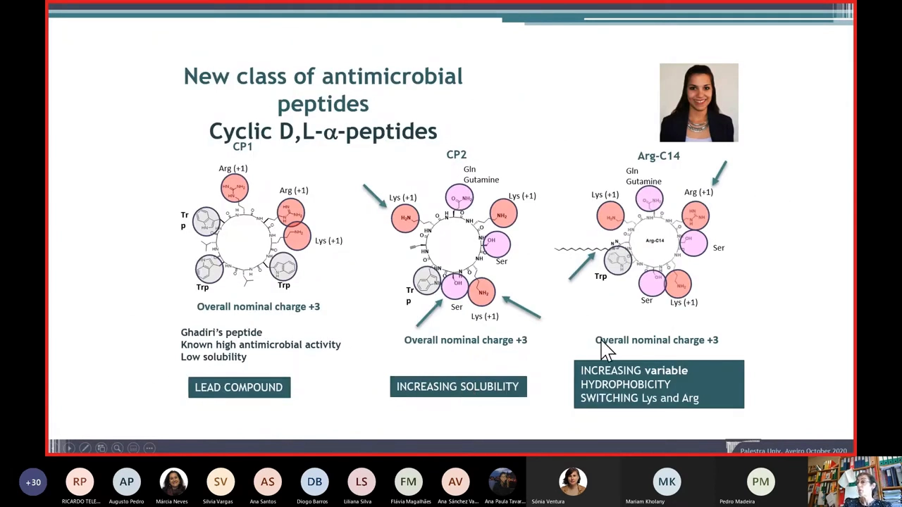

这张幻灯片正好是"净电荷 vs 疏水性"双变量设计的示范：三个分子**名义电荷都是 +3**，差别在溶解度与疏水性（以及 Lys/Arg 的替换）。讲者的策略是"生物物理实验 + 分子动力学模拟 + 微生物学测试"三线并行 [【跳转到 43:11】](https://www.youtube.com/watch?v=X_yzSByV2CI&t=2591)。

顺带一提，这类"环状 D,L-交替"序列的化学（为什么 D/L 交替有利于堆成管）属于肽的化学修饰与拓扑问题，不在本小节展开。

## 小结

- SAXS 读的是**相**：峰位比 $1:2:3$ 是层状相，立方相有自己的指标化序列；必须有周期性多层堆叠才有信号。
- 三个乳铁蛋白肽给出一个**结构阶梯**：Lfcin17-30 → 脂质分凝（膜还在）；LFampin265-284 → 胶束立方相 Pm3n（去污剂式溶解）；LFchimera → 双连续立方相 Im3m + Pn3m（彻底破坏）。
- 这个阶梯**不与电荷单调对应**：电荷决定"贴不贴上去"，两亲性的具体几何决定"贴上去之后干什么"。
- 模型膜的相行为与白色念珠菌冷冻蚀刻电镜**一一对应**：分凝、囊泡化、彻底破坏。
- 平台分工：DSC 判"有没有扰动"，CD 判"构象"，TRFS/ITC 给 $K_p$ 与 $\Delta H$，SAXS 判"相"。
- **高 $K_p$ 不等于膜活性**：Lfcin17-30 分配最强却只造成分凝，其杀伤来自胞内靶点。"结合 ≠ 插入 ≠ 破坏 ≠ 杀死"。
- 分凝不杀细菌，却能让膜透性改变，从而与乙胺丁醇产生**协同**——膜活性不是二元的。
- 杂合肽 CA(1-7)M(2-9)（+6，有效电荷 4.7）把整套流程走通：与 DMPC 也作用（对应溶血风险）、形成螺旋、$K_p \approx 3\times10^{5}$、诱导洋葱状多层堆叠。
- 模型膜的价值是**因子分析**：逐个改变电荷、胆固醇、脂质类型、链长，给出趋势而非细节。
- 电荷的"身份"（Lys 还是 Arg）可能是第三个变量：Lys 偏静电结合，Arg 偏进入。
- 判读一个肽是否"膜活性"，需要**结构证据 + 活性读数 + 毒性读数**三方对齐。

## 关键术语速查

| 术语 | 一句话解释 |
| --- | --- |
| SAXS | 小角 X 射线散射，通过布拉格峰位与比例判断膜的相结构 |
| 层状相（lamellar） | 脂双层平行堆叠，峰位比为整数比 |
| 胶束立方相（Pm3n） | 双层被拆成胶束单元再排成立方晶格，等价于去污剂式溶解 |
| 双连续立方相（Im3m、Pn3m） | 双层连续但弯成三维周期性迷宫，代表膜的彻底重构 |
| 脂质分凝 | 肽把阴离子脂质聚到自己周围，使膜分成组成不同的区域 |
| 冷冻蚀刻电镜 | 把膜劈开复型后观察膜内形态，可看到分凝、囊泡化、破坏 |
| 马尔他十字 | 偏振光下同心多层结构产生的十字形双折射图案，指示"洋葱状"堆叠 |
| 名义电荷 / 有效电荷 | 序列数出的正电荷 / 膜实际感受到的电荷（本例 +6 → 4.7） |
| $K_p$ | 分配系数，肽在膜相与水相之间的浓度比 |
| 协同（synergy） | 两药合用效果大于各自之和；本例由"分凝改变膜透性"解释 |
| CFU | 菌落形成单位，活菌计数的读数 |
| 治疗窗口 | 毒性浓度与有效浓度之比，越大越安全 |
| 螺旋轮 | 把螺旋沿轴投影到平面，用来看疏水面与带电面是否分居两侧 |