# 电荷与两亲性：抗菌肽如何选择细菌膜

> 视频来源：[Antimicrobial peptide-membrane interactions. Biophysical approaches and exploring the bridge to their pathogen effects](https://www.youtube.com/watch?v=X_yzSByV2CI)（YouTube · PATh 研究组网络报告，讲者 Margarida Bastos，波尔图大学化学与生物化学系）｜时长约 63 分钟
> 导读：这是一场把"模型膜生物物理"与"微生物读数"接起来的报告。本文覆盖报告的前半段（约 0–25 分钟）：抗菌肽凭什么先认细菌膜、净电荷与两亲性各自负责什么、以及怎样用 DSC、CD、荧光把"结合"变成可比较的数字。后半段的相结构判定与两个完整案例见同目录的《从分配到相结构：模型膜如何判定抗菌肽的杀菌机制》。字幕为自动识别，术语错拼已按上下文订正；讲者未展开的背景（如疏水矩的定义）以"术语补充"单独标出。

## 本讲要解决的核心问题（SCQA）

**背景**：传统抗生素靠"高特异性"工作——青霉素抑制细胞壁肽聚糖的交联，喹诺酮抑制 DNA 旋转酶，氨基糖苷类抑制蛋白合成。特异性带来高效，也带来一个弱点：细菌只要改动一个靶点（往往只换一个氨基酸），药物就失效了。

**冲突**：正因为如此，抗生素在人类医疗、农业与畜牧中的无节制使用，把耐药性推成了全球性的健康问题；而真正的新结构抗生素长期没有上市，市面上多是老药的第二、第三代。世界卫生组织的口号被讲者直接引在幻灯片上："今天不行动，明天就无药可治。"

**疑问**：既然"单靶点"是耐药性的入口，那么有没有一类分子，它的靶点不是某个蛋白，而是细菌的整个"外表面"？如果有，它凭什么只打细菌、不打我们自己？

**回答（中心思想）**：**抗菌肽（antimicrobial peptide, AMP）的靶点是膜，而膜的选择性来自电荷，膜的扰动能力来自两亲性。** 细菌膜外侧带净负电、几乎不含甾醇、富含阴离子磷脂（PG、CL、PS）；宿主细胞膜以两性离子的 PC 为主并含胆固醇。阳离子肽先被静电拉到细菌表面，再靠疏水面插入脂双层——"静电负责找对地方，疏水负责动手"。这条因果链的每一个环节，都可以在成分可控的模型膜上被单独测量。

## 一、抗生素的"高特异性"正是耐药性的入口

讲者用一张三行幻灯片把传统抗生素的机制归了类 [【跳转到 01:55】](https://www.youtube.com/watch?v=X_yzSByV2CI&t=115)：

| 作用层次 | 代表药物 | 机制 |
| --- | --- | --- |
| 细胞壁 | 青霉素、头孢菌素 | 抑制肽聚糖交联、阻断转肽 |
| 必需酶 | 喹诺酮、磺胺 | 抑制 DNA 复制、抑制二氢叶酸合成酶 |
| 蛋白合成 | 氨基糖苷、大环内酯、四环素 | 作用于核糖体 |

这三类的共同点是"高特异性"：一个分子精确地卡进一个口袋。耐药性于是有了最省力的路径——改口袋。

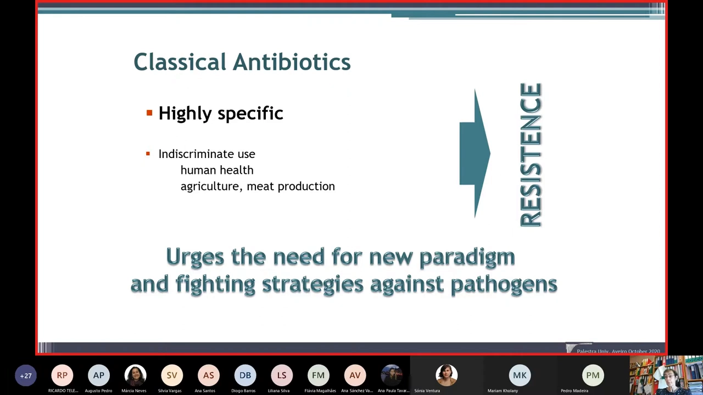

讲者把这条逻辑画成一个箭头：高特异性 + 无节制使用 → RESISTANCE → "需要新范式" [【跳转到 02:55】](https://www.youtube.com/watch?v=X_yzSByV2CI&t=175)。注意这里说的"新范式"不是"再找一个新靶点"，而是换一种作用方式：**从"改一个蛋白"变成"扰动一整片膜"**。这一点在后面会反复出现，因为它同时解释了抗菌肽为什么广谱、也解释了为什么耐药更难出现。

## 二、抗菌肽的两个结构特征：阳离子与疏水，合起来才是两亲性

抗菌肽几乎存在于所有生物体内，是先天免疫的一部分；它们从不同来源被发现，长度、序列、结构各异 [【跳转到 03:48】](https://www.youtube.com/watch?v=X_yzSByV2CI&t=228)。讲者给出的"特征清单"很短：

- 组成型或诱导型产生；
- 小，通常少于 50 个氨基酸；
- **阳离子氨基酸含量高 → 整体带正电**；
- **疏水氨基酸含量高 → 形成两亲性（amphipathic）结构**；
- 活性谱广：革兰阳性菌、革兰阴性菌、真菌、原虫、病毒，甚至癌细胞。

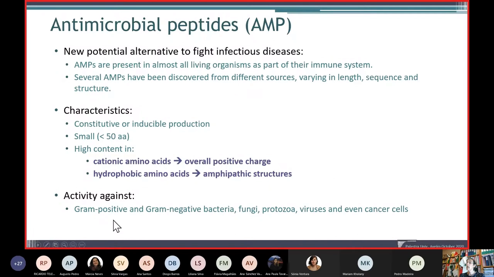

这里最容易被初学者读漏的是**两条特征必须同时具备**。只带正电不行——那只是一个阳离子聚合物，会被静电拉到任何负电表面，却插不进疏水的脂链区；只疏水也不行——那会不分敌我地溶进任何膜，包括红细胞膜。真正决定"能不能动手"的，是这两类残基在空间上**分处两侧**：一面是亲水/带正电的脸，一面是疏水的脸。

**术语补充（讲者未展开的背景）**：这种"一面亲水、一面疏水"的性质称为**两亲性**。当肽折叠成 α 螺旋时，如果沿螺旋轴看过去，疏水残基集中在一侧、带电残基集中在另一侧，就形成**两亲性螺旋**。把每个残基的疏水性看成一个沿螺旋轴垂直方向的向量，把这些向量相加，得到的合向量长度就是**疏水矩**（hydrophobic moment，常记作 $\mu_H$）：

$$
\mu_H = \left\lVert \sum_{n} H_n \, \vec{u}_n \right\rVert
$$

其中 $H_n$ 是第 $n$ 个残基的疏水性标度值，$\vec{u}_n$ 是该残基在螺旋轮上的单位方向向量。$\mu_H$ 大，说明疏水面与亲水面分离得干净，肽"贴"到膜界面的倾向强；$\mu_H$ 接近 0，说明疏水残基在螺旋上均匀分布，没有可用的疏水面。**净电荷决定"去哪"，疏水矩决定"贴得多紧、插得多深"**——这是本节要建立的第一条判据。报告里讲者没有直接算 $\mu_H$，而是用净电荷（名义电荷/有效电荷）与螺旋轮这两件更直观的工具来讲同一件事。

## 三、选择性来自膜脂组成：细菌膜"外面是负的"

讲者把革兰阳性菌与革兰阴性菌的膜结构并排放在一张图上，只强调一句话：**外面是负的** [【跳转到 04:44】](https://www.youtube.com/watch?v=X_yzSByV2CI&t=284)。

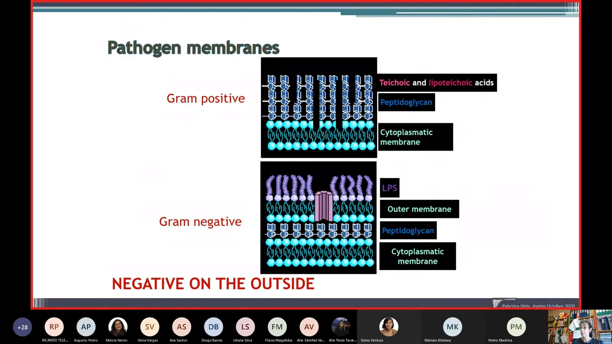

为什么负？讲者把原因拆成三条 [【跳转到 05:02】](https://www.youtube.com/watch?v=X_yzSByV2CI&t=302)：

1. **净电荷更负**：病原体膜的负电性高于宿主细胞膜（癌细胞膜也偏高）；
2. **没有甾醇**（细菌），**PC 或鞘磷脂（SM）很少**；
3. **阴离子磷脂占比显著**：PG（磷脂酰甘油）、PE（磷脂酰乙醇胺）、心磷脂（cardiolipin）、PS（磷脂酰丝氨酸）。

反过来看宿主细胞膜：以 PC 为主，PC 是两性离子（zwitterionic，正负电荷内抵，整体接近中性，讲者的说法是"被认为两性离子、但略偏负"），再加上胆固醇。于是出现一个干净的对照：**宿主膜偏中性且"硬"（有胆固醇），细菌膜偏负且"软"（无甾醇）**。

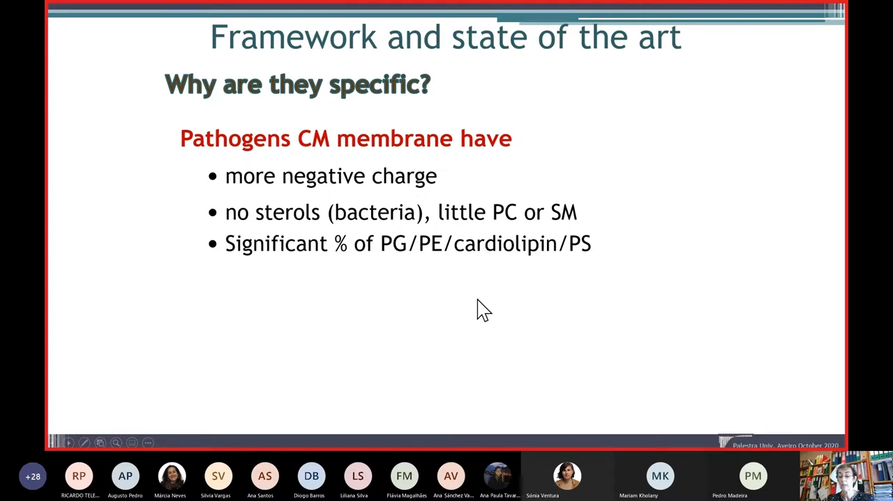

讲者的结论只有一句：**第一步相互作用是静电，特异性建立在电荷上** [【跳转到 05:32】](https://www.youtube.com/watch?v=X_yzSByV2CI&t=332)。这句话的分量在于它同时给出了"为什么广谱"和"为什么难耐药"：静电识别不依赖某个精确的原子排布，而是依赖一整片膜的电荷密度；细菌想把膜电荷改掉，等于重做整个膜系统。

## 四、作用机制的四种图景：孔、地毯、堆叠与立方相

在进入实验之前，讲者先把"抗菌肽怎么杀"的图谱摆出来。总框架分两支 [【跳转到 06:02】](https://www.youtube.com/watch?v=X_yzSByV2CI&t=362)：

- **直接杀伤**：先破坏膜（membrane disruption），再可能作用于胞内靶点（internal targets，影响细胞代谢）；
- **免疫调节**（immune modulation）：讲者明确说自己不讲这一支，因为不在她的"模型膜世界"里。

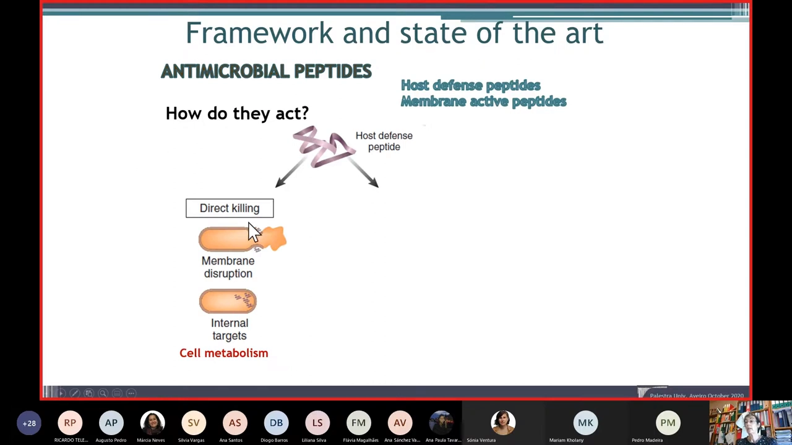

直接杀伤这一支的分子步骤，讲者用动画逐格讲了一遍 [【跳转到 06:32】](https://www.youtube.com/watch?v=X_yzSByV2CI&t=392)：

1. **静电吸引 + 氢键**把肽拉到膜表面；
2. 肽从无规卷曲**折叠成 α 螺旋**（多数如此，也有别的结构）；
3. 螺旋的疏水面插入膜的上半层，正电面留在界面；
4. 肽在表面**累积**，达到一个**阈值浓度**后，发生构象转变或自聚集/多聚化；
5. 由此形成孔（主要是 toroidal 环形孔与 barrel-stave 桶板孔），或走"地毯"路线把膜溶解掉。

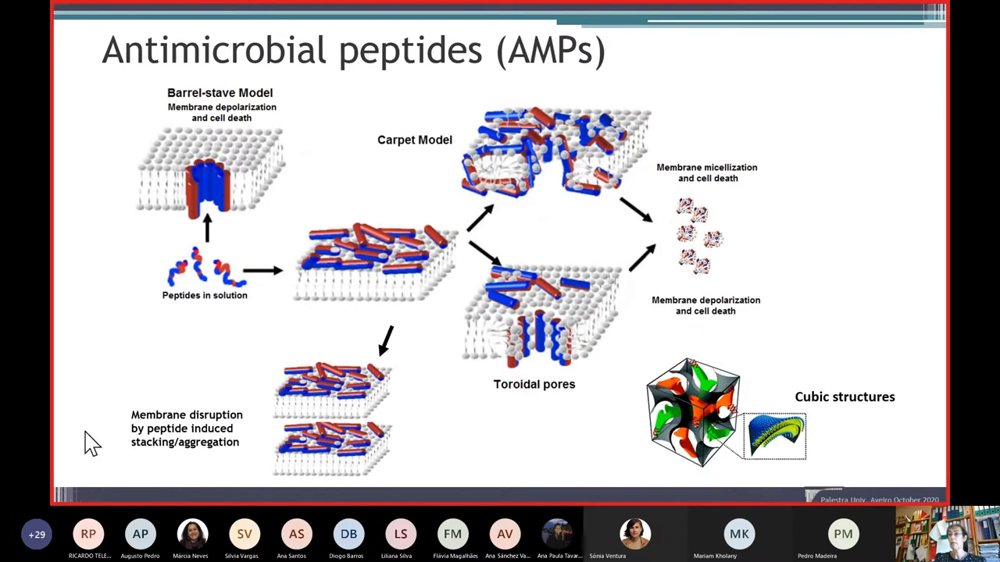

这张图值得逐个对照着看，因为它把"孔"这个词拆成了四种完全不同的物理图像：

| 图景 | 肽在膜里的姿态 | 膜发生了什么 | 后果 |
| --- | --- | --- | --- |
| 桶板孔 barrel-stave | 跨膜，多肽围成一圈当"桶板" | 形成真正的跨膜水通道 | 膜去极化、内容物泄漏 |
| 环形孔 toroidal | 与脂头基一起弯成环 | 孔壁由肽和磷脂共同构成 | 同样泄漏，但孔更"软"、更动态 |
| 地毯 carpet | 平铺在表面，不插入 | 表面被肽覆盖后像去污剂一样溶解 | 膜胶束化（micellization） |
| 立方相 cubic | 插在双层之间 | 双层重排成双连续立方相 | 膜结构彻底破坏 |

讲者特别提醒两件事。第一，**桶板孔其实很少见**："据我所知只有一个肽被报道是这种状态"，更常见的是累积后走向环形孔或地毯 [【跳转到 07:58】](https://www.youtube.com/watch?v=X_yzSByV2CI&t=478)。第二，**近年才被重视的是"双连续结构"**：肽插进双层之间，把膜堆叠、聚集起来，造成彻底的膜破坏 [【跳转到 08:28】](https://www.youtube.com/watch?v=X_yzSByV2CI&t=508)。这条"非孔道"的破坏路线，正是后半段用 SAXS 抓到的东西。

## 五、把膜变成可控变量：模型膜

讲者的方法学可以用一句话概括：**与其去研究真实细菌膜，不如造一片"只有我想研究的那个变量"的膜** [【跳转到 08:58】](https://www.youtube.com/watch?v=X_yzSByV2CI&t=538)。她用的是脂质体（liposome）——由磷脂双分子层围成的小囊泡，是生物膜的极简模型。

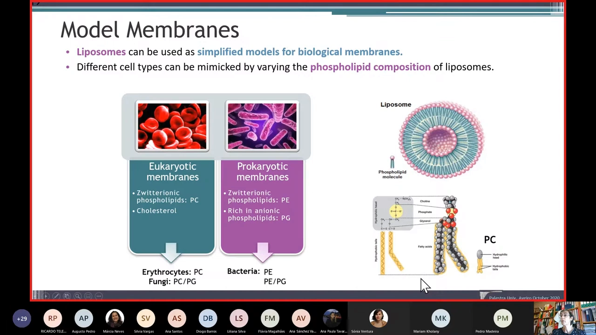

具体配方对应关系如下 [【跳转到 11:06】](https://www.youtube.com/watch?v=X_yzSByV2CI&t=666)：

| 想模拟的对象 | 脂质体配方 | 在实验里扮演的角色 |
| --- | --- | --- |
| 真核细胞 / 红细胞 | 纯 PC（不加胆固醇） | **毒性/溶血**的替代读数 |
| 真菌 | PC + 麦角固醇类脂 | 抗真菌活性的模型 |
| 细菌 | PC/PG、PE/PG | **抗菌活性**的模型 |

讲者自己承认"纯 PC 不加胆固醇不是完美的模型，但效果相当好"——这句自我限定很重要，它说明模型膜的价值不在"像"，而在"可控"：电荷可以改、链长可以改、有无胆固醇可以改，**每次只动一个变量**。

## 六、第一个案例：乳铁蛋白肽三兄弟的电荷阶梯

第一个案例来自与阿姆斯特丹 ACTA 的 Jan Bolscher 的合作。乳铁蛋白（lactoferrin）是转铁蛋白家族的铁结合糖蛋白，存在于乳汁、泪液等外分泌液和中性粒细胞颗粒中，本身就有微弱抗菌活性 [【跳转到 12:19】](https://www.youtube.com/watch?v=X_yzSByV2CI&t=739)。

研究者从中切出两段螺旋区，再把它们接成一个"嵌合体" [【跳转到 12:49】](https://www.youtube.com/watch?v=X_yzSByV2CI&t=769)：

| 肽 | 来源 | 净电荷（名义） |
| --- | --- | --- |
| Lfcin 17-30 | 乳铁蛋白 N 端一段螺旋 | +6 |
| LFampin 265-284 | 另一段螺旋 | +4 |
| LFchimera | 两段用特殊方式连接（含一个连接残基） | **+12** |

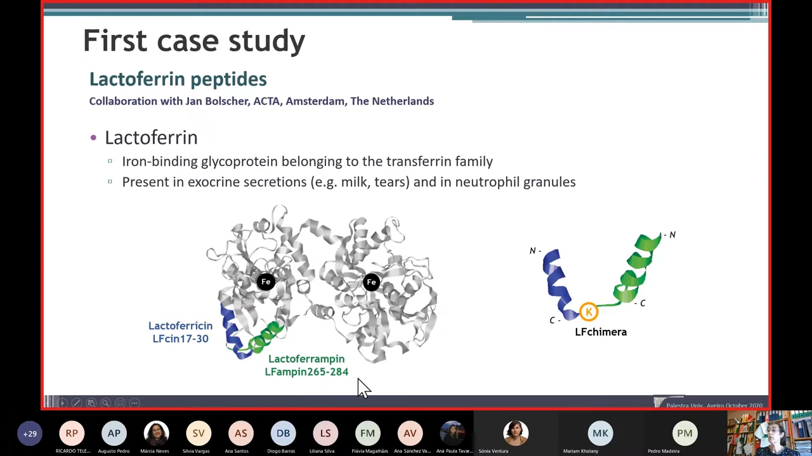

于是有了一个天然的"电荷阶梯"：+4、+6、+12。这正是做因子分析最想要的素材——**如果活性随电荷单调上升，电荷就是主因**。

### 6.1 活性读数：杀菌曲线与 LC50

合作者先做了微生物学读数。左图是低离子强度（5 mM PPB，30 分钟）下的杀菌曲线，右图是唾液离子强度（50 mM NaCl）下的同一实验 [【跳转到 13:53】](https://www.youtube.com/watch?v=X_yzSByV2CI&t=833)：

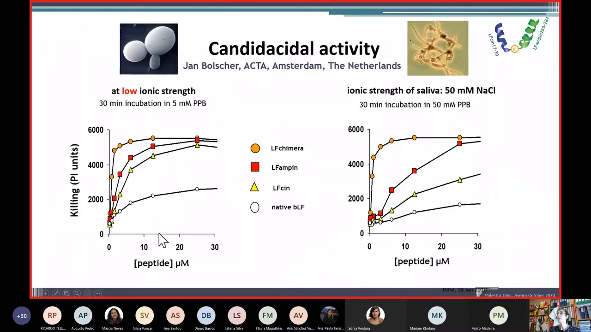

三个信息点：

1. **LFchimera 最强**，曲线最早饱和；
2. **天然乳铁蛋白（native bLF）最弱**，即使到 30 μM 也只到 2000 左右；
3. **提高离子强度后所有肽都变弱**，但 LFchimera 是"唯一一个活性不随离子强度显著改变"的——讲者的解释是它的电荷足够高，静电屏蔽不足以把它完全推离膜 [【跳转到 14:23】](https://www.youtube.com/watch?v=X_yzSByV2CI&t=863)。

把曲线压缩成一个数，就是 **LC50**：杀死 50% 病原体所需的浓度，越低越好 [【跳转到 14:38】](https://www.youtube.com/watch?v=X_yzSByV2CI&t=878)。

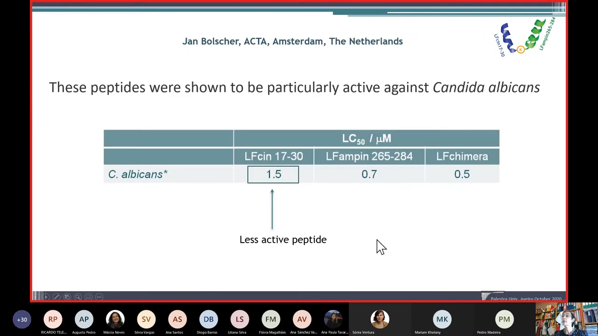

| 肽 | LC50 / μM（白色念珠菌） |
| --- | --- |
| Lfcin 17-30 | 1.5 |
| LFampin 265-284 | 0.7 |
| LFchimera | 0.5 |

### 6.2 毒性读数：溶血

**活性读数只回答"杀得多狠"，不回答"杀得多准"。** 讲者接着给出毒性一侧的读数：这三个肽里，"极其活跃"的那个同时也**显著溶血**，另外两个几乎不溶血；**只有 LFchimera 显著有毒** [【跳转到 15:08】](https://www.youtube.com/watch?v=X_yzSByV2CI&t=908)。

把两个读数放在一起，就得到这一节最实用的判据——**治疗窗口**：

$$
\text{选择性} \approx \frac{\text{毒性浓度（如溶血 HC}_{50}\text{）}}{\text{活性浓度（如 MIC 或 LC}_{50}\text{）}}
$$

比值越大，说明"杀细菌"与"伤红细胞"之间留的余量越大。本案例里 LFchimera 的活性最好（0.5 μM），但它是唯一显著溶血的；Lfcin 与 LFampin 活性差一些，却几乎不溶血。**单看活性会选错分子，必须两个读数一起看。**

### 6.3 DSC：第一次筛选，把"结合"读成热谱

有了微生物读数，讲者才开始做模型膜。她的第一件工具永远是 **DSC（差示扫描量热）**，理由是"极易上手，一次就能拿到相互作用焓、相变温度 $T_m$ 和峰形" [【跳转到 15:32】](https://www.youtube.com/watch?v=X_yzSByV2CI&t=932)。

DSC 读的是什么？脂双层的碳氢链在某个温度会从**凝胶相**（链排列紧密、刚性）转成**流体相**（链活动、柔软）。这个相变在热谱上是一个吸热峰：峰的位置给出 $T_m$，峰的面积给出相变焓 $\Delta H$。加进肽之后 [【跳转到 16:02】](https://www.youtube.com/watch?v=X_yzSByV2CI&t=962)：

- 峰**变宽、变矮** → 肽插进了脂链区，把协同的相变"打散"；
- 峰**位移** → 肽改变了膜的稳定性；
- 出现**新峰/分峰** → 膜被分成了化学上不同的区域。

实验设计是一张 3×2 的矩阵：三种肽 × 三种膜（DMPC、DMPG、DMPC:DMPG = 3:1），肽的比例从 0 递增到 3% [【跳转到 16:40】](https://www.youtube.com/watch?v=X_yzSByV2CI&t=1000)。

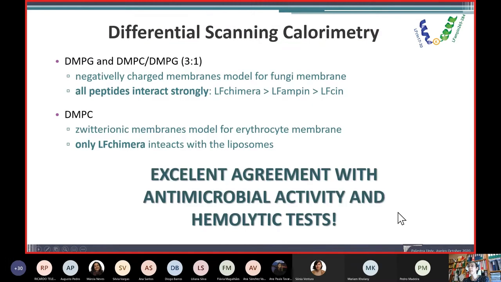

结论非常干净 [【跳转到 17:56】](https://www.youtube.com/watch?v=X_yzSByV2CI&t=1076)：

- **阴离子膜（DMPG 与 DMPC/DMPG 3:1）**：三个肽都强相互作用，顺序 **LFchimera > LFampin > Lfcin**——与电荷阶梯一致；
- **两性离子膜（DMPC，红细胞模型）**：**只有 LFchimera** 与脂质体作用。

而这张幻灯片的最后一行，是整场报告的方法学宣言：**"与抗菌活性和溶血试验高度一致！"** 换句话说，一个上午就能做完的 DSC 筛选，在"谁强、谁有毒"这两件事上，给出了与微生物学和溶血实验同向的答案。

## 七、名义电荷与有效电荷：+12 不等于 12 个正电荷

到这里出现一个必须澄清的概念。讲者说，前面写的 +4、+6、+12 是**名义电荷（nominal charge）**——就是把序列里带正电的氨基酸数出来。但肽在溶液里是卷曲的，只有在膜上折叠成螺旋才"激活"；一旦卷成螺旋，正电荷就**分布在螺旋表面一圈**，并不是所有电荷都能同时贴到膜上 [【跳转到 18:56】](https://www.youtube.com/watch?v=X_yzSByV2CI&t=1136)。

$$
Z_{\text{eff}} < Z_{\text{nominal}}
$$

**有效电荷（effective charge）**是"膜实际感受到的电荷"，可以用 ITC 拟合分配模型、或用电泳/ζ 电位（zeta potential）测出来。这个区分在定量上非常关键：**设计分子时你能改的是名义电荷，但决定结合强度的是有效电荷**。后面第二个案例里会看到一个具体数字：名义 +6，有效 4.7。

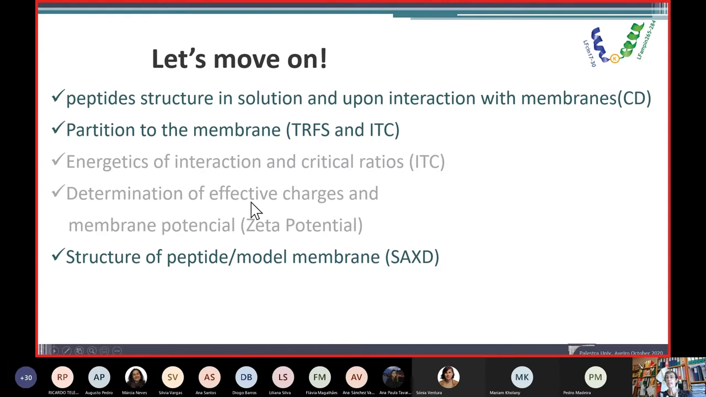

## 八、CD：两亲性螺旋是"膜诱导"出来的

**CD（圆二色谱）**读的是二级结构。判据很固定：无规卷曲在 ~200 nm 附近有一个负峰；α 螺旋在 **208 nm 与 222 nm** 出现双负峰。

讲者称 LFampin 为"模范肽"：在缓冲液里是典型的无规卷曲，加入 DMPC 后曲线几乎重合（说明不结合），而加入 PC/PG 或 PG 后立刻出现 208/222 的双负峰——**折叠成 α 螺旋** [【跳转到 20:25】](https://www.youtube.com/watch?v=X_yzSByV2CI&t=1225)。

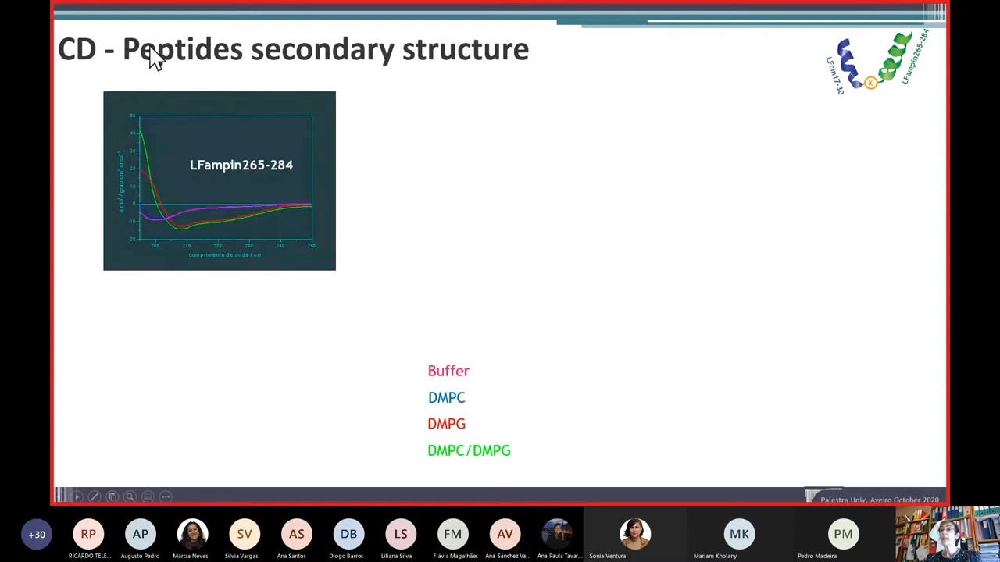

这张图把"两亲性"从一个静态的结构描述，变成了一个**条件依赖的过程**：肽不是天生就是螺旋，而是**遇到阴离子膜才折叠**。折叠本身又反过来把疏水面"摆好"，让它能插入——这就是为什么"净电荷"和"两亲性"不能分开讨论：电荷决定要不要折叠，折叠才产生可用的两亲性表面。

## 九、分配系数：把"结合"变成一个数

DSC 告诉你"有没有作用"，CD 告诉你"有没有折叠"，但两者都给不出"结合得多强"的数字。讲者用**时间分辨荧光光谱（TRFS）**来补这个数：这三个肽各含一个色氨酸（tryptophan），色氨酸从水环境进入膜内环境时荧光性质会变，于是可以追踪肽在水相与膜相之间的**分配** [【跳转到 22:48】](https://www.youtube.com/watch?v=X_yzSByV2CI&t=1368)。

为什么必须"时间分辨"？讲者给的理由很实在：这类相互作用常常伴随**聚集与沉淀**，聚集体沉降后常规光谱什么都测不到；时间分辨测量不受沉淀影响 [【跳转到 23:18】](https://www.youtube.com/watch?v=X_yzSByV2CI&t=1398)。

还有一个措辞上的讲究：这里谈的是**分配（partition）而不是结合（binding）**——肽是在"水相"和"膜相"这两个介质之间分配，用**分配系数** $K_p$ 描述 [【跳转到 23:48】](https://www.youtube.com/watch?v=X_yzSByV2CI&t=1428)：

$$
K_p = \frac{[\text{肽}]_{\text{膜相}}}{[\text{肽}]_{\text{水相}}}
$$

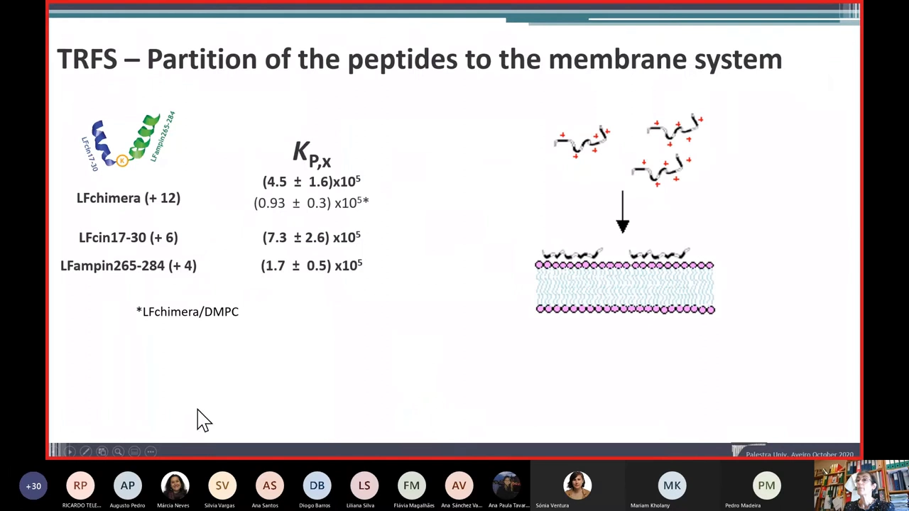

| 肽（名义电荷） | $K_p$（阴离子膜） | $K_p$（DMPC） |
| --- | --- | --- |
| LFchimera（+12） | $(4.5 \pm 1.6)\times 10^{5}$ | $(0.93 \pm 0.3)\times 10^{5}$ |
| Lfcin17-30（+6） | $(7.3 \pm 2.6)\times 10^{5}$ | — |
| LFampin265-284（+4） | $(1.7 \pm 0.5)\times 10^{5}$ | — |

表格里有一个**反直觉**的结果：$K_p$ 最高的不是电荷最高的 LFchimera，而是只有 +6 的 Lfcin17-30。讲者的处理方式是先把矛盾摆出来："这个值令人意外，因为它在 CD 上表征得并不好，在 DSC 上看起来也不强，但荧光给出的分配非常强" [【跳转到 24:48】](https://www.youtube.com/watch?v=X_yzSByV2CI&t=1488)。

她随即给出解释的方向：LFchimera 的电荷高得多，这是它分配强的原因；**但"分配强"和"效果强"不是同一件事**。这句话是整场报告的伏笔——下一篇会看到，Lfcin17-30 的高 $K_p$ 之所以没有换成高膜活性，是因为它的真正靶点在膜内，而不在膜上。

## 小结

- 传统抗生素靠高特异性工作，也因此最容易被"改一个靶点"绕过；抗菌肽换了一个靶点层次——**膜**。
- 抗菌肽的定义性特征是**阳离子 + 疏水**同时存在，折叠成螺旋后形成**两亲性**表面：净电荷负责"找对膜"，疏水矩负责"贴得住、插得进"。
- 选择性来自膜脂组成：细菌膜外侧更负、无甾醇、富含 PG/PE/心磷脂/PS；宿主膜以两性离子 PC 为主并含胆固醇。**第一步是静电，特异性建立在电荷上。**
- 机制不是一种而是多种：桶板孔、环形孔、地毯式溶解、肽诱导的堆叠与立方相。桶板孔其实罕见，非孔道的"堆叠/相变"路线近年才被重视。
- 模型膜的价值是**可控**而不是"像"：PC 对应红细胞（毒性），PC/PG、PE/PG 对应细菌（活性），一次只动一个变量。
- 乳铁蛋白肽案例给出电荷阶梯（+4/+6/+12）：活性 LC50 为 1.5 / 0.7 / 0.5 μM，但**只有电荷最高的 LFchimera 显著溶血**——活性与毒性必须一起读，才有治疗窗口的概念。
- DSC 是"第一道筛子"：峰宽、峰位、分峰就能判断"有没有作用、扰动多大"，结果与抗菌活性、溶血试验同向。
- 名义电荷是数出来的，有效电荷是膜感受到的；折叠成螺旋后 $Z_{\text{eff}} < Z_{\text{nominal}}$。
- CD 显示两亲性螺旋是**膜诱导**的：缓冲液里无规卷曲，遇阴离子膜才折叠。
- $K_p$ 把"结合"变成一个可比较的数，但**高 $K_p$ 不等于高膜活性**。

## 关键术语速查

| 术语 | 一句话解释 |
| --- | --- |
| 抗菌肽（AMP） | 先天免疫中的小分子肽（通常少于 50 个残基），以膜为主要靶点，兼具阳离子与疏水特征 |
| 两亲性（amphipathic） | 同一分子上同时存在亲水/带电面与疏水面；在螺旋上表现为两侧分工 |
| 疏水矩 $\mu_H$ | 把各残基疏水性按螺旋轮方向求向量和，衡量两亲性的强弱 |
| 名义电荷 | 按序列数出的正电荷总数 |
| 有效电荷 $Z_{\text{eff}}$ | 折叠成螺旋后膜实际"感受到"的电荷，恒小于名义电荷 |
| 两性离子磷脂（PC） | 正负电荷内抵、整体近中性的磷脂，是宿主膜的主要成分 |
| 阴离子磷脂（PG/PS/CL） | 头基带净负电的磷脂，富集于细菌膜，是阳离子肽的锚点 |
| 环形孔 / 桶板孔 | 两种跨膜孔模型：孔壁由肽与脂头基共同构成 / 由多肽围成桶状 |
| 地毯模型 | 肽平铺在膜表面，累积后像去污剂一样把膜溶解 |
| 立方相（cubic phase） | 脂双层重排成的三维周期性结构，是膜被彻底破坏的结构标志 |
| DSC | 差示扫描量热，读相变温度、相变焓与峰形，判断肽对膜的扰动程度 |
| CD | 圆二色谱，208/222 nm 双负峰指示 α 螺旋 |
| $K_p$ | 分配系数，肽在膜相与水相之间的浓度比 |
| LC50 / HC50 | 杀死 50% 病原体 / 溶解 50% 红细胞所需的浓度；两者之比即选择性 |